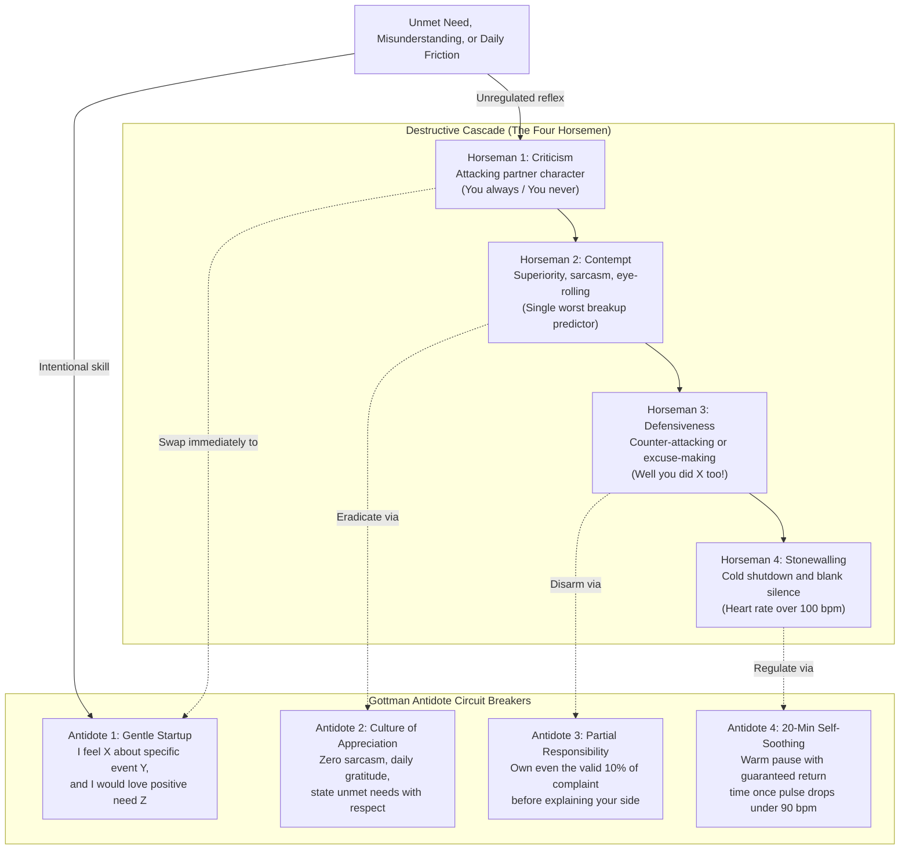
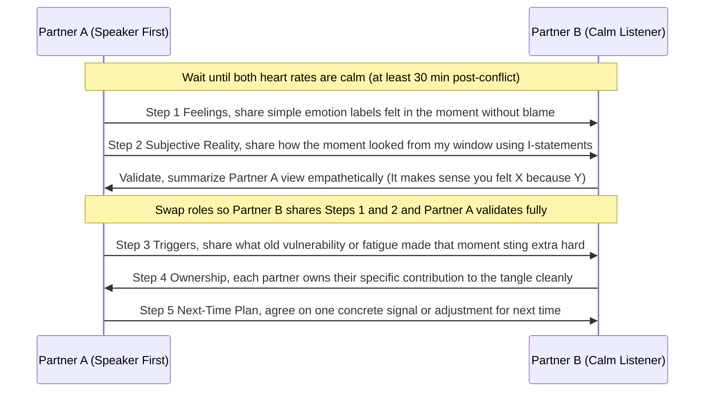

# John Gottman Relationship Lab Science: Bids for Connection, Defeating the Four Horsemen & 20-Minute Repair

## 1. Inside the Love Lab: Why Love Is Measurable Engineering

For over forty years at the University of Washington's "Love Lab," psychologist and mathematician **John Gottman** (an MIT-trained quantitative researcher before turning to clinical psychology) observed more than 3,000 couples in apartment laboratories equipped with synchronized cameras, heart-rate and blood-velocity sensors, skin-conductance monitors, and stress-hormone assays.

By coding facial micro-expressions, vocal tone, physiological arousal, and repair attempts during ordinary conversations and 15-minute conflict discussions, Gottman's team achieved **over 90% accuracy** in predicting which couples would remain happily together six years later ("Masters") versus which would break up or remain chronically unhappy ("Disasters").

Three counterintuitive findings overturn popular myths about romance:

1. **Personality Compatibility Is Overrated; Micro-Interaction Habits Decide Everything**: Calm couples, fiery expressive couples, and quiet introverted couples can all thrive—as long as they maintain high positive-to-negative interaction ratios and repair hurt quickly.
2. **69% of Relationship Conflicts Are Perpetual**: Most disagreements are rooted in enduring temperament, upbringing, or cultural rhythm rather than solvable bugs. Happy couples do not "eliminate" perpetual differences; they dialogue around them with warmth, humor, and mutual accommodation instead of gridlock.
3. **Grand Romantic Gestures Cannot Patch Daily Neglect**: An expensive birthday trip does almost nothing if you routinely ignore your partner's small everyday moments of reaching out.

### The Sound Relationship House: Seven Floors + Two Load-Bearing Walls

Gottman synthesized his laboratory findings into one structural blueprint called the **Sound Relationship House**. Just like distributed systems architecture, higher layers (conflict resolution and shared life dreams) collapse if the foundational friendship layers underneath are starved:

- **Load-Bearing Walls (Trust & Commitment)**: *Trust* means acting systematically to maximize both partners' well-being (not just your own); *Commitment* means cherishing what you have rather than scanning for imaginary alternatives during hard weeks.
- **Floors 1–3 (The Friendship Foundation)**:
  - *Floor 1 — Build Love Maps*: Knowing your partner's inner world, worries, history, and evolving hopes intimately.
  - *Floor 2 — Share Fondness & Admiration*: Actively voicing respect, warmth, and pride daily (the immune system against Contempt).
  - *Floor 3 — Turn Toward Instead of Away*: Responding warmly to tiny daily bids for connection.
- **Floor 4 — The Positive Perspective**: The emergent state (*Positive Sentiment Override*) unlocked automatically when Floors 1–3 are healthy.
- **Floor 5 — Manage Conflict**: Gentle startups, accepting influence, soothing flooding, repairing hurt, and dialoguing around perpetual differences.
- **Floors 6–7 (Shared Purpose)**: *Make Life Dreams Come True* (championing each other's deepest aspirations) and *Create Shared Meaning* (co-authoring rituals, holidays, and family culture).

---

## 2. Bids for Connection & The 86% Turning-Toward Rule

Gottman discovered that the atomic unit of emotional intimacy is the **Bid for Connection**—any tiny verbal or nonverbal gesture asking for attention, affirmation, humor, or shared presence. Most bids look completely ordinary on the surface:

- *"Look at how pretty the sunset is outside the window."*
- Sending a funny reel, a song link, or a photo of street cats during lunch.
- Letting out a tired sigh while reading an email across the table.
- *"Guess what my sister told me on the phone today?"*

Whenever your partner makes a bid, you respond in one of three ways. In Gottman's six-year follow-up study, couples who stayed happily married turned *toward* bids **86% of the time**, whereas couples who divorced turned toward bids only **33% of the time**.

### The Three Responses to Everyday Bids

| Response Type | What It Looks Like (In-Person & Digital) | Hidden Message to Her Nervous System | Impact on Emotional Bank Account |
| :--- | :--- | :--- | :--- |
| **Turning Toward (Target: 86%+)** | Looking up from your laptop within 3 seconds, smiling, asking a curious follow-up; replying warmly to a midday photo or voice note | "You matter to me; I enjoy sharing the small moments of life with you." | Steady daily compound deposit (+1) |
| **Turning Away (Silent Killer)** | Staying glued to your monitor with a flat "uh-huh"; leaving a heartfelt message on read for 7 hours without acknowledgment | "My screen or task is more important than your bid for closeness." | Slow invisible erosion (-2); breeds quiet loneliness |
| **Turning Against (Hostile)** | "Can't you see I'm coding? Stop interrupting me over random stuff!" | "Reaching out to me is annoying and unsafe; stop sharing with me." | Deep withdrawal (-5); shuts down future vulnerability |

> **What If You Are Genuinely Deep in Production Focus?** Turning toward does *not* mean abandoning urgent work for 45 minutes. A warm 10-second boundary *is* turning toward: look at her warmly, touch her hand (or send a quick voice reply), and say: *"Ooh I really want to hear this properly! Give me 20 minutes to finish this code review so I can give you 100% of my brain."*

### The 5:1 Magic Ratio & Positive Sentiment Override

Gottman's mathematical modeling revealed a critical stability threshold: during **conflict discussions**, thriving couples maintain at least a **5:1 ratio** of positive interactions (nodding, gentle humor, empathy, affectionate touch, owning part of the issue) to every 1 negative interaction (frustration, sharpness, defensiveness). During **ordinary peaceful days**, the ratio rises closer to **20:1**.

When your Emotional Bank Account stays richly funded above 5:1, the relationship enters **Positive Sentiment Override (PSO)**: if you sound slightly terse one evening, your partner automatically gives you generous benefit of the doubt (*"He must be exhausted from meetings—let me make him tea"*). When neglected below 1:1, the couple falls into **Negative Sentiment Override (NSO)**, where even neutral or loving comments get misread through a suspicious filter.

---

## 3. Defeating the Four Horsemen of the Apocalypse

Not all negativity is equally toxic. Honest anger or sadness expressed cleanly does not destroy relationships. Instead, four specific communication patterns—which Gottman named the **Four Horsemen of the Apocalypse**—form an escalating cascade that predicts relationship breakdown unless replaced by their exact clinical antidotes.

### Horseman-to-Antidote Translation Playbook

| Horseman | Toxic Phrase (Never Say) | Why It Fails | Exact Antidote Script (Say This Instead) |
| :--- | :--- | :--- | :--- |
| **1. Criticism** (Character attack vs. specific complaint) | "You never respect my schedule! Why are you so disorganized?" | Triggers immediate shame and counter-attack; frames partner as defective | **Gentle Startup**: "I felt stressed waiting outside the station tonight because I worried something happened. Next time, could you text me if you're running 15 minutes late?" |
| **2. Contempt** (Moral or intellectual superiority) | "Wow, you're crying over *that*? Try using basic logic for once." + eye-roll | Sulphuric acid to love; destroys emotional safety and even suppresses partner immune health | **Respectful Need + Appreciation**: "I can see how deeply this matters to you even though we view it differently. Help me understand what feels hardest right now." |
| **3. Defensiveness** (Excuse-making or cross-complaining) | "I only forgot to call because *you* kept changing plans yesterday, plus my boss pinged me!" | Tells your partner you care more about winning a courtroom verdict than hearing her hurt | **Accepting Partial Responsibility**: "You're completely right—I promised I'd call at 21:00 and I dropped the ball without texting you first. I'm really sorry, sweetheart." |
| **4. Stonewalling** (Icy wall of silence) | Staring at phone with stone face, muttering "Whatever, talk to yourself," or vanishing offline | Triggers primal attachment panic in your partner while keeping tension unresolved | **Structured Soothing Break**: "I'm feeling overwhelmed right now and don't want to speak sharply. Give me 25 minutes to walk and cool down—I'll call you right back at 20:30." |

### Mastering the Gentle Startup Formula

Gottman found that **96% of conversations end on the exact same emotional note on which they begin in the first 3 minutes**. Memorize the 3-part Gentle Startup whenever you need to raise a frustration:

1. **`I feel [emotion]`** (never *"I feel like you are..."*—that is a disguised accusation, not an emotion).
2. **`about [specific observable situation]`** (describe camera facts of *today*, never `"always"` or `"never"`).
3. **`and I need [positive, concrete action]`** (tell your partner how to succeed for you right now, rather than listing what you hate).

---

## 4. Diffuse Physiological Arousal (DPA) & The 20-Minute Reset

Why do intelligent, loving partners suddenly say foolish things or go completely mute mid-argument? The answer is biological hardware: **Diffuse Physiological Arousal (DPA)**, also called emotional flooding.

Once conflict pushes your resting heart rate above **100 beats per minute** (or spikes 10–15 bpm above your seated baseline):

- Adrenaline and cortisol surge into the bloodstream; blood shunts away from gut and higher cortical circuits toward large skeletal muscles.
- Prefrontal executive functions—perspective-taking, creative compromise, humor, and nuanced language—partially shut down.
- Evolutionarily, male cardiovascular systems often flood at a slightly lower interpersonal conflict threshold and take **longer** to clear stress hormones back to baseline, which is why men account for roughly **85% of stonewallers** in clinical studies.

**Crucial Rule**: Continuing to argue while either partner's heart rate exceeds 100 bpm has **zero constructive yield**. You cannot debug production code while the server room is physically on fire—you extinguish the heat first.

### How to Call a Loving 20-Minute Time-Out (Without Abandonment Panic)

Walking away *without* reassurance feels like punishment. Calling a **Time-Bounded Soothing Pause** protects both partners:

1. **Name Your Own State + Reassure Love**: *"My heart is racing right now and I love you too much to say something defensive."*
2. **State Exact Duration (Minimum 20–30 Minutes)**: Hormonal half-life clearance requires **at least 20 minutes**; 5 minutes is biologically too short.
3. **Guarantee the Exact Return Timestamp**: *"Let's pause for 25 minutes. I will come back into the living room (or call you back) at 21:15 sharp."*
4. **Zero Rumination During the Break**: If you spend those 25 minutes pacing and rehearsing *"And another reason I'm right is..."*, your heart rate stays above 105 bpm! Do physical reset actions instead: brisk outdoor walk, cold water on wrists, 5 Physiological Sighs (double inhale through nose, long slow exhale through mouth), or calm instrumental music.

---

## 5. Exact Repair Brakes, Clean Apologies & Aftermath Debrief

Gottman's single biggest discovery is that **the Masters of relationships are not couples who never get snappy or misunderstand each other—they are couples whose Repair Attempts succeed**.

### Real-Time Mid-Conversation De-Escalation Brakes

Keep three natural phrases in your pocket to stop a downward spiral within 30 seconds:

- **The Redo Brake**: *"Whoa, my tone just came out way colder than what's in my heart. Can I rewind 15 seconds and say that gently?"*
- **The Same-Team Anchor**: *"Wait a second—I don't want to fight against you. It's Us vs. this stressful week, not Me vs. You."*
- **The Yield-to-Win Pivot**: *"Hold on, I was listening to reply instead of listening to understand you. Tell me that part again—I'm really listening now."*

### Gottman's Field-Tested Repair Phrase Bank (By Emotional Situation)

Because nobody writes clean poetry when stressed, pick 1–2 natural phrases from each category below and make them muscle memory:

| Situation Mid-Conflict | Exact Repair Script That Softens Tension |
| :--- | :--- |
| **1. You Feel Vulnerable or Scared** | "Please be gentle with me right now—this topic hits a sensitive spot for me."; "I feel us drifting in this conversation and I just want to feel close to you." |
| **2. Tone Is Getting Too Sharp** | "Can we slow down a little? You matter way more to me than winning this point."; "Let's take a deep breath together—we're both exhausted tonight." |
| **3. Owning Your Mistake Quickly** | "You have a really fair point there—I didn't see how my rush affected you."; "Let me take that last sentence back; that wasn't fair to you." |
| **4. Defining Common Ground** | "I totally agree with that part of what you're saying—let's build from there."; "We both want our trip to feel relaxed; we're just picturing different schedules." |
| **5. Affection Inside Disagreement** | "Even when we disagree on plans, I still adore you completely."; "Come sit next to me while we figure this out." |

### Accepting Influence & Never Playing "Devil's Advocate"

Two extra Love Lab rules dramatically protect warmth for male engineers:

1. **Men Who Accept Influence Have Happier Partnerships**: Gottman found a striking gender asymmetry—marriages thrive when husbands willingly **share power and let their partner's feelings and preferences shape joint decisions** (*"That's a great catch, let's adjust our plan around what feels comfortable for you"*), rather than treating every household choice like a unilateral architecture review.
2. **The Stress-Reducing Conversation Rule (Zero Devil's Advocacy)**: When your girlfriend vents at the end of the day about an *external* annoyance (a bureaucratic delay, an unfair coworker, a rude stranger), analytical engineers love saying: *"Well, objectively from your manager's perspective, maybe he meant..."* **Never side with the enemy!** Gottman's golden rule of external-stress debriefing is **We Against Others**: validate her side warmly first (*"Seriously?! That would drive me crazy too!"*). Save objective nuance for 48 hours later only if she explicitly asks for strategy.

### Clean Adult Apology vs. Fake Engineer Non-Apology

Never use the word **"but"** inside an apology (*"I'm sorry, BUT..."* mathematically erases everything before the word *but*). Compare:

- **Toxic Non-Apology**: *"I'm sorry you got upset, BUT objectively my suggestion made complete sense."*
- **Clean 4-Step Adult Apology**:
  1. **Specific Ownership**: *"I'm really sorry for interrupting you and jumping straight into lecturing mode when you shared your rough day."*
  2. **Impact Empathy**: *"That must have felt lonely and dismissive when you just wanted warmth from me."*
  3. **Values Commitment**: *"You deserve to feel completely heard and safe with me."*
  4. **Concrete Adjustment + Check**: *"Next time I'm going to listen first and ask how I can support you. Can I give you a proper hug now?"*

### Worked Play-by-Play: Friday-Night Spiral vs. Three-Minute Repair

See how the exact same trigger—missing a planned 21:00 video date by 35 minutes because a production release broke—diverges completely based on Horsemen vs. Antidotes:

**Version A — Unregulated Horsemen Spiral (48 Hours of Cold Distance)**
- *Her (hurt, slipping into Criticism)*: "You're 35 minutes late again! Clearly your code matters way more to you than I ever do."
- *Him (Defensiveness + Contempt)*: "Oh come on, don't be dramatic. Production was down! Sorry I actually have a demanding job unlike people who clock out at 5."
- *Her (escalated hurt)*: "Wow, that's how you see me?"
- *Him (Stonewalling)*: "I'm too tired for this. Goodnight." *(Hangs up; weekend ruined.)*

**Version B — Gottman Masters Repair (Warmth Restored in 3 Minutes)**
- *Her (Gentle Startup)*: "Hey, I felt pretty sad sitting by my laptop for half an hour wondering where you were—I was really looking forward to our Friday tea together."
- *Him (Partial Responsibility + Zero Excuses First)*: "Sweetheart, you are 100% right to feel upset. A deploy broke at 20:50 and I got tunnel-visioned instead of taking 10 seconds to text you right away. That wasn't fair to your evening, and I'm really sorry."
- *Her (softening immediately)*: "Thank you for saying that. Rough deploy?"
- *Him (Affectionate Turn-Toward)*: "Super messy, finally green now—and seeing your face just dropped my stress by 80%. Can I make it up to you right now and hear everything about your Friday?"

### Gottman's 5-Step "Aftermath of a Regrettable Incident" Protocol

Once both nervous systems are calm (often later that evening or over tea the next day), process any bigger argument using Gottman's structured 5-step sequence. Notice there is **no courtroom verdict on whose memory is "objective truth"**—there are always two valid subjective realities.

---

## 6. Unlocking Perpetual Differences: Dreams Within Conflict

When a disagreement keeps resurfacing despite good intentions—for example, one partner loves spontaneous late-night social gatherings while the other craves quiet, pre-planned weekend routines—you have hit one of the **69% perpetual differences**. Pushing harder on surface logistics creates **Gridlock**.

Gottman's breakthrough was discovering that beneath almost every stubborn surface position sits an unspoken **Core Value or Life Dream** (often tied to childhood warmth, security, freedom, or belonging). Instead of debating logistics, switch to the **Dream-Catcher Dialogue**:

| Surface Gridlock Topic | Engineer Surface Debate (Deadlock) | Hidden "Dream Within Conflict" Underneath | Two-Circle Flexible Compromise |
| :--- | :--- | :--- | :--- |
| **Weekend spontaneity vs. structured itinerary** | "Booking everything 2 weeks ahead is objectively cheaper and avoids queues!" | Partner A associates spontaneity with aliveness and freedom after rigid school/work weeks; Partner B associates structure with safety and caring preparation | Book flights, hotel, and 1 anchor dinner ahead (honoring safety); leave Saturday afternoon 100% unscripted to wander together (honoring adventure) |
| **Hosting guests vs. quiet apartment recharge** | "Why do we need to cook 4 dishes when friends drop by? It's exhausting." | Partner A grew up where generous table hospitality equals love and dignity; Partner B needs quiet home sanctuary to recover from cognitive load | Host warmly twice a month with shared prep/cleanup; protect Sunday evenings strictly as quiet sanctuary for just the two of you |
| **Saving aggressively vs. enjoying travel/gifts now** | "Compounding index funds at 7% beats spending RMB 3,000 on a weekend trip." | Partner A equates a large cash buffer with never feeling powerless during crisis; Partner B equates shared experiences with savoring youth while healthy | Automate the monthly safety/investment floor first; create a guilt-free Shared Joy Fund specifically meant to be spent warmly together |

**Four Questions to Ask Gently When Stuck**:
1. *"What does this choice mean to you at a deeper level—is there a memory or family feeling connected to it?"*
2. *"What would feel lost or scary if you gave up this part completely?"*
3. *"What is the non-negotiable heart of what we each need here (Inner Circle), and what details can we flex on (Outer Circle)?"*
4. *"How can I honor your dream this month while we also protect mine?"*

---

## 7. Daily Micro-Checklist & Cross-Module Links

- [ ] **Morning & Evening Reunion Kiss / Warm Greeting**: Gottman recommends a **6-second kiss** or unhurried warm greeting when parting/reconnecting—long enough to trigger oxytocin release and shift out of work stress.
- [ ] **Daily Specific Appreciation**: Name one concrete detail you appreciated today (*"Thank you for sending that sweet voice note before my meeting—it made my whole afternoon lighter"*).
- [ ] **Zero Contempt Tolerance**: Ban sarcasm, eye-rolling, and intellectual superiority permanently, even when exhausted.

Continue to **[02-CHINA-MOROCCO-CROSS-CULTURAL-AND-LDR-LOVE.md](02-CHINA-MOROCCO-CROSS-CULTURAL-AND-LDR-LOVE.md)** to see how Gottman's attunement principles translate across Chinese and Moroccan cultural warmth and long-distance timezones, or return to **[00-README.md](00-README.md)** for the complete partnership overview.
