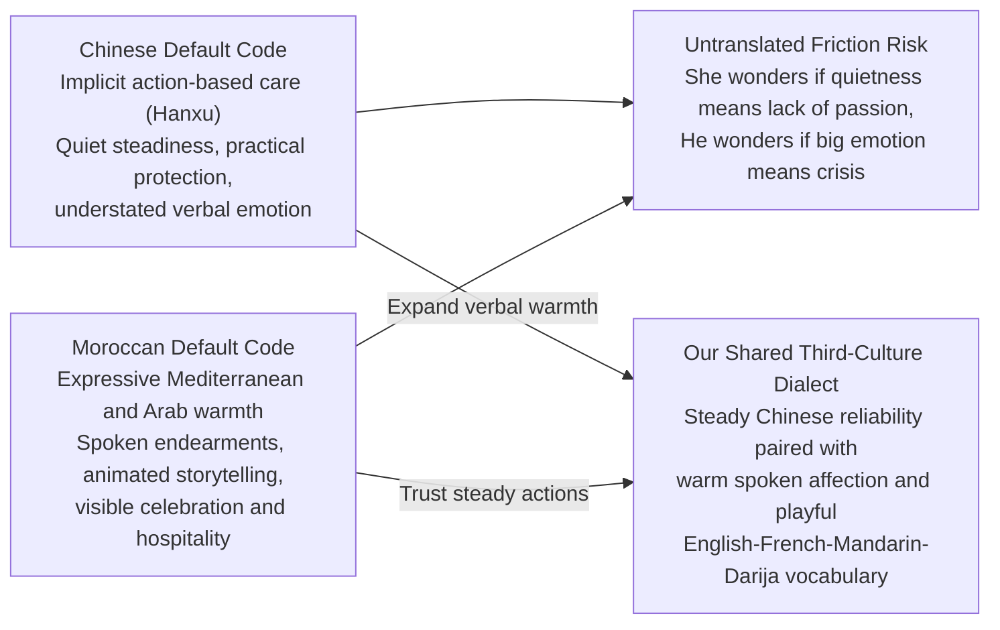
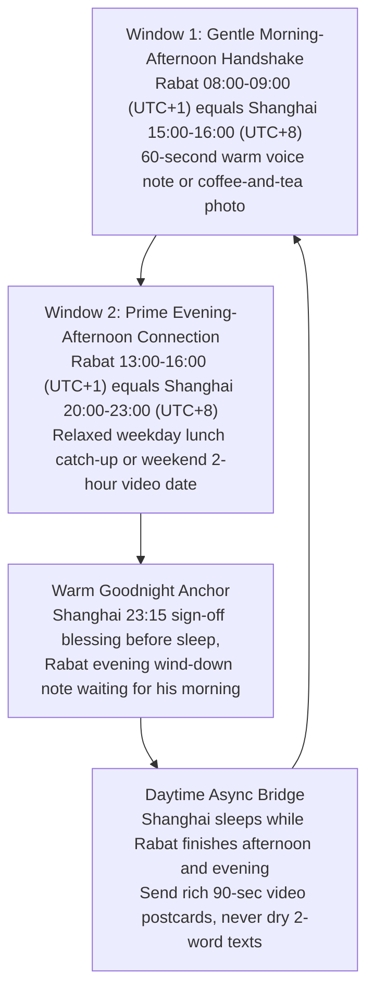

# Building a Joyful China-Morocco Cross-Cultural & Long-Distance Partnership

## 1. When Two Ancient Tea Cultures Fall in Love

At first glance, China and Morocco sit seven timezones and thousands of kilometers apart—one anchored on the Pacific rim, the other where the Mediterranean meets the Atlantic and the Sahara. Yet beneath surface geography, Chinese and Moroccan cultures share remarkably deep structural roots:

- **Deep Reverence for Family & Elders**: Neither culture treats individuals as isolated atoms; warmth toward parents, siblings, and extended family is a central measure of character.
- **Hospitality Through Food & Tea**: In China, love arrives as hot soup, peeled fruit, and poured Kungfu tea; in Morocco, *Karam* (generous hospitality) pours steaming *Atay* (gunpowder green tea originally traded from China, steeped with fresh spearmint) high from a silver teapot alongside shared tagines and warm bread.
- **Dignity, Loyalty & Long-Term Commitment**: Both traditions prize steady devotion over disposable modern dating cynicism.

Where cross-cultural couples stumble is rarely in core values—it is in **communication bandwidth and emotional expressiveness**.

---

## 2. Bridging Implicit Chinese Care (含蓄内敛) and Moroccan Expressive Warmth

Cross-cultural researcher Erin Meyer highlights that cultures vary independently across **Context** (how much is implied vs. stated explicitly) and **Emotional Expressiveness** (how visibly affection, excitement, and hurt are voiced).

Many Chinese engineers grow up in an environment of **reserved, action-based care (含蓄内敛)**: if a father drives two hours in the rain to bring you dumplings, he will never say *"I love you deeply, my child"*—he simply says *"Eat while it's hot."* Verbal romance can initially feel awkward or theatrical to someone raised in that code.

Moroccan culture—woven from Amazigh, Arab, and Mediterranean/Francophone threads—blends warm, poetic verbal affection (*Habibi / Hbiba*, *Mon coeur*, daily blessings like *Allah yhfdek*—"May God protect you") with lively storytelling, visible enthusiasm, and expressive warmth.

### Cross-Cultural Translation Matrix

| Everyday Moment | Reserved Chinese Default | Expressive Moroccan Lens | Upgraded "Third-Culture" Partner Move |
| :--- | :--- | :--- | :--- |
| **Daily Affection** | Thinking fondly of her while coding, assuming she already knows you love her | Spoken warmth, sweet nicknames, and affectionate check-ins are daily oxygen | Keep your rock-solid reliability *and* voice affection out loud daily ("Good morning hbiba, I loved hearing your laugh last night") |
| **Receiving a Compliment** | Deflecting modestly ("No, no, it was nothing") out of Chinese humility | Warmly receiving praise and returning a generous blessing | Smile, take the compliment in fully ("Thank you my love, hearing that from you makes me really happy"), and compliment her back |
| **Expressing Upset or Hurt** | Going quiet to avoid conflict and preserve surface harmony | Expressing feelings vividly with tone, hand gestures, and emotion so the air clears | Do not mistake animated expression for hostility; stay grounded, listen warmly, and share your own feelings in words rather than silence |
| **Gift-Giving & Thoughtfulness** | Asking pragmatically "What exact item link do you need?" | Surprise, presentation, handwritten notes, and remembering small spoken wishes | Keep a private "Wish Radar" note on your phone whenever she mentions a scent, book, pastry, or flower she loves—then surprise her |
| **Language Play** | Sticking strictly to English | Code-switching naturally across Darija, French, Arabic, and English | Learn 15-20 genuine Darija and French phrases (*Labas*, *Bslama*, *Saha*, *Zwin bezaf*); teach her playful Mandarin endearments in return |

---

## 3. Additive Reverence: Faith, Ramadan, Halal Care & Chinese Festivals

The happiest cross-cultural couples operate on one ironclad principle: **Additive Reverence, Never Zero-Sum Assimilation**. Neither partner is treated as the "default normal" whom the other must shrink to fit. Instead, your household becomes doubly rich in meaning, cuisine, and celebration.

### Thoughtful Halal Mindfulness as Everyday Love

When your partner observes Halal dietary principles (or comes from a Muslim family background), taking proactive ownership of food safety removes an enormous invisible burden from her shoulders—especially when visiting China or traveling together:

- **Proactive Ingredient Literacy**: In Chinese kitchens and restaurants, pork fat (*猪油 / lard*), bacon bits in vegetable stir-fries, and alcohol-based cooking wine (*料酒 / Shaoxing wine*) often appear unannounced even in beef, chicken, or seafood dishes. Asking clearly on her behalf (*"请问这道菜有用猪油或者料酒吗？女朋友是清真饮食"*) communicates unmistakable care and protection.
- **Exploring China's Rich Halal Culinary Heritage Together**: China has over a thousand years of extraordinary *Qingzhen* (清真) cuisine—from Lanzhou hand-pulled beef noodles and Xi'an lamb/beef delicacies to Xinjiang roasted skewers, Ningxia tender lamb, Beijing copper-pot hotpot, and Yunnan Halal dishes. Discovering great Halal spots together turns dining into joyful shared exploration rather than restriction.
- **Zero Pressure Around Alcohol**: Never allow friends, colleagues, or relatives at Chinese banquets to pressure her (or you) into drinking toasts. Intercept gracefully with tea or juice before she ever feels put on the spot.

### Showing Up Warmly During Ramadan & Eid

During the lunar month of **Ramadan**, observing Muslims fast from dawn (*Fajr*) until sunset (*Maghrib*)—abstaining from all food and water during daylight hours while focusing on spiritual mindfulness, patience, generosity, and family connection:

1. **Respect Circadian & Energy Shifts**: Late afternoon (15:00–18:00 local Morocco time) brings natural thirst and low blood sugar. Never schedule heavy relationship debates right before sunset! Offer gentle encouragement instead.
2. **Note the Clock Shift**: Morocco uniquely pauses its UTC+1 standard clock back to **UTC+0 during Ramadan**, temporarily widening the China–Morocco time gap from **7 hours to 8 hours**—adjust your calendar reminders automatically so you never miss call times.
3. **Celebrate *Ftour* (Iftar) & *Eid* Together**: Send a warm *"Ramadan Mubarak"* as the month begins and *"Saha ftourek!"* ("Enjoy your breaking of the fast!") at sunset. Even from afar, having a cozy weekend video call while she enjoys dates, *Harira* soup, and mint tea—and celebrating **Eid al-Fitr** and **Eid al-Adha** with flowers or a thoughtful gift—means the world.

### Welcoming Her Warmly Into Chinese Traditions

Cultural sharing flows both ways! Invite her into the warmth and stories behind **Spring Festival (春节)**, **Mid-Autumn Festival (中秋)**, and **Dragon Boat / Lantern Festivals**:

- Share the meaning behind reunion dinners, red envelopes (*Hongbao* blessings for good fortune), calligraphy couplets, and mooncakes (picking Halal-certified or plant-oil lotus/nut fillings).
- Translate family context *ahead of time* so she never feels anxious about unfamiliar customs—frame your heritage as an open door of warmth, never an exam she could fail.

### Our Two-Culture Celebration Calendar

Treat the calendar as an abundant year-round tapestry of shared joy rather than competing obligations:

| Celebration / Season | Cultural Origin | Core Meaning | Simple Ritual Together (In-Person or LDR) |
| :--- | :--- | :--- | :--- |
| **Yennayer (Jan 14)** | Amazigh / Moroccan | Agrarian New Year celebrating land, abundance, and heritage | Wish warm blessings; learn a story about Moroccan Amazigh roots |
| **Spring Festival (春节)** | Chinese Lunar | Family reunion, renewal, gratitude, and good-fortune blessings | Wear red accents together, fold Halal beef/lamb dumplings, gift a sweet *Hongbao* note |
| **Ramadan (Lunar Month)** | Islamic / Moroccan | Dawn-to-sunset fasting, patience, spiritual clarity, charity | Adjust call hours gently; send sunset *Saha ftourek* voice notes; share cozy weekend Iftar tea |
| **Eid al-Fitr (开斋节)** | Islamic / Moroccan | Joyous celebration marking the end of Ramadan | Send morning flowers/pastries to her door, dress up nicely for video call, greet family warmly |
| **Eid al-Adha (Eid Kebir)** | Islamic / Moroccan | Major family gathering honoring generosity, sacrifice, and community | Greet her parents warmly by video; celebrate shared gratitude and family hospitality |
| **Qixi (七夕) & Anniversaries** | Chinese + Couple | Celebrating devoted love across distance (Cowherd & Weaver Girl!) | Notice how *Qixi* is literally the ancient myth of star-crossed lovers bridging distance—write a real letter! |
| **Mid-Autumn (中秋节)** | Chinese Lunar | Full moon symbolizing completeness and missing loved ones afar | Step outside to look at the exact same full moon across Shanghai and Rabat; share Halal nut/lotus mooncakes |

### The Silk-Road Kitchen Bridge: Five Culinary Crossovers

Food is effortless emotional glue between China and Morocco because historic Silk Road and maritime spice routes linked both tables centuries ago:

1. **The Twin Tea Ceremony**: Moroccan *Atay* uses Chinese gunpowder green tea (*Chunmee / Zhucha*) steeped with fresh *Nana* spearmint. Brew traditional Gongfu oolong/jasmine one Sunday and authentic frothy Moroccan mint tea the next.
2. **Spiced Skewers Kinship**: Xinjiang Halal roast lamb skewers (*Yangrou Chuan* with toasted cumin and chili) and Moroccan *Qotban / Brochettes* (cumin, paprika, parsley, coriander, onion) feel like culinary cousins at first bite.
3. **Slow-Simmered Comfort**: Halal Chinese braised beef (*Qingzhen Dun Niurou* with star anise, cinnamon bark, ginger, and zero cooking wine) pairs naturally beside Moroccan *Beef Tagine with Prunes, Cinnamon, and Toasted Almonds*.
4. **Crispy Folded Parcels**: Folding Northern Chinese beef-and-scallion *Jiaozi* side-by-side with savory Moroccan *Briouats* (crispy *Warqa* pastry triangles filled with spiced minced beef or almonds) makes an unforgettable weekend date.
5. **Eggs & Spiced Tomatoes**: Comforting Chinese *Fanqie Chaodan* (silky scrambled eggs and sweet-savory tomatoes) meets Moroccan *Kefta Mkaouara* (spiced meatballs and eggs poached in bubbling tomato-garlic-cumin sauce with warm *Khobz* bread).

---

## 4. High-Trust Shanghai–Rabat Long-Distance Operating System

Long-distance relationships (LDRs) rarely fail because of kilometers; they fail because of **unstructured drift, dry logistical texting, and an empty calendar horizon**.

Between **China (UTC+8)** and **Morocco (UTC+1 most of the year; UTC+0 during Ramadan)**, the **7-hour offset** actually creates two clean daily overlap windows without forcing either partner into chronic sleep deprivation:

### Upgrading Digital Intimacy Beyond "Interview Calls"

If every video call consists of sitting stiffly at a desk asking *"How was work? What did you eat?"*, calls start feeling like daily Agile standups. Mix four richer modes across the week:

| LDR Connection Mode | How It Works in Practice | Why It Builds Deep Closeness |
| :--- | :--- | :--- |
| **1. Async Video/Voice Postcards** | Record a 60-second walking video showing cherry blossoms in Shanghai or the Atlantic breeze in Rabat ("Saw this cafe and thought of you") | Conveys vocal warmth, facial micro-expressions, and sensory daily life across timezones |
| **2. Parallel Presence ("Ambient Together")** | Prop up the iPad while you cook dinner in Shanghai and she reads, sketches, or studies in Rabat—no pressure to talk nonstop | Recreates the cozy domestic feeling of sharing a living room without conversational fatigue |
| **3. Curated Weekend Dates** | Brew tea simultaneously, order each other surprise local delivery, watch a synced film, or take turns answering 3 deep curiosity questions | Creates shared memories and novelty rather than repetitive status updates |
| **4. Tangible Physical Care Packages** | Local florist/patisserie delivery via local apps on big weeks; mailing a handwritten letter + a scarf/hoodie lightly spritzed with your cologne | Bridges screen fatigue with real-world touch, scent, and surprise |

### Six Memorable Shanghai–Rabat Date Ideas (Zero Boredom)

Keep a menu of effortless weekend video dates ready so distance stays playful and romantic:

1. **Google Earth Childhood Tour**: Screen-share satellite street view and walk each other virtually past your elementary schools, favorite childhood bakeries, seaside promenades in Rabat/Casablanca, and favorite neighborhood corners in China.
2. **Synchronized Kitchen Challenge**: Pick one simple Halal recipe (shakshuka, spiced beef briouats, or hand-rolled scallion pancakes), buy ingredients ahead of time, and cook simultaneously on video before sitting down to eat "across the table."
3. **Five-Song Cultural Music Swap**: Trade five meaningful songs—classic Fairuz, Moroccan Andalusian/Chaabi/indie favorites, Francophone classics, and Mandarin/hip-hop favorites—sharing the story or lyrics behind each track.
4. **Sunset-to-Night Walk Together**: At 18:30 Morocco / 01:30 China on a holiday (or 13:30 Atlantic coast walk in Rabat while you stroll the Bund at 20:30 in Shanghai), walk outdoors on video with earbuds so you share live scenery in motion.
5. **36 Questions & Dream Home Sketching**: Brew tea and sketch your imaginary future apartment layout together—arguing playfully over whether the balcony gets Moroccan zellige tiles, a Chinese tea table, or both.
6. **Bedtime Story or Voice Blessing**: On nights when timezone overlap misses because of travel or exams, record a calm 3-minute voice note reading a favorite passage or sharing three things you love about her so she can play it before sleep.

---

## 5. LDR Conflict Hygiene & The Next-Ticket Rule

Distance magnifies ambiguity because plain text strips away **90% of vocal warmth and soft body language**. Protect your LDR from preventable misunderstandings with four clear agreements:

1. **Never Argue Over Text Messages**: The moment a text thread feels tense or misread, immediately switch mediums: *"Text is making my tone sound flat and I adore you—let's hop on a 10-minute voice/video call so we can hear each other's real voices."* (Apply the Gentle Startup and repair tools from [01-GOTTMAN-SCIENCE-BIDS-HORSEMEN-AND-REPAIR.md](01-GOTTMAN-SCIENCE-BIDS-HORSEMEN-AND-REPAIR.md).)
2. **Proactive Context Beats Jealousy or Guessing**: High-trust couples never play detective or demand location surveillance, because both partners naturally share context enthusiastically (*"Heading to hotpot with three teammates from the infra team tonight—here's a pic of the table! Calling you when I'm home at 21:30"*).
3. **Practical Travel Advantage (Visa-Free Morocco + Hub Meetups)**: Chinese ordinary passport holders enjoy **visa-free entry to Morocco** (up to 90 days), making spontaneous trips to Rabat, Casablanca, Marrakech, or Chefchaouen remarkably frictionless! You can also meet halfway in vibrant hub cities (Istanbul, Dubai/Abu Dhabi, Paris, Madrid, or Cairo) while planning her smooth visits to China.
4. **The Golden Reunion Rule — Never Part Without the Next Date on the Calendar**: Saying goodbye at Mohammed V or Pudong Airport with *"Let's see when we're free later"* triggers heavy post-visit grief. Always lock in at least a target month/week for the **next** reunion before ending a trip—turning missing each other into a shared countdown toward closing the distance permanently.

### Surviving the 72-Hour "Post-Airport Oxytocin Drop"

Every international couple experiences a sharp neurochemical dip in the **first 72 hours after returning from an in-person trip**. After days or weeks of continuous physical warmth, shared meals, and co-regulated sleep, abruptly waking up in silent separate apartments triggers a temporary crash in oxytocin and dopamine—often masquerading as sudden irritability, tearfulness, or irrational relationship doubt.

Run this explicit **3-Day Soft-Landing Protocol** after every trip:

- **Name the Biology Ahead of Time**: Before boarding the return flight, remind each other: *"Our brains are going to feel the post-visit drop for the next three days—if either of us feels extra sad or sensitive on Tuesday, that's just missing each other, not anything wrong."*
- **Extra Warm Voice Touchpoints (Zero Heavy Debates)**: Double up on tender voice notes and photos of favorite trip memories during the first 72 hours; postpone any dry logistical/financial admin talks until Day 5 when jet lag clears.
- **Keep Sustainable Weekly Pacing**: Outside reunion weeks, avoid burning out on mandatory 3-hour weeknight calls when one of you needs sleep. A healthy sustainable rhythm looks like:
  - *Monday–Thursday*: Warm morning/goodnight voice notes + a sweet 15–20 minute evening/afternoon catch-up call.
  - *Friday*: Light celebratory end-of-week check-in while respecting local social/family dinners.
  - *Saturday or Sunday*: One unhurried, protected **90–120 minute Quality Date** (Shanghai 20:00 / Rabat 13:00) with tea, food, and undivided presence.

### Quick Reunion Prep Checklist Before Flying

- [ ] **Clear On-Call & Work Backlogs Early**: Delegate reviews 48 hours before departure so you are 100% mentally present when she walks through arrivals—never glued to Slack in the taxi.
- [ ] **Stock Favorite Morning Comforts**: Have her favorite tea, fruit, Halal snacks, fresh flowers, and a clean cozy robe waiting at your apartment on Day 1.
- [ ] **Leave Breathing Room in the Itinerary**: Over-scheduling 6 tourist stops a day kills romance; leave slow mornings and sunset walks unbooked.
- [ ] **Lock the Next Reunion Window Before Day Last**: Confirm your next meetup month together 48 hours before heading back to the airport.

---

## 6. First Home Visits Playbook: Visiting Morocco & Hosting Her in China

Visiting each other's home country for the first time is an unforgettable milestone when you handle the small friction points proactively.

### Visiting Her World & Family in Morocco

Moroccan family hospitality is legendary—warm, abundant, and deeply attentive. Show up with ease and grace:

- **Thoughtful Gifts from China (Never Alcohol)**: Bring curated gifts with cultural story—artisan Chinese green or jasmine pearl tea (a wonderful bridge to Moroccan tea culture!), Suzhou silk scarves for her mother/sisters, finely packaged nuts/pastries without animal fat/alcohol, or tasteful porcelain tea ware.
- **Table & Salon Etiquette**: Slip off shoes before stepping onto plush salon rugs (*Sedari*). Wash hands before shared meals; if eating traditional tagine or Friday *Couscous* from a communal platter, eat with your right hand (or spoon for couscous) from the triangle directly in front of you while your hosts warmly place tender cuts of meat toward your side.
- **Pace Your Appetite**: A Moroccan mother's love language is saying *"Kul! Kul!"* ("Eat! Eat!") across multiple courses followed by fruit, pastries, and mint tea—leave room early and praise the cooking sincerely (*"Bnin bezaf! Allah ya3tik saha"*—"Delicious! May God give you health").

### Hosting Her Smoothly in China

China's digital ecosystem is hyper-convenient for locals yet baffling on Day 1 for international visitors unless you set up her autonomy immediately:

| Friction Point in China | Proactive Partner Setup Before / On Day 1 | Why It Matters Emotionally |
| :--- | :--- | :--- |
| **Cashless Payment Wall** | Help link her international card to Alipay/WeChat *or* send her a WeChat Family Card (*亲属卡*, e.g., RMB 3,000 limit) + local eSIM data | Gives her effortless independence to buy coffee, metro rides, or gifts without needing you to scan every QR code |
| **Language & Navigation** | Bookmark top Halal restaurants, cozy cafes, and your home address in English/Pinyin on Apple Maps and Amap | Removes anxiety when walking around neighborhoods solo while you wrap up a meeting |
| **Social Curiosity / Questions** | Brief your friends and parents warmly beforehand on cultural respect, Halal dining, and topics to welcome her with | Ensures she feels celebrated as an honored partner rather than feeling like an exotic interview subject |
| **Comfort & Rest Pacing** | Balance sightseeing with slow mornings, familiar comfort foods, and quiet tea breaks after a 15-hour flight | Prevents jet-lag exhaustion from turning a romantic reunion into an exhausting marathon |

### Navigating Humor, Second-Language Nuance & "Face"

Operating a romance in a bridge language (usually English, which is a second or third language for both a native Mandarin speaker and a native Darija/French speaker!) requires three subtle habits of grace:

1. **Give Generous Linguistic Benefit of the Doubt**: Occasionally a direct translation from Mandarin (*"You should drink hot water"*, *"Why did you do it like that?"*) or from French/Darija lands slightly blunter in English than intended. Before taking offense at word choice, ask warmly: *"Wait—how would you say what you mean in Darija/French or Chinese? Let's check the nuance!"*
2. **Keep Teasing Warm, Never Dry Sarcasm Over Text**: Both Moroccans and Chinese love playful banter among close loved ones, yet deadpan irony typed in plain English text without emojis or voice tone looks identical to coldness. Save teasing for smiling video calls where your eyes show pure affection.
3. **Protect Dignity ("Mianzi" & "Karama") in Public**: Both Chinese *Mianzi* (面子, social grace) and Moroccan/Arab *Karama* (كرامة, personal dignity/honor) prize mutual respect in front of friends and family. Praise your partner generously in public; discuss disagreements gently in private.

---

## 7. Couple Phrasebook: Darija, French & Mandarin Warmth

Trading sweet everyday phrases across your home languages builds an irreplaceable private world that belongs only to the two of you:

| Everyday Moment | Moroccan Darija / French | Easy Pronunciation | Warm Mandarin Partner Phrase |
| :--- | :--- | :--- | :--- |
| **Good morning, my love** | `Sbahlkhir hbiba` / `Bonjour mon coeur` | *Sbah-l-kheer hbee-ba* | 早安宝贝 (*Zǎo'ān bǎobèi*) |
| **How are you doing?** | `Labas 3lik? Kidayra?` | *La-bas a-leek? Kee-day-ra?* | 今天怎么样呀？(*Jīntiān zěnmeyàng ya?*) |
| **I miss you so much** | `Twahachtek bezaf` / `Tu me manques fort` | *Twa-hash-tek be-zaf* | 好想你呀 (*Hǎo xiǎng nǐ ya*) |
| **You look gorgeous** | `Jiti zwina bezaf!` | *Zhee-tee zwee-na be-zaf* | 你今天超美 (*Nǐ jīntiān chāo měi*) |
| **Thank you, sweetheart** | `Choukran a zin` / `Merci ma chérie` | *Shook-ran a zeen* | 谢谢亲爱的 (*Xièxie qīn'ài de*) |
| **May God strengthen you (work/study)** | `Allah y3awnek` | *Al-lah y-aow-nek* | 加油，辛苦啦 (*Jiāyóu, xīnkǔ la*) |
| **Enjoy your meal / new outfit!** | `Bsaha!` (Reply: `Allah ya3tik saha`) | *B-sa-ha!* | 慢慢享用！(*Mànmàn xiǎngyòng!*) |
| **Delicious! Bless the hands that cooked** | `Bnin bezaf! Allah ya3tik saha` | *Bneen be-zaf!* | 太好吃了！(*Tài hǎochī le!*) |
| **No worries at all / all good** | `Machi mouchkil` / `Safi hania` | *Ma-shee moosh-keel* | 没关系，放心吧 (*Méi guānxi, fàngxīn ba*) |
| **Take care / drive safe** | `Rddi balek` / `Bslama` | *Rd-dee ba-lek / Bs-la-ma* | 注意安全哦 (*Zhùyì ānquán o*) |
| **Goodnight, sweet dreams** | `Tsbhi 3la khir hbiba` | *Tsb-hee a-la kheer hbee-ba* | 晚安好梦 (*Wǎn'ān hǎomèng*) |

Continue to **[03-SHARED-FUTURE-CONVERSATIONS-AND-COMMITMENT.md](03-SHARED-FUTURE-CONVERSATIONS-AND-COMMITMENT.md)** to learn how to turn long-distance devotion into a concrete, mutually thriving shared life—covering geography, finances, career seasons, and marriage alignment—or revisit **[00-README.md](00-README.md)**.
