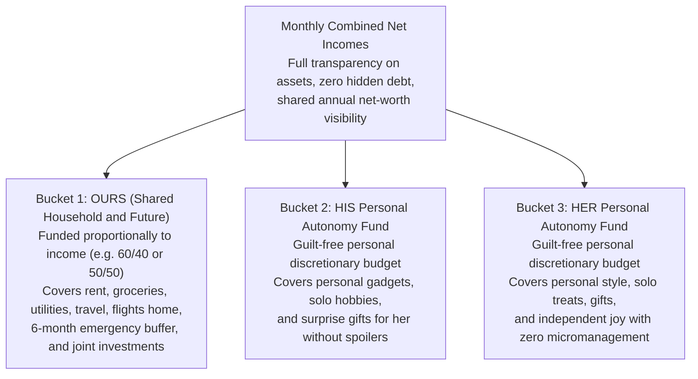

# Grown-Up Alignment: Navigating Money, Career Mobility, Family & Future Marriage Together

## 1. Deciding vs. Sliding: How Grown-Ups Talk About the Future

Relationship researcher Scott Stanley coined a vital distinction between **Sliding** and **Deciding**. Couples who *slide* avoid clear conversations about geography, finances, careers, and marriage out of fear of ruining a romantic mood—until visa deadlines, lease renewals, or family pressure force a high-stress crisis. Couples who *decide* hold calm, affectionate, intentional alignment talks *before* major transitions, turning uncertainty into shared excitement.

Especially in a cross-cultural partnership at 32, clarity is an act of deep love. Waiting vaguely for years "seeing how things go" across seven timezones is unfair to both partners' life timelines.

### Four Rules for Stress-Free Future Conversations

1. **Schedule Daylight, One-Topic Sessions**: Never ambush your partner with *"Where will we live for the next 20 years and how will we raise kids?"* at 23:30 after an exhausting workday. Pick *one* topic for a relaxed Sunday afternoon walk or cafe session.
2. **Open With an Unconditional Team Anchor**: Begin every big talk by reassuring attachment safety first: *"Before we compare options, I want you to know my #1 goal is building a life where BOTH of us thrive, feel respected, and stay close to the people we love."*
3. **Separate Brainstorming From Final Commitment**: Treat the first conversation on any major topic purely as an **Option-Mapping Draft**—zero pressure to sign a binding contract in 45 minutes.
4. **Frame Every Trade-Off as "Us vs. the Puzzle"**: If a logistical puzzle (visas, tax residency, language, career market) is genuinely hard, sit on the *same side* of the table looking at the puzzle together rather than pulling in opposite directions.

### Word-for-Word Openers for Big Alignment Talks

Engineers sometimes avoid future talks because they worry about sounding either pushy or clinical. Use these warm, low-pressure openers:

| Alignment Topic | Awkward / High-Pressure Opener (Avoid) | Warm, Grounded Adult Opener (Use This) |
| :--- | :--- | :--- |
| **Closing the Distance** | "We need to decide right now who is quitting their job next year or this makes no sense." | "I loved waking up next to you on our last trip, and I want us to start sketching how we close the distance over the next 12-18 months. Want to grab tea Sunday and map out 2-3 realistic city ideas together?" |
| **Money & Buckets** | "How much money do you have saved and how are we splitting rent?" | "Because I see a real future with you, I want money to always feel safe, transparent, and fair for both of us. Can we share how we each grew up viewing saving, spending, and personal freedom?" |
| **Marriage Timeline** | "My relatives keep asking when I'm getting married—what's your timeline?" | "Being with you feels like coming home. I'd love to hear what a meaningful path toward engagement and marriage looks like in your heart—no rush today, I just want us aligned on the same horizon." |
| **Career Stress Season** | "I'm going to be crazy busy for 6 months so don't expect much free time." | "The next quarter at work looks intense for me, and protecting *us* comes first. Let's design our weekly rhythm together now so you never feel sidelined while I'm sprinting." |

---

## 2. Closing the Distance: Choosing Which Country or City to Call Home

In an international China–Morocco partnership, choosing where to live together permanently is rarely an impulsive coin flip. Instead of framing the choice as *"Who sacrifices their country for whom?"*, evaluate realistic geographic architectures across five practical life dimensions—including the powerful option of a **Neutral Third-Country Hub** where neither partner feels like a dependent outsider.

### Cross-Border Base Evaluation Matrix

| Geographic Option | Career & Income Upside | Language & Daily Ease | Cultural & Halal Comfort | Flights & Family Access | Key Trade-Off to Manage |
| :--- | :--- | :--- | :--- | :--- | :--- |
| **China Tech Hub** (Shanghai, Shenzhen, Hong Kong) | Strong AI/software ecosystem; high engineering compensation and convenience | Native ease for him; steep Mandarin curve for her outside international circles | Great safety; requires intentional Halal dining/community curation | Instant domestic access to his parents; 15-18 hr trip to Morocco | Preventing her professional or social isolation while building Mandarin/network |
| **Morocco Base** (Rabat, Casablanca, Tangier) | Works best if paired with remote global USD/EUR engineering role or multinational branch | Native Darija/French/Arabic ease for her; welcoming coastal lifestyle | Effortless Halal food, faith rhythm, sunlight, and Mediterranean warmth | Close to her family and Europe; longer haul back to East Asia | Securing remote/global compensation parity and learning French/Darija |
| **Third-Country Hub: UAE / Gulf** (Dubai, Abu Dhabi) | Growing AI/cloud/fintech hub; 0% personal income tax; English working language | Both operate smoothly in English; huge Chinese and Moroccan expat communities | World-class Halal lifestyle alongside authentic Chinese supermarkets/dining | Halfway geographic bridge: approx. 7.5 hrs to Casablanca, approx. 8.5 hrs to China | Hot summer climate; residency tied to employment or freelance/golden visa |
| **Third-Country Hub: Europe / SG** (Paris, Madrid, Amsterdam, Singapore) | Strong tech/multinational job markets for bilingual professionals | Francophone Europe favors her career fluency immediately; English hubs favor tech | Strong work-life balance and diverse international communities | Easy Europe-Morocco hops (2-3 hrs) or Asia-China hops (4-5 hrs from SG) | Higher European tax rates and slower initial visa sponsorship paperwork |

### The Four-Stage Roadmap From Long Distance to Shared Roof

Never leap straight from holiday romance to irreversible international relocation without progressive validation. De-risk the transition across four natural stages:

1. **Stage 1 — Rhythm & Unfiltered Character Verification**: Consistent daily LDR trustworthiness plus multiple trips where you experience real life together (flight delays, mild headaches, rainy errands, meeting close friends)—not just five-star vacation highlights.
2. **Stage 2 — The "Ordinary Tuesday" Extended Trial (4–8 Weeks)**: Before anyone resigns from a career or ships furniture across oceans, spend 4 to 8 continuous weeks living and working remotely under one roof. Grocery shopping, cooking dinner after tired workdays, and sharing quiet living space reveal 10x more practical harmony than weekend getaways.
3. **Stage 3 — Engagement, Paperwork & Runway Preparation (6–12 Months)**: Lock your initial 24-month target city, build a dedicated Relocation Cash Buffer, line up career/language bridges, and handle civil paperwork early without panic.
4. **Stage 4 — Intentional Co-Living & Yearly Checkpoints**: Move in/marry with the Relocation Support Covenant active and a warm annual reflection ritual.

### The Relocation Support Covenant (Zero Martyr Resentment)

Whenever one partner relocates across borders for the relationship, they absorb invisible asymmetric costs: rebuilding friendships from zero, navigating bureaucracy in a second or third language, and missing family milestones. To prevent quiet resentment, commit explicitly to four protective promises:

- **Guaranteed Home-Visit Budget**: Pre-fund 1–2 round-trip flights home per year in your shared budget as an untouchable priority—never treated as an "expensive luxury."
- **Career & Language Runway**: Actively invest in language classes, professional credentialing, coworking spaces, or networking introductions so the relocating partner retains proud independent identity.
- **Ban the "You Chose to Move Here" Card**: Even during tough weeks of homesickness, the local partner responds with empathy (*"Moving worlds for us took huge courage; how can we bring more warmth here this month?"*), never defensiveness.
- **Defined 24-Month Checkpoint**: Agree to review how both partners feel after two years—knowing nothing is an irreversible prison makes settling in 10x calmer.

### Running the "Max-Min Fairness" City Scoring Exercise

In game theory and moral philosophy (John Rawls' *Maximin* principle), a partnership should **never pick an option that maximizes simple sum total if one partner scores 9/10 and the other suffers at 3/10**. Instead, choose the city that **maximizes the lower-scoring partner's daily wellbeing** ($\max \min(U_{\text{him}}, U_{\text{her}})$), where neither person drops below `6.5 / 10`.

Have both partners score your top 3 candidate cities independently from `1–10` before comparing sheets:

```markdown
## Candidate City Joint Scorecard — [City Name]
1. **Career Trajectory & Fulfilling Work** (Him: ___ / Her: ___)
2. **Language Comfort & Everyday Autonomy** (Him: ___ / Her: ___)
3. **Cultural, Halal Dining & Community Warmth** (Him: ___ / Her: ___)
4. **Net Savings & Quality-of-Life Purchasing Power** (Him: ___ / Her: ___)
5. **Flight Ease to Both Sets of Aging Parents** (Him: ___ / Her: ___)
6. **Gut-Level Excitement Waking Up Here on Saturday** (Him: ___ / Her: ___)
-> **Minimum Partner Average (Must Exceed 6.5/10 for Both)**: ___
```

---

## 3. Financial Harmony: Transparency & The Three-Bucket Architecture

Couples rarely fight over currency math; they fight over what money *symbolizes*: **safety, freedom, respect, and fairness**. Engineers who grew up managing solo savings accounts sometimes swing to one of two extremes when partnering: either rigid 50/50 receipt-splitting (which feels cold and transactional, especially if incomes differ across currencies) or merging 100% of every cent into one pot (which creates awkwardness when buying each other surprise gifts or personal tech hobbies).

The cleanest, highest-trust modern structure for committed couples is the **Proportional Three-Bucket System ("Ours, Mine, Yours")**:



### Worked Example: Proportional Fairness + Equal Personal Dignity

Suppose after moving in together or marrying, one partner earns `USD 7,000` net/month and the other earns `USD 3,500` net/month (combined household income: `USD 10,500`). Notice one crucial design detail that prevents quiet power imbalance: **fund shared living proportionally (67% / 33%), AND allocate EQUAL personal autonomy stipends to both partners** so neither person ever feels like a junior partner in their own home:

| Monthly Allocation Bucket | Target Amount (Illustrative) | Who Controls & How It Works |
| :--- | :--- | :--- |
| **OURS — Fixed Living & Home Visits** | `USD 4,500` (43%) | Joint account/card covering rent, Halal groceries, utilities, health insurance, and pre-funded annual flights to China & Morocco |
| **OURS — Shared Future Wealth & Goals** | `USD 4,200` (40%) | Automated 6-month cash emergency buffer, global index ETFs, and future home/family reserve owned transparently as a team |
| **HIS — Guilt-Free Personal Bucket** | `USD 900` (8.5%) | His personal card—camera gear, mechanical keyboards, coffee with friends, or surprise anniversary jewelry for her |
| **HERS — Guilt-Free Personal Bucket** | `USD 900` (8.5%) | Her personal card—identical personal freedom for skincare, fashion, gifts for her family/him, or solo hobbies with zero scrutiny |

### Navigating Marriage & Family Financial Customs With Dignity

Chinese and Moroccan marriage traditions both feature symbolic financial gestures meant to honor family commitment—yet misunderstandings arise if families assume unspoken rules:

- **Understanding Cultural Traditions Warmly**: In parts of China, families discuss *Cai Li* (彩礼, betrothal gift) and housing security; in Moroccan and Islamic marriage tradition, the groom offers **Mahr / Sadaq**—a respectful, agreed-upon gift or sum belonging *directly to the bride herself* as a symbol of honor, devotion, and personal security—alongside a joyful celebration (*Drib Sdaq* and wedding festivities with music, *Amariya*, and family).
- **Align Privately as a Couple First**: Discuss openly what feels meaningful, respectful, and financially wise for the two of you *before* extended relatives weigh in. Protect your young household's financial runway—a joyful, debt-free marriage start beats an overleveraged performance for acquaintances every time.
- **Agree on a Shared Consultation Threshold**: Once sharing finances, set a simple rule—any non-routine expense or family support gift above an agreed threshold (for example, `USD 400` / `RMB 3,000` / `MAD 4,000`) gets a quick, respectful 2-minute heads-up first.

---

## 4. Two-Body Career Stewardship & Turn-Taking Seasons

When two smart, capable adults build a life together, demanding exact 50/50 career symmetry every single month creates paralysis. Instead, thriving dual-career couples think in **Intentional 18-to-24-Month Seasons**:

- **Sprint & Anchor Rhythm**: During Season 1, Partner A may be in a high-intensity launch, relocation ramp, or graduate credential while Partner B holds slightly more domestic steadiness—with an explicit date on the calendar when Season 2 prioritizes Partner B's next leap.
- **Protecting Relationship Bandwidth From Startup/Big-Tech Creep**: Career ambition builds a great roof for your family, *unless* chronic 80-hour weeks leave your partner receiving only exhausted scraps of your attention. Protect one sacred date block every week and daily phone-free dinner presence.

### Sharing the Invisible Mental Load: End-to-End Domain Ownership

In modern partnerships, household resentment rarely comes from physical chores alone—it comes from the **Invisible Cognitive Load** (remembering expiring visas, restocking household staples, booking flights, buying family birthday gifts). Never say *"Just tell me what chores to do!"*—because making her act as your household Jira Product Manager *is* exhausting work.

Use Eve Rodsky's **CPE Ownership Standard** (**Conception → Planning → Execution**):

- **Partial Help (Still Drains Her)**: Waiting until asked to wash dishes, then asking *"Where does this pot go and which sponge do I use?"*
- **Full End-to-End Ownership (True Partner)**: Owning complete household domains from start to finish—for example, you own 100% of travel/flight bookings, tech/utilities/bill automation, kitchen cleanup, and weekend breakfast without needing a single reminder.

---

## 5. In-Law Harmony & Joyful Cross-Cultural Marriage Logistics

Cross-cultural relationships occasionally spark initial anxiety from loving parents on either side (*"Will you live too far away? Will they understand our food, faith, or language?"*). Parental hesitation usually comes from fear of losing closeness with their child—not malice.

However, one golden boundary rule separates happy cross-cultural marriages from miserable ones: **Each partner is the primary communicator, boundary-setter, and cultural translator with their OWN parents**. Never throw your partner under the bus to appease your parents.


### Exact Boundary & Reassurance Scripts With Family

| Family Situation | Weak / Triangulating Response (Creates Resentment) | United-Team Adult Response (Warm + Firm) |
| :--- | :--- | :--- |
| **Parents worry about cultural difference or distance** | "Well she refuses to live in our hometown, I can't do anything about it." (Paints her as villain) | "Mom, Dad, I love how much you care about my happiness. She is extraordinarily kind, family-oriented, and respectful—we've thought carefully through our plan together, and we'll make sure we visit regularly." |
| **Relatives push intrusive timeline or custom demands** | Telling your partner: "My parents are angry so you have to just comply to keep peace." | Absorbing the heat yourself calmly: "Thank you for the advice! The two of us have decided to handle our celebration in a simpler way that works best for our start together." |
| **Translating cultural habits during family visits** | Leaving your partner confused at a noisy banquet table for 3 hours without context | Sitting right beside her, translating jokes and stories warmly, spotlighting her strengths to your parents, and calling a restful break when energy dips |

### De-Stressing International Marriage Paperwork & Celebrations

International marriage paperwork looks intimidating only when left to the last minute. Separate **legal paperwork** from **family celebration** by at least 3 to 6 months:

1. **Streamlined Civil Registration + Apostille**: Because both China (since November 2023) and Morocco are contracting parties to the **1961 Hague Apostille Convention**, authenticating single-status certificates, birth certificates, and marriage certificates across borders uses standardized Apostilles rather than slow multi-tier consular legalization chains. Start document gathering 4–6 months ahead with a calm checklist.
2. **Two Intimate Celebrations Beat One Exhausting Mega-Production**: Elderly grandparents in China or Morocco may find an 18-hour intercontinental flight exhausting. Many cross-cultural couples host one warm, joyful Moroccan celebration (*Takchita / Caftan*, mint tea, *Amariya*, music, and blessings with her family) and one warm Halal-friendly Chinese tea ceremony & family banquet in China—giving both families full pride and intimacy without logistical chaos.
3. **Multilingual Future Family Superpower (OPOL)**: If you choose to raise children together in the future, linguists recommend **One Parent, One Language (OPOL)**—Dad speaking warm everyday Mandarin, Mom speaking Darija/French/Arabic, with English as a shared global bridge. Children raised with calm dual-heritage pride grow up natively fluent across three or four world languages, belonging deeply to both civilizations.

---

## 6. The 10 Essential Pre-Commitment Alignment Prompts

Before moving countries together or getting engaged, walk through these ten questions gently over several cozy weekends—not to demand identical personalities, but to ensure zero hidden surprises:

1. **Geographic Horizon**: Which 2–3 cities/countries feel genuinely exciting and workable for *both* of us over the next 3–5 years, and how often will we visit both sets of parents?
2. **Financial Philosophy**: How do we balance saving/investing for long-term freedom vs. enjoying life today, and do either of us carry debts or ongoing family support commitments?
3. **Career & Daily Rhythm**: What does a healthy ordinary Tuesday look like for us—work hours, shared meals, solo recharge time, and household teamwork?
4. **Conflict & Repair Pact**: When we inevitably get stressed or misunderstand each other, how do we want to pause, soothe, and repair? (Review [01-GOTTMAN-SCIENCE-BIDS-HORSEMEN-AND-REPAIR.md](01-GOTTMAN-SCIENCE-BIDS-HORSEMEN-AND-REPAIR.md).)
5. **Faith, Values & Cultural Home**: How will we joyfully weave Chinese and Moroccan holidays, Halal home hospitality, and spiritual/ethical values into our shared home? (Review [02-CHINA-MOROCCO-CROSS-CULTURAL-AND-LDR-LOVE.md](02-CHINA-MOROCCO-CROSS-CULTURAL-AND-LDR-LOVE.md).)
6. **Children & Multilingual Parenting**: Do we both want children, roughly on what timeline, which languages will we speak at home (Mandarin, Darija/Arabic, French, English), and what values matter most in raising them?
7. **Extended Family Boundaries**: How do we honor aging parents generously while keeping our marriage decisions private and united?
8. **Health, Intimacy & Vitality**: How will we keep supporting each other's physical health, emotional closeness, affection, and playfulness across busy decades?
9. **Hardship Plan**: If one of us faces a layoff, visa delay, burnout, or illness, how do we step up as each other's safest harbor?
10. **Shared Dream**: Fast-forward five years to a sunny Saturday morning in our home together—what are we drinking, where are we, and what makes us proudest of the life we built?

### Our Annual Half-Day Couple Vision Retreat

Once a year—around your anniversary or the first weekend of January—book a quiet afternoon over mint tea and pastries with two notebooks to run a warm, unhurried annual retrospective:

```markdown
## Annual Partnership Retrospective & Vision — [Year]
1. **Gratitude Reel**: Our 5 favorite memories, trips, laughs, and hard things we navigated well together this past year.
2. **Wellbeing & City Check**: Score our current city and daily rhythm (1-10 each)—what small upgrade would raise next year by +1.5 points?
3. **Three-Bucket & Security Audit**: Review emergency buffer, shared savings progress, and upcoming family-visit flight dates for both China and Morocco.
4. **Personal Dreams Spotlight**: One personal craft, health goal, or career milestone each of us wants to pursue this year—and how the other can champion it.
5. **Signature Adventure**: Pick one new place, skill, or cultural celebration we will experience together in the next 12 months.
```

### Pre-Engagement & Pre-Relocation Readiness Verification

Before signing an international lease, resigning from a role, or proposing marriage, verify that all six foundational green lights are shining steadily:

| Dimension | Strong Green Light (Ready to Build Together) | Yellow / Pause Signal (Align Before Leaping) |
| :--- | :--- | :--- |
| **1. Post-Conflict Repair** | Both own mistakes without "but," soothe anger calmly, and reconnect warmly the same day | Unresolved multi-day silent treatments, contempt, or keeping score of past hurts |
| **2. Ordinary-Day Compatibility** | Have spent 4+ continuous weeks sharing ordinary errands, workdays, and quiet evenings happily | Only ever interacted on short high-adrenaline holiday trips with zero mundane routine |
| **3. Financial Honesty** | Full mutual visibility into income, savings, debts, and agreed Three-Bucket rules | Vague deflection around money, hidden obligations, or conflicting expectations on family support |
| **4. Cultural & Faith Reverence** | Both genuinely cherish Chinese and Moroccan traditions and protect Halal/dietary comfort gladly | Secretly hoping the other partner will abandon their language, faith, or heritage after marriage |
| **5. Family Boundary Spine** | Each partner shields the couple's core decisions warmly and firmly with their own parents | Either partner routinely caves to parental guilt-tripping at the expense of their partner's peace |
| **6. Mutual Relocation Fairness** | City choice meets the 6.5+/10 threshold for *both* partners with concrete support budgeted | One partner sacrificing career, language, and community with zero concrete support plan |

---

## 7. Closing Reflection: From Solo Builder to Lifemate

Being a great software engineer taught you how to respect reality, debug complex systems patiently, and build durable architecture that stands up under load. Being an extraordinary partner asks you to bring that same steadiness—softened by humility, spoken warmth, deep listening, and playful curiosity—to the person you love.

Return anytime to **[00-README.md](00-README.md)** for the core Empathy-First framework, **[01-GOTTMAN-SCIENCE-BIDS-HORSEMEN-AND-REPAIR.md](01-GOTTMAN-SCIENCE-BIDS-HORSEMEN-AND-REPAIR.md)** for daily bids and repair scripts, and **[02-CHINA-MOROCCO-CROSS-CULTURAL-AND-LDR-LOVE.md](02-CHINA-MOROCCO-CROSS-CULTURAL-AND-LDR-LOVE.md)** for cross-cultural and long-distance rituals.
