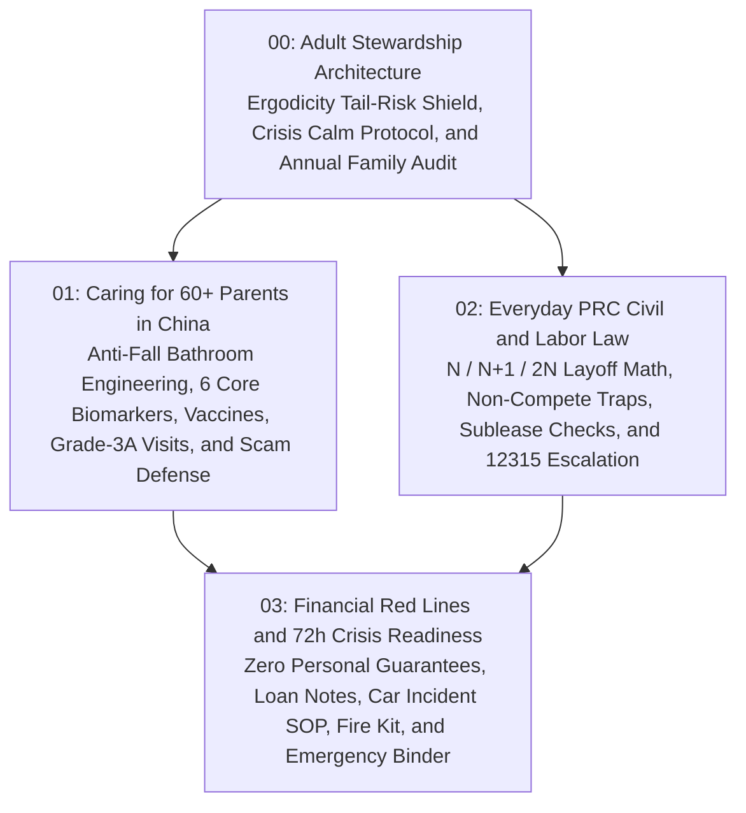
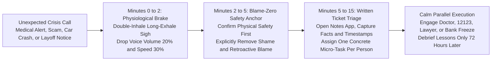

# Adult Stewardship at 32: Protecting Aging Parents & Mastering Real-World Legal & Crisis Guardrails (32岁家庭顶梁柱与成人法律危机护栏)

For most of your twenties, life runs inside a forgiving sandbox. When you catch a fever, switch jobs, rent a room, or scrape a bumper, there is almost always an invisible safety net hovering half a layer above you — parents who still seem invincible in their fifties, campus counselors, or low-stakes personal balance sheets where a mistake costs a month's salary rather than a decade's freedom.

Around age 32, a quiet structural inversion occurs without any ceremonial announcement. Your parents cross into their sixties (`60–70岁窗口期`), where vascular elasticity, bone mineral density, and cognitive fraud-resistance begin diverging sharply depending on upstream care. Simultaneously, your own savings, career equity, and romantic partnership reach meaningful scale. One afternoon — standing in a crowded Grade-3A hospital outpatient hall (`三甲医院门诊大厅`), reading a predatory severance clause, or fielding a panicky phone call at `22:30` — you look around and realize a sobering, liberating truth: **no "more adult" adult is coming to take over the keyboard. You are now the calm pillar of your family (`家庭定海神针`).**

Becoming a true family steward has nothing to do with joyless self-sacrifice, anxious micromanagement, or patriarchal preaching (`爹味控制`). For an engineer, adult stewardship is **High-Availability Family Reliability Engineering (`家庭高可用与容灾工程`)**: systematically eliminating the six or seven catastrophic single points of failure (`单点毁灭性风险`) that wipe out middle-class families overnight, while building the emotional composure (`遇事不慌的情绪托底力`) that lets everyone you love sleep soundly.

---

## Curriculum Architecture & Learning Path



### Clickable Table of Contents & Module Directory

| Module | File | Core Stewardship Domain | Concrete Real-World Deliverable |
| :--- | :--- | :--- | :--- |
| **00** | [00-README.md](00-README.md) | **Philosophy & Reliability Architecture**: Ergodicity vs. absorbing ruin barriers, secondary emotional contagion in crises, the 120-day parent reality math, and annual family audits | Internalize the **10-Minute Calm Pillar SOP** (`定海神针话术`) and run a quarterly 45-minute family risk audit |
| **01** | [01-CARING-FOR-AGING-PARENTS-HEALTH-AND-HEART.md](01-CARING-FOR-AGING-PARENTS-HEALTH-AND-HEART.md) | **Aging Parents Health, Home & Heart**: Preventing hip fractures (`人生最后一次骨折`), managing BP/LDL-C/HbA1c/DEXA/gastroscopy, Shingrix & flu vaccines, `异地就医备案`, anti-scam guardrails, and oral history | Complete a **RMB 800 weekend bathroom anti-fall upgrade**, replace useless VIP checkups with targeted screenings, and record parents' life stories |
| **02** | [02-ADULT-LEGAL-LITERACY-WORK-RENT-AND-CONTRACTS.md](02-ADULT-LEGAL-LITERACY-WORK-RENT-AND-CONTRACTS.md) | **PRC Labor, Lease & Consumer Self-Defense**: `N / N+1 / 2N` severance formulas, spotting `RMB 1,000,000` non-compete traps (`竞业限制违约金`), Tier-1 rental title/`二房东` checks, and `12315 / 12345` escalation | Audit employment and apartment contracts before signing, preserve clean digital paper trails, and negotiate from statutory strength |
| **03** | [03-FINANCIAL-RED-LINES-AND-EMERGENCY-READINESS.md](03-FINANCIAL-RED-LINES-AND-EMERGENCY-READINESS.md) | **Wealth Red Lines & 72-Hour Crisis SOPs**: Refusing `连带责任保证` personal guarantees, ironclad `借条` rules, nominal-director traps, `12123` car accident SOP, high-rise fire survival, and Emergency Binder | Never lose 10 years of savings to a relative's debt, equip a **RMB 500 home fire/72h kit**, and seal a **48-Hour Continuity Envelope** |

### In This Document (`00-README.md`)

1. [The Ergodicity Law of Family Ruin: Why Defense Beats Upside](#1-the-ergodicity-law-of-family-ruin-why-defense-beats-upside)
2. [Emotional Stewardship Under Fire: Killing Secondary Crisis Contagion](#2-emotional-stewardship-under-fire-killing-secondary-crisis-contagion)
3. [The Golden Decade Math: Seeing 60-to-72-Year-Old Parents Clearly](#3-the-golden-decade-math-seeing-60-to-72-year-old-parents-clearly)
4. [Healthy Boundaries vs. Enmeshment: Guiding Without Controlling](#4-healthy-boundaries-vs-enmeshment-guiding-without-controlling)
5. [The Annual Family & Legal Reliability Audit Calendar](#5-the-annual-family-legal-reliability-audit-calendar)

---

## 1. The Ergodicity Law of Family Ruin: Why Defense Beats Upside

Most ambitious thirty-somethings spend `98%` of their cognitive bandwidth optimizing **upside throughput** — Staff-level promotions, equity packages, side-project revenue, and portfolio returns — while spending `0%` hardening **downside absorbing barriers (`破产吸收壁`)**.

Physicist Ole Peters and risk theorist Nassim Nicholas Taleb point out that a real human family does not live across an ensemble average of 1,000 parallel universes; it lives along **one single sequential time-series path (`非遍历性时间序列`)**. Along a sequential multiplicative path, multiplying any cumulative state by zero permanently terminates compounding regardless of how brilliant the preceding ten years were:

$$W_T = W_0 \prod_{t=1}^{T} (1 + r_t) \cdot \mathbb{I}(\text{No Absorbing Ruin at } t)$$

In urban Chinese middle-class life, dramatic ruin almost never comes from choosing the wrong index fund or missing a `15%` raise. It comes from **six well-documented, completely preventable tail-risk traps**:

| Catastrophic Tail Event | Typical Unprepared Cost | Upstream Engineering Guardrail (Cost & Time) |
| :--- | :--- | :--- |
| **1. Nighttime Bathroom Fall -> Geriatric Hip Fracture (`高龄髋部骨折`)** | `20%–30%` 1-year mortality if bedridden; RMB 80,000–200,000 surgery/rehab + years of round-the-clock nursing burnout | Drilled `304` stainless grab bars + `2700K` motion nightlights + TPE drainage mats + DEXA bone scan (**RMB 800, 1 Saturday** — see [01-CARING-FOR-AGING-PARENTS-HEALTH-AND-HEART.md](01-CARING-FOR-AGING-PARENTS-HEALTH-AND-HEART.md)) |
| **2. Silent Vascular / GI Neglect (`脑卒中/心梗/中晚期消化道肿瘤`)** | Sudden stroke hemiplegia or late-stage diagnosis after years of normal "basic blood routines" | Home upper-arm BP `< 135/85`, strict `LDL-C` control, carotid ultrasound, low-dose chest CT, and 1 sedated gastro-colonoscopy at 55–60 (**1 annual planned morning**) |
| **3. Signing Joint-Liability Guarantee (`连带责任保证担保`)** | Court freezes your salary card, seizes apartment equity, and imposes `限高令` travel bans for a relative's failed business | Absolute zero-exception refusal rule + face-saving mortgage/compliance script (**RMB 0, 15 seconds** — see [03-FINANCIAL-RED-LINES-AND-EMERGENCY-READINESS.md](03-FINANCIAL-RED-LINES-AND-EMERGENCY-READINESS.md)) |
| **4. Predatory Non-Compete or Coerced "Personal Resignation" (`竞业违约金/骗签离职`)** | Forfeiting RMB 150,000–400,000 statutory `N+1` severance or facing a RMB 1,000,000 non-compete clawback lawsuit | Pre-signing clause audit + demanding stamped *Non-Compete Waiver Notice* at exit + never signing false resignation reasons (**30 min review** — see [02-ADULT-LEGAL-LITERACY-WORK-RENT-AND-CONTRACTS.md](02-ADULT-LEGAL-LITERACY-WORK-RENT-AND-CONTRACTS.md)) |
| **5. Telecom / AI-Clone / Uninsured Third-Party Crash (`电诈盗刷/豪车全责`)** | Parents' pension account drained via screen-share scam; or a `RMB 1,500,000` injury/luxury-car liability claim with bare-minimum auto insurance | Family verbal safe-word + `RMB 5,000` daily transfer limit on pension card + `RMB 3,000,000–5,000,000` auto Third-Party Liability coverage (`三者险`) |
| **6. High-Rise Smoke Inhalation or Incapacitation Lockout (`浓烟中毒/突发失能信息孤岛`)** | Fatal stairwell smoke inhalation during building fire; or family locked out of insurance policies and accounts during a 72h ICU stay | Bedside `TZL30` smoke hoods + kitchen fire blanket + sealed Emergency Continuity Envelope (`家庭应急锦囊`, **RMB 500, 2 hours**) |

> **The Steward's Leverage Ratio**: Spending **two focused weekends once** to install these six circuit breakers buys more expected lifetime peace and net-worth survival than a thousand hours of late-night financial anxiety.

### Worked 10-Year Trajectory Comparison: Unshielded vs. Stewarded Engineer

Consider two 32-year-old Staff/Senior software engineers in Shanghai, both earning `RMB 800,000` pre-tax with `RMB 1,200,000` liquid savings:

- **Engineer A (Pure Upside Optimizer, Zero Guardrails)**:
  - Skips bathroom retrofits and targeted checkups for hometown parents; signs HR's standard onboarding packet blindly; co-signs a cousin's `RMB 800,000` supply-chain loan out of holiday table pressure.
  - At age 35, Mother slips at `03:30 AM` fracturing her femoral neck (`RMB 140,000` surgery + 9 months of career distraction and nursing stress). At age 37, the cousin defaults (`RMB 650,000` frozen directly from Engineer A's salary account). At age 38, during an org re-org, A panics under HR background-check threats and signs a `"personal resignation"` form, forfeiting `RMB 260,000` in tax-free `N+1` severance.
  - **Net 10-year result**: Over `RMB 1,050,000` in uncompensated wealth destruction plus chronic family trauma.
- **Engineer B (Fault-Tolerant Family Steward)**:
  - Spends `RMB 800` on drilled bathroom grab bars + nightlights, books parents' `DEXA` + gastro-colonoscopy (catching and removing one benign `8 mm` colon polyp cleanly), declines the cousin's guarantee in 15 seconds using the mortgage-covenant script, and negotiates an uncapped `N+2` (`RMB 330,000` tax-free) + stamped non-compete waiver during the same re-org.
  - **Net 10-year result**: Zero absorbing barrier hits; uninterrupted compounding of health, career, and family serenity.

### The Family Commercial Insurance Matrix (`只买高杠杆纯保障，绝不碰返还分红坑`)

Public medical insurance (`国家基本医保`) covers the **floor (`保基本`)**, capping out or excluding many imported oncology targeted therapies (`院外靶向药`), ICU self-pay consumables, and proton-heavy-ion treatments. Build a **pure-protection commercial shield** for under `RMB 6,000–9,000/year` total across the whole family — and **never buy overpriced "return-of-premium / bundled dividend life policies (`返还型/捆绑分红型重疾险`)"**:

| Family Member | Must-Have Pure Policies (Priority Order) | Annual Cost Benchmark & Underwriting Notes |
| :--- | :--- | :--- |
| **You & Partner (Breadwinners, Age 32)** | **(1) Million-RMB Medical Insurance (`百万医疗险`, 20-year guaranteed renewal `保证续保20年`, covering outside-hospital cancer drugs `院外特药`)**; **(2) Term Life Insurance (`定期寿险`, `RMB 2,000,000–3,000,000` coverage to age 60 — covers mortgage + parents if the unthinkable happens)**; **(3) Comprehensive Accident Insurance (`综合意外险`, `RMB 1,000,000`, zero deductible medical)** | Approx. `RMB 400` (Medical) + `RMB 1,800–2,500` (Term Life) + `RMB 290` (Accident) per adult; **strictly follow Truthful Health Disclosure (`如实健康告知`)** — never hide pre-existing nodules, or insurers will deny claims after two years! |
| **Parents (Age 60–70)** | **(1) Comprehensive Senior Accident Insurance (`中老年综合意外险`, covering fracture/fall outpatient & inpatient `含意外医疗0免赔+医保外用药+骨折津贴`)**; **(2) Million-RMB Medical (`百万医疗险` if healthy) OR Cancer-Specific Medical (`防癌医疗险` — accepts hypertension, diabetes & coronary heart disease!) + Municipal Inclusive Medical (`各地政府惠民保`, e.g., `沪惠保`, zero health underwriting!)** | Approx. `RMB 300–500` (Senior Accident) + `RMB 150–200` (`惠民保`) + `RMB 1,200–2,200` (Medical / Cancer Medical) per parent; **avoid Senior Critical Illness (`60岁以上重疾险保费倒挂`, paying RMB 80,000 premium for RMB 100,000 payout!)** |

---

## 2. Emotional Stewardship Under Fire: Killing Secondary Crisis Contagion

Watch two families handle the exact same unexpected shock — a father's CT scan showing a `9 mm` pulmonary ground-glass nodule, a mother losing RMB 6,000 to a fake health lecture, or a rear-end collision on an elevated highway in pouring rain.

- **Unstewarded Family (Double-Fault Cascade)**: Within 90 seconds, fear mutates into **accusatory rage (`恐惧转化为指责`)**: *"Why didn't you watch the road?!"*, *"I told you ten times those supplements are scams — why do you never listen?!"*, *"What if it's cancer?!"* Cortisol floods every nervous system in the room. Nobody can read fine print or talk clearly to doctors, and worse: **your parents learn that telling you bad news results in being scolded**, so next time they feel chest tightness at `02:00 AM`, they hide it "so we don't trouble the kids (`别给孩子添乱`)."
- **Stewarded Family (Fault-Isolated Recovery)**: You absorb the initial emotional voltage spike like a surge protector (`浪涌保护器`), drop the room's heart rate within sixty seconds, separate **human safety** from **solvable logistics**, and convert panic into an ordered checklist.



### Four Verbatim "Calm Pillar" Scripts (`高情商定心丸标准话术`)

Memorize the cadence of these four responses BEFORE you ever need them — in an adrenaline spike, you do not rise to the occasion; you fall to your pre-rehearsed scripts:

1. **When a parent calls anxious about an abnormal checkup report (`体检报告异常指标恐慌`)**:
   - *Never say*: *"Why didn't you exercise like I told you?! Send it fast, let me Baidu it!"*
   - *Say slowly and warmly*: **"爸/妈，别慌，体检的意义就是在还没症状的时候早点发现小苗头，查出来反而是好事。您先把报告原图拍给我，今晚正常吃饭睡觉，千万别自己刷短视频吓自己。我明早帮您挂周四瑞金/中山医院专病门诊的号，咱们让专业主任看一眼最准。"** *(Dad/Mom, don't worry — the whole point of screening is catching tiny signals early, so finding it now is actually good news. Snap a clear photo of the full page for me, eat dinner and sleep normally tonight, and don't scare yourself on short videos. Tomorrow morning I'll book Thursday's specialist clinic so a senior doctor gives us an exact reading.)*
2. **When a parent confesses they were scammed out of money (`父母遭遇诈骗自责隐瞒`)**:
   - *Never say*: *"How could you fall for such an obvious trick?!"*
   - *Say immediately*: **"妈，人平平安安最重要，钱咱们挣得回来！现在的骗子都是几十个人的专业心理学团队加AI配音，连很多年轻工程师都中招，真不怪您。咱们现在分秒必争做两件事：先把这张卡挂失止付、截图保留聊天转账记录，我陪您去派出所报案做笔录，剩下的交给我。"** *(Mom, your safety matters above all else — money can always be earned back! Today's scam rings use professional psychology scripts and AI voice cloning that trick young engineers too; it is genuinely not your fault. Let's move fast on two steps right now: freeze the card and screenshot all transfer records, and I'll go with you to the police station to file the stop-payment report.)*
3. **When your partner accidentally scratches the car or breaks something expensive (`伴侣意外剐蹭或失误`)**:
   - *Say within 3 seconds*: **"你人没撞着吧？安全带勒疼没有？只要人一点事没有，铁皮和漆就是买保险来修的。你先打开双闪站到路边安全护栏里面，别站在车流里，把位置发我，剩下的12123和保险流程我教你一步步点。"** *(Are you unhurt? Did the seatbelt bruise you? As long as you are completely fine, sheet metal and paint are literally what insurance exists to fix. Turn on hazard lights, step behind the guardrail out of traffic, drop me a pin, and I'll walk you through 12123 step by step.)*
4. **When sudden company restructuring or an aggressive HR meeting hits (`突发职场裁员谈话`)**:
   - *Internal & external script*: **"I hear the company's proposal. Because this involves formal legal rights and compensation calculations, I won't sign any documents on the spot today. Please send the written termination proposal and calculation breakdown to my email; I will review it carefully and reply within 48 hours."** *(Never sign under artificial countdown pressure; silence and calm note-taking terrify bad-faith negotiators.)*

---

## 3. The Golden Decade Math: Seeing 60-to-72-Year-Old Parents Clearly

When you live and work in a Tier-1 city apart from your hometown, chronological years create a dangerous optical illusion (`时间错觉`). You think: *"My parents are 62; life expectancy in urban China is nearly 80, so we still have 18 years."*

Run the actual **high-vitality contact-day math (`高质量相聚天数精算`)**:

- **The Mobility Cliff (`73–75岁活力拐点`)**: Geriatric epidemiology distinguishes *lifespan* from **active travel-and-dining healthspan (`健康自理与远行窗口期`)**. Between ages **60 and 72**, well-managed parents can still walk `10,000` steps under autumn plane trees, fly with you to Kyoto, Yunnan, or Qingdao, savor crispy roast duck without dysphagia, and laugh late over tea. Past 75, knee osteoarthritis, stamina limits, and travel insurance restrictions narrow their physical radius rapidly.
- **Counting Shared Days**: Suppose your parents have `12` Golden-Decade years ahead (`ages 62 to 74`), and you only go home for `6` effective days at Spring Festival (`扣除走亲戚应酬`) plus `4` days at National Day:

$$\text{Remaining Golden-Decade Days Together} = 12 \text{ years} \times 10 \text{ days/year} = 120 \text{ days}$$

One hundred and twenty days is **four calendar months** — and if half of those hours are spent staring at Slack/WeChat in your childhood bedroom while your mother washes dishes alone in the kitchen, effective face-to-face connection drops below **300 hours**.

### Three High-ROI Shifts That Triple Shared Life Memory
1. **Add One Annual 3-to-4-Day Off-Peak Trip (`每年一次错峰小旅行`)**: Instead of fighting Golden Week crowds, take `2` days of annual leave attached to a weekend in April or November. Bring your parents to Shanghai for a curated checkup + Bund river walk + nice dinner, or meet them 90 minutes away by HSR (Suzhou, Hangzhou, Yangzhou, Xiamen). Four unhurried days exploring a new place together creates more episodic memory for them than five hectic Spring Festivals.
2. **Shift Video Calls from "Interrogation" to "Shared Scenes" (`把查户口式通话变成场景共享`)**: Instead of a dry Sunday duty call (*"Have you eaten? Yes. Everything fine? Yes. Bye"*), prop your phone up on Sunday evening while chopping vegetables or making coffee (`15 minutes`), show them the sunset on your walk, or send 3 photos mid-week of what you cooked. Parents don't crave grand speeches — they crave **visual proof that your everyday life is warm and healthy**.
3. **Give Experiences & Ergonomic Relief, Not Just Cash Envelopes**: Parents often hoard red-envelope cash (`舍不得花你的红包`) while sleeping on a sagging 18-year-old spring mattress, squinting through scratched reading glasses, or enduring rotting molars. Directly buy and schedule the **dental implant/cleaning, progressive lenses (`渐进多焦点眼镜`), firm-support latex/pocket-spring mattress, robotic vacuum (`上下水扫拖一体机`), or Shingrix vaccine appointment**.

---

## 4. Healthy Boundaries vs. Enmeshment: Guiding Without Controlling

Becoming the family pillar requires walking a razor-sharp boundary in East Asian family dynamics: **maximum reliability on life-and-death guardrails; gentle autonomy on harmless lifestyle preferences (`大事守底线，小事给自由`)**.

| Dimension | Enmeshed / Preachy Control (`孝顺焦虑与控制欲` — Breeds Friction) | Mature Adult Stewardship (`成熟托底与边界感` — Breeds Trust) |
| :--- | :--- | :--- |
| **Parents' Daily Habits** | Scolding Mom for keeping leftover vegetables 12 hours or saving cardboard boxes; lecturing Dad daily like a toddler | Enforcing non-negotiable red lines (daily BP pill, grab bars, zero wire-transfer scams) while smiling warmly at harmless frugal quirks |
| **Generational Worldview Differences** | Arguing for 2 hours at the dinner table trying to "correct" their 1960s views on marriage, career stability, or consumption | Listening for the **loving fear underneath their outdated advice** (*"They want to know I'll be safe"*), reassuring the emotion, and living your own chosen life calmly |
| **Partner vs. Origin Family (`伴侣与原生家庭边界`)** | Acting as a passive messenger (`传声筒`: *"My mom said..."*) or letting either side take blame | Applying the **Shield & Credit Rule (`好事归对方，边界自己扛`)**: handle friction with your own parents yourself; attribute thoughtful gifts to your partner! |

### Three High-Friction Generational Moments & Warm Deflection Scripts

1. **When Frugal Parents Refuse Air Conditioning in `38°C` Heat or Heating in `2°C` Cold (`省电费硬扛酷暑严寒`)**:
   - Extreme indoor heat causes silent geriatric heatstroke (`热射病`), and freezing `5°C` bedrooms spike morning blood pressure by `20–30 mmHg`, triggering winter strokes!
   - *Never lecture*: *"Stop being so stingy over RMB 200 of electricity!"*
   - *Action + Script*: Bind their State Grid (`网上国网 App -> 户号绑定`) directly to your own auto-pay, prepay `RMB 1,500` into their electricity balance before June and November, and say with a smile: **"妈，我们公司发了年度家庭绿色补贴电卡，已经直接充进咱家国家电网户头1500块了，过期不用就作废清零！您和爸夏天26度、冬天暖气尽管全天开着。"** *(A harmless white lie about "expiring company utility credits" unlocks instant guilt-free comfort for frugal parents!)*
2. **When Relatives Push Marriage, Fertility, or Career Comparisons at Holiday Dinners (`春节催婚催生与亲戚攀比`)**:
   - *Never get defensive or argue logic for an hour.* Use the **Warm Acknowledge + Topic Pivot (`温和接球+反客为主关心对方`)**:
   - *Script*: **"谢谢三姨惦记！感情和组建家庭这事急不得，我一直认真放在心上，有好消息一定第一个给您发喜糖。对了三姨，您去年说的膝盖今年冬天还酸吗？表弟今年工作忙不忙？"** *(Validate their care in 5 seconds, give zero debate hooks, and redirect the spotlight onto their health or their own kids — works `100%` of the time.)*
3. **When Parents Feel "Useless" or Afraid of Becoming a Burden (`父母退休后的失落感与怕拖累心理`)**:
   - Aging parents secretly dread becoming obsolete (`无用感`). Intentionally **ask for their expertise** on things they genuinely know better than you:
   - *Examples*: *"Dad, how do you judge whether winter bamboo shoots or rib cuts at the market are fresh?"*, *"Mom, my braised pork still doesn't get your glossy caramel color — walk me through when you add rock sugar?"*
   - Letting parents contribute small, dignified wisdom keeps their sense of agency (`自我效能感`) vibrant well into their seventies.

### Five Everyday Micro-Habits of a Reliable Family Steward

- **Keep a Dedicated `"Family Admin"` Folder in Cloud Notes / NAS**:
  - Store high-res scans of parents' ID cards (with watermark when used), household register (`户口本`), marriage certificates, property deeds, vaccination records, and chronological PDF checkup reports (`YYYY-MM-Hospital-Parent.pdf`).
- **Set Two Silent Recurring Reminders Before Peak Weather Shifts**:
  - **October 25 (`霜降前`)**: Remind parents that sharp autumn cold fronts constrict peripheral arteries — check morning BP daily and wear a warm vest when stepping out before `08:00`.
  - **June 20 (`入梅/高温前`)**: Clear refrigerator leftovers rule (`绿叶菜绝不过夜，泡发木耳银耳绝不超过4小时防米酵菌酸中毒!`) — *Burkholderia gladioli* (`米酵菌酸`, heat-stable toxin in overnight soaked wood-ear mushrooms or wet rice noodles) has **zero antidote** and `40%+` fatality; teach this one kitchen microbiology rule clearly!
- **Never Deliver Hard News Late at Night (`坏消息不过夜不睡前说`)**:
  - Unless an immediate action is required tonight, never call parents after `20:30` with stressful updates — let them sleep peacefully and discuss solutions at `10:00 AM` with a finished plan already in hand.

---

## 5. The Annual Family & Legal Reliability Audit Calendar

Put four recurring `45-minute` blocks on your calendar once a year so stewardship runs on quiet cron jobs rather than emergency paging:

| Quarter | Scheduled Maintenance Window | 45-Minute Action Checklist |
| :--- | :--- | :--- |
| **Q1 (Spring Festival Home Visit)** | Physical Apartment Safety & Oral Archive | Inspect bathroom grab bars, anti-slip mats, and motion nightlights; photograph **every medication box** parents currently take; test smoke/gas alarms; record one 20-minute childhood/family voice memo |
| **Q2 (April–May Checkup Season)** | Biomarkers, Insurance & Cross-Province Filing | Book parents' targeted annual screening (`BP, LDL-C, HbA1c, UACR, low-dose chest CT, carotid ultrasound`); verify `百万医疗险 / 惠民保` & your own term life/accident auto-renewal; check `国家医保服务平台` family binding |
| **Q3 (July–August Mid-Year Review)** | Legal, Lease & Digital Hygiene | Back up tax/social-insurance records (`个人所得税 / 社保缴费明细`); check apartment lease renewal window (`60 days prior`); verify auto `三者险 >= RMB 3,000,000`; rotate/charge 72h emergency power bank & check pharmacy expiry dates |
| **Q4 (Oct–Nov Pre-Winter Shield)** | Winter Vascular & Vaccine Protection | Escort parents for annual **quadrivalent flu shot** (and Shingrix / pneumococcal if due); remind morning warm-up & blood-pressure monitoring before cold snaps (`寒潮晨峰心脑血管防护`); refresh sealed Emergency Continuity Envelope |

### The 20-Point Family Stewardship Self-Audit (`家庭容灾成熟度20项自检清单`)

Copy this checklist into your personal notes once a year and track your score from `0/20` toward `20/20`:

```text
[FAMILY STEWARDSHIP READINESS AUDIT — TARGET: 18+/20]

A. AGING PARENTS HOME & MEDICAL SHIELD (6 pts)
[ ] 1. Bathroom has drilled 304 stainless grab bars + TPE drainage anti-slip mats (zero suction cups)
[ ] 2. Bedroom-to-toilet path has 2700K motion-sensing nightlights + Three 30-Seconds habit taught
[ ] 3. Validated upper-arm BP cuff at home; parents' BP (<135/85), LDL-C, and HbA1c logged this year
[ ] 4. Parents have completed low-dose chest CT, DEXA bone scan, and baseline painless gastro-colonoscopy
[ ] 5. Flu shot updated this autumn + Recombinant Shingles (Shingrix) vaccine scheduled/completed
[ ] 6. Cross-province medical insurance Family Account (国家医保服务平台亲情账户) bound on your phone

B. SCAM, INSURANCE & EMOTIONAL WARMTH (4 pts)
[ ] 7. Family verbal safe-word agreed for any urgent >RMB 2,000 transfer; stranger FaceTime disabled
[ ] 8. Parents' daily debit card capped at RMB 5,000/day; core pension principal isolated offline
[ ] 9. Senior Accident + Medical/Inclusive Insurance (百万医疗/防癌医疗+惠民保) active with truthful disclosure
[ ] 10. At least 1 oral-history audio/video recording and 1 unhurried trip/checkup planned this year

C. WORKPLACE & HOUSING LEGAL SHIELD (5 pts)
[ ] 11. Personal copies of labor contract, 12-month IIT tax record, and social-insurance ledger backed up
[ ] 12. Non-compete agreement audited (know exact cap, base, and exit written-waiver requirement)
[ ] 13. Zero personal indie code or side-project commits ever touched employer laptop/VPN/cloud
[ ] 14. Apartment lease verified against owner deed / authorized Master Lease; 4K move-in video archived
[ ] 15. Breadwinner Million-RMB Medical + Term Life (定期寿险) + Comprehensive Accident policies active

D. WEALTH RED LINES & 72-HOUR CRISIS READINESS (5 pts)
[ ] 16. Zero third-party loan guarantees (连带担保) or nominal legal-rep/shareholder roles under your ID
[ ] 17. Auto Commercial Third-Party Liability >= RMB 3,000,000 + Non-Formulary Drug Rider active
[ ] 18. Bedside TZL30 smoke respirators + kitchen fire blanket + water-mist extinguisher installed
[ ] 19. 72-hour emergency water, power bank, flashlight radio, trauma meds, and RMB 2,000 cash stocked
[ ] 20. iPhone Medical ID + Digital Legacy Contact + Sealed Family Continuity Envelope ready in drawer
```

---

## Next Step in the Curriculum

Start with the highest-leverage human domain first: open [01-CARING-FOR-AGING-PARENTS-HEALTH-AND-HEART.md](01-CARING-FOR-AGING-PARENTS-HEALTH-AND-HEART.md) to engineer a fall-proof home for your parents, master their six life-saving medical indicators, navigate Grade-3A hospitals effortlessly, and build shame-free scam immunity.
