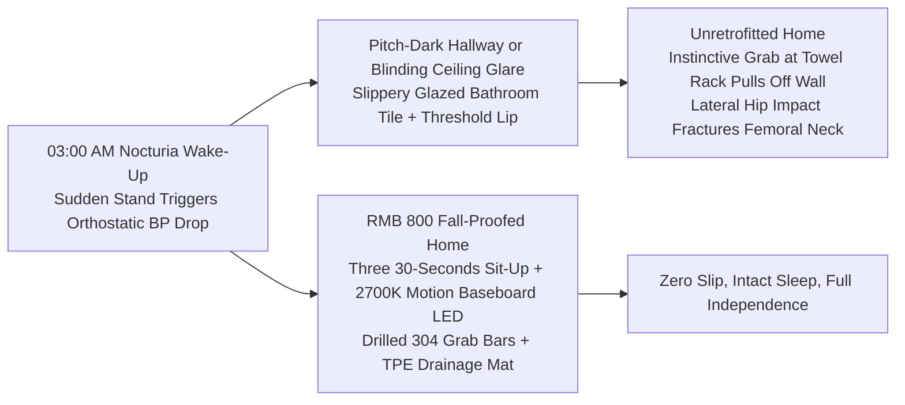
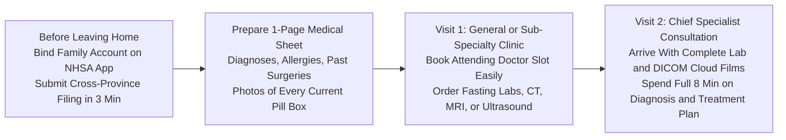

# Caring for Aging Parents: Medical, Home & Emotional Stewardship for 60+ Parents in China (父母健康管理、适老化防跌倒与情感陪伴实战)

In [00-README.md](00-README.md), we established that adult stewardship begins with eliminating single-point family catastrophes before they happen. Nowhere is upstream prevention higher-leverage than caring for parents entering their sixties and seventies (`60–75岁父母健康与居家护航`).

Chinese parents of the 1950s–1960s generation share a near-universal behavioral trait: **fierce frugality paired with silent pain tolerance (`报喜不报忧，小病硬扛，大病怕花钱`)**. They will walk past a dizzy spell, buy RMB 3,000 "quantum peptide powder" from a neighborhood salesman who calls them *"Mom"* every morning, yet hesitate to spend RMB 300 on a Grade-3A specialist or RMB 200 on bathroom grab bars because *"we aren't that old yet."* Your job is not to lecture them — it is to quietly re-engineer their physical environment, medical baseline, fraud guardrails, and emotional warmth.

---

## Table of Contents

1. [Preventing Catastrophe #1: Nighttime Bathroom Falls & Hip Fractures](#1-preventing-catastrophe-1-nighttime-bathroom-falls-hip-fractures)
2. [The 60+ Biomarker, Targeted Screening & Vaccine Dashboard](#2-the-60-biomarker-targeted-screening-vaccine-dashboard)
3. [Cross-Province Medical Filing & Grade-3A Hospital Escort SOP](#3-cross-province-medical-filing-grade-3a-hospital-escort-sop)
4. [Kindly Inoculating Parents Against Supplements & AI Telecom Scams](#4-kindly-inoculating-parents-against-supplements-ai-telecom-scams)
5. [Recording Oral Family History & Cherishing Unhurried Meals](#5-recording-oral-family-history-cherishing-unhurried-meals)

---

## 1. Preventing Catastrophe #1: Nighttime Bathroom Falls & Hip Fractures

Orthopedic surgeons across China call a geriatric **hip fracture (`髋部骨折：股骨颈骨折 / 股骨转子间骨折`)** **"the last fracture of life (`人生最后一次骨折`)."**

Why is a single slip so lethal? When an osteoporotic 68-year-old falls and fractures a hip, conservative bedrest immobilizes the lungs and venous return. Within weeks, **20% to 30% of conservatively treated patients pass away within 12 months** from four secondary bedridden complications:
- **Hypostatic pneumonia (`坠积性肺炎`)**: Mucus pools in the lower lung lobes when unable to sit upright or cough forcefully.
- **Deep vein thrombosis & pulmonary embolism (`下肢深静脉血栓与肺栓塞`)**: Venous stasis clots break loose and block pulmonary arteries.
- **Refractory urinary tract infections (`泌尿系感染`)** and **sacral pressure ulcers (`骶尾部褥疮`)**.

Epidemiological data from the China CDC shows that **over 50% of senior falls occur inside their own apartment**, peaking between **01:00 AM and 06:00 AM** during half-asleep bathroom trips (`起夜体位性低血压 + 卫生间湿滑瓷砖 + 摸黑或强光刺眼`).



### The RMB 800 Weekend Anti-Fall Upgrade Checklist (`适老化防跌倒改造清单`)

Next time you go home, order these six items ahead on JD/Taobao, hire a local installer (`京东安装 / 鲁班到家`, RMB 100) with a percussion drill, and complete the entire upgrade in two hours:

| Zone & Hazard | Exact Engineering Specification | Critical Anti-Pattern to Avoid |
| :--- | :--- | :--- |
| **1. Toilet & Shower Grab Bars (`马桶旁与淋浴区安全扶手`)** | **`304` stainless-steel core wrapped in textured anti-slip antibacterial nylon (`外包防滑尼龙恒温扶手`)**, `35 mm` grip diameter, anchored with `8 mm` expansion bolts into solid brick/concrete (`70 cm` height beside toilet; L-shaped vertical + horizontal bar in shower) | **NEVER buy suction-cup grab bars (`严禁使用吸盘式免打孔扶手`)!** Suction cups detach silently after thermal humidity cycles and fail at the exact instant full body weight pulls on them; never grab towel racks or glass shower doors |
| **2. Wet Shower Floor (`淋浴区地面防滑`)** | Interlocking **TPE modular drainage anti-slip tiles (`TPE拼接疏水防滑地垫`)** covering the entire wet zone + wall-mounted **fold-down shower seat (`壁挂折叠淋浴凳`, `150 kg` rated)** so parents sit while scrubbing feet | Avoid cheap thin PVC mats or fluffy cloth rugs outside the bathroom door — curled corners and sliding rugs *cause* trips (`拌脚二次跌倒`) |
| **3. Bedroom-to-Toilet Night Path (`起夜动线柔光照明`)** | Plug-in or rechargeable **PIR motion-sensing `2700K` warm amber baseboard lights (`人体感应柔光地脚灯 / 床底感应灯带`)** placed at bedside, hallway turn, and toilet entrance | Never force parents to grope for wall switches in pitch darkness or blast `6500K` ceiling lights at `03:00 AM` (destroys pupil dark-adaptation and spikes morning blood pressure) |
| **4. Footwear & Thresholds (`居家防滑拖鞋与门槛条`)** | Deep-tread **EVA/rubber anti-slip sole indoor slippers (`足力健/专业防滑纹EVA拖鞋`)** replaced every 12 months as treads wear smooth; add rubber bevel ramps over `1.5 cm` bathroom stone thresholds | Throw away worn-smooth hotel slippers, loose plastic flip-flops (`人字拖`), and cluttered electrical cords across walkways |
| **5. High-Cabinet Access (`高处取物安全`)** | Buy a wide-pedal **3-step folding aluminum ladder with top handrail (`带扶手宽踏板折叠三步梯`)** + an aluminum reacher grabber (`长柄取物器`) | Establish a strict family rule: **zero standing on plastic stools, swivel chairs, or beds (`严禁踩塑料凳/转椅换灯泡拿棉被`)** |

### Teach the "Three 30-Seconds Rule (`起床三个半分钟`)"
Print or gently practice this habit with your parents, especially if they take antihypertensives (`降压药`) or prostate alpha-blockers (`坦索罗辛` for BPH, which causes postural hypotension):
1. **Eyes open — lie flat for 30 seconds** (`醒来平躺半分钟`, wiggle toes and fists to prime venous return).
2. **Sit upright on the edge of the bed for 30 seconds** (`床沿静坐半分钟`, let cerebral perfusion pressure stabilize).
3. **Stand holding the bedside table/rail for 30 seconds** (`扶床站立半分钟`) before taking the first step toward the bathroom.

---

## 2. The 60+ Biomarker, Targeted Screening & Vaccine Dashboard

Most commercial checkup centers (`商业体检机构`) sell RMB 2,000 "Filial Piety VIP Packages" packed with low-specificity blood tumor markers (`泛查肿瘤标志物假阳性制造恐慌`) and abdominal ultrasounds while **completely omitting** the diagnostic tests that prevent strokes, myocardial infarctions, osteoporosis fractures, and GI cancers in Chinese seniors.

Take control of their annual checkup at a **Grade-3A Hospital Health Management Center (`三甲医院体检中心`)** and track a trend spreadsheet across years:

| Biomarker / Screening | Target Range & Frequency (Age 60+) | Clinical Why & Actionable Engineering Rule |
| :--- | :--- | :--- |
| **Home Blood Pressure (`家庭上臂式血压监测`)** | Home `< 135/85 mmHg` (Clinic `< 140/90`; `< 130/80` if well tolerated); measure 2 readings morning (before pills, after urination) & bedtime | Buy a validated **upper-arm cuff (`欧姆龙上臂式血压计`, NEVER wrist cuff `腕式不准`)**; **cardinal rule**: never stop blood-pressure pills in summer just because BP looks normal (`降压药不可凭感觉擅自停药或隔天吃`)! |
| **LDL-C & Carotid Ultrasound (`低密度脂蛋白 LDL-C + 颈动脉彩超`)** | General 60+: `LDL-C < 2.6 mmol/L`; High-risk / carotid plaque: `< 1.8 mmol/L`; Prior stent/stroke: `< 1.4 mmol/L` (Annual) | Ignore "Total Cholesterol looks borderline OK" — **`LDL-C` is the direct raw material of atherosclerotic plaque**; on carotid ultrasound, check whether plaques are **hyperechoic calcified (`强回声硬斑`, stable)** vs. **hypoechoic vulnerable (`低回声软斑/混合斑`, needs statin stabilization!)** |
| **Fasting Glucose + HbA1c (`空腹血糖 + 糖化血红蛋白`)** | `FPG < 6.1 mmol/L`; `HbA1c < 6.5%` (or `< 7.0%` in frail treated diabetics to prevent dangerous nocturnal hypoglycemia) | Chinese diets (white porridge, noodles, steamed buns) spike **2-hour postprandial glucose (`餐后血糖`)**; testing fasting glucose alone misses over `40%` of early Type-2 diabetes! |
| **Dual-Energy X-Ray Bone Density (`双能X线骨密度 DEXA`)** | Lumbar spine + femoral neck `T-score >= -1.0` normal; `-1.0 to -2.5` osteopenia; `<= -2.5` osteoporosis (Every 1–2 years, essential for 60+ Moms!) | **Demand central `DEXA`**, never checkup-center heel ultrasound (`脚后跟超声骨密度误差极大`); supplement daily **Vitamin D3 (`800–1200 IU`) + Calcium citrate (`柠檬酸钙`, gentle on low stomach acid)** + medical anti-resorptive therapy (`唑来膦酸/地舒单抗`) if `T <= -2.5` |
| **Low-Dose Spiral Chest CT (`胸部低剂量螺旋CT`)** | Annual (especially former smokers, secondhand smoke, or decades of high-heat wok cooking fumes `厨房油烟暴露`) | Plain chest X-rays (`胸片`) miss nearly all Stage-IA sub-centimeter lung cancers; low-dose CT catches early nodules at `95%+` curability with minimal radiation |
| **Sedated Gastroscopy & Colonoscopy (`无痛胃肠镜`)** | Baseline at age `50–60`; if clean, repeat every `5 years` (or `1–3 years` if adenomatous polyps removed); pair with *H. pylori* `C13/C14` breath test (`幽门螺杆菌呼气试验`) | Gastric and colorectal cancers rank among China's deadliest malignancies, yet `85%` of colon cancers evolve slowly over 8–10 years from benign **adenomatous polyps (`腺瘤性息肉`)** — snipping one polyp during a 20-minute painless scope literally deletes future cancer |
| **Kidney, Eye & Hearing Check (`UACR + 眼底眼压 + 纯音测听`)** | Annual **Urine Albumin-to-Creatinine Ratio (`尿微量白蛋白/肌酐比值 UACR`)** + `eGFR`; non-mydriatic **fundus photo (`免散瞳眼底照相`)**; audiometry | Serum creatinine (`血肌酐`) only rises after `50%` of nephrons are lost (`UACR` catches hypertension/diabetic kidney damage 5 years earlier!); *Lancet* Commission identifies **untreated mid-to-late-life hearing loss as the #1 modifiable risk factor for dementia** — fit quality digital hearing aids early without stigma |

### Three High-ROI Adult Vaccines (`社区卫生服务中心预防保健科即可预约`)
1. **Recombinant Herpes Zoster / Shingles Vaccine (`重组带状疱疹疫苗 Shingrix 欣安立适`)**:
   - Two intramuscular doses (`2–6 months` apart; approx. RMB 1,600/dose, `>90%` efficacy in 60+ adults).
   - One in three older adults develops shingles (`缠腰龙`) when immunity dips, and `20%–30%` of seniors over 60 suffer **postherpetic neuralgia (`带状疱疹后遗神经痛`)** — electric-shock burning nerve pain lasting months or years that drives elders into severe insomnia and depression. Two shots spare them unspeakable agony.
2. **Quadrivalent Influenza Vaccine (`四价流感疫苗`, Every September–October)**:
   - Costs RMB 100–150 (free for 60+/65+ hukou residents in many cities). Cuts winter pneumonia hospitalization and post-flu acute myocardial infarction risk by `40%+`.
3. **Pneumococcal Vaccine (`23价肺炎球菌多糖疫苗 PPV23` / `13价结合疫苗 PCV13`)**:
   - Protects against *Streptococcus pneumoniae*, the leading bacterial cause of severe geriatric pneumonia (free for 60+ residents in Shanghai and several Tier-1/2 municipalities).

### Polypharmacy Safety & Anti-Sarcopenia Nutrition (`安全用药与抗肌少症饮食`)

Many Chinese seniors fall into two opposite nutritional and medication extremes: **eating ultra-low-protein white rice porridge (`清粥配咸菜导致肌少症`)** while **swallowing unverified herbal powders (`乱吃偏方伤肝肾`)**.

- **Defeating Sarcopenia (`抗肌少症：保住大腿肌肉就是保住防跌倒装甲`)**:
  - After age 60, adults lose `1%–2%` of skeletal muscle mass per year unless they hit **`1.0 to 1.2 g/kg/day` of high-bioavailability protein** (`60 kg` parent needs `65–72 g` protein daily — **NOT** met by porridge and pickled vegetables!).
  - **Simple Daily Plate Rule**: Ensure parents eat **2 whole eggs + 250 mL lactose-free milk or unsweetened soy milk (`舒化奶/无糖豆浆`) + 1 palm-sized portion of steamed fish/shrimp/tofu + 1 palm-sized portion of lean meat** every single day, paired with 20 minutes of post-dinner walking and chair sit-to-stands (`扶椅深蹲起立练股四头肌`).
- **Four Medication & Liver/Kidney Red Lines**:
  1. **Use a 7-Day Morning/Evening Pill Organizer (`一周七天早晚分装药盒`)**: Eliminates `"Did I already take my blood pressure pill 10 minutes ago?"` double-dosing!
  2. **Zero Unverified "Pure Herbal Secret Formulas" (`严禁三无中药偏方/保健酒/生何首乌`)**: *Polygonum multiflorum* (`何首乌` touted for black hair), *Aristolochia* herbs (`马兜铃酸`), and unregulated "bone-pain pills" (secretly spiked with dexamethasone steroids and indomethacin) are the **#1 cause of acute drug-induced liver failure (`药物性肝衰竭`) and chronic kidney failure** in Chinese seniors!
  3. **The Grapefruit Interaction Ban (`吃降压药/他汀严禁吃西柚`)**: Furanocoumarins in grapefruit (`西柚/葡萄柚`) irreversibly inhibit intestinal `CYP3A4` enzymes, multiplying blood concentrations of **felodipine/nifedipine (`非洛地平/硝苯地平`) and atorvastatin/simvastatin (`阿托伐他汀/辛伐他汀`)** by `3x–10x`, risking hypotension shock or rhabdomyolysis!
  4. **Never Stack Cold Medicines (`混吃感冒药导致对乙酰氨基酚肝中毒`)**: Many Chinese patent cold remedies (`感冒灵颗粒 / 维C银翘片`) already contain hidden **acetaminophen (`对乙酰氨基酚`)** — stacking them with Tylenol (`泰诺/必理通`) breaches the `2,000–3,000 mg/day` senior liver safety ceiling.

### Golden-Window Vascular Emergencies: Stroke (`中风120`) & Heart Attack (`心梗自救`)

Print this compact emergency card onto the side of your parents' refrigerator — every **minute** of cerebral ischemia kills `1,900,000` neurons, and thrombolysis (`静脉溶栓黄金窗口`) closes at **4.5 hours**:

| Emergency | Instant Recognition Signs | Life-Saving First 10 Minutes | Deadly Folk Myths to BAN Forever |
| :--- | :--- | :--- | :--- |
| **Acute Stroke (`急性脑卒中：黄金 4.5 小时`)** | **`中风120` Rule**: **`1`** Look at 1 face (drooping corner of mouth `口角歪斜`); **`2`** Raise 2 arms (one arm drifts down `单侧肢体无力发麻`); **`0`** Listen (`0` clear speech, slurred words `言语含糊`) | Note the **exact minute symptoms started (`记录最后正常时间`)**; lay patient flat with **head turned 30 degrees to the side** (prevents vomit aspiration!); dial **`120`** specifying nearest certified **Stroke Center (`卒中中心医院`, search WeChat `卒中地图`)** | **NEVER force-feed `安宫牛黄丸` or water** to a drowsy stroke patient (causes fatal aspiration pneumonia/choking!); **NEVER prick 10 fingertips (`十宣放血` wastes time & spikes BP via pain)**; **NEVER feed aspirin blindly** before CT rules out brain hemorrhage (`脑出血吃阿司匹林致命`)! |
| **Acute Myocardial Infarction (`急性心梗：黄金 120 分钟`)** | Crushing substernal chest pressure `> 15 min` with cold sweat (`濒死感大汗`); **seniors & diabetics often show ATYPICAL signs**: sudden unexplained **upper-stomach pain, left jaw/toothache, or left shoulder-back radiating ache (`不典型牙痛/胃痛伴冷汗`)** | Stop all movement immediately (`绝对卧床/半卧位静息`); **unlock the apartment front door** so `120` medics can enter; dial **`120`** to go to a **Chest Pain Center (`胸痛中心`)**; only take nitroglycerin (`硝酸甘油舌下含服`) if systolic BP is verified `>= 100 mmHg`! | **NEVER walk downstairs or drive yourself/take a taxi to the hospital (`自己走下楼耗氧量剧增极易诱发室颤猝死`)**; never "sleep it off (`忍一忍等天亮再看`)"! |

---

## 3. Cross-Province Medical Filing & Grade-3A Hospital Escort SOP

When hometown parents visit you in Shanghai/Beijing/Shenzhen or seek specialist care at a top Grade-3A hospital (`三甲医院`), two preparation steps save thousands of RMB and hours of chaotic queueing:



### Step-by-Step Execution Playbook
1. **3-Minute Cross-Province Medical Insurance Direct Settlement (`异地就医备案直接结算`)**:
   - Download the official **`国家医保服务平台` App** (or search `异地就医备案` on Alipay/WeChat).
   - Bind your parents under **`亲情账户` (Family Account)** using your ID + their ID/face scan so you can display their **`医保电子凭证` (Medical Insurance QR Code)** directly on your phone at hospital kiosks!
   - Choose the right filing category:
     - **`异地长期居住人员` (Long-Term Cross-City Residents)**: If parents live with you for `>= 6 months` (using a local `居住证` or signed commitment letter per provincial rules), reimbursement ratios match hometown Grade-3A rates (`80%–90%`).
     - **`临时外出就医人员` (Temporary Referral / Out-of-Town Visit)**: Instant online approval with zero hospital stamp needed, swipe directly at settlement (`直接刷医保码结算，无需垫付回老家跑腿报销`), with a modest `10%–20%` statutory co-pay step-down.
2. **The Two-Stage Grade-3A Appointment Strategy (`普通号开单 -> 专家号看结果`)**:
   - Never fight scalpers for a RMB 300 Chief Physician (`特需/知名专家号`) on **Day 1** when your parent has zero recent imaging from that hospital — the professor will spend 90 seconds ordering a CT and blood draw, and by the time results come out 3 days later, the professor isn't in clinic!
   - Instead, book an abundant **General Outpatient or Specialty Clinic (`普通门诊 / 专病门诊`, RMB 25)** on Day 1 to complete blood panels, ultrasound, or CT/MRI. Once **Cloud DICOM Films (`云胶片二维码`, far clearer for surgeons than tiny printed plastic sheets!)** are ready, book the **Chief Physician** so every second of expert time goes into clinical judgment.
3. **Carry the Printed "One-Page Parent Medical Summary (`父母一页纸就诊卡`)"**:
   - Seniors freeze up when doctors ask rapid-fire questions. Hand the doctor a clean A4 sheet listing: `(1) Age, height, weight, baseline home BP; (2) Timeline of current symptoms; (3) Chronic conditions & past surgeries with years; (4) Exact generic names + milligram dosages of ALL current daily medications (plus photos of pill boxes on your phone); (5) Drug allergies.` Doctors visibly relax and give markedly more thorough guidance when handed structured clinical data.

### Copy-Pasteable Template: One-Page Grade-3A Outpatient Summary (`父母三甲医院一页纸就诊卡模板`)

Copy, fill in for both parents, print two A4 copies to slip inside their outpatient medical booklet (`门诊病历本`), and keep a PDF on your phone:

```text
======================================================================
                 患者一页纸简明病历卡（供接诊医生快速查阅）
======================================================================
【基本信息】
姓名：__________   性别：____   年龄：____岁   身高/体重：____cm / ____kg
血型：____型       医保类型：城镇职工 / 城乡居民（已办妥跨省异地就医备案）
紧急联系人（子女）：__________   电话：13X-XXXX-XXXX

【本次就诊核心诉求与症状时间线】（按时间先后简述，勿写主观猜测）
1. 起病时间：202X年__月__日起出现 ____________________________________
2. 症状特征（部位/性质/持续时间/加重或缓解因素）：____________________
3. 近期已做相关检查及关键异常值：_____________________________________

【既往慢性病史与手术外伤史】（注明确诊年份）
- 高血压：201X年确诊，平时家庭晨起血压约 ___/___ mmHg
- 糖脂代谢：空腹血糖 ___ mmol/L，HbA1c ___%，LDL-C ___ mmol/L
- 既往手术/住院史：____年于________医院行 ________________________手术
- 药物及食物过敏史：【无 / 有：对 ____________________ 过敏（皮疹/休克）】

【目前每日正在服用的全部药物清单】（化学通用名 + 单次剂量 + 每日频次）
1. 苯磺酸氨氯地平片（络活喜）   5 mg      每日1次（晨起口服）
2. 阿托伐他汀钙片（立普妥）     20 mg     每日1次（睡前口服）
3. ________________________    ____ mg   每日__次（餐前/餐后）
4. 保健品/中药补充剂：维生素D3 800 IU/日（无其他不明成分偏方）

【肝肾功能基线（供开药参考）】
最近一次检测（202X-__）：eGFR ____ mL/min，ALT ____ U/L，血肌酐 ____ umol/L
======================================================================
```

### Dental & Vision Quality-of-Life Upgrades (`种牙集采红利与白内障科学手术时机`)

Two "non-lethal" conditions silently rob 60+ Chinese parents of joy every day because of outdated myths:

- **Missing Molars & National Centralized Dental Implant Pricing (`缺牙早补与公立集采种植牙`)**:
  - Losing even one or two molars causes neighboring teeth to tilt (`邻牙倾倒、对颌牙伸长`), forces soft high-carb eating (`嚼不动肉菜改喝稀饭`), accelerates jawbone resorption, and impairs nutrition.
  - Thanks to **China's National Centralized Procurement for Dental Implants (`国家种植牙集采落地`)**, single-tooth implants at top public stomatology hospitals (`公立三甲口腔医院/综合医院口腔科`, e.g., Ninth People's Hospital in Shanghai `上海九院`) dropped from `RMB 15,000+` down to **`RMB 4,500–6,500` all-in** (`医疗服务费限价 + 集采进口植体 + 全瓷牙冠`)! Book an ultrasonic scaling (`超声波洗牙防牙周炎`) + panoramic dental X-ray (`口腔全景片`) for both parents this year.
- **Debunking the Cataract Myth (`粉碎“白内障要等完全熟透看不见了再做手术”的老观念`)**:
  - Thirty years ago, large-incision cataract extraction waited for mature lenses; today's **phacoemulsification + intraocular lens implantation (`超声乳化+人工晶体植入术`)** takes `10 minutes` through a `2.2 mm` micro-incision!
  - Waiting until a cataract gets "overripe (`过熟期`)" hardens the lens nucleus, **triples surgical complication risk**, and triggers acute angle-closure glaucoma (`继发性急性青光眼失明`)! Whenever corrected visual acuity drops below `0.5` and affects daily reading or walking stairs, schedule evaluation promptly.

---

## 4. Kindly Inoculating Parents Against Supplements & AI Telecom Scams

Why do thrifty parents who haggle over RMB 2 per jin of scallions hand RMB 50,000 to a "stem-cell health club" or a fake police video call?

1. **Emotional Bandwidth Arbitrage (`情绪价值降维打击`)**: Fraudsters spend 45 minutes every morning listening to elders' knee aches, pouring hot tea, and praising them (`比儿女嘴甜百倍`), triggering powerful reciprocity guilt (`拿人手短`).
2. **2026+ AI Voice & Real-Time Face Cloning (`AI拟声换脸与共享屏幕盗刷`)**: Modern scam groups scrape 10 seconds of voice/video, place a frantic WeChat/FaceTime call looking like a child or official, or trick elders into turning on **Screen Sharing (`腾讯会议/微信/FaceTime屏幕共享`)** to read incoming bank SMS OTP codes in real time.

### Four Non-Judgmental Structural Defenses (`不伤自尊的四道防诈防火墙`)
- **Defense 1 — The Family Safe-Word & 24-Hour Circuit Breaker (`家庭专属暗号与24小时熔断约定`)**:
  - Agree over dinner with a warm laugh: *"Mom and Dad, AI video and voice cloning can now imitate my face and voice 100%. Let's set a secret family password — say, the name of our old yellow dog or which street my primary school was on. If 'I', a 'doctor', a 'policeman', or a 'bank manager' EVER asks to transfer over RMB 2,000 urgently, hang up immediately, call my cell number directly, and ask the password. Real police (`真公检法`) NEVER have 'safe accounts (`安全账户`)' and NEVER take statements over video chat."*
- **Defense 2 — Partition Liquid Daily Cash from Retirement Principal (`养老金日常卡限额隔离`)**:
  - Help set their everyday WeChat/Alipay-linked debit card's **mobile banking daily transfer cap to `RMB 5,000` (`手机银行单日非柜面转账限额`)**.
  - Keep core retirement savings in **3-year paper certificate deposits (`纸质定期存单`) or sovereign savings bonds (`储蓄国债`)** at a major state bank (`工农中建邮`) with **online banking disabled** — requiring physical in-branch counter verification (where trained bank tellers actively intercept elder scams!).
- **Defense 3 — OS-Level Scam Surface Hardening (`手机系统级防诈设置 — 春节回家5分钟搞定`)**:
  - Subscribe their phone numbers free to official carrier scam-blocking mini-programs (`中国移动高频防骚扰电话拦截 / 联通防欺诈 / 电信天翼防骚扰`) and block international/`00`-prefix spoofed calls (`关闭境外来电权限`, unless family lives abroad).
  - On iPhone: **Disable FaceTime (`设置 -> FaceTime通话 -> 关闭`)** — scammers abuse group FaceTime because elders mistake full-screen Apple system rings for official service calls! On Android: enable **Elder Fraud Guard / Pure Mode (`纯净模式 / 长辈守护禁止安装未知APK`)** so rogue screen-sharing apps cannot sideload.
- **Defense 4 — Pre-Empt Bogus Supplements with Legitimate Care (`用正规营养品占领生态位`)**:
  - Never smash their pride by shouting *"You got scammed again!"* Instead, keep their shelf stocked with legitimate, inexpensive hospital/USP-grade **Vitamin D3, Calcium Citrate, high-purity fish oil, or whey protein isolate**, saying: *"Mom, our hospital nutrition department tested these — don't spend your own pension outside; let me send your supply every quarter."*

---

## 5. Recording Oral Family History & Cherishing Unhurried Meals

One day decades from now, the most priceless files on your NAS backup will not be source code or travel B-roll — they will be **uncompressed recordings of your parents' voices laughing and telling the story of their lives while they were healthy in their sixties**.

### The Sunday Tea Oral-History Project (`父母口述史：10个黄金提问`)
Set your iPhone Voice Memos (`无损录音`) or Osmo Pocket 3 unobtrusively on the tea table during a relaxed holiday afternoon — never make it feel stiff or morbid; frame it as *"I want to know what our family lived through so I can pass our stories down"* — and ask one or two of these across visits:

1. *"What is your earliest childhood memory of your own grandparents and the house you grew up in?"*
2. *"What was the single dish you dreamed of eating most when you were ten years old?"*
3. *"How did the two of you first meet, and what was your honest first impression of each other?"*
4. *"What was the hardest, tightest year our family went through when I was little — how did you pull through it?"*
5. *"What happened on the day I was born, and how did you pick my name?"*
6. *"What mischievous or funny thing did I do around age four or five that I've completely forgotten?"*
7. *"Who was the kindest mentor, teacher, or friend who changed the course of your twenties?"*
8. *"If you could go back to age 32 for one afternoon, what worry would you tell your younger self to drop?"*
9. *"What family recipe of yours do I need to stand beside you and film step-by-step so I never lose the taste?"* *(Film their hands chopping, seasoning, and plating in 4K!)*
10. *"Where is one place in China or the world you always wanted to see when you were young?"* *(Then book that trip next spring.)*

### The Unhurried Meal Rule (`餐桌无手机守则`)
When eating with your parents, leave your phone in your jacket pocket on silent. Stand beside your mother or father at the kitchen counter for twenty minutes washing greens and chatting while the soup simmers. Cook one signature dish for *them* (`参见中餐烹饪模块`), praise the specific flavor of what they made, and walk slowly together for thirty minutes after dinner. Presence without distraction is the deepest language of filial love.

---

## Next Step in the Curriculum

Now that your parents' physical environment, medical baseline, and emotional connection are fortified, protect your own career income and housing stability: continue to [02-ADULT-LEGAL-LITERACY-WORK-RENT-AND-CONTRACTS.md](02-ADULT-LEGAL-LITERACY-WORK-RENT-AND-CONTRACTS.md) for everyday PRC labor, contract, and rental self-defense.
