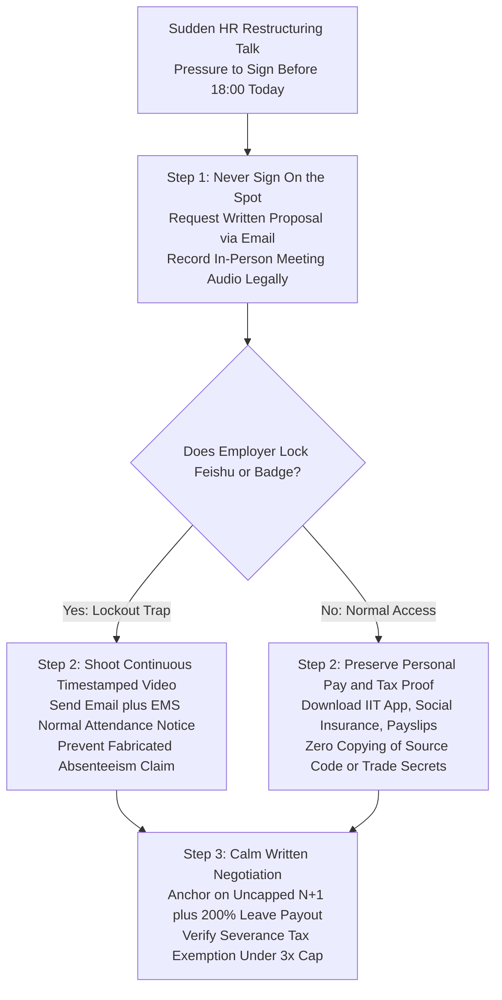
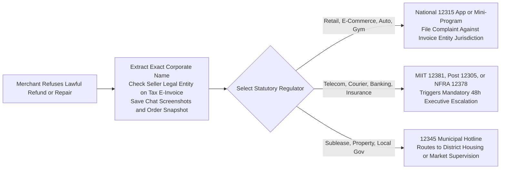

# Everyday PRC Civil & Labor Law Self-Defense for Engineers (程序员职场劳动法、租房合同与消费维权实战)

In [01-CARING-FOR-AGING-PARENTS-HEALTH-AND-HEART.md](01-CARING-FOR-AGING-PARENTS-HEALTH-AND-HEART.md), we fortified your parents' health and fraud defenses. Now we turn to **your own adult legal shield** across the three contractual arenas where thirty-something engineers in China lose the most money and sleep: **employment & layoffs (`劳动合同与竞业限制`)**, **Tier-1 apartment leases (`租房押金与二房东陷阱`)**, and **high-ticket consumer or service disputes (`消费与医疗维权`)**.

Software engineers often approach real-world disputes with two opposite failure modes: either **naive trust** (*"HR smiled and promised verbally they won't enforce the non-compete"*) or **emotional confrontation** (*"arguing angrily with frontline customer service for two hours with zero receipts"*). Under PRC civil and labor procedure, the core operating principle is **`谁主张，谁举证` (he who asserts must prove)** — modified in specific labor disputes where records sit exclusively under employer control (`用人单位掌握管理证据举证责任倒置`). Think of everyday legal literacy as **static contract auditing before runtime** plus **immutable structured logging during execution**.

---

## Table of Contents

1. [PRC Labor Contract Law Decoded: N, N+1, and 2N Severance Math](#1-prc-labor-contract-law-decoded-n-n1-and-2n-severance-math)
2. [Five Classic Tech Layoff Traps & Clean Counter-Moves](#2-five-classic-tech-layoff-traps-clean-counter-moves)
3. [Spotting Predatory Non-Compete Traps Before Signing & At Exit](#3-spotting-predatory-non-compete-traps-before-signing-at-exit)
4. [Apartment Lease Self-Defense: Ownership, Sublessors & Deposits](#4-apartment-lease-self-defense-ownership-sublessors-deposits)
5. [Consumer, Telecom & Medical Dispute Escalation Ladder](#5-consumer-telecom-medical-dispute-escalation-ladder)

---

## 1. PRC Labor Contract Law Decoded: N, N+1, and 2N Severance Math

When tech companies restructure, cut business lines, or use aggressive PIPs (`绩效改进计划`) to push out senior engineers without compensation, `90%` of your leverage comes from knowing the exact statutory formulas in the **PRC Labor Contract Law (`《中华人民共和国劳动合同法》`)** cold.

### Exact Variable Definitions (N and W)
- **Tenure Years ($N$, Art. 47)**: Calculated by full years worked at the current employer (including continuous transferred seniority across group affiliates `关联公司工龄连续计算`).
  - Remainder `>= 6 months` rounds **up** to `1.0` year (`例如 3年7个月 -> N = 4`).
  - Remainder `< 6 months` counts as `0.5` year (`例如 3年4个月 -> N = 3.5`).
- **Monthly Compensation Base ($W$, Art. 47 & Implementing Regulations Art. 27)**:
  - $W$ is **NOT** your bare "basic wage (`基本工资`)" written on page 2 of a split-salary contract!
  - By law, $W$ equals your **pre-tax all-in average monthly monetary compensation over the 12 full calendar months prior to termination (`离职前12个月应得税前平均工资`)** — including base salary, post/grade pay, monthly/quarterly bonuses, prorated `13th-month / annual bonus`, meal/transport allowances, and overtime pay, **before** deducting employee social insurance, housing provident fund, and personal income tax!
  - **The `3x` Municipal Cap (`三倍社平封顶与12年上限`)**: Only when your actual $W$ exceeds **3 times the local municipality's prior-year average employee wage** (for example, Shanghai's `3x` cap sits near `RMB 36,900–37,500/month`) is statutory economic severance capped at $W_{\text{cap}} = 3 \times \bar{W}_{\text{city}}$ and $N \le 12$. *(Note: During mutual negotiated exits `协商一致解除`, high-earning Staff/Senior engineers routinely negotiate uncapped `N+1` or `N+2` in exchange for fast, zero-friction sign-off!)*

| Termination Scenario | Statutory Formula | Legal Basis & Critical Practical Nuance |
| :--- | :--- | :--- |
| **Mutual Negotiated Exit Initiated by Company (`公司提出协商一致解除`)** | **`N`** *(Market norm: `N+1` or `N+2`)* | **Art. 36 & 46(2)**: Fastest, cleanest path; ensure the agreement explicitly records **"proposed by Employer (`由用人单位提出，双方协商一致解除`)"** so you remain `100%` eligible for **Unemployment Insurance (`失业保险金`)**! |
| **Unilateral Non-Fault Dismissal (`无过失性辞退：不胜任 / 客观情况重大变化`)** | **`N + 1`** *(or `N` with 30-day written notice)* | **Art. 40**: Extremely strict burden of proof on employer! For "incompetence (`不能胜任工作` / PIP)", employer MUST prove `(1) objective pre-acknowledged KPI criteria -> (2) failed evaluation -> (3) formal training OR role transfer -> (4) failed a SECOND evaluation`! Skipping any step makes unilateral firing **unlawful (`2N`)**! Note: the `+1` notice pay (`代通知金`) uses **last month's actual uncapped wage** |
| **Unlawful Unilateral Dismissal (`违法解除劳动合同`)** | **`2N`** *(or demand **Contract Reinstatement `继续履行`**)* | **Art. 48 & 87**: Triggered when HR fires you straight off one PIP, fabricates "gross misconduct (`严重违纪`)" without democratically enacted/signed handbook rules (`未经民主程序公示签收的规章制度`), or locks your badge during probation without proving failure of explicit **onboarding-signed probation conditions (`录用条件`)**! |
| **Constructive Dismissal for Employer Default (`被迫解除劳动合同`)** | **`N`** | **Art. 38 & 46(1)**: If employer withholds wages, fails to pay full social insurance (`未足额缴纳社保`), or cuts pay unilaterally, send a formal EMS *Notice to Cure (`限期补发/补缴催告函`)* first before invoking Art. 38 |
| **Voluntary Personal Resignation (`个人原因辞职`)** | **`0`** | **Art. 37**: **NEVER sign a pre-filled form ticked "Personal Reasons / Career Planning / Family Reasons (`个人原因申请离职`)"** during a layoff — signing forfeits `100%` of severance and blocks unemployment benefits! |

### Don't Forget Unused Statutory Annual Leave (`未休法定年假 300% 工资折算`)
Under the *Regulations on Paid Annual Leave for Employees*:
- Statutory annual leave (`法定年休假`, distinct from extra company welfare days `福利年假`) depends on **cumulative career working years across all employers (`累计工龄`, proven by total social-insurance months or archive)**: `1 to <10 years = 5 days`; `10 to <20 years = 10 days`; `>=20 years = 15 days`.
- Unused statutory days at exit must be paid out at **`300%` of your uncapped daily wage** (`W_actual / 21.75`; since `100%` was already paid in monthly salary, the employer owes the incremental **`200%` cash payout**!).

### Overtime Multipliers & Spotting Fake "Flexible Hours" Clauses (`加班费与工时制陷阱`)
Under **PRC Labor Law Art. 44**, standard working-hour employees (`标准工时制：每日8小时、每周40小时`) earn statutory overtime multipliers calculated against their contractually agreed wage base:
- **Weekday evening overtime (`工作日延时加班`)**: **`150%`** hourly pay (cannot be erased with compensatory time off `调休`!).
- **Weekend rest-day overtime (`休息日加班`)**: Employer must either arrange `1:1` compensatory rest (`补休/调休`) OR pay **`200%`** daily/hourly wage.
- **Statutory Public Holidays (`法定休假日加班` — e.g., Lunar New Year's Eve through Day 3, Oct 1–3, May 1–2)**: **`300%`** cash payout mandatory (`法定节假日加班绝不可用调休抵扣加班费`!).
- **The Unapproved "Flexible Hours" Bluff (`未经审批的不定时工时制无效`)**: Many tech offers insert *"Employee agrees to Flexible Working Hours (`不定时工作制`), with all overtime already included in salary."* In PRC judicial practice, `不定时工作制` is **legally void** unless the company holds an **active written administrative approval certificate (`特殊工时行政许可决定书`) issued by the local District Human Resources & Social Security Bureau (`区人社局`) specifically covering your exact job title**!
- **Admissible Overtime Evidence Chain**: Simply staying at the office desk until `22:00` is weak proof; arbitrators look for **employer-assigned overtime (`用人单位安排加班的证据`)**: `(1) OA/Feishu overtime tickets`, `(2) evening/weekend Slack/Feishu/WeChat messages from your manager assigning urgent deployments or on-call fixes`, and `(3) release duty rosters + production git/Jira timestamps`.

### Worked Severance Calculation: Senior Engineer Negotiated Exit (`裁员赔偿精算实例`)

Suppose you are a 32-year-old engineer in Shanghai with **`11` cumulative career working years** (`法定年假 10 天`, `6` days unused this year), **`3` years and `8` months** tenure at your current company ($N = 4.0$), a monthly base of `RMB 42,000`, plus a `RMB 120,000` annual bonus paid 4 months ago ($W_{\text{actual}} = 42,000 + 120,000 / 12 = \text{RMB } 52,000/\text{month}$), while the local `3x` municipal average wage cap is `RMB 36,921`:

```text
[STATUTORY FLOOR vs. MARKET NEGOTIATED PACKAGE BREAKDOWN]

1. Statutory Capped Economic Severance (Art. 47, if strictly capped at 3x):
   - N = 4.0 (3 years 8 months >= 6m rounds up to 4.0)
   - Statutory Severance (N)     = 4.0 x RMB 36,921          = RMB 147,684
   - 1-Month Notice Pay (+1)     = 1.0 x RMB 42,000 (uncapped)= RMB  42,000
   - Unused Statutory Leave (6d) = (52,000 / 21.75) x 6 x 200%= RMB  28,690
   -> Statutory Floor Total                                   = RMB 218,374 (100% Tax-Free!)

2. Uncapped Negotiated Mutual Exit (Market Norm for Clean Immediate Sign-Off):
   - Uncapped N+1                = 5.0 x RMB 52,000          = RMB 260,000
   - Unused Statutory Leave (6d) =                             RMB  28,690
   -> Negotiated Package Total                                = RMB 288,690 (100% Tax-Free under approx. RMB 443k ceiling!)

3. If Employer Fires Unlawfully on Single Failed PIP (Art. 87 Punitive 2N):
   - 2N Punitive Damages (Shanghai capped 2 x 4.0 x 36,921)  = RMB 295,368 (or Demand Reinstatement + Full Back-Pay!)
```

> **Why Knowing Both Numbers Matters**: Walking into an HR room with this exact 10-line breakdown printed in your notebook transforms an emotional confrontation into a calm CFO-level settlement discussion.

---

## 2. Five Classic Tech Layoff Traps & Clean Counter-Moves



1. **Trap 1 — "Sign Personal Resignation or We Will Tank Your Background Check (`背调威胁`)"**:
   - **Reality**: Legitimate third-party background-check vendors (`轩渡 / 全景求是 / First Advantage`) verify objective tenure dates, title, and whether there was fraud/corruption. Fabricating false slurs violates **PRC Civil Code Art. 1024 (Right to Reputation `名誉权`)** and exposes the ex-employer to civil damages. Moreover, recording a one-on-one workplace conversation to which *you yourself are a party* (without planting hidden bugs in others' offices) is **lawful admissible civil evidence** in PRC labor arbitration!
2. **Trap 2 — Overnight Account Lockout (`突然断飞书/删门禁，3天后按旷工无偿开除`)**:
   - **Immediate Counter-Move**: The exact morning your Feishu/email/badge stops working, shoot an **unbroken smartphone video (`一镜到底视频`)** capturing the date/time, office entrance, badge reader error, and login screen rejection. Within two hours, send both an email and a **China Post EMS letter (`邮政EMS法院专递标准：快递面单备注栏写明《关于要求提供劳动条件及正常出勤的声明函》，拍照留底+保存签收截图`)** to HR and company registered address. That single RMB 20 EMS envelope completely neutralizes any "3-day absenteeism (`旷工三日违纪`)" fabrication.
3. **Trap 3 — Unilateral Pay Cut or Forced Cross-Province Relocation (`变相逼退：单方降薪30%或调去外地`)**:
   - **Counter-Move**: Under Art. 35, altering workplace or salary requires **written mutual agreement**. Deliver a polite written *Letter of Objection (`不同意单方调岗降薪异议书`)* within **3 business days**, continue reporting to your original seat and performing duties diligently, and **never silently accept reduced paychecks for over 30 days** without written protest!
4. **Trap 4 — Severance Tax Ignorance (`离职补偿金免税额度漏算`)**:
   - Under Ministry of Finance & STA tax rules (`财税〔2018〕164号`), lump-sum severance (`一次性补偿收入`) **up to `3x` the local prior-year average annual wage** (e.g., approx. `RMB 440,000+` tax-free threshold in Shanghai/Beijing!) is **100% exempt from Personal Income Tax (`免征个税`)**! Make sure HR files it under **`解除劳动合同一次性补偿金`** in the IIT system rather than lumping it into ordinary monthly salary (`正常工资薪金` taxed up to `45%`).
5. **Trap 5 — Accidental IP / Trade-Secret Self-Sabotage (`离职前私拷代码反被刑事立案`)**:
   - **Iron Law**: When preserving labor evidence (contracts, salary slips, bonus emails, Feishu overtime approvals, `个人所得税 App` records), **NEVER `git clone`, AirDrop, email, or upload a single line of company source code, model weights, architecture docs, or customer lists to personal devices**. Desperate companies routinely audit DLP logs during layoffs to counter-sue under confidentiality breaches!

### Zero-Cost PRC Labor Arbitration in 4 Steps (`劳动仲裁零门槛实操指南`)
Most engineers fear labor arbitration (`劳动人事争议仲裁`) simply because they have never seen inside the process. In reality, `70%+` of companies settle for cash during pre-hearing mediation once they receive the official tribunal summons:
1. **Zero Filing Fee & 1-Year Statute (`完全免费 + 一年仲裁时效`)**: Under *PRC Labor Dispute Mediation and Arbitration Law Art. 27 & 53*, labor arbitration charges **`RMB 0`**! You have `1 full year` from termination to file, and for straightforward clear-cut claims under `RMB 100,000`, you can represent yourself cleanly without paying `10%–15%` contingency lawyer fees (or spend `RMB 500` once for a labor lawyer solely to review your written petition `代书费`).
2. **Pick the Best Jurisdiction (`管辖地选择`)**: File at the **District Labor Dispute Arbitration Commission (`区劳动人事争议仲裁委员会`)** either where you **physically worked (`劳动合同履行地`, e.g., Xuhui/Pudong Shanghai)** OR where the company is registered (`注册地`) — always pick your actual work city so an out-of-town shell entity has to fly HR to you!
3. **Prepare the 4-Item Filing Packet (2 Copies + 1 for Yourself)**:
   - `劳动仲裁申请书` (stating concrete numbered claims `仲裁请求`: exact `2N` or `N+1` amount, `200%` unused statutory leave payout, and issuance of clean stamped `离职证明` — **Labor Contract Law Art. 50 & 89 forbids writing any punitive remarks on a separation certificate!**).
   - Photocopy of your front/back `身份证`.
   - Company registration printout (`国家企业信用信息公示系统` free PDF showing Unified Social Credit Code & legal representative).
   - Indexed **Evidence Schedule (`证据目录清单`)**: `(E1) Labor contract`, `(E2) 12-month bank salary ledger (银行工资流水盖章版) + IIT App record`, `(E3) Unlawful lockout video / EMS notice / termination email`.
4. **Statutory Timeline**: Tribunal decides acceptance within `5 days` and renders an award within **`45 days` (`+15 days` max extension)**.

### Copy-Pasteable Template: Normal Attendance & Anti-Unilateral-Change Notice (`正常出勤及异议函模板`)

If an employer suddenly disables your accounts (`断网踢群`) or issues a unilateral pay-cut/relocation notice, send this exact text via **email + China Post EMS (`邮政特快专递`)** on the same day:

```text
致：[公司工商注册全称] 人力资源部及法定代表人

本人 [姓名]（身份证号：[18位号码]，岗位：[高级软件工程师]），于 [XXXX年XX月XX日] 入职贵司。

1. 【针对突然关闭系统权限/门禁】：本人于 [XXXX年XX月XX日 09:30] 按时到达办公场所正常出勤，
   发现贵司单方关闭本人企业邮箱/飞书/办公门禁权限，导致本人无法正常获取工作指令。现郑重声明：
   本人不存在任何旷工或自动离职意愿，随时待命提供正常劳动，请贵司立即恢复本人办公条件及系统权限。
   因贵司单方停工停职期间产生的工资损失，贵司依法应按原工资标准全额支付。

2. 【针对单方降薪/恶意异地调岗】：本人已收到贵司于 [日期] 发出的单方调岗/调薪通知。根据
   《中华人民共和国劳动合同法》第三十五条规定，变更劳动合同约定的工作地点、岗位及劳动报酬须经
   双方协商一致并采用书面形式。本人明确【不同意】上述单方变更，将继续在原岗位按原标准正常履职。

特此函告，请贵司依法合规处理。

声明人（手写签名）：___________
日期：202X年XX月XX日
（本函同步通过电子邮箱及中国邮政EMS快递单号 [11XXXXXXXXXXX] 送达留证）
```

---

## 3. Spotting Predatory Non-Compete Traps Before Signing & At Exit

Over the past five years, blanket **Non-Compete Agreements (`竞业限制协议`)** have become the #1 legal landmine for mid-to-senior Chinese tech engineers (`入职全员盲签，离职秋后算账索赔百万`).

| Clause Dimension | Fair / Standard Market Clause | Predatory Landmine Clause (`高危霸王条款`) | Your Pre-Signing & Exit Defense |
| :--- | :--- | :--- | :--- |
| **Duration (`期限`)** | `6 to 12 months` post-exit (Statutory ceiling under Art. 24 is **`24 months` max**; anything beyond 24m is void) | Full `24 months` for mid-level IC engineers with rapidly depreciating tech stacks | Request narrowing to `6–12 months` before signing offer, or negotiate full waiver upon separation |
| **Monthly Compensation (`竞业经济补偿金`)** | **`30% to 50%` of prior 12-month all-in average monthly pay** (Supreme Court Interpretation I Art. 36 sets `30%` as default floor if unspecified, never below minimum wage) | Stipulating `"20% of basic wage"` (e.g., paying RMB 3,500/month while forbidding a RMB 60,000/month engineer from working across the entire AI/cloud industry!) | Verify whether base is `离职前12个月平均总收入` vs artificially low `基本工资`; document gross disproportion |
| **Liquidated Damages (`违约金条款`)** | `2x to 3x` total compensation actually received, plus return of paid compensation | **`10x to 20x` prior annual total compensation (`动辄 RMB 1,000,000–3,000,000`)** regardless of whether only RMB 15,000 compensation was ever paid | Under Civil Code Art. 585, if sued, formally petition the arbitrator/court to **reduce excessive liquidated damages (`请求调低过高违约金`)** based on low actual compensation & non-executive status |
| **Competitor Scope (`竞业范围`)** | Named list of 5–10 direct business-line competitors | *"Top 100 internet/AI firms + all domestic/overseas subsidiaries, investees, and outsourcing vendors"* | Note that outsourcing/shell co-employment (`通过第三方外包/劳务派遣曲线入职竞对`) is routinely pierced via social-insurance/office-IP/video surveillance investigations! |

### Two Non-Negotiable Non-Compete Survival Rules
1. **At Exit — Never Leave Without a Stamped Written Waiver (`离职必拿盖章版《不启动/解除竞业限制通知书》`)**:
   - Many contracts contain an **"automatic activation upon exit unless Company notifies otherwise"** clause (`离职自动生效条款`). Verbal HR assurances (*"We won't enforce it"*) carry zero weight; if HR doesn't pay you for 2 months, they can still suddenly wire 2 months' back-pay in Month 2.5 and sue you! Insist that your *Severance Agreement (`解除劳动合同协议书`)* or separation packet includes an explicit stamped clause: **“甲方确认自离职之日起不启动/解除乙方的竞业限制义务，乙方无需履行竞业限制，甲方亦无需支付竞业限制经济补偿。”**
2. **The 3-Month Non-Payment Escape Hatch (`三个月未付补偿法定解除权`)**:
   - Under *Supreme People's Court Labor Dispute Interpretation (I) Art. 38*, if your non-compete WAS activated and the ex-employer fails to pay monthly compensation for **three cumulative months** due to employer reasons, **you do NOT become free automatically** — you must send a formal **EMS + email *Notice of Termination of Non-Compete Agreement (`解除竞业限制通知书`)* (`留存快递回执`)** to legally extinguish the obligation!

---

## 4. Apartment Lease Self-Defense: Ownership, Sublessors & Deposits

Renting in Shanghai, Beijing, Shenzhen, or Hangzhou involves RMB 50,000–120,000 per year in cash exposure. Run this **5-Point Pre-Signing Verification (`签约前五步验真`)** before transferring one fen of deposit:

1. **Defeating Runaway Sublessors (`严防黑二房东卷款跑路`, Civil Code Art. 716–718)**:
   - **Direct Owner Lease**: Inspect the landlord's original **`身份证` + `不动产权证` (or official `随申办 / 不动产登记电子证照` real-time screen, never a static Photoshop screenshot!)**. Ensure the bank account receiving rent belongs to the **named property owner** (or holds a signed spousal/co-owner authorization).
   - **Sublease / Managed Apartment (`二房东 / 托管公寓`)**: You MUST inspect `(a) the Master Lease between Owner and Sublessor`, `(b) the Owner's explicit written consent to sublease (原房东书面同意转租证明)`, and `(c) the Master Lease expiration date`. By PRC Civil Code Art. 717, **any sublease period exceeding the sublessor's remaining master lease term is legally unenforceable against the true owner (`超过原承租剩余期限的转租部分对大房东不具约束力`)**!
   - **Red-Alert Signal**: Any sublessor offering a `25%` discount if you pay **12 months upfront (`年付立减高额诱饵`)** while they pay the real owner monthly (`高收低租资金池`) is running a classic Ponzi cash-pool scam about to collapse. Stick strictly to **`押一付一` or `押一付三`**.
2. **Sale Does Not Break Lease (`买卖不破租赁`, Civil Code Art. 725)**:
   - If your landlord decides to sell the apartment mid-lease, **they have zero statutory right to evict you early** (`租赁物在承租人按照租赁合同占有期限内发生所有权变动的，不影响租赁合同的效力`)! Add two sentences to the lease remarks (`补充条款`): *"Tenant cooperates with buyer viewings only upon 24-hour advance notice, max twice weekly between 10:00 and 19:00; if Landlord requests early termination due to sale, Landlord refunds full deposit plus pays 2 months' rent liquidated damages."*
3. **The 4-Minute Move-In Walk-Through Video (`交房当天一镜到底验房视频`)**:
   - Before unpacking a single suitcase, record one continuous 4K smartphone video showing: `water/electricity/gas meter numbers (水电燃表底数)`, `every wall corner, floorboard scratch, mattress/sofa underside, window screen`, and `live operation of AC cooling, water heater ignition, toilet flush, and under-sink pipes`. Send the video + meter photos into the WeChat group with the landlord and type: *"Move-in baseline condition and meter readings confirmed on [Date]."* At move-out, zero bad-faith "you scratched the floor" deposit deductions can survive.
4. **Natural Aging vs. Tenant Damage (`自然老化维修责任归房东`, Civil Code Art. 710 & 712)**:
   - Write explicitly into the lease addendum: *"Natural wear-and-tear (`自然损耗`) and structural/core failures of air conditioners, water heaters, refrigerators, washing machines, range hoods, and concealed plumbing are repaired or replaced at Landlord's expense; if Landlord fails to repair urgent water/power/heating faults within 48 hours of notice, Tenant may hire licensed repair and deduct receipted cost from next rent (Art. 713)."*
5. **Spotting Toxic Formaldehyde Flip-Rooms (`远离“串串房”白血病/呼吸道陷阱`)**:
   - Speculators buy dilapidated old apartments, slap on ultra-cheap density-board wardrobes (`劣质颗粒板衣柜`), industrial glue wallpaper, and brand-new off-brand AC units (`五级能效杂牌空调`), and rent them out `48 hours` after renovation (`零通风直租`).
   - **3 Visual Tell-Tales**: `(a) Instagram-style bright white/cream fresh renovation inside an old 1990s walk-up with zero prior electricity usage history on State Grid`, `(b) pungent sweet/acrid smell inside closed wardrobe drawers`, and `(c) unbranded plastic-film mattress + brand-new thin polyester curtains`. If in doubt, close windows for 12 hours at `>25°C` and test with a calibrated **MBTH spectrophotometric formaldehyde reagent box (`酚试剂分光光度检测盒`, RMB 30)** — if `> 0.08 mg/m³` (`GB/T 18883-2022` national indoor standard), walk away immediately; under PRC judicial precedent, leasing an uninhabitable formaldehyde-exceeding apartment entitles the tenant to **immediate contract rescission + full deposit/rent refund (`解除合同并退一赔损失`)**!

### What If a Landlord Refuses to Return Your Deposit? (`微信在线小额诉讼25元追回押金SOP`)
When a bad-faith landlord or agency ghosts at move-out or fabricates `RMB 4,000` "wall repainting & wear fees" despite your clean move-in/move-out comparison videos:
- Never trespass or seize furniture. Send one final polite WeChat + SMS notice: *"Per Lease Clause X and Civil Code Art. 577, handover and utility settlement completed on [Date]. Please refund the RMB [Amount] deposit before 18:00 this Friday; otherwise I will submit an online filing to the District People's Court (`标的额含诉讼费与逾期利息`) this weekend."*
- If unpaid, open WeChat Mini-Program **`人民法院在线服务` (Online People's Court -> `我要立案 -> 审判立案`)**:
  - Upload your lease PDF (which already contains the landlord's `身份证号` + property address — **housing lease disputes fall under Exclusive Jurisdiction `不动产专属管辖` of the District Court where the apartment sits!**), payment receipts, and handover video screenshots.
  - Claims under `50%` of provincial average annual wage (`约 RMB 50,000–65,000` in Tier-1 cities) enter **Small-Claims Summary Procedure (`小额诉讼程序：一审终审`)** — court filing fee is just **`RMB 25`**, court-appointed pre-litigation mediators (`诉前调解员`) call the landlord directly from a court landline within `7–14 days`, and over `85%` of landlords transfer the full deposit immediately upon getting the court's call!

### Copy-Pasteable Template: Five Apartment Lease Addendum Clauses (`租房合同补充条款模板`)

Paste or handwrite these five protective clauses directly into the **`补充约定` (Addendum)** box before transferring deposit:

```text
【房屋租赁合同补充约定（与主合同具同等效力，冲突处以本补充约定为准）】
1. 权属与合规保证：甲方保证系本房屋合法产权人（或持有产权人书面同意转租授权且原租期晚于本合同到期日），
   房屋无查封及甲醛超标（符合 GB/T 18883-2022 标准），并配合乙方办理居住证登记及个税住房租金专项附加扣除。
2. 维修与自然损耗：租赁期内房屋主体、隐蔽水电管线及空调、热水器、冰箱、洗衣机、油烟机等大件设施因自然老化
   产生的故障由甲方承担维修或更换费用；紧急水电故障甲方48小时内未响应的，乙方可先行请正规师傅维修凭票抵扣房租。
3. 买卖不破租赁与看房边界：租赁期内如甲方出售房屋，本合同继续有效；乙方仅在提前24小时预约前提下配合看房
   （每周不超过2次，每次不超过30分钟）；若甲方因售房要求提前解约，须全额退还押金并另赔付乙方2个月租金。
4. 交房基线确认：双方以交房当日微信群共同确认的《入住验房视频及水电燃表底数照片》作为退租唯一比对基准；
   正常居住产生的墙面轻微痕迹及家具自然折旧不扣减押金，退租无需支付高价指定深度保洁费（保持日常干净即可）。
5. 押金退还时限：合同期满或协商解除交接钥匙当日，结清水电燃费用后，甲方须于24小时内原路无息全额退还押金。
```

---

## 5. Consumer, Telecom & Medical Dispute Escalation Ladder

Never waste emotional energy arguing with powerless Tier-1 call-center scripts. Assemble your **3-Piece Evidence Packet (`实名电子发票销售方企业全称 + 订单商品宣传快照/聊天承诺截图 + 现场/开箱一镜到底视频`)** and route directly to the statutory regulator that holds administrative KPI authority over that industry:



| Dispute Domain | Exact Official Channel | Why It Works & Key Filing Tip |
| :--- | :--- | :--- |
| **Retail, E-Commerce, Electronics, Gyms (`消费欺诈/退换货推诿`)** | **`全国12315平台` App / WeChat Mini-Program** *(Market Supervision Bureau `市场监管局`)* | Don't search the brand nickname — look up the **exact Unified Social Credit Code / Corporate Name (`统一社会信用代码/销售方全称`)** on your `电子发票` (e.g., filing against the registered district of JD/Tmall/Apple/merchant triggers mandatory official mediation) |
| **Mobile Carriers Hidden Plans / Port-Out Blocks (`运营商乱扣费/携号转网受阻`)** | **First call carrier (`10086/10000/10010`) for ticket ID -> If unresolved in 24h, file on `工信部电信用户申诉受理中心` (`12381` / WeChat `工信微报`)** | MIIT complaint ratios directly penalize provincial telecom executives; hidden recurring charges vanish within 24 hours |
| **Lost, Crushed, or Stalled Express Parcels (`快递丢件毁损只赔运费`)** | **`国家邮政局申诉网站` (`ss.spb.gov.cn` / WeChat `邮政业消费者申诉` / `12305`)** | Cite Civil Code Art. 832 (carrier strict liability for parcel damage/loss unless force majeure; unhighlighted fine-print "3x freight cap" standard clauses can be challenged under Art. 496–497!) |
| **Insurance Claims Stall or Bank Mis-Selling (`保险拒赔拖延/银行飞单误导`)** | **`12378` Financial Consumer Protection Hotline** *(NFRA `国家金融监督管理总局`)* | Forces headquarters compliance review rather than local branch stonewalling |
| **Hospital Care Dispute (`医疗纠纷与病历保全`)** | Hospital **`医务处/患者服务部`** + **`12320 / 12345 卫健委`** | Stay 100% calm (**zero physical disruption `严禁医闹`, which turns victims into public-order offenders**); immediately exercise your statutory right under *Medical Dispute Prevention Regulations* to **photocopy objective medical records and jointly seal (`共同封存病历原件/电子病历镜像`)** on site |

---

## Next Step in the Curriculum

Workplace contracts and apartment leases protect your earned income; the final module protects your **entire net worth and physical survival** against asymmetric disasters. Proceed to [03-FINANCIAL-RED-LINES-AND-EMERGENCY-READINESS.md](03-FINANCIAL-RED-LINES-AND-EMERGENCY-READINESS.md) to master the three wealth-destroying legal red lines, the 10-minute car accident SOP, high-rise fire survival, and your family's Emergency Continuity Binder.
