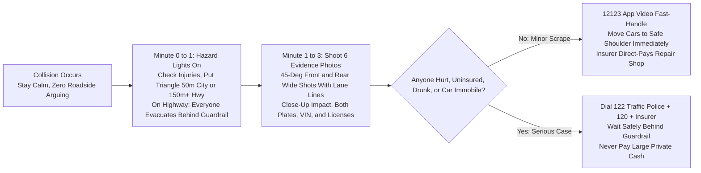
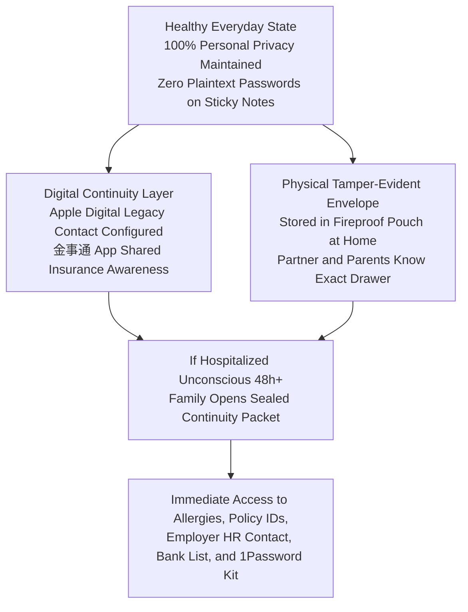

# Financial Red Lines & 72-Hour Family Crisis Readiness (倾家荡产法律红线与72小时家庭应急备灾手册)

In [02-ADULT-LEGAL-LITERACY-WORK-RENT-AND-CONTRACTS.md](02-ADULT-LEGAL-LITERACY-WORK-RENT-AND-CONTRACTS.md), we covered workplace severance, non-compete clauses, and rental contracts. Those rules protect several months of salary. This final module covers **existential family guardrails**: the three legal signatures that have bankrupted countless Chinese middle-class households overnight (`签字即破产的三大法律深渊`), alongside the concrete **10-minute roadside crash SOP**, **high-rise fire survival kit**, **72-hour typhoon/blackout kit**, and **sealed Family Continuity Binder (`家庭应急锦囊`)**.

---

## Table of Contents

1. [Three Wealth-Destroying Legal Red Lines: Never Touch the Pen](#1-three-wealth-destroying-legal-red-lines-never-touch-the-pen)
2. [Acquaintance Lending Rules & The Ironclad Five-Element Loan Note](#2-acquaintance-lending-rules-the-ironclad-five-element-loan-note)
3. [Minor Car Accident & Roadside Crisis 10-Minute SOP](#3-minor-car-accident-roadside-crisis-10-minute-sop)
4. [High-Rise Fire Survival & The 72-Hour Home Emergency Kit](#4-high-rise-fire-survival-the-72-hour-home-emergency-kit)
5. [The Sealed In-Case-of-Emergency Family Continuity Binder](#5-the-sealed-in-case-of-emergency-family-continuity-binder)

---

## 1. Three Wealth-Destroying Legal Red Lines: Never Touch the Pen

Across PRC civil judgment enforcement records (`中国执行信息公开网`), hundreds of thousands of honest engineers, teachers, and civil servants end up on the **Restricted High-Consumption & Judgment Debtor List (`限高令 / 失信被执行人` — barred from high-speed G-trains, flights, mortgages, and hotel stays)** without ever borrowing a cent for themselves. Nearly all of them crossed one of three red lines out of **face-saving politeness (`抹不开亲戚朋友面子`)**:

| Absolute Red Line | Legal Trap Under PRC Law | Catastrophic Consequence | Zero-Exception Action Rule |
| :--- | :--- | :--- | :--- |
| **1. Personal Loan Guarantee (`替亲友签字担保 / 共同借款人`)** | **PRC Civil Code Art. 688 (`连带责任保证`)**: While Art. 686 defaults *ambiguous* clauses to general guarantee (`一般保证`), **100% of bank, micro-loan, and business contracts print `"连带责任保证人"` or `"共同借款人"` explicitly** | The moment the borrower misses payment, the creditor **does not need to auction the borrower's assets first** — the court directly freezes **your salary account, deducts your provident fund, auctions your apartment, and issues a `限高令`** | **NEVER sign your name on any third-party loan, guarantee letter, or "witness (`实为担保条款的见证栏`)" page** — not for an uncle, cousin, or college roommate |
| **2. Nominal Legal Representative or Shareholder (`挂名法定代表人 / 挂名股东 / 监事`)** | **Revised PRC Company Law (2024) Art. 47 & 54**: Subscribed capital (`认缴出资`) must be paid in within 5 years, and if the company cannot pay debts, **unpaid capital accelerates immediately (`出资加速到期`)**; legal reps automatically bear court **`限高令`**, tax investigation blocks (`非正常户税务黑名单`), and criminal exposure if the boss flees | Your personal credit, travel freedom, and passport exit (`边控限制出境`) are held hostage for a company you own `0%` real upside in | Refuse 100% of requests to *"borrow your ID to register a clean company or act as nominal legal rep/supervisor (`挂名法人/财务负责人`)"* |
| **3. Lending Bank Cards, Alipay, or SIM Cards (`出借银行卡/电话卡跑分走账`)** | **PRC Criminal Law Art. 287-2 (`帮助信息网络犯罪活动罪 / 帮信罪`)** & PBOC/MPS **`断卡行动`** | Even with zero criminal intent, if illicit telecom-fraud or Underground FX funds touch your card, **all debit cards, WeChat Pay, and Alipay under your ID are frozen nationwide for 5 years (`五年惩戒期禁止非柜面支付`)** plus potential criminal prosecution | Never receive/forward money for acquaintances ("*my card hit its limit, pass RMB 80,000 through yours*"), and cancel unused SIM cards at official halls |

### Two Face-Saving Refusal Scripts (`不伤和气的甩锅拒签话术`)
Never lecture a relative on risk — **shift blame onto an immovable external institution** so they realize signing is physically impossible for you:
- **Script A (Blame Employer Compliance & Mortgage Audit)**: *"二叔，真不是我不帮，我们公司核心研发岗每年要做商业利益与个人征信合规背调（查央行征信对外担保栏），而且我房贷合同签了补充条款，一旦征信出现对外连带担保，银行会触发抽贷提前收回房贷，公司也会停职合规审查，我实在没法签这个字。"* *(Uncle, our company runs annual compliance checks on PBOC credit reports for external guarantees, and my mortgage covenant triggers loan recall if any third-party guarantee appears — my hands are genuinely tied.)*
- **Script B (Partner Two-Key Veto)**: *"哥，我和对象结婚/同居前签了家庭财务铁律，身份证和征信授权双方互相监管，任何对外担保、挂名法人一概不碰。我如果在外面签了字，家里真要闹翻天了，实在对不住。"*

### Two Extra Legal Red Lines Specifically for Tech Engineers

1. **Clean-Room Isolation for Indie Projects (`严防“职务发明/职务作品”IP污染`, Patent Law Art. 6 & Copyright Law Art. 18)**:
   - Under PRC IP law, any software, model, or invention created `(a) within the scope of your assigned job duties`, `(b) using employer material/technical resources (利用本单位物质技术条件：公司电脑、公司内网VPN、公司测试云账号、公司API Key)`, OR **`(c) within 1 year after resignation if related to your prior duties (离职后1年内作出的与原工作相关的发明)`** legally belongs `100%` to the employer!
   - **Clean-Room Rule**: Build personal SaaS/open-source strictly on **personally purchased hardware (`自购电脑`), home broadband, personal GitHub/Apple accounts, outside working hours**, and outside your employer's core vertical.
2. **Never Swap Foreign Currency Privately in WeChat Groups or Underground Desks (`严禁私下对敲换汇`)**:
   - Even if an acquaintance says *"Send RMB 100,000 to my Shanghai Alipay and I'll Zelle USD 14,000 to your US account at mid-market rate"*, **never touch peer-to-peer FX matching (`对敲换汇`)**!
   - First, the domestic RMB counterparty leg is frequently tainted by telecom-fraud money laundering, instantly freezing your domestic bank cards (`公安异地司法冻卡半年起步`). Second, under *SAFE Foreign Exchange Regulations*, private FX trading triggers administrative fines up to **`30%` of the transaction value** (and criminal *Illegal Business Operations `非法经营罪`* above statutory thresholds). Always use your clean **`USD 50,000/year` personal quota (`个人便利化购汇额度`)** inside official bank apps!

---

## 2. Acquaintance Lending Rules & The Ironclad Five-Element Loan Note

When a close relative or lifelong friend faces a genuine medical or acute liquidity emergency, follow the **Three Iron Rules of Private Lending (`民间借贷三铁律`)**:

1. **Emergency Medical Only, Never Business Speculation (`救急不救穷，绝不借钱给人做生意/炒股/还网贷`)**: If a bank with 500 risk models refused to lend to their restaurant or crypto trade, you have `0%` edge.
2. **Never Borrow to Lend (`严禁刷信用卡/套网贷转借他人`)**: Under *Supreme People's Court Private Lending Judicial Interpretation Art. 13*, **on-lending funds drawn from bank credit, Huabei, or consumer loans renders the private lending contract legally VOID (`套取金融机构信贷资金转贷，民间借贷合同无效`)**, forfeits interest, violates bank loan-use terms, and risks criminal `高利转贷罪`!
3. **Mental Write-Off Rule (`做好收不回的准备`)**: If someone asks to borrow RMB 50,000 and losing RMB 50,000 would strain your life, **either decline gently or say**: *"My cash is locked in long-term fixed notes right now; here is RMB 5,000 for urgent hospital expenses — take care of your family first, no rush at all."*

### When You DO Lend (`>= RMB 5,000`): The 5-Element Ironclad `借条`
Never accept a sloppy WeChat message or a flawed `欠条`. Have the borrower write or sign a **`借条` (Loan Receipt)** + wire strictly via **Bank-to-Bank Transfer (`银行卡实名转账`)**:

| Trap to Avoid | Correct Legal Standard | Why Courts Care |
| :--- | :--- | :--- |
| Writing **`欠条`** instead of **`借条`** | Title the document **`借条` (Loan Note)** | `欠条` can arise from gambling, goods, or disputed settlements requiring extra proof of underlying cause; `借条` directly proves a statutory loan relationship (`民间借贷法律关系`) |
| Writing ambiguous **`今借 XXX 5万元`** | Write **`今收到出借人[你的姓名+身份证号]通过银行转账出借的人民币伍万元整（RMB 50,000.00）`** | Chinese character `借` means both *borrow* and *lend*, and `"今借"` fails to prove funds actually arrived (`款项实际交付证据`)! |
| Handing physical cash (`给现金`) | Transfer from **your named bank card to borrower's named bank card**, with transfer memo **`"出借给[对方姓名]个人周转借款"`** | In PRC courts, a signed `借条` **without** matching bank transfer proof is routinely challenged as "unfunded note"! |
| Missing borrower ID or court address | Attach **front/back photo of borrower's `身份证`** + write **`"借款人确认法律文书送达地址：[精确住址+手机号]"`** | You **cannot even file a lawsuit (`法院立案必须提供被告明确身份证号与送达地址`)** without the defendant's 18-digit ID number! |
| Missing maturity date | Specify exact **`还款日期：XXXX年XX月XX日前归还`** (plus lawful interest `<= 4x 1-year LPR` if any) | Triggers clear **3-year Statute of Limitations (`三年诉讼时效`, Civil Code Art. 188)** and default overdue interest from day one after maturity |

### Copy-Pasteable Template: Court-Ready PRC Private Loan Note (`法院立案级标准《借条》模板`)

Print or have the borrower copy every word by hand in black gel pen (`黑色签字笔手写签名并按右手食指手印`), and wire strictly to the exact bank card listed inside:

```text
                              借    条

为用于【个人家庭医疗应急/合法周转】（非用于赌博、炒股等非法用途），今借款人
________（身份证号：______________________）实际收到出借人 ________
（身份证号：______________________）通过银行转账方式出借的人民币大写：
________元整（RMB ________.00元）。

一、指定收款账户：借款人本人名下 ________银行卡（账号：______________________），
    银行转账凭证回单作为本借条不可分割之交付附件（绝不以现金交付）。
二、还款期限与利息：借款人承诺于 202X年__月__日前一次性归还全部本金；借期内年利率
    为 ___%（不超过合同成立时一年期 LPR 四倍）；如逾期未还，自逾期之日起按年利率
    ___% 计付逾期利息，并由借款人承担出借人为实现债权支出的律师费、诉讼费及保全费。
三、法律文书送达地址确认：借款人确认以下地址为法院诉讼及仲裁有效送达地址（无人签收
    或拒收均视为合法送达）：________________________________________，
    联系电话：13X-XXXX-XXXX。

借款人（正楷手写签名并按指印）：________________
借款人配偶知情共同签字（如涉及夫妻共同生活）：________________
签署日期：202X年__月__日（附借款人身份证正反面复印件于本页背面）
```

---

## 3. Minor Car Accident & Roadside Crisis 10-Minute SOP

An elevated-ring-road collision in rush hour floods untrained drivers with panic, leading either to **deadly secondary rear-end crashes (`站在快车道理论引发二次车祸致死`)** or **botched insurance claims**.



### Four Roadside Golden Rules
1. **Insurance Baseline Before You Ever Drive**: Beyond compulsory `交强险` (which covers only RMB 2,000 property / RMB 180,000 medical+death!), **always buy `RMB 3,000,000 to 5,000,000` Commercial Third-Party Liability Insurance (`商业三者险 300万–500万`) PLUS the RMB 30–50 rider for `医保外用药责任险` (Non-Formulary Medical Expense Rider)**. Without that RMB 40 rider, imported orthopedic plates or ICU drugs (`自费药/进口耗材`) in an injury crash come straight out of your pocket!
2. **Highway Survival Law (`高速“车靠边、人撤离、即报警”九字诀`)**: On an expressway, **NEVER stand between the two cars inspecting bumpers or arguing!** If drivable, pull onto the emergency lane (`应急车道`), place the reflective triangle `150m–200m` back while watching oncoming traffic, move **every passenger outside the steel highway guardrail (`全员翻出护栏外`)**, and dial **`12122`**.
3. **The 6 Mandatory Photos (`挪车前必拍6张图`)**: `(1) Front 45-degree wide shot showing both cars + lane markings`, `(2) Rear 45-degree wide shot showing lane markings/signs`, `(3) Close-up of exact collision contact point & paint transfer`, `(4) Other car's license plate + windshield VIN`, `(5–6) Other driver's Driver's License + Vehicle Registration (驾驶证+行驶证)`. Then open **`交管12123 App -> 事故视频快处`** (or local municipal **`快处易赔`** mini-program in Shanghai) to clear the lane legally in minutes!
4. **If Someone Is Injured (`人伤事故三不原则`)**: Call `120` and `122` immediately; notify your insurer to advance hospital deposit (`保险公司垫付抢救费`); **do not visit with cash envelopes to "settle privately," do not advance large medical sums out of pocket (`不垫付医药费`), and insist all final settlements go through Traffic Police / People's Mediation + Insurer sign-off (`交警调解/法院确认，保险直赔`)**.

---

## 4. High-Rise Fire Survival & The 72-Hour Home Emergency Kit

In urban Chinese high-rise apartments (`20–35层住宅`), `80%+` of fire deaths are caused not by flames, but by **3 minutes of inhaling superheated carbon monoxide and hydrogen cyanide smoke (`浓烟窒息中毒`)** inside stairwells (`烟囱效应垂直蔓延速度高达 3–5 m/s`, five times faster than human stairs descent!).

### The Life-or-Death High-Rise Door Test (`高层火场逃生第一铁律：先摸门把`)
1. **Fire Starts INSIDE Your Own Apartment**:
   - **Wok Oil Fire (`厨房油锅起火`)**: **NEVER pour water (`严禁泼水，瞬间爆燃喷出两米火球`)!** Turn off the gas valve first, slide the metal wok lid horizontally from the side OR pull down your **kitchen fiberglass fire blanket (`灭火毯`)** over the pan, and turn off the range hood.
   - **Electrical / Sofa Fire Past Initial Control**: Grab keys + wet/filtering hood, get everyone out, **pull your front door CLOSED firmly behind you (`随手关紧入户门与防火门，断氧阻烟救整栋楼`)**, press manual fire call point, descend stairwell (**NEVER take elevators**).
2. **Fire Starts OUTSIDE Your Unit (Downstairs / Neighbor)**:
   - Touch your closed metal front door and handle with the **back of your hand (`手背试探门把手温度`)** and check the peephole:
   - **If the door handle is hot OR dark smoke is already in the corridor/stairwell (`门把发烫或走廊楼梯间已进浓烟`)**: **DO NOT OPEN THE DOOR AND NEVER RUN BLINDLY UP OR DOWN A SMOKE-FILLED STAIRWELL!** Stay inside, soak towels/bedsheets to seal every crack around the front door (`湿毛巾封堵门缝并不断泼水降温`), retreat to a room with an exterior window (away from smoke plumes), dial **`119`** stating exact *Street + Compound + Building # + Room #*, and wave a bright flashlight/sheet at the window (`固守待援 — 标准入户防火门可耐火 60–90 分钟!`).
   - **Only if corridor AND pressurized evacuation stairwell (`防烟楼梯间`) are 100% smoke-free** and fire is above you: put on your **`TZL30` filtering smoke respirator**, close the door, and walk rapidly down to ground level.
3. **Zero Indoor E-Bike Lithium Battery Charging (`严禁电瓶车及锂电池入户充电`)**: Thermal runaway (`锂电池热失控爆燃`) reaches `800°C` with toxic hydrofluoric gas in **12 seconds** — impossible to extinguish with household extinguishers.

### The RMB 500 Home Fire & 72-Hour Crisis Kit (`居家救命四件套 + 72小时备灾箱`)

| Kit Category | Exact Items & Specifications | Storage Location & Maintenance |
| :--- | :--- | :--- |
| **Home Fire 4-Piece Kit (`家庭消防四件套`, approx. RMB 220)** | (1) Two **`3C`-certified `TZL30` filtering fire self-rescue respirators (`过滤式消防自救呼吸器`)**; (2) One `1.2m x 1.2m` **fiberglass fire blanket (`硅胶/玻纤灭火毯`)**; (3) One **`2L / 3L` water-mist fire extinguisher (`水基型灭火器`, rated for Class A/B/E/F live household electrical up to `36kV` + grease)**; (4) Standalone **photoelectric smoke + natural-gas alarms (`独立光电感烟+燃气报警器`)** | Keep `TZL30` hoods on **bedroom nightstand** (not buried in balcony closets!); hang fire blanket on kitchen wall away from stove flame; check extinguisher pressure gauge (`绿区`) & 3–4 year expiry annually |
| **Power, Light & Comms (`断电断网包`, approx. RMB 150)** | `20,000 mAh` PD power bank + multi-tip cable; **hand-crank solar AM/FM emergency radio + LED flashlight (`手摇发电收音机强光手电`)**; high-decibel **aluminum rescue whistle (`高频求生哨` — saves breath if trapped)** | Charge power bank every Q1/Q3 audit; keep flashlight by bedroom door |
| **Water, Rations & Cash (`72小时生存物资`)** | One sealed case of bottled water (`3L/person/day`, rotated every 6 months); compact high-energy bars / canned fish; **`RMB 2,000` physical cash in `RMB 20 / 50 / 100` bills** | During severe typhoons (`台风积水停电`) or earthquakes when cell towers fail, **QR payments stop working completely** — cash buys water and rides |
| **Trauma & Core Meds (`家庭急救药箱`)** | Sterile gauze pads, elastic pressure bandage, medical tape, povidone-iodine single-use swabs (`碘伏棉签`), nitrile gloves, digital thermometer, ibuprofen, cetirizine (`西替利嗪` for acute allergy), **Oral Rehydration Salts III (`口服补液盐III` — gold standard for acute gastroenteritis dehydration)** | Audit expiration dates every August; keep 7-day buffer of any daily prescription meds |

### Three Hands-On Physical First-Aid Skills Every Steward Must Know

Before ambulances arrive (`平均出车响应 8–15 分钟`), what you do in the **first 240 seconds** determines life vs. permanent brain death or disfigurement:

1. **Complete Airway Obstruction — Heimlich Maneuver (`海姆立克急救法` & Solo Self-Rescue)**:
   - High-risk foods for seniors & festive dinners: glutinous rice balls (`汤圆/年糕`), beef tendon, whole grapes, and jellyfish. Sign: victim clutches throat with **complete inability to speak or cough (`三不能：不能说话、不能咳嗽、不能呼吸`)**.
   - **For Another Adult (`剪刀-石头-布口诀`)**: Stand firmly behind them, lean their torso forward, place `2` fingers (`剪刀`) above the navel, make a fist (`石头`) thumb-side inward right above that spot below the ribcage xiphoid, wrap your other hand (`布`) over the fist, and deliver **sharp inward-and-upward abdominal thrusts (`向内上方快速冲击`)** until the bolus pops out!
   - **If You Choke While Living Alone (`独居噎食黄金60秒自救`)**: Immediately make the same fist above your navel and **slam your upper abdomen forcefully downward onto the rounded top edge of a sturdy dining chair back or kitchen counter edge (`猛烈撞击坚固椅背/桌沿`)**!
2. **Thermal Burns & Boiling Soup Scalds (`烫伤急救五字诀：冲-脱-泡-盖-送`)**:
   - **Step 1 `冲` (Flush)**: Immediately hold the burned skin under **gentle cool running tap water (`15–20°C 流动自来水，绝不可用冰块直接冻伤组织!`) for a full 20 to 30 minutes**! Continuous cooling halts residual deep dermal heat conduction (`阻断余热向真皮深层穿透`) — the difference between zero scar and a skin graft.
   - **Step 2 `脱-泡-盖-送`**: Cut away (never rip!) stuck clothing under water, cover loosely with sterile gauze/clean cling film, and go to a burn clinic if larger than a palm or on face/joints.
   - **Absolute Ban**: **NEVER smear toothpaste, soy sauce, sesame oil, or purple gentian violet (`严禁涂牙膏、酱油、香油`)** — doctors must scrub every grain off raw nerve endings before treating!
3. **Sudden Cardiac Arrest (`黄金4分钟 CPR 胸外按压 + 微信“AED地图”`)**:
   - If someone collapses unresponsive with **no normal breathing (`无意识且无正常呼吸/仅有叹息样濒死喘息`)**: shout to a bystander *"You in the blue jacket — call 120 and grab the nearest AED (`微信搜索城市急救/AED地图`, available in every Shanghai metro station & major mall)!"*
   - Kneel beside the chest, heel of palm on the **center of the sternum (nipple line)**, arms locked straight, and push **hard (`5–6 cm` depth) and fast (`100–120 BPM` — exact tempo of *Stayin' Alive*)** without stopping until the AED pads attach and analyze!

### Pre-Typhoon / Extreme Storm 12-Hour Apartment Checklist (`超强台风暴雨防御清单`)
When a Red/Orange Typhoon Warning (`如上海秋季超强台风过境`) is 12 hours out:
- Bring ALL balcony flowerpots, drying racks, and loose items indoors (`高空坠物承担民事乃至刑事责任`, Civil Code Art. 1254!).
- Tape large `米`-shaped painter's masking tape (`美纹纸胶带，撕除不留胶`) across large old floor-to-ceiling panes to prevent shattered glass spray if hit by flying debris; stuff dry towels along window weep-hole tracks (`窗框排水孔防倒灌`).
- Fill clean pots/buckets with tap water (high-rise rooftop booster pumps `二次供水泵房` cut off whenever basement power floods!), charge all laptops/power banks to `100%`, and move your car **out of underground flood-prone garages (`地下车库防淹车`)** onto high flat open ground away from old plane trees (`避开老旧梧桐树断枝砸车`)!

---

## 5. The Sealed In-Case-of-Emergency Family Continuity Binder

Ask yourself one uncomfortable engineering question: **Bus-Factor = 1 Test (`家庭单点失能测试`)**. If a distracted driver hits your bike tonight and you lie sedated in an ICU for 5 days, can your partner or parents smoothly unlock your medical insurance, contact your employer's group-insurance HR, and keep mortgage auto-pay from defaulting — *without* exposing your plaintext passwords during normal daily life?



### Build Your Two-Layer Continuity Packet in 45 Minutes This Sunday
1. **Configure Built-In OS Digital Legacy (`系统级数字遗产/紧急联系人`)**:
   - **iPhone Medical ID (`健康 App -> 医疗急救卡`)**: Set blood type, drug allergies, conditions, and two ICE contacts (`紧急联系人`) accessible **from the lock screen without passcode** by paramedics (`按住侧边按钮+音量键即可查看`).
   - **Apple Digital Legacy Contact (`设置 -> Apple账户 -> 登录与安全性 -> 遗产联系人`)** & **Password Manager Emergency Kit (`1Password Emergency Kit` printed PDF)**.
2. **Prepare One Tamper-Evident Sealed A4 Envelope (`防拆封条家庭应急信封` inside a RMB 50 fiberglass fireproof document bag `防火防水文件袋`)**:
   - **Sheet 1 — Medical & Insurance Sheet**: Blood type, allergies, and every active policy (`社保所在地 + 商业百万医疗险 + 综合意外险 + 定期寿险 + 公司补充商业团险`: Insurer name, Policy #, 24h Claims Hotline `955XX`; also tell family about **`金事通` App** — the official China Banking & Insurance Information Technology platform that queries ALL policies under an ID!).
   - **Sheet 2 — Institution Topology (Names Only, Zero Raw PINs Needed Until Emergency Kit)**: Which banks hold salary, emergency cash, and mortgage auto-debit (`房贷扣款卡号与每月还款日`, so family can transfer cash *into* that card number to prevent mortgage default!); securities brokerage names; employer HRBP & manager phone numbers.
   - **Sheet 3 — Sealed Inner Envelope**: Master password recovery key (`1Password Emergency Kit`) + SIM card PIN/recovery notes, sealed with a signed tamper-evident sticker (`防拆封条`) to be opened **only in medical incapacitation or crisis**.

### Copy-Pasteable Template: Family 48-Hour Continuity Sheet (`《家庭应急锦囊》A4打印模板`)

Print, fill out, seal inside your fireproof document bag (`防火防水文件袋`), and tell your partner and parents which drawer holds it:

```text
======================================================================
      家庭 48 小时应急连续性指引卡（仅限本人突发重病/意外失能时拆阅）
                    最后更新日期：202X年__月__日
======================================================================
【1. 医疗急救基线】
本人姓名：__________   身份证号：__________________   血型：____型
药物/麻醉过敏史：【无 / 严禁使用：____________________________】
社保参保地：________市（医保电子凭证已绑定父母/伴侣亲情账户）

【2. 商业保险与公司团险报案清单】（入院48小时内拨打报案！可登录“金事通”App查全量保单）
- 百万医疗险：[保险公司名称]  保单号：________________  报案热线：955XX
- 综合意外险：[保险公司名称]  保单号：________________  报案热线：955XX
- 定期寿险：  [保险公司名称]  保单号：________________  受益人：________
- 公司补充商业医疗/意外团险：请联系下方我司 HRBP 协助发起理赔

【3. 职场紧急联络人】（请假、工伤认定、商业团险、限制性股票/公积金处理）
直属主管：________  电话：13X-XXXX-XXXX   HRBP：________  电话：13X-XXXX-XXXX

【4. 家庭资产与防断供拓扑图】（仅列机构名称，不含明文密码，防日常遗失风险）
- 工资及紧急备用金银行：[招商银行 / 工商银行]（尾号 XXXX）
- 房贷自动扣款卡（请勿断供！）：[建设银行] 卡号：__________________（每月__日扣款 RMB ____）
- 证券/基金账户机构：[华泰证券 / 天天基金 / 盈透证券]（凭身份证明可临柜查询）

【5. 数字遗产与内层密封袋说明】
- 手机已设置 Apple 遗产联系人：[伴侣/父母姓名]；锁屏长按侧边键+音量键可看医疗急救卡
- 本袋内附【防拆封条小信封】：内含 1Password Emergency Kit 主恢复密钥及主手机号
  PUK 码，仅在本人昏迷失能超48小时或极端意外情况下撕开封条使用。
======================================================================
```

---

## Curriculum Summary: The Quiet Strength of an Adult Steward

Review the arc across all four modules in [00-README.md](00-README.md):
- Your parents walk into a warm, brightly guided, fall-proof bathroom (`01`), up to date on targeted screenings and vaccines, shielded from telecom fraud, with their life stories recorded in their own voices.
- Your career and housing stand on clear statutory awareness (`02`), immune to HR intimidation, hidden non-compete traps, and runaway sublessors.
- Your balance sheet and apartment sit behind hard red lines (`03`) — zero third-party guarantees, `RMB 3,000,000+` liability protection, bedside fire gear, and a clean continuity binder.

You don't build these guardrails to live in fear. **You build them once so you can forget about fear — and spend your thirties fully present, warm, playful, and fearless with the people you love.**
