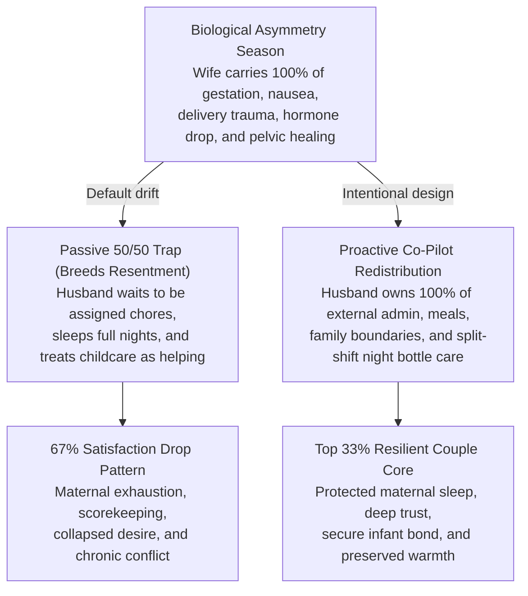
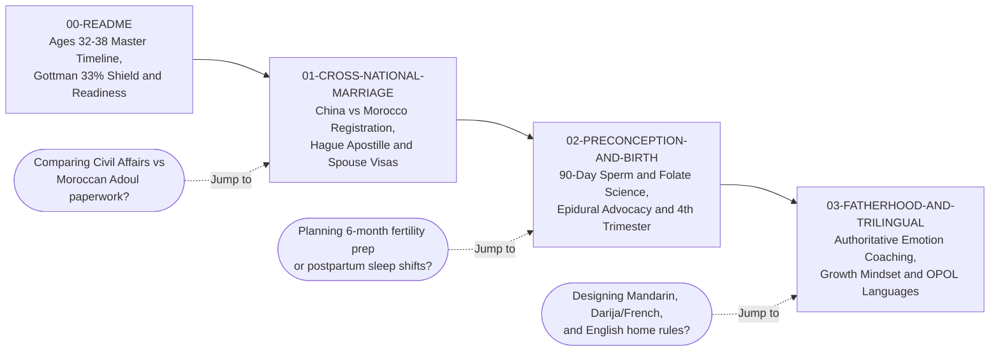

# Ages 32 to 38 Next-Chapter Readiness: Walking Into Marriage & Fatherhood Prepared, Calm & Equal

## 1. Why Studying This Before Engagement Puts You in the Top 1%

Most well-intentioned men walk into marriage, pregnancy, and fatherhood completely blind—not because they lack love, but because society treats family literacy as something a man only looks up *after* an emergency begins. As a result, the average husband scrambles to learn Apostille bureaucracy four weeks before a visa expires, Googles morning sickness only after his wife is already vomiting at Week 7, freezes when relatives pressure her against an epidural, and defaults at 03:00 to the harsh parenting scripts he absorbed in childhood.

Reading and internalizing this curriculum **before** engagement and pregnancy—while your nervous system is rested, curious, and unhurried—puts you in the top 1% of thoughtful husbands and fathers for three structural reasons:

- **Zero Cognitive Overload During High-Stakes Transitions**: In software engineering, you never read the incident runbook for the first time while production is on fire. Studying cross-national legal lead times, pre-conception biology, obstetric red flags, and infant attachment ahead of time lets you stay calm when your partner needs steadiness most.
- **Eliminating the "Maternal Project Manager" Burden**: When a man knows nothing about fertility windows, prenatal tests, postpartum pelvic recovery, or language milestones, he forces his wife to carry both **100% of the physical load** *and* **100% of the research and teaching load**. Arriving already informed feels like profound emotional shelter.
- **Designing Intentional Defaults Instead of Inheriting Flawed Ones**: Under chronic sleep deprivation, human brains revert to automatic childhood conditioning. Pre-committing together to evidence-based medicine, split-shift sleep, Authoritative warmth, and One-Parent-One-Language (OPOL) prevents generational trauma and cultural friction before Day 1.

### Reactive Passenger vs. Prepared Co-Pilot Compared

| Life Transition | Reactive Passenger ("Just Tell Me How to Help") | Top-1% Prepared Co-Pilot (Calm, Informed & Equal) |
| :--- | :--- | :--- |
| **Cross-National Marriage** | Underestimates single-status expiry and translation seals; triggers frantic embassy trips and delayed visas | Maps China Civil Affairs vs. Morocco Family Court 6 months ahead; tracks Hague Apostille validity windows cleanly |
| **Pre-Conception Window** | Assumes fertility is "100% female health"; drinks, uses hot saunas, and sleeps 5 hours until positive test | Optimizes his own 74-to-90-day sperm maturation cycle alongside her folic acid, rubella, thyroid, and dental checks |
| **Pregnancy & Childbirth** | Treats OB visits as optional errands; wavers when older relatives claim epidurals "harm the baby" | Knows trimester physiology and preeclampsia flags; pre-verifies 24/7 hospital anesthesia and champions her bodily autonomy |
| **Fourth Trimester (0–12 Wks)** | Sleeps 7 hours claiming "I have work tomorrow" while she fractures into 90-minute scraps; misses PPD signs | Runs a protected 5-hour consolidated sleep shift for her every night; rejects harmful *Yuezi* myths; screens EPDS proactively |
| **Parenting & Multilingualism** | Falls back on East Asian comparison/shaming when stressed; lets minority heritage languages fade by age 5 | Practices high-warmth, clear-boundary Emotion Coaching, process praise, and structured Mandarin + Darija/French + English OPOL |

---

## 2. The Ages 32 to 38 Unhurried Master Timeline

Men entering serious love in their early thirties sometimes feel artificial urgency to compress relocating, marrying, buying property, and having a baby into a single 18-month sprint. Relationship science warns strongly against **Transition Stacking**: piling multiple irreversible stressors onto a young partnership simultaneously starves the couple bond of oxygen.

From 32 to 38, you actually possess abundant biological and financial runway—provided you sequence each chapter deliberately rather than sliding or rushing:

1. **Phase 1 — Partnership Verification & Ordinary-Week Reality (Ages 32 to 33.5)**: Build daily attachment trust, bridge cross-cultural communication rhythms, meet each other's core circles, and complete at least one continuous **4-to-8-week shared-roof working trial** before making permanent cross-border leaps.
2. **Phase 2 — Engagement, Civil Registration & Newlywed Foundation (Ages 33.5 to 35)**: Execute cross-national marriage documentation without panic ([01-CROSS-NATIONAL-MARRIAGE-AND-LEGAL-LOGISTICS.md](01-CROSS-NATIONAL-MARRIAGE-AND-LEGAL-LOGISTICS.md)), establish your shared home and proportional Three-Bucket finances, and **protect 12 to 18 months of joyful "just the two of us" marriage** before trying to conceive. That unhurried newlywed reservoir becomes your shock absorber when infant nights arrive.
3. **Phase 3 — 6-Month Couple Pre-Conception, Pregnancy & Protected Recovery (Ages 35 to 36.5)**: Run the joint 180-day pre-conception health protocol, navigate all three trimesters as an active obstetric partner, advocate for evidence-based pain relief during delivery, and guard her physical and psychological recovery across the Fourth Trimester ([02-SCIENTIFIC-PRECONCEPTION-PREGNANCY-AND-POSTPARTUM.md](02-SCIENTIFIC-PRECONCEPTION-PREGNANCY-AND-POSTPARTUM.md)).
4. **Phase 4 — Secure Fatherhood & Trilingual Family Culture (Ages 36.5 to 38+)**: Step into hands-on solo-capable caregiving from week one, protect weekly marital micro-connection, break toxic comparison cycles, and cultivate a warm trilingual household honoring both Chinese and Moroccan roots ([03-SECURE-ATTACHMENT-AND-TRILINGUAL-PARENTING.md](03-SECURE-ATTACHMENT-AND-TRILINGUAL-PARENTING.md)).

### Phase-by-Phase Horizon Roadmap (Ages 32 to 38+)

| Horizon Window | Primary Chapter Focus | Concrete Logistics & Financial Deliverables | Couple Bond Guardrail (Anti-Burnout Rule) |
| :--- | :--- | :--- | :--- |
| **Ages 32.0 – 33.5** | Deep Partnership & Co-Living Trial | Complete 4–8 continuous weeks working under one roof; meet core family; align on 24-month base city | Never resign a job or sign multi-year overseas leases before passing the "Ordinary Tuesday" living test |
| **Ages 33.5 – 35.0** | Marriage Registration & Newlywed Base | Execute Hague Apostille civil dossier; secure spouse residence permit; launch Three-Bucket joint accounts | Protect **12–18 months of child-free newlywed life** so you stabilize co-living before adding pregnancy stress |
| **Ages 35.0 – 36.5** | Pre-Conception, Pregnancy & Birth | Complete 180-day couple pre-conception labs & folate; lock 24/7 epidural hospital; fund parental-leave cash buffer | Zero major optional career gambles or cross-country house moves during the Third or Fourth Trimester |
| **Ages 36.5 – 38.5+** | Early Fatherhood & Trilingual Rhythm | Run split-shift night care; lock OPOL Mandarin + Darija/French + English habits; automate child index savings | Enforce daily 15-minute non-baby conversation and weekly 45-minute *State of the Union* appreciation check-in |

### Why Protecting a 12-to-18-Month Newlywed Runway Pays Dividends

Couples who conceive within weeks of closing long distance or registering marriage have to negotiate three massive adaptations at once: learning to live under one roof across cultures, navigating in-law expectations, and managing first-trimester nausea and hormone shifts. Giving yourselves **one full four-season cycle just as husband and wife** lets you travel freely together, debug household chore systems while sleeping 8 hours a night, and build a deep reservoir of shared playfulness before a newborn arrives.

### Why Biological Pacing Still Matters (Honest Numbers Without Panic)

Staying calm does not mean ignoring reproductive biology. Both partners benefit from knowing honest clinical baselines early:

- **Female Ovarian Reserve Curve**: Natural monthly fecundability averages approx. **20% to 25% per cycle** under age 30, holds near **15% to 20%** through ages 31–34, dips gradually after **35**, and declines more steeply after **37–38** alongside rising embryonic aneuploidy rates. Checking anti-Müllerian hormone (**AMH**) and antral follicle count calmly during routine wellness visits gives objective clarity rather than guesswork.
- **Male Paternal Age Curve**: While men produce new sperm continuously, sperm DNA fragmentation, time-to-pregnancy, and *de novo* point mutation rates begin creeping upward steadily from **ages 35–40 onward**—especially when compounded by poor sleep, visceral fat, heat stress, or oxidative inflammation. A fit, metabolically healthy father at 35–38 has vastly better reproductive biomarkers than a sedentary 28-year-old.

---

## 3. Protecting the Couple Core Across the Parenthood Transition

In Dr. John Gottman's landmark *Bringing Baby Home* longitudinal study, researchers tracked couples from newlywed life through the birth of their first child and uncovered a sobering statistic: **67% of couples experienced a significant drop in relationship satisfaction during the first three years after baby arrived**, accompanied by an 8x spike in conflict hostility and plummeting intimacy.

Yet **33% of couples suffered zero decline—or grew even closer**. Four concrete behavioral choices separated the thriving one-third from the struggling two-thirds:

- **Competent Solo Fatherhood From Day One (Zero Maternal Gatekeeping Loop)**: When a new father fumbles a diaper or soothing attempt on Day 3 and retreats behind *"You're naturally better at this than me,"* the mother becomes trapped as sole primary parent while the father drifts to the periphery. Stepping right back in to master burping, swaddling, bathing, and solo outings bonds your neurobiology directly to your baby *and* keeps marital respect high.
- **Balancing Biological Asymmetry With Structural Stewardship**: Equality in pregnancy and early parenthood does **not** mean splitting identical tasks 50/50—because biology places 100% of gestation, labor, blood loss, hormone crashes, and pelvic tissue healing onto her body. True equality means the husband absorbs **asymmetric external and domestic load** so net recovery stays balanced.
- **Protecting Daily 15-Minute Friendship Check-Ins**: Thriving parents refuse to become purely logistical coworkers whose only conversations are *"Did the baby poop?"* and *"We're out of wipes."* They guard brief daily moments of affectionate eye contact, gratitude, and non-baby curiosity.
- **Forming an Impenetrable Couple Shield Around Parenting Choices**: Grandparents from two loving cultures will inevitably offer conflicting, outdated advice on newborn clothing layers, postpartum diets, and discipline. Decisions are made exclusively inside the **Husband + Wife Core**, and each spouse manages their own parents warmly but firmly.



### Real-World Husband Upgrades: Defeating Gatekeeping & Exhaustion Loops

Most marital resentment in year one does not explode over big philosophical clashes—it accumulates across five predictable daily friction points:

| High-Friction Moment | Untrained Husband Reflex (Drives the 67% Drop) | Prepared Co-Pilot Response (Builds the Top 33%) |
| :--- | :--- | :--- |
| **Newborn fusses when handed from Mom to Dad** | Immediately hands baby back within 45 seconds saying, "She only wants you right now!" | Stays calm for 15 minutes using skin-to-skin chest contact, gentle rhythmic squats, and shushing until baby learns Dad's scent and heartbeat are equally safe |
| **Pediatric vaccines & developmental milestones** | Has no idea when 2-month or 4-month shots happen; asks wife in clinic parking lot what appointment this is | Shares a synced family medical calendar; tracks vaccine schedules, Vitamin D drops (`400 IU/day`), and pediatrician questions proactively |
| **03:30 exhaustion snap during night waking** | Takes sleep-deprived irritation personally; snaps back with scorekeeping ("I worked 9 hours yesterday!") | Invokes the pre-agreed **03:00 Grace Rule**: "Neither of us means sharp words between midnight and 06:00—drink some water, go back to bed, I've got the next 3 hours" |
| **Well-meaning grandmother criticizes feeding or layers** | Stays silent on the sofa hoping his wife and mother sort it out between themselves | Steps in immediately with warm filial firmness: "Mom, our pediatrician set this exact room temperature and feeding plan—let's stick to what the doctor ordered" |
| **Postpartum physical intimacy after 6-week OB check** | Treats the 6-week medical clearance like an automatic switch; takes low libido during breastfeeding as personal rejection | Understands high prolactin suppresses estrogen and lubrication; rebuilds non-demanding affection, massage, sleep relief, and gentle communication with zero pressure |

### Three Non-Negotiable Couple Maintenance Rituals With a Young Child

1. **The Daily 15-Minute No-Logistics Check-In**: Once the baby is asleep, spend 15 minutes with phones face-down where household chores and baby schedules are temporarily off-limits—ask *"How did your heart and body feel today?"*
2. **The Sunday 45-Minute Gottman State of the Union**:
   - Start by naming **3 to 5 specific appreciations** from the past week (*"Thank you for taking the 05:00 wake-up Thursday so I could sleep before my presentation"*).
   - Review the coming week's calendar, solo recharge blocks (each parent gets **at least one guilt-free 3-hour personal recharge window** per week for exercise or hobbies), and household friction points calmly.
   - End with one question: *"What is one thing I can do this week to make you feel deeply loved and supported?"*
3. **Protected Micro-Dates**: Once newborn feeding stabilizes (around Month 3–4), schedule a recurring 2-hour coffee walk or dinner date twice a month with trusted care—remembering that a joyful marriage is the #1 emotional security blanket your child will ever have.

---

## 4. Curriculum Map & Clickable Table of Contents

Work through this four-part reference sequentially once to build your mental model, then revisit individual checklists when each real-life season approaches.



### Complete Folder Index

1. **[00-README.md](00-README.md) — Ages 32 to 38 Next-Chapter Readiness: Walking Into Marriage & Fatherhood Prepared, Calm & Equal**
   - Why learning marriage law, obstetrics, and parenting psychology *before* engagement puts you in the top 1%; sequencing ages 32–38 without transition stacking; Gottman's *Bringing Baby Home* findings; the five pre-flight readiness gates.
2. **[01-CROSS-NATIONAL-MARRIAGE-AND-LEGAL-LOGISTICS.md](01-CROSS-NATIONAL-MARRIAGE-AND-LEGAL-LOGISTICS.md) — China-Morocco Cross-National Marriage Logistics & Document Roadmap**
   - Step-by-step comparison of Mainland China Foreign-Related Marriage Registration (*涉外婚姻登记处*) vs. Morocco Mixed Marriage (*Adoul* & Family Court *Moudawana* procedure) vs. third-country civil hubs; post-2023 Hague Apostille (*海牙附加证明书*) workflows replacing dual legalization; certified translation traps; China Q1/Q2 & Spouse Residence Permit rules; dignified pre-marital alignment.
3. **[02-SCIENTIFIC-PRECONCEPTION-PREGNANCY-AND-POSTPARTUM.md](02-SCIENTIFIC-PRECONCEPTION-PREGNANCY-AND-POSTPARTUM.md) — 6-Month Couple Pre-Conception Science & The Husband Playbook Through Pregnancy and Postpartum**
   - The 74-to-90-day male spermatogenesis protocol (thermal, micronutrient, sleep, and DNA fragmentation optimization) paired with female folic acid, rubella/varicella immunity, thyroid TSH, thalassemia/Rh, and dental checks; trimester-by-trimester physiological guide; firm advocacy for Labor Epidural Analgesia (*无痛分娩*); split-shift newborn sleep protection, evidence-based recovery vs. *Yuezi* myths, and EPDS screening for Postpartum Depression (*产后抑郁*).
4. **[03-SECURE-ATTACHMENT-AND-TRILINGUAL-PARENTING.md](03-SECURE-ATTACHMENT-AND-TRILINGUAL-PARENTING.md) — Modern Evidence-Based Fatherhood & Raising Secure, Trilingual Kids**
   - Authoritative high-warmth + firm-boundary parenting vs. East Asian comparison/shaming (*打压式教育*) and permissive indulgence; Circle of Security, rupture-and-repair, and father-child play neurobiology; Carol Dweck Growth Mindset praise; concrete OPOL (One-Parent-One-Language) + community blueprint for raising children fluent in Mandarin, Moroccan Darija/French, and English.

---

## 5. Five Pre-Flight Readiness Gates Before Engagement & Baby

Before moving from dating into marriage—and again before moving from marriage into trying to conceive—walk calmly through these five objective readiness gates together:

| Readiness Gate | Pre-Engagement Target Standard | Pre-Conception Target Standard |
| :--- | :--- | :--- |
| **1. Emotional & Conflict Safety** | Zero contempt, threats, or silent disappearing; physiological soothing and genuine repair consistently happen within 20–60 minutes | Explicit couple pact on how sleep-deprived snapping will be repaired without scorekeeping ("03:00 Grace Rule") |
| **2. Legal & Cross-Border Runway** | Passports valid over 24 months; jurisdiction chosen; Hague Apostille & translation lead times mapped; residency eligibility verified | Newborn citizenship, dual-travel documentation rules (PRC Travel Document *旅行证* vs. visa), and birth hospital registration confirmed |
| **3. Liquid Financial Buffer** | Zero undisclosed debt; Three-Bucket system agreed; 6 months of core living expenses + annual flights to China and Morocco funded | Dedicated maternity/delivery medical fund (`USD 5,000–15,000` or full insurance verification) + parental leave cash buffer secured |
| **4. Physical & Medical Baseline** | Transparent pre-marital health exchange; alignment on alcohol/smoking, sleep hygiene, and sustainable work hours | 180-day pre-conception labs completed for both partners; rubella/Tdap vaccines updated; folic acid active 90+ days pre-conception |
| **5. Domestic Co-Ownership (CPE)** | Husband already owns complete end-to-end household domains (meals, groceries, bills, cleaning) without needing reminders | Postpartum caregiving plan locked: night-shift rotation, evidence-based *Yuezi*/recovery help vetted, and grandparent boundaries agreed |

### Copyable Sunday Tea Readiness Audit

Walk through this lightweight checklist together before locking your engagement paperwork—and revisit Part B six months before trying to conceive:

```markdown
## Next-Chapter Couple Readiness Audit
### Part A — Pre-Marriage & Shared Roof Baseline
- [ ] We have lived under one roof continuously for 4-8 ordinary working weeks without chronic friction.
- [ ] We have chosen our primary marriage registration jurisdiction and mapped Apostille/translation timelines.
- [ ] We have full visibility into incomes, savings, and zero hidden debt, with Three-Bucket percentages agreed.
- [ ] Both partners' annual home-visit flights (China and Morocco) are pre-funded as a fixed household line item.
- [ ] Each partner owns clear end-to-end household domains (Conception -> Planning -> Execution) without nagging.

### Part B — 6-Month Pre-Conception & Newborn Shield Baseline
- [ ] Both partners completed pre-conception bloodwork (folate, thyroid TSH, rubella IgG, thalassemia/Rh, dental).
- [ ] Male 90-day optimization is active (7.5h+ sleep, zero sauna/hot-tub heat, folate/zinc, alcohol paused).
- [ ] Delivery hospital is vetted for 24/7 obstetric anesthesiology (epidural) and evidence-based postpartum care.
- [ ] Split-shift night sleep schedule (protecting 4-5 continuous hours for Mom) and EPDS check dates are set.
- [ ] Our OPOL trilingual language assignment and grandparent boundary pact are explicitly aligned.
```

### Curating the Best of Both Worlds (China + Morocco Family Culture)

Cross-cultural couples have a rare privilege: instead of blindly obeying every inherited rule from one country, you get to **consciously curate your own family operating system**—keeping the warmest strengths of both civilizations while retiring outdated anxieties:

- **What to Treasure & Keep**: Chinese long-horizon educational stewardship, quiet practical reliability, nourishing warm soups, and deep generational devotion—blended with Moroccan emotional warmth, joyful celebratory gatherings, spoken affection, effortless multilingualism, and generous table hospitality.
- **What to Gently Retire Together**: Retire East Asian shame-based academic comparison (*打压式教育*), unspoken martyrdom, and unscientific *Yuezi* hygiene bans—alongside any rigid extended-family intrusion into private couple decisions or maternal bodily autonomy.

---

## 6. Financial Runway Model: What Ages 33 to 38 Actually Cost

Engineers feel 10x calmer when vague future anxieties are converted into concrete order-of-magnitude numbers. You do **not** need ultra-wealthy status to give your wife and child a dignified, stress-free transition—you need liquid buffers targeted at high-impact health and comfort priorities while skipping status traps.

### Realistic Cross-National Family Milestone Cost Ranges

| Milestone Category | Typical Realistic Range | High-ROI Priority Where Money Matters | Low-ROI Status Trap to Skip |
| :--- | :--- | :--- | :--- |
| **Civil Paperwork, Apostilles & Translations** | `USD 400 – 1,200` (`RMB 3,000 – 8,500`) | Certified agency translations, notarizations, Hague Apostille fees, extra certified marriage copies | Paying overpriced "VIP marriage brokers" `USD 5,000+` for standard municipal filings |
| **Celebration & Dual-Family Gatherings** | `USD 5,000 – 25,000` (highly customizable) | Intimate, joyful dinners in China and Morocco + flying core parents comfortably without debt | Going into consumer debt for a 300-stranger banquet performance nobody enjoys |
| **Pre-Conception & Prenatal Diagnostics** | `USD 800 – 3,500` (`RMB 6,000 – 25,000`) | Couple carrier screening, NIPT cell-free fetal DNA, Level-II anatomy ultrasound, dental clearance | Unverified boutique "fertility detox" supplements with zero clinical trials |
| **Delivery & 24/7 Epidural Care** | Public VIP: `RMB 8,000 – 25,000`; International Private: `USD 6,000 – 15,000` | Private single recovery room (so Husband stays 24/7) + guaranteed round-the-clock obstetric anesthesia | Luxury hospital photo-shoot packages while cutting corners on anesthesia staffing |
| **Fourth-Trimester Postpartum Support** | Vetted *Yuesao* / Doula at home: `RMB 15,000 – 28,000` vs. Boutique Center: `RMB 50,000 – 120,000+` | Evidence-based newborn nurse/doula, meal prep service, and pelvic floor physical therapy sessions | Ultra-expensive postpartum hotels that push unscientific herbal upsells |
| **Year-1 Newborn Gear & Safety** | `USD 1,500 – 3,500` (`RMB 10,000 – 25,000`) | ECE R129 (i-Size) infant car seat, breathable firm crib mattress, hospital-grade electric breast pump | Designer newborn outfits outgrown in 21 days, crib bumpers (SIDS hazard!), wipe warmers |
| **Annual Dual-Country Family Flights** | `USD 2,500 – 5,000 / year` | Dedicated sinking fund (`USD 250–400/month`) so visiting grandparents in China and Morocco never strains cash flow | Waiting until peak Eid or Spring Festival week to buy unbudgeted last-minute tickets |

### Three Financial Rules Before Trying to Conceive

1. **Hold 6 to 9 Months of Core Family Fixed Expenses in Liquid Cash**: Keep your emergency buffer in instant-access high-yield cash or money-market funds—never locked in volatile single stocks—so an unexpected C-section, extended maternal rest, or tech layoff never touches household peace.
2. **Verify Maternity Insurance Waiting Periods 12 Months Early**: Almost all international private maternity health insurance plans (Bupa, Cigna, MSH, Allianz) enforce a strict **10-to-12-month waiting period** *before* conception is covered. Buying a policy after a positive pregnancy test covers zero prenatal or delivery bills.
3. **Lock Term Life Insurance Once Someone Depends on Your Income**: As soon as pregnancy begins, both parents should carry simple, low-cost **20-year level Term Life Insurance** (`10x` annual household expense coverage)—never high-commission whole-life savings hybrids.

---

### High-Signal Reading Shelf for Future Husbands & Fathers

If you read just six evidence-based books between ages 32 and 36, pick these primary scientific sources over social-media parenting noise:

| Domain | Book & Author | Core Takeaway You Will Use Weekly |
| :--- | :--- | :--- |
| **Couple Transition to Baby** | *And Baby Makes Three* — John & Julie Gottman | Concrete playbook for staying in the thriving 33% of new parents and repairing sleep-deprived conflict |
| **Household Mental Load** | *Fair Play* — Eve Rodsky | Replacing nagging and 50/50 scorekeeping with full Conception-Planning-Execution domain ownership |
| **Evidence-Based Pregnancy** | *Expecting Better* — Emily Oster | Reading actual clinical trial numbers on caffeine, prenatal screening, epidurals, and labor interventions |
| **Early Childhood Statistics** | *Cribsheet* — Emily Oster | Objective pediatric data on sleep training, breastfeeding trade-offs, vaccines, and early milestones |
| **Attachment & Brain Wiring** | *The Whole-Brain Child* — Daniel Siegel & Tina Payne Bryson | Neuroscience-backed scripts for soothing toddler meltdowns and integrating emotional + logical brain circuits |
| **Multilingual Family Design** | *Raising a Bilingual Child* — Barbara Zurer Pearson | Practical research on the 20%+ active exposure threshold, OPOL consistency, and minority-language resilience |

### The Core Ethos of Ages 32 to 38

Competence is one of the quietest, deepest forms of tenderness a man can offer the woman he loves and the children they bring into the world. You do not need to be a flawless superhuman—even secure parents get things right only a fraction of the time and repair the rest. What makes you extraordinary is showing up **curious, prepared, emotionally gentle, scientifically grounded, and 100% on your family's team**.
