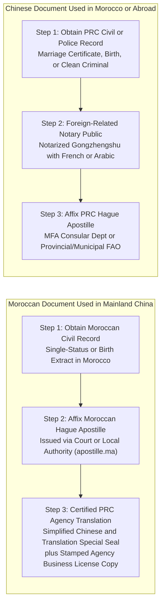
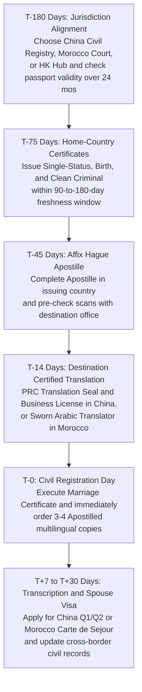

# China-Morocco Cross-National Marriage Logistics & Document Roadmap

## 1. The Post-2023 Legal Breakthrough: Hague Apostille Between China & Morocco

Cross-national marriage paperwork looks intimidating only when couples rely on outdated pre-2023 forum posts. A landmark diplomatic upgrade simplified document verification between China and Morocco dramatically:

- **Morocco** has been a full contracting state to the 1961 Hague Apostille Convention since **August 14, 2016**.
- **Mainland China** officially enforced the Hague Apostille Convention (*《取消外国公文书认证要求的公约》*) starting **November 7, 2023** (Hong Kong SAR and Macao SAR already applied it prior).

**What this means in plain engineering terms**: The slow, expensive old "dual consular legalization" pipeline (*双认证*—waiting months for Ministry of Foreign Affairs authentication *plus* foreign Embassy consular stamps) is **retired** for public documents moving between China and Morocco. Today, a genuine public or notarized document from either country requires only a **single Hague Apostille certificate (*海牙附加证明书*)** from its home issuing authority plus a compliant certified translation in the destination country.



### Golden Rule of Cross-Border Paperwork

Always verify **exact current document checklists directly with the specific municipal Civil Affairs Bureau (*涉外婚姻登记处*) or Moroccan Family Court (*Tribunal de la Famille*) 90 days before filing**, as local translation formatting preferences evolve periodically.

---

## 2. Choosing Where to Register: China vs. Morocco vs. Civil Hub

A couple only needs **one valid legal marriage registration**—you do not "re-marry from scratch" in two countries; rather, you register marriage in Jurisdiction A and **notarize, Apostille, and transcribe** that marriage certificate for recognition in Jurisdiction B (while celebrating joyfully with family dinners or ceremonies in both countries whenever you choose).

### Three Legal Registration Pathways Compared

| Dimension | Pathway A: Mainland China (*涉外婚姻登记处*) | Pathway B: Morocco (*Family Court & Adoul*) | Pathway C: Hong Kong SAR Civil Registry |
| :--- | :--- | :--- | :--- |
| **Governing Law** | PRC Civil Code Book V & Marriage Registration Regulations (purely secular civil law) | Moroccan Family Code (*Moudawana*) Mixed Marriage (*Mariage Mixte*) rules | Hong Kong Marriage Ordinance (purely secular English/Chinese bilingual civil law) |
| **On-the-Ground Time** | **1 business day** (same-day issuance of two red *结婚证* once documents pass review) | **3 to 6 weeks** on the ground in Morocco (court dossier + police inquiry + judge sign-off + *Adoul*) | Notice filed online/overseas 15+ days ahead; **2 days** in Hong Kong for oath & ceremony |
| **Document Volume** | Low: 1 Apostilled Single-Status Certificate + Passport + PRC Translation for foreign spouse | High: 8–10 documents per spouse, medical exam, dual criminal records, embassy capacity cert | Ultra-low: Passports + Notice of Intended Marriage (divorce/single proof only if previously married) |
| **Faith & Legal Nuance** | Secular civil process; zero religious document required at Civil Affairs counter | Under *Moudawana* Art. 39, a Muslim Moroccan woman marrying a foreign man requires a notarized *Acte de Conversion à l'Islam* in the court dossier | Secular civil process; outputs native **English + Chinese** certificate immediately eligible for HK Apostille |
| **Government Filing Fee** | `RMB 0` registry fee (`RMB 400–900` total for PRC translation, photos & post-marriage notary) | Approx. `MAD 1,500 – 4,000` across *Adoul* fees, sworn Arabic translations, and court stamps | `HKD 305` notice + `HKD 715` registry ceremony (`HKD 1,935` weekend) + `HKD 125` per HK Apostille |
| **Cross-Recognition Note** | Valid worldwide once notarized + PRC Apostilled; transcribing into Moroccan *État Civil* later still checks *Moudawana* rules | Native Moroccan *Acte de Mariage* valid in Morocco; Apostille + Chinese translation makes it valid for PRC Q1/Q2 visas | Recognized internationally and by Mainland authorities (via HK China Legal Service Co. attestation if needed for domestic *Hukou* update) |

### Navigating the Faith & Jurisdiction Conversation With Deep Respect

Notice the critical legal distinction in Row 4 above: Mainland China and Hong Kong conduct purely secular civil marriage, whereas Moroccan family law (*Moudawana*) treats marriage involving a Moroccan citizen—and subsequent registration of an overseas marriage into Moroccan civil status (*État Civil*)—within an Islamic family-law framework.

Never leave this until a clerk mentions it at a counter. Sit down together in complete warmth and candor early in your engagement planning to align on **personal conscience, faith sincerity, family expectations, and legal recognition in both countries** so neither partner ever feels pressured or blindsided.

---

## 3. Step-by-Step Document Dossiers & Classic Rejection Traps

### Pathway A Checklist: Mainland China Foreign-Related Marriage Registration (*涉外婚姻登记处*)

Designated municipal or provincial Civil Affairs Foreign-Related Marriage Registration Centers (for example, Shanghai Marriage Registration Center on Caobao Road) process marriages between a Mainland Chinese citizen and a foreign national:

1. **Chinese Citizen's Documents**:
   - Original valid **PRC Resident ID Card (*居民身份证*)** (ensure chip is readable and not within 30 days of expiry).
   - **Household Register (*户口簿*)** (verify local bureau guidance following China's 2025 marriage registration reforms; ensure the marital status field reads *未婚* [Unmarried] rather than blank or outdated, and that name/ID digits match your ID card 100%).
   - Signed declaration at the counter confirming unmarried status and zero lineal blood kinship or collateral blood kinship within three generations.
2. **Moroccan Citizen's Documents**:
   - Original valid **Moroccan Passport** (with valid Chinese visa/entry stamp).
   - **Certificate of Celibacy / Single Status & Capacity to Marry (*Certificat de Célibat / Capacité Matrimoniale*, 单身/无婚姻障碍证明)**:
     - *Route 1 (Issued in Morocco)*: Obtained from competent Moroccan civil authority + **Moroccan Hague Apostille** (`apostille.ma`).
     - *Route 2 (Embassy Route)*: Issued or certified via the Embassy of the Kingdom of Morocco in Beijing (verify current consular certificate requirements + MFA confirmation rules).
   - **Certified Simplified Chinese Translation**: Both the Single-Status Certificate, its Apostille page, **and** the Moroccan Passport bio page must be translated by a **Mainland-registered translation company** bearing its official ink **Translation Special Seal (*翻译专用章*)** and attached to a **stamped copy of the agency's PRC Business License (*营业执照副本加盖公章*)**.
3. **Joint Item**: Three recent **2-inch couple color photos** (`53 mm x 35 mm`, bareheaded, red background standard; can be taken prior at a studio for `RMB 50–100` rather than rushing).

### Four Classic Bureaucratic Traps That Derail Appointments

| Trap | Why Couples Get Turned Away at the Window | Zero-Stress Prevention Fix |
| :--- | :--- | :--- |
| **1. The 6-Month Single-Status Clock** | PRC Civil Affairs treats foreign single-status certificates as valid for **6 months from issue date** (or **3 months** if the certificate text itself prints a 90-day limit!) | Request the Moroccan Single-Status Certificate **60 to 90 days** before your booked China flight—never 7 months early |
| **2. Overseas or Self-Made Translations** | Couples bring a French-to-Chinese translation done in Casablanca or by a bilingual friend; rejected immediately | Email clear PDF scans of the Apostilled document + passport to a licensed Shanghai/Beijing notary translation agency **10 days before flying** so stamped originals await you |
| **3. Transliteration / Name Order Drift** | Passport shows French order `FATIMA ZAHRA EL AMRANI` while translation drops a space or hyphen on one page | Audit every single letter, passport number, and birth date (`YYYY-MM-DD`) character-by-character across original, Apostille, and Chinese translation |
| **4. Leaving Without Apostilled Copies** | Couple celebrates after getting red *结婚证* and flies abroad, forgetting red books alone cannot be read by foreign immigration | The very next morning in China, take both passports + both red *结婚证* to a **Foreign-Related Notary Office (*涉外公证处*)** to order **3 French/English Notarized Marriage Certificates + PRC Hague Apostilles** |

### Pathway B Overview: Morocco Family Court & *Adoul* Mixed Marriage (*Mariage Mixte*)

If you choose to register marriage in Morocco instead, budget **4 to 6 weeks** and prepare the foreign groom's Apostilled Chinese dossier before boarding:

- **Prepared in China (Notarized in French/Arabic + PRC Hague Apostille)**: (1) Notarized Birth Certificate (*出生公证*); (2) Notarized Clean Criminal Record (*无犯罪记录公证*, issued within 3 months); (3) Notarized Single-Status Declaration (*未婚声明公证*); (4) Proof of Employment & Income (*在职及收入证明公证*).
- **Completed in Morocco**: (5) Nationality & Capacity Attestation from the **Chinese Embassy in Rabat**; (6) **Moroccan Central Criminal Record (*Fiche Anthropométrique / Casier Judiciaire Central*)** issued by the Ministry of Justice in Rabat; (7) Local Moroccan **Pre-Marital Medical Certificate (*Certificat Médical Prénuptial*)** for both spouses; (8) Notarized *Chahada d'Islam* (per *Moudawana* Art. 39) & Sworn Arabic Translations (*Traducteur Assermenté*); (9) Routine **Police Inquiry (*Enquête de Police*)** verifying genuine relationship -> **Family Judge Authorization** -> **Two *Adouls* Execute *Acte de Mariage*** -> Court Homologation + Moroccan Apostille for international use.



### Master Document Freshness & Issuing Authority Reference Table

Never prepare time-sensitive certificates too early or too late—use this exact validity matrix:

| Document Name | Issuing Authority | Filing Freshness Window | Typical Turnaround |
| :--- | :--- | :--- | :--- |
| **Moroccan Single-Status / Capacity (*Célibat*)** | Local *Moqataa* / Civil Registry in Morocco (+ `apostille.ma`) | **90 to 180 days max** (check printed text; PRC Civil Affairs caps at 6 months) | 2–5 working days + 2–5 days Apostille |
| **PRC Unmarried / Clean Criminal Notary (*公证书*)** | Municipal Foreign-Related Notary Public (*涉外公证处*) + FAO Apostille | **90 to 180 days max** (Moroccan courts strictly require criminal records under 90 days old) | 5–7 working days notary + 3–5 days FAO Apostille |
| **Moroccan Central Criminal Record (*Casier Judiciaire*)** | Ministry of Justice (*Direction des Affaires Pénales*), Rabat (or online portal) | **90 days max** from date of issue | 1–3 working days in Rabat |
| **Birth Certificate Extract / Notary** | Morocco *État Civil* (extract under 3 mos for court) / PRC Birth *公证书* | Moroccan court requires fresh extract **under 90 days**; PRC Birth Notary never expires once issued | 2–7 working days |
| **PRC Entry-Exit Quarantine Medical Certificate** | International Travel Healthcare Center (*国际旅行卫生保健中心*) | **6 months** from exam date | 3–4 working days |
| **Notarized + Apostilled Marriage Certificate** | PRC Notary + FAO Apostille, or Moroccan Court + `apostille.ma` | Permanent validity (some European/Gulf visa desks ask for an Apostille copy under 12 months old) | 5–10 working days total |

---

## 4. Visas & Spouse Residence Permits (China Q1/Q2 & Morocco Residency)

Marriage to a citizen does **not** grant instant visa-free work or residency in either country—understand the exact immigration categories so travel and work stay 100% legal:

| Visa / Residency Type | Target Use Case | Validity & Stay Rules | Critical Legal & Work Rules to Know |
| :--- | :--- | :--- | :--- |
| **China Q2 Visa** (*短期团聚签证*) | Living together in Morocco, Dubai, Europe, or SG while visiting Chinese parents regularly | Multi-entry (often 1–5 years for spouses); **120 to 180 days max per entry** | Zero medical exam needed; strictly for family visits—**no local PRC employment permitted** |
| **China Q1 Visa -> Family Reunion Residence Permit** (*团聚类居留许可*) | Living long-term (**over 180 days**) together inside Mainland China | Enter on 30-day Q1 visa; convert within **30 days** at Exit-Entry Bureau to **1-to-3-year Residence Permit** | Must register address with local police within **24 hours** of arrival + pass Entry-Exit Health Check; **does NOT authorize working for a PRC company** (requires separate Work Permit *工作许可证*) |
| **China Permanent Residence ("Five-Star Card" *五星卡*)** | Long-term settlement in China after 5 years of marriage | **10-year renewable card** functioning like a domestic ID for trains, hotels, banking & work | Requires **5 consecutive years of marriage**, residing in China **at least 9 months per year** for 5 straight years, plus stable housing and income |
| **Morocco *Carte d'Immatriculation* (*Conjoint de Marocain*)** | Living long-term (**over 90 days**) together in Morocco | File at local *Préfecture de Police*; initial **1-year residency card** renewable to multi-year / 10-year card | Chinese citizens enter Morocco **visa-free for up to 90 days**; to live longer, bring PRC Clean Criminal Record (Apostilled) + Moroccan Marriage Record + address/means proof within 90 days |

### Day-by-Day Execution: Converting a China Q1 Visa Into a Spouse Residence Permit

Couples moving to Shanghai, Shenzhen, or Beijing often stress over the strict **30-day Q1 conversion clock** after landing. Follow this exact sequence so zero deadlines slip:

1. **Hours 0 to 24 After Landing — Mandatory Police Accommodation Registration (*临时住宿登记*)**:
   - If staying at a licensed hotel first, reception registers digitally; once moving into your apartment, complete **Online Self-Declaration** (available via municipal Exit-Entry WeChat mini-programs in Shanghai/Beijing/Shenzhen) or visit the neighborhood police station (*派出所*) within **24 hours** with lease contract, landlord ID/property deed copy, and passport. Save the printed/PDF *Registration Form of Temporary Residence*—every subsequent step demands it.
2. **Days 2 to 5 — International Travel Healthcare Center Exam (*出入境体检*)**:
   - Required once for first-time Residence Permits of 1 year or longer (ages 18–70). Book morning fasting slot (`RMB 400–700`, bring passport + four 2-inch photos); results issue in **3 to 4 working days**.
3. **Days 7 to 12 — Municipal Exit-Entry Administration Filing (*出入境管理局*)**:
   - Both spouses attend in person bringing: (a) Foreign spouse's Passport + Q1 visa + Temporary Residence Registration; (b) Chinese spouse's PRC ID + *Hukou* + signed Residence Guarantee Letter; (c) Red PRC *结婚证* (or Apostilled + PRC-translated foreign Marriage Certificate); (d) Health Certificate (`RMB 400–800` permit fee).
   - **Domestic Travel Tip While Passport Is Held**: Exit-Entry keeps the physical passport for **7 working days** to print the Residence Permit sticker, handing you an official yellow/white **Acceptance Receipt (*外国人签证证件受理回执*)** with photo and stamp—this receipt legally lets your spouse ride high-speed trains (*高铁*), board domestic flights, and check into hotels inside Mainland China while waiting!

### Flying Both Sets of Parents In: Grandparent & In-Law Mobility Cheat Sheet

When hosting a wedding celebration or welcoming grandparents after a baby arrives, asymmetric visa rules apply between the two passports:

| Visiting Family Direction | Visa Requirement | Exact Preparation Checklist for Smooth Entry |
| :--- | :--- | :--- |
| **Chinese Parents Flying to Morocco** | **90 Days Visa-Free** (since June 2016 bilateral exemption) | Passports valid over 6 months + printed return flight itinerary + bilingual French/Arabic invitation note with your Moroccan address and phone number for smooth border greeting |
| **Moroccan Parents Flying to Mainland China** | **China Q2 Visa** (or S2 if inviting spouse holds PRC Work Residence Permit) | Apply at Chinese Visa Application Service Center in Rabat using: (1) Signed **Q2 Invitation Letter (*邀请函*)** from Chinese son-in-law; (2) Front/back copy of his PRC ID Card; (3) Copy of Marriage Certificate + wife's Birth Certificate proving parent-child relationship; (4) Travel health insurance |
| **Both Families Meeting in Third Hub (e.g., Dubai)** | **UAE Visa-on-Arrival (30 Days)** for PRC passports; **UAE Tourist e-Visa** for Moroccan passports | Pre-apply Moroccan parents' UAE e-Visa 3 weeks ahead via airline/sponsor portal; book adjacent apartments with full kitchen access for familiar tea and home cooking |

---

## 5. Cross-National Newborn Citizenship & Travel Document Preview

Before you ever have children, understanding how **PRC Nationality Law** and the **Moroccan Nationality Code** interact saves weeks of confusion at birth:

- **Morocco (2007 Nationality Code Article 6)**: A landmark 2007 reform granted Moroccan women full equal citizenship transmission—any child born to a **Moroccan mother** (or father) anywhere in the world **automatically holds Moroccan citizenship by descent** and can be registered in the Moroccan family book (*Livret de Famille* / *État Civil*) at the nearest Moroccan Embassy.
- **Mainland China (PRC Nationality Law Articles 4 & 5)**: China does not recognize dual nationality in adult law, yet a child born to a Chinese citizen parent (who does **not** hold foreign permanent residence *定居国外* at the time of birth) and a foreign citizen parent holds Chinese nationality at birth alongside maternal Moroccan nationality—creating an official administrative status known as **Nationality Conflict (*国籍冲突*)**.
- **How Your Child Actually Travels Before Age 18**:
  - **Born Outside China** (when Chinese father holds a temporary work/residence visa rather than permanent green card): Apply at the Chinese Embassy for a **PRC Travel Document (*中华人民共和国旅行证*, valid 2 years)** to enter/exit Mainland China visa-free, paired with the child's **Moroccan Passport** for global travel.
  - **Born Inside Mainland China**: Obtain the bilingual **Medical Certificate of Birth (*出生医学证明*)** -> register family status -> apply at Municipal Exit-Entry Administration for an **Entry-Exit Pass (*中华人民共和国出入境通行证*)** when flying abroad to obtain/use their Moroccan passport and return on a PRC Travel Document.

---

## 6. Respectful Pre-Marital Alignment, Dual Celebrations & Document Vault

### Navigating Cultural Traditions & Marital Property Without Friction

1. **Honor Symbolic Traditions Privately First**: In Moroccan culture, **Mahr / Sadaq** is a dignified gift written into the marriage contract belonging directly to the bride; in Chinese culture, families value **Cai Li (*彩礼*)** and housing stability. Agree privately as a united couple on joyful, debt-free amounts that honor her dignity and protect your household's investment runway before bringing parents into the conversation.
2. **Understand Cross-Border Marital Property Defaults**:
   - Under **PRC Civil Code Book V (Articles 1062–1065)**, assets owned fully *before* marriage (*婚前个人财产*) remain separate property unless commingled, whereas salaries and investment gains earned *during* marriage default to **50/50 joint community property (*夫妻共同财产*)**.
   - Under **Morocco's *Moudawana* (Article 49)**, spouses default to **separate property estates**, with the option to sign a separate written annex (*Accord sur la gestion des biens acquis*) defining equitable sharing of wealth built together during marriage.
   - **High-Trust Best Practice**: Keep pre-marital accounts cleanly documented, fund a transparent joint household & wealth bucket during marriage, and ensure both spouses' names and protective rights are explicitly clear whenever buying real estate or major assets in any country.

### Word-for-Word Openers for Sensitive Pre-Marital Logistics

| Pre-Marital Topic | Clumsy / Transactional Phrasing (Avoid) | Warm, Dignified Partner Script (Use This) |
| :--- | :--- | :--- |
| **Jurisdiction & Faith Rules** | "Morocco paperwork takes way too long and has religious rules, let's just do a 10-minute civil stamp." | "I want our marriage to feel deeply respected in your heart, in my heart, and legally secure in both our countries. Can we walk through the China, Morocco, and HK options calmly together so there are zero surprises for you or your parents?" |
| **Mahr / Sadaq & Cai Li** | "Why do families still care about old-fashioned wedding gift customs?" | "I love that both Moroccan Mahr and Chinese traditions symbolize honoring the bride and starting our home with security. Tell me what feels meaningful to you and your family so we design something warm, proud, and financially smart together." |
| **Marital Property & Accounts** | "We should keep our pre-marital assets separate in case anything goes wrong." | "I want both of us to feel 100% protected and clear across two legal systems. Let's list our pre-marriage baselines openly, set up our joint household and investment buckets, and make sure both our names are protected as emergency beneficiaries." |
| **Supporting Aging Parents** | "Don't send money to relatives without asking my permission." | "We both love our parents deeply. Let's agree on an annual family-gift budget and a simple rule where any non-routine support over USD 400 gets a quick 2-minute team check-in first." |

### Hosting Joyful Dual-Culture Celebrations Without Debt or Burnout

Trying to merge 200 Chinese relatives and 150 Moroccan relatives onto one intercontinental flight creates visa stress and massive expense. Seasoned cross-national couples separate **Legal Civil Registration** from **Two Intimate Cultural Gatherings**:

- **Celebration 1 — Intimate Chinese Tea Ceremony & Halal-Mindful Banquet**: Host a warm 30-to-60-person family gathering in China featuring traditional **Tea Offering (*敬茶*)** to elders. When her parents fly in, book a certified **Halal banquet menu (*清真席*)** or dedicated Halal fine-dining private room (strictly zero pork, lard, or cooking wine *料酒*, with sparkling tea/juice toasts instead of pressuring *Baijiu*)—that single act of thoughtfulness wins lifelong trust from Moroccan in-laws.
- **Celebration 2 — Joyful Moroccan Family Celebration (*Henna & Drib Sdaq*)**: Host an intimate celebration in Morocco honoring Moroccan bridal artistry (*Takchita*, *Henna*, Moroccan mint tea, *Pastilla*, almond pastries, music, and *Amariya* joy) where his visiting parents are welcomed warmly as honored guests without needing to speak Darija or French.

### Post-Marriage Daily Autonomy Onboarding (First 14 Days Under One Roof)

When a foreign spouse relocates to China—or when a Chinese spouse settles in Morocco or a third-country hub—dependency on the local partner's phone or bank card erodes adult dignity fast. Complete four practical onboarding steps in Week 1:

1. **Personal Local Mobile Number in Spouse's Own Passport Name**: Open a primary carrier SIM (China Mobile/Unicom or Maroc Telecom/Orange) registered directly under your spouse's passport—almost every banking OTP, hospital portal, and ride-hailing app binds to name-matched SIM verification.
2. **Independent Local Bank Account & Seamless Mobile Payments**:
   - In China: Once the Residence Permit is issued, open a **Type-I Debit Account** at a major international-friendly branch (China Merchants Bank *招商银行* or ICBC *工商银行*) and bind **Alipay + WeChat Pay** directly to her own card; during the first week before the bank visit, send a high-limit **WeChat/Alipay Family Card (*亲属卡*)** so she rides metro, orders coffee, and shops independently from Hour 1.
   - Cross-Border Remittance Note: Keep marriage and tax records clean for legitimate spouse family-living foreign exchange transfers under SAFE rules (`USD 50,000/year` individual quota for PRC citizens; lawful tax-cleared salary repatriation for foreign workers).
3. **183-Day Tax Residency & Double-Taxation Awareness**: Both China and Morocco treat individuals physically present **183 days or more** in a calendar/tax year as tax residents, governed bilaterally by the **China–Morocco Double Taxation Avoidance Agreement**. Track international flight entry/exit days in a simple spreadsheet if working across hubs.
4. **Emergency Medical Proxy Readiness**: Save high-resolution photos of your **Marriage Certificate + certified local-language translation** in a Favorites album on both phones—proving legal spouse status instantly grants hospital emergency informed-consent authority (*家属知情同意权*) in either country.

### The Cross-National Couple Document Vault Checklist

Create an encrypted cloud folder (shared in 1Password / iCloud Drive + offline backup drive + fireproof home binder) using strict ISO naming (`YYYY-MM-DD_Country_Person_DocType_Lang.pdf`):

- [ ] High-resolution color scans (300 DPI) of **both Passports**, **PRC ID & Hukou**, and **Moroccan CNIE**.
- [ ] **3 original Apostilled + Translated Marriage Certificates** (stored in two separate physical locations so losing one suitcase never blocks an emergency flight or hospital admission).
- [ ] Apostilled **Birth Certificates** of both spouses (frequently requested years later when applying for Permanent Residence, European/UAE Golden Visas, or registering a newborn's citizenship!).
- [ ] Digital tracking table of **Passport, Residence Permit, and Insurance renewal dates** with automated calendar reminders set at **T-210 days** (since many visas require 6+ months remaining passport validity).

```text
/Couple-Legal-Vault/
├── 01_Identity_Passports/
│   ├── 2026-03-10_CHN_Husband_Passport_BioPage.pdf
│   └── 2026-05-18_MAR_Wife_Passport_and_CNIE.pdf
├── 02_Marriage_Apostilles/
│   ├── 2027-04-12_CHN_MarriageCert_Notarized_French_Apostilled.pdf
│   └── 2027-04-12_MAR_Transcription_ActeDeMariage.pdf
├── 03_Birth_and_Kinship/
│   └── Both_Spouses_Birth_Extracts_Apostilled.pdf
└── 04_Visas_Residence_Tax/
    └── Entry_Exit_Flight_Day_Counter_183DayRule.xlsx
```

Once your civil foundation and residency mobility are rock-solid, your household is ready—whenever the two of you choose—to turn calmly toward [02-SCIENTIFIC-PRECONCEPTION-PREGNANCY-AND-POSTPARTUM.md](02-SCIENTIFIC-PRECONCEPTION-PREGNANCY-AND-POSTPARTUM.md).
