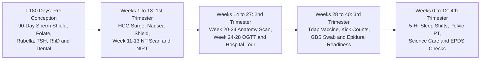
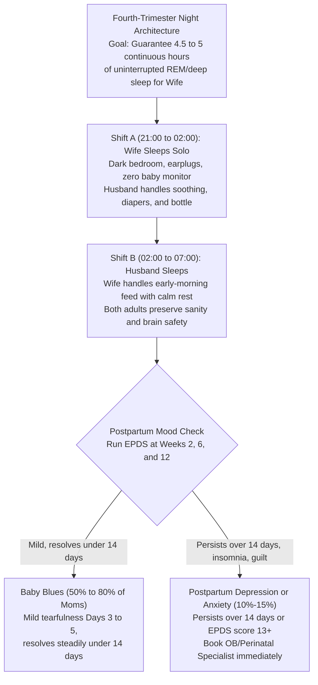

# 6-Month Couple Pre-Conception Science & The Husband Playbook Through Pregnancy and Postpartum

## 1. Why Pre-Conception Starts 180 Days Early — And Half Is Male Biology

Traditional culture treats fertility preparation as 100% the woman's responsibility while the husband changes nothing until a pregnancy test turns positive. Reproductive biology proves that assumption dead wrong: **50% of the embryo's nuclear genome—and a dominant share of the epigenetic signaling that builds the placenta—comes directly from the father's sperm**.

Crucially, human **spermatogenesis plus epididymal maturation takes 74 to 90 days** from stem cell to ejaculated sperm. Every fever, 42°C sauna session, binge-drinking weekend, micronutrient deficiency, or 5-hour sleep week during the prior three months increases **Sperm DNA Fragmentation (SDF)** and oxidative stress—raising the risk of early first-trimester miscarriage and impaired placental function even when standard sperm count looks normal.

### The Husband's 90-to-180-Day Pre-Conception Optimization Protocol

1. **Strict Testicular Thermal Protection**: Sperm production requires scrotal temperature **2°C to 3°C cooler** than 37°C core body temperature. Eliminate saunas, hot tubs, over `39°C` baths, car seat heaters on high, and laptops resting directly on your lap for a full **90 days** prior to trying (a single 30-minute hot-tub soak impairs motility for 6 to 8 weeks). Wear breathable boxer briefs.
2. **Evidence-Based Male Fertility Micronutrients**:
   - **Folate (`400 mcg/day`) + Zinc (`11 to 15 mg/day`)**: Essential cofactors for DNA synthesis, chromatin packaging, and reducing sperm aneuploidy.
   - **Coenzyme Q10 / Ubiquinol (`200 mg/day`) + Selenium (`55 mcg/day`)**: Mitochondrial antioxidants clinically shown to boost progressive sperm motility and reduce oxidative DNA fragmentation in men over 32.
   - **Vitamin D3 (`1,000 to 2,000 IU/day`, targeting serum `30–50 ng/mL`) + Omega-3 EPA/DHA (`1,000 mg/day`)**: Supports testosterone synthesis and sperm membrane fluidity.
3. **Metabolic, Sleep & Medication Audit**:
   - Sleep **7.5 to 8 hours** nightly; combine Zone-2 cardio with 3x/week resistance training.
   - Pause alcohol and eliminate all nicotine/vaping **90+ days** pre-conception.
   - **Medication Red Flag**: Never take exogenous testosterone, SARMs, or anabolic steroids (they suppress pituitary LH/FSH and crash sperm count toward zero!). If taking oral **finasteride** (`1 mg`) for hair loss, review pausing options with a physician 3 months ahead if semen parameters are borderline.

### The Joint 6-Month Pre-Pregnancy Medical Checklist

Book pre-conception checkups **together** 6 months before trying—framing every test as a loving team upgrade, never an evaluation:

| Clinical Check | Who Needs It | Why 6 Months Ahead Matters (Clinical Rationale) | Target / Action Threshold |
| :--- | :--- | :--- | :--- |
| **Folic Acid Supplementation** | Both (Critical for Her) | Embryonic neural tube closes by **Day 28 post-conception** (before many women realize they missed a period); cuts spina bifida/anencephaly by **50% to 70%** | **400 to 800 mcg/day** started **at least 90 days before** trying and continued through Week 12 |
| **Rubella IgG & Varicella IgG** | Wife | Rubella infection in early pregnancy causes devastating Congenital Rubella Syndrome; live MMR/Varicella vaccines **cannot** be given while pregnant | If IgG non-immune, vaccinate immediately and **wait 28 days** before conceiving |
| **Thyroid Panel (`TSH`, `FT4`, `TPOAb`)** | Wife | Maternal thyroid hormone drives fetal brain development across Weeks 1–12; untreated hypothyroidism raises miscarriage risk | Pre-conception / 1st-trimester `TSH` typically targeted **under 2.5 mIU/L** (per OB endocrinology) |
| **Comprehensive Dental & Gum Exam** | Wife (Ideal for Both) | Pregnancy hormones trigger gingival inflammation; active periodontitis correlates with preterm birth, and dental X-rays/wisdom extractions are far easier pre-pregnancy | Complete scaling, X-rays, cavity fillings, and problematic wisdom teeth **before** trying |
| **Thalassemia & Carrier Screening** | **Both Spouses** | **Crucial China–Morocco Insight**: Both Southern China and North Africa/Mediterranean carry elevated alpha/beta-thalassemia carrier rates (`3%–10%`) | Check CBC (`MCV` under `80 fL` flag), Hemoglobin Electrophoresis, and expanded genetic carrier panel |
| **ABO & RhD Blood Typing** | **Both Spouses** | **Crucial Cross-Population Insight**: Rh-negative blood is rare in Han Chinese (under `1%`) but common in Moroccan/Mediterranean women (`approx. 10%–15%`) | If Wife is **Rh-negative** and Husband is **Rh-positive**, hospital must stock **RhoGAM (Anti-D)** at Week 28 and within 72h postpartum |
| **Iron Stores (`Ferritin`) & Vitamin D** | Wife | Pregnancy expands maternal blood volume by **45% to 50%**, rapidly depleting baseline iron reserves | Replenish early if serum ferritin is under `30–50 ng/mL` or `25(OH)D` is under `30 ng/mL` |
| **Infectious & Semen Baseline** | Both / Husband | Screen HBV, HCV, HIV, Syphilis, and Chlamydia; optional baseline WHO 6th-Ed Semen Analysis removes guesswork early | Semen normal floor: concentration `>= 16M/mL`, progressive motility `>= 30%`, morphology `>= 4%` |

---

## 2. Fertility Window Science Without Turning Love Into a Spreadsheet

Once off contraception, healthy couples in their early-to-mid thirties have roughly a **15% to 20% probability of clinical pregnancy in any single cycle**, with **approx. 80% to 85% conceiving within 12 months** (clinical threshold to consult a reproductive endocrinologist: **12 months** if wife is under 35; **6 months** if 35 or older).

- **The 6-Day Fertile Window**: After ovulation, the egg survives only **12 to 24 hours**, whereas healthy sperm survive **3 to 5 days** inside fertile estrogenic cervical mucus. Conception probability peaks when intercourse occurs on the **2 days immediately BEFORE ovulation** plus ovulation day itself (a positive urinary **LH surge strip** signals ovulation will follow in **24 to 36 hours**).
- **The Husband's Golden Intimacy Rule**: Never turn trying to conceive into robotic calendar pressure. Aim for relaxed, affectionate intimacy every **1 to 2 days** across the mid-cycle window (e.g., Days 10–17 of a 28-day cycle), bring warmth and humor if a period arrives, and never treat a monthly negative test as anyone's "failure."

### Knowing the Science of Early Miscarriage Before You Ever Need It

Books rarely mention a critical clinical statistic: **15% to 20% of clinically recognized pregnancies end in early first-trimester loss**, even among completely healthy couples. Over **60% to 70% of early miscarriages result from random, sporadic chromosomal copy errors during cell division**—meaning **nothing she ate, lifted, felt, or did caused it**.

Knowing this biology beforehand equips you to protect her immediately from crushing self-blame—and to shut down any uninformed relative who dares ask *"Did you walk too much or eat cold food?"* (Clinical note: a single early loss rarely delays healthy subsequent pregnancy; **2 or more consecutive losses** warrants a compassionate Recurrent Pregnancy Loss workup checking parental karyotypes, uterine cavity, thyroid, and antiphospholipid antibodies.)

---

## 3. Trimester-by-Trimester Realities & The Husband Action Matrix



### Trimester Physiology, Key Diagnostics & Concrete Husband Playbook

| Stage | What Her Body Is Experiencing | Key Medical Milestones | Concrete Husband Co-Pilot Actions |
| :--- | :--- | :--- | :--- |
| **1st Trimester (Wks 1–13)** | HCG doubles every 48–72h early on; crushing cellular fatigue, nausea/vomiting (NVP), intense smell triggers, heightened anxiety before viability scan | **Wk 6–8**: Dating & heartbeat ultrasound; **Wk 11–13+6**: NT nuchal translucency scan + **NIPT** cell-free fetal DNA screening | Take over **100% of smelly kitchen cooking, dishwashing, fridge cleaning & trash**; keep dry crackers, ginger tea & OB-approved Vitamin B6 (`10–25 mg`) bedside; guard privacy until ready to announce |
| **2nd Trimester (Wks 14–27)** | Placenta takes over hormone production; nausea usually eases; blood volume surges 45%; round-ligament aches; first fetal flutters (*Quickening* Wks 18–20) | **Wk 20–24**: Level-II Detailed Anatomy Ultrasound (*大排畸*); **Wk 24–28**: **75g OGTT** Gestational Diabetes test (fasting `< 5.1`, 1h `< 10.0`, 2h `< 8.5 mmol/L`) | Attend the Anatomy Scan in person; if OGTT shows elevated glucose, **eat low-GI protein/veggie meals together** (never eat cake in front of her!); set up a U-shaped pregnancy pillow for **left-lateral sleep tilt** after Wk 20 |
| **3rd Trimester (Wks 28–40+)** | Uterus compresses diaphragm, stomach & bladder; acid reflux, sciatic/pelvic girdle pressure, ankle edema, 3–4 bathroom trips nightly | **Wk 27–36**: Maternal **Tdap** vaccine (passes pertussis antibodies to baby; Husband & visiting Grandparents get Tdap + Flu 2+ wks before birth!); **Wk 35–37**: GBS swab | Track daily fetal kick patterns after Wk 28; put on her shoes/socks; give nightly calf/foot massages; **pack the hospital bag & install ECE R129 car seat by Week 35**; verify 24/7 epidural protocol |

### Five Obstetric Emergency Red Flags (Go Straight to Maternity Triage)

Memorize these five clinical warning signs so you never hesitate at midnight:

1. **Preeclampsia Warning Triad (After Week 20)**: Blood pressure **`>= 140/90 mmHg`** paired with a throbbing headache that ignores acetaminophen, visual spots/flashing lights, sudden facial/hand swelling, or sharp upper-right abdominal pain.
2. **Vaginal Bleeding or Intense Cramping** at any gestational week.
3. **Preterm Fluid Leak or Gush** (*Premature Rupture of Membranes*) before Week 37.
4. **Marked Decrease in Fetal Movement** after Week 28 (fewer than **10 distinct movements within 2 hours** when lying quietly on her left side—never "wait until tomorrow morning" to check!).
5. **High Maternal Fever (`>= 38.0°C`)** or burning urination (untreated UTIs in pregnancy can ascend to pyelonephritis and trigger preterm contractions).

### Evidence-Based Pregnancy Food & Medication Quick Rules

- **Strict Avoid List**: Zero alcohol; zero unpasteurized milk/soft cheeses, raw deli meats, or cold smoked fish (*Listeria* crosses the placenta); zero raw/undercooked meat or handling dirty cat litter (*Toxoplasmosis*); zero high-mercury predatory fish (shark, swordfish, king mackerel); **never give ibuprofen/NSAIDs during pregnancy** (acetaminophen/paracetamol is standard first-line for fever when approved by OB) and strictly zero retinoids/isotretinoin.
- **Encourage Warmly**: **2–3 servings/week of cooked low-mercury DHA fish** (salmon, sardines, shrimp), pasteurized yogurt/cheese, cooked leafy greens, eggs cooked through, and safe caffeine under **`200 mg/day`** (1 standard latte/americano is completely safe per ACOG).

---

## 4. Labor Advocacy & Unwavering Support for Epidural Analgesia (*无痛分娩*)

Few moments reveal a husband's character more clearly than the delivery room. Across East Asia and traditional families elsewhere, mothers in agony are still occasionally fed cruel, outdated myths: *"Epidural anesthesia makes the baby less smart," "Epidurals cause lifelong back pain,"* or *"Wait until 4 cm—enduring natural pain proves maternal strength."*

**Every single one of those claims is medically false**:

- **Zero Harm to Baby's Brain or Apgar Scores**: Modern **Labor Epidural Analgesia (*硬膜外分娩镇痛*)** delivers ultra-low-concentration local anesthetic (`0.0625%–0.125%` ropivacaine/bupivacaine) directly around spinal nerve roots—maternal systemic absorption and placental transfer are negligible, and reducing extreme maternal catecholamine stress actually **improves uteroplacental blood flow** during prolonged labor.
- **Epidurals Do NOT Cause Chronic Lower Back Pain**: Large randomized controlled trials confirm identical 1-year backache rates with or without epidurals (postpartum back pain stems from relaxin-induced ligament laxity and newborn lifting biomechanics).
- **No Arbitrary "Wait Until 3–4 cm" Gate**: The American College of Obstetricians and Gynecologists (**ACOG**) and ASA explicitly state that **in the absence of medical contraindication** (such as severe low platelets under `70,000/uL` or anticoagulation), **a mother's request alone is sufficient medical indication for pain relief**—early epidural placement does *not* increase C-section rates.

### The Husband's Delivery-Room Covenant

1. **Vet Dedicated 24/7 Obstetric Anesthesiology Months Ahead**: Ask the hospital explicitly: *"Do you have dedicated in-house obstetric anesthesiologists on the maternity floor 24/7, and what is your actual epidural placement rate (`target > 75%–85%`)?"*
2. **100% Her Body, 100% Her Call**: Whether she chooses early epidural analgesia, unmedicated movement, or requires an unplanned C-section for fetal safety, you act as her **fierce, calm advocate**. If any relative attempts to guilt-trip her pain-relief choice or pressure the hospital team, escort them politely out of the room immediately.

### Stages of Labor & Delivery-Room Husband Playbook

| Labor Phase | Clinical Signs & Timing | What the Husband Does Step by Step |
| :--- | :--- | :--- |
| **Early / Latent Labor (At Home)** | Mild irregular contractions gradually becoming rhythmic; cervix effacing (`0–5 cm`) | Keep the house calm and dim; encourage rest, light carbs, hydration; time intervals on an app without hovering anxiously; head to hospital at the **5-1-1 Rule** (contractions **5 mins** apart, lasting **1 min**, for **1 hour**—or **immediately** if water breaks / GBS-positive / bleeding) |
| **Active Labor & Epidural Placement** | Stronger contractions every 3–4 mins (`5–10 cm`); anesthesiologist places epidural catheter | Handle 100% of admission paperwork; hold her shoulders steady while rounding her back during epidural insertion; keep an insulated **bent-straw water tumbler** at her lips, apply lip balm, and guard quiet lighting |
| **Delivery (Vaginal or C-Section)** | Pushing stage (`30 mins–3 hrs` first baby) or sterile operating-room Cesarean (`45–60 mins`) | Speak calm encouragement by her ear; if unplanned C-section occurs, sit right beside her head holding her hand and **wear a front-button shirt** so you can hold the baby skin-to-skin if Mom is still being sutured |
| **The Golden First 2 Hours** | Placenta delivered; **Delayed Cord Clamping (`30–60 sec`)** boosts infant iron stores; routine newborn **Vitamin K shot** prevents fatal bleeding | Place baby bare-chested on Mom for Golden Hour skin-to-skin; decline non-urgent visitor crowds so Mom eats a warm meal and rests undisturbed |

### Copyable Week-35 Hospital Go-Bag Checklist

Pack and stage these two bags by the front door at **Week 35** so a 02:00 water-break feels effortless:

```markdown
## Week-35 Maternity Triage & Delivery Go-Bag
### 1. Legal & Medical Folder (Husband Carries)
- [ ] Both Passports / PRC IDs, Marriage Certificate, Insurance Card, and Prenatal Record Book (建档大卡)
- [ ] Printed 1-page Birth Preferences (requesting Labor Epidural Analgesia, delayed cord clamping, Vitamin K)

### 2. Wife's Comfort & Postpartum Recovery Kit
- [ ] Insulated 1L tumbler with angled silicone straw (essential for drinking while lying with an epidural)
- [ ] 2 loose front-button cotton nightgowns, warm non-slip grippy socks, lip balm, hair ties, eye mask
- [ ] Postpartum perineal upside-down Peri Bottle, disposable high-waist mesh/cotton briefs, maternity pads
- [ ] Lanolin/lanolin-free nipple balm and comfortable nursing bras

### 3. Husband's 48-Hour Stamina Kit & Newborn Exit Gear
- [ ] Front-button shirt (for Dad skin-to-skin), warm zip hoodie (delivery rooms are 20°C), 3-meter phone cable
- [ ] High-protein quiet snacks (nuts, protein bars, electrolyte packets—never eat smelly takeout in labor room!)
- [ ] 2 newborn cotton zip-up onesies, swaddle blanket, and ECE R129 infant car seat ALREADY installed in car
```

---

## 5. The Fourth Trimester (Weeks 0–12): Sleep Shifts, Recovery & PPD Shield

The 12 weeks after birth bring the steepest physiological drop in human endocrinology: maternal estradiol and progesterone plummet **100-fold within 48 hours of placenta delivery** while wounds heal and a newborn feeds every 2 to 3 hours.



### Modern Science vs. Unscientific Postpartum (*坐月子*) Myths

Blend the caring warmth of Chinese *Yuezi* and Moroccan *Nafsa* postpartum traditions while **strictly banning harmful superstitions**:

| Postpartum Practice | Old Superstition (Reject Firmly) | Evidence-Based Medical Standard (Enforce Warmly) |
| :--- | :--- | :--- |
| **Showering & Hair Washing** | "Zero showers or hair-washing for 30 days to avoid wind (*月子病*)" -> causes lochia/incision bacterial infection | Warm shower as soon as steady on feet (**24–48h after vaginal birth**; **after waterproof dressing clearance post-C-section**); dry hair promptly in a warm bathroom |
| **Oral Hygiene** | "Don't brush teeth for a month" -> causes rampant decay & gum bleeding | Brush gently twice daily with a **soft-bristle toothbrush and warm water** plus fluoridated toothpaste |
| **Room Ventilation & AC** | Sealing windows shut in 35°C summer under thick quilts -> has caused fatal maternal heatstroke | Maintain clean, comfortable **22°C to 25°C** room temperature (`50%–60%` humidity) with indirect AC/air circulation—just avoid cold drafts blowing straight onto skin |
| **Postpartum Nutrition** | Forcing bowls of greasy pig-trotter fat soup on Days 1–4 -> triggers painful blocked milk ducts & mastitis | **Week 1**: Hydration, high-protein lean broths, iron-rich foods, fiber (prevents agonizing postpartum constipation), warm Moroccan lentil/chicken soups; balance calories gently afterward |
| **Physical Activity & Pelvic Rehab** | Lying immobile in bed 24/7 (raises DVT blood-clot risk!) vs. rushing back to crunches/running too early | Gentle short indoor walks from Day 2 to prevent clots; **book a dedicated Pelvic Floor Physical Therapy & Diastasis Recti assessment at Week 6** before resuming impact workouts |

### Zero-Shame Infant Feeding & Newborn Safety Essentials

1. **Fed + Mentally Healthy Mom Always Wins (Breastfeeding, Combo-Feeding & Formula Science)**:
   - On Days 1–3, newborn stomach capacity is only `5 to 15 mL` (cherry-sized)—thick golden **colostrum** comes in tiny drops before mature milk arrives around Days 3–5.
   - If breastfeeding or pumping: **the Husband owns 100% of washing, sterilizing, drying, and reassembling pump parts and bottles** plus refilling her water glass at every session—if she feeds the baby, she never washes a bottle.
   - Protect against toxic "breast-only martyrdom": if latch pain is severe, supply is delayed, or exclusive night nursing destroys maternal sleep and mood, **combination feeding (breast milk + Stage-1 infant formula) or full formula feeding raises thriving, deeply loved, equally intelligent children**. (Safety note: breastfed/combo-fed infants need **`400 IU/day` liquid Vitamin D3 drops** starting in Week 1; for newborns under 2 months on powdered formula, WHO guidelines recommend mixing powder into boiled water cooled no lower than **`70°C`** to eliminate rare *Cronobacter*, then cooling under cold tap water to `37°C` wrist-test before feeding—or using sterile ready-to-feed liquid bottles.)
2. **AAP Safe Infant Sleep ABCs (Cuts SIDS Risk by Over 50%)**:
   - **A — Alone, B — on their Back, C — in a bare Crib or Bassinet** inside the parents' bedroom (*room-sharing without bed-sharing* for at least the first 6 months).
   - **Strict Bare-Mattress Rule**: Firm flat mattress + tight fitted sheet + wearable sleep sack/swaddle ONLY—**zero loose blankets, zero newborn pillows ("head-shaping pillows" are suffocation hazards!), zero crib bumpers, and zero plush toys** inside the sleep space. Stop swaddling arms-in the exact week baby shows first signs of rolling (typically Months 2.5–4).
3. **Three Newborn Pediatric Red Flags (Days 0 to 90)**:
   - **Any rectal temperature `>= 38.0°C` (`100.4°F`) in an infant under 90 days old** requires **immediate pediatric emergency evaluation** (never give fever-reducing drops first to mask it!).
   - **Dehydration / Jaundice Check**: By Day 5 onward, expect **`>= 6` heavy wet diapers per 24 hours**; watch for lethargy, refusal to wake for feeds, or yellowing spreading down to palms/soles (follow transcutaneous bilirubin monitoring closely).
   - **Breathing Distress**: Nostril flaring, rib-cage retractions, grunting, or bluish lips (`> 60 breaths/min` sustained at rest) -> immediate emergency room.

### Screening Proactively for Postpartum Depression (*产后抑郁*) — Including Dads

Sleep fragmentation (under `4` continuous hours) plus hormonal withdrawal puts **10% to 15% of new mothers**—and **approx. 8% to 10% of new fathers**—into clinical Postpartum Depression (PPD) or Postpartum Anxiety (PPA). Many mothers hide symptoms out of shame (*"Everyone expects me to look blissful"*).

- **Know the 14-Day Line**: *Baby Blues* (weepy mood swings peaking Days 3–5) fade naturally within **2 weeks**. If low mood, numbness, racing dread, inability to sleep *even when the baby is sleeping*, or crushing inadequacy lasts **beyond 14 days**, treat it as a medical condition—never a character flaw.
- **Run the 10-Question Edinburgh Postnatal Depression Scale (EPDS)** gently at **Weeks 2, 6, and 12**: An EPDS score **`>= 13`** (or **`>= 10`** borderline, or *any* positive score on Item 10 regarding self-harm thoughts) means booking a compassionate perinatal psychiatrist/OB appointment that same week—modern breastfeeding-compatible SSRIs (such as sertraline) and CBT work remarkably well. (**Emergency Note**: Sudden confusion, paranoia, or hallucinations within weeks of birth indicates rare **Postpartum Psychosis** [`1–2 per 1,000 births`]—go to emergency care immediately and never leave mother/baby unattended.)

### Mastering the "5 S's" Soothing Reflex & Fourth-Trimester Boundary Scripts

Newborns have an innate **Calming Reflex** triggered by recreating womb sensations. When a fed, clean, burped baby cries inconsolably during evening witching hours (Weeks 2–8), run pediatrician Harvey Karp's **5 S's** yourself so your wife stays asleep:

1. **Swaddle** snugly (hips loose in frog position for hip health, arms secure until rolling begins).
2. **Side or Stomach Position** *strictly while held in your arms* (never for unsupervised crib sleep, which is always Back-only).
3. **Shush** steadily near baby's ear (`65 dB` white noise matching intrauterine blood-flow acoustics).
4. **Swing** with tiny, rapid `2-cm` jello-head support motions (never shake a baby—gentle supported micro-sway only).
5. **Suck** on a clean finger or pacifier once feeding latch is established.

| Fourth-Trimester Boundary Moment | Passive Husband Failure | Protective Husband Script (Use Verbatim) |
| :--- | :--- | :--- |
| **Relatives want to kiss newborn's face or visit with a "mild cold"** | Lets polite pressure slide, risking neonatal RSV, HSV-1 (fatal to newborns!), or pertussis | "Our pediatrician has a strict zero-kissing-baby and symptom-free rule for the first 8 weeks while his immune system is immature. Please wash hands up to wrists first, and let's reschedule anyone with even a scratchy throat." |
| **Relative comments "Your breast milk looks thin / not enough!"** | Repeats the worry to his exhausted wife | "Our pediatrician weighed the baby this week and growth is right on curve—combo/feeding plan is 100% handled between us and our doctor, thank you." |
| **Unannounced 2-hour living-room guest drop-ins at Week 2** | Expects his recovering wife to sit up in day clothes hosting tea | "We're keeping visits to 20 minutes max by advance invite this month so she can rest topless/comfortably and heal—can't wait to host properly in Month 3!" |
| **Checking in on her emotional state at Week 3 without sounding clinical** | "Are you getting postpartum depression?" | "Your body just went through a massive marathon and hormone drop. How is your heart feeling inside—any heavy dread, racing thoughts, or nights you can't fall back asleep even when I have the baby? You never have to carry heavy feelings alone with me." |

### First-Year Immunization & Cross-Border Vaccine Record Continuity

When raising a child who may travel between China, Morocco, and international hubs, keep an **English/French/Chinese bilingual WHO Yellow Immunization Booklet** from Day 1 and prioritize high-protection modern combination schedules:

- **Birth (Within 24h)**: **Hepatitis B (Dose 1)** + **BCG** (standard in both China and Morocco) + intramuscular **Vitamin K1**.
- **Months 2, 4 & 6**: **Pentavalent (`DTaP-IPV-Hib` 五联疫苗)** (reduces total needle sticks from 12 down to 4!), **13/15-valent Pneumococcal Conjugate (`PCV13` 肺炎13价)**, and **Oral Rotavirus (`五价轮状病毒`)** (strictly check first-dose age window: Weeks 6 to 12!).
- **Months 6+ & 12**: **Seasonal Influenza** (2 doses 4 weeks apart in first season from 6 months) + **MMR (Measles-Mumps-Rubella)** & **Varicella** around Month 12. Always bring your bilingual vaccine log to every pediatrician in any country so zero doses are duplicated or missed.

With mother and newborn healthy, rested, and emotionally sheltered, your family transitions naturally into [03-SECURE-ATTACHMENT-AND-TRILINGUAL-PARENTING.md](03-SECURE-ATTACHMENT-AND-TRILINGUAL-PARENTING.md).
