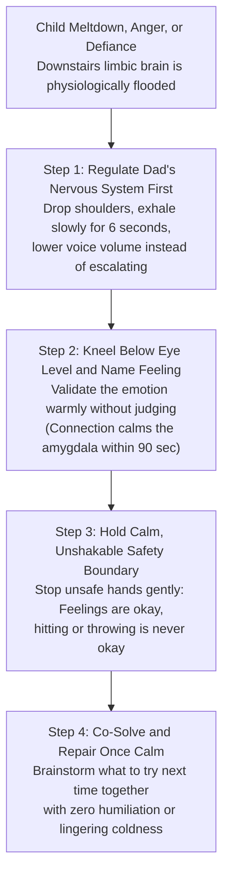
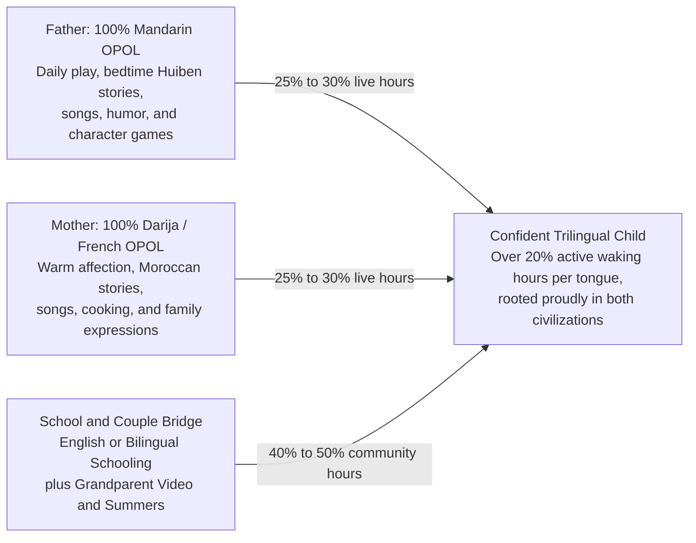

# Modern Evidence-Based Fatherhood & Raising Secure, Trilingual Kids

## 1. Authoritative Parenting vs. East Asian Shame & Comparison (*打压式教育*)

Every new parent carries an invisible script recorded during their own childhood. Many Chinese adults grew up inside high-sacrifice, deeply loving homes that nevertheless relied on **shame, public comparison (*"Look at the neighbor's kid" 别人家的孩子*), conditional praise, and emotional dismissal (*"What do you have to cry about?"*)** out of fear that warmth would make a child lazy. Others swing to the opposite extreme—**permissive indulgence**—fearing any firm boundary will hurt their child's feelings.

Fifty years of developmental psychology initiated by Diana Baumrind (and replicated across East Asian, European, North African, and North American cohorts) proves that thriving children come from neither harshness nor permissiveness. They come from **Authoritative Parenting (*权威型养育*: High Warmth + Clear, Predictable Boundaries)**:

| Parenting Style | Emotional Warmth | Boundary Clarity | Classic Parent Reflex | Long-Term Child & Adult Outcome |
| :--- | :--- | :--- | :--- | :--- |
| **Authoritative (*权威型 — Target*)** | **High** (attuned, affectionate, validates feelings) | **High** (calm, explained, consistent rules) | "I see you're furious that playtime ended; I still won't let you throw blocks. Let's clean up together." | High emotional resilience, intrinsic curiosity, strong executive self-control, lifelong closeness with parents |
| **Authoritarian (*专制/打压式教育*)** | **Low** (withholds praise, shames mistakes, compares) | **Rigid / Fear-Based** ("Because I said so!") | "96% again? Why did Xiao Ming get 100%? Stop crying right now or else!" | Short-term obedience paid for with adult anxiety, harsh inner critic, fear of failure, or polite emotional distance |
| **Permissive (*溺爱/放任型*)** | **High** (affectionate but anxious about tears) | **Low** (caves to tantrums, rescues from effort) | "Okay, okay, don't cry—here's the iPad and candy, Daddy will pick up your toys." | Poor frustration tolerance, entitlement, impulsive emotional dysregulation when peers or life say no |
| **Uninvolved / Absent (*丧偶式育儿*)** | **Low** (emotionally checked out behind phone/work) | **Low** (outsources all parenting to Mom) | "Ask your mother—I worked all day to pay for this apartment." | Attachment insecurity, resentment toward absent father, and marital burnout ([00-README.md](00-README.md)) |

### Neurobiology of Meltdowns: Connect Before You Redirect

Between ages 1 and 6, a child's emotional alarm center (**amygdala / downstairs brain**) is fully active while their logical impulse-braking **prefrontal cortex (upstairs brain)** will not finish myelinating until their mid-twenties. Yelling logic or lectures at a screaming three-year-old is neurologically identical to shouting architectural diagrams at a server throwing kernel panics.

Memorize Dr. John Gottman's core **Emotion Coaching** law: **All feelings are allowed; not all behaviors are allowed.**



### Real-World Fatherhood Script Upgrades (Retiring *打压式教育* Forever)

| Everyday Childhood Moment | Toxic Comparison / Harsh Reflex (Retire This) | Authoritative Emotion-Coaching Script (Use This) |
| :--- | :--- | :--- |
| **Child accidentally knocks over a full glass of milk** | "Why are you always so clumsy?! Watch what you're doing!" | *(Calm voice)* "Oops, gravity won! Spills happen to everyone—grab the blue towel with me and let's wipe it up together." |
| **Toddler tries to hit when told playground time is over** | Slapping hand back or yelling: "Bad boy! Don't you dare cry in public!" | *(Gently catching wrist, kneeling down)* "You're really sad to leave the slide—you were having so much fun. I won't let you hit Baba. Want to hop like frogs to the stroller or hold my hand?" |
| **7-year-old comes home upset over a low math quiz score** | "Other kids got 100—clearly you were careless and lazy!" | "I can tell you feel disappointed because you care. Your worth in this family never changes with a test score—let's grab a snack first, then play detective together on the two tricky problems." |
| **4-year-old feels scared of a vaccine needle or dark room** | "Big kids don't cry! Look, that little girl isn't even crying!" | "Needles pinch for three seconds—it makes total sense to feel nervous! Squeeze Baba's hand as hard as you can and count to five with me; we can do brave things even while feeling scared." |
| **Older child says "I hate my baby sister!" out of jealousy** | "How selfish! You're the big brother, you must always yield to her!" | "Sharing Mama and Baba after having us all to yourself feels really hard sometimes. I love spending special one-on-one time just with you—let's go kick the ball for 20 minutes right now." |
| **Dad snaps impatiently after an exhausting workday** | Pretending nothing happened or blaming the child ("You made me yell!") | *(Kneeling 10 mins later)* "Sweetheart, Baba raised his voice just now because Baba was tired from work—that was my mistake, never your fault. I'm sorry. Can we have a redo hug?" |

### Enforcing Firm Boundaries Without Punishment: Natural & Logical Consequences

Authoritative warmth never means letting children walk over household rules. Instead of corporal punishment, yelling, or cold silent treatment—which trigger fight-or-flight rather than moral learning—use **Related Logical Consequences** (**R-R-R**: *Related, Respectful, Reasonable*):

- **Natural Consequence** (safe everyday physics): Child refuses raincoat on a mild drizzle walk -> feels damp sleeves and chooses the raincoat next time (**zero "I told you so!" lecturing**—empathy lets the lesson sink in).
- **Logical Consequence** (directly tied to the action):
  - *Draws with markers on the living-room wall* -> Markers take a rest on the high shelf for the afternoon, and Dad + child wipe the wall clean together with a magic sponge.
  - *Throws a wooden toy truck in anger* -> *"Toys are for rolling, not throwing; the truck rests in the basket until after lunch."*
  - **Time-In Over Punitive Isolation**: When a 2-to-4-year-old melts down, locking them alone in a bedroom teaches *"My big feelings make me unlovable."* Stay calmly nearby in a quiet corner (**Time-In Co-Regulation**) until breathing slows, *then* hold the boundary.

---

## 2. Secure Attachment, The 30% Repair Rule & Father Neurobiology

### Circle of Security: Secure Base + Safe Haven

Attachment pioneers John Bowlby and Mary Ainsworth proved that parental warmth does **not** make children clingy—paradoxically, **deep emotional safety is the launchpad of bold independence** (*The Dependency Paradox*). A securely attached father serves two alternating roles all day long:

1. **The Secure Base (Supporting Exploration Outward)**: Delighting in their curiosity, letting them climb, try, struggle safely, and figure puzzles out without anxious hovering (*"Watch me, Baba!"*).
2. **The Safe Haven (Welcoming Return Inward)**: Whenever they scrape a knee, face peer rejection, or feel overwhelmed, your open arms regulate their cortisol back to baseline—never shaming tears as "weakness."

### Ed Tronick's Reassuring 30% Rule: Perfection Is Not Required

Perfectionist engineers sometimes worry one tired mistake will traumatize their child. Harvard developmental psychologist Ed Tronick micro-coded thousands of hours of healthy parent-infant video and discovered a liberating truth: **even optimal, securely attached parents are smoothly in sync with their child only about 30% of the time**. The remaining 70% consists of ordinary misreads and small ruptures—and **what wires lifelong psychological resilience is reliable Repair**. Every time you apologize warmly and reconnect, you teach your child: *"Relationships survive imperfect moments, and adults own their mistakes."*

### The Unique Neurobiology of Hands-On Fathers

Fatherhood is not "secondary motherhood"—neuroscientist Ruth Feldman's longitudinal imaging and endocrine studies show active caregiving physically rewires a man's brain and teaches unique regulatory skills:

- **Direct Caregiving Remodels Paternal Brain Circuits**: Men who bathe, feed, soothe, and care solo for infants experience measurable **oxytocin surges** and heightened superior-temporal-sulcus empathy network activation matching maternal depth—rewiring only happens through *hands-on hours*, never passive proximity.
- **Rough-and-Tumble Play Builds Prefrontal Brakes & Consent**: Energetic, safe physical play with Dad (carpet wrestling, pillow obstacle courses, tickle-and-freeze games) spikes a child's heart rate and dopamine joyously while demanding instant behavioral inhibition. Make one sacred rule automatic: **the split-second either person says `"Stop!"`, hands freeze 100% immediately every single time**—wiring both impulse self-regulation and lifelong respect for bodily consent before age five.

### Age-by-Age Brain Milestones & Normal Behaviors Often Misread as "Naughty"

Parents get angry half as often once they understand what a child's brain is actually capable of at each developmental stage:

| Age Window | AAP 24-Hr Sleep Need | Key Neurological Milestone | Normal Behavior Mistaken for "Defiance" | Grounded Father Response |
| :--- | :--- | :--- | :--- | :--- |
| **0 – 6 Months** | `12 – 16 hrs` (incl. naps) | Co-regulation & basic trust; zero ability to "manipulate" adults by crying | Waking frequently or crying immediately when put down | Respond reliably with warmth ([02-SCIENTIFIC-PRECONCEPTION-PREGNANCY-AND-POSTPARTUM.md](02-SCIENTIFIC-PRECONCEPTION-PREGNANCY-AND-POSTPARTUM.md)); you **cannot** spoil a young infant with responsiveness |
| **6 – 18 Months** | `11 – 14 hrs` (incl. 1–2 naps) | Object permanence (**8–10 mos**); first spoken words across languages | Crying when Mom/Dad leaves room (*Separation Anxiety*); dropping spoons off highchair 10x | Separation tears prove healthy attachment! Wave warmly without sneaking away; redirect spoon physics to water/ball drop play |
| **18 – 36 Months** | `11 – 14 hrs` (incl. 1 nap) | Autonomy surge ("I do it myself!"); emotional desires outpace spoken vocabulary | Saying `"No!"` constantly; melting down over wrong-colored cup | Offer **Two Bounded Choices** ("Red shoes or blue shoes?") so toddler exercises healthy agency inside your guardrail |
| **3 – 5 Years** | `10 – 13 hrs` | Emerging *Theory of Mind*; vivid imagination blurring fantasy and fact | Tall tales ("A dinosaur spilled the juice!") before age 4.5 | Avoid harsh "Don't lie to me!" traps ("Did you spill that?!"); state reality calmly: "I see juice on the floor—let's grab the cloth together" |
| **5 – 8 Years** | `9 – 12 hrs` | Logical reasoning, peer social comparison, rule fairness, multi-step focus | Sensitivity to peer comparison or fear of looking foolish when learning | Anchor home as an unconditional zero-comparison refuge; model laughing warmly at your own adult learning mistakes |

---

## 3. Carol Dweck's Growth Mindset & Childhood Brain Hygiene

### Praise the Process, Never Innate Genius Labels

Stanford psychologist Carol Dweck demonstrated that praising children for fixed traits (*"You're so smart! You're a natural!"*) quietly makes them **terrified of hard challenges**—because if difficulty requires struggle, they conclude they are "no longer smart." Upgrade your automatic praise syntax:

| Situation | Fixed-Mindset Label Praise (Fragile Ego) | Growth-Mindset Process Praise (Resilient Mastery) |
| :--- | :--- | :--- |
| **Solves a Lego build or math problem fast** | "Wow, you're a born math genius just like Baba!" | "You stayed super focused and tested three different ways until that tricky piece clicked!" |
| **Struggles with piano bars or French verbs** | "Maybe languages/music just aren't your talent." | "You haven't mastered that rhythm **yet**—every slow repetition is literally growing thicker myelin on those brain wires." |
| **Draws a colorful painting or builds a fort** | "You're the best artist in your whole class!" | "Look how thoughtfully you mixed those warm colors and balanced the roof—tell me how you came up with this idea!" |

### Five Daily Brain & Body Guardrails (Ages 0 to 10)

1. **Evidence-Based Screen Boundaries (AAP & WHO)**:
   - **Ages 0 to 18–24 Months**: **Zero passive screen media** (short videos, cartoons, background TV). **Explicit Exception**: Live, interactive **video calls with Grandparents in China and Morocco** are wonderful social connection and 100% encouraged!
   - **Ages 2 to 5 Years**: Cap at **under 1 hour/day** of slow-paced, co-viewed content—**never use an iPad or phone at the dining table or stroller to silence normal boredom**, or you rob your child of self-soothing and dinner conversation. Zero screens **60 minutes before bed**.
2. **2+ Hours of Daily Outdoor Daylight (Anti-Myopia Shield)**: Epidemiological trials across East Asia prove **at least 120 minutes/day outdoors in natural daylight** stimulates retinal dopamine and cuts childhood **myopia onset by 30% to 50%**—far more powerful than any "eye-protection lamp."
3. **20 Minutes of Nightly Bedtime Reading Aloud**: Snuggling with physical picture books (*绘本*) every night builds vocabulary, attention span, and bedtime calm.
4. **Age-Appropriate Chores From Age 3**: Putting laundry in the basket, setting spoons on the table, and tidying toys builds **agency and family teamwork**—kids who contribute feel proud, never entitled.
5. **Ellyn Satter's Golden Feeding Law (Zero Bowl-Chasing *不追着喂饭*)**: Pediatric nutrition science proves chasing toddlers around the living room spoon-feeding—or bribing *"Three more bites for dessert!"*—destroys innate hypothalamus satiety signals. Enforce clean **Division of Responsibility**: **Parents decide *what* nutritious food is served, *when*, and *where* (seated at the table); the child's own body decides *whether* and *how much* to eat**.

### Holding Loving Parenting Boundaries With Visiting Grandparents

Grandparents in both China and Morocco love grandchildren fiercely, yet generational habits occasionally clash with modern pediatric science. Each spouse handles their own parents warmly using these scripts:

| Classic Grandparent Habit | Why Modern Science Avoids It | Warm Filial Boundary Script |
| :--- | :--- | :--- |
| **Chasing a 2-year-old around the room spoon-feeding** | Overrides natural hunger/fullness cues; creates picky-eating power struggles | "Mom, our pediatrician wants her seated in her highchair for meals—once she climbs down or shakes her head, mealtime is finished until afternoon fruit." |
| **Handing child Douyin/YouTube Shorts to keep them quiet** | Dopamine slot-machine loops impair toddler attention and language | "Dad, we keep screens at zero during the day so his Mandarin and Darija take off—let's build blocks or go watch bugs downstairs with him instead!" |
| **Saying "Shame on you, big boys don't cry!" after a fall** | Teaches emotional suppression rather than nervous-system regulation | *(Scooping child warmly)* "Even grown-ups feel hurt when they scrape a knee! Grandpa just wants you to feel better—take a big breath with Baba." |
| **Comparing siblings or cousins ("Look how obedient cousin is!")** | Breeds sibling resentment and conditional self-worth | "Every kid blooms on their own clock in our house—we never compare cousins so they stay lifelong best friends." |

---

## 4. Raising Joyful Trilingual Kids: Mandarin + Darija/French + English

A China–Morocco household gives your child an extraordinary cognitive and cultural gift—fluency across **Mandarin Chinese**, **Moroccan Darija / French** (and optional Arabic literacy), and **English**—provided you engineer exposure intentionally rather than assuming children "absorb languages by magic."

### Three Psycholinguistic Laws Every Multilingual Parent Must Know

1. **Multilingualism Does NOT Cause Speech Delay**: Decades of bilingual/trilingual developmental research (Ellen Bialystok, François Grosjean) confirm multilingual babies hit first words (`approx. 12 months`) and two-word phrases (`18–24 months`) on the exact same neurological clock as monolinguals. Always count **Total Conceptual Vocabulary summed across all languages combined** (e.g., 22 Mandarin words + 20 Darija/French words + 15 English words at 24 months = **57 words**, comfortably above the 50-word clinical milestone!).
2. **Code-Mixing Is Grammatical Sophistication, Not Confusion**: When a 3-year-old says *"Baba, regarde 小猫咪!"*, they are seamlessly pulling the fastest lexical retrieval across grammars—by age 4 to 5, pragmatic person-separation locks in cleanly.
3. **The 20% to 25% Live Human Interaction Threshold**: Infant phonetic studies (Patricia Kuhl) prove babies learn zero phonetic tones from passive TV/iPad audio alone. For a child to become an **active speaker** (rather than a passive listener who understands Mom/Dad but replies only in English), *each* language requires **at least 20% to 25% of waking live interactive hours** (`approx. 20–25 hours/week`).



### Rebalancing Exposure Across Your Family's Base Country

Because the surrounding school/street language always tries to swallow minority home languages after age 5, adjust your home hours dynamically based on where you live ([01-CROSS-NATIONAL-MARRIAGE-AND-LEGAL-LOGISTICS.md](01-CROSS-NATIONAL-MARRIAGE-AND-LEGAL-LOGISTICS.md)):

| Where Family Lives | Dominant Community Tongue (Free 45%–55%) | Languages At Risk of Starving | Concrete Rebalancing Architecture |
| :--- | :--- | :--- | :--- |
| **International Hub** (Dubai, SG, London) | **English** (via international school & peers) | **Mandarin** AND **Darija / French** | Strict **OPOL at home**: Dad speaks 100% Mandarin; Mom speaks 100% Darija/French; choose a **French-English** or **Mandarin-English** bilingual primary school + annual summer cousin trips |
| **Mainland China** (Shanghai, Shenzhen, HK) | **Mandarin** (+ English in bilingual schools) | **Moroccan Darija & French** | Mom speaks 100% Darija/French; consider **Lycée Français** or international school with strong French track; host Moroccan playdates, video rituals with Rabat grandparents 3x/week, and **4-week Moroccan summers** |
| **Morocco or France** (Rabat, Casa, Paris) | **French & Darija** | **Mandarin** (+ English until upper grades) | Dad holds **100% warm Mandarin OPOL** without slipping into English/French with child; read Chinese *绘本* nightly, join weekend Mandarin playgroups, and spend **4 weeks every summer in China** |

### Five Tactics When Kids Hit the Ages 4–7 "Majority-Language Pushback"

Almost every multilingual child goes through a phase around age 5 where they understand your heritage language 100% but reply in the easier school language. Never turn your heritage tongue into a scolding chore—use these five high-joy tactics:

1. **Warm Recasting (Never Punish or Pretend Cruel Deafness)**: If your child points excitedly and says *"Daddy, look at the huge crane!"*, never snap *"Speak Chinese!"* Instead, light up and recast naturally in Mandarin before continuing: *"哇，好高的一台大起重机呀！你猜它能吊起几辆小汽车？"*
2. **Activate the "Communicative Need Principle" With Grandparents & Cousins**: Children speak a minority language effortlessly the week they realize beloved grandparents and playful cousins in China or Morocco *genuinely* only understand Mandarin or Darija—protect annual immersive family summers.
3. **Tie Heritage Languages to Fun Passions, Not Drill Worksheets**: Cook steamed dumplings in Mandarin and Moroccan *Msemen* pancakes in Darija; sing songs, play football, watch favorite animated films dubbed in Mandarin/French, and use graded picture stories (*四五快读 / 绘本*) for pain-free character recognition (`300–500 characters` before formal handwriting drills).
4. **Never Mock Accents on Either Side of the Extended Family**: If a relative in China laughs at your child's French-tinted Mandarin tone—or a relative in Morocco teases their Darija pronunciation—step in warmly: *"Speaking three languages at age five is amazing! We celebrate every word in our family."*
5. **Affirm 100% Dual Belonging (Never "Half and Half")**: Never describe your child as "half-Chinese, half-Moroccan" as though split down the middle. Tell them often: *"You carry 100% of two extraordinary thousand-year cultures—wherever you walk from Shanghai to Rabat and beyond, both worlds belong fully to you."*

### Sequencing Three Writing Systems Without Phonics Collision (Ages 0 to 10)

Oral trilingualism happens naturally in parallel, whereas **formal reading instruction should be staggered** so Latin-letter **Pinyin (`q, x, zh, c`)** never collides simultaneously with **English phonics** and **French orthography** at age 5:

| Child Age | Oral & Listening Focus | Smart Reading & Script Sequencing Rule |
| :--- | :--- | :--- |
| **Ages 0 – 4.0** | **100% Pure Spoken Ear Tuning**: Native Mandarin four-tone rhythm with Dad; native Darija/French cadence with Mom; bilingual picture books & songs | Zero flashcards or writing drills—infant ears wire permanent native phoneme boundaries best through joyful play and face-to-face talk |
| **Ages 4.0 – 5.5** | Rich narrative storytelling & "Why?" conversations in all home languages | **Visual Chinese Character Sight-Reading FIRST (Skip Pinyin Initially!)**: Playfully point-and-read **300 to 500 high-frequency pictorial characters (*汉字思维 / 四五快读*)** directly as visual icons—kids recognize `山, 水, 火, 木, 大, 小` effortlessly with zero Latin-alphabet confusion! |
| **Ages 5.5 – 7.0** | School peer fluency takes off; guard minority home OPOL strictly at dinner | **Primary School Alphabet Literacy (English or French First)**: Let school anchor one primary Latin phonics system solidly for 12–18 months before adding the second Latin-script reading rules |
| **Ages 7.5 – 10.0** | Chapter-book audiobooks (`西游记` stories, French *Petit Nicolas*, Roald Dahl) during car rides & breakfasts | **Add Pinyin + Digital Input & Optional Arabic Script**: Once English/French reading is automatic, a 7.5-year-old masters Pinyin in **3 weeks** with zero interference, unlocking independent Chinese reading and typing alongside optional Arabic calligraphy/script enrichment |

### Curated Trilingual Starter Bookshelf & Audio Toolkit (Ages 1 to 8)

Stock low, forward-facing Montessori bookshelves at toddler eye height with rich storytelling in all three worlds:

| Language Pillar | Ages 1 – 4 Picture Books & Songs | Ages 4 – 8 Graded Reading & Audio Stories |
| :--- | :--- | :--- |
| **Mandarin (*普通话*)** | *小熊宝宝* series, *猜猜我有多爱你*, *好饿的毛毛虫*, classic nursery rhymes (*童谣*) | *四五快读* (visual characters), *神奇校车* Chinese edition, *凯叔讲故事* (*凯叔西游记 / 诗词来了* audio on screen-free speaker) |
| **Darija / French** | Moroccan nursery songs, *T'choupi*, *Petit Ours Brun*, *L'école des loisirs* board books | *J'aime lire* (Bayard magazines), *Le Petit Nicolas*, *Astérix*, Lunii *Ma Fabrique à Histoires* screen-free French audio box |
| **English** | *Brown Bear, Brown Bear*, Julia Donaldson (*The Gruffalo*, *Room on the Broom*), Sandra Boynton | *Frog and Toad*, *Magic Tree House*, Roald Dahl audiobooks on a screen-free **Yoto Player** card speaker |

---

## 5. Signature Father-Child Rituals That Build Lifelong Closeness

Children rarely remember expensive toys from age six; they remember **predictable, phone-free sensory rituals** with their parents. Anchor your family week around four simple traditions:

```markdown
## The Engaged Father's Weekly Anchor Rituals
1. **Daily 20-Minute Phone-Free "Special Time"**:
   - Leave your phone in another room after work. Sit on the rug and let your child lead the game 100% in Mandarin for 20 uninterrupted minutes—zero work Slack checks, zero quizzing.
2. **Saturday Morning "Baba & Kid Expedition" (08:30 to 11:30)**:
   - Every Saturday morning, Dad takes the child solo to parks, markets, museums, or cycling—giving Mom 3 sacred, guilt-free hours of quiet rest while cementing an unbreakable father-child adventure bond.
3. **Friday Cultural Kitchen & Story Night**:
   - Alternate making handmade Chinese dumplings/noodles and Moroccan Tagine/Msemen together as a family, sharing stories from each parent's childhood hometown.
4. **Annual Birthday Interview & Letter Vault**:
   - Record a cozy 5-minute video asking the same playful questions every birthday—and write one private letter per year in a shared family journal praising their kindness, curiosity, and courage.
```

### What Your Marriage Quietly Teaches Sons and Daughters Every Day

Children listen to only 20% of parental lectures, yet they record **100% of how their father treats their mother**:

- **If You Raise a Son**: Seeing his father cook dinner effortlessly, speak to his mother with visible warmth and respect, validate feelings without shame, and apologize promptly without fragile ego teaches him what strong, grounded manhood actually looks like—immunizing him against both toxic hardness and passive helplessness.
- **If You Raise a Daughter**: Your attentiveness, encouragement of her physical courage and intellectual boldness (never praising appearance alone), and unwavering tenderness toward her mother become her lifelong internal compass—she will never settle for coldness or disrespect in her future relationships because her nervous system grew up knowing how real love behaves.
- **Celebrating Dual-Heritage Joy All Year**: Fill your home calendar with sensory joy from both roots—steaming reunion dumplings and glowing lanterns for **Spring Festival (*春节*)** and **Mid-Autumn (*中秋*)**, alongside warm family tables, sweet almond pastries, and generosity during **Ramadan** and **Eid (*开斋节 / 宰牲节*)**.

Looking back at age 45 or 55, no production deployment or career promotion will ever rival the quiet pride of watching your partner flourish beside you and hearing your child laugh effortlessly across three languages—confident, kind, curious, and deeply secure in where they come from.

