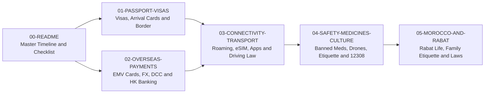
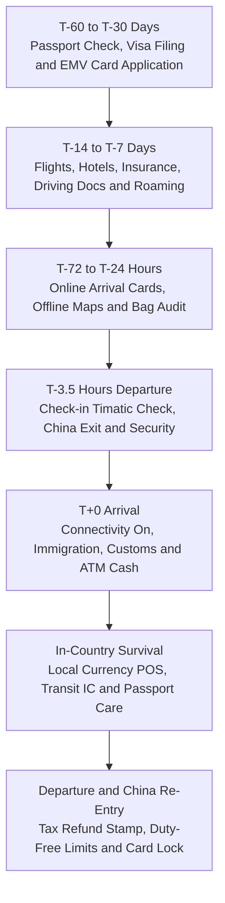

# Going Abroad as a Chinese Citizen: Complete Preparation and Notice Handbook (中国人出国全攻略)

Traveling internationally with a People's Republic of China (`中华人民共和国普通护照`) passport is fundamentally an exercise in **bridging two parallel digital, financial, and regulatory ecosystems**. Inside Mainland China, daily life runs on a tightly integrated stack: a `+86` mobile number, Resident Identity Card (`身份证`) real-name verification, WeChat Pay and Alipay QR codes, UnionPay (`银联`), Gaode/Baidu Maps, and domestic super-apps. The moment you cross an international border, nearly every layer of that stack either degrades or stops functioning altogether.

Most overseas travel emergencies experienced by Chinese travelers do not stem from poor English. They happen because of **unbridged infrastructure dependencies**: losing access to `+86` SMS verification codes when a bank triggers fraud control, discovering Alipay is rejected at a Tokyo ramen machine or Paris metro gate, bringing household cold medicine (`新康泰克` or `复方甘草片`) that triggers narcotics detention at customs, or renting a car in Japan with a notarized license translation that constitutes arrestable unlicensed driving.

This handbook is a complete, end-to-end operational manual designed to make international travel—from neighboring Asian hubs to Europe and North America—predictable, legal, cost-efficient, and stress-free.

---

## Curriculum Architecture and Learning Path

Use the roadmap below to navigate all five modules in this guide. Each module addresses a critical failure domain of international travel for PRC citizens.

### Module Directory (Clickable Index)

| Module | File Link | Core Decisions and Problems Solved |
| :--- | :--- | :--- |
| **00. Master Timeline & Overview** | [00-README.md](00-README.md) | Dual-ecosystem mental model, destination difficulty tiers, T-60 to T+Return master runbook, airport security & customs allowances. |
| **01. Passports, Visas & Borders** | [01-PASSPORT-VISAS-AND-BORDER-CONTROL.md](01-PASSPORT-VISAS-AND-BORDER-CONTROL.md) | 6-month passport rule, Tier-1/Shanghai residence perks (Japan 3/5yr, Schengen, US B1/B2 + EVUS, Singapore), visa-free traps, VJW/SGAC/TDAC digital arrival cards. |
| **02. Payments, Cards, FX & Tax** | [02-OVERSEAS-PAYMENTS-CARDS-AND-FX.md](02-OVERSEAS-PAYMENTS-CARDS-AND-FX.md) | Why Alipay fails outside malls, applying for 0% FX fee EMV chip+contactless Visa/Mastercard, Apple Pay, ATM rules, avoiding DCC rip-offs, legal HK bank accounts, tax refunds. |
| **03. Internet, Apps & Driving** | [03-CONNECTIVITY-APPS-TRANSPORT-AND-DRIVING.md](03-CONNECTIVITY-APPS-TRANSPORT-AND-DRIVING.md) | Keeping `+86` alive for bank OTPs (`无忧行`/roaming) + eSIM/SIM data, Mainland iPhone eSIM hardware limits, Google/Naver Maps, Uber/Grab, Apple Suica, legal vs illegal overseas driving. |
| **04. Safety, Meds, Culture & SOS** | [04-SAFETY-MEDICINES-CULTURE-AND-EMERGENCIES.md](04-SAFETY-MEDICINES-CULTURE-AND-EMERGENCIES.md) | Banned ingredients in Chinese OTC meds, DJI drone registration laws, tipping rules (US/EU/JP/SEA), European anti-pickpocket defense, lost passport `中国领事` `旅行证` SOP. |
| **05. Morocco & Rabat Special Playbook** | [05-MOROCCO-AND-RABAT-SPECIAL-GUIDE.md](05-MOROCCO-AND-RABAT-SPECIAL-GUIDE.md) | Shanghai ↔ Rabat flight & Al Boraq rail routes, 90-day visa-free entry, strict drone ban, Article 490 / `CIN` hotel law for couples, Rabat neighborhoods, Rabati family etiquette, Darija/French phrases, Halal gifts, and her Shanghai visit prep. |

---

## Core Mental Model: The Two-Ecosystem Bridge

Before booking your first ticket, audit your readiness across six infrastructure layers. If any layer lacks an international equivalent, fix it before departure—several steps (passport issuance, physical EMV credit card mailing, consular visas, and `+86` roaming activation) **cannot be completed once you have already boarded the plane**.

| Infrastructure Layer | Mainland China Stack | Global Stack Required Abroad | Failure Mode if Unprepared |
| :--- | :--- | :--- | :--- |
| **1. Identity Credential** | PRC Resident ID Card (`居民身份证`) | PRC Passport (`> 6 months` validity, `>= 2` blank pages) + Visa/ETA + Printed Bookings | Denied boarding (`航司拒载`) at check-in counter before reaching security. |
| **2. Authentication Root** | `+86` SIM SMS + Facial Recognition | `+86` International SMS Roaming ON (Data Roaming OFF) | Locked out of Chinese banking apps, 3DS credit card verification, or WeChat on new networks. |
| **3. Payment Rail** | WeChat Pay / Alipay / UnionPay QR | Physical EMV Chip + Contactless Visa/Mastercard (`0% FX fee`) + Small Local Cash | Unable to pay hotel deposits (`预授权`), subways, restaurants, Uber, or unattended kiosks. |
| **4. Network & IP** | Domestic 5G / Home Broadband | Overseas eSIM / Physical Local SIM / Carrier Roaming Pack | Stranded at arrival airport without maps, translation, ride-hailing, or electronic arrival QR codes. |
| **5. Spatial & Mobility** | Gaode (`高德`) / Baidu Maps / Didi | Google Maps (or Naver Map in Korea) + Uber/Grab/Bolt + Transit IC | Lost on multi-operator rail networks (Tokyo/London) or overcharged by street taxis. |
| **6. Legal & Medical** | PRC Driver's License + Domestic OTC Meds + `110/120` | Destination-legal License Translation/IDP + Audited OTC Kit + Travel Insurance + `+86-10-12308` | Criminal charges for unlicensed driving (Japan/Korea) or customs detention over banned cold tablets. |

---

## Destination Progression Matrix for First-Time to Seasoned Travelers

If you are building international travel confidence from scratch, calibrate your destination choice to logistical friction:

| Tier | Representative Destinations | Visa Friction | Language & Cultural Friction | Payment & Safety Profile |
| :--- | :--- | :--- | :--- | :--- |
| **Tier 1: Zero-Friction Warmup** | **Hong Kong, Macau, Singapore, Malaysia** | Visa-free (SG 30d, MY 30d) or HK/Macau Permit (`港澳通行证`) | Mandarin + English widely spoken; signage bilingual | High Alipay/UnionPay/Contactless acceptance; ultra-safe (SG/HK); ideal first trip to set up HK bank cards. |
| **Tier 2: High-Reward Short-Haul** | **Japan, South Korea (Jeju / Seoul), Thailand, UAE** | Visa-free (TH 60d, UAE 30d, Jeju 30d) or Agency Visa (JP, KR) | Kanji helps reading in Japan; translation & ride apps bridge gaps | Cash + IC Card + Visa/MC essential in JP; strict med & drone rules; **driving on PRC license illegal in JP & KR**. |
| **Tier 3: Developed Long-Haul** | **Schengen Europe, United Kingdom, Australia, New Zealand** | Biometric or e-Visa (VFS/TLS, AU Subclass 600, NZ 5yr) | English (UK/AU/NZ) or local European languages + English | Near-100% EMV Contactless; legal self-drive (with proper translation); high pickpocket vigilance needed in EU cities. |
| **Tier 4: Complex / High-Stakes** | **United States, Canada, South America, North Africa** | Interview or multi-step visa (US B1/B2 + EVUS; or conditional visa-free via US visa) | English / Spanish; car-centric infrastructure in North America | Mandatory credit card culture + 18–22% tipping in US; ultra-expensive ER medical costs (insurance non-negotiable). |

---

## End-to-End Operational Timeline (T-60 Days to Return)

### Phase 1: T-60 to T-30 Days (Credentials and Financial Rails)

1. **Audit Passport Validity and Blank Pages**:
   - Confirm your passport expires **more than 6 months after your planned return date** (not merely your departure date) and has **at least 2 to 4 completely blank visa pages** (`签证页`, excluding `备注页` endorsement pages at the back).
   - If renewing via the **`移民局 12367`** App or Exit-Entry Administration (`出入境管理局`), allow 7 working days for local Hukou (`户籍地`) or up to 20 calendar days for cross-province (`全国通办`) issuance.
2. **Initiate Visa or Electronic Authorization**:
   - **Schengen / UK / US / Japan / Korea / Australia**: Submit applications 30 to 60 days ahead. Never pay for non-refundable flights before visa issuance unless explicitly required; use refundable tickets or itinerary reservations where accepted (see [01-PASSPORT-VISAS-AND-BORDER-CONTROL.md](01-PASSPORT-VISAS-AND-BORDER-CONTROL.md)).
   - **US B1/B2 Holders**: Verify your **EVUS** (`evus.gov`) status is `ENROLLED` and will not expire mid-trip.
3. **Apply for a True Overseas EMV Credit/Debit Card**:
   - Apply at a Mainland bank for a **single-network EMV Chip + Contactless (`拍卡`) Visa or Mastercard** with **`0% 货币转换费`** (zero FX conversion fee).
   - Physical card manufacturing, courier delivery, and mandatory in-person branch activation (`柜台面签激活` for first-time cardholders at that bank) take **10 to 15 days**. Do not leave this to the final week (see [02-OVERSEAS-PAYMENTS-CARDS-AND-FX.md](02-OVERSEAS-PAYMENTS-CARDS-AND-FX.md)).

### Phase 2: T-14 to T-7 Days (Insurance, Driving, Cash & Roaming)

1. **Purchase Travel Medical and Evacuation Insurance**:
   - Select a policy covering overseas outpatient/inpatient medical care, **24/7 emergency medical evacuation (`紧急医疗运送和送返`)**, flight delays, and baggage/passport loss.
   - Suggested medical coverage floors: **CNY 300,000+** for Asia; **EUR 30,000+ (approx. CNY 250,000+)** mandatory for Schengen; **CNY 1,000,000+** for the United States, Canada, Switzerland, or Japan.
2. **Prepare Legal Driving Documents (Only Where Permitted)**:
   - Confirm whether your destination recognizes a PRC driver's license (US/AU/NZ/UK/France/Germany = Yes with proper translation; **Japan/Korea = Strictly Illegal**). Order a Chinese Notary Public (`公证书`), German Sworn Translation (`宣誓翻译`), or NAATI translation accordingly (see [03-CONNECTIVITY-APPS-TRANSPORT-AND-DRIVING.md](03-CONNECTIVITY-APPS-TRANSPORT-AND-DRIVING.md)).
3. **Exchange Small Emergency Cash at a Domestic Bank**:
   - Use your bank app (`中国银行` / `工商银行` / `招商银行`) to purchase foreign currency (`购汇`) and book branch cash pickup (`预约外币现钞取现`)—specifically **requesting small denominations (`小面额零钞`)** if available (e.g., JPY 1,000, USD 10/20, EUR 10/20, THB 100/500). Carrying USD 200–500 or equivalent local cash serves as a fail-safe against POS outages.
4. **Enable `+86` International Roaming & Prepare Overseas Data**:
   - Open your carrier app (`中国移动` / `中国联通` / `中国电信`) or call `10086` / `10010` / `10000` to turn on **International Voice & SMS Roaming (`国际及港澳台漫游`)**. Verify whether a deposit or tenure threshold applies.
   - Check if your phone supports eSIM (`*#06#` -> look for `EID`). Mainland China iPhones lack eSIM hardware—order a physical overseas data SIM (`境外流量实体卡` + SIM ejector pin!) or carrier roaming pack (`无忧行`) ahead of time.

### Phase 3: T-72 to T-24 Hours (Digital Declarations, App Binding & Packing)

1. **Complete Official Online Arrival Cards (Free Government Sites Only)**:
   - Submit **SG Arrival Card** (Singapore, within 3 days), **TDAC** (Thailand, within 3 days), **MDAC** (Malaysia, within 3 days), **Visit Japan Web** (Japan), or **Korea e-Arrival Card** (within 3 days). Save screenshots of submission confirmations and QR codes in a dedicated phone album (`Offline Travel Docs`).
2. **Pre-Install and Bind Overseas Apps While `+86` SMS Works Cleanly**:
   - Install Google Maps (download offline city maps), Google Translate (download offline language packs), Uber / Grab / Bolt, WhatsApp, Airline App, and `中国领事` App.
   - Register accounts and bind your Visa/Mastercard inside Uber/Grab while still in China or with SMS roaming verified.
3. **Cloud + Paper Backup of Critical Documents**:
   - Print **one physical paper folder** containing: Passport bio-page copy, Visa/EVUS printout, English flight itinerary (showing e-ticket number `票号` and return date), English hotel booking confirmations (with street address & phone), and travel insurance policy certificate (with 24h emergency phone number).
   - Store encrypted digital scans in cloud storage and local phone files, plus pack **2 white-background passport photos** (`48mm x 33mm` / `35mm x 45mm`) in your suitcase for emergency travel document replacement.
4. **Luggage, Lithium Battery & Medicine Compliance Audit**:
   - **Chinese Airport Security (`中国民航安检`) Power Bank & Battery Rules**:
     - Power banks (`充电宝`) and spare lithium batteries **MUST go in carry-on baggage (`必须随身携带，严禁托运`)**.
     - Rated energy **`<= 100Wh`** (e.g., `20,000mAh` at `3.7V` = `74Wh`, or `27,000mAh` at `3.7V` = `99.9Wh`): permitted up to 2 units without airline approval. **`100Wh < Wh <= 160Wh`**: requires explicit airline counter approval. **`> 160Wh` or faded/missing `Wh` / `3C` specification label**: **100% confiscated at security**.
     - **In-Flight Usage Ban**: Under current CAAC and major Asian carrier (Singapore Airlines, Thai Airways, Korean Air, EVA Air, Cathay Pacific) safety regulations, **using a power bank to charge devices mid-flight or charging the power bank via seat USB ports is prohibited**, and power banks must be kept within sight/seat pocket rather than overhead bins on many carriers. Bring a high-wattage USB-C cable to plug directly into in-seat power!
   - **Liquids (`100ml` Rule)**: Every liquid, gel, cream, toothpaste, or sunscreen in carry-on must be in a container whose **printed bottle capacity is `<= 100ml`** (a `150ml` bottle that is only one-quarter full will still be confiscated!), fitting inside a `1L` clear resealable bag. Put full-size toiletries in checked luggage.
   - **Zero Lighters / Matches (`禁带火种`)**: Unlike US/European airports that sometimes allow one lighter on person, **Mainland Chinese airports enforce a strict zero-tolerance ban** on all lighters, matches, and flameless arc lighters in both carry-on and checked bags.
   - **Medicine Audit**: Strip out `新康泰克`, `白加黑`, `复方甘草片`, `强力枇杷露`, and animal/endangered TCM ingredients (see [04-SAFETY-MEDICINES-CULTURE-AND-EMERGENCIES.md](04-SAFETY-MEDICINES-CULTURE-AND-EMERGENCIES.md)).

---

## Departure Day Runbook: Navigating Airport Exit in China

Arrive at the international terminal **3 to 3.5 hours before scheduled departure**. International departures involve four sequential checkpoints:

### Step 1: Airline Check-In Counter (`航司值机与证件核验`)
- Even if you checked in online, many international flights from Mainland China require **counter document verification** before issuing a live boarding pass (`登机牌`).
- The agent checks IATA **Timatic** rules: passport 6-month validity, destination visa/e-Visa printout, EVUS enrollment, and **return/onward flight ticket** (mandatory for almost all visa-free and tourist entries).
- Verify your checked luggage tag (`行李条`) prints your final destination airport IATA code (e.g., `NRT`, `LHR`, `SIN`)—keep the baggage claim sticker pasted to your passport cover or boarding pass until your suitcase is in your hands.

### Step 2: China Customs Outbound (`中国海关出境申报`)
- Most ordinary tourists walk straight through the **Nothing to Declare (`无申报通道`)** lane.
- **When You MUST Declare at Outbound Customs**:
  1. Carrying physical cash exceeding **CNY 20,000** OR foreign currency cash exceeding **USD 5,000 equivalent** (carrying USD 5,000–10,000 requires a bank-issued `携带外汇出境许可证`).
  2. Carrying professional high-value personal photography/cinema/computer equipment (e.g., high-end telephoto lenses, cinema cameras, multiple brand-new bodies) that you plan to bring **back** into China—filing an outbound declaration form (`进出境旅客行李物品申报单`) proves the gear was exported from China rather than newly purchased overseas, preventing accidental import tax questions upon return.

### Step 3: China Immigration Exit (`中国边检`)
- **Fast Track E-Gates (`快捷通道`)**: PRC citizens aged 14+ holding machine-readable electronic passports with biometric fingerprints enrolled at issuance can clear China exit in 15 seconds via fingerprint + facial scan.
- **Note on Missing Physical Exit Stamps**: E-gates do not stamp your passport. Almost no foreign immigration authority cares whether China stamped you out, **except** if your company accounting (`财务报销`) or local government requires proof of exit/entry dates—in which case you can either print an official stamped **`出入境记录凭证`** at the self-service kiosk right past the e-gates, or download the digitally signed PDF anytime in the **`移民局 12367` WeChat Mini-Program**!

### Step 4: Aviation Security (`安全检查`) & Boarding Gate
- Remove laptops, iPads, umbrellas, cameras, and power banks into separate trays as instructed.
- Confirm boarding time (usually **40–50 minutes prior to departure** for wide-body international jets; gates close **15–20 minutes prior**).

---

## Arrival Runbook: First 60 Minutes in a Foreign Country

1. **While Taxiing to the Gate**:
   - Switch off Airplane Mode. Turn **ON** your overseas eSIM / swap in your local physical SIM (keep your `+86` nano-SIM taped inside a SIM card holder in your wallet—never loose in a pocket!).
   - Verify your `+86` line has **Data Roaming OFF** (`数据漫游：关闭`) unless using a prepaid carrier pack.
2. **Immigration (`Arrivals / Passport Control / 入境审查`)**:
   - Follow signs for **`Foreign Passports` / `All Passports` / `Visitors`** (unless eligible for automated e-Gates, such as **Singapore Changi** and **Malaysia KLIA**, where PRC passport holders who submitted SGAC/MDAC online can now use automated biometric lanes!).
   - Remove hats, sunglasses, headphones, and masks. Present passport, boarding pass, and arrival QR if applicable. Do not use your phone in the queue.
3. **Baggage Claim & Customs (`Customs / 税关 / 海关`)**:
   - Collect checked bags and verify your name on the luggage tag (identical black suitcases get swapped constantly!).
   - Walk through **Green Channel (`Nothing to Declare`)** only if you have zero restricted food, plants, controlled meds, excess tobacco/alcohol, or cash above the statutory declaration limit. When in doubt (especially in Australia, New Zealand, or the US), **declare it on the card and take the Red/Declare lane**—honest declaration results in inspection/disposal with zero fine, whereas undeclared contraband triggers immediate fines of AUD 3,000+ or visa cancellation.
4. **Cash, Transit Card & Ground Transport**:
   - Ignore airport currency exchange booths (`Travelex` spreads often exceed 10–15%!). If you need local notes, find an official bank ATM in the arrivals hall, insert your UnionPay or Visa debit card, withdraw once, and **decline conversion / choose local currency**.
   - Follow official airport signage (`Train to City` / `Official Taxi Stand` / `Ride App Pickup Zone`). **Never follow anyone approaching you inside the arrivals terminal whispering "Taxi? Uber?"**—every legitimate driver around the world waits at designated stands or dispatches via app.

---

## Returning to China: Customs Allowances & Post-Trip Wrap-Up

### China Inbound Customs Rules for Resident Travelers (`中国居民旅客进境海关规定`)

Under current PRC Customs regulations (updated duty-free quota policy):

| Category | Statutory Limit / Rule | Key Notes |
| :--- | :--- | :--- |
| **Overseas Personal-Use Duty-Free Quota** | **CNY 5,000** | Applies to personal-use items (`自用、合理数量`) acquired outside China. |
| **Port Inbound Duty-Free Shop Add-On** | **+ CNY 3,000** (Total **CNY 8,000**) | Combined total remains duty-free if extra purchases up to CNY 3,000 are made at Chinese port inbound duty-free shops (`口岸进境免税店`). |
| **Single Indivisible Item (`不可分割单件`)** | Taxed on full value if `> CNY 5,000` (if approved as personal use) | E.g., one luxury watch or high-end handbag exceeding the quota is assessed import tax (`行邮税/进境物品进口税`: typically 13%, 20%, or 50% by category) on its value rather than deducting CNY 5,000. |
| **Tobacco & Alcohol** | **400 cigarettes** + **1,500ml alcohol** (`>12% ABV`) | Different lower limits apply if arriving solely from Hong Kong or Macau (200 cigarettes + 750ml alcohol). |
| **Strictly Prohibited Inbound (`严禁携带入境`)** | **Fresh fruits, raw/cooked meats, sausages, jerky, dairy/eggs, soil, seeds, live animals/plants, endangered wildlife products (ivory, giant clam `砗磲`, crocodile without CITES), illicit publications** | Airport quarantine detector beagles (`检疫犬`) inspect carousel bags; leftover airplane apples or overseas beef jerky must be discarded in biosecurity bins *before* customs! |

### T+1 Day Back Home: Post-Trip Security Checklist
1. **Enable Overseas Card Lock (`境外交易锁 / 一键锁卡`)**: Skimmed magnetic-stripe or leaked CVV numbers from overseas merchants/hotels are frequently tested weeks later. Lock `境外无卡交易` and `境外刷卡` inside your banking app until your next trip, while keeping any intentional recurring subscriptions (e.g., iCloud/Cloudflare) on a dedicated virtual or HK debit card.
2. **Verify Hotel Pre-Authorization Releases (`酒店预授权解冻`)**: Check that hotel security deposits (`Deposit / Hold`) disappear or reverse within 7–30 days rather than posting as settled charges.
3. **Confirm Tax Refund Receipts**: Track Global Blue / Planet / airport refund credits to ensure customs stamps registered properly before discarding receipts.

---

## Critical Booking Pitfalls: Flights, Transit Visas, Hotels & Power

Before locking in non-refundable reservations, run your itinerary through these three structural checks that routinely trap first-time outbound travelers:

### 1. International Transit Traps (`联程直挂 vs 非联程过境签陷阱`)
- **Single PNR Through-Ticket (`联程机票`, one 13-digit ticket/booking reference)**: Checked bags are tagged through to your final destination (`行李直挂`), and in most Asian/European hubs (`SIN`, `HKG`, `DOH`, `DXB`, `FRA`, `AMS`) you stay airside (`国际中转区`) without clearing transit immigration.
- **Self-Transfer / Separate Tickets (`非联程拼接票`, bought separately on OTAs)**: You **MUST clear immigration**, enter the transit country to claim your suitcase, walk upstairs to check in again, and re-clear security—meaning **you MUST hold a valid visa (or visa-free eligibility) for the transit country**, or the first airline in China will refuse to board you!
- **Three Special Transit Red Lines**:
  1. **United States (`所有美国机场均无国际中转免签区`)**: US airports have **zero sterile airside transit**. Even if flying `Shanghai -> Los Angeles -> Mexico City / Lima` on one ticket, **every passenger must hold a valid US visa + EVUS**, clear US CBP immigration, claim bags, and re-drop them!
  2. **Cross-Airport Transfers (`同城跨机场转机`)**: Changing between **Tokyo Haneda (`HND`) and Narita (`NRT`)**, **Seoul Incheon (`ICN`) and Gimpo (`GMP`)**, or **London Heathrow (`LHR`) and Gatwick (`LGW`)** requires entering the country—requiring a full visa or qualifying transit pass!
  3. **Multiple Stops Inside Schengen**: Flying `Shanghai -> Frankfurt -> Paris -> Rome` means you **enter Schengen immigration at Frankfurt** (the intra-Schengen flight `Frankfurt -> Paris` is treated like a domestic flight!), while baggage customs clears at your final airport.

### 2. Overseas Hotel Pricing & Hidden Fee Rules (`海外酒店预订潜规则`)
- **Japan Strict Per-Person Occupancy (`日本酒店按人头严格计费`)**: Unlike China or the US where a room price covers 1 or 2 guests interchangeably, Japanese hotels charge **strictly per person (including young children above preschool age)**. Booking a room for `1 Adult` to save money and sneaking `2 Adults` inside violates Japan's Inns and Hotels Act (`旅館業法`) and triggers police calls or on-the-spot penalty charges! Always enter the exact adult + child headcount (`人数与儿童年龄`) when searching.
- **Mandatory Post-Booking Fees**:
  - **United States**: Watch for mandatory **`Resort Fee / Destination Fee` (USD 25 to 60 + tax per night)** in Las Vegas, New York, Hawaii, Miami, and San Francisco—collected at the hotel front desk even if you selected "Prepaid Online"!
  - **Europe & Japan**: Municipal **`City Tax / Tourist Tax / 宿泊税`** (EUR 2–10 per person per night in Paris/Rome/Barcelona; JPY 100–1,000+ in Tokyo/Kyoto/Osaka) is collected directly at check-in or check-out.

### 3. Global Plug Types & Voltage Compatibility Matrix (`全球插座与电压速查表`)

Modern USB-C GaN phone/laptop/camera chargers (`iPhone`, `MacBook`, `Osmo Pocket 3`) support **wide global voltage (`100V–240V, 50/60Hz`)** and only need a passive plug adapter. **However, `220V`-only heating/motor appliances bought in Mainland China (hairdryers, curling irons, Dyson Airwrap Mainland version, travel electric kettles) WILL fail in `100V–120V` countries** (blowing fuses or barely heating up)!

| Destination Region | Voltage & Frequency | Socket Standard | Adapter & Appliance Compatibility Notes |
| :--- | :--- | :--- | :--- |
| **Japan (`日本`)** | **`100V`** (`50Hz` East / `60Hz` West) | **Type A / B** (2 flat parallel pins) | Mainland 2-flat-pin plugs (`两扁插头`) plug straight into Japanese walls with **zero adapter**! Mainland 3-pin plugs (`三扁`) do NOT fit; `220V` hairdryers run weak. |
| **United States & Canada** | **`120V / 60Hz`** | **Type A / B** (2 flat + 1 round ground) | Mainland 2-flat-pin plugs fit directly (check polarized blade width on older sockets); `220V`-only appliances unusable. |
| **Hong Kong, Macau, UK, Singapore, Malaysia, UAE** | **`220V–240V / 50Hz`** | **Type G (`英标三方脚`)** | **Adapter mandatory** (three thick rectangular prongs); voltage matches China `220V` cleanly. |
| **Continental Europe (`FR, DE, ES, NL`) & South Korea** | **`220V–230V / 50–60Hz`** | **Type C / E / F (`欧标/德标双圆孔`)** | **4.8mm round-pin Schuko adapter mandatory** (note: Switzerland `Type J` & Italy `Type L` have narrow recessed 3-pin variants—carry a universal adapter!). |
| **Australia & New Zealand** | **`230V / 50Hz`** | **Type I (`澳标八字三扁`)** | Identical angled 3-flat-pin geometry to China's 3-prong air-fryer/laptop cord (`国标三扁插头可直接插入澳新插座`)! Mainland 2-flat-pin cords still need an adapter. |
| **Thailand (`泰国`)** | **`220V / 50Hz`** | **Hybrid Type A / B / C / O** | Most Thai hotel sockets accept **Mainland 2-flat-pin plugs directly** without an adapter! |

---

## Master Printable T-24h Packing & Readiness Checklist

- [ ] **Documents**: Passport (`>6m` validity) + Visa/EVUS + Old passport (if holding valid visa) + Paper printouts (flights, hotels, insurance) + 2 passport photos + PRC ID card (`身份证`, useful for domestic high-speed rail to/from airport!).
- [ ] **Money**: 1–2 EMV Chip+Contactless Visa/Mastercard cards (`0% FX fee`, activated, PIN known, CVV covered) + 1 UnionPay IC Debit card + USD 200–500 / local emergency cash (divided across 2 bags).
- [ ] **Connectivity**: `+86` SMS Roaming confirmed ON + Data Roaming OFF + Overseas eSIM installed or Physical SIM + SIM ejector pin (`取卡针`).
- [ ] **Power & Hardware**: Universal travel adapter (`万国转换插头`) + Wide-voltage USB-C GaN multi-port charger + Power bank (`<=100Wh`, clear 3C/Wh label, in carry-on, never used mid-flight).
- [ ] **Safety**: Crossbody phone lanyard + Retractable luggage cable lock + Safe single-ingredient OTC meds in original boxes + `+86-10-12308` saved in Contacts + `中国领事` App installed.

Continue to [01-PASSPORT-VISAS-AND-BORDER-CONTROL.md](01-PASSPORT-VISAS-AND-BORDER-CONTROL.md) to master passport renewals, visa strategies, regional residence perks, and smooth border passage.
