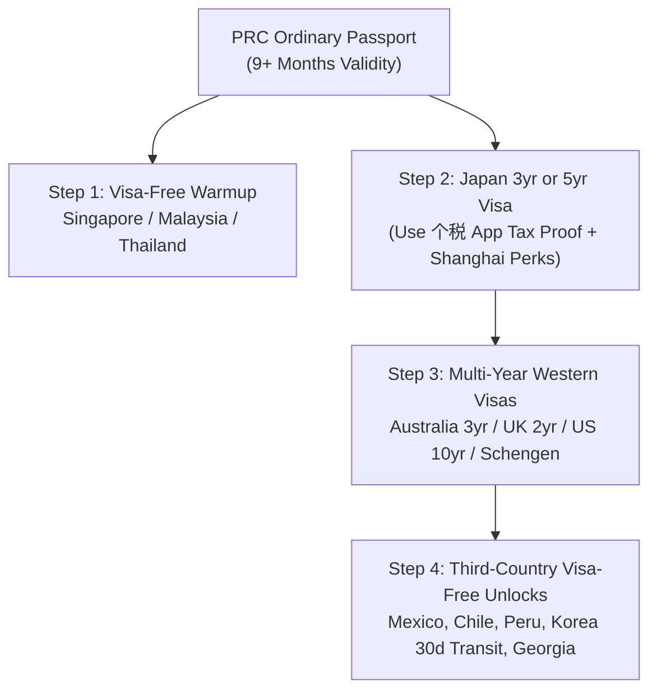
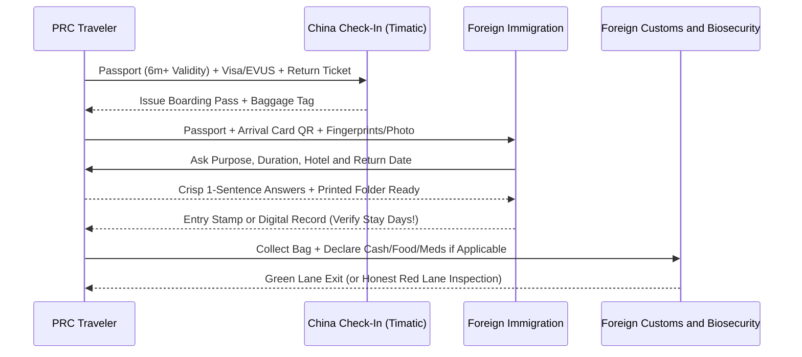

# Passports, Visas, Digital Arrival Cards and Smooth Border Passage

Crossing international borders smoothly comes down to understanding **who actually enforces entry rules** and **what triggers scrutiny**. Before you ever meet a foreign immigration officer, an airline check-in agent in China queries IATA's **Timatic** database; if your passport lacks 6 months of validity, lacks blank visa pages, misses an electronic update like EVUS, or lacks a return ticket for a visa-free country, **the airline is fined thousands of dollars for flying you—so they will deny you boarding on the spot**.

This module covers PRC passport lifecycle rules, high-leverage multi-year visa strategies (including Tier-1 / Shanghai Hukou and Residence Permit advantages), visa-free traps, official digital arrival cards, and exact border-control protocols.

---

## 1. PRC Ordinary Passport (`普通护照`) Hard Rules

### The 6-Month Validity + Blank-Page Rule
- **Validity Floor (`6个月有效期铁律`)**: Nearly all Asian destinations (Singapore, Thailand, Malaysia, Indonesia) and most airlines enforce a strict **minimum 6 months remaining validity** calculated from your **intended departure or return date**. Schengen states legally require **3 months beyond your planned departure from the Schengen area** (plus passport issued within the past 10 years), yet airlines departing China routinely enforce 6 months as a safety buffer. **Rule of thumb: renew your passport as soon as remaining validity drops below 9 months.**
- **Blank Visa Pages (`空白签证页`)**: Keep at least **2 to 4 completely blank visa pages** (pages 8–45 on a 48-page passport; pages 4–6 and 46–47 are `备注页` endorsement pages and **cannot** receive entry stamps or visa stickers in most jurisdictions).

### Fast Renewal via `移民局 12367` (`全程网办` vs Counter)
- **Full Online Renewal (`全程网办`)**: Adult residents with Hukou in pilot cities (**Shanghai, Beijing, Tianjin, Chongqing, Guangzhou, Shenzhen, Hangzhou, Nanjing, Suzhou, Chengdu, Xiamen, Qingdao**, etc.) whose expired, expiring (`< 6 months`), or full ordinary passport still has valid fingerprints on file can apply **100% online** via the **`移民局 12367`** App or WeChat/Alipay Mini-Program—upload a compliant white-background photo (take a free self-check photo or use `证照e拍` receipt) and receive the new passport by EMS courier without visiting a hall.
- **Cross-Province Counter Application (`全国通办`)**: Any Mainland citizen can book an Exit-Entry Administration (`出入境管理局`) slot nationwide with just their `身份证` (processing: ~7 working days for local Hukou, up to 20 days for non-local Hukou without local residence permit).

### Preserving Valid Visas Inside an Expired Passport (`新旧护照结合使用`)
When renewing a passport that still holds valid multi-year visas:
1. **Tell the counter officer explicitly** (or note in `全程网办`) that your old passport contains valid visas so they **clip only the front cover corner (`仅剪封面一角`)** and never punch through interior visa sticker pages!
2. Check how each destination treats visas in an invalidated old passport:

| Destination Visa | Valid After Passport Renewal? | Required Action Before Flying |
| :--- | :--- | :--- |
| **US B1/B2 (10-Year)** | **Yes** (provided visa page is undamaged & personal info unchanged) | Carry **BOTH old + new passports** AND submit a fresh **EVUS enrollment** (`evus.gov`) entering both the new passport number and the old passport's visa foil number. |
| **Japan 3-Year / 5-Year** | **Yes** | Carry **BOTH old + new passports** stapled/held together at check-in and Japan immigration (or optionally pay an agency for `签证移贴` transfer). |
| **Schengen Multi-Entry** | **Yes** (most states, e.g., France/Germany/Italy; verify carrier) | Carry **BOTH old + new passports** together so border police see the valid sticker and stamp the new passport. |
| **Singapore e-Visa** | **No** until transferred | Submit an online **Visa Transfer (`移签`)** via ICA portal or your issuing agency to bind the e-Visa PDF to your **new passport number** *before* departure! |
| **Australia (Subclass 600) / NZ** | **No** until linked | Log into **ImmiAccount** (Australia) -> `Update Details` -> `Change of passport details` (free, updates Timatic electronically in 24–72h); NZ requires paid eVisa transfer application. |

---

## 2. Strategic Multi-Year Visa Playbook (Building a "Strong Passport")

As a working professional—especially if you hold **Shanghai Hukou (`上海户籍`)** or a **Shanghai Residence Permit (`上海市居住证`)** / Tier-1 city social security and tax records—you sit in the **Shanghai Consular District (`上海领区`: Shanghai, Jiangsu, Zhejiang, Anhui)**, which offers the most streamlined multi-year visa qualification criteria in Mainland China.



### Non-Hukou Engineers in Tier-1 Cities: Unlocking Local Consular Jurisdiction
- Foreign consulates divide Mainland China into consular districts (`北京/上海/广州/成都/沈阳领区`). You do **not** need local Hukou to apply in Shanghai/Beijing/Guangzhou/Shenzhen!
- Download your **`上海市居住证` (`随申办市民云` 电子证照)** or recent 6–12 months **Social Security Record (`社保缴纳证明`)** + **Individual Income Tax Record (`个人所得税 App` -> `纳税记录开具` + `收入纳税明细查询`)**. These official verifiable QR-coded PDFs establish both your **consular jurisdiction** and your **verified income tier** simultaneously.

### Major Visa Profiles & Qualification Tactics

#### A. Japan (`日本签证`: Single, 3-Year Multiple, 5-Year Multiple)
- **Channel**: Japan embassies/consulates **never accept individual walk-ins** for tourist visas; you must submit through an official **Embassy-Designated Travel Agency (`领馆指定送签旅行社`)**.
- **Three Tiers**:
  1. **Single-Entry (`单次电子签 eVISA`, valid 90 days, 15-day stay)**: Simplified qualification in Shanghai jurisdiction for local Hukou, prestige university graduates (`教育部直属/双一流高校毕业或在读` within 3 years), credit card gold/platinum holders, or modest tax/bank balances. **Critical Check-In Warning**: Japan single-entry eVISA issues an online **`Visa Issuance Notice`**. Airlines and immigration **reject static screenshots or PDF printouts alone**—you must log in live at the check-in counter to display the dynamic countdown/page!
  2. **3-Year Multiple-Entry (`三年多次往返`, 30 days per stay, max 180 days/year)**: Typically qualified via prior fiscal year taxable salary **`>= CNY 200,000`** (via `个人所得税 App` screenshot/record), OR **`>= CNY 100,000`** under specific regional first-trip routes (e.g., Okinawa/Tohoku stay requirement if using the lower-income tier), OR asset/tax-free bank statement pathways offered by Shanghai-district designated agencies. Must enter Japan within 3 months of issuance on many 3-year tracks—confirm with your agency!
  3. **5-Year Multiple-Entry (`五年多次往返`, 90 days per stay, unrestricted destination/port from Trip 1)**: Qualified via annual salary **`>= CNY 500,000`** (`个税 App` 纳税证明) or equivalent verified financial assets (`50万-100万存款/理财流水`, agency-dependent). Holds high prestige as travel history when applying for Schengen or US visas later.

#### B. Schengen Area (`申根签证` — 29 European Countries including Switzerland & Norway)
- **Jurisdiction Rule (`向哪国递签` — Strictly Enforced!)**:
  1. Apply to the country where you will spend the **most nights (`停留过夜天数最多国`)**.
  2. ONLY if two or more countries tie for the exact maximum number of nights, apply to your **first port of entry into Schengen (`首入申根国`)**.
- **Fatal Schengen Pitfalls to Avoid**:
  - **Never "Visa-Shop" or Cancel Bookings Post-Issuance**: Obtaining a French visa because appointments are easier, then canceling your Paris hotels and flying straight into Rome or Zurich, frequently results in **German/Swiss/Dutch border police revoking your visa at the airport and deporting you** (or triggering a future refusal code). Keep your actual trip aligned with your main destination!
  - **Bank Statements (`工资卡近3-6个月银行流水`)**: Consulates want steady monthly `工资/奖金` inflows and a healthy organic balance (typically `CNY 30,000–50,000+` remaining after trip costs)—**never wire a sudden `CNY 50,000` lump sum into your card two days before printing the statement (`切忌临近送签大额突击存入`)**, which screams borrowed funds.
  - **Insurance Requirement**: Medical coverage **`>= EUR 30,000`**, covering **all Schengen states**, including emergency medical repatriation (`医疗运送和遗体送返`), valid across your entire Schengen dates (recommended: cover `+2 buffer days` after your return flight takes off in case of overnight arrival or delay).
  - **Biometrics**: Fingerprints collected at **TLScontact** or **VFS Global** remain in the Visa Information System (VIS) for **59 months**, though consulates can request re-collection anytime. France (`法国`) in the Shanghai consular district is historically generous with **1-year to 5-year multiple-entry circulation visas** for applicants with clean compliance and strong income.

#### C. United States (`美国 B1/B2 十年多次签` + Mandatory `EVUS`)
- **Legal Standard (`INA Section 214(b)`)**: By US law, every B1/B2 applicant is **presumed to have immigrant intent** until they prove strong social, economic, and family ties to China (`国内约束力`).
- **Special Advice for Software, AI, Hardware & Cloud Engineers (`敏感专业行政审查 Check 防范`)**:
  - Because technical keywords (`AI, Machine Learning, Cryptography, Semiconductors, Robotics, Cloud Infrastructure, Drones`) often trigger **Section 221(g) Administrative Processing (`Check`, taking 3–8 weeks, resulting in a 1-year visa instead of 10-year)**:
  - Bring a **clean, truthful, plain-English 1-page Resume/CV**, an employer verification letter, and a concrete tourist itinerary printed in a neat folder. Describe commercial software work clearly (e.g., *"Backend web services for e-commerce checkout and payment reconciliation"*) without unnecessary buzzword inflation, while **always remaining 100% truthful on your DS-160**.
- **Interview Conduct**: Answer the consular officer's exact question in 1–2 natural sentences (English or Chinese—speaking calm, clear Chinese is completely fine for tourism unless attending an English tech conference!). Do not thrust unrequested paper stacks through the window unless asked.
- **EVUS (`Electronic Visa Update System` — `www.evus.gov`)**:
  - Mandatory for all PRC passport holders holding a **10-year B1/B2 visa** before boarding any US-bound flight/ship. Valid for **2 years** (or until passport expires, whichever is sooner).
  - **Scam Warning**: Only use **`https://www.evus.gov`**. CBP instituted a statutory USD 30 EVUS enrollment fee in late 2025; avoid third-party search-ad websites that mimic government seals and charge USD 89–150 while harvesting your passport and family data! Enroll **at least 72 hours before departure**.

#### D. Australia, UK, New Zealand & Singapore
- **Australia (`Subclass 600` Visitor Visa — 1-Year or 3-Year Multiple)**: 100% online submission via **ImmiAccount** (no physical passport submission, no interview!). Upload scanned PDFs of passport stamps, `个税` record, 6-month salary bank statement, employment letter, and property/car registration. Issues an electronic **`Visa Grant Notice`** PDF—print a copy for check-in.
- **New Zealand (5-Year Multiple Visitor Visa)**: Online submission via RealMe; couples/families can even apply under a single family fee in supported categories!
- **United Kingdom (2-Year Standard Visitor Visa)**: Online application + VFS Global biometrics; grants 2-year multiple entry by default at the standard fee. Transitioned to digital **UKVI eVisa** accounts—ensure your passport is linked in your UKVI account before travel.
- **Singapore**: Since **February 9, 2024**, PRC ordinary passport holders enjoy **30-day mutual visa-free entry (`中新互免签证`)** for tourism, family visits, and short business—no visa needed! You ONLY need to submit the free **SG Arrival Card** within 3 days before arrival.

### Bonus: Third-Country Visa-Free Perks Unlocked by Holding US / Schengen / Japan Visas
Once you hold a valid, multi-entry **US B1/B2** (or Schengen/UK/Canadian/Japanese visa, depending on target rules), you automatically unlock visa-free or simplified entry to:
- **Mexico** (up to 180 days with valid multi-entry US/CA/UK/Schengen/Japan visa), **Chile** (up to 90 days with US/Canada `>=6m` validity), **Peru** (up to 180 days), **Colombia**, **Costa Rica**, **Panama**.
- **South Korea 30-Day Visa-Free Transit (`韩国过境免签`)**: Holding a valid physical/electronic visa and confirmed onward flight within 30 days **to or from the US, Canada, Australia, or New Zealand** (check exact current Korean MOJ transit list before booking) allows up to 30 days visa-free entry into Seoul/Korea!

---

## 3. Visa-Free (`免签`) & Visa-on-Arrival (`落地签`) Trap Checks

"Visa-free" (`免签`) **never means unconditional entry**. Every week, unprepared travelers are turned back at Pudong/Baiyun check-in or detained at Bangkok/Singapore immigration because they assumed a blank passport and a one-way ticket were enough.

### Four Mandatory Checks for Visa-Free Travel (Singapore, Thailand, Malaysia, UAE, Jeju, Maldives, Serbia, etc.)
1. **Confirmed Return or Onward Ticket (`往返或离境机票`)**: Airlines strictly enforce Timatic's return-ticket rule for visa-free tourists. Have your return e-ticket confirmation printed in English (showing passenger name, flight number, date, and 13-digit ticket number).
2. **Verifiable Hotel Reservation (`真实酒店预订单`)**: Immigration forms require your exact local hotel name, street address, and phone number. Do not write *"TBD"* or cancel your hotel while standing in the arrival queue.
3. **Sufficient Funds / Physical Cash Spot-Check (`入境随身现金抽查`)**:
   - **Thailand Specific Trap**: Under the Thai Immigration Act, visa-exempt tourists can be spot-checked at land/air borders to show **THB 20,000 per person** (approx. CNY 4,200 / USD 600) or **THB 40,000 per family** in **physical cash** (any major convertible currency like CNY, USD, or THB counts—**Alipay/WeChat screen balances do NOT satisfy formal cash spot-checks**). While rare at Suvarnabhumi regular lanes for tourists with clean records, frequent visitors or low-cost carrier flights are periodically checked.
4. **Jeju Island Geographic Trap (`济州岛免签陷阱`)**:
   - Jeju Island (`CJU`) is visa-free for PRC citizens **ONLY on direct international flights into Jeju** (or international transfers that never cross South Korean domestic immigration). Booking a cheap ticket **Shanghai -> Seoul Incheon (`ICN`) -> Seoul Gimpo (`GMP`) -> Jeju (`CJU`)** requires entering mainland South Korea to change airports—**you will be denied boarding in China without a Korean visa!**

---

## 4. Official Digital Arrival Cards (`电子入境卡` — 100% Free Official Portals)

Paper landing cards on airplanes are rapidly disappearing. **Warning**: Searching *"SG Arrival Card"* or *"Thailand Arrival Card"* on search engines frequently surfaces paid commercial middleman ads at the very top that charge USD 40–90 for a **100% free** government form! Bookmark only these official domains:

| Destination | Official System Name | Official URL / App | Submission Window | Fee |
| :--- | :--- | :--- | :--- | :--- |
| **Japan** | **Visit Japan Web (VJW)** | `https://vjw-lp.digital.go.jp` | Anytime prior to arrival (do T-72h) | **FREE** |
| **Singapore** | **SG Arrival Card (SGAC)** | `https://eservices.ica.gov.sg/sgarrivalcard` or **MyICA** App | Within **3 days** prior to arrival (includes arrival day) | **FREE** |
| **Thailand** | **Thailand Digital Arrival Card (TDAC)** | `https://tdac.immigration.go.th` | Within **3 days (72 hours)** before arrival | **FREE** |
| **Malaysia** | **Malaysia Digital Arrival Card (MDAC)** | `https://imigresen-online.imi.gov.my/mdac/main` | Within **3 days** before arrival (unlocks KLIA Autogate!) | **FREE** |
| **South Korea** | **Korea e-Arrival Card** | `https://www.e-arrivalcard.go.kr` | Within **3 days (72 hours)** before arrival (waived if K-ETA/paper) | **FREE** |
| **Indonesia (Bali)** | **All Indonesia / e-CD + Bali Levy** | `https://ecd.beacukai.go.id` (Customs) + `lovebali.baliprov.go.id` | Within **3 days** before arrival (e-VOA at `evisa.imigrasi.go.id`) | Customs FREE (e-VOA IDR 500k; Bali levy IDR 150k) |

---

## 5. Clearing Foreign Immigration & Customs Without Stress



### The 5 Classic Immigration Questions & Ideal Answers
Approach the booth **alone** (unless traveling as an immediate family/parent-child unit), remove sunglasses/hat/earbuds, say *"Good morning / Hello"*, and answer concisely:

1. **"What is the purpose of your visit?"** -> *"Tourism and sightseeing."* (Never say *"helping a friend's shop"* or *"remote working for a local client"* on a tourist visa!)
2. **"How long are you staying?"** -> *"Nine days. I am flying back to Shanghai on December 5th."*
3. **"Where will you be staying?"** -> *"At the Shinjuku Washington Hotel in Tokyo—here is my booking confirmation."*
4. **"What do you do for a living?"** -> *"I am a software engineer at a technology company in Shanghai."*
5. **"Are you traveling alone or with someone, and how much cash are you carrying?"** -> *"Traveling with my wife. I have USD 800 cash and two Visa credit cards."*

> **Verify Your Authorized Stay Before Walking Away!** Especially in the US (`I-94` online at `i94.cbp.dhs.gov`), Japan (landing permission sticker `上陸許可` showing exact expiration date: `15 days`, `30 days`, or `90 days`), and visa-free states—overstaying even by **1 single day** due to miscounting calendar days vs 24-hour periods can void multi-year visas permanently! (Note: Japan counts entry day as Day 0 and starts Day 1 the next day on landing stickers—always read the printed **`Until DD MMM YYYY`** date directly on the sticker!)

### Device Border Searches & Photography Red Lines
- **Absolute Zero-Photography Zone**: Never pull out a phone, Osmo Pocket, or smart glasses in **any immigration queue, secondary inspection room, or customs baggage hall**. Officers confiscate phones immediately to verify deletion and may escalate to secondary questioning.
- **Electronic Device Inspection (`电子设备搜查`)**: Border agencies in the **United States (CBP), Canada (CBSA), Australia (ABF), and New Zealand** possess statutory authority to demand passwords and inspect phones/laptops without a warrant at ports of entry—primarily looking for **illegal unauthorized employment conversations** (e.g., messages arranging paid work on a tourist visa), contraband media, or visa fraud. Keep work laptops compliant with your employer's travel-device policy, and ensure your social/chat records never contradict your stated tourist status.

### Global Cash & Biosecurity Customs Red Lines

| Country / Region | Cash Declaration Threshold (Inbound & Outbound) | Biosecurity / Food Strictness Level |
| :--- | :--- | :--- |
| **China (Exit/Entry)** | **> CNY 20,000** OR **> USD 5,000** equivalent | Strict inbound ban on fresh fruit, meat, jerky, eggs, dairy, soil, seeds. |
| **United States** | **> USD 10,000** (combined total across **entire family/group**!) | Very High — declare all food; zero pork/beef/poultry products, broth packets with meat, fresh fruit/seeds. |
| **Schengen / EU / UK** | **>= EUR 10,000** (EU) / **>= GBP 10,000** (UK) | High — zero meat or dairy products from non-EU countries. |
| **Japan** | **> JPY 1,000,000** (incl. gold bullion >90% purity requires declaration!) | Very High — strict meat quarantine (sausages, duck necks, vacuum beef jerky carry up to JPY 3,000,000 fine / arrest!); declare gold jewelry if heavy! |
| **Singapore** | **> SGD 20,000** equivalent (`NPPs` online declaration) | Zero chewing gum import; **zero duty-free allowance on cigarettes** (every open/closed cigarette pack must be declared at Red Channel!); **vapes 100% illegal**. |
| **Australia & NZ** | **>= AUD 10,000** / **>= NZD 10,000** | **Extreme (World's Strictest)** — declare *every* snack, tea leaf, honey, nut, medicine, or muddy hiking boot on the Incoming Passenger Card. Declaring is safe; failing to declare draws instant AUD 3,300–6,600+ fines and visa cancellation! |

> **Golden Rule of Cash Declarations**: Carrying > USD 10,000 / EUR 10,000 is **not illegal or taxed** at foreign borders—**failing to declare it** is what triggers immediate seizure for suspected money laundering, and note that the limit applies to **all currencies combined across family members traveling together**!

---

## 6. Hong Kong & Macau 7-Day Passport Transit Rule (`持护照免通行证过境港澳红线`)

One of the most useful legal perks for PRC ordinary passport holders—and also one of the easiest to misuse—is the **7-Day Visa-Free Transit via Hong Kong or Macau**:

- **How It Works Legally**: If you fly or take high-speed rail from **Mainland China -> Hong Kong (or Macau) -> Overseas Third Country** (e.g., `Shenzhen -> HK Airport -> Tokyo`), AND/OR on your return leg fly **`Tokyo -> Hong Kong -> Mainland China`**, Hong Kong Immigration grants **up to 7 days of visa-free stay on EACH transit leg** using **only your PRC Passport + confirmed third-country flight ticket** (and third-country visa, if not visa-free)—**no `港澳通行证` or HK endorsement (`签注`) required**!
- **The Fatal `DT` ("Doubtful Transit") Blacklist Trap (`严禁假借过境之名只去港澳!`)**:
  - Some travelers without a valid HK endorsement book a refundable `HK -> Bangkok` flight, enter Hong Kong on their passport, cancel the flight, shop for 3 days, and cross back to Shenzhen.
  - Doing so earns a handwritten **`DT` (`Doubtful Transit` / 不良过境记录)** mark in Hong Kong Immigration's database (and historically on the passport page):
    - **1st `DT`**: Next passport transit restricted to 2 days and scrutinized in secondary room.
    - **2nd `DT`**: Blacklisted from passport transit AND **prosecutable under Hong Kong law for making a false representation to an Immigration Officer** (which carries custodial penalties!) + triggers visa refusals from foreign consulates inspecting your passport!
  - **Only use passport transit when you genuinely board the onward international flight** (if an airline genuinely cancels your flight due to typhoon/mechanical failure, obtain the airline's official cancellation certificate to show HK Immigration upon exit).

---

## 7. Reusable Visa Application Document Pack & Templates (`核心送签材料标准`)

Across Schengen, UK, Australia, New Zealand, Canada, and Japan applications, consulates evaluate the same **four pillars of credibility**: stable employment, genuine recurring income, logical travel plan, and clean photo/form compliance.

### Visa Photo Dimension Pitfalls (`各国签证照尺寸差异 — 切勿拿旧照混用!`)
Never submit a photo printed more than **6 months ago**—if a visa officer sees the **exact same headshot** that already appears on your passport bio-page issued 3 years ago or an older Schengen sticker, **VFS/TLS will reject the photo on the spot** as older than 6 months!

| Jurisdiction | Exact Physical / Digital Spec | Head Crown-to-Chin Ratio & Rules |
| :--- | :--- | :--- |
| **PRC Passport (`中国护照`)** | `33mm x 48mm` (White background) | Ears & eyebrows fully visible; no white shirt blending into background; no glasses/jewelry. |
| **Japan Visa (`日本签证`)** | **`35mm x 45mm` OR `45mm x 45mm`** (check recent `45x35mm` agency spec; square `45x45mm` changed to `45mm x 35mm` standard!) | Pure white background, taken within 6 months, no heavy beauty-filter retouching (`严禁过度美颜修图导致海关人脸比对失败!`). |
| **Schengen & UK** | **`35mm x 45mm`** (White / off-white background) | Face height `32mm–36mm` (70%–80% of frame); neutral expression, mouth closed, zero eyeglasses. |
| **US B1/B2 (`DS-160`)** | **`51mm x 51mm` (`2 x 2 inches`, `600x600 px` min)** | Strict **no eyeglasses rule** (even clear prescription glasses cause instant DS-160 rejection!). |

### Standard English Employment & Leave Certificate Template (`英文在职准假证明标准模板`)

Save this clean, consulate-tested structure for your company HR to print on official company letterhead (`公司抬头纸`), sign by HR/manager, and stamp with the red Company Seal / HR Seal (`加盖公章或人事章`):

```text
CERTIFICATE OF EMPLOYMENT AND LEAVE APPROVAL

Date: October 15, 2026
To: Visa Section, Consulate General of [Target Country] in [Shanghai / Beijing / Guangzhou]

Dear Visa Officer,

This is to certify that Mr./Ms. [FULL NAME IN PINYIN], holder of PRC Passport No. [E00000000]
(Date of Birth: [DD MMM YYYY]), has been employed full-time with [Company Legal English Name]
since [Month Year] and currently serves as a [Senior Software Engineer] with a gross annual
compensation of approximately RMB [XXX,XXX] (before tax).

We have approved his/her paid annual leave from [DD MMM YYYY] to [DD MMM YYYY] for a sightseeing
holiday in [Target Country / Schengen Countries]. All travel, accommodation, and medical insurance
expenses during this trip will be borne entirely by Mr./Ms. [SURNAME] personally.

We hereby guarantee that Mr./Ms. [SURNAME] will abide by all laws and regulations of your country
and return to China on schedule, and we will retain his/her current position upon return.

Should you require verification, please contact our Human Resources Department:
Company Address: [Full Street Address, District, City, Postal Code, P.R. China]
HR Contact Person: [HR Name], [HR Manager]
Office Landline Tel: +86-[21-XXXXXXXX] (Ensure someone answers this landline!)
Official Email: [hr@company.com]

Sincerely,
[Handwritten Signature of HR / Department Head]
[Company Official Red Chop / HR Seal]
```

> **HR Landline Verification Tip (`电调避坑`)**: Make sure the phone number printed on the letter is a **working company landline or official HR desk number** that colleagues know how to answer—Schengen and Australian visa officers occasionally place 60-second verification calls (`电话调查`), and an unanswered or disconnected landline is a classic avoidable refusal trigger.

Next, proceed to [02-OVERSEAS-PAYMENTS-CARDS-AND-FX.md](02-OVERSEAS-PAYMENTS-CARDS-AND-FX.md) to set up zero-loss international payment cards, avoid POS DCC traps, withdraw cash safely, and legally open a Hong Kong bank account.
