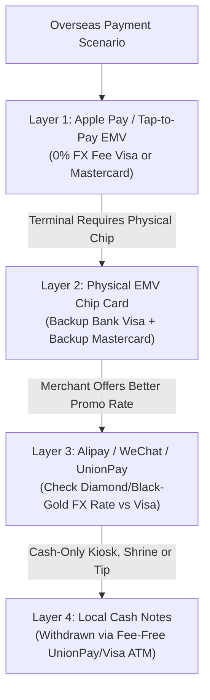
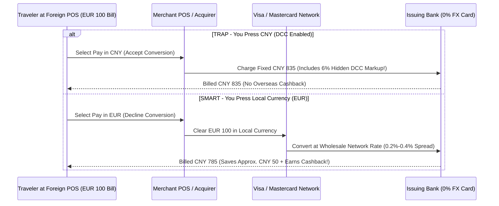

# Overseas Payments, Credit Cards, Cash and Currency Pitfalls

Inside Mainland China, carrying nothing but a smartphone with WeChat Pay and Alipay works 99.9% of the time. Abroad, **relying solely on WeChat Pay, Alipay, or a domestic single-logo UnionPay (`62` prefix) card is the single fastest way to get stranded** at a subway turnstile, hotel front desk, highway toll booth, or neighborhood restaurant.

This module explains how global payment rails actually clear transactions, which exact cards to apply for in Mainland China (and Hong Kong), how to configure Apple Pay and overseas transit cards, how to defeat predatory POS exchange-rate traps, and how to handle overseas ATM cash and tax refunds without losing 5% to 15% in hidden fees.

---

## 1. Why Alipay & WeChat Pay Fail Outside Tourist Malls

Alipay (`支付宝`, including `Alipay+`) and WeChat Pay (`微信支付`) have expanded impressively into Asian duty-free stores, Japanese convenience stores (`7-Eleven`, `Lawson`, `FamilyMart`), Singapore Changi, and Thai malls. Despite this, they fail across four critical real-world scenarios:

1. **Unattended & Offline Infrastructure (`无人值守终端`)**: London Underground / NYC Subway / Singapore MRT contactless gates, European train ticket kiosks (`SNCF`, `DB`, `Trenitalia`), Japanese local ramen shop ticket machines (`食券机`), unmanned highway tolls, and self-service gas stations **only accept EMV Contactless/Chip cards or local coins/notes**.
2. **Pre-Authorization Deposits (`酒店与租车预授权 Deposit`)**: International hotels (US, Europe, Singapore, Australia) and all car rental counters require a physical **Visa, Mastercard, or Amex** card at check-in to place a temporary pre-authorization hold (`预授权冻结`, typically USD 100 to 500). QR wallets cannot process open-ended credit pre-authorizations.
3. **Merchant Discount Rate (MDR) & Local Habits**: Outside Chinese-tourist shopping districts (`银座`, `新宿`, `奥斯曼大道`), 90%+ of local cafés, bistros, museums, and clinics in Europe, North America, Australia, and rural Japan accept only Visa/Mastercard/Amex or cash.
4. **Online Ride-Hailing & Ticketing**: While Grab in Southeast Asia supports Alipay binding, **Uber, Bolt, Lyft, Trainline, SmartEX, and airline onboard Wi-Fi** overwhelmingly require an international Visa/Mastercard/Apple Pay rail with 3D Secure (`3DS`) authentication.

### The Resilient 4-Layer Payment Architecture

Never travel abroad with a single point of failure. Carry a layered wallet:

---

## 2. Applying in Mainland China for True Overseas EMV Cards

### Card Hardware & Network Anatomy
- **Avoid Legacy Dual-Logo Magnetic-Stripe Cards (`双标磁条卡`)**: Old cards bearing both `UnionPay + Visa` on one magnetic stripe lack modern EMV chips, cannot tap (`不支持拍卡 Contactless`), and are easily skimmed (`盗刷`) in Southeast Asia and the Americas.
- **What You Actually Need**: A **Chip + Contactless (`芯片 + 水波纹拍卡标志`)** card on the **Visa** or **Mastercard** network:
  - **EMV Contactless (`Tap to Pay / 拍卡`)**: Look for the sideways four-bar radio wave symbol on the card face. In the UK, Australia, Singapore, and Europe, 95% of transactions are completed simply by tapping the card (or Apple Pay) against the reader in 0.5 seconds—your card never leaves your hand!
  - **Zero FX Conversion Fee (`0% 货币转换费 / 免货转`)**: Traditional USD-denominated cards charge a **1.5% currency conversion surcharge** whenever you spend in a non-USD currency (`EUR -> USD (+1.5%) -> CNY`). Always choose **`全币种国际信用卡`** or **`免货币转换费`** products, which convert `JPY / EUR / GBP / THB / AUD` -> `USD` -> `CNY` at pure Visa/Mastercard wholesale network rates with **zero 1.5% markup** and settle directly in RMB (`自动购汇人民币入账`)!

### Recommended Mainland-Issued Card Categories (Credit & Zero-Threshold Debit)

| Card Type | Representative Mainland Products | Best For & Key Advantages |
| :--- | :--- | :--- |
| **Mainstream `0% FX` Credit Cards** | **CMB (`招商银行`)** 全币种国际信用卡 (Visa/MC) **BOC (`中国银行`)** 卓隽卡系列 (Visa/MC) **CCB (`建设银行`)** 全球热购卡 (Visa/MC) **ICBC (`工商银行`)** 星座卡 / 环球旅行全币种 | Zero annual fee (`终身免年费` or waived after 5–6 swipes); `0% FX fee`; automatic RMB billing; frequent **1% to 8% overseas cashback campaigns** (`境外返现`, requires pre-registration in bank app!). |
| **New Dual-Market China Mastercard (`全新中国万事达卡`)** | Issued via **Mastercard NetsUnion (`万事网联`)** by CMB, BOC, ICBC, CCB, CITIC, etc. | Works seamlessly **both inside Mainland China (RMB)** and **globally on Mastercard's EMV contactless network (`0% FX fee` on most tiers)**, with growing native Apple Pay support! |
| **Zero-Threshold Overseas EMV Debit Cards (`无门槛国际借记卡`)** | **BOC `长城跨境通国际借记卡`** (Mastercard / Visa) **CITIC / CMB International Debit** | **No credit approval required** (even students or freelancers get approved!). Buy 19 foreign currencies (`USD, JPY, EUR, GBP, HKD, SGD, AUD...`) inside the **中国银行 App** at spot `现汇卖出价` whenever rates dip, and spend/withdraw directly from that currency balance abroad with **zero FX spread at swipe time**! |

### Mandatory Pre-Departure Card Setup (Do NOT Skip!)
1. **In-Person Counter Activation (`首卡柜台面签激活`)**: If it is your first credit card with that Mainland bank, regulations require activating it in person at a domestic branch before flying.
2. **Cover the 3-Digit CVV2 Code (`贴上 CVV 安全防窥贴`)**: Anyone who photographs the front 16 digits, expiration date, and back 3-digit CVV2 of your Visa/Mastercard can shop online without your PIN! Memorize or save your CVV2 in a password manager (1Password / Apple Passwords), then **cover the physical 3 digits on the card back with an opaque tamper-evident sticker**.
3. **Configure App Security Switches & PIN**:
   - Open your bank app (`掌上生活` / `中国银行` / `建行生活` / `工银e生活`): verify **`境外交易开关` (`Overseas POS & Online`)** and **`小额免密拍卡`** are turned **ON**, set a sensible single-transaction cap, and submit a **Travel Notice (`出境行程报备`)** so anti-fraud AI does not freeze your card on your first overseas payment.
   - **Understand Overseas PIN vs Signature Rules**: At staffed US restaurants/stores, credit cards run without a PIN (or ask for signature on screen). At **European unmanned train kiosks, toll booths, and UK/Japanese terminals**, the terminal may prompt for an **Offline/Online Chip PIN**—for Mainland credit cards, set/confirm your **6-digit transaction PIN (`交易密码`)** before leaving (if a legacy European kiosk strictly demands 4 digits and rejects 6, press `Enter/Green` blank or switch to Apple Pay / BOC Debit / HK card).

---

## 3. Apple Pay Overseas & Digital Transit Cards

### Why Apple Pay Beats Physical Cards Abroad
When you pay via **Apple Pay**, your iPhone transmits a randomized cryptographic **Device Account Number (`DPAN`)** and dynamic one-time cryptogram rather than your real card number—making card skimming impossible and bypassing physical PIN-pad quirks on European ticket machines.

- **Mainland Cards on Apple Pay**: Historically, pure single-logo Visa/Mastercard cards issued by Mainland banks only bound to UnionPay Apple Pay. Recently, selected Mainland banks (such as **BOC Visa, CMB Visa, ICBC Visa**, and **new `万事网联` Mastercards**) have rolled out international Apple Pay support—test adding your card inside **iPhone `Wallet (钱包)` -> `+`** *before* leaving China!
- **Hong Kong Cards on Apple Pay**: Every Hong Kong bank card (**HSBC One Mastercard Debit, HSBC Pulse/Red, BOCHK Mastercard Debit, ZA Bank Visa**) supports global Apple Pay natively out of the box.

### Pre-Load Local Transit Cards in Apple Wallet Before Takeoff
You do **not** need to queue for paper tickets at Narita, Kansai, or Hong Kong Airport:
1. **Japan (`Suica` / `PASMO` / `ICOCA`)**: Open iPhone **Wallet (`钱包`) -> `+` -> `Transit Card (交通卡)` -> Japan -> `Suica` or `ICOCA`**. Top up JPY 2,000–5,000 directly using a UnionPay debit/credit card or Mastercard in Apple Pay! Enable **Express Transit (`快捷交通卡`)**—walk through JR, Metro, bus, 7-Eleven, and vending machines by tapping the top of your iPhone without waking the screen or using Face ID (works for up to 5 hours even after iPhone battery dies!). *(Note: Android phones purchased outside Japan lack Sony FeliCa `Osaifu-Keitai` licensing and **cannot** add mobile Suica—Android users should pick up a physical `Welcome Suica` / `ICOCA` card or use contactless Visa where supported).*
2. **Hong Kong (`Octopus 八达通`)**: Add **`Octopus` (`旅客八达通` App or Apple Wallet)** directly on iPhone and top up in RMB/HKD.

---

## 4. The #1 POS Rip-Off: NEVER Choose RMB / DCC (`动态货币转换`)

Whenever you insert or tap a non-local Visa/Mastercard at a foreign POS terminal (in Europe, Japan, Thailand, Singapore, UK, Dubai, or duty-free airports) or foreign ATM, the terminal detects your card's home currency (`CNY` or `USD`) and flashes a deceptive prompt:

> *"Choose Currency: **[1] CNY 768.50 (Guaranteed Exchange Rate + 4.5% Markup)** OR **[2] EUR 95.00 (Local Currency)**?"*
> — or on ATMs: *"Continue WITH Conversion"* vs *"Continue WITHOUT Conversion"*

### Iron Law: ALWAYS Choose LOCAL CURRENCY (`永远选当地货币 / Continue WITHOUT Conversion`)!

Choosing `CNY` (or `USD` when in Europe/Japan) activates **Dynamic Currency Conversion (DCC)**. DCC lets the foreign merchant's payment processor convert your bill at an **inflated, predatory exchange rate padding 3.5% to 8.5% pure profit**, AND because the transaction hits your bank already converted into CNY/USD, **your Chinese bank often disqualifies it from overseas FX cashback promotions**!

### Exact Cost Comparison Formula
For a local purchase price $P_{\text{local}}$ (say $\text{EUR } 1{,}000$ for a handbag or hotel stay) where the interbank mid-market rate is $R_{\text{mid}}$:

$$
\text{Cost}_{\text{Local Currency}} = P_{\text{local}} \times R_{\text{network}} \times (1 + f_{\text{FX}}) \approx P_{\text{local}} \times R_{\text{mid}} \times 1.003 \quad (\text{when } f_{\text{FX}} = 0\%)
$$

$$
\text{Cost}_{\text{DCC}} = P_{\text{local}} \times R_{\text{mid}} \times (1 + m_{\text{DCC}}) \approx P_{\text{local}} \times R_{\text{mid}} \times (1.04 \text{ to } 1.08)
$$

On a EUR 1,000 purchase, pressing the wrong button costs **CNY 300 to CNY 600 in instant, irreversible FX loss**! If a sneaky cashier presses `CNY` for you without asking and hands you a slip showing `Transaction Currency: CNY` with a checkbox *"I have been offered a choice of currencies"*, **politely refuse to sign and ask them to void and re-run in local currency** (`"Please void and charge in Euros / Yen, no conversion"`).

---

## 5. Overseas Cash & ATM Withdrawal Strategy

Even in cashless countries, **always carry USD 150–300 equivalent in local banknotes** (crucial for Japanese shrines/ramen shops/rural buses, Thai street food, European public toilets, US valet/housekeeping tips, and power/network outages).

### PRC Regulatory Limits You Must Respect (`国家外汇管理局规定`)
1. **Personal FX Purchase Quota (`年度便利化购汇额度`)**: **USD 50,000 equivalent per person per calendar year** across all Mainland banks combined (`购汇` inside banking apps is instant; withdrawing physical foreign banknotes `外币现钞` requires booking 1–2 days ahead in the app).
2. **Overseas ATM Cash Withdrawal Hard Cap (`境外ATM取现硬性红线`)**:
   - Daily cap per card: **CNY 10,000 equivalent**.
   - Annual cap **across ALL bank cards under your PRC ID (`本人名下所有境内银行卡合计`)**: **CNY 100,000 equivalent per calendar year**!
   - **Severe Penalty for Breaching CNY 100,000**: Unlike FX purchase quotas that simply block the excess transaction, **exceeding CNY 100,000 in annual overseas cash withdrawals places your ID on SAFE's suspension list—freezing overseas ATM cash withdrawals across ALL your Mainland cards for BOTH the remainder of the current year AND the entire following calendar year!** Pay large purchases by card swipe, never by draining ATMs.

### How to Withdraw Cash Overseas with Minimum Fees
Every overseas ATM withdrawal involves **two separate potential fees**:
1. **Card Issuer Fee (`发卡行跨境取现手续费`)**: Mainland major banks typically charge `1% + CNY 12` per withdrawal, whereas select regional commercial banks, wealth-tier debit cards (`招行金葵花`, `兴业寰宇人生借记卡` first 3 monthly withdrawals, `恒丰/盛京` verify current schedule), or `中行跨境通` promos waive/reduce issuer fees. (**Never withdraw cash using a Credit Card**—it triggers immediate daily cash-advance interest `取现日息万分之五`!).
2. **Local ATM Operator Surcharge (`当地ATM受理行服务费`)**: Charged by the ATM owner regardless of whether your Chinese bank is "fee-free":
   - **Japan**: Use **7-Eleven (`Seven Bank` ATM)** or **AEON Bank ATM** (supports Chinese UI, UnionPay/Visa/MC; fee ~JPY 110–220).
   - **Thailand**: Almost ALL Thai ATMs charge a mandatory **THB 220 (~CNY 46)** surcharge per foreign card withdrawal -> withdraw THB 10,000–20,000 in **one lump sum** rather than four small withdrawals! (Tip: Purple `SCB` or Yellow `Krungsri` ATMs allow higher single-withdrawal limits up to THB 30,000).
   - **Europe — AVOID `Euronet` ATMs!**: Never touch standalone blue-and-yellow **`Euronet`** ATMs planted on tourist street corners in Prague, Rome, Paris, Barcelona, or Amsterdam—they charge **EUR 4.95 fees PLUS aggressive 13% DCC traps** and force huge minimum dispense amounts (`EUR 200+`). Always walk inside the lobby of a **real retail bank** (`BNP Paribas`, `Société Générale`, `Santander`, `CaixaBank`, `Deutsche Bank`, `UniCredit`).

---

## 6. Legally Opening a Hong Kong Bank Account While Visiting HK

For Mainland engineers and frequent travelers, holding a **personal, legally opened Hong Kong retail bank account** eliminates 100% of overseas payment friction: native Apple Pay Mastercard/Visa, instant multi-currency conversion (`HKD, USD, JPY, EUR, GBP, SGD, AUD`), zero trouble paying overseas cloud/AI tools or airlines, and fee-free global ATM withdrawals at HSBC/BOCHK networks.

### Legal Compliance & Zero-Intermediary Walk-In Protocol
Mainland residents visiting Hong Kong in person are **100% legally permitted** to open Hong Kong retail bank accounts (`中银香港 BOCHK`, `香港汇丰 HSBC One`, and HKMA-licensed virtual banks like `ZA Bank 众安银行` / `Ant Bank 蚂蚁银行`) for **zero intermediary fee (`0元中介费`, never pay CNY 2,000+ to touts!)**:

#### Step 1: Pre-Trip Preparation (T-7 Days Before Entering HK)
1. **Book a Branch Appointment Online (Strongly Recommended)**:
   - **BOCHK (`中银香港`)**: Search WeChat Mini-Program **`中银香港微服务`** -> `预约开立中银香港账户` (releases branch slots ~7–14 days ahead at midnight; pick non-border residential branches like Kwun Tong, Quarry Bay, Tsuen Wan, or North Point if Tsim Sha Tsui/Mong Kok are full).
   - **HSBC HK (`香港汇丰 One`)**: Book via HSBC HK website/WeChat or download the **`HSBC HK`** App before crossing the border; many branches also allow online initiated `HSBC One` onboarding once physically inside Hong Kong (`连接香港本地网络 + NFC 读取港澳通行证芯片`).
2. **Prepare the 4 Mandatory Physical Documents**:
   - Original **`中华人民共和国居民身份证`** (`> 6 months` validity).
   - Original **`往来港澳通行证`** with valid HK endorsement (`签注`) — OR your PRC Passport + international flight ticket if legitimately transiting through HK Airport (`过境香港`).
   - **Hong Kong Immigration Entry Slip (`入境标签小白条` — CRITICAL!)**: When passing through the HK border gate (`落马洲/罗湖/西九龙高铁站/香港机场`), **keep that tiny rectangular thermal paper slip printed by the gate!** Every HK bank scans or photographs it to prove legal physical presence inside Hong Kong.
   - **Mainland Address Proof & Financial Backup (Just in Case)**: Bring a physical credit card paper statement showing your name + residential address (or recent 3-month PDF utility/credit card bill with bank stamp) and open **`个人所得税 App` / 工资流水** in case a branch compliance officer asks for source-of-wealth (`资金来源`) or investment proof (only needed if opening investment sub-accounts; basic savings + Mastercard Debit requires **"旅游消费与储蓄 / Travel & Savings"**!).

#### Step 2: While Physically Standing in Hong Kong
- Switch on **`+86` SMS roaming** AND connect to **local HK mobile data / branch Wi-Fi** (virtual banks like **`ZA Bank 众安银行`** verify GPS + HK IP + HK Immigration record; you can apply in 5 minutes from your hotel bed in Hong Kong!).
- **At BOCHK / HSBC**: Request their multi-currency **Mastercard Debit Card (`中银万事达扣账卡` / `汇丰蓝狮子万事达扣账卡`)**! Unlike credit cards, this debit card approves on the spot, binds directly to **Apple Pay**, charges **`0% FX fee`** across 12 major currencies (spending directly from your HKD/JPY/EUR/USD pockets), and supports free overseas HSBC/BOC ATM cash withdrawals!

#### Step 3: Post-Opening SAFE Compliance & Account Maintenance
- **Cross-Border Funding**: Transfer legally via your Mainland bank (`如中国银行 -> 中银香港「中银快汇」同名跨境汇款`, zero remittance fee on select tiers!) strictly within your **USD 50,000 annual personal FX quota** for truthful personal travel/education/living expenses. **Never use illegal underground money changers (`严禁地下钱庄/私人对敲换汇`).**
- **Prevent Dormant Account Freeze (`防不动户冻结`)**: Make at least 1 small transaction every 3–6 months (e.g., top up Apple Suica/Octopus by HKD 10 or pay iCloud via your HK Mastercard).

---

## 7. Overseas Shopping Tax Refunds (`退税实操与避坑`)

| Dimension | **Europe (Global Blue / Planet)** | **Japan (`Tax-Free` -> Nov 2026 Airport Refund System)** | **Singapore / Korea / Thailand** |
| :--- | :--- | :--- | :--- |
| **VAT / Tax Rate & Net Refund** | Nominal VAT 19%–22%; **actual net refund ~10%–14%** after operator commission tiers. | Consumption tax **10%** (8% food/cosmetics); check store handling fee (`0%` at department stores vs `1.55%` at malls). | SG `eTRS` (~6–7% net on >SGD 100); Korea instant/kiosk (~6–7%); Thailand `P.P.10` (>THB 2,000). |
| **How Validation Works** | Scan digital barcode (`PABLO` in France, `DIVA` in Spain, `OTELLO` in Italy) or get physical Customs stamp at your **LAST EU departure airport** (before checking bags if items are in checked luggage!). | **Major Shift (Effective Nov 1, 2026)**: Japan transitioned from in-store tax-free counter deductions (`密封袋免税`) to the **"Refund Method" (`先付含税价、离境机场海关核验退税`)**—pay tax-inclusive price in store, scan passport at airport customs kiosk before security, and receive refund electronically to card/account! | Automated airport e-kiosks (`eTRS` in Changi before bag drop for checked items, or airside for carry-on luxury watches/jewelry!). |
| **Refund Method Priority** | **1st choice: Credit Card / Alipay digital**. **Avoid Airport Cash Refund**: Global Blue/Planet cash booths deduct EUR 3–5 *per form* PLUS a terrible **10–15% FX spread**! | Bind **Visa/Mastercard or Alipay/bank account** on Japan's J-TaxFree portal so refund settles automatically once airport customs clears your exit. | **Credit Card or Alipay** at automated airport self-service kiosks (takes 2 minutes). |
| **Fatal Trap to Avoid** | **Downtown Instant Cash Refund (`老佛爷/春天百货市区提前拿现金`)**: Requires credit card guarantee. If airport customs fails to receive your stamped form within 21 days (or queue is too long and you miss stamping), **they claw back the full refund PLUS a 15% penalty!** | **Never re-sell or hand over items inside Japan** before departing! High-value luxury purchases without matching physical goods at airport customs trigger mandatory 10% tax collection + customs record flags. | Keep high-value watches, jewelry, and handbags **in your carry-on (`手提行李`)**—customs officers demand visual serial-number inspection airside! |

---

## 8. FX Rate Comparison & Bank Cashback Stacking (`汇率实测对比与境外返现叠加`)

Travelers frequently ask: *"At a Japanese department store or Singapore mall that supports Visa, UnionPay, Alipay, AND WeChat Pay, which one actually charges the fewest RMB?"*

| Payment Channel | Underlying Exchange Rate Benchmark | Typical Spread Over Mid-Market | When It Wins (`最优刷卡策略`) |
| :--- | :--- | :--- | :--- |
| **Visa / Mastercard (`0% FX Fee` Credit Card)** | Visa / Mastercard wholesale network rate (settled `T+1` or `T+2` 入账日汇率) | `~0.2% – 0.5%` | **Best overall whenever paired with Bank Cashback (`境外刷卡返现 1%–8%`)**! Register in `掌上生活` / `中行缤纷生活` / `建行生活` *before* swiping—net cost beats mid-market by 1%–6%! |
| **BOC `跨境通` / HK Multi-Currency Debit (`提前购汇扣账`)** | Bank `现汇卖出价` locked on the day you converted currency | `~0.15% – 0.35%` | **Best when local currency is rising (`汇率上涨期`)**—lock in cheap `JPY` at `4.6` or `USD` ahead of your trip with zero `T+2` settlement drift! |
| **Alipay (`钻石/铂金会员`) / WeChat Pay** | Partner bank spot FX + Alipay member preferential tier | `~0.3% – 0.7%` (Standard tier `~0.8%+`) | **Best for small convenience-store / drugstore purchases** when store-specific Alipay coupons (`满减红包`) apply and you don't want coin change! |
| **UnionPay (`银联 62 芯片卡`)** | UnionPay daily published FX rate (`当日实时汇率`) | `~0.4% – 0.8%` | Great when `银联国际云闪付「优计划」` merchant QR coupons offer instant `3%–10%` discounts at Matsumoto Kiyoshi, Bic Camera, or King Power. |

> **Pre-Authorization (`预授权`) vs Settlement (`入账清算`) Timing Note**: When you swipe USD 300 at a hotel or restaurant on Monday, you receive an instant SMS (`预授权/消费提醒`), **but Visa/Mastercard clears the actual RMB charge 1 to 3 business days later (`入账日`)** at the settlement day's FX rate. Do not panic if you see two entries temporarily on your unbilled statement (`待入账` vs `已入账`)—only settled items count toward your bill!

---

## 9. Card Skimming Defense & Emergency Fraud (`盗刷拒付`) SOP

Credit card fraud (`境外盗刷`) remains common in **Southeast Asia, North/South America, Southern Europe, and via compromised OTA hotel messaging systems**:

### Three High-Frequency Overseas Fraud Vectors to Block
1. **Card Out-of-Sight Copying (`服务员拿走卡片后台复制磁条/拍照CVV`)**: At restaurants in the US, Thailand, Bali, or Italy, **never let a waiter walk into the back kitchen carrying your physical credit card** if you can pay via **Apple Pay (`拍手机`)** or ask them to bring the wireless handheld POS terminal to your table! Keep your **CVV2 sticker** firmly over the 3-digit security code on the card back.
2. **Gas Pump & Street ATM Skimmers (`加油机与街边ATM读卡器套壳`)**: Before inserting a physical card into any unattended gas pump or street ATM, **grab the plastic card-slot bezel and tug firmly**—criminals glue hollow Bluetooth skimmer overlays right over real card slots! Better yet, tap the **NFC Contactless symbol** on the gas pump instead of inserting the card.
3. **Booking.com / Hotel Chat Phishing (`酒店后台被黑钓鱼链接` — Huge Global Wave!)**: Attackers infect hotel front-desk Windows PCs and send messages *inside the real Booking.com app chat* reading: *"Urgent: Payment verification failed, click this link within 12 hours to re-enter your Visa card or your reservation will be canceled!"* **Rule**: Never enter card details on external links sent via chat—call the hotel front desk directly or verify inside Booking's native reservation billing screen!

### The "Golden 30 Minutes" SOP If You Receive an Unauthorized Swipe SMS (`遭遇盗刷自救四步法`)

If your phone buzzes at 2:00 AM (or while sightseeing in Tokyo) showing **`USD 1,240.00 spent at BestBuy Miami`**:

1. **Step 1 — Prove Physical Card Presence Immediately (`证明人卡同在、异地盗刷` — Crucial Evidence!)**:
   - Before permanently canceling the card, if you are physically standing near a convenience store or ATM, **immediately buy a JPY 100 bottle of water (or insert card to query balance at an ATM) and keep the printed paper receipt**! A timestamped Tokyo chip receipt at `14:05` proves beyond all doubt that your physical chip card was in your hand in Japan when a cloned magnetic stripe was swiped in Miami at `14:02`!
2. **Step 2 — Freeze the Card in App (`一键锁卡 / 挂失止付`)**:
   - Open your banking app -> toggle **`一键锁卡` (`境外锁 / 全部锁`)** immediately so follow-up test charges fail.
3. **Step 3 — Call Issuing Bank Hotline to File Formal Chargeback (`致电银行客服发起拒付调查`)**:
   - State clearly: *"My card is physically in my possession in [City], I just received an unauthorized fraudulent transaction alert (`非本人授权盗刷`), please freeze the card, block settlement if still in pre-authorization, and open a **Visa/Mastercard Chargeback investigation (`拒付调单`)**."*
4. **Step 4 — File Police Report & Upload Proof**:
   - File a quick report at a local police box (or domestic `110` upon return) and submit photos of your **passport entry stamp + intact physical card + local convenience store receipt** to your bank's dispute email. Under Visa/Mastercard **Zero Liability** and Chinese bank card-guard rules, verified counterfeit/unauthorized transactions are reversed without charging you!

Next, proceed to [03-CONNECTIVITY-APPS-TRANSPORT-AND-DRIVING.md](03-CONNECTIVITY-APPS-TRANSPORT-AND-DRIVING.md) to configure dual-SIM roaming + eSIM internet, essential overseas apps, transit IC cards, and the strict legal boundaries of driving abroad with a Chinese license.
