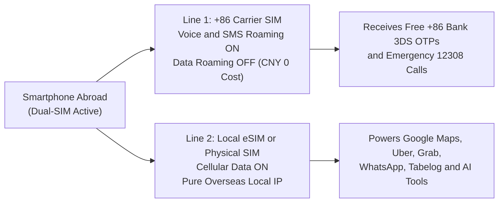
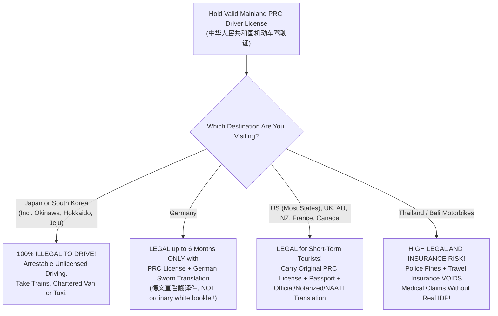

# Overseas Internet, eSIM, Must-Have Apps, Transit and Driving Legally

Landing in a foreign country without working cellular data, offline maps, or a legal mobility plan turns trivial tasks—finding your hotel exit in Shinjuku Station or hailing a ride from LAX—into expensive, stressful ordeal loops. Worse, misunderstanding **which phones physically support eSIM** or **which countries arrest tourists driving on Chinese license translations** can ruin an entire trip before day two.

This module provides an engineer-grade setup for dual-channel overseas connectivity (`+86` OTP preservation + local data), your mandatory pre-departure app stack, public transit fare hacks, and the strict legal boundaries of driving abroad on a PRC license.

---

## 1. Dual-Channel Overseas Connectivity (`+86` SMS + Local Data)

Never pull your `+86` SIM card out and leave it sitting in a drawer at home unless you have configured call/SMS hosting (`号码托管`). Abroad, Chinese bank risk-control systems, credit card `3D Secure` online payments, airline schedule alerts, and WeChat/Alipay new-network checks **all fire verification codes to your `+86` mobile number**.

### Step 1: Configure Your `+86` Line Before Boarding (`收短信免费，关数据防天价账单`)
1. **Enable International Roaming (`开通国际及港澳台漫游功能`)** via `中国移动 App` (`10086`), `中国联通 App` (`10010`), or `中国电信 App` (`10000`) **at least 48 hours before departure**.
2. **Receiving SMS Overseas Is 100% FREE (`境外接收短信免费`)** across all three Chinese carriers! Just do **NOT** answer spam voice calls (incoming/outgoing roaming voice calls cost CNY 0.99–2.99/minute).
3. **CRITICAL Phone Setting (`关闭 +86 卡的数据漫游`)**:
   - On iPhone: `Settings (设置)` -> `Cellular (蜂窝网络)` -> Tap your `+86` number -> Toggle **`Data Roaming (数据漫游)` -> OFF**, AND under `Cellular Data (蜂窝数据)` toggle **`Allow Cellular Data Switching (允许切换蜂窝数据)` -> OFF**!
   - **China Mobile Bonus Trick (`无忧行 JegoTrip` App)**: If your phone only has a single physical SIM slot, install China Mobile's official **`无忧行`** App before leaving China and enable **Free Number Hosting (`免费号码托管`)**—even if you physically remove your `+86` SIM card, all `+86` SMS verification codes and incoming calls are delivered free over Wi-Fi/data inside the `无忧行` App!

### Step 2: Check Hardware eSIM Support (`国行 iPhone 硬件不支持 eSIM 避坑!`)
Before buying any eSIM on Airalo, Nomad, or Trip.com (`携程`), run this **5-second hardware check**:
- Open your phone dialer and type **`*#06#`**.
- **If a 32-digit `EID` barcode appears**: Your device has an embedded eSIM chip (true for US, Japanese, European, Singaporean, Australian, and single-SIM Hong Kong iPhones, plus global Pixel/Samsung phones). You can install QR-code eSIMs (`Airalo`, `Nomad`, `Ubigi`, `Trip.com eSIM`) in 60 seconds!
- **If NO `EID` appears (only `IMEI1` and `IMEI2`)**: You have a **Mainland China (`CH/A`) or dual-physical Hong Kong (`ZA/A`) iPhone**, which **physically lacks an eSIM chip**! Buying an Airalo eSIM will NOT install on your phone. Instead, choose one of these two solutions:
  1. **Physical Overseas Data SIM (`境外本地实体流量卡`)**: Order on Taobao / `携程` 5 days before departure (delivered to your home with a SIM ejector pin `取卡针`), put `+86` in Slot 1 and the overseas data SIM in Slot 2!
  2. **Carrier Roaming Data Pack (`无忧行 / 联通出境流量包 / 支付宝境外流量包`)**: Activates directly on your `+86` SIM with zero hardware swap (typically CNY 15–28/day unlimited/tiered).

### Technical Nuance: Carrier Roaming IP vs Native Local SIM/eSIM IP

| Connectivity Option | Setup Convenience | Google / WhatsApp / IG / Maps | TikTok / ChatGPT / Claude / Local Streaming | Network Latency |
| :--- | :--- | :--- | :--- | :--- |
| **`+86` Carrier Roaming Pack (`移动无忧行/联通漫游`)** | Highest (no SIM swap) | **Works natively** (no VPN needed!) | **Often Blocked!** Traffic tunnels back to China/HK (`+86` MCC `460` + Mainland/HK IP), so TikTok goes black and OpenAI/Anthropic block region! | Higher (`150ms–280ms` round-trip back to China) |
| **Travel eSIM (`Airalo / Trip.com / Ubigi`)** | Instant QR (requires non-Mainland eSIM phone) | **Works natively** | Verify exit IP! Pure local carrier eSIMs (`Ubigi JP`, `Airalo Local`) work everywhere; cheap HK-routed eSIMs (`Three HK` exit) may still trigger HK geo-blocks on AI apps. | Low (`20ms–60ms` if local breakout) |
| **Local Carrier Physical SIM (`AIS / Singtel / Docomo / Orange`)** | Swap nano-SIM in Slot 2 | **Works natively** | **100% Unblocked** + includes a local phone number (handy for restaurant queues or European bookings!). | Lowest (`15ms–35ms` native local 5G) |

---

## 2. Mandatory Pre-Departure App Stack (Install & Log In at Home!)

Download and register accounts **before leaving China** while your `+86` number and domestic payment bindings are calm:

### A. Navigation & Urban Transit
- **Google Maps**: Global standard everywhere **except Mainland China and South Korea**.
  - *Pro Trick 1*: Tap your profile avatar -> **`Offline maps (离线地图)`** -> Save your target cities (`Tokyo`, `Paris`, `London`, `Los Angeles`) over home Wi-Fi so navigation never freezes inside underground metro tunnels!
  - *Pro Trick 2*: When confused exiting a 30-exit station like Shinjuku or Shibuya, tap **`Live View` (AR camera icon)**—point your camera at surrounding buildings and giant 3D arrows float in mid-air showing which street to walk down!
- **Naver Map (`네이버 지도`) — MANDATORY FOR SOUTH KOREA**: Due to South Korean national security laws restricting high-precision map data exports, **Google Maps walking and driving directions DO NOT WORK in Seoul, Busan, or Jeju!** Install **Naver Map** (supports full Simplified Chinese & English UI).
- **Citymapper**: Superior to Google Maps in **London, Paris, New York, and Singapore**—tells you the exact subway car (`Front / Middle / Back`) to board for the fastest transfer and real-time strike (`罢工`) detours!

### B. Ride-Hailing (`海外打车软件 — 杜绝黑车与出租车绕路宰客`)

| Region | Primary App(s) | Payment & Insider Tips |
| :--- | :--- | :--- |
| **North America (US / Canada)** | **Uber**, **Lyft** | Compare both—prices surge independently by 30%+ at airports! Meet at designated `App-Based Rideshare` zones. |
| **Europe & UK** | **Uber**, **Bolt**, **FreeNow** | **Bolt** is frequently **20%–35% cheaper than Uber** in Paris, London, Lisbon, Madrid, Prague, and Central Europe! |
| **Southeast Asia (SG, TH, MY, VN, ID)** | **Grab**, **Bolt** (TH), **Gojek** (ID/SG) | **Grab supports direct Alipay & WeChat Pay binding!** Use Grab's built-in camera chat to send the driver a photo of the exact mall entrance you are standing at. |
| **Japan** | **GO Taxi**, **Uber** | Street taxis in Japan are 100% honest with meters (rear left door opens and closes automatically—**do NOT pull or slam it yourself!**). Use **GO** or **Uber** when carrying heavy suitcases in rain. |
| **South Korea** | **Kakao T** / **`k.ride`** | Foreign tourists can use **`k.ride`** (English/Chinese global version of Kakao Mobility with overseas Visa/MC) or Alipay's built-in `Kakao T` mini-program. |

### C. Translation, Messaging, Booking & Local Dining
- **Google Translate + Papago**: Download **Offline Language Packs** in Google Translate for instant live camera translation (`相机实时悬浮翻译`). For **Japanese and Korean**, Naver's **Papago** translates grammar and restaurant menus noticeably more accurately than Google. For vertical handwritten Japanese izakaya (`居酒屋`) calligraphy menus, snap a photo and ask a multimodal LLM to list every dish with ingredients and flavor notes!
- **WhatsApp & LINE**: Register **WhatsApp** (`+86` works!) for Europe, Americas, Southeast Asia, and Australia (boutique hotels, airport drivers, and diving/tour operators communicate 99% via WhatsApp). Register **LINE** for Japan and Thailand.
- **Booking.com, Agoda & Trip.com (`携程`)**: Compare rates across platforms—**Agoda** frequently undercuts competitors by 10%–20% across **Japan, Thailand, and Southeast Asia**, while **Booking.com** dominates **Europe and North America** and **Trip.com** offers responsive 24/7 Mandarin emergency support. Save both the **English PDF confirmation** (for immigration & visa checks) and the **local-language address card** (to show taxi drivers), and enable **Apple Wallet `Suica / ICOCA / Octopus` Express Transit** before takeoff!
- **Tabelog (`食べログ` — Japan's Ultimate Restaurant Bible)**:
  - **Crucial Score Calibration**: Unlike Dianping (`大众点评`) where mediocre tourist traps have `4.8/5.0`, Japanese diners grade brutally on **Tabelog**:
    - **`3.00 – 3.29`**: Solid everyday local spot.
    - **`3.30 – 3.49`**: Very good neighborhood favorite.
    - **`3.50 – 3.99`**: **Top 3%–4% nationwide**—genuinely outstanding culinary craftsmanship (often requires advance reservation!).
    - **`4.00+`**: **Top 0.05% national culinary legends** (booked months out via `OMAKASE` or `TableCheck`).
- **OpenTable / Resy** (US & UK restaurant bookings) and **TheFork** (France, Italy, Spain—frequently offers automatic **20% to 50% discounts** off the food bill when booked through the app!).

---

## 3. Mastering Foreign Subways & High-Speed Trains

### Open-Loop Contactless Gates (`直接拍 Visa / Mastercard / Apple Pay 进站`)
Cities including **London (Tube/Bus/Elizabeth Line), Singapore (MRT/Bus SimplyGo), New York (OMNY), Sydney (Opal), Milan, Rome, Amsterdam, and select Japanese lines** allow you to tap your contactless Visa/Mastercard or Apple Pay directly on the subway gate with zero ticket purchase!
- **CRITICAL Rule — Never Mix Card vs Phone (`同进同出铁律`)**: Your physical Visa card (`FPAN`), your iPhone Apple Pay (`DPAN #1`), and your Apple Watch (`DPAN #2`) transmit **three completely different tokenized card numbers** to the transit computer! If you tap **IN** with your iPhone and tap **OUT** with your Apple Watch (or physical card), the system sees two unfinished trips and bills you **two maximum penalty fares** (e.g., GBP 18+ in London) AND breaks London's automatic daily fare cap (`Daily Cap`)!

### High-Speed Rail Gotchas (Japan Shinkansen & European Rail)
1. **Japan Shinkansen (`新干线`) — The `160cm` Oversized Luggage Rule (`特大荷物席予約`)**:
   - On the **Tokaido, Sanyo, and Kyushu Shinkansen** (`Tokyo – Nagoya – Kyoto – Osaka – Hiroshima – Fukuoka`), if your suitcase's **three dimensions combined (`Length + Width + Height`) exceed `160cm`** (standard **28-inch / 30-inch check-in suitcases** are usually `158cm–175cm`!), you **MUST reserve a seat with an Oversized Luggage Area (`特大荷物スペースつき座席`)** at no extra cost when booking (via **`SmartEX`** App or JR ticket machine). Bringing a `>160cm` suitcase onboard without that specific reservation incurs a **JPY 1,000 onboard fee** and crew relocation! (`20-inch` to `24-inch` suitcases `<160cm` fit freely on overhead racks with no special booking).
2. **European Trains (`SNCF / DB / Trenitalia / Italo / SBB`) — Ticket Validation & Strikes**:
   - Book via official carrier apps (**`DB Navigator`**, **`SNCF Connect`**, **`Trenitalia`**, **`SBB Mobile`**) or **`Trainline`** (60–90 days ahead saves 50%+ on high-speed `TGV / ICE / Frecciarossa` fares!).
   - **Validate Unreserved Regional Tickets (`打票/电子Check-in`)**: In Italy (`Trenitalia Regionale`) and parts of France/Austria, paper regional tickets must be stamped in the green/yellow platform validation box *before* boarding, and digital regional e-tickets require tapping **`Check-in`** inside the Trenitalia app prior to scheduled departure—forgetting draws an instant **EUR 50–100 conductor fine** even though you paid for the ticket!

---

## 4. Driving Overseas Legally (`中国驾照海外自驾法律生死线`)

> **CRITICAL LEGAL WARNING**: Mainland China (`中国大陆`) is **NOT** a contracting party to either the **1949 Geneva Convention on Road Traffic** or the **1968 Vienna Convention on Road Traffic**. Therefore, **Mainland China CANNOT issue an International Driving Permit (`IDP / 国际驾照`)**.
>
> **Beware the "IAA / KIDA International Driver's License" Scam**: Any plastic card + multi-language booklet sold on Taobao or travel sites labeled *"IAA / KIDA / IDL 国际驾照"* is **NOT a government-issued IDP**—it is a private commercial translation! Using it in a country that legally requires a genuine 1949 Geneva IDP (such as **Japan or South Korea**) is **criminal unlicensed driving (`无证驾驶`)**, resulting in **police arrest, criminal record, deportation, and 100% insurance denial**!

### Country-by-Country Self-Drive Legal Matrix for PRC License Holders

| Country / Region | Legal with PRC License? | Exact Required Document Combination (Always Carry ORIGINAL PRC License!) | Crucial Local Nuances |
| :--- | :--- | :--- | :--- |
| **Japan (`日本`)** | **NO — STRICTLY ILLEGAL** | None (PRC license + notarization / white booklet / IAA booklet are **ALL ILLEGAL**). Only genuine 1949 Geneva IDP from a contracting jurisdiction (e.g., legal HK/US/UK/SG license + IDP, subject to resident 3-month non-entry rules) or Taiwan/DE/FR/CH + JAF translation works. | Rental shops that illegally rent to fake IDPs will NOT save you: any fender-bender triggers mandatory `110` police dispatch -> **arrest (`無免許運転`: up to 3 yrs prison / JPY 500k fine)**! |
| **South Korea (`韩国`, incl. Jeju)** | **NO — STRICTLY ILLEGAL** | Mainland PRC license is **NOT recognized** anywhere in South Korea, including Jeju Island. | Charter a licensed local driver (`包车`) or use `Kakao T` / buses in Jeju. |
| **United States (`美国`)** | **YES (Most Major Tourist States)** | **Original PRC License + English Notarized/Certified Translation (`英文公证件/车行认证翻译件`) + Passport + Credit Card in Main Driver's Name**. | **State-by-State Law**: 100% smooth in **California, Nevada, Arizona, Utah, Washington, New York, Florida**. Double-check individual state DMV statutes before driving in **Massachusetts, New Jersey, Texas, Hawaii, or Georgia**! |
| **Australia & New Zealand** | **YES** | **Original PRC License + NAATI-certified translation (AU) / NZTA-approved translation or PRC Notary Public (`公证书`) (NZ)**. | **Right-hand drive, drive on the LEFT (`右舵左行`)!** Strict speed camera enforcement (`+3 km/h` can ticket in Victoria, AU!). |
| **United Kingdom** | **YES (up to 12 months)** | **Original PRC License + English Certified/Notarized Translation**. | **Drive on the LEFT**; London **Congestion Charge** & **ULEZ** zones must be paid online (`tfl.gov.uk`) or draw heavy fines. |
| **Germany (`德国`)** | **YES (Strict Translation Rule)** | **Original PRC License + German Court Sworn Translation (`德文宣誓翻译件`)** or German diplomatic authentication. | **Warning**: Generic free "rental white booklets (`租车平台小白本`)" are accepted by some airport desks **but rejected by German police (`Polizei`)** during traffic stops! Spend CNY 150–250 on a real `德文宣誓翻译`! |
| **France (`法国`)** | **YES** | **Original PRC License + French Notarized Translation (`法文公证件`)**. | Watch Paris `Crit'Air` emission stickers and tight underground parking ramps. |
| **Italy (`意大利`)** | **Conditional / High Friction** | Legally requires **Italian Embassy/Consulate certified translation (`意大利使领馆认证翻译`)**; police fines without it are EUR 400+. | **Beware `ZTL` (`Zona a Traffico Limitato`)**: Historic centers of Florence, Rome, Milan, Pisa have invisible cameras that fine **EUR 100–300 EVERY time you cross the sign**! Never drive inside historic Italian cores; take `Frecciarossa` trains between cities! |

### 5 Non-Negotiable Overseas Self-Drive Survival Rules (Where Legal)

1. **Buy Full Zero-Deductible Insurance + USD 1,000,000 Liability (`全险 + 百万三者险`)**:
   - **CDW / LDW (`车损盗抢险`)**: Covers rental car damage; upgrade to **Zero Deductible / Super Cover (`0起赔额全险`)** including **Glass, Tires & Roadside Assistance (`玻璃轮胎道路救援`)**.
   - **SLI / LIS (`补充第三者责任险` — CRITICAL IN THE USA)**: Several US states (like California) have tiny statutory minimum liability limits—always make sure your booking includes **`SLI / EP` (`USD 300,000 to USD 1,000,000` third-party liability)**! Booking via reputable international aggregator packages or corporate/international rates frequently bundles `LDW + SLI` at 50% less than buying at the airport counter.
2. **All-Way `STOP` Signs & Right-of-Way (`STOP 标志必须完全刹停 3 秒`)**:
   - In North America, Australia, and Europe, a red octagonal **`STOP`** sign means **your wheels must come to a 100% dead stop (`0 km/h`) behind the white line for 2–3 seconds**—a "rolling slowdown (`滑行观察`)" is treated the same as running a red light! At `4-WAY / ALL-WAY STOP` intersections, first car to stop goes first.
   - **US / Canada School Buses**: When a yellow school bus stops and extends its flashing red **`STOP`** arm on an undivided road, **traffic in BOTH directions must stop completely at least 6 meters back**—passing a stopped school bus carries massive fines and license/court summons!
3. **Left-Side Driving Mental Anchor (`右舵左行防逆行口诀` — UK, AU, NZ)**:
   - Repeat out loud every time you turn out of a parking lot or gas station (where 80% of wrong-way tourist crashes happen!): **"Keep my body next to the centerline (`驾驶员身体永远贴着马路中线`)!"** Expect to turn on the windshield wipers (`雨刷`) the first three times you reach for the turn signal—stay calm and don't jerk the wheel.
4. **Refueling Fuel-Type Check (`加油防错加柴油/汽油`)**:
   - In the **US**: **`Regular (87)`** is normal unleaded gasoline (green handles in the US are often **Diesel `柴油`**—do NOT grab green by habit!).
   - In **Europe**: **`E5 / E10 / Super 95 / Sans Plomb 95 / Benzina`** = Gasoline (`汽油`); **`Diesel / Gasoil / Gasolio`** = Diesel (`柴油`). Putting gasoline into a European diesel rental destroys the high-pressure fuel pump (`EUR 3,000+` repair NOT covered by CDW!). Check the sticker inside the fuel cap door every single time.
5. **Anti-Smash-and-Grab Car Protocol (`防砸窗铁律` — San Francisco, Los Angeles, Seattle, Milan, Barcelona, Nice)**:
   - Thieves in San Francisco (`Lombard St / Palace of Fine Arts / Fisherman's Wharf`) and Southern Europe can smash a rear quarter window and grab every suitcase in **8 seconds** using Bluetooth/Wi-Fi scanners to detect iPads/MacBooks inside trunks!
   - **Rule**: Leave **ZERO items visible inside the cabin** (not even an empty shopping bag, phone mount cable, or coin!). If storing luggage in a closed sedan trunk (avoid open-hatch SUVs without cargo covers, or fold the rear seat flap slightly if empty!), **put everything in the trunk BEFORE arriving at your parking destination**—never open your trunk in front of watchers *after* parking at a tourist viewpoint, and **always keep passports, phones, and cards on your body** whenever stepping out of the car!

---

## 5. Rental Car Pickup Inspection & Accident Emergency SOP (`取还车防坑与事故处理`)

Even with `0 Deductible` insurance, sloppy rental pickup or accident documentation can trigger USD 500+ post-trip credit card deductions (`还车后秋后算账`):

### Pickup & Return Evidence Checklist (`取车3分钟视频取证法`)
1. **Walk-Around 4K Video at Pickup (`提车绕车一圈拍视频`)**: Before driving out of the garage, turn on your iPhone flash and record a continuous 60-second video covering **all four bumpers, wheel rims (`轮毂划痕`), lower front lip, windshield (`前挡风玻璃碎石小坑`), roof, and the dashboard fuel + mileage gauge**. Point out any existing scratch (`> 2cm`) to the lot attendant so it is marked on the checkout sheet.
2. **Prepay vs Full-to-Full Fuel Policy (`满油取还 Full-to-Full 最划算`)**:
   - Always choose **`Full-to-Full` (`满油取满油还`)** rather than `Prepaid Fuel` unless you are certain you will return the tank empty.
   - Refuel within **5–10 miles of the return airport** and **keep the paper gas station receipt + snap a photo of the `F` fuel needle on the dashboard inside the return lane**! Rental systems routinely misfire USD 120 automated "refueling fee" charges that vanish the instant you email that photo.
3. **Highway Electronic Tolls (`高速电子收费避坑`)**:
   - In the US (`FasTrak` in California, `SunPass` in Florida, `E-ZPass` in Northeast), Australia (`Linkt`), and Portugal/Norway, many bridges (including San Francisco's **Golden Gate Bridge — 100% cashless!**) have zero cash booths! Confirm how your rental agency bills tolls (e.g., pay Golden Gate Bridge toll online by license plate within 48 hours at `bayareafastrak.org` to avoid Hertz/Avis USD 15/day administrative toll-pass surcharges!).

### What to Do Immediately After Any Scratch or Crash (`擦碰/事故必报警拿单!`)
- **Stop Safely & Put On High-Vis Vest (`欧洲强制反光背心`)**: In Europe, every rental car carries neon safety vests in the glovebox—put one on *before* stepping onto a highway shoulder, and place the red warning triangle 50–100m behind.
- **ALWAYS Call Local Police for an Incident Number (`无论单方刮擦还是双车事故，必须拿警局报告!`)**: Even if you bought the most expensive `0 Deductible Super Cover` and merely scraped a hotel pillar alone (`单方事故`), **rental insurance policies require an official Police Report Number (`报警回执`) or incident report** plus calling the rental company's roadside hotline within 24 hours—returning a dented car silently without a police number voids CDW in many jurisdictions!

---

## 6. Global Hub Airport-to-City Optimal Transit Cheat Sheet

Skip CNY 1,500 street-taxi shocks on arrival by bookmarking the highest-ROI airport transfer for the 8 busiest international hubs:

| Arrival Airport | Best Rail / Express Option (Time & Cost) | Taxi / Ride-App Benchmark & Traps to Avoid |
| :--- | :--- | :--- |
| **Tokyo Narita (`NRT` — 65km out!)** | **`Keisei Skyliner`** (`41m` to Ueno, JPY 2,580) or **`Narita Express (N'EX)`** (`55m` to Tokyo/Shinjuku/Shibuya, round-trip pass deal for foreign passports!) | **NEVER hail a street taxi at Narita**—costs **JPY 25,000–35,000 (~CNY 1,200–1,700)**! Take rail or Airport Limousine Bus (JPY 3,100). |
| **Tokyo Haneda (`HND` — Close!)** | **`Keikyu Line`** (`15m` to Shinagawa) or **`Tokyo Monorail`** (`13m` to Hamamatsucho) via Apple Suica (~JPY 330–520). | Fixed-rate taxi / Uber reasonable at night (~JPY 7,000–10,000 for 2–3 people with luggage). |
| **Osaka Kansai (`KIX`)** | **`JR Haruka`** (`35m` to Tennoji / `50m` to Osaka-Umeda / `75m` direct to Kyoto!) or **`Nankai Rapi:t`** (`34m` to Namba). | Buy discounted QR foreign-tourist tickets on Klook/Trip.com 10 minutes before boarding! |
| **Singapore Changi (`SIN`)** | **MRT East-West / Thomson-East Coast Line** (tap Visa/Mastercard directly, SGD ~2.20) | **Grab** or official metered taxi from arrivals basement (`20–25m` to Marina Bay / Orchard, **SGD 22–35**—super convenient!). |
| **London Heathrow (`LHR`)** | **`Elizabeth Line`** (`30–38m` direct to Paddington / Bond St / Tottenham Court Rd / Liverpool St via Contactless ~GBP 13.30)! | **Skip `Heathrow Express` (`GBP 25` walk-up)** unless rushing to Paddington! Black Cabs to Central London cost **GBP 75–110**; use **Bolt/Uber** (~GBP 45–60). |
| **Paris CDG (`戴高乐机场`)** | **`RER B` Train** (`35m` to Gare du Nord / Châtelet, watch bags closely!) or `RoissyBus` to Opéra. | **Official Paris Taxi Stand ONLY**: Legally capped **flat fare (`一口价`: EUR 56 Right Bank / EUR 65 Left Bank)**! Ignore fake drivers inside terminal quoting EUR 120! |
| **Bangkok (`BKK` Suvarnabhumi)** | **`Airport Rail Link (ARL)`** (`28m` to Phaya Thai BTS, THB 45—bypasses notorious Bangkok traffic jams!). | **Grab** pickup zone on Level 1 (`THB 350–500` incl. highway tolls; keep THB 75 small cash ready if driver asks for toll booth cash). |
| **New York (`JFK`)** | **`AirTrain JFK` + `LIRR` (`20m` to Penn Station / Grand Central!)** or Subway `E/A` via Contactless OMNY. | Official Yellow Cab flat rate to Manhattan (~USD 70 + tolls + 18% tip = **~USD 95–105** total) or Uber/Lyft. |

---

## 7. Pre-Flight Dual-SIM Data Drain Protection (`防止后台偷跑漫游流量 3 步检查`)

If you buy a tiered roaming/eSIM pack (e.g., `5GB / 7 Days`), iOS and Android treat cellular connections as unlimited unless told otherwise—**one afternoon of shooting 4K iPhone video can silently upload 5GB to iCloud Photos in 12 minutes!** Toggle these three switches before takeoff:

1. **Enable `Low Data Mode` (`低数据模式`) on the Travel eSIM/SIM**: `Settings -> Cellular -> [Travel Data Line] -> Data Mode -> Low Data Mode (ON)` (pauses automatic iCloud Photos sync, system OTA downloads, and background app refresh until you join hotel Wi-Fi).
2. **Disable Cellular App Store Auto-Updates**: `Settings -> App Store -> Cellular Data -> Automatic Downloads (OFF)`.
3. **Download Entertainment Offline (`提前缓存航程电影与歌单`)**: Cache Netflix/Bilibili/YouTube videos and Apple Music/Spotify playlists onto local flash storage over home Wi-Fi—in-flight satellite Wi-Fi blocks video streaming and terminal Wi-Fi is throttled.

---

## 8. Hands-Free Travel: Luggage Forwarding (`宅急便`) & Bag Storage Apps

Dragging two 28-inch suitcases up narrow European cobblestone stairs, onto crowded Kyoto buses (where large suitcases are now restricted on municipal buses!), or across Shinkansen transfers is exhausting and unnecessary:

1. **Japan Hotel-to-Hotel Luggage Delivery (`ヤマト運輸 宅急便 / 黑猫宅急便`)**:
   - Almost every Japanese hotel front desk (plus `7-Eleven` and `FamilyMart` stores) dispatches **Yamato Transport (`Ta-Q-Bin`)** or **Sagawa** luggage courier slips—staff will even fill out the Japanese address of your next hotel for you!
   - **Cost & Speed**: Typically **JPY 2,200 – 3,000 (~CNY 105–145)** per large suitcase for **next-morning delivery** (`Tokyo -> Kyoto` or `Osaka -> Tokyo`). Pack 1 night of clothes/toiletries in a small backpack, ship your big suitcase the morning before checkout, and sightsee completely hands-free! *(Note: Shipping to an **Airport (`空港宅急便`)** requires handing over the bag **2 to 3 days before flight departure**).*
   - **Apple AirTag / Find My Tracker**: Drop an **Apple AirTag** (CR2032 coin-cell battery—100% legal inside checked bags globally!) inside every suitcase so you can see its exact terminal or courier truck position in real time.
2. **Global Left-Luggage Apps (`Bounce` / `Radical Storage` / `ecbo cloak`)**:
   - When station coin lockers (`コインロッカー`) are 100% full at 11:00 AM in Tokyo/Kyoto, open **`ecbo cloak`** to reserve guaranteed behind-the-counter storage at nearby cafés, kimono shops, or JR counters.
   - Across **Europe, the UK, US, and Australia** (where post-9/11 security removed many automated station lockers), install **`Bounce`** or **`Radical Storage`** (~EUR 5–6 / USD 6 per bag/day, insured, verified hotel front desks right outside `Gare du Nord`, `King's Cross`, `Roma Termini`, or `Penn Station`).

Next, proceed to [04-SAFETY-MEDICINES-CULTURE-AND-EMERGENCIES.md](04-SAFETY-MEDICINES-CULTURE-AND-EMERGENCIES.md) to audit restricted Chinese medicines, check DJI drone laws, navigate tipping and cultural taboos, defeat street scams, and master the `中国领事` emergency passport replacement workflow.
