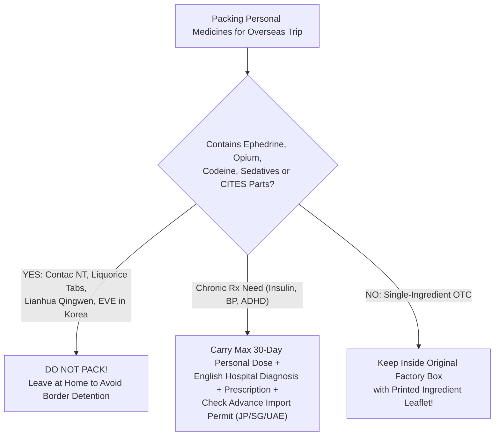
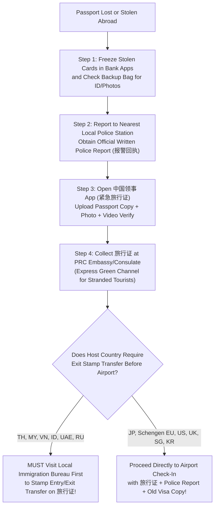

# Restricted Medicines, Drones, Cultural Taboos, Anti-Scam and Consular Emergencies

Even experienced travelers with valid visas and premium credit cards can see a trip implode over seemingly minor oversights: packing a box of `复方甘草片` or `新康泰克` that triggers narcotics detention at foreign customs, launching a 249g DJI Mini drone in Tokyo without realizing Japan's threshold is `100g`, leaving a backpack unlocked on an Italian train rack, or arriving at Bangkok Airport with a replacement `旅行证` only to learn Thai Immigration requires a separate downtown exit stamp first.

This final module covers high-risk legal red lines (medicines, vaping, drones, street photography), regional tipping and cultural norms, physical anti-theft engineering, and step-by-step emergency recovery workflows.

---

## 1. Banned Ingredients in Common Chinese Household Medicines (`携药出境红线`)

Many over-the-counter (`OTC`) household medicines sold freely in Mainland pharmacies contain chemical precursors or opiate extracts classified abroad as **Controlled Stimulants, Narcotics, or Illegal Psychotropics**. Carrying excessive or prohibited boxes can lead to **immediate customs seizure, secondary interrogation, visa revocation, 5-year entry bans, or criminal prosecution**.

### The 4 Blacklisted Ingredient Classes & Common Domestic Brands

| Forbidden Chemical / Ingredient | Common Chinese / Asian OTC Brands Containing It | Strictest Enforcement Destinations & Legal Consequence |
| :--- | :--- | :--- |
| **1. Ephedrine & Pseudoephedrine (`麻黄碱 / 伪麻黄碱 / 麻黄`)** *(Methamphetamine precursor)* | **`新康泰克` (`Contac NT`)**, **`白加黑`**, **`日夜百服咛`**, **`泰诺酚麻美敏片`** (multi-symptom cold), **`急支糖浆`**, **`大活络丸`**, **`连花清瘟胶囊/颗粒`** (contains `麻黄` *Ephedra*!) | **Japan** (`>10%` pseudoephedrine banned under Stimulants Control Act), **New Zealand** (`新康泰克` & `连花清瘟` strictly prohibited!), **Australia** (must declare), **South Korea**, **UAE / Middle East**, **Mexico**. |
| **2. Morphine, Codeine & Opium Poppy (`阿片粉 / 吗啡 / 可待因 / 罂粟壳`)** *(Opioid narcotics)* | **`复方甘草片`** (contains Opium powder `阿片粉`!), **`强力枇杷露`** (`罂粟壳`), **`联邦止咳露`**, **`可待因桔梗片`**, **`肠胃宁`**, **`咳喘宁`**, **`克痢痧`** | **Global Zero Tolerance** — **United States (CBP), New Zealand, Australia, Japan, Korea, Singapore, UAE**. Multiple real cases of PRC travelers deported with 5-year bans at LAX over `复方甘草片`! |
| **3. Controlled Psychotropics & Sedative Painkillers (`精神镇静安眠及特殊止痛剂`)** | **`思诺思` (`Zolpidem`)**, **`安定` (`Diazepam`)**, **`曲马多` (`Tramadol`)**, **Japanese `EVE Quick / EVE A EX`** (contains **`丙烯异丙乙酸尿素` Allylisopropylacetylurea**!) | **South Korea (since April 2025)** banned bringing Japanese `EVE` painkillers containing Allylisopropylacetylurea into Korea! **UAE / Saudi / Qatar** arrest travelers carrying unpermitted `Tramadol` or sleeping pills! |
| **4. Endangered Animal & Plant Parts (`CITES 濒危动植物中药`)** | **`安宫牛黄丸`**, **`片仔癀`**, **`马应龙麝香痔疮膏`** (`麝香` Musk), **`熊胆粉`** (Bear bile), **`羚羊角`**, **`石斛`**, **`西洋参`**, **`燕窝`** (Bird's nest) | **US, EU, UK, AU, NZ, Japan, Singapore** enforce CITES wildlife trafficking & biosecurity statutes regardless of medicinal packaging. |

### Safe, Border-Compliant Travel Medicine Kit (`安全替代药箱清单`)
1. **Golden Packaging Rule**: **Never strip pills out of blister packs into unlabeled plastic 7-day pill organizers (`切勿剪碎拆盒混装`)!** Always keep medicines in their **original retail box with the printed generic ingredient name (`通用化学名`) and leaflet**.
2. **Safe Single-Ingredient Replacements**:
   - **Fever / Headache**: Pure **Acetaminophen / Paracetamol (`单方对乙酰氨基酚` — 必理痛 `Panadol` / 泰诺林)** or pure **Ibuprofen (`单方布洛芬` — 芬必得)**.
   - **Diarrhea / Stomach**: **Montmorillonite Powder (`蒙脱石散` — 思密达)** + **Oral Rehydration Salts III (`口服补液盐 III`)** + **Berberine (`黄连素` — check plant rules in AU/NZ, declare if carried)**.
   - **Allergies / Hives**: **Loratadine (`氯雷他定` — 开瑞坦)** or **Cetirizine (`西替利嗪` — 仙特明)**.
   - **External First Aid**: Individually wrapped **Povidone-Iodine swabs (`碘伏棉签`, `<100ml` total)**, hydrocolloid blister plasters (essential for 20,000-step walking days!), sterile band-aids.
3. **Personal Prescription Medications (`慢性病处方药合规携带`)**: Carry at most a **30-day supply** alongside a hospital-stamped **English Medical Diagnosis + Prescription (`英文诊断证明与处方`)** matching your passport name. Check official portals before flying to **Singapore** (`hsa.gov.sg` online Medicine Checker), **Japan** (`薬監証明 Yunyu Kakunin-sho` required if exceeding 1-month Rx or carrying syringes/injectors beyond insulin pens), or **UAE** (`mohap.gov.ae` free online prior approval).

---

## 2. Vaping (`电子烟`), Drones & Camera Gear Overseas Laws

### Strict E-Cigarette / Vaping Bans (`电子烟入境与使用高压红线!`)
Do **NOT** assume vapes (`悦刻 RELX / 一次性电子烟 / IQOS 加热烟草`) are legal abroad just because locals secretly use them:
- **Singapore**: **100% ILLEGAL to import, possess, or use** any e-vaporizer or heated tobacco product (`SGD 2,000` instant fine; repeat/import offenses face prosecution and immigration bans!).
- **Thailand**: **100% ILLEGAL** to import or possess e-cigarettes (`电子烟` & `IQOS`). Street police in Bangkok, Phuket, and Pattaya notoriously arrest or fine foreign tourists up to **THB 30,000–50,000+** on the spot for holding a vape!
- **Hong Kong, Macau (import ban), India, Taiwan Region, Vietnam (2025+ ban)**: Strict import bans—leave all e-cigarettes at home in Mainland China!

### DJI Drone Overseas Legal Matrix (`大疆无人机海外合规表`)
Many creators assume a **`249g` DJI Mini 3 / Mini 4 Pro** or **`135g` DJI Neo / Flip** bypasses drone laws worldwide. **That is false in Japan, Europe, Thailand, and airport-ban nations:**

| Destination | Sub-250g Drone (`DJI Mini / Neo`) Rule | Key Registration & No-Fly Zone Red Lines |
| :--- | :--- | :--- |
| **India, Egypt, Morocco, Cuba, Uzbekistan** | **BANNED AT AIRPORT CUSTOMS!** | **Do NOT pack a drone at all** (carry-on X-ray confiscates drones upon arrival, resulting in hours of police paperwork or permanent seizure). |
| **Japan (`日本`)** | **Regulated at `>= 100g`!** (`249g` Mini IS regulated!) | Must register online at **MLIT DIPS 2.0** *before* trip + pay fee + enable Remote ID. **Almost all of Tokyo, Osaka, Kyoto (`DID 人口集中地区`), shrines, temples, parks, and Mt. Fuji are strict NO-FLY zones** without complex ministry flight permits! |
| **United States (`美国`)** | `< 250g` exempt from FAA USD 5 reg, **MUST pass `FAA TRUST`** | Every recreational flyer **must pass the free 20-minute `FAA TRUST` online test** and save the PDF certificate! **100% BANNED inside all US National Parks** (Yellowstone, Yosemite, Grand Canyon — federal misdemeanor!) and near stadiums/airports (`B4UFLY` / `Air Control` app). |
| **Europe (`EU / EASA` + CH/NO)** | **Camera = Mandatory Registration!** | Even `< 250g` drones **equipped with a camera** require online **UAS Operator Registration** in your first EU country of use + sticking your `Operator ID` onto the drone body + liability insurance! |
| **Thailand (`泰国`)** | **Camera = Mandatory Dual Registration!** | Any drone with a camera requires registration with **both `NBTC` (radio spectrum) and `CAAT` (civil aviation)** + drone liability insurance before takeoff—unregistered flight carries criminal penalties! |

> **Creator Tip for Osmo Pocket 3 / iPhone**: Handheld gimbals like **DJI Osmo Pocket 3** are legal almost everywhere drones are banned, **EXCEPT** note that **Tokyo Disney Resort, Shibuya Sky rooftop, Universal Studios Japan, teamLab, and JR train platforms** ban selfie sticks, extension rods, and tripods (`自拍杆与三脚架禁用`)—use the Pocket 3 compactly in your palm without extending a pole! Respect strict portrait privacy laws in **Germany, Austria, Switzerland, and Japan** (avoid filming strangers' faces or children; never film inside Kyoto Gion's marked private lanes `私道撮影禁止`).

---

## 3. Global Tipping, Dining & Cultural Taboos Matrix

| Region | Sit-Down Restaurant Tipping | Taxi / Hotel / Counter Etiquette | Crucial Dining & Cultural Pitfalls |
| :--- | :--- | :--- | :--- |
| **United States & Canada** | **18% – 22%** calculated on **pre-tax (`Subtotal`)** amount! | **Counter / Coffee Takeout**: Tap **`No Tip (0%)`** guilt-free on swivel iPads! **Hotel**: USD 2–5/day housekeeping; USD 2/bag bellhop. **Uber/Taxi**: 10%–15%. | **Check Receipt for `Service Charge / Auto-Gratuity (18%-20%)` FIRST!** Tourist-area restaurants in NYC, Miami, SF, and Vegas frequently auto-add 18%–20%—writing another 20% on the `Additional Tip` line means tipping 40%! |
| **Western & Southern Europe (`FR, IT, ES, DE, UK`)** | **0% – 10%** (Service is legally built into wages!) | **France**: `Service compris` included; leave EUR 1–3 coins if great. **Italy**: `Coperto` (EUR 2–4/person cover charge) printed on menu—no extra tip required! **Germany/Austria**: Round up 5%–10% verbally. **UK**: Check bill for **`12.5% Optional Service Charge`** already added! | **Water Trap**: In France, say **`"Une carafe d'eau, s'il vous plaît"`** for free tap water (asking for *"water"* brings EUR 8 Evian!). In Germany/Italy, tap water is rarely served free. **Table Bread/Olives**: In Italy/Spain/Portugal, bread baskets placed unasked often cost EUR 2–4 unless declined. |
| **Japan (`日本`)** | **STRICTLY 0% (`绝对不给小费`)** | Never leave cash on tables or hand tips to taxi drivers/hotel staff—it causes confusion and they will run after you to return it! | **`お通し (Otoshi)`**: JPY 300–600 small appetizer served automatically at izakayas = standard table charge, NOT a rip-off! **No Walking & Eating (`食べ歩き`)** on Kyoto/Tokyo sidewalks; finish snacks beside the stall. **Onsen (`温泉`)**: Scrub body clean *seated* before entering hot water; keep small towel out of bath; cover or verify tattoo policies beforehand. |
| **Southeast Asia (`SG, TH, MY`)** | **0% – 10%** (`10% Service Charge` already on mall/hotel bills!) | Street stalls: `0%`. Massage parlors in Thailand: THB 50–100 cash tip to masseuse is customary and appreciated. | **Thailand**: Never disrespect portraits of the Royal Family (including stepping on rolling Thai Baht coins/notes!). Cover shoulders & knees at temples. **Singapore**: Clear your own tray at Hawker Centres (`不归还餐盘罚款`—returning trays is mandatory by law in SG!). **No durian** on MRT or in hotels! |
| **Middle East (`UAE, Qatar, Saudi`)** | **10%** if service charge not included | Respectful modest dress in public malls/mosques; ask permission before photographing local residents (especially women). | Strict alcohol rules (licensed hotel venues only in UAE/Qatar; **100% alcohol ban in Saudi Arabia!**). During **Ramadan**, avoid eating, drinking, or chewing gum in public view during daylight fasting hours where restricted. |

---

## 4. Anti-Theft, Anti-Scam & Physical Security Engineering

Pickpocketing and distraction theft in **Paris, Rome, Milan, Barcelona, Madrid, London, Brussels, and Athens** operate as organized, industrialized teamwork—not random bad luck. Adopt hard physical engineering rather than relying on alertness when jet-lagged:

### The "3-3-3" Compartmentalization Rule (`三三制分装防盗原则`)
1. **Body Layer (Front Concealed Only)**: Phone attached to a **heavy-duty crossbody lanyard (`斜挎防抢手机挂绳`)** + 1 daily contactless credit card + EUR 50 / USD 50 cash in a **zippered front inner jacket pocket** (never back pants pocket, never outer backpack pocket!).
   - *Passport Carry Rule Split*: Under **Japan's Immigration Control Act**, foreign tourists **MUST carry their original physical passport on their person at all times** (`日本法律强制随身带护照原件`, needed for police checks). By contrast, in **Paris, Rome, Barcelona, and London**, lock your **original passport + backup Visa card + USD 200 cash** inside your hotel room safe (set a calendar alarm for checkout morning so you never forget it!) or wear it inside an **under-shirt flat RFID waist belt (`贴身隐形腰包`)**, carrying a paper photocopy + phone photo for daily sightseeing!
2. **Suitcase Backup Layer**: Hide **1 backup activated EMV credit/debit card (from a different bank!) + USD 200 emergency cash + 2 paper passport photos + paper passport copy** deep inside your locked hotel suitcase. Even if your street bag is snatched completely, you still have a working card, cash, and photos to fly home smoothly!

### Defeating the 6 Classic Overseas Street Scams
1. **Clipboard Petition Scam (`巴黎卢浮宫/铁塔假慈善签名党`)**: Young scammers thrust a clipboard under your chin asking *"Speak English? Sign for deaf children!"*—the clipboard blocks your downward line of sight while an accomplice's hand unzips your coat or bag underneath! **Counter**: Never break stride, keep hands on zippers, say firmly **"NO!"**, and walk briskly away.
2. **Bracelet / Birdseed Trap (`巴黎圣心堂红绳党 / 米兰大教堂玉米党`)**: Someone grabs your wrist to tie a string "for free friendship" or shoves corn kernels into your open palm for pigeons, then surrounds you demanding EUR 20–50. **Counter**: Keep hands inside pockets when walking through plaza crowds; never accept anything handed to you on the street.
3. **Fake Plainclothes Police (`假警察查钱包查毒/查假钞`)**: Two men flash a fake badge for 0.5 seconds and demand to inspect your passport and "count your cash notes for counterfeits" (sleight-of-hand stealing half your EUR 50 notes!). **Counter**: Real European police **NEVER** inspect tourists' cash on sidewalks! Say *"Let's walk together into that bank / uniformed police station"*—fakes vanish instantly.
4. **London E-Bike Snatch & Paris Metro Door Grab (`关门瞬间抢手机`)**: Thieves on silent electric Sur-Ron bikes mount London pavements to snatch unlocked iPhones right out of pedestrians' hands (because an unlocked phone lets them drain apps before screen lock!), and Paris metro thieves grab phones 1 second before pneumatic train doors hiss shut. **Counter**: Turn ON **iOS `Stolen Device Protection (失窃设备保护)`** (`Settings -> Face ID & Passcode`), step back from street curbs to check maps, and never stand beside subway doors holding your phone.
5. **European Intercity Train Luggage Rack Theft (`火车停靠站顺走大行李箱`)**: Thieves board `Trenitalia / SNCF / Eurostar` coaches 2 minutes before departure, grab an untethered Rimowa/Samsonite suitcase from the end-of-car rack, and hop off just as the whistle blows. **Counter**: Pack a lightweight **retractable steel-cable combination lock (`便携钢丝密码锁`, CNY 25)** and loop your suitcase handle straight around the metal rack bar!
6. **"Attraction Closed Today" Friendly Local Scam (`曼谷大皇宫今天不开门骗局`)**: A well-dressed "teacher/guard" outside Bangkok's Grand Palace or Wat Pho tells you *"Closed until 2 PM for royal ceremony—take this cheap THB 40 tuk-tuk to Lucky Buddha!"* -> drives you to high-pressure fake gem & tailor shops. **Counter**: Walk straight to the official main ticket gate and verify with uniformed booth staff yourself.

---

## 5. Consular Protection, Lost Passport & Medical Emergency SOP

### Essential Global Emergency Numbers (Save Before Takeoff!)

| Service | Phone Number / App | Crucial Usage Notes |
| :--- | :--- | :--- |
| **PRC MFA 24/7 Global Consular Protection (`外交部全球领保热线`)** | **`+86-10-12308`** or **`+86-10-65612308`** App: **`中国领事`** (`一键网络电话` free on Wi-Fi) | Staffed 24/7/365 in Mandarin for lost passports, detention, violent crime, major accidents, or natural disasters abroad. |
| **Europe (All EU/Schengen) & South Korea** | **`112`** | Universal free emergency number from any phone (even without SIM!) for Police, Ambulance, and Fire; English operators available. |
| **United States & Canada** | **`911`** | Police, Ambulance, Fire (ask for *"Mandarin interpreter"* if needed!). |
| **Japan (`日本`)** | **`110`** (Police) / **`119`** (Ambulance & Fire!) | Note: Ambulance in Japan is **`119`** (NOT `120`!); JNTO 24h Multilingual Hotline: `050-3816-2787`. |
| **UK, Hong Kong, Singapore, Malaysia** | **`999`** (SG Ambulance/Fire: **`995`**) | Universal emergency dispatch. |
| **Thailand (`泰国`)** | **`1155`** (**Tourist Police — 24h Chinese Service!**) / `191` | Always dial **`1155`** as a tourist in Thailand—dedicated Mandarin-speaking officers handle scams, thefts, and road emergencies! |
| **Australia / New Zealand** | **`000`** (Australia) / **`111`** (New Zealand) | Universal Police, Ambulance, Fire. |

---

### Lost or Stolen Passport Overseas: 4-Step Emergency Return SOP (`护照遗失补办旅行证全流程`)

Thanks to the **`中国领事` (China Consular) App**, losing your passport abroad is no longer a two-week nightmare—stranded short-term tourists can typically obtain an **Emergency PRC Travel Document (`中华人民共和国旅行证`, a passport-equivalent booklet valid for returning to China)** in **1 to 3 working days**:

1. **Step 1 — Police Report (`当地警局报案开具遗失证明`)**: Go immediately to the nearest local police station (`Polizei / Police / 交番 Koban`). Insist on receiving a **written Police Report / Lost Property Receipt (`报警记录单 / 遗失证明编号`)**—both your travel insurance (`证件遗失理赔`, often reimbursing CNY 1,000–3,000 for replacement & hotel rebooking fees!) and border control require this paper.
2. **Step 2 — Apply via `中国领事` App (`紧急旅行证绿色通道`)**:
   - Open **`中国领事` App** -> `护照/旅行证` -> Check **`紧急旅行证` (Emergency Travel Document)** -> Fill in your lost passport number (from your saved cloud scan!), PRC `身份证` number, entry details, and upload a digital white-background headshot (you can shoot one neatly against a white hotel wall!).
   - Call the local Chinese Embassy/Consulate consular protection line (or `+86-10-12308`) explaining your return flight date to request **express same-day / next-day review (`加急审发`)**. Complete the in-app video verification if prompted, then pick up the physical blue **`中华人民共和国旅行证`** at the consulate.
3. **Step 3 — CRITICAL Host-Country Exit Stamp Check (`离境前移民局补章核验!`)**:
   - A `旅行证` proves your Chinese citizenship to board a China-bound direct flight (**note: reroute your return flight to a DIRECT flight back to Mainland China or verify Hong Kong transit rules**, as third countries may reject transit on an un-visad `旅行证`!).
   - **HOWEVER, in Southeast Asia & Middle East (`Thailand, Malaysia, Indonesia, Vietnam, UAE, Russia`)**, airport exit immigration **WILL REFUSE TO LET YOU LEAVE** on a blank `旅行证`! You **must first take your Police Report + Embassy note + `旅行证` to the city's Immigration Headquarters** (e.g., Chaeng Watthana Division 1 in Bangkok, or Putrajaya/KL Immigration in Malaysia) during weekday office hours to have your arrival record transferred (`补盖入境记录/出境许可章`) before heading to the airport!
   - By contrast, in **Japan, Schengen Europe, the UK, US, South Korea, and Singapore**, travelers generally proceed directly to the departure airport early (`T-4 hours`) with their `旅行证` + Police Report + photocopy of lost passport/visa.

---

### Overseas Medical Emergency & Travel Insurance Protocol (`突发疾病与保险直付救援`)

In the United States, calling an ambulance + 6 hours in an Emergency Room (`ER`) for acute appendicitis or kidney stones easily generates a **USD 15,000 to USD 60,000 hospital bill**; in Japan or Switzerland, uninsured inpatient treatment is billed at `100%–300%` of national medical point schedules.

1. **Life-Threatening Emergency**: Dial local emergency (`911 / 112 / 119 / 999`) immediately—stabilize life first, notify your insurer's 24h hotline within 24–48 hours.
2. **Non-Critical Illness / Injury (Fever, Fracture, Gastroenteritis, Dog Bite)**:
   - **Call Your Travel Insurer's 24/7 Global Assistance Hotline (`保单上的24小时全球救援电话`, e.g., Allianz / AIG / AXA / Ping An) FIRST!**
   - Their multilingual medical coordinators will refer you to a nearby **Direct-Billing Network Hospital (`医疗直付网络医院`)** and fax a **Guarantee of Payment (`GOP 担保函`)** directly to the clinic so you walk out paying **USD 0 out of pocket**!
3. **If Paying Out-of-Pocket (`先行垫付后回国理赔`)**: Before leaving the hospital pharmacy/cashier, collect and photograph **all 4 mandatory claim documents**:
   - **Official Medical Diagnosis Report (`医生签字盖章的诊断证明 / Medical Report`)** stating symptoms and diagnosis.
   - **Itemized Billing Breakdown (`医疗费用明细清单 / Itemized Bill`)**—a credit card POS slip alone is **rejected** by insurers without the line-by-line itemized hospital invoice!
   - **Official Payment Receipt (`正式收据 / Official Receipt`)** + **Copy of Prescription (`处方单`)**.
   - *(Bonus for Flight Delays & Lost Bags)*: Always obtain an official airline **`Flight Irregularity Certificate (航班延误/取消证明)`** or baggage counter **`PIR (Property Irregularity Report 行李事故报告)`** at the airport before leaving the baggage hall!

---

## 6. Hotel Room Security, Bedbug Prevention & Fire Safety (`海外酒店入住安全五步法`)

Spend 90 seconds running this routine every time you unlock a new hotel or Airbnb room abroad:

1. **Locate the Fire Exit Staircase (`数清距离逃生门有几个房间`)**: Look at the evacuation map on the back of your door and glance down the corridor so you could find the fire stairwell blindfolded in smoke.
2. **Engage the Secondary Mechanical Latch (`反锁防盗链 / 便携阻门器`)**: Always flip the U-bar / deadbolt latch (`防盗扣`) whenever inside the room—front-desk keycard mis-issuance (`前台误开重房卡`) happens regularly at busy hotels! Solo travelers staying in older European buildings or Airbnbs can pack a 90g **portable stainless-steel door lock / wedge alarm (`便携阻门器`)**.
3. **Anti-Bedbug Inspection (`巴黎/伦敦/北美酒店防臭虫 Bedbugs 铁律`!)**:
   - Even 4-star and 5-star hotels in Paris, London, and New York periodically suffer `Bedbug` infestations—bringing two hitchhiking bugs home in a cloth suitcase costs thousands to eradicate!
   - **Action**: Upon entering, place your suitcase **on the tiled bathroom floor or metal luggage rack—NEVER throw your open suitcase onto the bed or carpet!** Pull back one bottom corner of the fitted bedsheet (`床笠四角缝隙`) with your phone flashlight: if you spot tiny rust-colored ink-like dots or shed shells along the mattress piping, walk straight back to reception and demand a room change on a different floor!
4. **In-Room Kettle & Drinking Water Rules**:
   - Tap water (`自来水直饮标准`) is safe to drink cold directly from the tap in **Japan, Singapore, Western/Northern Europe, UK, US, Australia, and New Zealand**; **NEVER drink unboiled tap water (or brush teeth with tap water in rural areas, or order street-stall crushed ice) in Thailand, Bali/Indonesia, Vietnam, India, Egypt, or Mexico**—buy sealed bottled mineral water (`2L` bottles at 7-Eleven)!
   - Avoid uncleaned hotel plastic kettles; pack a **foldable food-grade silicone dual-voltage (`100V–240V` switchable!) travel kettle** if you drink hot tea or morning coffee.

---

## 7. Disasters, Strikes & Legal Flight Compensation (`天灾罢工与最高 EUR 600 航延索赔`)

### A. Earthquakes & Typhoons in Japan (`日本地震与台风应急`)
- Install Japan Tourism Agency's official **`Safety tips`** App (supports Simplified Chinese push notifications for **Earthquake Early Warnings `紧急地震速报`**, Tsunami warnings, and Shinkansen suspensions!).
- During an indoor tremor: drop beside sturdy furniture away from glass windows, open the room door slightly so frame warping doesn't jam your exit, and **never run outside beneath glass building facades**. Near coastlines, any strong long shaking means **evacuate immediately uphill / to a designated `津波避難ビル` (`Tsunami Evacuation Building`, >= 4th floor reinforced concrete)**.

### B. European Strikes & Claiming Mandatory `EU261 / UK261` Cash Compensation (`高达 EUR 600 法定现金赔偿!`)

Most Chinese travelers do not know that European consumer aviation law (**EU Regulation `EC 261/2004`** and UK equivalent **`UK261`**) grants some of the strongest passenger cash payouts in the world—**completely separate from your domestic travel insurance!**

| Eligibility Criterion | Statutory Rule Under `EC 261/2004` (`EU261`) |
| :--- | :--- |
| **Which Flights Are Covered?** | 1. **ANY airline** (including **Air China, China Eastern, China Southern, Cathay, Emirates!**) departing **FROM an EU/EEA/Swiss/UK airport** (e.g., `Paris CDG -> Shanghai PVG`), OR 2. **An EU/UK carrier** (`Lufthansa, Air France, KLM, Finnair, British Airways`) flying **INTO** Europe/UK (e.g., `Shanghai PVG -> Frankfurt FRA`). |
| **Trigger Threshold** | Arrival at final destination delayed **`>= 3 hours`**, flight **canceled `< 14 days` before departure**, or **involuntary denied boarding (`超售拒载`)**—provided the root cause was within airline control (mechanical fault, crew scheduling, airline staff strike—NOT extreme weather or ATC strikes). |
| **Mandatory Duty of Care (`食宿照料义务`)** | Even during weather/ATC delays, the airline **must provide meals, refreshments, and free overnight hotel + airport transfers** (`Right to Care`)—keep every hotel and meal receipt if ground staff tell you to book your own! |
| **Fixed Cash Compensation Tier** | - Flights `<= 1,500 km`: **EUR 250** - Flights `1,500 – 3,500 km`: **EUR 400** - Long-haul flights **`> 3,500 km` (e.g., Europe to/from China!)**: **EUR 600 (or GBP 520 under UK261 — approx. CNY 4,700 per passenger!)** |

> **How to Claim `EU261` Without Paying 35% Agency Commissions**: Never hand 35% of your payout to third-party claim sharks (`AirHelp`) on your first try! Simply search `[Airline Name] EC261 Compensation Claim Form` on the airline's official website after landing, enter your PNR, ticket number, actual arrival delay, and IBAN/SWIFT bank details (your Hong Kong BOCHK/HSBC multi-currency account receives EUR/GBP transfers cleanly with zero friction!). Plus, you can **still claim your Chinese travel insurance flight-delay payout (`国内旅游险航延理赔`) simultaneously**!

---

## 8. High-Stakes Emergency English Phrasebook (`海外紧急状况救命高频英文卡`)

When panicked at a clinic, police desk, or POS counter, exact terminology saves precious minutes and prevents costly misunderstandings:

| Scenario | Exact English Phrase to Say or Show | Why Phrasing Matters |
| :--- | :--- | :--- |
| **Drug Allergy at Clinic / ER (`药物过敏声明`)** | *"I am allergic to **Penicillin (`青霉素`)** / **Cephalosporins (`头孢`)** / **Sulfonamides (`磺胺`)**."* | Prevents life-threatening anaphylaxis when foreign ER doctors prescribe antibiotics without domestic skin-testing (`国外开青霉素通常不做皮试!`). |
| **Requesting Insurance Claim Papers (`索要保险理赔四件套`)** | *"For my travel insurance claim, could I please get a signed **Medical Diagnosis Report**, an **Itemized Invoice**, and the **Official Receipt**?"* | Ensures you receive line-item billing codes (`明细账单`) rather than a useless summary card slip. |
| **Reporting Stolen Passport / Bag (`警局报案拿书面回执`)** | *"My passport and wallet were stolen. I need an official **written Police Report with a reference number** for the Chinese Consulate and my insurer."* | Distinguishes a formal written crime report (`报警回执`) from an informal verbal log. |
| **Refusing POS DCC Rip-Off (`拒绝POS机人民币动态转汇`)** | *"Please **void** this transaction and charge my card in **local currency (Euros / Yen / Baht) WITHOUT currency conversion**."* | Forces cashier to cancel forced-CNY DCC before settlement. |
| **Asserting Consular Notification Rights (`要求联系中国领事馆`)** | *"I am a citizen of the People's Republic of China. Under the Vienna Convention, I request to contact the **Chinese Embassy/Consulate** (`+86-10-12308`) and an interpreter before signing any document."* | **Never sign a foreign-language customs/police statement you cannot read (`切勿在看不懂的外文笔录上签字`)**—request an interpreter first! |

---

## Quick Cross-Reference Back to Previous Modules

- Review the end-to-end T-60 to Return master checklist in [00-README.md](00-README.md).
- Verify passport validity, multi-year visa perks, and free digital arrival portals in [01-PASSPORT-VISAS-AND-BORDER-CONTROL.md](01-PASSPORT-VISAS-AND-BORDER-CONTROL.md).
- Double-check `0% FX` card settings, DCC avoidance, ATM limits, and HK account steps in [02-OVERSEAS-PAYMENTS-CARDS-AND-FX.md](02-OVERSEAS-PAYMENTS-CARDS-AND-FX.md).
- Audit `+86` SMS roaming, Mainland iPhone eSIM workarounds, apps, and self-drive laws in [03-CONNECTIVITY-APPS-TRANSPORT-AND-DRIVING.md](03-CONNECTIVITY-APPS-TRANSPORT-AND-DRIVING.md).
