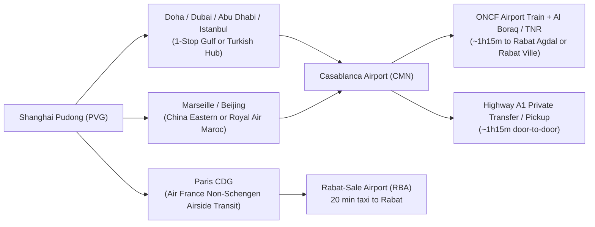
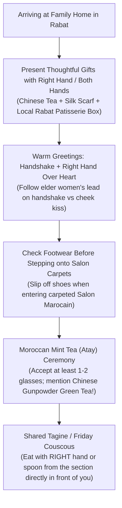

# Morocco & Rabat Special Playbook: Travel, Family Etiquette & Cross-Cultural Guide (摩洛哥与拉巴特深度指南)

A dedicated, insider-level handbook for a Chinese traveler and partner visiting **Rabat, Morocco (拉巴特)** and traveling across Morocco together. Most Chinese travel blogs focus exclusively on touristy Sahara/Marrakech loops and get Rabat completely wrong — this guide covers **border entry, legal/hotel nuances for couples, Rabat neighborhood life, camera/drone laws, family hospitality, gifts from China, and two-way China–Morocco logistics**.

---

## Table of Contents

1. [Why Rabat Is Unlike Anywhere Else in Morocco](#1-why-rabat-is-unlike-anywhere-else-in-morocco)
2. [Flights from Shanghai & Reaching Rabat Seamlessly](#2-flights-from-shanghai--reaching-rabat-seamlessly)
3. [Visa-Free Entry, Border Stamps & Critical Customs Rules](#3-visa-free-entry-border-stamps--critical-customs-rules)
4. [Crucial Couple & Accommodation Law (Article 490 / CIN Rule)](#4-crucial-couple--accommodation-law-article-490--cin-rule)
5. [Money, Cards, eSIM & Getting Around Rabat](#5-money-cards-esim--getting-around-rabat)
6. [Knowing Rabat Like a Local: Neighborhoods & Landmarks](#6-knowing-rabat-like-a-local-neighborhoods--landmarks)
7. [Meeting Her Family: Moroccan Etiquette, Darija/French & Gifts from China](#7-meeting-her-family-moroccan-etiquette-darijafrench--gifts-from-china)
8. [Filming Life in Rabat (iPhone / Osmo Pocket 3 vs Strict Drone Ban)](#8-filming-life-in-rabat-iphone--osmo-pocket-3-vs-strict-drone-ban)
9. [Reverse Direction: Helping Her Visit Shanghai & Document Basics](#9-reverse-direction-helping-her-visit-shanghai--document-basics)

---

## 1. Why Rabat Is Unlike Anywhere Else in Morocco

If your impression of Morocco comes from social media posts about chaotic medina touts in Marrakech or labyrinth alleys in Fez, **reset your expectations completely for Rabat**:

- **Political, Diplomatic & Intellectual Capital**: Rabat is the seat of the Moroccan monarchy, government ministries, foreign embassies (including the PRC Embassy), and top universities.
- **Clean, Calm & Safe**: Wide palm-lined boulevards, manicured parks, modern tramways, strict municipal policing, Atlantic Ocean breezes, and virtually **zero aggressive street hustlers**.
- **Cultural Blend**: Traditional Andalusian-Moorish heritage (*Kasbah des Oudayas*, *Hassan Tower*, *Chellah*) sits right beside French-influenced café culture in *Agdal* and Zaha Hadid's futuristic *Grand Théâtre de Rabat*.
- **Climate**: Mild Mediterranean-Atlantic climate. Summers (`22°C–28°C`) are far cooler than inland Marrakech (`40°C+`), while winters (`9°C–18°C`) feel damp and chilly indoors because most Moroccan homes lack central heating (bring a warm fleece/down layer for indoor evenings in Dec–Feb!).

---

## 2. Flights from Shanghai & Reaching Rabat Seamlessly

### 2.1 Best Flight Routes from Shanghai (`PVG`)

| Route Option | Airlines | Pros | Watch-Outs |
| :--- | :--- | :--- | :--- |
| **Gulf 1-Stop to Casablanca (`CMN`)** | Qatar (`DOH`), Emirates (`DXB`), Etihad (`AUH`) | Generous baggage (great for family gifts), reliable service, **zero transit visa hassle** | Lands in `CMN`, requiring a ~75–90 min ground transfer north to Rabat |
| **Shanghai → Marseille → Casablanca** | China Eastern / Shanghai Airlines (`FM`/`MU`) | Chinese crew, single aircraft technical stop in Marseille, familiar service | Check seasonal operating days |
| **Paris `CDG` 1-Stop Direct into `RBA`** | Air France (`AF`) | Lands directly at **Rabat-Salé Airport (`RBA`)**, 20 minutes from central Rabat | **Must** be a single through-ticket staying airside at `CDG` with **only one** Schengen stop; never book a `CDG` → `ORY` airport change or 2-stop Schengen route (e.g. `PVG-AMS-CDG-RBA`) without a Schengen visa |
| **Istanbul 1-Stop (`IST` → `CMN`)** | Turkish Airlines (`TK`) | Good schedules and Star Alliance miles | Verify terminal transfer buffer |

### 2.2 Getting from Casablanca Airport (`CMN`) to Rabat

Casablanca Mohammed V Airport (`CMN`) lies ~115 km south of Rabat. You have two effortless options:

1. **ONCF Train (`CMN` → `Casa-Voyageurs` → `Rabat Agdal` / `Rabat Ville`)**:
   - Walk downstairs in Terminal 1 to the **ONCF train station**.
   - Buy a **1st Class (`1ère classe`)** through-ticket to **`Rabat Agdal`** (modern south-central district) or **`Rabat Ville`** (historic downtown) at the kiosk or on `oncf-voyages.ma` (~100–160 MAD / RMB 70–115).
   - Take the airport train to `Casa-Voyageurs`, then step onto either **Al Boraq** (Africa's 320 km/h high-speed TGV) or the frequent **TNR** intercity shuttle.
2. **Highway `A1` Car Pickup / Pre-Booked Transfer**:
   - If your girlfriend or her family picks you up, or you pre-book a private driver (~600–800 MAD), the toll highway `A1` runs straight to Rabat in ~75 minutes.

---

## 3. Visa-Free Entry, Border Stamps & Critical Customs Rules

### 3.1 90-Day Visa-Free Entry for Chinese Passports

Holders of an ordinary PRC passport (`中华人民共和国普通护照`) enter Morocco **visa-free for up to 90 days**.

**Prepare a physical paper folder in your backpack before boarding** (Moroccan border and airline staff strongly prefer paper over phone screens):

- Passport valid for **at least 6 months** beyond exit date with >= 2 blank pages.
- **Printed return/onward flight itinerary** (in English or French).
- **Accommodation details**:
  - If staying at a hotel: printed booking confirmation.
  - If staying at her family's home: write down the **exact street address in Rabat, district, and local Moroccan phone number** (and ideally carry a signed `Attestation d'hébergement` + copy of the host's Moroccan `CIN` card just in case an officer asks).
- **Important Check-In Note on Departure from Morocco**: Moroccan airports (`CMN` and `RBA`) almost always require **every international passenger to line up at the physical check-in desk** even if you checked in online and have no checked bags — your paper boarding pass must receive a security/document verification stamp before border police let you through! Arrive **3 hours early** when flying home.

### 3.2 Guard Your Handwritten Border Entry Number (`Numéro d'entrée`)

When Moroccan border police stamp your passport on first arrival, they also stamp or hand-write a **6-to-8-digit police registration number** (e.g., `123456/26`) next to the entry stamp.

- Every hotel check-in card (`Fiche de police`) and exit control officer will look for this exact number.
- Take a clear photo of both your photo page and that entry stamp page immediately after clearing immigration.

### 3.3 Strict Customs Red Lines (Read Before Packing!)

| Item | Rule in Morocco | Consequence if Violated |
| :--- | :--- | :--- |
| **Flying Drones (ANY weight, including DJI Mini <249g)** | **STRICTLY PROHIBITED** without commercial Ministry of Interior import license | All luggage passes through X-ray **upon arrival** before exiting the airport; drones are confiscated immediately and trigger police questioning |
| **DJI Osmo Pocket 3 / iPhone / Mirrorless Cameras** | **100% Allowed** for personal use | Zero issue — ideal setup for Rabat (avoid tripod setups right in front of royal palaces, embassies, military, or police) |
| **Moroccan Dirham (`MAD`) Cash** | Closed currency; max **2,000 MAD** import/export | Exchange remaining MAD back to EUR/USD at the airport bank booth *before* passing security on departure (keep your original exchange/ATM slip!) |
| **Alcohol & Tobacco** | Personal duty-free allowance only (1 bottle spirits + 1 bottle wine) | Never bring alcohol as a family gift unless explicitly requested |

---

## 4. Crucial Couple & Accommodation Law (Article 490 / CIN Rule)

Every cross-national couple where one partner is a **Moroccan citizen** must understand this local legal reality in advance so you are never blindsided during domestic trips together (e.g., weekend trips to Tangier, Chefchaouen, Marrakech, or Essaouira):

- Under **Article 490 of the Moroccan Penal Code** and strict hotel police-registration laws, hotels, riads, and legally registered Airbnbs in Morocco **cannot check an unmarried Moroccan citizen (`CIN` holder) into the same room as a partner** (even if the partner holds a foreign passport) without presenting a **marriage certificate (`Acte de mariage`)**.
- **Foreign + Foreign couples** are exempted in practice at hotels, **because neither holds a Moroccan `CIN`**. When **one partner is Moroccan**, front desks are audited by local police and almost universally enforce this rule (including international 5-star chains).
- **How Couples Navigate This Smoothly & Respectfully**:
  1. Never argue with reception staff — their license and personal liability are on the line.
  2. When booking weekend trips around Morocco before marriage, **book two rooms** (or discuss openly with your girlfriend beforehand how she prefers to arrange stays).
  3. In Rabat itself, follow her lead regarding family expectations — in many warm, educated Rabati families, staying in a nearby hotel/apartment in Agdal or in a separate guest room while visiting daily is seen as deeply respectful and classy (`ولد الناس` / *weld nass* — "a well-raised gentleman from a good family").

---

## 5. Money, Cards, eSIM & Getting Around Rabat

### 5.1 Dirhams (`MAD`), ATMs & Cards

- **Quick Mental Math**: `10 MAD ≈ 7.2 RMB` (multiply MAD by `0.7` to feel the RMB price).
- **Cards**: Modern Rabat (`Agdal`, `Hay Riad`, `Hassan`, `ONCF`, `Marjane`, `Carrefour`, upscale cafés/restaurants) accepts **Visa & Mastercard** contactless smoothly. Always pay in **MAD**, never DCC!
- **Cash Is Still Essential**: Blue petit taxis, medina shops, neighborhood bakeries, parking attendants (`gardiens de voitures` — tip 2–5 MAD), and café tips (5–10 MAD coins) are cash-only.
- **Best ATMs (`Guichet Automatique`)**: **Bank of Africa (BMCE)**, **Attijariwafa Bank**, **Al Barid Bank** (Al Barid often charges 0 local ATM operator fee on foreign Visa/Mastercard withdrawals!). Break 200 MAD notes at supermarkets or cafés so you always carry **10, 20, and 50 MAD** bills for taxis.

### 5.2 Connectivity & Local Apps

- **SIM / eSIM**: Buy an **Airalo / Trip.com eSIM** so you have data the second the plane touches down to message your girlfriend on **WhatsApp** (Morocco's universal messaging app — everyone from family members to restaurants uses WhatsApp!). For longer stays (>1 week), pick up a **Maroc Telecom (`IAM`)** or **Orange Maroc** SIM/eSIM (~100–200 MAD for 20–50 GB).
- **Transport Apps in Rabat** (*Uber does not exist in Morocco!*):
  - **Rabat Blue Petit Taxis**: Clean, safe, plentiful. Just hail on the street and confirm the meter (`compteur`) is running — minimum fare is ~7–8 MAD, most cross-city rides in Rabat cost **12–30 MAD (RMB 9–22)**! Note: maximum **3 passengers** per petit taxi; a **50% night tariff** after 8/9 PM is official law.
  - **Ride-Hailing Apps**: **Careem**, **InDrive**, **Yassir**, **Heetch** (handy late at night or with luggage; Grand Taxis / app cars carry 4+ passengers and go between Rabat, Salé, Temara, and airports).
  - **Rabat-Salé Tramway**: Modern, spotless light rail connecting Agdal, Avenue Mohammed V, Hassan, Bou Regreg bridge, and Salé (~6–7 MAD per ticket bought at platform machines).
  - **ONCF Voyages App / Website**: High-speed `Al Boraq` train from `Rabat Agdal` reaches **Casablanca in ~45 min** and **Tangier (`Tanger`) in ~1 hr 20 min**!

---

## 6. Knowing Rabat Like a Local: Neighborhoods & Landmarks

Understanding Rabat's geography immediately shows your girlfriend and her family that you genuinely care about her hometown:

| Area / Landmark | Vibe & Why It Matters | Great Date / Family Walk Ideas |
| :--- | :--- | :--- |
| **Kasbah of the Oudayas (`قصبة الأوداية`)** | Iconic 12th-century cliffside fortress painted white & blue over the Atlantic and Bou Regreg river | Stroll narrow blue lanes → Andalusian Gardens → mint tea & almond gazelle-horn pastries overlooking the river at *Café Maure* |
| **Agdal (`أكدال`)** | Youthful, cosmopolitan heart along *Avenue Fal Ould Oumeir*; specialty coffee, French/Syrian/Moroccan dining, Arribat Center | Specialty coffee, shopping, relaxed evening walks, TGV train hub (`Gare Rabat Agdal`) |
| **Hassan (`حسان`) & Downtown (`Centre-Ville`)** | Monumental *Hassan Tower* (`Tour Hassan`), *Mausoleum of Mohammed V*, palm-lined *Avenue Mohammed V*, Modern Art Museum (`MMVI`) | Cultural afternoon + quiet stroll along historic Art Deco arcades |
| **Chellah (`شالة`)** | Ancient Roman (*Sala Colonia*) & medieval Marinid walled garden ruins filled with nesting storks and fig trees | Peaceful golden-hour photography walk away from crowds |
| **Hay Riad (`حي الرياض`) & Souissi** | Leafy upscale residential villas, embassies, *Mahaj Riad* pedestrian dining plaza | Upscale dinner dates, patisseries, calm residential cafés |
| **Corniche de Rabat & Bouregreg Marina** | Dramatic rocky Atlantic coastline, lighthouse (`Phare de Rabat`), Zaha Hadid's *Grand Théâtre* | Ocean sunset walk and fresh grilled seafood |
| **Rabat Medina & Rue des Consuls** | Authentic, wide, relaxed souk streets where locals actually shop (unlike tourist traps elsewhere) | Buying genuine handmade babouches, leather goods, ceramics, and spices |

---

## 7. Meeting Her Family: Moroccan Etiquette, Darija/French & Gifts from China

Moroccan hospitality (*Karam*) is legendary — warm, expressive, generous, and deeply family-oriented. Small gestures of cultural awareness leave an unforgettable impression.

### 7.1 Essential Darija (Moroccan Arabic) & French Phrases

Moroccans in Rabat switch fluidly between **Darija** (Moroccan Arabic, quite distinct from Gulf Arabic!) and **French**. Dropping even 5 Darija expressions brings instant smiles:

| Situation | Darija (Pronunciation) | French Equivalent | Meaning |
| :--- | :--- | :--- | :--- |
| **Warm Greeting** | *Salam Alaikum* (`萨拉姆·阿莱库姆`) | *Bonjour / Bonsoir* | Peace be upon you (reply: *Wa Alaikum Salam*) |
| **How are you?** | *Labas? Bikhir?* (`拉巴斯？比嘿尔？`) | *Ça va bien ?* | Everything good? All well? (reply: *Labas, hamdullah!*) |
| **Thank you very much** | *Choukran bezaf* (`舒克兰·贝扎夫`) | *Merci beaucoup* | Thank you so much |
| **Enjoy your meal / tea / new item** | *Bsahtek* / *Bsaha* (`布萨哈特克 / 布萨哈`) | *Bon appétit / Santé* | To your health! (reply: *Allah yaatik saha*) |
| **Praise food / home / beauty** | *Tbarkallah!* (`特巴尔卡拉`) | *Magnifique !* | Blessings of God! (huge compliment to a host's cooking!) |
| **Delicious!** | *Bnin bezaf!* (`布宁·贝扎夫`) | *C'est délicieux !* | Super delicious! |
| **Goodbye** | *Bslama* (`布斯拉玛`) | *Au revoir* | Go in peace |

### 7.2 Table & Home Etiquette in a Rabati Household

1. **The Chinese Green Tea Connection (Instant Icebreaker!)**:
   - Moroccan national mint tea (**Atay**) is brewed using **Chinese Gunpowder Green Tea (`珠茶` / `Chunmee 眉茶`)** imported from Zhejiang and Anhui! Mentioning this shared history and bringing top-tier Chinese loose-leaf green tea delights Moroccan parents and grandparents every single time.
2. **Right-Hand Rule**:
   - Always shake hands, pass gifts, tear Moroccan round bread (*khobz*), and scoop from a shared *Tagine* or *Couscous* platter using your **right hand** (the left hand is traditionally associated with bathroom hygiene).
   - Eat from the **triangular wedge directly in front of you** on the shared platter rather than reaching across the center; the host will happily push the best tender meat pieces toward your side!
3. **Pacing Yourself at Meals**:
   - Saying *"Koul! Koul!"* ("Eat! Eat!") is how Moroccan mothers show love. Pace yourself during starters/salads because a massive main Tagine/Pastilla/Couscous and fresh fruit platter are still coming! Complimenting the cooking with *"Tbarkallah, c'est trop bon / bnin bezaf!"* means the world.
4. **Opposite-Gender Greeting**:
   - With men: warm handshake, often touching your right palm to your chest/heart afterward.
   - With older/observant female relatives: smile warmly, place your right hand over your heart, and wait a half-second — if she extends her hand or leans for cheek air-kisses, reciprocate; if she nods with hand on heart, mirror it gracefully.

### 7.3 Best Gifts to Bring from Shanghai / China (and What to Avoid)

- **10/10 Hits**:
  - **High-Grade Chinese Green Tea** (*West Lake Longjing 西湖龙井*, *Anji Bai Cha 安吉白茶*, *Jasmine Pearl 茉莉龙珠*, or premium *Zhejiang Gunpowder 珠茶*) in an elegant tin — 100% Halal, deeply appreciated.
  - **100% Mulberry Silk Scarf / Shawl (`桑蚕丝丝巾`)** from Hangzhou/Suzhou for her mother, sisters, or grandmother.
  - **Jingdezhen Porcelain Tea Cups** or refined Chinese handicraft (wooden comb, embroidery bookmark, calligraphy fan).
  - **Smart Tech Accessories** (compact GaN travel charger, high-end power bank, earbuds) for brothers/younger cousins.
  - **Day-of Visit Add-On in Rabat**: Stop by a top *pâtisserie* in Agdal or Hay Riad with your girlfriend to pick up a fresh box of Moroccan almond pastries (*cornes de gazelle*) or French gateaux (`1–2 kg` assortments are customary when visiting a home!).
- **Strictly Avoid**:
  - Anything containing **pork, lard (`猪油` — check Chinese flaky pastries like 鲜肉月饼/老婆饼/桃酥 ingredient labels carefully!), pork gelatin, or alcohol/liquor chocolates**.
  - Knives/scissors or overly personal clothing sizes.

---

## 8. Filming Life in Rabat (iPhone / Osmo Pocket 3 vs Strict Drone Ban)

Rabat is extraordinarily photogenic — warm ochre walls, whitewashed medina lanes, cobalt-blue doors in the Oudayas, golden Atlantic light, and storks silhouetted at sunset.

- **Best Gear**: **iPhone Pro + DJI Osmo Pocket 3** (leave ANY flying drone in Shanghai!).
- **Street Filming Etiquette in Morocco**:
  - Architecture, ocean waves, food close-ups, and framing yourself/your girlfriend are completely welcome.
  - **Ask before pointing a camera directly at local faces**, especially women, shopkeepers, artisans, or elders (*"Excusez-moi, je peux prendre une photo ?"*). Many artisans are happy if you buy something small; if someone waves *"La"* (No), lower the camera immediately with a smile.
  - **Zero-Tolerance No-Photo Zones**: Never point a camera toward **police officers, Royal Gendarmerie checkpoints, military buildings, embassies, or the Royal Palace (`Dar al-Makhzen`) gates and guards** — officers will walk over and make you delete the clip on the spot.

---

## 9. Reverse Direction: Helping Her Visit Shanghai & Document Basics

When your girlfriend visits you in Shanghai (or her family visits China):

1. **Chinese Visa Application in Rabat**:
   - Because she is from **Rabat**, the **PRC Embassy and Chinese Visa Application Service Center (`CVASC Rabat`)** are right in her home city — no intercity travel needed!
   - For a private/partner visit or tourism (`L` visa), you can provide a clean **Invitation Letter** (stating your ID, Shanghai address, dates, and relationship/itinerary) + copy of the front/back of your PRC Resident ID card (`身份证`), or standard confirmed flight + hotel bookings.
2. **24-Hour Accommodation Registration in Shanghai (`境外人员临时住宿登记`)**:
   - If she stays at a licensed hotel, the front desk registers automatically.
   - If she stays at **your apartment in Shanghai**, PRC law requires registering her passport within **24 hours of arrival** — in Shanghai this takes **3 minutes online** via the official **Shanghai Public Security Bureau Self-Service Portal (`gaj.sh.gov.cn` / WeChat mini-program `上海公安出入境管理` → 境外人员住宿登记)** without even visiting the local `派出所` in person! Keep the digital receipt PDF on her phone.
3. **Setting Up Her Phone in Shanghai**:
   - Help her bind her **foreign Visa/Mastercard directly inside Alipay (`支付宝`) and WeChat Pay (`微信支付`)** (passport verification works seamlessly for foreigners in China now; single transactions under RMB 200 waive the 3% international card fee!).
   - Load **Apple Maps** (works in English/French inside China with accurate subway routing, unlike Google Maps!) + **Didi English interface** inside Alipay + roaming/Hong Kong eSIM so her WhatsApp stays connected to family in Rabat.
4. **Long-Term Legal Tip — Both Countries Are Hague Apostille Members (`海牙认证`)**:
   - Both **Morocco** (since 2016) and **China** (since Nov 2023) are contracting parties to the **1961 Hague Apostille Convention**. Whenever official civil documents (birth certificates, single-status certificates, background checks) are needed in the future, a single **Apostille stamp (`附加证明书`)** replaces the slow, multi-month dual consular legalization process!

---

## Related Guides in This Folder

- [00-README.md](00-README.md) — Complete Going Abroad Timeline & Checklist
- [01-PASSPORT-VISAS-AND-BORDER-CONTROL.md](01-PASSPORT-VISAS-AND-BORDER-CONTROL.md) — Passports, Visas & Immigration
- [02-OVERSEAS-PAYMENTS-CARDS-AND-FX.md](02-OVERSEAS-PAYMENTS-CARDS-AND-FX.md) — Cards, Apple Pay, Cash & Zero-FX Tricks
- [03-CONNECTIVITY-APPS-TRANSPORT-AND-DRIVING.md](03-CONNECTIVITY-APPS-TRANSPORT-AND-DRIVING.md) — eSIM, Overseas App Stack & Driving Laws
- [04-SAFETY-MEDICINES-CULTURE-AND-EMERGENCIES.md](04-SAFETY-MEDICINES-CULTURE-AND-EMERGENCIES.md) — Restricted Medicines, Safety & Consular Emergencies
