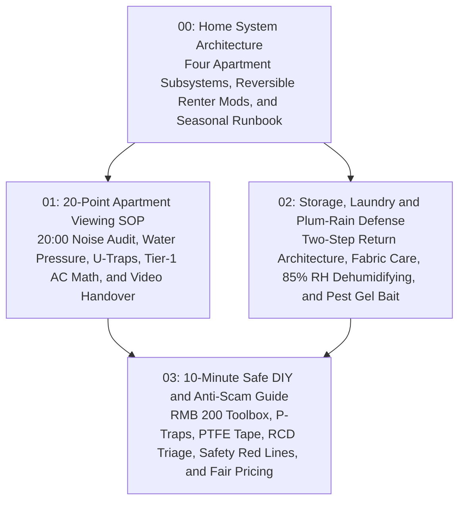
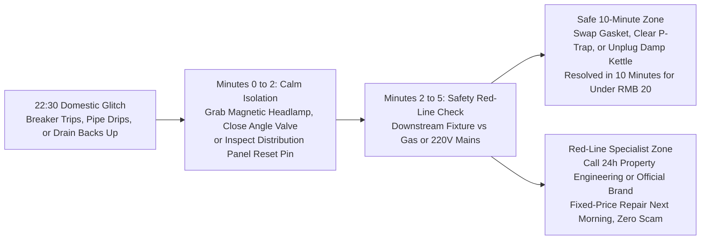

# Reliable Adult Home Craft: Treating Your Apartment Like a Clean, Well-Maintained System (现代成人居家运维学：把住所当成高可靠系统来养护)

At work, a skilled engineer monitors latency percentiles, automates log rotation, isolates fault domains, and runs preventive runbooks before traffic peaks. Yet many of those same engineers walk through their apartment door at `21:00` into an environment running in permanent degraded mode: a dried bathroom floor drain quietly venting sewer hydrogen sulfide into the bedroom, a landlord's aging Tier-5 fixed-speed air conditioner burning `RMB 600` of summer electricity a month, a mountain of unopened delivery boxes blocking the entryway, musty towels souring in Shanghai's June humidity, and zero idea which valve shuts off water when an under-sink hose bursts at midnight.

Living well as an independent adult — whether solo (`高质量独居`) or sharing a home with your partner (`伴侣同居`) — has nothing to do with obsessive perfectionism or luxury interior design. It is **Residential Site Reliability Engineering (`居家系统可靠性工程`)**. An urban apartment is a compact physical machine composed of **four coupled subsystems**: building envelope, plumbing and odor seals, electrical/HVAC/network infrastructure, and spatial/microclimate storage. Mastering twenty hours of foundational knowledge and `RMB 600` of reversible hardware eliminates **over 90% of solo and couple domestic emergencies**, protects your respiratory health and security deposit, and turns coming home into an instant physiological exhale.

---

## Curriculum Architecture & Learning Path

### Clickable Table of Contents & Module Directory

| Module | File | Core Home-Craft Domain | Concrete Real-World Deliverable |
| :--- | :--- | :--- | :--- |
| **00** | [00-README.md](00-README.md) | **System Philosophy & Seasonal SRE**: The 4 apartment subsystems, domestic friction vs. couple harmony, reversible renter upgrades, seasonal calendar, and Day-1 shutoffs | Locate all **4 master shutoff valves/breakers** in 5 minutes and deploy a **RMB 600 reversible comfort upgrade kit** |
| **01** | [01-TWENTY-POINT-APARTMENT-HUNTING-CHECKLIST.md](01-TWENTY-POINT-APARTMENT-HUNTING-CHECKLIST.md) | **Apartment Viewing & Lease Inspection SOP**: `20:00` acoustic stress test, shower pressure + heater lag, floor-drain `反味` & flue `止逆阀`, Tier-1 vs. Tier-5 AC kWh math, west-sun `西晒`, and move-in video evidence | Filter out noisy, smelly, power-guzzling apartments before signing and lock down **100% security deposit return** with a timestamped handover video |
| **02** | [02-DECLUTTERING-STORAGE-AND-SHANGHAI-PLUM-RAIN.md](02-DECLUTTERING-STORAGE-AND-SHANGHAI-PLUM-RAIN.md) | **Zero-Clutter Storage, Laundry & Plum-Rain Survival**: Two-step return drop zones, wool/heavyweight-cotton/denim wash matrix, defeating `85% RH 黄梅天` mold, pre-summer AC coil wash, and `呋虫胺` pest defense | Build a clutter-proof entryway, keep clothes crisp for years, hold indoor humidity at **`45%–55%`**, and run a **zero-cockroach, zero-mold** home |
| **03** | [03-TEN-MINUTE-SAFE-DIY-FIXES-AND-REPAIR-ANTI-SCAM.md](03-TEN-MINUTE-SAFE-DIY-FIXES-AND-REPAIR-ANTI-SCAM.md) | **10-Minute Safe DIY, Toolbox & Repair Anti-Scam**: `RMB 200` 10-year toolbox, clearing hair clogs & P-traps, PTFE `生料带` hose/aerator swaps, `MCB` vs. `RCD` breaker triage, wired-backhaul Mesh, 5 hard red lines, and defeating `RMB 800` repair scams | Solve 80% of minor plumbing/network/breaker glitches safely in 10 minutes and **never get extorted** by search-ad plumbers or locksmiths |

### In This Document (`00-README.md`)

1. [The Four Subsystems of an Apartment: Why 90% of Home Emergencies Are Upstream Bugs](#1-the-four-subsystems-of-an-apartment-why-90-of-home-emergencies-are-upstream-bugs)
2. [Home Friction vs. Relationship Harmony: Why Domestic Competence Is Quiet Romance](#2-home-friction-vs-relationship-harmony-why-domestic-competence-is-quiet-romance)
3. [The Renter's Upgrade Philosophy: High-ROI Reversible Micro-Mods](#3-the-renters-upgrade-philosophy-high-roi-reversible-micro-mods)
4. [The Four-Season Shanghai & Tier-1 Home Maintenance Calendar](#4-the-four-season-shanghai-tier-1-home-maintenance-calendar)
5. [Emergency Shutoff Orientation: The First 5 Minutes in Any New Home](#5-emergency-shutoff-orientation-the-first-5-minutes-in-any-new-home)

---

## 1. The Four Subsystems of an Apartment: Why 90% of Home Emergencies Are Upstream Bugs

Most people treat domestic breakdowns as random acts of bad luck — *"Why does my bathroom smell like a sewer whenever it rains?"*, *"Why did tiny roaches suddenly appear in a clean kitchen?"*, *"Why did the power trip when the kettle and dryer ran together?"*

In reality, every urban apartment operates on deterministic physics. Expected annual domestic disruption ($D_{\text{annual}}$, measured in lost sleep hours, unexpected repair bills, and partner arguments) splits cleanly into **apartment selection error** at lease signing plus **preventive maintenance deficit** across the seasons:

$$D_{\text{annual}} = E_{\text{selection}} + \sum_{k=1}^{4} \lambda_k \cdot (1 - M_k) \cdot C_k$$

where $E_{\text{selection}}$ is structural misery locked in on lease day (elevated-highway low-frequency noise, pure west-sun baking, hollow drywall partitions), $\lambda_k$ is the natural failure rate of subsystem $k$, $M_k \in [0, 1]$ is your preventive maintenance coverage, and $C_k$ is the unmitigated emergency cost when you panic-search a repairman at `22:30`.

### The Four-Subsystem Apartment Reliability Matrix

| Subsystem | Hidden Failure Mode (`常见隐蔽故障`) | Unmanaged Consequence | Upstream Engineering Fix (Module Link) |
| :--- | :--- | :--- | :--- |
| **1. Acoustic, Thermal & Envelope (`围护隔音与热工系统`)** | Single-pane sliding aluminum windows (`老式单层推拉窗`), pure west-sun (`西晒`), cracked exterior window sealant | Chronic `> 48 dBA` nighttime road noise fragmenting deep sleep; `36°C` evening walls; rainy-season wall peeling | Screen for broken-bridge double glazing (`断桥铝双层中空`) and `20:00` peak noise before signing; apply EPDM door seals ([01-TWENTY-POINT-APARTMENT-HUNTING-CHECKLIST.md](01-TWENTY-POINT-APARTMENT-HUNTING-CHECKLIST.md)) |
| **2. Plumbing, Water Seals & Flues (`给排水、水封与公共烟道`)** | Missing `50 mm` U-trap floor drain (`无水封直通地漏`), unsealed vanity drain pipe, stuck kitchen flue valve (`烟道止逆阀失效`), hair-clogged P-trap | Sewer gas (`H2S` + drain flies) and downstairs cooking fumes flooding rooms; ankle-deep shower puddles; `RMB 600` plumber rip-off | Install `RMB 25` silicone magnetic T-core drain inserts + vanity sewer plug; clean hair traps monthly ([01-TWENTY-POINT-APARTMENT-HUNTING-CHECKLIST.md](01-TWENTY-POINT-APARTMENT-HUNTING-CHECKLIST.md); [03-TEN-MINUTE-SAFE-DIY-FIXES-AND-REPAIR-ANTI-SCAM.md](03-TEN-MINUTE-SAFE-DIY-FIXES-AND-REPAIR-ANTI-SCAM.md)) |
| **3. Electrical, HVAC & Network (`强弱电、暖通与全屋网络`)** | Tier-5 fixed-speed AC (`五级定频电老虎`), dirty AC evaporator fins, damp appliance triggering `30 mA RCD` trip, router trapped inside metal shoe box | Extra `RMB 500–1,000/summer` electricity; musty *Legionella* AC blast; bedroom video calls dropping packets; dark panic during breaker trips | Verify Tier-1 inverter AC (`一级能效变频`); foam-wash evaporator every May; deploy wired-backhaul Mesh; learn 3-minute `RCD` isolation ([02-DECLUTTERING-STORAGE-AND-SHANGHAI-PLUM-RAIN.md](02-DECLUTTERING-STORAGE-AND-SHANGHAI-PLUM-RAIN.md); [03-TEN-MINUTE-SAFE-DIY-FIXES-AND-REPAIR-ANTI-SCAM.md](03-TEN-MINUTE-SAFE-DIY-FIXES-AND-REPAIR-ANTI-SCAM.md)) |
| **4. Spatial Flow, Textiles & Microclimate (`收纳动线、洗护与微气候`)** | High-friction lidded storage, delivery cardboard hoarded indoors, `85% RH 黄梅天` open windows, alkaline enzymes on wool | Sofa buried under clothes (`次净衣椅`); shrunken sweaters; moldy leather & sour towels; German cockroach colony hatching from cardboard | Entryway 2-step drop zone; 4-load mesh-bag wash protocol; `20L/day` compressor dehumidifier + `0.5%` dinotefuran gel bait ([02-DECLUTTERING-STORAGE-AND-SHANGHAI-PLUM-RAIN.md](02-DECLUTTERING-STORAGE-AND-SHANGHAI-PLUM-RAIN.md)) |

### Worked 1-Year Comparison: Unmanaged vs. Engineered Shanghai Apartment

Consider two 30-year-old engineers renting identical `RMB 7,500/month` 1-bedroom apartments in Xuhui or Pudong (`58 m^2`):

- **Tenant A (Reactive "Just a Rental" Mode)**:
  - Signs a sunny Saturday lease without a `20:00` noise check or AC label inspection (`Tier-5` old fixed-speed AC + west-facing bedroom).
  - Over summer + winter (`1,400 AC hours`), burns an extra `900 kWh` (`RMB 600+`); ruins two `RMB 1,200` merino sweaters and three heavyweight tees in high-spin enzyme washes (`RMB 3,000` wardrobe loss); gets hit with a June `黄梅天` mold bloom on leather shoes and camera lenses; calls a search-engine sponsored plumber for a slow shower drain and gets billed `RMB 680` for two bottles of unnamed acid; forfeits `RMB 1,500` of security deposit at move-out over pre-existing floor scratches never filmed on Day 1.
  - **1-Year Net Penalty**: **`RMB 5,780+` in direct cash waste** plus `300+ nights` of sewer odor, `46 dBA` traffic rumble, and cluttered visual fatigue.
- **Tenant B (Home-SRE Mode)**:
  - Rejects two flawed listings in 15 minutes using [01-TWENTY-POINT-APARTMENT-HUNTING-CHECKLIST.md](01-TWENTY-POINT-APARTMENT-HUNTING-CHECKLIST.md), securing a south-facing `Tier-1` inverter AC unit with double-glazed windows (`34 dBA` quiet bedroom).
  - Spends `RMB 600` on Day-1 reversible upgrades + `RMB 200` on a 10-year toolbox; runs a `20L/day` dehumidifier during June rain; clears hair traps in 5 minutes for `RMB 3`; recovers `100%` of the `RMB 7,500` deposit using the timestamped move-in video.
  - **1-Year Net Payoff**: Saves **`RMB 5,000+` net**, zero pest sightings, hotel-crisp bedding, and restorative deep sleep every weeknight.

---

## 2. Home Friction vs. Relationship Harmony: Why Domestic Competence Is Quiet Romance

Ask long-term couples in Shanghai, Shenzhen, or Beijing what actually triggered their sharpest weeknight arguments, and the answer is almost never macro-philosophy. It is **cumulative micro-friction inside 65 square meters (`高密度居住空间里的琐碎内耗`)**:

- Stepping barefoot onto a cold, hair-clogged shower puddle after an 11-hour workday.
- Opening the wardrobe in July to discover `RMB 3,000` wool coats spotted with white mildew because nobody turned on the dehumidifier.
- Having the main breaker snap off in pitch darkness while cooking dinner, followed by two tired adults snapping *"What did you plug in?!"* instead of calmly isolating the faulty kettle in 90 seconds.
- Watching a cockroach dart across the cutting board at `23:00` and panicking with toxic aerosol sprays.

Being the partner — or the self-reliant solo adult — who quietly understands how pipes, breakers, humidity, fabrics, and storage ergonomics work is one of the deepest, least performative forms of **adult attractiveness and emotional safety (`接地气的靠谱感与生活托底力`)**. You never weaponize competence to nag or keep score (`绝不用家务标准爹味指责伴侣`); instead, you **design friction out of the room** so the environment stays clean by default, and when something breaks, your calm voice lowers the room's heart rate immediately.

### Couple Home-Operations SLA: Zero-Nagging Shared Ownership (`伴侣同居无内耗分工协议`)

When two busy professionals move in together, ambiguous "`50/50` splitting" (`谁看见谁做`) almost always degenerates into resentment because the partner with the lower mess threshold ends up doing `80%` of invisible cognitive tracking. Borrow **clear service-ownership boundaries** from engineering teams instead:

1. **Assign End-to-End Subsystem Owners, Not Ad-Hoc Tasks (`按模块包干到人，不搞临时指派`)**:
   - *Example Split*: Partner A owns **Plumbing/Electrical/Network/Trash/Heavy Deliveries + Seasonal AC & Pest Runbooks**; Partner B owns **Laundry Sorting/Bedding Cadence/Kitchen Pantry Restock + Robot-Vacuum Scheduling**.
   - **The Non-Interference Rule (`接手即信任，不挑刺执行细节`)**: Once a partner owns a domain, you do not micromanage *how* they fold a towel so long as the shared quality bar (dry, clean, put away) is met.
2. **The 10-Minute `22:00` Nightly Reset (`睡前十分钟双人归零仪式`)**:
   - Put on one 3-song playlist after dinner cleanup: clear dining table to zero items, wipe kitchen induction/gas stove + sink strainer, hang worn-once jackets onto entryway hooks, squeegee shower glass, and check robot-vacuum floor clearance. Waking up at `07:30` to a spotless kitchen changes the emotional tone of the entire workday.
3. **Three Verbatim High-EQ Domestic Scripts (`高情商居家应急定心话术`)**:
   - *When a breaker trips or pipe leaks*: **"别慌，人别碰湿插座，我去把总阀/分路关掉，五分钟就能查清楚。"** *(Don't worry — step clear of wet outlets; I'll shut the branch off and isolate it in five minutes.)*
   - *When a favorite garment shrinks or dish breaks*: **"没事儿，手没划破吧？衣服/盘子本来就是消耗品，咱们下次换护洗袋洗就行。"** *(Are your hands okay? Dishes and shirts are consumables — next time we'll toss it in a mesh bag.)*
   - *When proposing a storage tweak*: **"我发现门口快递老堆着是因为没顺手放美工刀，我在门后贴个磁吸刀架试试，看咱俩是不是更省事？"** *(Blame the **workflow geometry**, never your partner's character!)*

---

## 3. The Renter's Upgrade Philosophy: High-ROI Reversible Micro-Mods

One of the most expensive psychological traps among young professionals in Tier-1 cities is the **"Temporary Renter Mentality (`房子是租来的，凑合过吧`)"**. Because you do not own the property deed, you tolerate a calcified showerhead spraying needle jets sideways, harsh `6500K` hospital-white ceiling tubes that wreck melatonin at night, and rattling door gaps that leak corridor footsteps.

Do the actual time-allocation math: you spend **`3,000 to 3,600 hours every single year`** inside your apartment — roughly `40%` of your lived youth. Refusing to spend `RMB 600` (`0.6%` of annual rent on a `RMB 8,000/month` Shanghai 1-bedroom) to upgrade the exact physical interfaces touching your skin, eyes, and lungs every day is irrational austerity.

### The RMB 600 Reversible Move-In Upgrade Kit (`退租可带走/无损复原微改造清单`)

Keep the landlord's worn original parts in one labeled shoebox on the top closet shelf; install yours on Day 1 in 40 minutes, and swap the originals back in 15 minutes when moving out:

| Touchpoint | Landlord Default Pain Point | Reversible Upgrade Spec & Cost | Daily Quality-of-Life Payoff |
| :--- | :--- | :--- | :--- |
| **1. Showerhead & Braided Hose (`增压手持花洒 + 304防爆软管`)** | Calcified nozzles + slimy black inner rubber hose from 5 prior tenants | Branded micro-nozzle pressurized handheld showerhead (`九牧/箭牌/汉斯格雅入门款`) + new `1.5 m` PVC/304 anti-twist hose + fresh `4分` silicone washers (**RMB 90–160**) | Clean, dense hotel-grade shower flow; zero prior-tenant biofilm touching your skin |
| **2. Floor-Drain & Basin Odor Seals (`防臭地漏芯 + 洗手台下水防臭塞`)** | Hollow metal grate venting sewer stench and drain flies 24/7 | Universal **silicone/brass magnetic T-type self-closing drain core (`磁吸防臭地漏内芯`, measure hole `32–45 mm`)** + silicone sewer-pipe sealing ring under vanity (**RMB 35–50**) | Eliminates `95%` of bathroom sewer `反味` and cockroach drain entry in 3 minutes without breaking tile |
| **3. Circadian Warm Lighting (`高显色护眼暖光照明`)** | Single glaring `6500K Ra 70` cold ceiling panel making rooms look like a convenience store | `Ra >= 95` flicker-free `3000K` warm floor lamp + magnetic rechargeable `4000K` mirror/cabinet light bars (`充电感应酷毙灯`, **RMB 150–220**) | Switch off overhead glare after `21:30`; instant boutique warmth and effortless `23:30` sleep onset |
| **4. Door & Window Acoustic/Draft Seal (`EPDM门缝隔音密封条 + 门底挡风条`)** | `8 mm` hallway door gaps leaking elevator dings, hallway light, and neighbor cooking smells | Self-adhesive **D-type EPDM cellular rubber weatherstripping (`三元乙丙发泡密封条`)** on door frame + slide-on silicone bottom door sweep (**RMB 45**) | Cuts corridor high-frequency speech/footstep bleed by `5–8 dBA`, blocks roaches, and retains AC cooling |
| **5. Digital Hygrometer-Thermometers (`高精度电子温湿度计 x 2`)** | Guessing whether rooms feel stuffy from heat or `82% RH` moisture | Two e-ink Bluetooth hygrometers (`小米电子温湿度计 Pro`, bedroom + bathroom/closet, **RMB 90**) | Objective trigger for dehumidifier/AC (`target 45%–55% RH`) before mold spores ever germinate |
| **6. Faucet Swivel Aerator (`万向双模防溅水龙头起泡器`)** | Short bathroom faucet splashing water all over vanity countertop | Solid brass universal dual-spray `720°` swivel aerator with adapter ring (**RMB 35**) | Rinse sink corners and gargle cleanly without soaking sleeves or counter edges |

### Healthy Indoor Environmental Telemetry Targets (`健康住宅五项量化指标`)

Stop relying on subjective discomfort; keep your living and sleeping quarters inside these evidence-based physiological ranges:

| Metric | Target Range | Danger Zone & Symptom | Low-Cost Control Mechanism |
| :--- | :--- | :--- | :--- |
| **1. Relative Humidity (`室内相对湿度 RH`)** | **`45% – 55%`** | `> 68%`: *Aspergillus* mold & dust mites explode; `< 35%`: dry nasal mucosa & static shocks | Compressor dehumidifier (`黄梅天`); evaporative mist-free humidifier (`北方/冬季空调房无雾加湿器`, never ultrasonic tap-water white dust!) |
| **2. Bedroom Night Noise (`夜间睡眠底噪`)** | **`< 35 dBA`** (`max peak < 45 dBA`) | `> 45 dBA` traffic/footstep spikes fragment REM and slow-wave sleep without full awakening | Broken-bridge double glazing + EPDM door seals + `35 dB SNR` soft foam earplugs (`安耳悠`) as backup |
| **3. Evening Light Spectrum (`21:30后室内色温`)** | **`2700K – 3000K`**, `< 50 lux` eye-level | `6000K+` overhead LEDs suppress pineal melatonin secretion by `50%+` for 2 hours | Switch off ceiling main light at `21:30`; run low-positioned `2700K Ra>=95` floor/desk lamps |
| **4. Bedroom `CO2` Ventilation (`夜间睡眠二氧化碳`)** | **`< 1000 ppm`** (`ideal < 800 ppm`) | Closed small bedroom with 2 sleepers hits `2,200+ ppm CO2` by `04:00 AM`, causing morning brain fog | Crack bedroom door `5 cm` to living-room air volume during AC nights or run ERV fresh-air fan (`新风系统`) |
| **5. Particulate & TVOC Purity (`PM2.5 与甲醛洁净度`)** | **`PM2.5 < 15 ug/m^3`**; **`HCHO < 0.06 mg/m^3`** | Winter haze spikes vascular inflammation; cheap particleboard glues off-gas chronic airway irritants | Run quiet `HEPA H13` + activated-carbon purifier (`CADR >= 300 m^3/h`) and reject newly flipped `串串房` |

### Drinking & Bathing Water Architecture for Renters (`租房饮水与用水方案选型`)

Municipal water plants in Shanghai and Tier-1 cities meet national standards leaving the plant, but **secondary rooftop/basement storage tanks (`老小区二次供水箱`) and aging building risers** introduce rust sediment, residual chlorine odor (`余氯漂白粉味`), and calcium carbonate hardness (`水垢`):

- **Stop Hauling `5L` Plastic Water Jugs Every Week**: Two adults drinking and cooking consume `4–5 L/day` (`approx. RMB 1,800–2,400/year` in bottled water plus heavy elevator hauling and microplastic waste).
- **Best Renter Solution #1 — Countertop Instant-Hot RO Dispenser (`台式免安装RO反渗透净饮机`, RMB 900–1,400)**:
  - Zero plumbing modifications (move-out portable!), filters down to `0.0001 microns` (`TDS` drops from `180–260 ppm` to `< 15 ppm` — zero kettle limescale, crisp tea/pour-over coffee), and dispenses `45°C / 85°C / 98°C` water in 3 seconds.
  - **Hygiene Rule**: Dump the raw-water tank residue completely before every refill (`每次换水先倒空原水箱浓缩废水，绝不直接往旧水里续新水`) and wash the tank weekly so biofilm never grows.
- **Best Long-Term Lease Solution #2 — Under-Sink Tankless RO (`厨下无桶大通量RO净水器 800G–1000G`, RMB 1,200–1,800)**:
  - Requires only one standard sink soap-dispenser hole (`利用水槽皂液器孔无损安装`, fully reversible at move-out!) and access to an under-sink `220V` outlet. Never buy old-style bladder-tank RO units (`带压力储水桶老款易滋生细菌`) or `0.01 micron` ultrafiltration (`超滤机无法去除重金属离子与水垢`).
- **Shower De-Chlorination Filter (`花洒除余氯滤芯`, RMB 45–80)**:
  - Calcium sulfite (`亚硫酸钙`) inline cartridge screwed between the shower mixer valve and hose removes `90%+` of free chlorine in hot water, noticeably reducing winter dry skin itch and color-treated hair dryness (replace cartridge every `3–4 months`).

---

## 4. The Four-Season Shanghai & Tier-1 Home Maintenance Calendar

Preventive home care takes **less than 45 minutes per quarter** when tied to seasonal weather transitions rather than waiting for mold blooms or summer heatwaves (when AC cleaners and repairmen have 7-day queues and surge pricing):

| Season & Window | Environmental Stress in East/South China | 45-Minute Preventive SRE Runbook |
| :--- | :--- | :--- |
| **Spring (`4月下旬 – 5月中旬`, Pre-Summer & Pre-Meiyu)** | Rising temperatures (`24°C+`), overwintering cockroach oothecae hatching, AC about to run continuously | **(1)** Foam-clean split-AC filters and aluminum evaporator coils ([02-DECLUTTERING-STORAGE-AND-SHANGHAI-PLUM-RAIN.md](02-DECLUTTERING-STORAGE-AND-SHANGHAI-PLUM-RAIN.md)); **(2)** Clear exterior window track weep holes (`窗槽排水孔`) so typhoons cannot overflow sills; **(3)** Apply fresh `0.5%` dinotefuran gel bait dots in kitchen/bath corners; **(4)** Wash and vacuum-bag winter down coats *only after* 100% bone-dry |
| **Plum Rain & Peak Summer (`6月中旬 – 8月下旬`, `黄梅天` + `三伏天`)** | `26°C–38°C`, `80%–95% RH` during Meiyu; peak grid load; rapid bacterial biofilm growth | **(1)** Keep windows **closed** during `80%+ RH` muggy days and run compressor dehumidifier (`target 50% RH`); **(2)** Dry laundry inside closed bathroom with dehumidifier (`干衣模式`) to prevent sour `阴干味`; **(3)** Pour `300 mL` clean water weekly into any unused balcony/guest floor drain so U-trap water seals never evaporate dry |
| **Crisp Autumn (`9月下旬 – 11月中旬`, Golden Dry Window)** | Low humidity (`45%–60% RH`), clear UV sunlight, ideal cross-ventilation | **(1)** Air and sun-dry duvets, pillows, and mattresses (`10:00–15:00`, never beat down comforters hard — gentle airing preserves loft); **(2)** Descale electric kettle and showerhead nozzles in warm food-grade citric acid (`食品级柠檬酸`); **(3)** Run a 15-minute 6-month declutter pass before `Double 11` shopping |
| **Winter (`12月 – 2月`, Cold Snaps & Closed-Window Heating)** | `0°C–8°C` damp chill in Shanghai; closed windows raising indoor `CO2` and gas water-heater risks | **(1)** Press the **`T` (Test) button** on your breaker panel's `RCD` (`漏电保护器每月按一次试验键`) to confirm the mechanical trip spring isn't seized; **(2)** Verify kitchen forced-exhaust gas water heater stainless exhaust pipe (`强排烟管`) is tightly clamped outdoors with zero backdraft; **(3)** Wipe refrigerator rubber door gaskets (`冰箱门封条`) |

### The Weekly 20-Minute Cadence vs. Weekend Burnout Cleaning (`用高频微巡检替代周末大扫除崩溃`)

Never let grime compound until Saturday requires a 4-hour scrubbing marathon:

1. **Every Night (`22:00`, 5 minutes)**: Clear kitchen sink strainer (`厨余滤网不过夜`), squeegee shower walls (`15秒刮水`), crack front-load washer door open `5 cm`, and clear floor cables for the morning robot-vacuum run.
2. **Every Sunday Morning (`10:00`, 20 minutes)**:
   - Strip and wash pillowcases + bath towels (bedsheets every **14 days**).
   - Lift shower floor-drain grate, lift out captured hair from the screen (`30秒清毛发`), and rinse magnetic drain core under hot tap water so soap scum never glues the flap open.
   - Empty robot-vacuum mop dirty-water tank (`污水箱必须及时倾倒冲洗，否则夏臭堪比下水道!`) and wipe kitchen range-hood grease baffle while still warm after cooking (`趁热一擦即净，避免半年结成老油垢`).
3. **1st of Every Month (5-Minute Heartbeat Check)**:
   - Pour `300 mL` water down any dry balcony/secondary floor drain.
   - Run washing machine `60°C+` **Tub Clean (`筒自洁`)** with `150 g` sodium percarbonate (`过碳酸钠`).
   - Glance under the kitchen sink and vanity cabinet with your phone flashlight for any weeping angle-valve droplets (`三角阀微渗水珠早发现早紧固`).

---

## 5. Emergency Shutoff Orientation: The First 5 Minutes in Any New Home

Commercial airline pilots never take off without knowing exact memory items for engine fire. Perform this **5-minute "Flight Deck Walkaround"** on Day 1 in every apartment you ever rent or buy — and show your partner too, so neither of you ever watches helplessly while water floods parquet flooring at `02:00 AM`:

1. **Master Water Shutoff Valve (`全屋自来水总水阀`)**:
   - Check two places: under the kitchen sink (`厨下总球阀`) AND inside the hallway water-meter shaft (`楼道水表井专属水阀` — confirm which meter number matches your unit!).
   - **Action**: Turn the ball-valve handle `90 degrees` perpendicular to the pipe (`手柄与管道垂直即为关闭`) once to verify it isn't rusted frozen, then turn it fully back parallel (`与管道平行即为全开`). Snap a labeled photo for your shared Home Notes folder.
2. **Master Natural Gas Shutoff Valve (`燃气表前总球阀` + Stove Sub-Valve `灶前阀`)**:
   - Locate the yellow-handled ball valve immediately upstream of the gas meter inside the kitchen cabinet.
   - **Rule**: Close the stove sub-valve (`灶前阀`) when leaving for trips longer than `3 days`. If you ever smell rotten-egg mercaptan gas (`燃气加臭剂臭鸡蛋味`), **NEVER touch any light switch, range hood, or doorbell** (micro-sparks ignite gas!) — open windows gently by hand, close the yellow meter valve if safe, walk outside to open air, and call the municipal gas emergency line (e.g., Shanghai `962777`).
3. **Electrical Distribution Box (`室内强电配电箱`)**:
   - Usually hidden behind a decorative painting in the entryway or dining wall. Open the cover, identify the leftmost **2P Main Breaker (`总开关`)** vs. individual **1P/RCBO Branch Breakers (`照明、普通插座、厨房、卫生间、空调分路`)**, and stick clean printed labels under each switch.
4. **24-Hour Property Engineering & Emergency Contacts (`物业24小时工程部电话`)**:
   - Save your compound's **24-hour Property Service Desk (`物业管家与24小时工程值班室座机`)** into both partners' phone favorites on Day 1. When a hallway riser leaks or an elevator stalls, property engineers hold the master keys to basement pump rooms and rooftop valves that no outside repairman can touch.

### The Day-1 Utility Spares & Safety Drawer (`居家常备应急耗材百宝箱`)

Dedicate one labeled middle drawer in your living room sideboard (`全屋唯一固定应急抽屉`) so you never hunt through ten bags at `23:30`:

- **Power & Batteries**: 8x low-self-discharge `AA (5号)` and `AAA (7号)` alkaline/NiMH batteries (for AC remotes, smart door locks, gas meters — **note: most gas meters and smart locks require `1.5V` alkaline cells `碱性电池`, never `1.2V` rechargeables or leaky carbon-zinc cells!**), 2x `CR2032` coin cells, and one `USB-C` emergency power bank + magnetic headlamp.
- **Plumbing & Sealing Micro-Spares**: 5x `4分 (G1/2", 19 mm OD)` silicone flat washers, 1 roll PTFE thread tape (`生料带`), 1 spare magnetic floor-drain core, and 2 barbed plastic hair snakes.
- **Fire & First-Aid Basics**: 1x `1 m x 1 m` fiberglass **kitchen fire blanket (`厨房灭火毯`, hangs inside pantry door — smothers wok oil fires in 3 seconds; NEVER splash water onto burning cooking oil!)**, 2x **`TZL30` fire escape smoke hoods (`过滤式消防自救呼吸器`)**, iodophor swabs (`碘伏棉签`), sterile hydrocolloid bandages (`水胶体创可贴`), and a digital thermometer.

### Maintain a One-Page Shared Digital Home Spec (`一页纸家庭数字档案卡`)

Create one pinned shared note (`Apple 备忘录共享置顶 / Notion Home Card`) between you and your partner so nobody ever crawls under a sink twice to re-measure hardware sizes or hunts for utility account numbers:

1. **Utility Account IDs (`水电燃网户号`)**:
   - State Grid 10-digit account number (`国家电网户号`), Waterworks account (`自来水户号`), Gas customer ID (`燃气户号`), and Fiber broadband account + PPPoE credentials.
2. **Exact Hardware & Filter Specs (`全屋耗材型号速查`)**:
   - Floor-drain inner hole diameter & pipe depth (e.g., `Shower: 42 mm diameter, 80 mm depth`).
   - RO water purifier cartridge SKUs + next replacement calendar reminder; Air purifier `HEPA` filter model; Light bulb base types (`E27` vs. `E14` vs. `GU10`).
   - Door lock cylinder exact millimeter spec (e.g., `C-Grade 90 mm = 45+45`) + Router admin IP & `2.4G / 5G` passwords.
3. **Trusted Contacts & Lease Milestones (`应急电话与租约日历`)**:
   - 24h Property Engineering landline (`物业工程部`), Municipal Gas hotline (`962777`), Landlord mobile, and a **45-day pre-expiry calendar alert** (`合同到期前45天提醒`) so you never forfeit notice windows.

---

## Where to Go Next

- **Hunting for a new apartment or renewing a lease soon?** Start with **[01-TWENTY-POINT-APARTMENT-HUNTING-CHECKLIST.md](01-TWENTY-POINT-APARTMENT-HUNTING-CHECKLIST.md)** before booking your first Saturday viewing.
- **Already moved in and want a calm, clutter-free, mold-proof space?** Jump straight to **[02-DECLUTTERING-STORAGE-AND-SHANGHAI-PLUM-RAIN.md](02-DECLUTTERING-STORAGE-AND-SHANGHAI-PLUM-RAIN.md)**.
- **Equipping your toolbox or fixing a slow drain, dripping shower hose, tripped breaker, or weak bedroom Wi-Fi?** Open **[03-TEN-MINUTE-SAFE-DIY-FIXES-AND-REPAIR-ANTI-SCAM.md](03-TEN-MINUTE-SAFE-DIY-FIXES-AND-REPAIR-ANTI-SCAM.md)**.
