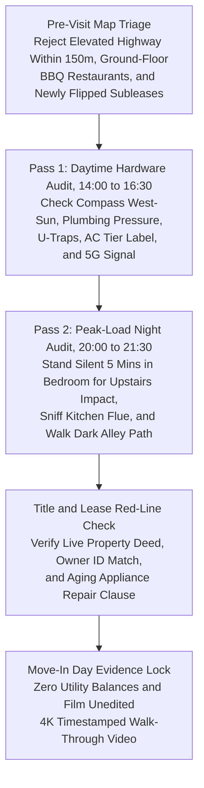
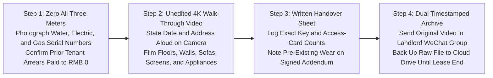

# The 20-Point Apartment Viewing & Lease Inspection SOP (租房看房20项硬核体检与入住交接证据流)

In [00-README.md](00-README.md), we saw that `50%+` of domestic misery is locked in on the afternoon you sign a lease. Real-estate agents (`房产中介`) engineer viewings for maximum sensory deception: they book you at `13:30` on a sunny Saturday when upstairs toddlers are napping, heavy diesel trucks are banned from inner-ring elevated roads, downstairs restaurant exhaust flues are idle, and every window is thrown wide open to disperse sewer gas (`下水道反味`) and particleboard formaldehyde (`劣质板材甲醛`). Five minutes in, the agent drops the classic scarcity hook: *"Another couple from Lujiazui loved it this morning and wants to transfer the deposit tonight."*

Never let artificial urgency bypass engineering due diligence. Signing a 12-month Shanghai lease at `RMB 7,500/month` (`RMB 90,000` contract value plus `RMB 7,500` deposit and moving friction) is an enterprise procurement decision. Running this **20-Point Two-Pass Inspection SOP** takes **25 minutes per apartment** and filters out `95%` of acoustic nightmares, utility traps, toxic renovations, and deposit disputes before a single yuan leaves your bank account.

---

## Table of Contents

1. [The Two-Pass Viewing Protocol: Why You Never Sign Without a 20:00 Night Visit](#1-the-two-pass-viewing-protocol-why-you-never-sign-without-a-2000-night-visit)
2. [Points 1–7: Acoustic Envelope, Upstairs Slabs, West-Sun & Formaldehyde Traps](#2-points-17-acoustic-envelope-upstairs-slabs-west-sun-formaldehyde-traps)
3. [Points 8–13: Water Pressure, Heater Lag, Floor-Drain U-Traps & Flue Check-Valves](#3-points-813-water-pressure-heater-lag-floor-drain-u-traps-flue-check-valves)
4. [Points 14–20: Tier-1 AC Energy Math, 5G/Fiber Signal, Pests & Landlord Contract Guardrails](#4-points-1420-tier-1-ac-energy-math-5gfiber-signal-pests-landlord-contract-guardrails)
5. [The Move-In Timestamped Video & Utility Handover Protocol](#5-the-move-in-timestamped-video-utility-handover-protocol)

---

## 1. The Two-Pass Viewing Protocol: Why You Never Sign Without a 20:00 Night Visit

Daytime viewings verify **sunlight, dampness, and hardware condition**; only a **`20:00 to 21:30` weeknight revisit** exposes the apartment's true acoustic, olfactory, and neighborhood baseline when every surrounding household is home cooking, showering, walking barefoot across floors, and parking scooters downstairs.

### Pre-Visit Satellite Map Elimination (`出门前5分钟地图排雷`)

Before spending an afternoon commuting across town, check Gaode/Baidu Maps (`高德/百度地图街景与卫星图`) around the exact building number (`弄/幢/号`) and eliminate instant dealbreakers:

- **Within `150 meters` line-of-sight of an elevated highway, rail line, or inner-ring ramp (`内环/中环/延安高架、轻轨铁路`)**: High-floor units (`Floors 8–22`) actually suffer **worse** direct unshielded tire/engine noise than tree-shielded `Floors 3–5` because sound waves diffract upward without ground attenuation!
- **Active construction sites (`在建工地/地铁施工`) within `300 meters`**: Pile drivers and nocturnal concrete pours (`夜间连续浇筑准许证`) legally run past midnight and penetrate even double-glazed glass via low-frequency ground vibration.
- **Ground-floor heavy-fume retail (`一楼底商烧烤、川湘重油烟餐饮、KTV、24小时便利店冷链外机`)**: Grease smoke, rats, `02:00 AM` beer-table shouting, and `50 Hz` compressor hum make Floors 2–4 unlivable.

### Tier-1 Housing Archetype Trade-Off Matrix (`上海及一线城市四大主流房型选型对比`)

Before filtering individual units, pick the right building generation for your sleep sensitivity and budget:

| Building Archetype | Typical Era & Rent Tier | Core Structural Strengths | Hidden Failure Modes to Inspect Hard |
| :--- | :--- | :--- | :--- |
| **1. Post-2005 Commercial Elevator Condo (`次新商品房电梯小区`)** | `2005–2022`; Baseline `1.0x` | Cast-in-place concrete slabs (`现浇楼板`), broken-bridge double glazing, `24h` gated property engineering, underground package/parking access, `民水民电` | Check morning elevator wait (`梯户比 <= 2梯4户` ideal) and distance from wet-trash station (`湿垃圾厢房`) |
| **2. Renovated 1980s–90s Walk-Up (`内环老公房 3–4楼`)** | `1982–1998`; `0.75x – 0.85x` | Prime walkable metro access, mature street food/parks, low utility rates, high usable area ratio (`得房率 > 85%`) | Hollow-core floor slabs (`预制板隔音差`), corroded iron risers, clogged main drains on Floor 1–2, single-pane sliding windows, stair hauling |
| **3. Commercial Loft / Branded Youth Apartment (`商住Loft / 集中式公寓`)** | `2012–2024`; `0.85x – 1.1x` | App-based repair tickets, modern lobby, single-person compact layout, easy short-notice lease transfer | **Commercial electricity (`RMB 1.2–1.5/kWh`)**, no gas stove, single-aspect poor cross-breeze (`单面采光不通透`), hollow gypsum party walls |
| **4. Lane House / Historic Shikumen (`老洋房 / 新式里弄改造`)** | Pre-`1949`; `1.1x – 1.5x` | Photogenic French-Concession charm, tall ceilings, leafy quiet lanes | Wood-joist floors amplify every neighbor step (`木结构楼板毫无隔音`), severe winter drafts, June `黄梅天` termites (`白蚁纷飞季`), damp plaster |

> **The Engineer's Sweet Spot**: A **middle-to-high floor (`Floors 6 to 18`, avoiding the very top roof floor and equipment-room floor `设备层`) inside a `2005–2018` residential elevator compound (`民水民电次新小区`)** facing an internal garden courtyard (`小区中庭花园`) delivers the highest sleep quality and lowest total cost of occupancy per yuan.

---

## 2. Points 1–7: Acoustic Envelope, Upstairs Slabs, West-Sun & Formaldehyde Traps

Bring four pocket tools on your phone and keychain: **Compass App (`指南针`)**, **Decibel Meter App (`分贝仪`, e.g., NIOSH Sound Level Meter)**, **Phone Flashlight**, and **one sheet of A4 paper**.

### Points 1–7 Field Inspection Checklist

1. **Point 1 — Window Glazing & Airtightness (`断桥铝双层中空玻璃 vs. 老式单层推拉铝窗`)**:
   - **Test**: Look inside the glass spacer bar for stamped markings like `5mm+9A+5mm` or `5mm+12A+5mm` + `3C` tempered-glass logo. Casement windows (`平开窗/内开内倒窗`) compress rubber gaskets tightly; old sliding aluminum tracks (`老公房单层推拉窗`) rattle in wind and leak `15+ dBA` of street noise.
   - **A4 Paper Clamp Test**: Place a strip of A4 paper across the window frame, close and lock the handle, and pull the paper. If it slides out effortlessly, the EPDM rubber seal (`密封胶条`) is hardened or warped. With windows shut at `20:00`, bedroom ambient noise must sit **below `38 dBA`**.
2. **Point 2 — Upstairs Impact Noise & Party-Wall Solidity (`楼板撞击隔音与分户墙实心度`)**:
   - **Knuckle-Rap Test**: Knock firmly across all four bedroom walls. A dull solid thud indicates brick/concrete (`承重墙/实心砌块`, `STC >= 48 dB`); a hollow drum echo (`咚咚空响`) exposes **gypsum drywall partitions (`轻质石膏板隔断房/群租改建`)** where you will hear your neighbor's phone alarm and WeChat voice calls verbatim.
   - **20:00 Ceiling Listen**: Stand silently in the bedroom for `5 full minutes` around `20:30`. Listen for heel strikes, chair scraping, piano scales, or jumping kids (`楼上熊孩子跑跳/老人凌晨五点剁肉`). No earplug blocks `60 Hz` structural bone-conducted thuds!
3. **Point 3 — Compass Orientation & West-Sun Penalty (`指南针朝向核验与西晒硬伤`)**:
   - **Test**: Stand at the bedroom and living-room windows with your phone Compass (`165°–195°` true South `正南` or Southeast `东南` is gold).
   - **Reject Pure West / Northwest (`255°–305° 西晒`) unless deeply shaded**: In Shanghai/Hangzhou/Wuhan summers, western facades absorb `600+ W/m^2` of low-angle afternoon solar radiation from `13:30 to 18:30`. Reinforced concrete walls act as thermal batteries, radiating `35°C–38°C` heat into your bedroom until `01:00 AM`, driving up AC power bills by `35%–50%` and warping wooden floors.
4. **Point 4 — Exterior Wall Seepage & Ceiling Leak Scars (`外墙窗框渗水与顶楼漏水遮盖痕迹`)**:
   - **Test**: Inspect window-sill corners, ceiling edges, AC wall-sleeve holes (`空调穿墙孔是否内高外低防雨水倒灌`), and **pull back curtains and peek behind bedroom wardrobes** with your flashlight. Bubbling plaster (`墙皮鼓包起粉`), yellow water halos, or suspiciously bright patches of fresh paint over one corner indicate chronic rain seepage or upstairs bathroom waterproofing failure.
5. **Point 5 — "Newly Flipped Toxic Rental" (`串串房/速装甲醛房一票否决`)**:
   - **Red Flags**: Brand-new ultra-cheap wood-grain PVC sticker flooring (`劣质石塑地板胶水`), pungent sweet/chemical smell inside closed wardrobes, cheap cream-colored `"网红奶油风"` particleboard furniture (`密度板/劣质颗粒板`), and zero lived-in wear by a prior owner.
   - **Test**: Close all windows and wardrobe doors for `15 minutes` while inspecting other rooms, then bury your nose inside a wardrobe drawer. Any eye sting, throat scratchiness, or chemical odor means chronic **formaldehyde (`甲醛`, boils at `-19.5°C` and releases for `3–15 years`!)** and TVOC exposure — **walk out immediately, regardless of how pretty the photos look**.
6. **Point 6 — Mattress Spine Support & Hygiene (`床垫弹簧塌陷与卫生检查`)**:
   - **Test**: Unzip or lift the fitted sheet corner to check for bedbug fecal spots or mold stains (`床垫边缘霉斑`), then sit and lie flat across the center. Cheap rental hollow-spring mattresses (`劣质整网弹簧床垫`) sag in a hammock V-shape that triggers lumbar disc pain within two weeks.
7. **Point 7 — Ground-Floor Dampness vs. Top-Floor Baking (`一楼返潮虫鼠 vs. 老小区无阁楼顶层冬冷夏热`)**:
   - Avoid Floor 1 without an elevated underground garage (`无架空层/地下车库的一楼`), which suffers `90% RH` ground capillary dampness, mosquitoes, and sewer main backups (`一楼下水总管反水淹屋`!). On pre-2005 walk-ups, avoid flat-roof top floors (`平改坡前老顶楼`) due to roof membrane leaks and summer oven heat.

---

## 3. Points 8–13: Water Pressure, Heater Lag, Floor-Drain U-Traps & Flue Check-Valves

Plumbing and ventilation defects rarely show up in listing photos, yet they dictate whether your daily shower feels restorative or disgusting.

| Point | Component | Exact 60-Second Field Test | Pass Criteria vs. Walk-Away Red Flag |
| :--- | :--- | :--- | :--- |
| **8** | **Concurrent Shower Water Pressure (`并发动态水压测试`)** | Flush the toilet **and** open the kitchen tap while turning the showerhead on full blast | **Pass**: Strong, steady cone (`>= 8–10 L/min`); **Fail**: Collapses to a weak dribble or turns rusty yellow (corroded galvanized risers `老镀锌管锈蚀` or weak rooftop gravity tank) |
| **9** | **Water Heater Type, Capacity & Hot-Water Lag (`热水器制式与出热水延迟`)** | Check heater nameplate + time how many seconds hot water takes to reach the shower | **Pass**: `13L–16L` forced-exhaust gas unit (`强排式燃气热水器`, stainless vent exiting outdoors!) or `60L` Tier-1 electric tank; hot in `< 25 s`; **HARD BAN**: Old flue-less/natural-draft gas heaters (`直排式/老烟道式`) or unvented heaters mounted inside the shower room (lethal `CO` poisoning!) |
| **10** | **Bathroom Floor-Drain U-Trap (`淋浴与干区地漏水封反味`)** | Lift the metal floor-drain grate and shine phone flashlight straight down the pipe | **Pass**: `>= 50 mm` deep U-water seal or intact self-closing magnetic core; zero sour sewer smell; **Fixable vs. Fail**: Shallow `40 mm` pipe can take a `RMB 25` silicone core, whereas horizontal offset pipes (`移位器`) clog constantly |
| **11** | **Under-Vanity Sewer Pipe Seal (`洗手盆下水管存水弯与防臭塞`)** | Open the bathroom sink cabinet doors and inspect where the flexible drain tube enters the floor/wall `50 mm` PVC pipe | **Pass**: Proper S/P-trap (`存水弯`) + tight silicone sealing plug (`防臭密封塞`) around pipe collar; **Common Bug**: Bare corrugated hose loosely shoved into open sewer pipe (`全屋最大反味与蟑螂通道`, fixable in 2 minutes for `RMB 15`!) |
| **12** | **Kitchen Communal Flue Check-Valve (`厨房公共烟道止逆阀串味`)** | Open upper cabinet above the range hood (`油烟机吊柜`), sniff at `18:30–19:30`, and switch hood ON/OFF | **Pass**: Zero neighbor stir-fry chili smell when hood is OFF; strong suction holds a single tissue sheet flat against intake grille (`一张餐巾纸吸附测试`); **Fail**: Grease-caked broken plastic check-valve (`止逆阀破裂串味`, demand landlord replace before move-in!) |
| **13** | **Toilet Siphon Flush & Flange Seal (`马桶冲力与底座法兰密封`)** | Toss 3 crumpled sheets of toilet paper into bowl and flush; press knees gently against bowl sides | **Pass**: Crisp single-vortex siphon clearance; rock-solid base with clean white anti-mold silicone; **Fail**: Slow swirling rise, wobble, or black wet gap around base (`法兰圈老化漏粪水反臭`, landlord must reseat!) |

---

## 4. Points 14–20: Tier-1 AC Energy Math, 5G/Fiber Signal, Pests & Landlord Contract Guardrails

### Point 14 — The Tier-1 vs. Tier-5 Air Conditioner Electricity Math (`一级能效变频 vs. 五级定频电老虎精算`)

Landlords flipping rental units love installing second-hand **Tier-5 fixed-speed air conditioners (`老款五级能效定频空调`, wholesale cost RMB 600)** because *they* buy the machine while *you* pay the utility bill. Always photograph the **China Energy Label (`中国能效标识`)** pasted on every indoor AC unit!

Compare the actual thermodynamics for one `1.5 HP (3500W cooling)` bedroom AC running `10 hours/night` across `120 summer days` + `60 winter heating days` (`1,800 hours/year`):

$$E_{\text{annual}} \approx \frac{Q_{\text{load}}}{\text{APF}} \implies \Delta \text{Cost} = \left(\frac{1}{\text{APF}_{\text{Tier5}}} - \frac{1}{\text{APF}_{\text{Tier1}}}\right) \cdot Q_{\text{load}} \cdot P_{\text{kWh}}$$

- **New National Standard Tier-1 Inverter (`新国标一级能效全直流变频`, `APF >= 5.27`)**: Rapidly cools the bedroom in 15 minutes, then throttles compressor frequency down to a whisper-quiet `220–320 W` cruise (`< 22 dBA`, zero temperature swings). Annual power: approx. `520 kWh` (**`RMB 260/year`** using Shanghai valley night rate `RMB 0.307/kWh` + peak `RMB 0.617/kWh`).
- **Aging Tier-5 Fixed-Speed Unit (`老国标五级定频空调`, effective `EER / APF` approx. `2.8–3.1` with dirty coils)**: Cycles loudly (`42 dBA` relay clicks waking light sleepers!) between `1,150 W` full blast and `0 W` warm muggy sweat. Annual power: approx. `1,250–1,450 kWh` — costing **`RMB 550 to RMB 800 extra per machine per year`** at residential rates, or **`RMB 1,200+ extra per machine`** inside a commercial-utility loft (`商水商电 RMB 1.3–1.5/kWh`)! Across a 2-room apartment, Tier-5 ACs represent a hidden **`RMB 100–200/month` rent hike**.

### Points 15–20 Connectivity, Safety & Contract Checklist

15. **Point 15 — Residential vs. Commercial Utility Rates (`民水民电燃气 vs. 商水商电分表刺客`)**:
    - Confirm independent State Grid (`国家电网`) meter account (`户号`) billed at municipal residential tiered rates (`上海居民电价第一档峰 0.617 / 谷 0.307 元/度`). **Never rent sub-divided apartments with private landlord sub-meters (`二房东私装电表`)** charging `RMB 1.20–1.50/kWh` with opaque line-loss markups (`公摊电费刺客`).
16. **Point 16 — Closed-Door Cellular 5G & FTTH Fiber Conduit (`关门5G信号盲区与弱电箱光纤核验`)**:
    - Walk into the bedroom and toilet, **shut the doors**, disable Wi-Fi, and run a live voice call + speed test. High-density urban tower blocks (`筒子楼/超高层天井内侧房`) frequently drop cellular signal to `1 bar / SOS`, causing missed on-call pager alerts and SMS verification codes! Open the entryway weak-current box (`弱电箱`) to confirm an intact FTTH optical fiber pigtail (`光纤入户`) and Ethernet wall conduits to the bedroom.
17. **Point 17 — Breaker Panel Grounding & Kitchen Outlets (`强电配电箱漏保与三孔接地`)**:
    - Open the distribution box: confirm a working `30 mA RCD` (`漏电保护器`) and separate `20A` air-conditioner/kitchen circuits rather than 1990s fuse wire or single-circuit bottlenecks that trip whenever an oven and hairdryer run together.
18. **Point 18 — Hidden Cockroach Frass & Termite Trails (`橱柜铰链蟑螂粪便点与白蚁泥线`)**:
    - Shine your flashlight onto warm dark corners: kitchen cabinet metal hinges (`铰链凹槽`), refrigerator rear compressor bay, and rubber door gaskets. Tiny black pepper-speck clusters (`黑胡椒粒状德国小蠊粪便`) or brown oval egg cases (`卵鞘`) betray an entrenched building infestation.
19. **Point 19 — Trash Station Proximity, Hallway E-Bikes & Delivery Rules (`湿垃圾厢房、楼道电瓶车与快递外卖上楼`)**:
    - Check where the compound's **wet-trash sorting station (`湿垃圾厢房`)** sits (`< 25 meters` downwind brings fermented summer sourness and `06:00 AM` garbage-truck clang). Reject hallways choked with neighbors' cardboard mountains or **indoor electric-scooter charging cables (`楼道飞线/电瓶入户充电` — #1 fatal residential fire hazard)**. Confirm couriers/takeout riders can reach your unit door (`外卖能否上楼或有无智能柜`).
20. **Point 20 — Landlord Deed Verification & Aging-Appliance Clause (`产权证核验与超龄家电免责补充条款`)**:
    - **Zero Unverified Sublessors (`严防黑二房东卷押金跑路`)**: Demand to see the owner's live municipal app deed (`随申办/不动产权证原件`) + matching `身份证` (or notarized power of attorney + written sublease consent `产权人书面同意转租证明`), and transfer rent/deposit only to the deed owner's bank account.
    - **Mandatory Lease Addendum (`合同补充条款必写两句话`)**:
      1. *"房屋内空调、热水器、冰箱、洗衣机及隐蔽水电管路如因自然老化、使用年限久远发生非人为损坏，由房东负责在48小时内免费维修或更换；夏冬季空调/热水器逾期未修的，租客有权预约品牌官方售后维修，凭正规发票从下期房租中抵扣。"*
      2. *"房东保证房屋交付前无欠缴水、电、燃气、宽带及物业费；租期届满按入住交接视频原状（扣除合理自然损耗）退还全额押金。"*

### High-Success Rent Negotiation, Rent-Loan Traps & Housing-Fund Extraction (`议价筹码、租金贷防坑与公积金提现`)

Once an apartment passes your 20-point audit, use calm, respectful leverage to save **`RMB 4,000 to RMB 10,000` per lease year**:

1. **Trade Stability for Price (`用优质租客信用换租金折让`)**:
   - Individual landlords fear three nightmares above all: subleasing (`群租转租`), trashed interiors, and delinquent payments.
   - **High-EQ Script**: Present your work badge/business card (`大厂/稳定研发工作证明`), note that you don't smoke or keep destructive pets, and say:
     > *"哥/姐，房子地段和采光我都挺满意的。我们俩工作很稳定、作息规律不折腾房子，打算长租两年以上省得您每年重新招租空置半个月（空置半月就是4000块成本）。不过我看卧室这台定频空调年头比较久了，如果租金能按 `RMB X - 400` 签，再加上 `7天` 搬家免租期（或者您帮我们换一台新一级变频空调/新床垫），今天晚上我就可以直接跟您签合同付定金。"*
2. **Negotiate Agent Commission Down from `50%` to `25%–35%` (`中介费可谈空间`)**:
   - In Shanghai (`双向收费，房东租客各收35%–50%月租`) and Beijing/Shenzhen, standard agency fees are **not** fixed by law (`除链家自如明码实价外，众多本地门店在月底冲业绩时可谈至 30%–35% 月租`). Ask BEFORE signing the viewing confirmation slip!
3. **Hard Ban on "Rent Financing Loans (`绝对严禁签署租金贷 / 分期付租绑定网贷`)"**:
   - Standard payment is **`押一付三` (1-month deposit + quarterly rent)** or `押一付一`. If a long-term apartment operator asks you to *"scan a QR code for monthly installment facial verification (`刷脸办理月付免息分期`)"*, read the screen carefully: unscrupulous operators secretly take out a **12-month personal consumer bank loan (`个人征信消费贷`)** in your name, pocket the full year's cash upfront, and leave YOU owing the bank `11 months` of loan repayments even if the operator goes bankrupt!
4. **Unlock Statutory Tax & Housing-Fund Subsidies (`个税租房专项附加扣除 + 公积金按月提取付房租`)**:
   - **Individual Income Tax Deduction (`个人所得税 App — 住房租金专项附加扣除`)**: In Tier-1 cities (Shanghai/Beijing/Shenzhen/Guangzhou), deduct **`RMB 1,500/month` (`RMB 18,000/year`)** directly from taxable income (saves **`RMB 3,600–5,400/year` cash** at `20%–30%` marginal tax brackets!).
   - **Housing Provident Fund Rent Extraction (`随申办 — 提取住房公积金支付房租`)**: If neither you nor your spouse owns housing in Shanghai, apply in `随申办` in 3 minutes (zero landlord signature needed for market-rate standard tier!) to transfer up to **`RMB 4,000/month`** directly from your frozen Provident Fund account into your debit card every month.

### Three Hidden Exit-Clause Traps to Strike Before Signing (`退租转租与卖房看房三条合同排雷`)

Most standard agency templates (`制式合同`) heavily favor the drafter on exit penalties. Audit these three paragraphs line by line:

1. **Job-Relocation Sublease Right (`工作调动无责转租权`)**:
   - *Trap*: Contract forbids subleasing under any circumstance and forfeits `200%` of deposit upon early exit.
   - *Fix*: Insert a balanced clause:
     > *"租期内如因租客工作调动或搬迁需提前退租，租客提前30天通知房东并协助寻找到资信合格的新租客承接原合同剩余租期的，房东应予配合且不视为违约（不扣押金）；若租客直接解约不找下家，违约金上限以1个月租金为限。"*
2. **Landlord Selling the Apartment Mid-Lease (`房东中途卖房与看房扰民边界`)**:
   - Under **PRC Civil Code Article 725 (`民法典第725条“买卖不破租赁”`)**, even if the landlord sells the apartment mid-lease, the new buyer **must honor your lease through expiration at the exact same rent**.
   - *Fix*: Add a quiet-enjoyment boundary:
     > *"租期内如房东挂牌出售房屋，须提前24小时与租客预约看房，每周集中看房不超过1次（每次不超过1小时），严禁向中介提供门锁密码或在租客不在家时擅自开门带看。"*
3. **Move-Out Cleaning Standard (`明确退租日常保洁标准，防天价开荒费`)**:
   - Specify *"租期届满按日常居家整洁状态交还（无大面积油污垃圾），不强制指定高价第三方深度保洁公司"* so unscrupulous agents cannot deduct `RMB 600` for "mandatory professional sterilization."

---

## 5. The Move-In Timestamped Video & Utility Handover Protocol

Ninety percent of ugly move-out security deposit battles (`退租扣押金扯皮：这道地板划痕是不是你弄的？`) happen because tenants only snap three blurry photos on move-in day. On handover day — **before moving a single suitcase across the threshold** — execute this **12-Minute Ironclad Evidence Chain**:

### Exact 8-Shot Move-In Video Checklist (`一镜到底4K入住取证视频脚本`)

Set your phone camera to `1080p/4K 60fps`, enable watermark timestamp or speak today's date aloud, and record **one continuous unedited video** (`一镜到底不剪辑，法律证明力最强`) covering:

1. **Utility Meter Readings**: Hallway water meter (`水表吨数`), electric meter (`峰/谷电表度数`), and kitchen gas meter (`燃气表字数` + remaining IC balance if prepaid). Verify on Alipay/WeChat Living Payment (`生活缴费`) that historical arrears equal **`RMB 0.00`**.
2. **Hardwood/Tile Floors & Baseboards**: Pan slowly under bright light across high-wear zones (under desk chair, sofa legs, bedroom doorway) zooming in on every pre-existing scratch, water swell (`木地板起拱发黑`), or cracked tile.
3. **Walls, Curtains & Window Screens**: Capture nail holes, tape peel marks left by prior tenants, torn window mesh screens (`纱窗破洞`), and stiff window handles.
4. **Upholstery & Mattress Surfaces**: Flip sofa cushions (`沙发坐垫正反面污渍/猫抓痕`) and lift the mattress protector to film both sides of the mattress.
5. **Bathroom Silicone, Mirror & Porcelain**: Zoom in on sink/toilet hairline cracks (`台盆/马桶釉面暗裂` — landlords frequently charge `RMB 1,200` at move-out claiming you dropped a perfume bottle!) and existing black mold on silicone caulk.
6. **Kitchen Countertop & Range Hood**: Film quartz countertop soy-sauce/burn rings (`石英石台面渗色裂纹`), gas stove dual-burner blue flame ignition (confirm thermocouple flameout protection `熄火保护针` works!), and refrigerator glass shelves/crisper drawers (cracked fridge acrylic drawers cost `RMB 200` each!).
7. **Live Appliance Power-On**: Film every AC remote turning its indoor unit ON to `18°C` cooling for 2 minutes, plus washing machine spin start.
8. **Same-Day WeChat Confirmation (`当日微信群固定证据`)**: Immediately upload the video (or share an unexpiring cloud link + key defect photos) into the WeChat group containing the **Landlord + Agent** with a polite, unambiguous message:
   > *"房东哥/姐您好，今天顺利办完交接啦！水表 `XXX` 吨、电表峰 `XXX` / 谷 `XXX` 度、燃气 `XXX` 方已核对结清。房屋原始墙地家具状况及几处原有细微划痕（如次卧门后墙皮、客厅沙发侧边、主卫台盆细纹）我已拍了完整视频发群里备忘留存，接下来这年我会像自己家一样爱惜维护房子，祝咱们合作愉快！"*

### Day-1 Door-Lock Security Reset (`入住首日门锁权限清零与C级锁芯安全`)

Think about how many strangers held keys or passcodes to your rental before today: five prior tenants, three real-estate agents, cleaners, and renovation workers! Never sleep a single night on unreset credentials:

1. **Electronic Smart Locks (`智能指纹密码锁`)**: Ask the landlord during handover to perform a **Factory User-List Wipe (`清空全部历史指纹、密码与NFC门卡`)** or assign you a dedicated temporary tenant PIN while deleting all agent/cleaner passcodes (`中介看房临时密码必须当面删除!`). Enable the **indoor anti-peep deadbolt knob (`室内反锁旋钮`)** every night before bed.
2. **Mechanical Key Locks (`传统机械防盗门锁`)**: With the landlord's quick WeChat nod (`"哥，为安全起见我自费换个新C级锁芯，原锁芯帮您收好，退租给您装回去或者把新钥匙全交您"`), buy a **`RMB 120` Grade-C pure-copper blade lock cylinder (`C级真插芯防盗锁芯`, measure exact `A+B` millimeter length)** on JD and swap it in 5 minutes with a single `PH2` Phillips screwdriver on the door edge!
3. **Solo Female / Couple Doorstep Privacy Habits (`独居与伴侣入户隐私防线`)**:
   - Set takeout/courier notes to **"Leave at door / smart locker (`放门口或丰巢，勿按门铃`)"** and wait `30 seconds` after footsteps depart via a **smart peephole camera (`智能可视猫眼门铃`, RMB 250, clamps onto existing peephole reversibly!)** before opening the door.
   - Tear off or thermal-blackout courier shipping labels (`热敏涂改液涂抹快递面单姓名电话`) before tossing boxes into the compound recycling bin.

### Summary Triage Rule: Hard Veto vs. Cheap DIY Fix

- **Instant Walk-Away (`一票否决 — 给再便宜也不租`)**: Newly flipped formaldehyde `串串房`; unvented gas heater; `> 45 dBA` closed-window elevated-road/construction roar; heavy upstairs heel-thud impact; Floor-1 dampness; unverified sublessor (`黑二房东`); indoor hallway e-bike charging.
- **Easy RMB 30–150 Renter Fix (`可签约并用小成本解决`)**: Smelly floor drain without U-trap (`RMB 25` silicone magnetic core); open vanity sewer pipe (`RMB 15` silicone plug); weak showerhead (`RMB 120` pressurized head + hose); cold glare ceiling lamp (`RMB 150` warm floor lamp); worn door weatherstripping (`RMB 40` EPDM strip).

### Weighted 100-Point Viewing Comparison Matrix (`多套房源理性横向打分卡`)

After viewing 4 apartments in one afternoon, memory blurs and pretty staging lighting tricks your gut. Score every finalist out of `100 points` in your Notes app immediately after stepping out of the elevator (`低于 78 分不签`):

| Dimension | Weight | Full-Marks Benchmark | Half/Zero-Score Deduction Trigger |
| :--- | :--- | :--- | :--- |
| **1. Nighttime Acoustic Silence (`20:00睡眠静音度`)** | **30 pts** | `< 35 dBA` closed window; cast concrete slab; quiet courtyard | `-15 pts` arterial road hum; `-30 pts` drywall partition or noisy upstairs |
| **2. Air Safety, Sunlight & Dryness (`空气甲醛、朝向与防潮`)** | **20 pts** | Lived-in zero-odor cabinets; `165°–195°` South sun; zero wall peel | `-10 pts` pure west-sun `西晒`; `-20 pts` formaldehyde smell or mold scars |
| **3. Plumbing, Pressure & Odor Seals (`水压热水与防反味`)** | **15 pts** | Strong concurrent shower; `< 20 s` forced-exhaust gas hot water; clean U-traps | `-8 pts` electric small tank `40L` wait; `-10 pts` broken kitchen flue valve |
| **4. Utility & Appliance Efficiency (`一级变频空调与民水民电`)** | **15 pts** | Tier-1 inverter ACs + residential tiered grid + `1000M` fiber conduit | `-10 pts` Tier-5 old fixed-speed ACs; `-15 pts` commercial `RMB 1.4/kWh` |
| **5. Commute, Compound & Landlord (`通勤安全与房东靠谱度`)** | **20 pts** | Door-to-desk `< 35 min`; responsive 24h property desk; direct kind owner | `-10 pts` cluttered fire stairs; `-20 pts` evasive sublessor or harsh contract |

### Move-Out Day Zero-Deduction Checkout SOP (`退租交接全额拿回押金四步闭环`)

Close the lease lifecycle with the same precision you opened it:

1. **Send Written Notice 35 Days Prior (`提前35天微信书面确认不续租`)**: Respect the contract's `30-day` notice window in writing so no "late-notice penalty" applies.
2. **Swap Back Original Hardware (`15分钟无损还原原厂件`)**: Reinstall the landlord's saved showerhead, aerator, and mechanical lock cylinder (if swapped) from your labeled Day-1 shoebox, and peel off `3M` hooks cleanly using warm hairdryer air (`吹风机热风吹30秒软化背胶，无痕不掉墙皮!`).
3. **Final Meter Settlement & Key Return (`水电燃末次读数当场结清`)**: Read final water/electric/gas numbers together, pay exact utility usage via Alipay/WeChat on the spot, and pull up your **Day-1 Timestamped Video** if any pre-existing wear is questioned.
4. **Sign Two-Line Termination Receipt (`签署两行退租结清回执`)**: Confirm in WeChat or on the paper addendum: *"双方确认房屋及物品已按合同约定完好交接结清，水电燃物业费无欠费，押金人民币 `XXXX` 元已全额退还，原租赁合同权利义务至此全部终止。"*

Once your handover video and lock security are locked down, your next move is setting up zero-clutter storage and mold-proof microclimate controls in **[02-DECLUTTERING-STORAGE-AND-SHANGHAI-PLUM-RAIN.md](02-DECLUTTERING-STORAGE-AND-SHANGHAI-PLUM-RAIN.md)**, and stocking the `RMB 200` toolbox in **[03-TEN-MINUTE-SAFE-DIY-FIXES-AND-REPAIR-ANTI-SCAM.md](03-TEN-MINUTE-SAFE-DIY-FIXES-AND-REPAIR-ANTI-SCAM.md)**.
