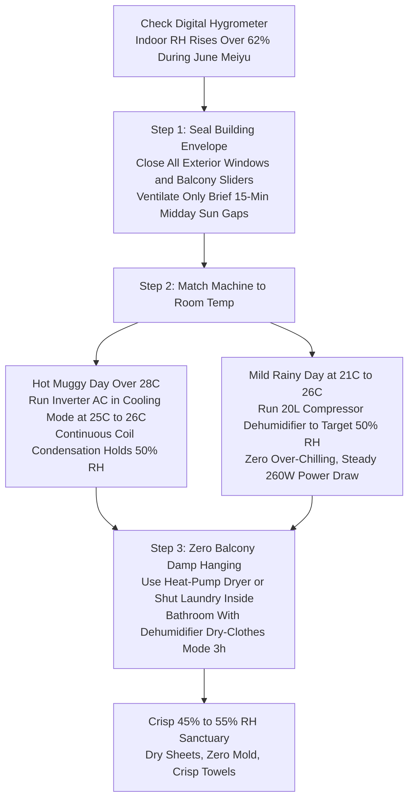
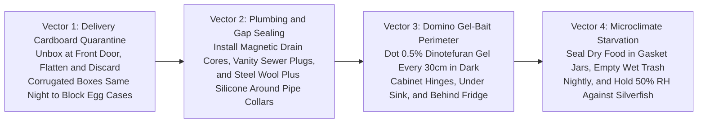

# Zero-Clutter Storage Architecture, Laundry Care & Surviving Shanghai Plum-Rain Mold (零杂乱收纳架构、衣物洗护与江南黄梅天防霉防虫工程)

Why do `90%` of apartments look spotless for 48 hours after an exhausting Saturday cleanup, only to relapse into cluttered tables, overflowing "clothes chairs," and musty bathroom corners by Wednesday night?

Because **tidying (`家务整理`) is manual garbage collection, whereas storage architecture (`居家收纳系统设计`) is low-friction memory allocation**. Whenever putting an everyday object back into its home requires **more than 2 physical actions**, a tired human brain at `21:30` will rationally dump that object onto the nearest horizontal surface — your dining table, sofa, or bathroom vanity. Combine high-friction clutter with East and South China's notorious **`25-to-35-day` Plum-Rain Season (`江南黄梅天 / 华南回南天`, `26°C–32°C` at `80%–95%` relative humidity)**, and an unengineered apartment rapidly breeds *Aspergillus* black mold, sour-smelling laundry, silverfish (`衣鱼`), and German cockroaches (`德国小蠊`).

This guide gives you a deterministic system for **effortless spatial order, multi-year garment longevity, crisp `50% RH` humidity control, pre-summer AC hygiene, and hospital-clean pest exclusion**.

---

## Table of Contents

1. [Zero-Clutter Spatial Architecture: Everything Has an Address](#1-zero-clutter-spatial-architecture-everything-has-an-address)
2. [Adult Fabric & Laundry Engineering: Keeping Clothes Crisp for Years](#2-adult-fabric-laundry-engineering-keeping-clothes-crisp-for-years)
3. [Surviving Shanghai Plum-Rain Season: Defeating 85% RH Mold & Sour Towels](#3-surviving-shanghai-plum-rain-season-defeating-85-rh-mold-sour-towels)
4. [Pre-Summer AC Evaporator Foam Cleaning & Integrated Pest Defense](#4-pre-summer-ac-evaporator-foam-cleaning-integrated-pest-defense)

---

## 1. Zero-Clutter Spatial Architecture: Everything Has an Address

Stop buying twenty matching lidded plastic bins on Taobao before fixing your **put-away ergonomics (`归位动线阻尼`)**. Three structural laws govern every calm, visual-noise-free apartment:

### Law 1 — The 2-Action Return Ceiling (`归位动作不超过两步法则`)

Count the physical motions required to store an item used daily:

- **Anti-Pattern (5-Step Lidded Stack)**: Pull bottom bin from deep closet -> lift top bin off -> unclip two latches -> drop item -> re-latch and re-stack (`5 steps`). Result: the item sits on the coffee table for two weeks.
- **Engineered Pattern (`<= 2` Steps)**:
  - High-frequency daily items (`每天用`: keys, AirPods, scissors, charging cables, skincare): **1 step** (drop onto open magnetic tray or wall caddy) or **2 steps** (pull shallow drawer -> drop into open divider).
  - Reserve latched, lidded weather-tight bins (`带卡扣密封箱`) strictly for **low-frequency seasonal cold storage (`半年才动一次的换季羽绒服/备用被芯`)** on upper closet shelves.

### Law 2 — The 80% Surface Blankness & 80% Cabinet Fill Rule (`台面留白80%，柜内留空20%`)

Just as an NVMe SSD suffers severe write-amplification stalls above `85%` capacity, cabinets stuffed to `100%` turn every retrieval into a Jenga collapse:

1. **Horizontal Surfaces Are Workspaces, Not Warehouses (`餐桌与厨房台面只留当季刚需`)**: Keep your dining table `95%` bare between meals (at most a tissue box and coaster tray). Visual clutter in peripheral vision elevates baseline cortisol and cognitive fatigue.
2. **One-In, One-Out + The 6-Month Quarantine Box (`一进一出与半年暂存断舍离箱`)**:
   - Buy 40 uniform **ultra-thin velvet non-slip hangers (`植绒无痕防滑衣架`)**. When all 40 hangers are full, buying one new shirt requires donating or recycling one unworn shirt.
   - Unsure whether to toss old cables, promotional mugs, or novelty gadgets? Seal them inside one cardboard **"Quarantine Box"** taped with today's date + `6 Months`. Anything you do not retrieve from that box in 180 days gets donated or recycled unopened.

### Law 3 — Four High-Leverage Zone Blueprints (`四大核心功能区收纳工程`)

| Apartment Zone | Root Cause of Mess & Grime | Exact Hardware & Placement Spec | Immediate Behavioral Win |
| :--- | :--- | :--- | :--- |
| **1. Entryway Drop Zone (`玄关落尘归位咽喉`)** | Keys lost; courier cardboard boxes carried into living room (`带入泥沙与蟑螂卵`) | Magnetic door-back **ceramic-blade safety box cutter (`磁吸自动回弹拆快递刀`)** + catch-all tray (`钥匙工牌托盘`) + umbrella drip stand right inside the front door | Slice packages open **at the doormat**, carry only clean contents inside, and flatten cardboard out to recycling the same evening |
| **2. "Worn-Once" Buffer Zone (`次净衣专属缓冲区`)** | Coats, jeans, and cardigans worn for 3 hours aren't dirty enough to wash nor clean enough for sealed clean closets -> **Bedroom Chair Mountain (`衣服山`)** | Wall-mounted coat rack (`门后6钩实木挂衣架`) or narrow `45 cm` open garment valet stand (`次净衣立式衣帽架`) in bedroom corner | Zero clothes piled on desk chairs or beds; garments air out vertically overnight |
| **3. 100% Suspended Bathroom (`卫浴全壁挂悬空化`)** | Shampoo bottles, soap dishes, and toothbrushes sitting on wet sink/shower ledges trap pink *Serratia* slime (`粉红色水垢粘菌`) and black mold | Punch-free `304` stainless / space-aluminum wall racks (`免打孔壁挂架`), inverted magnetic mouthwash cups (`倒扣磁吸漱口杯`), and hanging electric-toothbrush holders | Wipe the entire vanity counter in **4 seconds** with one pass; bottle bottoms stay bone-dry forever |
| **4. Floor-Zero Cable & Pantry Discipline (`全屋离地化理线 + 厨房密封罐`)** | Power strips tangled on floor block robot vacuums (`扫拖机器人缠线罢工`); opened flour/noodle bags attract pantry weevils (`米象`) | Clamp **under-desk steel cable trays (`桌下免打孔理线槽`)** + Velcro ties so zero cords touch the floor; transfer opened grains/spices into square **silicone-gasket PET jars (`按压式密封防潮罐`)** | `100%` automated robot-vacuum floor coverage while at work; zero damp clumping in June |

### Household Cleaning Chemistry Matrix: Acid vs. Alkali (`酸碱对症清洁公式 — 告别蛮力刷洗`)

Eighty percent of exhausting scrubbing happens because people attack alkaline mineral scale with alkaline soap, or wipe acidic polymerized grease with plain water. Keep **only four core chemical agents** under your sink and let `pH` chemistry dissolve grime passively in 10 minutes:

| Stain / Grime Class | Chemical Nature | Exact Reagent & Concentration | Fatal Chemical Mixing / Surface Red Line |
| :--- | :--- | :--- | :--- |
| **1. Range-Hood Sticky Grease, Burnt Pans & Collar Yellowing (`重油污/锅底焦垢/领口汗渍`)** | Acidic polymerized triglycerides & skin sebum | **Alkaline (`pH 10–13`)**: Foam kitchen degreaser (`威猛先生重油污净`) or `60°C` water + **Sodium Percarbonate (`过碳酸钠爆炸盐`)** soak | Wear nitrile gloves (`强碱脱脂伤手皮肤屏障`); never spray strong alkali onto bare aluminum pans (`腐蚀铝材变黑`) |
| **2. Kettle Limescale, White Shower-Glass Spots & Faucet Crust (`水壶水垢/淋浴玻璃白斑`)** | Alkaline `CaCO3 / Mg(OH)2` mineral deposits & soap scum | **Food-Grade Citric Acid (`pH 2.2 食品级柠檬酸`, RMB 12/500g)**: Boil `20 g` in kettle for 5 mins; spray `5%` citric-acid water onto shower glass, wait 10 mins, squeegee off | **NEVER spray acid onto natural marble countertops (`大理石含碳酸钙遇酸即刻腐蚀失光哑面!`)** — quartz (`石英石`) and glass are safe |
| **3. Silicone Black Mold & Cutting-Board Biofilm (`玻璃胶黑霉/菜板发黑`)** | Deep fungal hyphae & bacterial polysaccharide film | **Oxidizing Sodium Hypochlorite (`次氯酸钠除霉啫喱 / 84消毒液` `1:100` diluted)** | **LIFE-OR-DEATH RULE**: **NEVER mix `84` bleach with acidic toilet cleaner (`洁厕灵`) or vinegar/citric acid** (`NaClO + 2HCl -> Cl2` toxic yellow-green chlorine gas causes acute pulmonary edema in minutes!) |
| **4. Engineered Wood Floors, Mirrors & Screens (`木地板/镜面/显示器屏幕`)** | Dust, footprints & skin oil smudges | **Neutral (`pH 7.0`)**: Damp-wrung microfiber mop; `75%` alcohol for door handles (**distilled water + dry lens microfiber ONLY for MacBook/OLED anti-reflective coatings!**) | **NEVER wipe MacBook or TV anti-glare screens with `75%` alcohol or window cleaner (`酒精会造成屏幕镀膜永久性脱落斑驳!`)** |

### Refrigerator Cold-Chain & Anti-Listeria Partitioning (`冰箱生熟分层保鲜与防李斯特菌规范`)

A cluttered refrigerator (`4°C` cold room) is NOT a sterile time-capsule: psychrotrophic ***Listeria monocytogenes* (`嗜冷性单增李斯特菌`)** actively multiplies at `4°C` on uncovered cut melons, cold cuts, and raw meat drip, causing severe gastroenteritis or pregnancy risk. Enforce strict **Top-to-Bottom Gravity Isolation**:

1. **Top & Middle Shelves (`即食熟食区`: `4°C`)**: Ready-to-eat yogurt, cut fruit, and cooked leftovers **sealed inside airtight borosilicate glass boxes (`高硼硅玻璃保鲜盒`)** — never stretch thin cling-wrap loosely over bowls (`保鲜膜易漏气串味且无法叠放`). Eat chilled leftovers after reheating to **`>= 75°C` boiling core** within `24–36 hours`.
2. **Bottom Shelf Above Crisper (`待烹调生鲜防滴漏区`: `2°C`)**: Thawing steaks, raw chicken, and fish placed **inside a rimmed containment tray (`带边解冻托盘`)** so raw myoglobin liquid can NEVER drip onto ready-to-eat food below!
3. **Crisper Drawer (`果蔬控湿抽屉`)**: Line the bottom with **two dry paper towels (`铺两张厨房纸吸收呼吸冷凝水`)** — leafy greens stay crisp twice as long without slimy rot! Keep tropical fruits (bananas, mangoes) and tomatoes **out** of the `4°C` fridge (`热带水果冷藏会冻伤发黑`).
4. **Freezer Drawers (`-18°C 冷冻生熟分格`)**: Top drawer strictly for ready-to-boil dumplings, ice cubes, and bread (`熟制速冻面点冰格`); bottom drawers for portioned raw meats wrapped flat in freezer bags labeled with **masking-tape dates (`美纹纸标注分装日期，超过3个月优先清库`)**.

---

## 2. Adult Fabric & Laundry Engineering: Keeping Clothes Crisp for Years

Most thirty-somethings buy `RMB 400` heavyweight cotton T-shirts, `RMB 1,200` merino knitwear, and crisp Oxford shirts — then destroy them in three weeks by tossing everything together at `40°C`, `1,200 rpm` spin with alkaline enzyme detergent (`普通加酶强碱洗衣液`), and jamming wide coat hangers straight down through wet collars (`硬撑湿领口导致荷叶边变形`).

### The 4-Category Garment Sorting & Wash Matrix (`衣物科学分洗与护洗袋矩阵`)

Keep **four structured polyester laundry mesh bags (`粗网+细网立体护洗袋`, RMB 35 set)** clipped beside your hamper (`深浅分色双格脏衣篓`):

| Load Category | Detergent Chemistry | Water Temp, Cycle & Spin Speed | Mesh Bag & Drying Geometry (`晾晒防变形铁律`) |
| :--- | :--- | :--- | :--- |
| **1. Heavyweight Tees, Dress Shirts & Knits (`重磅纯棉T恤 / 衬衫 / 卫衣`)** | Standard mild liquid detergent (zero chlorine bleach!) | Cold / `30°C`; Gentle/Cotton cycle; **`600–800 rpm` spin MAX** (`1200+ rpm` centrifugally stretches wet neck ribs!) | Turn garment **inside out (`反面朝外防印花磨损`)**, fold neatly inside **medium structured mesh bag**; **insert hanger UP from the bottom hem (`衣架务必从下摆穿入，严禁撑拉湿领口`)** |
| **2. Merino Wool, Cashmere & Silk (`美利奴羊毛 / 羊绒 / 真丝`)** | **Strict `pH 7.0` Neutral Wool/Silk Detergent (`专用中性丝毛洗涤剂`)** — **NEVER standard enzyme detergent (`蛋白酶会直接水解啃断羊毛角蛋白纤维，洗一次硬缩成童装!`)** | Cold `20°C–30°C` dedicated **Wool Cycle (`羊毛柔洗程序`)** or gentle cold hand-press (never wring/twist!) | Fine cushioned mesh bag; press excess water out inside a dry bath towel, then **lay 100% FLAT on a horizontal mesh drying net (`平铺晾衣网阴干，严禁悬挂拉长20厘米`)** |
| **3. Dark Jeans, Chinos & Technical Shells (`深色原牛 / 休闲裤 / 冲锋衣`)** | Color-care neutral liquid (for Gore-Tex/DWR rain shells: zero powder residue & **zero fabric softener `严禁柔顺剂堵塞防水透气微孔`**) | Cold `20°C–30°C` inside out, buttoned & zipped (`拉好拉链扣好纽扣防金属齿刮伤其他衣物`); `800 rpm` | Wash darks strictly separate from whites/ecru tees (or toss in 2 color-catcher sheets `防串色吸色片`); clip pants upside-down by cuffs/waistband in shade (`反面阴干防紫外线褪色`) |
| **4. Bath Towels, Underwear, Socks & Bedding (`毛巾 / 贴身内衣袜 / 四件套`)** | Enzyme detergent + **PCMX/BKC Laundry Sanitizer (`威露士/滴露衣物除菌液` in rinse slot)** or `50 g` oxygen bleach (`过碳酸钠`) for whites; **BAN fabric softener on towels (`柔顺剂蜡膜会让毛巾丧失吸水性`)!** | `40°C–60°C` hygienic wash (`高温除螨洗`); `1,000–1,200 rpm` spin | **Wash bedsheets & duvet covers every 14 days**, pillowcases & bath towels **every 7 days** (replace bath towels completely every `6–9 months`) |

### Washing Machine Drum Hygiene: Killing Hidden Outer-Tub Biofilm (`消灭洗衣机夹层黑霉`)

If freshly washed clothes smell faintly swampy, the culprit is the invisible **gap between your washing machine's stainless inner drum and plastic outer tub (`洗衣机内外筒夹层水垢霉斑`)**:

1. **After EVERY Single Wash (`每次洗完必做两秒动作`)**: Leave the front-loader glass door **propped open `5–10 cm`** AND pull the top **detergent dispenser drawer (`洗涤剂料盒`)** out `3 cm` to dry! Closing a wet rubber door gasket (`密封胶圈积水`) immediately after unloading breeds slimy black *Cladosporium* mold inside 10 days. Wipe the lower fold of the rubber gasket with one dry tissue after your last Sunday load.
2. **1st of Every Month (`每月一次过碳酸钠筒自洁`)**: Empty the drum, pour **`150 g` pure Sodium Percarbonate powder (`过碳酸钠 / 活氧爆炸盐`, RMB 12/kg — releases hydrogen peroxide + soda ash without corroding stainless steel like chlorine bleach)** directly into the drum, and run the **`60°C–90°C` Tub Clean (`筒自洁`)** program. Check and drain the bottom-right **lint/coin pump trap (`右下角排污滤清器`)** over a shallow tray every `6 months`.

### Footwear, Leather & Down-Coat Seasonal Care (`鞋履除臭防霉与羽绒服羊毛大衣换季封存`)

1. **The Two-Pair Shoe Rotation & Cedar Shoe-Tree Rule (`主力鞋隔天轮换 + 雪松木鞋撑`)**:
   - Adult feet perspire `100–200 mL` of moisture into shoe linings over a 10-hour workday. Wearing the exact same pair of sneakers or Goodyear-welted leather shoes two days in a row traps sweat inside EVA/leather pores, breeding odor-producing *Brevibacterium* and permanent toe creases.
   - **Fix**: Rotate at least **two everyday pairs on alternate days (`隔天轮穿干透24小时`)**, and slide **unvarnished red cedar shoe trees (`无漆天然红雪松木鞋撑`, RMB 48/pair)** into leather shoes the second you kick them off — raw cedar absorbs moisture, neutralizes acids, and prevents June `黄梅天` green mold inside toe boxes.
2. **Down Jackets: NEVER Dry-Clean, NEVER Wafer-Vacuum (`羽绒服严禁干洗与极限抽真空`)**:
   - **Check the care tag**: `90%` goose/duck down coats (`鹅绒/鸭绒服`) **forbid dry cleaning (`不可干洗`)** because perchloroethylene solvent strips natural hydrophobic oils off down clusters, leaving feathers brittle and cold!
   - **Proper Wash & Loft Recovery**: Spot-clean cuffs with neutral detergent, zip closed inside a large mesh bag, run cold **Down/Gentle wash (`羽绒洗 600 rpm`)**, then tumble-dry on **low heat (`<= 50°C`) with 3 clean wool dryer balls (`羊毛烘衣球拍打蓬松`)** until `100%` lofted.
   - **Storage**: Hang inside a **breathable non-woven garment bag (`无纺布透气防尘袋` — discard dry-cleaner thin plastic film `丢掉干洗店一次性塑料套，塑料袋锁潮必发霉泛黄!`)** or fold loosely at `>= 50%` volume; crushing down into wafer-flat vacuum bags snaps delicate feather quills permanently.

### The 2-Minute Crisp Presentation Kit: Steaming & De-Pilling (`出门前2分钟除皱与去毛球体面术`)

Three low-cost grooming tools (under `RMB 250` total) keep a 5-year-old wardrobe looking sharper than brand-new fast fashion:

1. **Pressurized Handheld Garment Steamer (`手持增压蒸汽挂烫机 >= 1300W`, RMB 140–220, e.g., Philips/Midea)**:
   - Relaxes Cotton/Linen/Wool wrinkles in `90 seconds` while hanging vertically, and `110°C` dry steam instantly deodorizes hotpot/coffee smells from winter wool coats without over-washing!
   - **Golden Hardware Rule**: **Fill the steamer tank ONLY with `RO` purified or distilled water (`严禁加自来水! 自来水钙镁离子三个月就会堵死微增压发热腔并在黑西装上喷出白水垢粉末`)**, and empty remaining water after every use.
2. **Six-Blade Rechargeable Fabric Shaver (`六叶旋风毛球修剪器`, RMB 45, e.g., Xiaomi/Flyco)**:
   - Underarm and hip friction inevitably raises fiber pills (`起球`) on fine merino sweaters, cashmere scarves, and winter coats — **pilling is physics of soft short fibers, not poor quality!**
   - Lay the sweater completely flat on a hard table (`务必平铺拉展，切勿悬空修剪防割破针织线圈`) and glide the shaver lightly without pressing down: 2 minutes restores a `RMB 1,500` sweater to showroom smoothness.
3. **Sticky Lint Roller at the Door (`玄关常备斜撕粘毛器`)**: One 5-second pass over dark trousers and coats before stepping into the elevator removes lint, dust, and stray hair effortlessly.

---

## 3. Surviving Shanghai Plum-Rain Season: Defeating 85% RH Mold & Sour Towels

Every year from roughly **mid-June to mid-July (`上海/江浙沪黄梅天`, and March–April `华南回南天`)**, warm Pacific subtropical moisture collides with cooler continental air, locking cities into `25–35 consecutive days` of `26°C–31°C` temperatures and **`82% to 95%` outdoor relative humidity**.

### The Dew-Point Trap: Why Opening Windows Makes Your Home Wetter (`露点物理陷阱`)

Newcomers instinctively open windows whenever rain pauses *"to air out the apartment."* Check the psychrometric math: outdoor air at `29°C` and `88% RH` carries a **dew point of `26.8°C` (`25.4 g/m^3` absolute water vapor)**. When that saturated air flows across `25°C` floor tiles, north-wall corners, leather loafers, and guitar fretboards, moisture condenses directly onto surfaces (`表面结露与隐形水膜`). Once micro-surface RH stays above **`68%` for 48 hours**, dormant mold spores germinate exponentially, while wet cotton clothes hung on an open balcony take `3 days` to dry — allowing *Moraxella osloensis* bacteria (`奥斯陆莫拉菌`) to metabolize sweat lipids into the unmistakable **"wet-dog sour laundry stench (`衣服阴干馊臭味`)"**.

### Dehumidification Hardware Comparison (`除湿装备选型避坑表`)

| Device / Method | Real Extraction Capacity | Best Use Case & Critical Limitation |
| :--- | :--- | :--- |
| **1. Standalone Compressor Dehumidifier (`压缩机除湿机`, `16L–22L/day`, RMB 700–1,300)** | **`16–22 Liters/day`** (`220–320 W` power draw; e.g., Deye `德业` / Panasonic / Midea) | **#1 Must-Buy for East/South China Renters!** Works brilliantly at `20°C–27°C` without freezing you; roll it into the closed bathroom after washing clothes and hit **`干衣模式` — bone-dry, sweet-smelling laundry in 2.5 to 3 hours!** |
| **2. Split AC "Dry Mode" vs. "Cool Mode" (`空调除湿模式 vs. 制冷模式`)** | High *only* while compressor runs | On `23°C` rainy June days, AC `除湿模式` chills the bedroom to a clammy `19°C` and **stops dehumidifying the instant room temp hits setpoint** (worse: water sitting on idle wet evaporator fins blows back into the room!). Use AC `制冷` on `28°C+` days; use a real dehumidifier on `22°C` rainy days |
| **3. Heat-Pump Washer-Dryer / Standalone Dryer (`热泵式烘干机`, RMB 2,500+)** | Full `8–10 kg` laundry load dried at gentle `52°C` + lint filtration | Gold standard if space/budget allows; **avoid cheap `冷凝式一体机` without lint filters (`无绒毛收集器的廉价洗烘一体机越烘越臭且高温缩衣`)** |
| **4. Calcium Chloride Desiccant Boxes (`氯化钙吸湿盒/除湿挂袋`, RMB 3/box)** | Only `250–400 mL` total over `3–4 weeks` | Useless for whole rooms! Hang **strictly inside closed wardrobes and shoe cabinets** (`衣柜挂袋距离羊绒皮衣 10 cm 以上，严防袋体破损高浓度氯化钙卤水滴漏毁坏真皮!`) |
| **5. Semiconductor Electronic Dry Cabinet (`电子防潮箱 30L–50L`, RMB 220–320)** | Holds sealed box at exact **`40%–45% RH`** (`5 W` silent Peltier chip) | Mandatory if you own mirrorless cameras, lenses (`镜头一旦长霉丝擦洗即伤镀膜`), passports, paper deeds, luxury watches, or microphones |

### Four Daily Anti-Mold Micro-Habits (`梅雨季四条黄金防霉习惯`)

1. **The 15-Second Post-Shower Silicone Squeegee (`洗完澡15秒刮水铁律`)**: Hang a `RMB 18` silicone window/floor squeegee (`硅胶刮水器`) in the shower. Spending 15 seconds sweeping wall tiles, glass doors, and shower floor water directly into the drain removes **`80%` of liquid water** before it can evaporate into your apartment air, then leave the bathroom exhaust fan (`换气扇`) running for `30 minutes`.
2. **5-Centimeter Furniture Air Gap (`家具背板离墙 5 cm`)**: Never push bookshelves, wardrobes, or bed headboards flush against cold exterior walls (`外墙内表面温度低极易结露长黑毛霉`). Leave a `5 cm` convective breathing gap.
3. **Rescuing Early White Mildew Safely (`局部霉点安全清除法`)**:
   - *Bathroom silicone caulk black mold (`玻璃胶黑霉点`)*: Lay twisted cotton strips soaked in **sodium hypochlorite mold-remover gel (`除霉啫喱`)** flat along the dry silicone seam overnight (`8 hours`), then rinse clean (ensure exhaust fan is ON; **NEVER mix chlorine bleach/gel with acidic toilet cleaners `洁厕灵` — generates lethal chlorine gas `Cl2`!**).
   - *Walls or wood furniture*: Wipe gently with **`75%` medical ethanol (`75%医用酒精`)** on a microfiber cloth (alcohol denatures fungal proteins and evaporates fast without soaking wood!).
4. **Crack Closet & Under-Sink Doors Open During Dehumidifier Runs (`开除湿机时敞开衣柜与水槽柜门同步抽湿`)**: Closed wooden wardrobes, shoe cabinets, and under-sink doors trap stagnant `75%+ RH` micro-pockets even after bedroom air drops to `50% RH`. Swing cabinet doors open `10 cm` for `1 hour` whenever your compressor dehumidifier runs so dry air circulates deep into dark corners.

### Emergency Rescue Table for Rain-Soaked Gear (`梅雨季突发受潮物品急救表`)

| Damp Emergency | Instant Wrong Reflex (`毁物操作`) | Correct Engineering Rescue SOP |
| :--- | :--- | :--- |
| **Rain-Drenched Leather Dress Shoes (`暴雨踩水真皮皮鞋湿透`)** | Blasting with hot hairdryer or radiator (`高温热风会让真皮胶原纤维硬化缩裂报废!`) | Wipe mud, stuff tightly with crumpled absorbent kitchen paper (swap paper after `2 hours`), insert cedar shoe trees once `70%` dry, and air-dry beside dehumidifier for `24 hours` before conditioning |
| **Sour "Wet-Dog" Bath Towels (`毛巾洗完依然发馊发臭`)** | Masking smell with heavy floral fabric softener (`柔顺剂包覆细菌越用越臭`) | Soak 45 mins in **`60°C` hot water + `60 g` Sodium Percarbonate (`过碳酸钠`)**, run `60°C` wash with `PCMX` sanitizer in rinse, and dry to `100%` crisp inside 3 hours (oxidizes *Moraxella* biofilm completely!) |
| **Camera / Passport Caught in Downpour (`相机镜头/护照淋雨受潮`)** | Sealing wet gear inside an airtight backpack overnight (`闷在包里48小时必起雾发霉`) | Towel exterior dry immediately, remove battery & SD card, leave port flaps open inside **`40% RH` electronic dry cabinet** (or sealed zip-bag with 4 fresh silica-gel packets) for `24 hours` |

### Defeating Bedroom Dust-Mite Rhinitis (`尘螨过敏性鼻炎卧室防控铁三角`)

If you or your partner wake up sneezing ten times in a row with itchy eyes and clear nasal congestion (`晨起喷嚏不断、鼻塞眼痒`) during spring and rainy June, the trigger is almost always **`Der p 1` fecal protease allergens from house dust mites (`屋尘螨 / 粉尘螨`)**, which multiply explosively inside mattresses and pillows whenever indoor humidity exceeds `65% RH`:

1. **Starve Mites of Moisture (`湿度压制 <= 50% RH`)**: Dust mites have no lungs or mouths to drink liquid water — they absorb moisture osmotically from humid air! Holding bedroom RH at **`45%–50%`** dehydrates and halts mite reproduction within 10 days.
2. **Physical Micro-Pore Encasement (`物理高密防螨床笠与枕套`, Pore Size `< 10 microns`)**: Zip your rental mattress and pillow cores inside breathable **Evolon / high-density physical anti-mite encasements (`物理防螨全包床笠枕芯套`, RMB 180–280)** underneath your normal cotton sheets — physically sealing decades of prior mattress dander away from your airway. (Skip gimmicky `"UV handheld mite vacuums"` `手持紫外线除螨仪智商税` — weak `2W` UV tubes flashing for `0.2 seconds` cannot kill mites buried `2 cm` inside foam!)
3. **Thermal Denaturation at `55°C–60°C` (`双周 60°C 热水洗或热泵烘干`)**: Cold `30°C` water washes away sweat but **does not kill live dust mites** (`冷水洗不死活螨`). Wash sheets/pillowcases at **`60°C`** OR run them through a **`55°C+` dryer cycle for 30 minutes** every two weeks to denature `Der p 1` proteins completely.

---

## 4. Pre-Summer AC Evaporator Foam Cleaning & Integrated Pest Defense

### 25-Minute Pre-Summer Split-AC Evaporator Cleaning SOP (`每年5月壁挂空调深度自洗流程`)

Washing only the two plastic mesh dust screens (`只洗滤网等于只洗口罩外层`) leaves a millimeter of damp dust, skin dander, *Aspergillus* spores, and *Legionella* bacteria caked across the cold **aluminum evaporator fins (`蒸发器散热翅片`)** directly underneath. Do this safe `RMB 35` wash every May before summer cooling starts:

1. **Hard Power Isolation (`拔掉空调插座或拉下空调分路空开`)**: Never spray liquid near a live `220V` indoor unit!
2. **Remove & Wash Mesh Screens**: Flip open the front plastic shell, slide out the two nylon dust screens (`初效防尘网`), brush dust off dry first, rinse from the **back side toward the front (`反面朝外冲洗`)** with warm dish-soap water, and air-dry in the shade (`严禁暴晒变形`).
3. **Protect Right-Side PCB & Hang Drain Bag (`遮蔽右侧电路板 + 挂接水袋`)**:
   - Tuck a dry towel or plastic tape shield tightly over the **far-right electrical terminal box (`空调右侧主板接线盒严禁进水`)**, and slip a `RMB 10` elastic AC wash funnel bag under the unit if your cleaner creates heavy runoff.
4. **Apply Neutral AC Fin Foam (`喷涂中性空调蒸发器泡沫清洗剂`)**:
   - Shake a can of **neutral non-corrosive AC coil foam (`中性免拆洗空调翅片清洁剂`, e.g., Earth Chemical `安速` /威露士)** and spray evenly from `5 cm` away across the bare aluminum fin rows (`顺着铝翅片竖直纹理上下喷满`).
5. **15-Minute Self-Drain & Flush Cycle**: Wait `15 minutes` as the white foam dissolves biofilm into dark liquid and drains automatically outdoors through the **condensate drain hose (`冷凝水排水管`)**. Reinstall dry mesh screens, plug power back in, open windows, and run **`18°C` Cooling + High Fan for `30 minutes`** to flush residual moisture outdoors.

### Integrated Urban Pest Perimeter Defense (`城市公寓蟑螂、蛾蚋、衣鱼根治方案`)

Even spotless high-rise apartments get invaded if delivery boxes, drain pipes, or neighbor renovations breach your perimeter. Abandon panic aerosol spraying (`普通杀虫喷雾只会把蟑螂驱赶扩散到全屋缝隙并产生抗药性`) and run **Four-Vector Integrated Exclusion**:

- **German Cockroaches (`德国小蠊` — Small Light-Brown Kitchen Roaches)**:
  - **Why Corrugated Cardboard Is Enemy #1**: Warehouse corrugated flutes (`快递纸箱瓦楞夹层`) are warm, humid nurseries where female roaches glue brown **oothecae (`卵鞘`, each hatching `30–40` nymphs!)**. Never hoard shipping cartons indoors!
  - **The Domino Colony-Wipe Protocol (`呋虫胺/氟虫腈杀蟑胶饵连环端窝`)**: Buy a `10 g–30 g` syringe of **`0.5%` Dinotefuran (`呋虫胺`, e.g., Seclira `速克朗`, zero resistance!) or `0.05%` Fipronil (`拜灭士`) gel bait**. Squeeze **`20–30` tiny rice-grain dots (`米粒大小 3 mm，点多量少，切勿挤成一整条`)** inside warm, dark, dry crevices: kitchen cabinet hinges, underside of countertop overhang, behind fridge/microwave vents, router bottom, and bathroom vanity corners. Roaches eat the delayed-action bait, crawl back to their wall nest to die, and nestmates cannibalize their carcasses/feces — **eradicating the entire hidden colony within `5 to 7 days`** (refresh dots every `4–6 months`).
- **Drain Flies (`蛾蚋` — Tiny Heart-Winged Fuzzy Black Flies on Bathroom Walls)**:
  - They do **not** fly in through windows; their larvae feed on organic hair/soap slime lining the upper walls of your drain pipes! Scrub under the floor-drain rim with an old toothbrush, pour `500 mL` of `60°C` hot water + **foaming pipe-slime cleaner (`管道除菌泡沫`)** weekly, and keep magnetic T-cores installed.
- **Silverfish & Booklice (`衣鱼与书虱` — Tiny Silvery/Translucent Bugs in Books & Closets)**:
  - Purely humidity-driven (`> 70% RH` allows them to graze on starch/cellulose glue and silk/wool). Dropping indoor RH below **`55%`**, vacuuming baseboard cracks, and placing natural **aromatic red cedar blocks (`天然红雪松木块`)** in drawers eliminates them cleanly — **NEVER put toxic naphthalene/paradichlorobenzene mothballs (`绝对禁用含萘/对二氯苯樟脑丸` — carcinogenic hemolytic toxin that permanently taints clothing!)** inside wardrobes.

### Closing the Last Two Summer Gaps: High-Floor Mosquitoes & Kitchen Fruit Flies

Ever wondered how mosquitoes buzz beside your ear at `02:00 AM` on the `18th floor` even when every window screen (`纱窗`) stays shut? Seal **two hidden `4 mm` mosquito bypasses** for `RMB 15` and lock down **one kitchen fruit-fly rule** in 5 minutes:

1. **Window Track Weep-Hole Stickers (`窗框外侧排水孔不锈钢防蚊贴`, RMB 6/20 pcs)**:
   - Aluminum window tracks have `5 mm x 20 mm` rectangular rain-drain slots (`窗槽排水孔`) leading straight outside — mosquitoes crawl right through those hollow frame channels into your bedroom! Wipe the track dry and stick breathable stainless-mesh weep-hole patches over every slot.
2. **Sliding-Screen Center Overlap Brush (`推拉窗与纱窗中缝加长加密毛条`, RMB 9)**:
   - When a sliding window is opened only halfway (`半开推拉窗`), a `6 mm` vertical gap opens between the two glass sashes (`两扇窗交叠中缝直通室外` — slide the glass sash all the way flush to the end stop so the vertical interlock engages, and stick a dense pile strip along the gap!).
3. **Zero-Fruit-Fly Kitchen Discipline (`夏日零果蝇三原则`)**:
   - *Drosophila* fruit-fly eggs arrive already laid microscopically on **banana stems, lychees, peaches, and melons (`水果表皮自带虫卵`)**. Rinse stone/tropical fruit stems on arrival, store ripe fruit in the fridge or under a mesh dome, use a **tightly lidded pedal/sensor wet-trash bin (`带密封盖湿垃圾桶`)**, and carry fruit peels + espresso pucks down to the compound bin **every night after dinner (`夏日果皮湿垃圾绝不过夜`)**.

With your storage geometry, laundry workflow, and microclimate running cleanly, turn to **[03-TEN-MINUTE-SAFE-DIY-FIXES-AND-REPAIR-ANTI-SCAM.md](03-TEN-MINUTE-SAFE-DIY-FIXES-AND-REPAIR-ANTI-SCAM.md)** to master 10-minute safe fixes and protect yourself against predatory repair scams.
