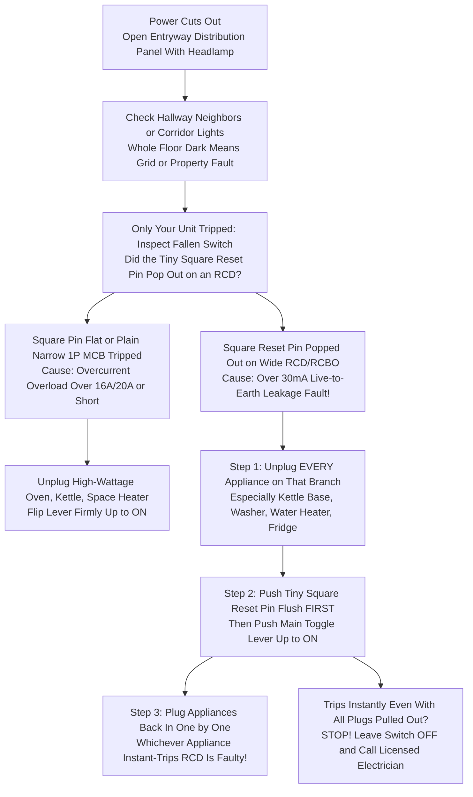
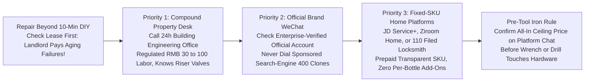

# 10-Minute Safe Home Fixes, RMB 200 Essential Toolbox & Defeating Repair-Service Rip-Offs (10分钟安全居家维修、200元常备工具箱与黑心上门维修防坑指南)

Urban adults tend to fall into one of two expensive extremes when something breaks at home:

1. **Learned Helplessness (`完全不敢动手`)**: Calling a top-sponsored search-engine repairman for a dripping shower hose that only needed a `RMB 1` silicone washer — and getting bullied into paying `RMB 680` for "imported nano-sealant."
2. **Reckless Improvisation (`盲目蛮干越界`)**: Twisting a rusted cast-iron angle valve until the thread snaps off flush inside the bathroom tile wall (`三角阀断丝在墙内`), or poking bare `220V` ceiling wires with uninsulated pliers while standing on a plastic stool.

True home craft means mastering **two crystal-clear boundaries**:
- **Inside the Safe 10-Minute Zone**: Low-voltage networking, breaker panel *switch-level* diagnostics, downstream water fixtures *after* closing local shutoff valves, drain traps, cabinet hinges, and silicone touch-ups.
- **Beyond the Red Line**: Natural gas piping, live `220V` wiring, upstream pressurized risers, and high-floor exterior work — where you immediately dispatch **vetted, transparent-pricing specialists** without getting scammed.

---

## Table of Contents

1. [The RMB 200 Ten-Year Apartment Toolbox: Buy Once, Never Scramble](#1-the-rmb-200-ten-year-apartment-toolbox-buy-once-never-scramble)
2. [Safe Fix 1 & 2: Clearing Hair Drains, Sink P-Traps & PTFE Thread Sealing](#2-safe-fix-1-2-clearing-hair-drains-sink-p-traps-ptfe-thread-sealing)
3. [Safe Fix 3 & 4: Tripped Breaker Triage (MCB vs. RCD) & Wired-Backhaul Mesh Wi-Fi](#3-safe-fix-3-4-tripped-breaker-triage-mcb-vs-rcd-wired-backhaul-mesh-wi-fi)
4. [Absolute Safety Red Lines: Five Jobs You Must NEVER Touch Yourself](#4-absolute-safety-red-lines-five-jobs-you-must-never-touch-yourself)
5. [Defeating RMB 800 Search-Ad Plumber & Locksmith Scams](#5-defeating-rmb-800-search-ad-plumber-locksmith-scams)

---

## 1. The RMB 200 Ten-Year Apartment Toolbox: Buy Once, Never Scramble

Never wait until water is spraying across the bathroom floor at `23:00` to order a wrench on instant delivery. Spend **`RMB 190 to RMB 230` once** on JD (`世达 SATA / 得力 Deli / 小米米家 / 威克士`) to assemble this compact `30 cm` poly-box kit that will follow you across apartments for a decade:

| Item # | Exact Tool & Specification | Est. Price | Primary Domestic Use Case & Pro Tip |
| :--- | :--- | :--- | :--- |
| **1** | **24-in-1 Ratchet Screwdriver Set (`棘轮螺丝刀+S2钢批头组套`)** | RMB 45 | Tightening loose cabinet hinges (`PH2` Phillips), assembling desks (`H4/H5` hex), laptop/eyeglass screws (`PH00`) |
| **2** | **`8-Inch (200 mm)` Wide-Jaw Adjustable Wrench (`大开口活动扳手 >= 28 mm`)** | RMB 28 | Swapping `G1/2" (4分)` shower hoses, faucet aerators, and flexible braided supply nuts; **wrap jaws in a cloth (`垫一块抹布拧`) so metal teeth never scratch chrome plating!** |
| **3** | **PTFE Thread Seal Tape x 2 + `4分` Silicone Washers x 10 (`生料带 + 19mm硅胶垫片`)** | RMB 10 | Stopping 99% of showerhead, angle-valve, and washing-machine tap drips in 3 minutes |
| **4** | **Barbed Hair Snakes x 5 + Keratin-Dissolving Gel + Flange Plunger (`倒刺疏通棒+溶毛啫喱+带翻边皮搋子`)** | RMB 32 | Clearing slow shower hair drains and toilet paper siphon clogs (`选碗口带折叠翻边的马桶专用皮搋子，吸力是平口碗的3倍`) |
| **5** | **Non-Contact AC Voltage Detector Pen (`非接触感应测电笔 NCV`, CAT III)** | RMB 25 | Verifying an outlet or lamp wire is `100%` de-energized without touching bare copper (`靠近火线声光报警`) |
| **6** | **`3-Meter` Self-Locking Steel Tape Measure (`3米自锁钢卷尺`)** | RMB 12 | Measuring doorway clearances, refrigerator alcoves, washing-machine niches, and floor-drain inner diameters (`内径测量`) |
| **7** | **`USB-C` Rechargeable Magnetic Headlamp (`磁吸充电头灯/工作灯`)** | RMB 28 | Frees **both hands** when working inside dark under-sink cabinets or inspecting a tripped breaker panel during a blackout |
| **8** | **Anti-Mold Neutral Silicone Tube + Scraper (`中性防霉美容胶软管 + 刮胶器`)** | RMB 18 | Resealing peeling sink-to-countertop edges (choose **neutral oxime silicone `中性防霉硅酮胶`**, never pungent acidic glass glue that corrodes mirrors/metals) |
| **9** | **Utility Knife + `3M VHB` Tape + Zip Ties + Electrical Tape (`美工刀/VHB无痕胶/3M绝缘胶布`)** | RMB 15 | Mounting routers/power strips reversibly and tidying cables |
| **10** | **Needle-Nose Pliers + Pencil Graphite Powder (`尖嘴钳 + 锁芯专用石墨粉`)** | RMB 15 | Pulling stuck aerator screens; lubricating stiff mechanical keyholes (**NEVER spray oily `WD-40` inside door lock cylinders `锁芯喷油会吸附灰尘卡死弹子`, puff dry graphite powder only!**) |

---

## 2. Safe Fix 1 & 2: Clearing Hair Drains, Sink P-Traps & PTFE Thread Sealing

### Safe Fix 1 — Clearing Slow Shower Hair Drains & Sink P-Traps (`淋浴地漏与台盆10分钟疏通`)

When shower water pools around your ankles or the bathroom basin drains sluggishly, the blockage sits within the **top `15 to 40 cm`** (`毛发缠绕皂垢形成的生物油泥栓`) — zero need for a `RMB 400` power auger:

1. **Mechanical Hair Extraction First (`先物理勾出成团毛发`)**:
   - Put on disposable nitrile gloves, lift the shower grate, slide a **`50 cm` barbed plastic hair snake (`带倒刺塑料疏通棒`, RMB 1.5)** straight down through the trap bend, twist `3 turns`, and pull upward. Removing the physical hair wad does `80%` of the work instantly.
2. **Chemical Keratin Dissolution (`次氯酸钠+氢氧化钠溶毛啫喱分解残渣`)**:
   - Pour **`150–200 mL` heavy liquid hair-dissolving gel (`管道溶毛疏通啫喱` — thicker than water so it sinks through standing puddles directly onto the clog)** into the drain.
   - Wait **`30 to 45 minutes`**, then flush thoroughly with `2 Liters` of **warm tap water (`40°C–50°C`)**.
   - **TWO CRITICAL CHEMICAL RED LINES**:
     - **NEVER pour `100°C` boiling kettle water (`严禁直接浇100°C沸水`)** into PVC drain pipes, corrugated sink hoses (`薄壁波纹管遇开水即软化缩瘪漏水!`), or ceramic toilets (thermal shock cracks porcelain glaze!).
     - **NEVER use violent exothermic caustic-soda/aluminum powder granules (`慎用强碱性固体火碱粉剂`)** in corrugated hoses, and **NEVER mix alkaline drain openers with acidic toilet cleaner (`洁厕灵`)** — mixing releases toxic chlorine gas (`Cl2`) or splashes caustic lye into eyes!
3. **Bathroom Sink Bottle-Trap / U-Trap Cleanout (`洗手盆下方存水弯拧盖清淤`, 4 Minutes)**:
   - Open the vanity doors and place a small plastic washbasin (`接水盆`) directly underneath the curved plastic U-bend (`U型/瓶式存水弯`).
   - Hand-unscrew the knurled **bottom cleanout cap (`存水弯底部排污旋盖`)** counter-clockwise — zero tools required!
   - Dump out the accumulated hair, toothpaste grit, and dropped bobby pins into the trash (never back down the sink!), rinse the black rubber O-ring (`检查橡胶密封圈无错位`), hand-tighten snugly, and run tap water for 30 seconds while feeling the joint with a dry tissue (`干纸巾轻触接缝验漏法` — dry tissue instantly turns dark on even a `0.1 mL` micro-weep!).

### Safe Fix 2 — Swapping a Leaking Shower Hose, Aerator & Mastering PTFE Tape (`换花洒软管与生料带顺时针缠法`)

Ninety percent of amateur plumbing leaks happen because people confuse **two completely different mechanical sealing principles**:

- **Case A — Flat Gasket Compression Joints (`平口螺母靠端面硅胶垫片密封 — 不用缠生料带!`)**:
  - Showerhead hoses (`花洒两端软管螺母`), washing-machine inlet hoses, and flexible under-sink braided hoses (`冷热水编织软管`) seal by pressing a **flat black/white `4分 (19 mm OD)` rubber/silicone washer (`平垫片`)** squarely against the flat nose of the fitting.
  - **Fix**: If water sprays sideways out of a shower hose nut, unscrew it by hand, pop out the cracked old rubber ring, insert **one fresh `3 mm` thick silicone washer** (with integrated stainless filter screen if upstream of showerhead), and tighten `1/4 turn` past hand-tight with a cloth-wrapped wrench. Do **not** over-crank (`拧太猛反而把硅胶垫片切碎漏水!`) and do **not** wrap PTFE tape on flat-gasket hose nuts!
- **Case B — Tapered Pipe Thread Joints (`无垫片金属外丝螺纹靠生料带填充密封`)**:
  - Wall-mounted shower S-eccentric unions (`曲脚`), threaded brass adapters, and angle-valve wall threads (`入墙4分外丝`) seal inside the microscopic spiral gap between male and female metal threads.
  - **Exact Clockwise PTFE Winding Technique (`正对管口顺时针缠绕12–15圈`)**:
    1. Hold the male threaded fitting in your left hand **pointing straight at your nose (`正对着外螺纹管口看`)**.
    2. Press the end of the white PTFE tape (`生料带`) onto the **second thread back from the tip** (leaving the very first thread bare prevents shredded tape ribbons from breaking off inside pipes and jamming ceramic valve cartridges!).
    3. Wind **`12 to 15` taut, slightly overlapping turns CLOCKWISE (`顺时针拉紧缠绕`, matching the direction the female nut screws on)** so screwing the fitting in tightens the tape rather than bunching it backward!
- **Swapping a Calcified Faucet Aerator (`水龙头起泡器除垢或换新`, 2 Minutes)**:
  - If your bathroom or kitchen tap sprays crookedly, grip the round nozzle ring with the plastic aerator key (`起泡器专用塑料扳手` included free with replacement aerators, or cloth-wrapped pliers), unscrew **clockwise when looking down from above** (which is counter-clockwise looking up at the spout mouth!), soak the mesh cartridge in warm `5%` citric acid (`柠檬酸`) for 20 minutes, or screw in a new `RMB 30` brass swivel aerator.

### Bonus 5-Minute Mechanical Fixes: Running Toilet Tank & Sagging Cabinet Hinges

1. **Stopping a Silently Hissing Toilet Tank (`马桶水箱长流水暗漏 — 每月白流 25 吨水费`)**:
   - Lift the porcelain tank lid straight up and set it flat onto a folded bath towel on the floor (`水箱盖极脆，务必平放在毛巾上防摔裂!`), then inspect which of two states is happening:
     - **Water spilling over the top of the central vertical overflow tube (`水位过高漫过中央溢流管`)**: Turn the plastic Phillips screw or slide clip on the left **Fill-Valve Float (`进水阀浮球调节杆`)** counter-clockwise `3 turns` to lower maximum shutoff water level `2 cm` below the rim.
     - **Water level stays low while bowl ripples silently (`底部排水阀止水硅胶圈老化变形`)**: Turn the wall angle valve behind the toilet `90 degrees` OFF, flush to empty the tank, twist the central **flush tower (`排水阀柱`)** `1/4 turn` counter-clockwise to unclip it (`卡扣式设计免拆马桶!`), wipe limescale off the bottom silicone seal ring (`止水皮垫`, or swap a `RMB 15` universal replacement ring), and twist back into its bayonet base.
2. **Re-Leveling a Drooping Kitchen or Wardrobe Door (`欧式铰链三颗螺丝3分钟调平柜门`)**:
   - When a cabinet door sags crookedly or scrapes the adjacent door, grab your `PH2` Phillips screwdriver and inspect the metal **cup hinge (`阻尼铰链臂`)** — no carpenter needed:
     - **Front/Middle Cam Screw (`偏心左右调节螺丝`)**: Turning clockwise/counter-clockwise shifts the door gap **left or right (`2–4 mm`)** until the vertical seam between double doors is perfectly parallel.
     - **Rear Slot Screw (`尾部前后深度螺丝`)**: Loosen slightly, push door flush against cabinet rubber bumper so it closes tightly without gap, and re-tighten.
     - **Top/Bottom Mounting-Plate Screws (`底座上下高度螺丝`)**: Loosen on both top and bottom hinges, lift the sagging door `2 mm`, and tighten firmly.

---

## 3. Safe Fix 3 & 4: Tripped Breaker Triage (MCB vs. RCD) & Wired-Backhaul Mesh Wi-Fi

### Safe Fix 3 — 5-Minute Tripped Breaker Triage: Overload (`空气开关`) vs. Leakage (`漏电保护器`)

When your apartment suddenly goes dark, **do NOT blindly slam every fallen switch back up**. Grab your magnetic headlamp, open the entryway distribution box (`强电配电箱`), and read the mechanical state of the tripped switch first:

- **Why the Lever Refuses to Stay Up (`为什么漏保推上去立刻滑下来`)**: On a `30 mA RCD / RCBO` (`漏电保护断路器` — wider module with a `T` test button and a tiny blue/gray square **Reset Pin `复位方钮`**), a leakage trip pops that tiny square pin outward `3 mm` as a mechanical lockout. Until you **press that tiny square pin back in flush (`必须先把弹出的小方钮按到底`)**, the toggle handle physically cannot latch!
- **Top 3 Culprits Behind Sudden Rainy-Day `RCD` Trips**: **(1)** Moisture splashed under an electric kettle's circular base (`电水壶底座进水受潮`); **(2)** Aging corroded magnesium/heating element inside an electric storage water heater (`储水式电热水器加热棒绝缘老化漏电` — **deadly shower hazard, replace immediately!**); **(3)** Balcony or bathroom power strip damped by condensation.

### Safe Fix 4 — Eliminating Bedroom Wi-Fi Dead Zones (`千兆宽带跑不满与有线回程Mesh组网`)

Paying China Telecom `RMB 199/month` for `1,000 Mbps` fiber while suffering `15 Mbps` video-call freezes in the bedroom almost always stems from **two physical-layer mistakes**: stuffing your solitary router inside the **steel entryway weak-current shoebox (`金属弱电箱法拉第笼屏蔽`)**, or running a **100 Mbps crippled patch cable**.

1. **Verify `1,000 Mbps` Physical Link Negotiation (`排查百兆网线瓶颈`)**:
   - Inspect every Ethernet patch cord between your ISP optical modem (`光猫`) and router: jacket text MUST say **`CAT5E` (`超五类`) or `CAT6` (`六类`)** with all **8 copper pins (`8芯全通`)** intact. A single oxidized pin on a cheap wall faceplate silently forces Ethernet auto-negotiation down from `1,000 Mbps` to **`100 Mbps`**, capping your Wi-Fi speed at `92 Mbps` forever! Buy two certified `RMB 12` `Cat6` patch cables (`山泽/绿联六类成品跳线`) to rule out bad cords in 30 seconds.
2. **Deploy Wired-Backhaul Dual-Node Mesh (`有线回程双路由Mesh — 穿墙满速终极解法`)**:
   - Almost every post-2008 Chinese apartment has pre-buried Ethernet tubes running from the entryway weak-current box (`弱电箱`) to the living-room TV wall and master bedroom.
   - **Topology**: Connect `ISP Optical Modem Gigabit Port 1` -> pre-buried living-room cable -> **Primary Wi-Fi 6/7 Router (`主路由放在客厅开放桌面`)**. Connect either `Primary Router LAN` back through a second wall port OR place a compact `RMB 55` 5-port Gigabit switch (`千兆交换机` if optical modem is in router mode) feeding the **Bedroom Wall Port -> Secondary Same-Brand Mesh Node (`卧室子路由自动有线回程`)**.
   - **Result**: Full `850–940 Mbps` low-jitter `5 GHz` signal right beside your bed and desk, seamless `802.11k/v` roaming on video calls, for `RMB 400–600` total hardware cost (reversible on move-out day!).
   - **IoT Split Tip**: Keep one dedicated **`2.4 GHz`-only guest/IoT SSID** (`不开启双频合一`) for robot vacuums, dehumidifiers, and smart plugs — cheap `2.4 GHz` ESP32 chips frequently fail onboarding on combined `2.4G/5G` WPA3 networks.

---

## 4. Absolute Safety Red Lines: Five Jobs You Must NEVER Touch Yourself

Confidence comes from knowing **where your wrench stops**. Violating any of these five boundaries risks fatal electrocution, gas explosion, structural liability, or `RMB 200,000+` third-party flood claims:

| Red-Line System | Why Amateur DIY Turns Catastrophic | Mandatory Escalation Channel |
| :--- | :--- | :--- |
| **1. Natural Gas Piping, Meters & Flexible Gas Hoses (`燃气管阀、燃气表与金属波纹管`)** | Invisible micro-leaks accumulate to `5%–15%` explosive LEL inside kitchen cabinets; rubber gas hoses crack or get chewed by rodents (`严禁私改燃气管或自行接燃气灶连接管`) | Municipal Gas Utility Official Hotline ONLY (e.g., Shanghai Gas `962777`, Beijing `96777`) — technicians bring explosion-proof leak sniffers and `304` armored bellows |
| **2. Live `220V` Hardwiring, Breaker Swaps & Wall Outlets (`220V强电拆线、换空开插座、装吸顶灯`)** | `220V 50Hz` AC induces lethal ventricular fibrillation above `30–50 mA` in `< 0.5 s`; loose neutral/live screw torque causes `600°C` arc fires inside walls | Certified electrician holding **`特种作业操作证（低压电工）`** via Property Engineering (`物业电工`) or JD Service+ |
| **3. Corroded In-Wall Angle Valves & Pre-Meter Risers (`锈蚀入墙三角阀与总阀前主立管`)** | Old zinc-alloy angle valves (`劣质锌合金三角阀`) snap cleanly in half inside the wall female elbow (`断丝在墙砖内`); if the hallway meter valve wasn't shut first, high-pressure water floods 3 floors! | Call `物业工程部水工` (they confirm hallway riser shutoff first and carry specialized broken-thread extractors `断丝取出器`) |
| **4. Exterior AC Condensers & High-Rise Window Sashes (`高层空调外机与窗外高空作业`)** | Leaning out a 15th-floor window to retrieve a dropped cloth or adjust a louver without certified fall arrest is instantly fatal and illegal | Certified high-altitude technician holding **`高处作业操作证`** wearing anchored full-body safety harness |
| **5. Fire Sprinkler Red Glass Bulbs & Load-Bearing Walls (`68°C消防喷淋头与承重墙`)** | Hanging a coat hanger on a ceiling sprinkler shatters the fragile glycerin bulb (`一碰即爆`), unleashing pressurized black stagnant fire-main water at `60+ L/min` that cannot be stopped from inside your unit! | **NEVER touch or hang anything within `30 cm` of ceiling fire sprinklers**; never drill deep anchors into shear walls or distribution-box vertical wire zones (`配电箱正上下左右严禁打孔防打穿暗线!`) |

### Golden 5-Minute Containment Protocol When a Pipe Bursts (`突发软管爆裂/水漫金山黄金5分钟止损`)

If a washing-machine tap pops off or an old under-sink braided hose bursts (`老旧编织软管爆管`) while you are home, execute these **four steps in strict sequence** to save your hardwood floors and prevent `RMB 50,000+` downstairs neighbor ceiling claims:

1. **Seconds 0–30 — Kill Socket Power BEFORE Stepping Into Water (`先拉插座漏保，严禁赤脚踩带电积水!`)**:
   - If standing water has reached any floor-level power strip or refrigerator plug, flip your distribution box's **Socket Branch `RCD` OFF (`先断插座分路电，照明保留`)** before stepping into the puddle in rubber-soled slippers.
2. **Seconds 30–90 — Shut the Upstream Ball Valve (`关死厨下总阀或楼道水表井总阀`)**:
   - Rotate the local angle valve clockwise, OR run straight to your Day-1 pre-located **Master Water Shutoff Valve (`全屋自来水总球阀手柄转90度垂直关死`)**.
3. **Minutes 2–5 — Dam Wood-Floor Thresholds Immediately (`浴巾筑坝死守木地板门槛!`)**:
   - Ceramic kitchen and bathroom tiles tolerate water; **engineered/laminate wood flooring (`客厅卧室强化/实木复合地板`) absorbs water through tongue-and-groove seams within `15 minutes` and warps permanently (`起鼓报废`)**. Throw rolled bath towels across doorway stone thresholds first, then sweep water back toward the bathroom floor drain with your silicone squeegee!
4. **Minute 5+ — Alert Property Desk & Dehumidify Hard (`通知物业协查楼下 + 除湿机强抽24小时`)**:
   - Call `24h 物业工程部` to bring commercial wet-vacuums (`大功率吸水机`) and check the ceiling shaft below, then run your **compressor dehumidifier + floor fans continuously for `24 hours`** with baseboards wiped bone-dry.

---

## 5. Defeating RMB 800 Search-Ad Plumber & Locksmith Scams

Search `"附近通下水道电话"`, `"急开锁上门"`, or `"格力美的售后电话"` on mobile search engines or unclassified local boards at `22:00`, and **8 of the top 10 sponsored results are industrialized lead-gen extortion rings (`竞价排名天价维修黑产：平台抽成60%，师傅靠宰客回本`)**.

### Anatomy of the Four Classic Urban Repair Rip-Offs (`四大高频天价维修套路拆解`)

1. **The "RMB 30 Unclog -> RMB 900 Dissolving Potion" Scam (`30元上门通马桶变3瓶天价药水`)**:
   - Quotes `"RMB 30–50 unclog"`, arrives, pretends the mechanical spring can't pass, then pours `2–3 unmarked plastic bottles` of `RMB 5` industrial acid before announcing: *"Imported biological pipe-softening fluid is billed at `RMB 280 per bottle` — total `RMB 890`!"*
2. **The "Waterproofing Injection by the Jin" Scam (`卫生间免砸砖按斤高压注胶骗局 — 动辄骗走 RMB 5,000–12,000!`)**:
   - Claims a minor tile-grout seep can be fixed in 30 minutes without breaking tiles using `"German aerospace polymer gel at RMB 138 per jin (`按斤计费`)"` — then pumps `50+ jin` (`25 kg`) of cheap water-swelling acrylamide foam into empty sub-floor cinder layers and demands `RMB 7,000+` for a gel that shrinks and leaks again in 3 months!
3. **The Midnight Lock-Drilling Scam (`半夜暴力钻锁芯换三无高价锁`)**:
   - Quotes `"RMB 60 unlock"`, glances at your door for 10 seconds, declares *"Anti-theft Grade-C lock cannot be opened non-destructively — must drill it out (`必须强拆破坏锁芯`)"*, drills your good lock, and bills `RMB 150` drilling + `RMB 580` for a `RMB 35` unbranded lock cylinder + `RMB 100` night surcharge (`总计 RMB 830`).
4. **The Summer AC "Freon Top-Up" Scam (`空调制冷差假加氟按压计费骗局`)**:
   - Air conditioners circulate refrigerant (`R32 / R410A`) inside a **hermetically brazed copper closed loop (`密闭铜管系统制冷剂永不消耗`)**. Unless a copper flare nut physically leaked oil (`接口有油渍漏氟` — which requires fixing the leak first!), weak cooling is `95%` dirty indoor evaporator coils/filters ([02-DECLUTTERING-STORAGE-AND-SHANGHAI-PLUM-RAIN.md](02-DECLUTTERING-STORAGE-AND-SHANGHAI-PLUM-RAIN.md)). Scam repairmen hook up a fake gauge and charge `"RMB 80 per pressure (`按个压收钱`) x 6 pressures = RMB 480"` while turning the valve for 3 seconds!

### Four Ironclad Anti-Rip-Off Guardrails (`绝不挨宰的四条铁律`)

1. **Pre-Store Two Trusted Numbers Today (`平时存好两个救命号码，出事不搜网页广告`)**:
   - Your compound's **24-hour Property Engineering Desk (`小区物业工程部`)**: Regulated transparent fee schedule posted in the lobby (typically `RMB 30–80` labor to swap a faucet/valve or snake a drain; you buy genuine parts on JD Instant Delivery `京东秒送` in 30 minutes!).
   - **Police-Filed Locksmith (`公安110联动备案开锁`)**: Call `110` non-emergency referral or check municipal PSB mini-programs (`切勿相信楼道小广告贴纸!`), and **always keep one spare physical door key inside your office desk drawer** (`办公室锁一把备用钥匙，打车回去拿只需 RMB 40!`).
2. **Verify Brand After-Sales Strictly via Official WeChat (`家电报修只走微信认证官方公众号`)**:
   - Search `美的服务`, `格力董明珠店/格力服务`, `海尔服务`, `林内服务`, `能率服务` inside WeChat and check the **Official Enterprise Verification (`企业认证主体为原厂股份有限公司`)** — **never dial `"售后400电话"` from browser search ads** (`山寨李鬼售后重灾区`).
3. **Demand an All-In Written Ceiling Before Work Starts (`动工前必须在平台聊天框确认一口包干封顶价`)**:
   - Ask verbatim before they open their toolbox:
     > *"师傅，先别动工哈。请问今天这项维修加上上门费、人工费和所有配件耗材，总共包干封顶是多少钱？如果不成功怎么收费？咱们先在平台订单备注里确认好一口价再开始，按斤、按瓶、按压计费的项目我这边一律不做的。"*
   - Any repairman who mumbles *"Gotta open it up / pour it in first to know (`得先倒进去看用多少才知道`)"* is **100% running a scam** — politely pay at most the platform's `RMB 30` cancellation visit fee and send them out the door immediately.
4. **Safe De-Escalation If Pressured Indoors (`遭遇坐地起价围堵时的安全维权法`)**:
   - Personal physical safety inside an apartment always comes first (`独居切勿在室内与陌生壮汉发生肢体冲突`). If an unvetted worker demands an absurd sum aggressively: stay calm, **refuse cash (`绝不付现金`)**, pay via traceable **WeChat/Alipay merchant scan** noting `"争议维修费待核实"`, photograph their work order/materials/invoice, lock the door safely once they exit, and immediately file a **`12315` market-supervision complaint + platform chargeback + `110` coercion report**.

### Tier-1 City Fair Repair Price Benchmark Table (`上海/北深常见维修合理行情锚点表`)

Bookmark these honest market anchors (2026 Tier-1 residential benchmarks) so any inflated quote triggers an instant mental alarm:

| Common Repair Task | Property Desk (`物业工程部`) Labor | Fixed-SKU Platform (`京东服务+/自如`) | Search-Ad Extortion Trap Price |
| :--- | :--- | :--- | :--- |
| **Machine Auger Toilet / Floor-Drain Unclog (`电动弹簧机疏通马桶/地漏`)** | **RMB 50 – 80** | **RMB 99 – 149** (all-in, no-clear no-fee) | RMB 480 – 1,200 (`"加3瓶进口软化药水"`) |
| **Swap Angle Valve or Basin Faucet (`更换三角阀 / 水龙头`，自备件)** | **RMB 30 – 60** | **RMB 69 – 109** (labor SKU) | RMB 280 – 450 (`卖劣质高价合金阀`) |
| **Non-Destructive Door Unlock (`防盗门未反锁技术开锁 / 插片开锁`)** | N/A (call `110` filed locksmith) | **RMB 80 – 120** (`夜间 22:00 后 +RMB 30–50`) | RMB 650 – 980 (`谎称必须电钻破锁换芯`) |
| **Swap Grade-C Copper Lock Cylinder (`更换C级纯铜锁芯`，含正品锁芯)** | RMB 30 labor (you buy `RMB 120` lock) | **RMB 180 – 260** (branded package) | RMB 580 – 880 (`三无杂牌锁芯`) |
| **Split-AC High-Pressure Steam Deep Wash (`挂机高温蒸汽拆洗风轮`)** | N/A | **RMB 89 – 129 / unit** (`京东/美团团购一口价`) | RMB 350+ (`顺便忽悠假加氟收 RMB 480`) |
| **Swap Wall Outlet or Breaker Module (`更换五孔插座 / 单路漏保`，自备正泰/施耐德件)** | **RMB 30 – 50** | **RMB 65 – 99** | RMB 300+ (`虚报线路老化大修`) |

> **Golden Procurement Formula**: **Buy genuine branded parts yourself in 30 minutes via JD Self-Operated / Instant Delivery (`自己网购施耐德空开、潜水艇地漏/角阀、凯迪仕/飞利浦锁芯`), then pay `物业工程部` `RMB 40–60` pure labor (`包清工`)** — you get top-spec hardware at `25%` of contractor markup!

---

## Putting the Complete System Together

You now hold the complete four-part **Home Maintenance & Living Craft** runbook:
- **[00-README.md](00-README.md)** — Four-subsystem apartment architecture, couple division-of-ownership, `RMB 600` reversible move-in upgrades, and seasonal runbooks.
- **[01-TWENTY-POINT-APARTMENT-HUNTING-CHECKLIST.md](01-TWENTY-POINT-APARTMENT-HUNTING-CHECKLIST.md)** — Two-pass `20:00` acoustic/hardware lease inspection, Tier-1 AC math, and move-in timestamped video evidence.
- **[02-DECLUTTERING-STORAGE-AND-SHANGHAI-PLUM-RAIN.md](02-DECLUTTERING-STORAGE-AND-SHANGHAI-PLUM-RAIN.md)** — Two-step return storage, 4-load garment/wool care, `85% RH 黄梅天` mold defense, AC fin foam wash, and `呋虫胺` pest perimeter.
- **[03-TEN-MINUTE-SAFE-DIY-FIXES-AND-REPAIR-ANTI-SCAM.md](03-TEN-MINUTE-SAFE-DIY-FIXES-AND-REPAIR-ANTI-SCAM.md)** — `RMB 200` 10-year toolbox, 10-minute safe fixes, 5 hard red lines, and zero-scam repair procurement.
