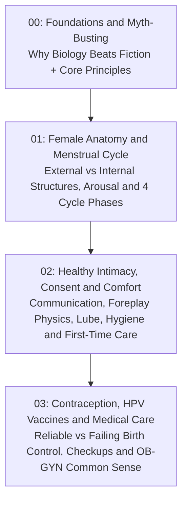

# Intimacy, Female Anatomy & Evidence-Based Sex Education (科学两性与女性生理常识导览)

Growing up in Mainland China—or focusing intensely on school, university, and software engineering through your 20s—means almost nobody ever sat down and taught you **accurate, respectful, medically grounded human anatomy and adult sex education**. School biology textbooks skipped over those chapters in silence, while internet media and movies portray exaggerated, unrealistic choreography that has almost nothing to do with real female physiology, comfort, or emotional connection.

Entering your first relationship in your 30s with **curiosity, humility, and scientific knowledge** is actually a massive advantage: instead of carrying bad habits or ego, you get to learn how the female body genuinely works from day one—becoming a calm, safe, attentive, and deeply caring partner.

---

## Curriculum Architecture & Learning Path

### Module Directory

| Module | File | Core Focus | Why Every Partner Needs This |
| :--- | :--- | :--- | :--- |
| **00** | [00-README.md](00-README.md) | Unlearning media myths, the 5 golden principles of healthy intimacy | Replaces embarrassment and guesswork with calm, medical clarity |
| **01** | [01-FEMALE-ANATOMY-AND-MENSTRUAL-CYCLE.md](01-FEMALE-ANATOMY-AND-MENSTRUAL-CYCLE.md) | Vulva vs vagina, the 3 external openings, clitoral anatomy, uterus/ovaries, the 4 hormonal phases & real period pain care | Understand her body's daily and monthly signals instead of saying empty phrases like "drink hot water" (`多喝热水`) |
| **02** | [02-HEALTHY-INTIMACY-CONSENT-AND-FIRST-TIME-CARE.md](02-HEALTHY-INTIMACY-CONSENT-AND-FIRST-TIME-CARE.md) | Enthusiastic consent, cultural/religious pace respect, arousal physiology, water-based lubricant, first-time expectations & UTI hygiene | Ensures emotional safety, zero avoidable pain, and relaxed confidence for first-time partners |
| **03** | [03-CONTRACEPTION-STI-PREVENTION-AND-MEDICAL-CARE.md](03-CONTRACEPTION-STI-PREVENTION-AND-MEDICAL-CARE.md) | Condom & short-acting pill science vs dangerous myths (`安全期/体外/紧急避孕药`), 9-valent HPV vaccine for men & women, Grade-3A hospital care | Protects your partner's body and future health with 99%+ reliability |

---

## 1. Five Myths Every Adult Must Unlearn Immediately

| Common Myth | Medical & Physiological Reality |
| :--- | :--- |
| **Myth 1: Movies / adult videos show how real intimacy works** | Commercial videos are edited athletic performances filmed for cameras, skipping 90% of emotional warmth, verbal check-ins, slow foreplay, lubrication, condom placement, and post-intimacy hygiene. Copying them causes discomfort and disconnection in real life. |
| **Myth 2: "Vagina (`阴道`)" refers to everything between a woman's legs** | **Vulva (`外阴`)** is the external anatomy (labia, clitoris, urethral opening, vaginal entrance); the **vagina (`阴道`)** is strictly the internal muscular canal leading to the cervix (`宫颈`). Crucially, **women do NOT urinate from the vagina**—the urethral opening (`尿道口`) is a separate tiny opening just above the vaginal entrance! |
| **Myth 3: First-time intercourse must hurt and bleed ("hymen breaking / 处女膜破裂见红")** | Medically termed the **vaginal corona (`阴道瓣`)**, the hymen is NOT a sealed drumhead lid—it is a thin, elastic crescent or ring of mucosal tissue with natural openings from birth (otherwise menstrual blood could never exit!). Its thickness varies hugely by genetics; cycling, gymnastics, or tampons stretch it naturally, and **over 40–50% of women do NOT bleed on their first time**, especially when relaxed, unhurried, and well-lubricated. Pain and bleeding are never a "test" or goal! |
| **Myth 4: Penetration alone naturally produces female orgasm** | The inner two-thirds of the vaginal canal has relatively few touch/pain nerve endings (an evolutionary adaptation for childbirth!), whereas the **clitoris (`阴蒂`)** contains **8,000–10,000+ sensory nerve endings**. Clinical studies consistently show **70%–80% of women require gentle external clitoral stimulation** (not penetration alone) to reach climax. |
| **Myth 5: Using lubricant (`润滑液`) means a partner isn't attracted enough** | Natural vaginal transudate fluctuates wildly with menstrual cycle phase, antihistamines, mild dehydration, room temperature, or first-time nervousness. Keeping a clean, unscented **water-based lubricant (`水溶性人体润滑液`)** on hand is universally recommended by OB-GYNs to prevent painful micro-abrasions and condom breakage. |

---

## 2. The Five Golden Rules of a Great Partner

1. **Safety & Consent Come First (`尊重与安全感永远第一`)**:
   - Physical intimacy should only happen at a pace where **both** partners feel 100% emotionally safe, respected, and unpressured—including full respect for personal, family, cultural, and religious values (such as marriage timelines in observant families). "Wait" or "let's stop/slow down" is always met with a warm hug, never pouting or pressure.
2. **Unhurried Warmth Over Performance (`慢即是好，连接大于技巧`)**:
   - Intimacy is not an exam with a pass/fail score. Nervousness, awkwardness, laughing together, asking *"Does this feel comfortable or too fast?"*, and simply holding each other are what build genuine closeness.
3. **Strict Hygiene Protects Her Anatomy (`个人卫生是对伴侣最基本的爱护`)**:
   - Because the female urethra is short (~`4 cm`) and sits right next to the vaginal opening, unwashed male hands, long rough fingernails, or unwashed skin directly introduce *E. coli* and skin bacteria, causing acute urinary tract infections (`尿路感染`) or vaginitis (`阴道炎`). Showering, trimming/filing nails smooth, and washing hands beforehand are non-negotiable habits.
4. **Never Gamble With Her Body on Contraception (`绝不用侥幸心理赌避孕`)**:
   - An unplanned pregnancy or repeated emergency contraceptive pills (`紧急避孕药`) inflict heavy physical and emotional harm strictly on the woman's body. A responsible man masters proper condom use (or dual protection) before intimacy ever begins—and **never** relies on "safe days (`安全期`)" or "pulling out (`体外`)".
5. **Normalize Medical Literacy Without Shame (`科学就医，拒绝羞耻与野鸡医院`)**:
   - Periods, cramps, discharge changes, UTIs, HPV vaccination, and checkups are ordinary human physiology—just like dental care or eyesight. Discuss them openly, gently, and factually.
