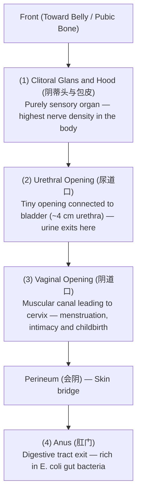
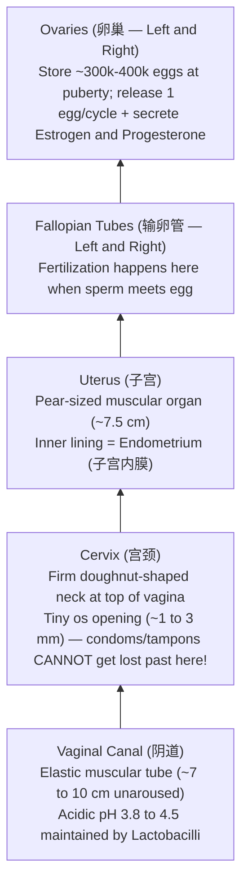
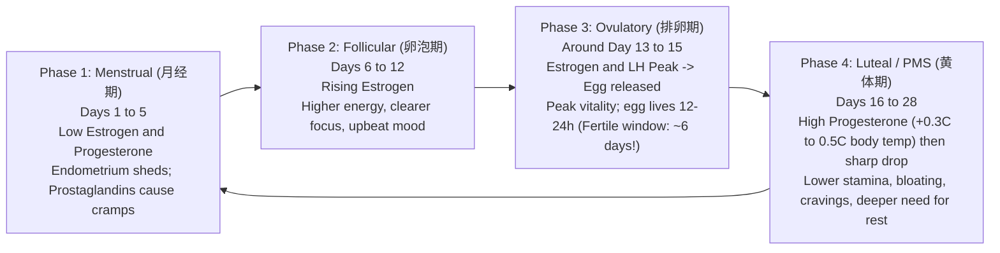

# Understanding the Female Body, Hormones & Menstrual Cycle (女性生理结构与月经周期科学)

To care well for your girlfriend—both in everyday life (when she has cramps, fatigue, or hormonal shifts) and in physical closeness—you need an accurate mental map of **external anatomy**, **internal reproductive organs**, and the **four-phase monthly endocrine cycle**.

---

## Table of Contents

1. [External Anatomy: The Vulva & Three Distinct Openings](#1-external-anatomy-the-vulva--three-distinct-openings)
2. [The Clitoral Network & Physiology of Female Arousal](#2-the-clitoral-network--physiology-of-female-arousal)
3. [Internal Reproductive Anatomy: Vagina, Cervix, Uterus & Ovaries](#3-internal-reproductive-anatomy-vagina-cervix-uterus--ovaries)
4. [Breast Anatomy & Cyclical Sensitivity](#4-breast-anatomy--cyclical-sensitivity)
5. [The 4 Phases of the Menstrual Cycle (Days 1 to 28)](#5-the-4-phases-of-the-menstrual-cycle-days-1-to-28)
6. [How to Actually Care for Her During Period Cramps (`痛经科学护理`)](#6-how-to-actually-care-for-her-during-period-cramps-痛经科学护理)

---

## 1. External Anatomy: The Vulva & Three Distinct Openings

In everyday speech people mistakenly call everything external the "vagina," whereas anatomically the external region is the **vulva (`外阴`)**.

### 1.1 Front-to-Back Spatial Layout (Crucial for Hygiene!)

Moving strictly from **front (pubic bone) to back (tailbone)**, there are **three separate anatomical structures and openings**:

**Why This Spatial Order Matters Every Single Day**:
- **Direction Rule (`永远从前往后`)**: Because the anus (`肛门`), vaginal opening (`阴道口`), and urethral opening (`尿道口`) sit within just a few centimeters of each other, wiping, touching, or moving **from back to front** drags intestinal bacteria (*E. coli*) directly into the vagina and urethra—immediately triggering painful **urinary tract infections (`尿路感染 / 膀胱炎`)** or **bacterial vaginosis (`细菌性阴道病`)**. Everything—wiping, washing, and intimacy—must strictly respect the **front-to-back** one-way boundary!
- **Labia Majora & Labia Minora (`大阴唇与小阴唇`)**:
  - The outer folds (`大阴唇`) and inner petal-like mucosal folds (`小阴唇`) protect the delicate urethral and vaginal openings from friction and dryness.
  - **Important Aesthetic Truth**: Just like human faces or ears, natural labia minora vary widely in size, asymmetry, and pigment (from pale pink to deeprose-brown due to normal hormone and melanin distribution—it has **zero** connection to sexual history, despite predatory cosmetic clinic ads!).

---

## 2. The Clitoral Network & Physiology of Female Arousal

### 2.1 Iceberg Structure of the Clitoris (`阴蒂的冰山结构`)

What is visible externally at the top junction of the inner labia (`阴蒂头`, about the size of a pea) is only **10% of the organ**:
- Beneath the skin, the clitoris extends `9–11 cm` internally as two wishbone-shaped erectile crura (`阴蒂脚`) and vestibular bulbs (`前庭球`) hugging both sides of the vaginal entrance.
- **Direct Touch Sensitivity**: Because `8,000+` nerve endings are concentrated in a tiny area, touching a dry clitoral glans directly right away feels **overwhelming or stinging** (comparable to rubbing an eyeball or an oversensitive glans). Gentle, indirect touch *through* the clitoral hood (`阴蒂包皮`), slow rhythmic warmth, and ample moisture are essential.

### 2.2 Why Female Arousal Takes 15–25 Minutes (`女性唤起生理机制`)

Male and female vascular arousal operate on different clocks:
- Men can experience physical erection in `30–90 seconds`.
- In women, **emotional relaxation + slow affectionate foreplay (`15–25 minutes` of kissing, holding, gentle touch, and warmth)** triggers blood flow (`盆腔充血`) that causes two vital physical changes:
  1. **Natural Lubrication (`阴道渗出液`)**: Plasma filters through the vaginal walls to coat the canal.
  2. **Vaginal Tenting / Ballooning (`阴道帐篷效应`)**: Smooth muscle relaxes, the uterus lifts slightly upward, and the vaginal canal lengthens and widens comfortably by `30%–50%`.
- **Attempting penetration before tenting and lubrication occur** is the #1 cause of sharp friction pain and micro-tears!

---

## 3. Internal Reproductive Anatomy: Vagina, Cervix, Uterus & Ovaries

### Three Everyday Biological Facts Good Partners Know

1. **Nothing Can "Get Lost" Inside the Vagina**:
   - The top of the vaginal canal ends in a closed, firm muscular wall around the **cervix (`宫颈`)** (which feels like the tip of your nose). The cervical opening (`宫颈口`) is microscopic (`1–3 mm`), just wide enough for menstrual fluid out or microscopic sperm in—a condom or tampon can **never** slip up into the abdomen!
2. **Self-Cleaning Acidic Ecosystem (`阴道自洁系统`, pH `3.8–4.5`)**:
   - Healthy *Lactobacillus* (`乳酸杆菌`) bacteria keep the internal vagina mildly acidic (like yogurt) to block pathogens.
   - **Normal Daily Discharge (`正常白带`)**: Healthy women naturally have `1–4 mL` of clear, milky-white, or slightly pale-yellowish odorless fluid per day (which dries slightly yellowish on cotton underwear and becomes stretchy like raw egg white around ovulation). **Never** buy commercial "internal vaginal wash/douche (`妇炎洁等阴道内冲洗液`)"—flushing inside kills good *Lactobacilli* and *causes* infections! Only external vulvar rinsing with plain warm water is needed.
3. **Pelvic Floor Muscles (`盆底肌`)**:
   - Hammock-like muscles supporting the bladder, uterus, and bowel. When a woman feels anxious, cold, or braced against expected pain, these muscles clamp shut involuntarily—making gentleness and emotional safety essential.

---

## 4. Breast Anatomy & Cyclical Sensitivity

- Breasts consist of mammary glands (`乳腺腺体`), milk ducts (`乳腺导管`), connective tissue, and fat cushioned over the pectoral muscle.
- **Natural Asymmetry**: Nearly every woman has one breast slightly fuller or shaped slightly differently than the other—100% normal anatomy.
- **Pre-Period Tenderness (`经前乳房胀痛`)**: During the 7–10 days *before* her period starts (Luteal phase), rising progesterone and estrogen cause harmless fluid retention and glandular swelling. Hugs, stairs, or firm touch that felt fine two weeks ago may suddenly feel sore and tender—always check in gently!

---

## 5. The 4 Phases of the Menstrual Cycle (Days 1 to 28)

A healthy adult cycle typically spans **21 to 35 days** (`Day 1` = first day of bright red menstrual bleeding, *not* the day the period ends!). Across every month, her estrogen (`雌激素`) and progesterone (`孕激素`) rise and crash—affecting core body temperature, sleep quality, gut motility, energy, and mood.

| Phase | What Happens Biologically | How She Often Feels | How a Thoughtful Partner Shows Up |
| :--- | :--- | :--- | :--- |
| **1. Menstrual (`月经期`, ~Days 1–5)** | Uterus sheds functional lining (`30–80 mL` blood + tissue); **prostaglandins (`前列腺素`)** trigger uterine muscle contractions (`痛经`) and also stimulate nearby intestines (causing loose stools/bloating `经期腹泻`!). | Cramps, lower-back ache, heavy fatigue, iron dip, sensitivity to cold. | Zero exhausting errands; prepare heat pad, warm meals, pain relief on standby, and take care of chores quietly. |
| **2. Follicular (`卵泡期`, ~Days 6–12)** | Follicles mature in ovaries; estrogen climbs steadily; uterine lining rebuilds. | Recharged, lighter, optimistic, social, higher physical stamina. | Great week for active dates, travel exploration, hiking, or trying new restaurants! |
| **3. Ovulatory (`排卵期`, ~Days 13–15)** | Luteinizing Hormone (`LH`) surge releases a mature egg; clear stretchy cervical mucus (`蛋清样拉丝白带`). Some women feel a brief 1-sided lower belly twinge (`排卵痛`). | Peak energy and warmth (note: **highest pregnancy probability**—sperm survive up to 5 days waiting for this egg!). | Enjoy active connection; maintain 100% strict condom/contraceptive discipline! |
| **4. Luteal / PMS (`黄体期`, ~Days 16–28)** | Corpus luteum secretes **progesterone**, raising basal body temperature by `0.3°C–0.5°C` and slowing digestion; if no pregnancy occurs, both hormones drop sharply on Days 25–28 (**PMS `经前综合征`**). | Sleepier, warmer, mild bloating, breast soreness, lower stress tolerance, tearfulness or irritability before bleeding starts. | **Never say "Why are you so emotional?"** Recognize hormonal exhaustion, lower conflict friction, offer comfort food, early sleep, and calm reassurance. |

---

## 6. How to Actually Care for Her During Period Cramps (`痛经科学护理`)

Saying *"多喝热水"* ("drink more hot water") from across the room is a meme for a reason: it dumps zero effort onto a generic platitude while she is in visceral muscle pain. Here is what **actually works physiologically**:

1. **Understand NSAID Timing (`布洛芬不是毒药，越早吃效果越好`)**:
   - Primary dysmenorrhea (`原发性痛经`) is caused by the uterine lining releasing **prostaglandins (`PGF2α`)**, which constrict uterine blood vessels into painful ischemia.
   - **Ibuprofen (`布洛芬`, e.g., `200–400 mg` taken *with food/milk*) or Naproxen (`萘普生`)** works by **blocking the COX enzyme from manufacturing new prostaglandins**—it cannot easily erase prostaglandins already flooding the bloodstream!
   - Therefore, taking 1 capsule **at the very first hint of cramps/bleeding** relieves 80%+ of pain safely (**non-addictive!** Taking ibuprofen 2–3 days a month does *not* cause addiction or tolerance; just avoid on an empty stomach if she has gastric ulcers).
2. **Continuous `40°C–45°C` Local Heat (`腹部热敷`)**:
   - Clinical trials show topical abdominal heat relaxes smooth muscle spasm nearly as effectively as low-dose painkillers—and works additively *with* ibuprofen! Keep adhesive heat patches (`暖宝宝` — stick on the *outside of underwear/shirt*, NEVER directly on bare skin to avoid low-temp burns!), a rechargeable hot-water bag, or electric heating pad stocked at home.
3. **Nutritional & Practical Care**:
   - Cook warm, digestible, iron- and magnesium-rich meals (beef/lean pork soup, warm ginger-jujube tea if she enjoys it, dark chocolate, warm congee), avoid icy drinks if cold triggers GI cramps for her, and handle dishes/laundry so she can curl up undisturbed.
4. **Medical Red Flags (`需要陪她去三甲医院妇科排查的信号`)**:
   - If cramps get **progressively worse year after year**, require multiple painkillers without relief, cause fainting/vomiting, or come with **heavy bleeding** (soaking through a maxi pad every 1–2 hours, or periods lasting `> 8 days`), encourage a gentle checkup (pelvic ultrasound `妇科B超`) to rule out treatable conditions like **endometriosis (`子宫内膜异位症`)**, **adenomyosis (`子宫腺肌症`)**, or **uterine fibroids (`子宫肌瘤`)**.
