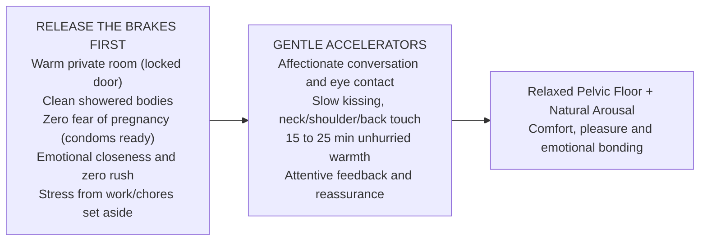
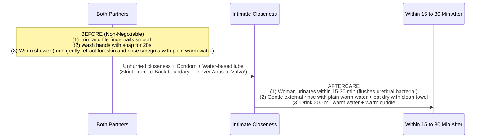

# Healthy Intimacy, Consent, Comfort & First-Time Guidance (亲密关系沟通、舒适度与初次体验指南)

For someone entering a romantic relationship without prior experience, the biggest source of stress is **fear of the unknown**: *"What if I don't know what to do? What if I hurt her? What if I'm nervous?"*

Here is the reassuring truth: **great intimacy is 80% emotional safety, hygiene, patience, and communication—and only 20% mechanics**. A gentle, attentive first-time partner who listens to his girlfriend's cues is infinitely better than someone rushing through scripted moves.

---

## Table of Contents

1. [Enthusiastic Consent & Respecting Cultural / Personal Pace](#1-enthusiastic-consent--respecting-cultural--personal-pace)
2. [The Dual-Control Model: Accelerators vs Brakes (`唤起与抑制双控制模型`)](#2-the-dual-control-model-accelerators-vs-brakes-唤起与抑制双控制模型)
3. [Natural Progression of Physical Affection (No Rushing!)](#3-natural-progression-of-physical-affection-no-rushing)
4. [First-Time Intercourse: Step-by-Step Comfort & Zero-Pain Principles](#4-first-time-intercourse-step-by-step-comfort--zero-pain-principles)
5. [Normalizing Male Nervousness & Performance Anxiety](#5-normalizing-male-nervousness--performance-anxiety)
6. [Mandatory Pre- and Post-Intimacy Hygiene Checklist (`事前事后卫生铁律`)](#6-mandatory-pre--and-post-intimacy-hygiene-checklist-事前事后卫生铁律)

---

## 1. Enthusiastic Consent & Respecting Cultural / Personal Pace

Healthy intimacy runs on **enthusiastic, ongoing, reversible consent (`积极、持续、可随时撤回的同意`)**:

- **Every Couple Sets Their Own Timeline**: Especially in cross-cultural relationships (for instance, with partners from Morocco or families with traditional/faith-informed values), partners may hold deeply meaningful boundaries around privacy, public affection, or saving certain levels of physical intimacy until deeper commitment or marriage. **Talk openly in calm, clothed, daylight moments** about what makes her feel cherished, comfortable, and respected!
- **Consent Is Not a One-Time Contract**:
  - Checking in warmly (*"Is this okay?"*, *"Do you want to slow down?"*, *"Tell me if anything feels uncomfortable"*) builds deep trust—women find calm verbal care reassuring, never awkward!
  - Pay attention to **body language**: leaning in, relaxed breathing, and warm reciprocation mean green light; freezing up, tensing shoulders, turning away, or wincing mean **pause immediately**, hold her gently, and ask how she is feeling without an ounce of frustration.

---

## 2. The Dual-Control Model: Accelerators vs Brakes (`唤起与抑制双控制模型`)

Sex researcher Dr. Emily Nagoski's landmark finding (*Come as You Are*) explains female desire better than any other model in medicine:

- Every human brain has two independent pedals: a **Sexual Excitation System (the Gas Pedal / 油门)** and a **Sexual Inhibition System (the Brake Pedal / 刹车)**.
- Many men try to press harder on the gas pedal (more physical touch), **not realizing her foot is still firmly on the brake pedal**! As long as the brakes are engaged, physical touch will not feel arousing.

**Common "Brakes" You Can Proactively Remove**:
1. Feeling cold (keep bedroom `22°C–25°C` with a soft blanket—cold feet literally suppress female arousal reflexes in lab studies!).
2. Worry about privacy (thin walls, unlocked doors, family nearby).
3. Worry about hygiene or unplanned pregnancy.
4. Feeling rushed toward a finish line rather than simply enjoying closeness.

---

## 3. Natural Progression of Physical Affection (No Rushing!)

Intimacy is **not** an all-or-nothing jump from holding hands straight to intercourse. Healthy couples build comfort across weeks or months in unhurried layers:

1. **Everyday Non-Sexual Warmth**: Holding hands, forehead kisses, hugging without expecting it to "lead somewhere," brushing hair back, shoulder massages after a long day. (If every hug feels like a demand for escalation, a partner starts guarding against hugs!)
2. **Slow Sensual Closeness**: Unhurried kissing, cuddling, learning where she enjoys light vs firm touch (neck, ears, collarbones, back, waist) while asking warmly what she likes.
3. **Intimate Touch & Shared Exploration**: Exploring gently only when both feel completely ready, keeping communication light and affectionate.

---

## 4. First-Time Intercourse: Step-by-Step Comfort & Zero-Pain Principles

When both partners explicitly decide they are ready for intercourse:

### 4.1 Preparation Essentials (Keep Within Arm's Reach)
- **Properly sized, in-date Latex or Polyurethane Condoms (`避孕套`)** from a reputable pharmacy/flagship brand (e.g., Durex, Okamoto, Sagami, Jissbon—check expiration date!).
- **Unscented, Glycerin-Free Water-Based Lubricant (`无香精水溶性人体润滑液`)**:
  - Avoid "warming / tingling / cooling / fruit-flavored" novelty lubes—menthol, glycerin, and sugars irritate delicate vulvar mucosa and trigger yeast infections (`霉菌性阴道炎`)! Choose pure, medical-grade pH-balanced water-based lubricant.
  - **CRITICAL MATERIAL RULE**: **Never** use Vaseline (`凡士林`), baby oil, coconut/olive oil, or hand lotion with latex condoms—oils chemically dissolve latex within **60 seconds**, causing silent micro-ruptures! Water-based lubricant is 100% safe with all condoms.

### 4.2 Golden Comfort Rules During the Moment
1. **Generous Unhurried Foreplay (`15–25+ minutes`)**: Wait until she is deeply relaxed, breathing warmly, and explicitly says she feels ready.
2. **Apply Condom + Add a Few Drops of Water-Based Lube on the *Outside* of the Condom Tip**: Even with natural moisture, latex/polyurethane has higher surface friction than skin; a few drops of water-based lube on the exterior eliminates dry tugging (`干涩拉扯感`).
3. **Go Slowly & Let Her Control the Angle/Pace**:
   - At initial entry, pause completely for `10–20 seconds` while breathing slowly together so the pelvic floor muscles (`盆底肌`) naturally relax rather than clamping down defensively.
   - **Pain Is a Stop/Adjust Signal, Never Something to "Push Through"**: Mild stretching/fullness at first is normal; **sharp, burning, or tearing pain means STOP immediately**, hold her warmly, add lubricant or return to gentle cuddling—there is zero rush to "succeed" in a single evening! Sometimes relaxing across two or three unhurried nights makes everything effortless and pain-free.
4. **Aftercare (`温存与事后照顾` — Often Neglected, Deeply Important!)**:
   - After intimacy, oxytocin (`催产素`) and vulnerability peak. **Never** immediately roll over to scroll your phone! Hold her closely for 5–10 minutes, tell her how much you care about her, bring her a glass of warm water and tissues, and remind her gently about the post-intimacy bathroom trip (Section 6).

---

## 5. Normalizing Male Nervousness & Performance Anxiety

If you have never been intimate with a partner before, know how **male autonomic physiology** works so you never panic if your body acts nervous the first few times:

- **Why Nervousness Affects Erections (`交感神经与副交感神经拮抗`)**:
  - Physical erection requires the **parasympathetic nervous system (`副交感神经` — "rest, relax, feel safe")** to dilate blood vessels.
  - First-time excitement, fear of making mistakes, or rushing to put on a condom fires the **sympathetic nervous system (`交感神经` — adrenaline / "fight or flight")**, which constricts peripheral blood vessels!
  - Losing firmness while fumbling with a condom packet or feeling nervous on your first 1–3 nights happens to **the majority of healthy 20- and 30-something men**—it means your brain cares deeply, NOT that anything is broken medically!
- **Why First-Time Timing Is Often Fast**:
  - High novelty and sensitivity naturally make early experiences brief (`1–3 minutes` is completely common at first; even long-term clinical median intravaginal latency `IELT` across healthy couples globally is `5.4 minutes`, NOT the 45-minute fiction of movies!).
- **The Instant Reset**: Smile, say honestly *"I feel so lucky to be close to you that I'm a little nervous,"* cuddle, kiss, focus on her comfort, and take all performance pressure off the table. Within a few relaxed experiences together, your nervous system recalibrates automatically.

---

## 6. Mandatory Pre- and Post-Intimacy Hygiene Checklist (`事前事后卫生铁律`)

Memorize this simple 6-step medical protocol—it prevents **90% of relationship UTIs (`蜜月期尿路感染`) and gynecological inflammation**:

1. **Fingernails Short & Filed Smooth**: Sharp nail edges cause microscopic cuts in delicate mucosal tissue.
2. **Men's Shower Detail (`男性包皮清洁`)**: Before intimacy, gently pull back the foreskin (`包皮`) in the shower and rinse away any accumulated sebum/smegma (`包皮垢`) with plain warm water—male smegma carries dense anaerobic bacteria linked directly to partner vaginitis and cervical irritation.
3. **Oral Hygiene**: Brush teeth/rinse mouth; **avoid oral contact if either partner has an active cold sore / fever blister on the lip (`唇疱疹 / 单纯疱疹 HSV-1`)**, as oral HSV-1 can transmit to delicate skin!
4. **The Golden Post-Intimacy Rule — Pee Within 15–30 Minutes (`事后排尿是预防尿路感染的第一神技`)**:
   - Friction near the short `4 cm` female urethra nudges skin bacteria toward the urethral entrance. Drinking a glass of water and **urinating once within 15–30 minutes after intimacy** mechanically flushes those bacteria out before they can climb to the bladder!
5. **External Warm Water Only**: Gently rinse external skin with clean warm water and pat dry with a dedicated clean towel or clean facial tissue (`一次性棉柔巾`)—never flush soap or antiseptics inside the vagina.
