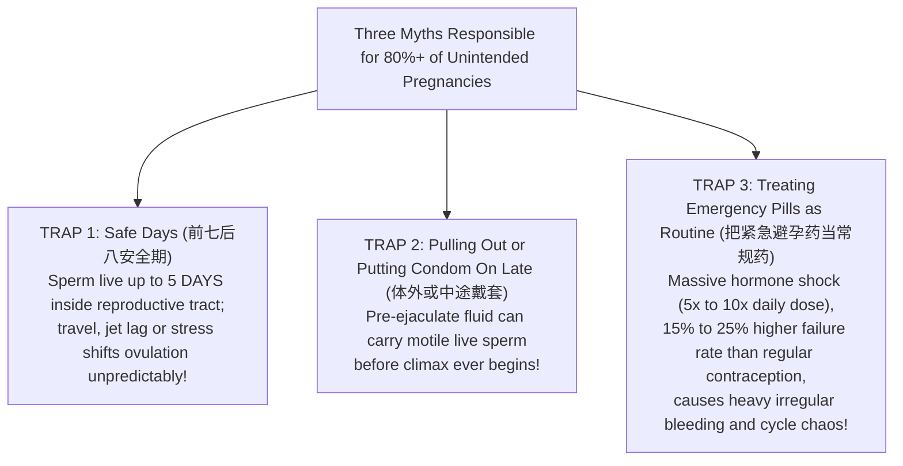

# Reliable Contraception, HPV Vaccination & Medical Common Sense (科学避孕、疫苗与两性健康防护)

Nothing expresses genuine love and maturity more clearly than **taking proactive responsibility for reproductive safety and preventive medicine**. This guide ranks birth control methods by clinical failure rates, explains correct condom mechanics, covers mutual vaccination (`HPV` & `Hep B`), and outlines when and where to seek legitimate medical care.

---

## Table of Contents

1. [Evidence-Based Contraception Tier List (Clinical Failure Rates)](#1-evidence-based-contraception-tier-list-clinical-failure-rates)
2. [Three Dangerous Contraception Traps to NEVER Rely On](#2-three-dangerous-contraception-traps-to-never-rely-on)
3. [Correct Condom Engineering: Sizing, Application & Accident Protocol](#3-correct-condom-engineering-sizing-application--accident-protocol)
4. [Short-Acting Pills (`短效避孕药`) vs Emergency Pills (`紧急避孕药`)](#4-short-acting-pills-短效避孕药-vs-emergency-pills-紧急避孕药)
5. [Mutual Preventive Health: 9-Valent HPV Vaccine & Couple Checkups](#5-mutual-preventive-health-9-valent-hpv-vaccine--couple-checkups)
6. [Common Gynecological & Urological Issues (Zero Stigma, Legitimate Hospitals Only!)](#6-common-gynecological--urological-issues-zero-stigma-legitimate-hospitals-only)

---

## 1. Evidence-Based Contraception Tier List (Clinical Failure Rates)

Obstetricians measure birth control reliability using the **Pearl Index**—the percentage of couples experiencing an unintended pregnancy within **1 year**:

| Tier | Method | Perfect-Use Failure | Typical Real-World Failure | STI Protection? | Best Use Case |
| :--- | :--- | :--- | :--- | :--- | :--- |
| **Tier S (Long-Acting Reversible)** | Subdermal Implant (`皮下埋植`) / Hormonal or Copper IUD (`宫内节育器`) | `0.05% – 0.6%` | `0.05% – 0.8%` | No | Long-term committed/married couples wanting multi-year hands-off protection |
| **Tier A (Daily Hormonal)** | Combined Oral Contraceptive — **Short-Acting Pill (`短效避孕药 COC`, e.g., 优思明 / 优思悦)** | `0.3%` | `~7%` (missed pills) | No | Committed partners after OB-GYN medical screening (also regulates heavy/painful periods for some women) |
| **Tier A (Barrier Standard)** | **Male Condom (`医用乳胶 / 聚氨酯避孕套`)** — *used from start to finish every single time* | **`2%`** | `~13%` (only when put on late or slipped!) | **YES (Only method!)** | **Gold-standard starting choice for every couple** — zero systemic hormones, dual protection against pregnancy & infections |
| **Tier A+ (Dual Method)** | **Condom + Short-Acting Pill / IUD** | **`< 0.1%`** | **`< 1%`** | **YES** | Maximum peace of mind when pregnancy must be 100% avoided |
| **DANGER ZONE (Unreliable!)** | Withdrawal / Pull-Out (`体外射精`) | `4%` | **`20% – 22%` (1 in 5 pregnant/yr!)** | No | **DO NOT USE AS CONTRACEPTION** |
| **DANGER ZONE (Unreliable!)** | "Safe Period" Calendar (`安全期推算`) | `5%` | **`15% – 24%` (1 in 4 pregnant/yr!)** | No | **DO NOT USE AS CONTRACEPTION** |

---

## 2. Three Dangerous Contraception Traps to NEVER Rely On

1. **Why "前七后八安全期" Is Scientifically Broken**:
   - Even if a woman usually has a regular 28-day cycle, a single late night, long-haul flight, exam/work stress, or mild cold can shift ovulation forward or backward by 5–10 days without warning. Meanwhile, **healthy sperm survive 3 to 5 days** inside fertile cervical mucus waiting for an egg!
2. **Why "Just Touching / Putting the Condom On Halfway (`先蹭蹭 / 快射了再戴`)" Fails**:
   - Pre-ejaculatory fluid (`前列腺液 / 尿道球腺液`) secreted automatically during arousal can pick up live motile sperm remaining in the urethra and requires zero sensation of ejaculation to release. **The condom goes on BEFORE any genital-to-genital contact.**

---

## 3. Correct Condom Engineering: Sizing, Application & Accident Protocol

Most "condom failures" (`13%` typical vs `2%` perfect use) are actually **human operating errors**. Follow this exact 6-step checklist (practice opening and unrolling one privately beforehand so you aren't guessing in the dark!):

1. **Storage & Width Sizing (`标称阔度`)**:
   - Never store condoms in a hot car glovebox or tight back wallet pocket for months (heat and friction degrade latex!).
   - Standard Asian market condoms have a nominal flat width (`标称阔度`) of **`52 ± 2 mm`**. If `52 mm` leaves a painful red ring or refuses to unroll (`太紧易破`), step up to **`54–56 mm` (`大号`)**; if it bunches or slips (`太松易脱`), step down to **`49 mm` (`紧型`)**. If either partner has a latex sensitivity (`乳胶过敏` — itching/burning), switch immediately to **`0.01 / 0.02` Polyurethane (`聚氨酯`) condoms** (which also conduct body warmth better, though they stretch less than latex so sizing matters more!).
2. **Open With Fingers, Never Teeth or Scissors**: Check the expiry date and feel that the foil pillow still has a tiny air cushion (`有气垫感 = 未漏气`), then push the condom slightly aside and tear along the serrated edge.
3. **Check Roll Direction ("Sombrero Hat Up" vs Inside-Out)**:
   - Hold the rolled rim: it should unroll smoothly down the *outside* like a little rolled beanie/hat (`卷边朝外`). **Crucial rule**: If you touch it upside-down to the tip and realize it won't unroll, **throw that condom away and open a fresh one** (the outer side may already have pre-ejaculate on it!).
4. **Pinch the Reservoir Tip (`捏扁前端储精囊排空空气` — #1 Anti-Breakage Step!)**:
   - Pinch the `1 cm` nipple tip at the front flat with thumb and index finger *while* unrolling all the way to the base. Leaving an air bubble trapped at the tip causes friction pressure to burst the latex!
5. **Hold the Rim Firmly Upon Withdrawal (`及时按住根部退出`)**:
   - Withdraw **soon after ejaculation while still firm**, holding the base ring of the condom snugly against your body so it cannot slip off inside as firmness subsides.
6. **Quick Integrity Check**: Tie a knot or wrap cleanly in tissue (never flush down a toilet—clogs pipes!) and verify zero leaks.

### What If a Condom Breaks or Slips Off Completely? (`意外破损应急SOP`)

Stay completely calm, reassure your girlfriend immediately (panic helps nobody!), and follow medical protocol:
1. Have her urinate and rinse **externally** with warm water (**do NOT douche inside**—sperm reach the cervical canal within 90 seconds, and internal flushing only damages mucosa without preventing pregnancy).
2. If within **72 hours** (ideally **within 12–24 hours**—sooner = much higher efficacy!), consult a pharmacist or OB-GYN for a single-dose **Emergency Contraceptive Pill (`紧急避孕药`, e.g., Levonorgestrel `左炔诺孕酮 1.5 mg`)**. (Note: if she vomits within 2 hours of swallowing the tablet, a replacement dose is needed; expect her next period to arrive ~1 week early or late.)
3. Take a standard urine **hCG pregnancy test (`早孕试纸`, first morning urine)** **14–21 days** after the incident to confirm peace of mind.

---

## 4. Short-Acting Pills (`短效避孕药`) vs Emergency Pills (`紧急避孕药`)

Because Chinese names sound dangerously similar, many people confuse these two completely different medications:

| Feature | **Short-Acting Oral Contraceptive (`短效避孕药 COC`, e.g., 优思明 / 优思悦 / 妈富隆)** | **Emergency Contraceptive (`紧急避孕药 ECP`, e.g., 毓婷 / 金毓婷)** |
| :--- | :--- | :--- |
| **Purpose** | Planned, daily routine contraception (`21` or `28` micro-dose tablets per pack taken at the same hour daily) | **Strict emergency backup ONLY** after unprotected accident or broken condom (`<= 72h`) |
| **Hormone Dose** | Ultra-low steady physiological micro-dose (`20–30 mcg` ethinylestradiol + modern progestin like drospirenone) | Massive single hormone surge (`1,500 mcg` levonorgestrel) to forcibly delay ovulation |
| **Reliability** | **99.7%** when taken daily on schedule; fertility returns right away in the next cycle after stopping! | Only **~75%–85%** risk reduction (fails completely if ovulation already occurred that day!) |
| **Medical Screening Required?** | **YES** — requires an OB-GYN consultation first (contraindicated for women `>35` who smoke, have migraine with aura, history of blood clots/thrombosis, hypertension, or liver/breast conditions) | Over-the-counter emergency rescue; **should not be used repeatedly** (max 1–2 emergency rescues per year, never multiple times in one cycle) |

---

## 5. Mutual Preventive Health: 9-Valent HPV Vaccine & Couple Checkups

### 5.1 Get Vaccinated Against HPV — Men Included! (`男性接种 HPV 疫苗同样重要`)
- **Human Papillomavirus (`HPV`)** is so common that `80%+` of adults encounter a strain in their lifetime via normal intimate skin contact (even condoms only reduce—not 100% eliminate—skin-to-skin HPV transmission around the base). High-risk strains (**HPV 16, 18, 31, 33, 45, 52, 58**) cause **99% of cervical cancers (`宫颈癌`)** in women as well as throat/anal/genital cancers and warts (`HPV 6, 11`) in both sexes.
- **Action You Can Take Right Now at Age 32**:
  - Mainland China (and Hong Kong / international clinics) now offer **4-valent and 9-valent HPV vaccination (`四价 / 九价 HPV 疫苗`) for adult men** as well as women! Booking your own 3-dose HPV series (`0, 2, 6 months` at a local community health center `社区卫生服务中心` or international clinic in Shanghai) protects **both yourself and your girlfriend** for decades—it is one of the most thoughtful, concrete gestures a male partner can make!

### 5.2 Mutual Pre-Intimacy / Couple Checkup (`伴侣健康体检`)
- Before transitioning away from barrier protection in a committed long-term relationship (or before marriage `婚前医学检查`), doing a routine joint checkup at a legitimate hospital (**Hepatitis B surface antigen & antibody titer `乙肝两对半`**, **HIV / Syphilis / HCV routine blood screen `传染病四项`**, blood type / Rh factor—especially important to know in cross-national couples if one partner is **Rh-negative** for future pregnancy care!) builds 100% mutual transparency and safety.

---

## 6. Common Gynecological & Urological Issues (Zero Stigma, Legitimate Hospitals Only!)

### 6.1 Common Non-STI Conditions (Never Blame or Stigmatize!)
Even in a 100% monogamous, hygienic relationship—or even in women who have *never* had intercourse—minor imbalance happens easily from humidity, tight synthetic pants, antibiotic courses, or low sleep:

| Condition | Typical Symptoms | Cause & Calm Action |
| :--- | :--- | :--- |
| **Acute UTI / Cystitis (`急性尿路感染 / 膀胱炎`)** | Frequent urgent need to pee every 10 minutes, burning/stinging at the end of urination (`尿频、尿急、尿痛`), cloudy or pink-tinged urine | Usually ordinary skin/gut *E. coli* entering the short urethra. **Drink plenty of water + visit a hospital Urology/Internal Medicine (`泌尿外科/肾内科`)** same day for a 10-minute `尿常规` test and targeted 3-day prescription antibiotic—clears rapidly! (**Go to ER immediately** if accompanied by high fever, chills, or flank/kidney back pain!) |
| **Vulvovaginal Candidiasis — Yeast Infection (`外阴阴道假丝酵母菌病 / 霉菌性阴道炎`)** | Intense vulvar itching, redness, thick white cottage-cheese/curd-like odorless discharge (`豆腐渣样白带`) | Overgrowth of natural *Candida* fungus (often triggered by Shanghai's damp `梅雨季`, taking broad-spectrum antibiotics for a cold, high sugar, or tight non-breathable underwear)—**NOT an STI!** Treated easily via OB-GYN vaginal antifungal suppositories + breathable `100%` cotton underwear dried in sunlight/heat dryer. |
| **Bacterial Vaginosis (`细菌性阴道病 BV`)** | Thin greyish-white discharge with a fishy odor (`鱼腥味`) | Shift in vaginal pH / *Lactobacillus* depletion; cured cleanly with a short course of doctor-prescribed metronidazole/clindamycin. |

### 6.2 Strict Hospital Rule in China (`绝对避坑原则`)

> **NEVER click sponsored search-engine ads or visit private "men's/women's specialty hospitals" (`莆田系民营男科/妇科专科医院`)!** They manufacture fake alarming diagnoses ("severe cervical erosion `重度宫颈糜烂`" — note that "cervical erosion" was officially **removed from Chinese medical textbooks in 2008** because it is normal harmless **cervical columnar ectopy `宫颈柱状上皮异位`!**) to scam patients out of thousands of RMB in harmful laser/infusion procedures.

- **Always go ONLY to**:
  - **Public Grade-3A General or OB-GYN Hospitals (`公立三甲医院妇产科 / 泌尿外科`)** — in Shanghai, examples include **Obstetrics & Gynecology Hospital of Fudan University (`复旦大学附属妇产科医院 / 红房子医院`)**, **International Peace Maternity & Child Health Hospital (`国妇婴`)**, **Shanghai First Maternity and Infant Hospital (`上海市第一妇婴保健院`)**, **Ruijin / Zhongshan / Renji Hospital**, or reputable transparent international clinics (**Parkway / Jiahui International Hospital `嘉会国际医院` / United Family `和睦家`**).
