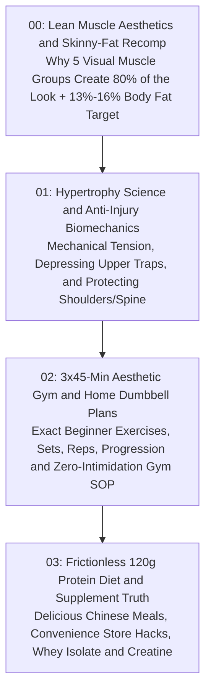
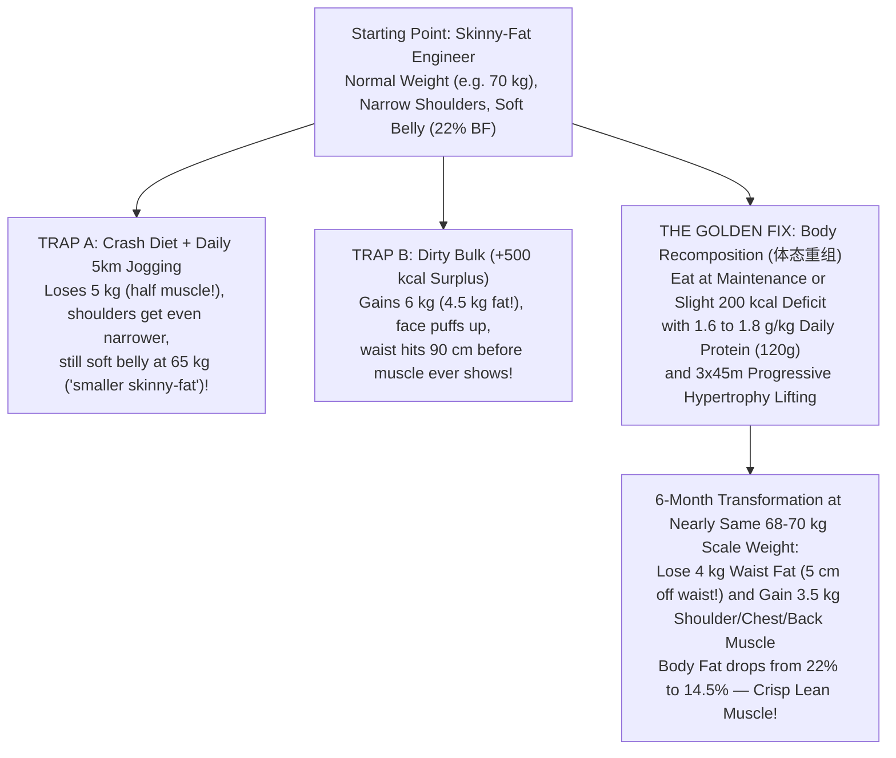

# Aesthetic Lean Muscle Engineering at 32: The "Swimmer / Clothes-Hanger" Physique (`薄肌与头肩比塑形指南`)

Most software engineers do **not** want to look like a bulky `100 kg` powerlifter whose neck disappears into giant upper traps and whose thighs rip through straight-leg trousers. What looks sharpest in everyday life—and makes every **heavyweight boxy hip-hop tee, linen shirt, and wool overcoat** in [mens-ootd-style-guide](../mens-ootd-style-guide/00-README.md) drape `3x` better—is **Lean, Defined Functional Muscle (`薄肌 / 穿衣显瘦、脱衣有肉`)**.

Even better: **building `4–6 kg` of lean muscle in the exact right visual places while sitting at `13%–16%` body fat is dramatically faster, safer on your joints, and infinitely easier to sustain at age 32** than chasing heavy barbell 1-rep maxes.

---

## Curriculum Architecture & Learning Path

### Module Directory

| Module | File | Core Focus | Practical Outcome |
| :--- | :--- | :--- | :--- |
| **00** | [00-README.md](00-README.md) | Visual proportion math (`头肩比 / 倒三角`), fixing **Skinny-Fat (`假瘦小肚子`)** via Body Recomposition | Stop doing random cardio that shrinks shoulders or dirty bulks that puff up your face |
| **01** | [01-HYPERTROPHY-BIOMECHANICS-AND-FORM-CUES.md](01-HYPERTROPHY-BIOMECHANICS-AND-FORM-CUES.md) | How muscle actually grows (`8–15 reps` tension, `1–2 RIR`), **how NOT to grow bulky neck-traps (`防斜方肌代偿沉肩法`)**, joint safety | Feel the exact target muscle working instead of sore neck, elbows, or lower back |
| **02** | [02-AESTHETIC-GYM-AND-HOME-DUMBBELL-PROGRAMS.md](02-AESTHETIC-GYM-AND-HOME-DUMBBELL-PROGRAMS.md) | Complete **`3 × 45-Min` Lean V-Taper Gym Split** (`乐刻/Pure`) + **Home Adjustable-Dumbbell Split** | Walk into any gym (or train in your living room) with zero confusion |
| **03** | [03-HIGH-PROTEIN-CHINESE-MEALS-AND-SUPPLEMENTS.md](03-HIGH-PROTEIN-CHINESE-MEALS-AND-SUPPLEMENTS.md) | Hitting `115–130 g` protein/day on tasty Chinese food (`盒马/山姆/外卖/家常菜`) + the ONLY 2 worthwhile supplements | Build lean muscle with zero boiled-chicken misery and zero supplement scams |

---

## 1. Lean Muscle (`薄肌`) vs Bulky Powerlifting: Different Goals, Different Blueprint

| Dimension | Bulky Strength / Bodybuilding (`大块头壮汉`) | Aesthetic Lean Muscle (`薄肌 / 衣架子身材`) |
| :--- | :--- | :--- |
| **Primary Visual Goal** | Maximum total mass & `1RM` barbell numbers | **`1.6 : 1` Shoulder-to-Waist V-Taper (`头肩比`)**, crisp jawline, flat waist, upright posture |
| **Target Body Fat (`体脂率`)** | Either `18%–24%` ("bear mode" bulk) or `<8%` stage dehydration | **`13%–16%` Sweet Spot** — visible flat abs/oblique lines in good light, healthy hormones, great energy & restaurant freedom! |
| **Priority Muscle Groups** | Heavy low-bar squats, heavy flat bench, heavy shrugs/traps | **1. Lateral & Rear Delts (`中后束肩宽`)**, **2. Upper Chest (`上胸饱满`)**, **3. Lats (`背阔宽度`)**, **4. Clean Arms/Forearms**, **5. Athletic Glutes/Core** |
| **Neck & Upper Traps (`上斜方肌`)** | Heavily developed (makes neck look thick/short in collars) | **Deliberately kept relaxed (`沉肩训练`)** so your neck stays long, clean, and sharp in shirts! |
| **Rep Range & Equipment** | Heavy `1–5 rep` barbells (higher lower-back/shoulder risk) | **`8–15 rep` controlled dumbbells, cables & machines** (maximum muscle tension, near-zero joint/spine risk!) |

---

## 2. The 5 Visual Anchor Muscles That Create 80% of the "Lean & Fit" Look

When someone sees you in a T-shirt at a café or shirtless at the beach, five specific anatomical regions dictate 80% of your silhouette:

1. **Lateral & Posterior Deltoids (`三角肌中束与后束` — #1 OOTD Game-Changer!)**:
   - Adds `2–3 cm` of horizontal cap width to each shoulder and pulls rounded "programmer shoulders" backward—instantly erasing narrow/sloping shoulders (`溜肩/窄肩`) and making your head look smaller (`优化头肩比`)!
2. **Clavicular Upper Pectorals (`胸大肌上束 / 锁骨下缘`)**:
   - Overdoing heavy flat bench press builds a droopy lower chest (`下胸下垂显油腻`), whereas **$15^\circ\text{--}30^\circ$ incline pressing** builds a clean, flat armor plate right beneath your collarbones!
3. **Latissimus Dorsi & Mid-Back (`背阔肌与中下斜方肌`)**:
   - Creates the subtle **V-shape** tapering from armpits to waist and holds your thoracic spine effortlessly tall without conscious effort.
4. **Long Head of Triceps, Brachialis & Forearms (`手臂线条` — Rolled Linen Sleeves!)**:
   - Triceps make up **two-thirds** of upper-arm silhouette; clean forearms below twice-rolled shirt sleeves are universally rated one of the most attractive subtle male features.
5. **Rectus Abdominis, Serratus & Glutes (`平坦腹肌与挺拔臀线`)**:
   - Built `70%` by reaching `14%–15%` body fat + `30%` by weighted spinal flexion (`悬垂举腿 / 绳索卷腹`) so abs have clean shallow blocks even at comfortable `15%` body fat—plus athletic glutes so straight jeans sit cleanly without sagging at the seat (`扁平臀裤子塌腰`)!

---

## 3. Solving the #1 Engineer Starting Point: "Skinny-Fat" (`假瘦小肚子体态重组`)

At age 32, 75% of desk-working East Asian engineers start out **Skinny-Fat (`正常体重肥胖 / 假瘦`)**: e.g., `175 cm`, `68–73 kg` (normal BMI!), thin arms and narrow shoulders in a T-shirt, yet `84–88 cm` soft belly fat around the navel (`体脂 21%–24%`).

### Realistic Timeline Expectations (Zero Fake 14-Day Influencer Lies)
- **Weeks 1–4**: Neural adaptation—posture stands taller immediately, sleep deepens, muscles feel firmer/fuller (`intracellular glycogen + water`), scale weight barely moves (do NOT panic—fat is trading places with lean tissue!).
- **Weeks 6–12**: Shirt shoulders noticeably fill out; belt tightens by **1–2 notches (`腰围缩小 3–4 cm`)**; girlfriend and friends notice you look sharper and younger in the face.
- **Months 4–9**: Genuine **"Lean Muscle (`薄肌`)" milestone**—`+3 to 4.5 kg` permanent contractile tissue across shoulders, upper chest, and lats, flat defined midsection, lifelong metabolic armor.
