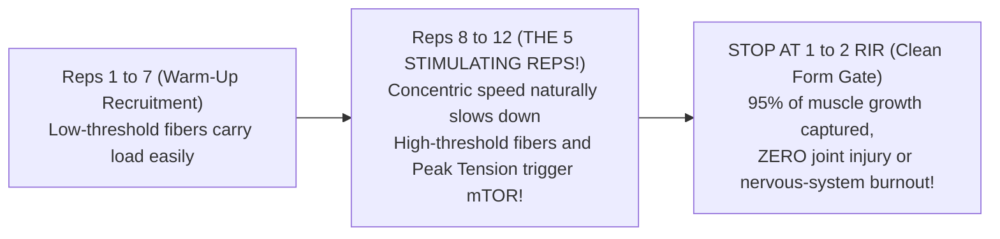

# Hypertrophy Science & Anti-Injury Biomechanics: Growing Lean Muscle Without Bulky Traps or Sore Joints (增肌力学与防代偿细节)

Beginners quit lifting for two preventable reasons: **(1) their neck, upper traps, elbows, or lower back hurt while their chest and side shoulders feel nothing**, or **(2) they think muscle only grows from lifting dangerous ego weights**. Master the **three hypertrophy laws** and **five anti-compensation cues** below before picking up a dumbbell.

---

## Table of Contents

1. [How Muscle Actually Grows: Mechanical Tension & Stimulating Reps](#1-how-muscle-actually-grows-mechanical-tension--stimulating-reps)
2. [Why `8–15 Reps` Beats Heavy `1–5 Reps` for Safe Lean Muscle](#2-why-815-reps-beats-heavy-15-reps-for-safe-lean-muscle)
3. [Cue #1 — Scapular Depression (`沉肩`): Grow Wide Shoulders, NOT a Thick Neck!](#3-cue-1--scapular-depression-沉肩-grow-wide-shoulders-not-a-thick-neck)
4. [Cue #2 — The `30°` Scapular Plane (`肩胛面`): Protect Your Rotator Cuffs Forever](#4-cue-2--the-30-scapular-plane-肩胛面-protect-your-rotator-cuffs-forever)
5. [Cue #3 — Pulling With Your Elbows, Not Your Biceps/Wrists (`手只是钩子，肘部驱动`)](#5-cue-3--pulling-with-your-elbows-not-your-bicepswrists-手只是钩子肘部驱动)

---

## 1. How Muscle Actually Grows: Mechanical Tension & Stimulating Reps

Modern exercise physiology (Schoenfeld, Beardsley) proved that muscle hypertrophy is **NOT** caused by "tearing muscle fibers apart and feeling crippled with soreness (`酸痛感 DOMS != 增肌效果`)".

Muscle grows via **Mechanotransduction (`机械张力传导`)**:
- When a muscle fiber contracts hard against resistance and **involuntarily slows down** on the final few reps of a set (approaching **1–2 Reps In Reserve `RIR`**), cell-membrane mechanosensors (`integrins / focal adhesion kinases`) trigger the **`mTORC1`** protein-synthesis pathway to add new sarcomeres!
- Whether you reach those **final 5 challenging slow reps** using a heavy `6-rep` load (`85% 1RM`) OR a joint-friendly `12–15 rep` load (`65% 1RM`), **hypertrophy per set is 100% IDENTICAL**—provided both sets end `1–2 reps` shy of technical failure!

---

## 2. Why `8–15 Reps` Beats Heavy `1–5 Reps` for Safe Lean Muscle

- **Compounds (`Incline DB Press, Lat Pulldown, Row, Split Squat, RDL`)**: Work in the **`8–12 rep`** window (`2–3 seconds` controlled lowering eccentric, `0.5s` pause in the stretch—muscle grows fastest under **loaded stretch `拉伸位张力`!**—and `1s` smooth drive up).
- **Small Aesthetic Isolations (`Lateral Raises, Rear Delt Flyes, Face Pulls, Arms`)**: Work in the **`12–18 rep`** window with lighter weights (`4–8 kg` dumbbells!)—going heavy on lateral raises only forces your upper neck-traps (`上斜方肌`) to swing the weight!

---

## 3. Cue #1 — Scapular Depression (`沉肩`): Grow Wide Shoulders, NOT a Thick Neck!

Why do many guys do lateral raises (`侧平举`) for 6 months and end up with a **sore, thick, shrugged neck (`斜方肌粗壮显脖子短溜肩`)** while their side delts barely grow?

Because raising your arms straight out to `90°` while shrugging your shoulders upward hands `70%` of the torque to the **upper trapezius**!

- **The Fix ("Reach Out Toward the Walls, Not Up Toward the Ceiling!")**:
  1. Before rep 1, gently slide your shoulder blades down into your back pockets (`沉肩 — 耳朵远离肩膀`) and lean your torso forward a tiny `10°`.
  2. Raise your arms slightly forward in the **`30°` Scapular Plane** (halfway between side and front—where your hands stay visible in peripheral vision!).
  3. Imagine pushing the dumbbells **horizontally outward toward the left and right walls** (`向远端推出去`) rather than shrugging upward, stopping right at shoulder height (`85°–90°`), and lowering slowly over `2.5 seconds`.

---

## 4. Cue #2 — The `30°` Scapular Plane (`肩胛面`): Protect Your Rotator Cuffs Forever

Never flare your elbows out at a `90°` T-shape (`大字型架肘`) during push-ups, dumbbell bench presses, or overhead presses! Flaring at `90°` pinches your **supraspinatus rotator cuff tendon (`冈上肌肌腱`)** directly under the acromion bone (`肩峰撞击综合征`).

- **Always tuck your elbows to a natural `45°–60°` arrow shape (`箭头夹角`)** on incline presses and push-ups, and press overhead with dumbbells angled `30°` inward—zero shoulder clicking, better upper-chest stretch, lifelong healthy shoulders!

---

## 5. Cue #3 — Pulling With Your Elbows, Not Your Biceps/Wrists (`手只是钩子，肘部驱动`)

Beginners complain: *"When I do Lat Pulldowns (`高位下拉`) or Rows (`划船`), my forearms and biceps burn out at rep 6 while my back feels zero contraction!"*

- **Three Instant Fixes**:
  1. **Thumbless "Hook Grip" (`四指半握钩住握把`)**: Wrap your thumb *over* the same side as your four fingers on Lat Pulldowns and Cable Rows, relaxing your grip to `60%` squeeze—treat your hands and forearms purely as passive metal hooks!
  2. **Drive Elbows Into Back Pockets (`想着用手肘往裤兜里揣`)**: Don't think "pull the bar to my chest"; think **"drive my elbows down and back toward my hips"** while lifting your sternum slightly to meet the bar.
  3. **Buy a Pair of RMB 45 Lifting Straps (`助力带 / Versa Gripps 平替握力带`)**: Using wrist straps on heavy rows, RDLs, and lat pulldowns removes forearm grip bottlenecks immediately, increasing back muscle activation by `30%+`!
