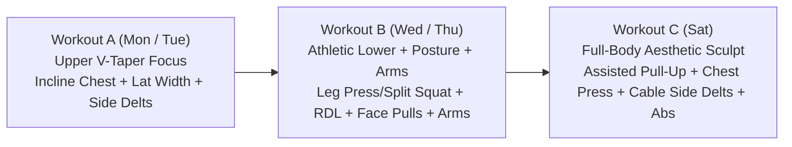

# 3×45-Minute Aesthetic Lean-Muscle Programs: Gym & Home Dumbbell Splits (薄肌三分化与居家哑铃实战计划)

You do **not** need a 6-day bodybuilder "bro split" (`Monday Chest, Tuesday Back...`) where missing one workday ruins the cycle. Research proves training each target muscle **2–3 times per week** across **3 crisp 45-minute sessions** (e.g., `Tue / Thu / Sat` or `Mon / Wed / Sat`) triggers `30%–40%` more protein synthesis than hitting a muscle once a week—while leaving 4 full evenings free for life, vlogging, cooking, and rest!

Below are **two complete plug-and-play programs**: **Track A (Commercial 24h Gym like `乐刻 / Pure`)** and **Track B (Living-Room Adjustable Dumbbells + Doorway/Stand Pull-Up Bar)**.

---

## Table of Contents

1. [Zero-Intimidation First Day at the Gym (`新手第一次进健身房不社恐指南`)](#1-zero-intimidation-first-day-at-the-gym-新手第一次进健身房不社恐指南)
2. [Track A — Commercial Gym `3 × 45-Min` Aesthetic V-Taper Split](#2-track-a--commercial-gym-3--45-min-aesthetic-v-taper-split)
3. [Track B — Home Adjustable-Dumbbell + Pull-Up Bar Split (`居家薄肌全套`)](#3-track-b--home-adjustable-dumbbell--pull-up-bar-split-居家薄肌全套)
4. [Exact Progression & Tracking Rules (`渐进超负荷记录法`)](#4-exact-progression--tracking-rules-渐进超负荷记录法)

---

## 1. Zero-Intimidation First Day at the Gym (`新手第一次进健身房不社恐指南`)

If you've rarely stepped into a free-weight area, remember: **serious lifters are the friendliest nerds in the room—everyone is focused on their own rest timer and headphones!** Follow four simple gym-etiquette rules and you look like a regular from Day 1:

1. **Best Low-Pressure Chain**: **Leke (`乐刻运动`, ~RMB 239/month monthly pay, zero pushy annual-card sales traps!)** or a clean condo/office gym. Go at `07:30–08:45`, `12:15`, or `20:30` to avoid the `18:30–19:45` bench rush.
2. **Shoes**: Wear **flat-soled shoes** (`Converse Chuck 70`, `Vans`, `Adidas Samba`, `Nike Metcon`, or `德训鞋`)—**never** squishy marathon foam running shoes when squatting or hinging (soft foam wobbles under your ankles!).
3. **Etiquette**: Re-rack dumbbells to their numbered slots after finishing, bring a small clean sweat towel (`擦汗毛巾`) to lay over benches, and politely ask *"请问这台器械我们能交替组用吗？"* ("Mind if I work in while you rest?") if busy.

---

## 2. Track A — Commercial Gym `3 × 45-Min` Aesthetic V-Taper Split

Every session starts with **4 minutes** of brisk incline walking + shoulder circles + 1 light warm-up set at `50%` working weight. Rest **`90 seconds`** on compound lifts (`#1–#3`) and **`60 seconds`** on aesthetic isolations (`#4–#6`).

### Workout A — Upper V-Taper Priority (`45 min`)
| # | Exercise | Sets × Reps | Aesthetic Target & Key Form Cue |
| :-: | :--- | :---: | :--- |
| 1 | **$30^\circ$ Incline Dumbbell Press (`30度上斜哑铃卧推`)** | `3 × 8–12` | **Upper Clavicular Chest** — bench at notch 2 (`30°`), elbows tucked `45°`, deep stretch at armpit level |
| 2 | **Wide Neutral-Grip Lat Pulldown (`宽距对握高位下拉`)** | `3 × 9–12` | **V-Taper Lat Width** — thumbless hook grip, depress shoulders first, drive elbows toward hips |
| 3 | **Chest-Supported Machine/DB Row (`俯卧胸托划船`)** | `3 × 10–12` | **Mid-Back Posture** — chest pad supports torso so lower back takes **zero** spinal shear! |
| 4 | **Dumbbell / Cable Lateral Raise (`哑铃或绳索侧平举`)** | **`4 × 12–16`** | **#1 Shoulder-Widening Move** — light weight, `30°` scapular plane, zero neck shrugging! |
| 5 | **Overhead Cable Triceps Extension (`绳索过头臂屈伸`)** | `3 × 12–15` | **Long Head of Triceps** — overhead stretch builds `40%` more arm size than pushdowns alone! |

### Workout B — Athletic Legs, Rear Delts & Clean Arms (`45 min`)
| # | Exercise | Sets × Reps | Aesthetic Target & Key Form Cue |
| :-: | :--- | :---: | :--- |
| 1 | **$45^\circ$ Leg Press OR DB Bulgarian Split Squat (`倒蹬机 / 保加利亚分腿蹲`)** | `3 × 10–12` | **Athletic Quads & Glutes** — zero spinal crushing load; place feet mid-high on sled for balanced glute/quad sweep |
| 2 | **Dumbbell Romanian Deadlift (`哑铃罗马尼亚硬拉 RDL`)** | `3 × 9–12` | **Hamstrings, Glutes & Lower-Back Armor** — push hips straight *backward* like closing a car door with your butt; shave dumbbells along shins, neutral flat spine! |
| 3 | **Rope Face Pulls OR Reverse Pec-Deck (`绳索面拉 / 蝴蝶机反向飞鸟`)** | **`4 × 14–18`** | **3D Rear Delts & Anti-Tech-Neck** — pulls rounded programmer shoulders permanently upright! |
| 4 | **$45^\circ$ Incline Dumbbell Curl (`上斜板哑铃弯举`)** | `3 × 10–14` | **Biceps Peak** — arms hang behind torso in deep stretch, zero body swinging |
| 5 | **Hanging Knee / Leg Raise (`悬垂举腿 — 卷骨盆!`)** | `3 × 10–15` | **Lower & Mid Abs** — curl tailbone upward toward chest (`卷尾骨`), don't just swing straight legs from hip flexors! |

### Workout C — Saturday Aesthetic Full-Body Pump (`45 min`)
| # | Exercise | Sets × Reps | Aesthetic Target & Key Form Cue |
| :-: | :--- | :---: | :--- |
| 1 | **Assisted Pull-Up Machine (`辅助引体向上机`)** | `3 × 8–12` | **Master V-Taper Move** — adjust counterweight cleanly until you graduate to strict bodyweight pull-ups! |
| 2 | **Converging Machine Chest Press OR Weighted Push-Up (`器械推胸`)** | `3 × 10–12` | **Mid/Upper Pecs** — safe controlled squeeze to `1 RIR` without needing a spotter |
| 3 | **Seated Dumbbell Shoulder Press (`坐姿75度哑铃推举`)** | `3 × 9–12` | **Front/Side Delt Cap** — set backrest at `75°` (one notch below vertical `90°`) for healthier shoulder clearance |
| 4 | **Single-Arm Cable Lateral Raise (`单臂龙门架绳索侧平举`, pulley at wrist height)** | **`3 × 12–15`** | **Constant Tension Side Delts** — cables pull hardest at the bottom stretched position where dumbbells have zero gravity! |
| 5 | **Walking Dumbbell Lunges + Cable Crunch (`哑铃箭步走 + 跪姿绳索卷腹`)** | `2 × 10` + `3 × 12` | **Glute Tie-In + 6-Pack Block Depth** |

---

## 3. Track B — Home Adjustable-Dumbbell + Pull-Up Bar Split (`居家薄肌全套`)

If commuting to a gym adds friction on busy weeks, **`RMB 1,500` buys a lifetime home hypertrophy corner** taking `0.8 m²` of floor space:
- **1 Pair of Quick-Dial Adjustable Dumbbells (`快速调节哑铃 2–24 kg`, e.g., Nuobell / 诺贝尔平替)**: Switches from `4 kg` lateral raises to `20 kg` presses in `1 second`!
- **1 Foldable Adjustable Weight Bench (`可折叠多角度仰卧板`, RMB 350)**: Crucial for `30°` incline chest, chest-supported rows, and split squats.
- **1 Freestanding / Sturdy Doorframe Pull-Up Bar + Resistance Band (`引体杆 + 弹力带`)**.

**Home Swap Table**:
- Swap *Lat Pulldown* -> **Band-Assisted Chin-Ups / Pull-Ups**;
- Swap *Machine Row* -> **Chest-Supported Incline Bench Dumbbell Row** (`趴在30度斜板上双手划船`);
- Swap *Cable Face Pull* -> **Resistance-Band Face Pulls** anchored to door top + **Bent-Over DB Rear-Delt Raises**;
- Swap *Cable Triceps* -> **Seated Overhead Single-Dumbbell Extension**. `95%` identical physique results!

---

## 4. Exact Progression & Tracking Rules (`渐进超负荷记录法`)

Muscle is an adaptation organ: if you lift the exact same `10 kg` dumbbell for `3 × 10` for six months, your body has zero biological reason to add new muscle tissue after Month 1.

Use **Logbook Double Progression** (track in *Hevy*, *Strong*, or a 1-page Apple Note):
1. Pick a starting weight where `3 × 8` feels crisp (`2 RIR`).
2. Next week, aim for `3 × 9` or `10, 9, 9` with the **exact same weight and strict form**—even adding **1 single rep** across the week is real hypertrophy progress!
3. The day you hit **`3 × 12`** cleanly across all 3 sets (`3 × 15` on lateral raises), increase the dumbbells by the smallest jump (`+2 kg`) next session and start back at `3 × 8`.
4. **Every 7th–8th Week = Easy Deload Week (`减载恢复周`)**: Cut sets in half (`2 sets` instead of `3–4`) so tendons and nervous system super-compensate injury-free.
