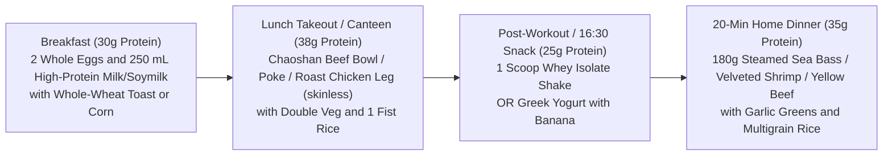

# Delicious High-Protein Chinese Meals & Evidence-Based Supplements (`不吃水煮鸡胸肉的120g蛋白饮食与补剂真相`)

Fitness influencers make lean-muscle nutrition look miserable: weighing dry boiled chicken breast, broccoli, and unseasoned oats in plastic Tupperware. In reality, **Chinese culinary ingredients—seafood, beef shank, eggs, soy/tofu, lean pork tenderloin, and hotpot—are naturally world-class lean-muscle foods** the moment you control hidden stir-fry oil!

---

## Table of Contents

1. [Exact Calorie & Protein Targets for Lean Muscle (`体态重组宏量公式`)](#1-exact-calorie--protein-targets-for-lean-muscle-体态重组宏量公式)
2. [Hitting `120 g` Daily Protein Effortlessly in Shanghai (Home, Takeout & Sam's/Hema)](#2-hitting-120-g-daily-protein-effortlessly-in-shanghai-home-takeout--samshema)
3. [Pre- and Post-Workout Nutrition + Sleep Hormone Window](#3-pre--and-post-workout-nutrition--sleep-hormone-window)
4. [Supplement Truth Matrix: Only 2 Tier-S Winners vs 90% Marketing Waste](#4-supplement-truth-matrix-only-2-tier-s-winners-vs-90-marketing-waste)

---

## 1. Exact Calorie & Protein Targets for Lean Muscle (`体态重组宏量公式`)

Suppose your body weight is **`W` kg** (e.g., `70 kg`):

| Starting Body Type | Daily Calorie Target | Daily Protein Target (`1.6–1.8 g/kg`) | Expected Monthly Scale Rate |
| :--- | :--- | :---: | :--- |
| **Skinny-Fat (`假瘦有小肚子`, BF `19%–24%`)** | **Maintenance to `-250 kcal` slight deficit** (`~1,950–2,150 kcal` for a desk engineer lifting 3x/wk) | **`115–130 g` protein/day** | Scale drops slowly (`-0.8 to -1.2 kg/month`) while waist shrinks fast and shoulders grow! |
| **Naturally Very Thin (`竹竿偏瘦`, BF `<13%`, BMI `<19.5`)** | **Clean Lean Surplus (`+200 to +250 kcal` ONLY)** (`~2,400–2,550 kcal` — never `+800 kcal` dirty bulk!) | **`115–130 g` protein/day** | Scale rises slowly (`+0.8 to +1.0 kg/month`) — `80%` pure lean muscle, face stays sharp! |

- **Why `1.6–1.8 g/kg` (`~120 g/day`) Is the Scientific Ceiling**: A landmark meta-analysis of 49 trials (Morton et al., *British Journal of Sports Medicine*) proved muscle protein synthesis plateaus completely at **`1.62 g/kg/day`**! Eating `220 g` of protein like steroid bodybuilders adds zero extra muscle—just digestive bloat and wasted money.
- **Distribute Across `3–4` Feedings (`30–35 g` per meal)**: Each `30 g` hit provides the `~2.5–3.0 g` **Leucine (`亮氨酸`)** threshold needed to flip the `mTOR` muscle-building switch!

---

## 2. Hitting `120 g` Daily Protein Effortlessly in Shanghai (Home, Takeout & Sam's/Hema)

Look how delicious **`125 g` of daily protein** looks with zero boiled chicken breast:

### High-Protein, Low-Fat Chinese Supermarket & Dining Cheat Sheet

| Food Item (Raw / Edible Portion) | Protein | Fat | Calories | Practical Shanghai Sourcing & Cooking Tip |
| :--- | :---: | :---: | :---: | :--- |
| **`150 g` Peeled Shrimp (`青虾仁`)** | **`28 g`** | `1.5 g` | `130 kcal` | **#1 Protein-to-Calorie King!** Keep frozen bags from **Sam's Club (`山姆大青虾仁`) / Hema (`盒马`)**—thaws in 4 min for `虾仁滑蛋` or garlic vermicelli! |
| **`150 g` Lean Beef Shank / Sirloin (`牛腱子 / 吊龙`)** | **`32 g`** | `5–7 g` | `190 kcal` | Slice cold braised beef shank (`山姆卤牛腱 / 自卤牛腱`) straight onto evening noodles or salad; or `25s` `小炒黄牛肉` |
| **`200 g` Steamed Sea Bass / Cod (`清蒸鲈鱼 / 银鳕鱼`)** | **`36 g`** | `6 g` | `210 kcal` | Hema delivers cleaned butterfly-slit sea bass in 30 min—8 minutes in steamer = restaurant luxury! |
| **`150 g` Skinless Chicken Thigh (`去皮鸡腿肉`)** | **`28 g`** | `7 g` | `180 kcal` | **3x juicier than chicken breast** for only `+35 kcal`! Use for `宫保鸡丁` or air-fryer soy-garlic thighs |
| **`200 g` Firm Northern Tofu / Tofu Skin (`北豆腐 / 千张豆皮`)** | **`20–32 g`** | `8 g` | `180–240 kcal` | `凉拌千张丝` (Formula 6 Cold Toss) packs `30g` plant protein in 2 minutes! |
| **`1` Whole Egg + `2` Egg Whites** | **`14 g`** | `5 g` | `105 kcal` | Add `100 g` pasteurized liquid egg whites (`兰皇/圣迪乐盒装蛋白液`) into `2` whole eggs for a huge, fluffy low-fat `番茄炒蛋`! |
| **Eating Out (`火锅 / 烤肉 / 外卖`)** | **`40–50 g`** | Low! | Controlled | **Chaoshan Clear-Broth Beef Hotpot (`潮汕鲜切牛肉火锅` — 吊龙/匙仁/嫩肉 with 沙茶/酱油碟 instead of heavy sesame paste!)** is literally the single cleanest lean-muscle restaurant meal on Earth! For takeout: *Wagas / 超级碗 / 赛百味双倍牛肉 / 粤式烧味去皮豉油鸡饭*. |

---

## 3. Pre- and Post-Workout Nutrition + Sleep Hormone Window

1. **60–90 Min Before Lifting (`训练前垫一口碳水`)**: Never lift heavy completely fasted if you haven't eaten in 6 hours—eat **1 banana or 1 slice of toast (`25–30 g` fast carbs)** 45 minutes before the gym so muscle glycogen powers crisp final reps!
2. **The "30-Minute Anabolic Window" Myth**: You do **not** lose your workout if you don't chug a shake in the locker room within 15 minutes! Total protein across the **4-hour pre-to-post window** and **full 24-hour day** is what drives `95%` of growth.
3. **Sleep Is Where Muscle Actually Synthesizes**: Lifting in the gym only writes the *blueprint*; **`7.5+ hours` of sleep** releases `70%` of daily pulsatile **Growth Hormone (`生长激素 GH`)** and keeps endogenous **Testosterone (`睾酮`)** high (sleeping `<5.5 hours` for 1 week drops healthy male testosterone by `10%–15%`—equivalent to aging 10 years!).

---

## 4. Supplement Truth Matrix: Only 2 Tier-S Winners vs 90% Marketing Waste

Save thousands of RMB by ignoring flashy fitness tubs—only **two** sports supplements pass rigorous Olympic/clinical meta-analyses:

| Supplement | Verdict | Why & Exact Protocol (East Asian Specifics!) |
| :--- | :---: | :--- |
| **1. Whey Protein Isolate (`分离乳清蛋白粉 WPI`)** | **TIER S (Convenience Food)** | Pure filtered milk protein (`25 g` protein / `110 kcal`). **CRITICAL TIP FOR CHINESE ADULTS**: Roughly `80%` of East Asians have mild adult lactase reduction—standard cheap *Whey Concentrate (`浓缩乳清 WPC`)* often causes bloating, gas, or acne (`乳糖不耐与爆痘`). Spend the extra RMB 80 for **`100%` Whey Protein Isolate (`分离乳清`, e.g., Optimum Nutrition Gold Isolate / Myprotein Iso / Rule 1)** which strips out `99%` of lactose and fat! *(If dairy still triggers breakouts, use Pea/Soy Plant Isolate).* |
| **2. Creatine Monohydrate (`纯一水肌酸`, `Creapure`)** | **TIER S (`#1` Proven Ergogenic)** | Over **1,000 human clinical trials**: saturates muscle `phosphocreatine` (`ATP` rapid battery), giving you `+1 to 2` extra reps per set, faster recovery, neurocognitive benefits under sleep loss, AND **draws `1–1.5 kg` of water strictly *inside* muscle cells (`肌细胞内储水`, ZERO subcutaneous belly bloat!)**, making lean shoulders and arms look fuller and firmer! **Dose**: **`3 g to 5 g` plain micronized powder once daily** in water/coffee (**skip** the `20 g/day` "loading phase", which upsets stomachs; drink `2.2 L+` water/day). *(Note: Creatine naturally raises benign blood `creatinine 肌酐` slightly on annual checkups; ask for **`Cystatin C 胱抑素C`** if checking kidney filtration!)* |
| **BCAAs (`支链氨基酸`) / Glutamine (`谷氨酰胺`)** | **SKIP (RMB 0)** | `120 g` of daily food/whey protein already contains `25 g+` natural BCAAs—buying separate candy-flavored BCAA water is 100% redundant! |
| **"Mass Gainer" Powders (`增肌粉`)** | **AVOID!** | `80%` cheap maltodextrin (`麦芽糊精` = pure fast sugar!) spiking insulin and visceral belly fat! Eat real jasmine rice, oats, or bananas instead. |
| **"Fat Burners" / L-Carnitine (`左旋肉碱 / 燃脂弹`)** | **SKIP (RMB 0)** | Oral L-carnitine has negligible absorption and zero meaningful fat loss compared to a `-250 kcal` diet + black coffee. |
