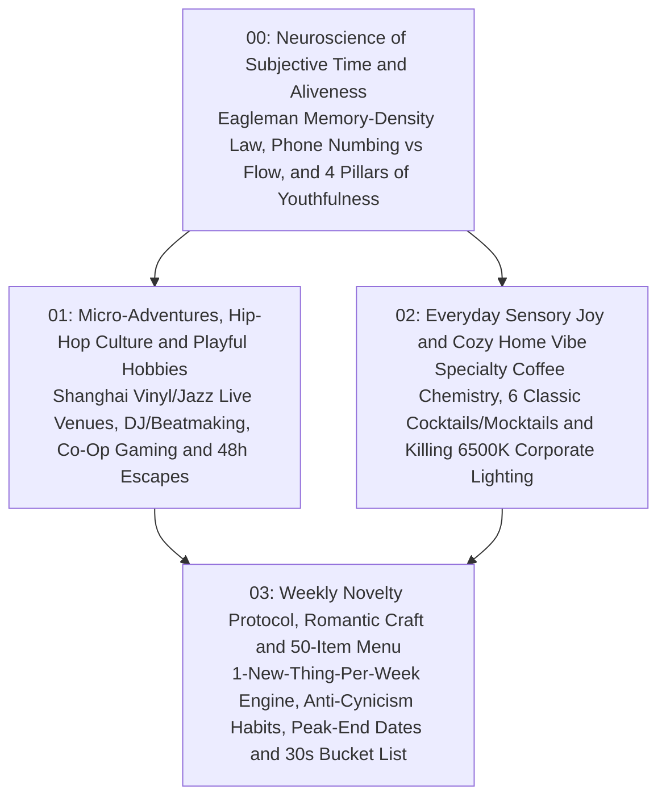
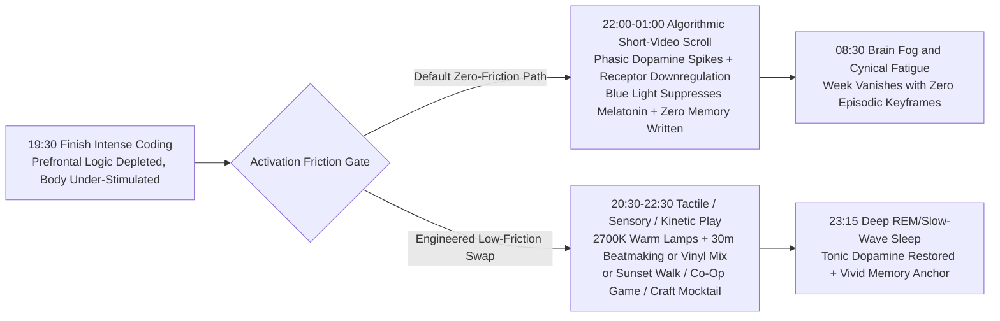

# Living Younger at 32: The Neuroscience of Slowing Subjective Time & Reclaiming Youthful Aliveness (32岁少年感与主观时间工程学)

Ask almost any software engineer in their early thirties how the last seven years felt, and you will hear the exact same eerie confession: *"Ages 15 to 22 felt like an entire geological epoch, while ages 25 to 32 vanished in what felt like eighteen months."*

Nothing went wrong with your biological clock, and time did not physically accelerate. What collapsed was your **hippocampal write throughput**. When your life settles into a deterministic `while (true)` loop — wake up to an alarm, scan Slack, sit under 6000K office lighting, debug distributed systems, order the same three takeout bowls, collapse onto the sofa, and scroll algorithmic short-video feeds until 12:45 AM — your brain's compression engine treats Tuesday of Week 41 as a duplicate pointer to Tuesday of Week 14. Nothing unexpected happened, so almost nothing was written to long-term episodic storage. When you look back at the year on December 31, the archive file is terrifyingly small.

Living younger at 32 — what East Asian aesthetics call **`少年感` (youthful aliveness)** — has nothing to do with pretending to be an undergraduate, dodging adult responsibility, or chasing trendy slang. It is an **operating-system architecture problem**: systematically replacing low-grade digital numbing and cynical autopilot (`班味` and `爹味`) with **high-resolution sensory presence, playful beginner's-mind hobbies, kinetic lightness, and weekly novelty keyframes** so that ages 32 to 42 feel three times longer, richer, and more vivid than your late twenties.

---

## Curriculum Architecture & Learning Path

### Clickable Table of Contents & Module Directory

| Module | File | Core Engineering Focus | Practical Outcome |
| :--- | :--- | :--- | :--- |
| **00** | [00-README.md](00-README.md) | **Neuroscience of Subjective Time**: David Eagleman's memory-density model, predictive coding deduplication, phasic phone numbing vs. tonic flow, and the 4 pillars of adult `少年感` | Understand mathematically why ages 25-32 blurred together and run a weekly Keyframe Density Audit |
| **01** | [01-MICRO-ADVENTURES-MUSIC-AND-PLAYFUL-HOBBIES.md](01-MICRO-ADVENTURES-MUSIC-AND-PLAYFUL-HOBBIES.md) | **Play, Groove & 48h Expansion**: Shanghai jazz/hip-hop vinyl bars & livehouses, bedroom DJing (`DDJ-FLX4`) & beatmaking (`Koala Sampler`), guilt-free masterpiece/co-op gaming, and 2-hour HSR micro-adventures | Turn ordinary weeknights into tactile flow sessions and make a 2-day weekend feel like a 5-day vacation |
| **02** | [02-TASTE-COFFEE-DRINKS-AND-COZY-HOME-VIBE.md](02-TASTE-COFFEE-DRINKS-AND-COZY-HOME-VIBE.md) | **Everyday Sensory Interfaces**: Decoding washed vs. anaerobic specialty coffee in 5 minutes, zero-intimidation bar ordering (6 classic cocktails + craft 0%-ABV mocktails), and `2700K` layered home lighting, plants, audio & woody scent | Upgrade the 3 daily rituals you repeat 365 times a year and erase harsh corporate `班味` from your apartment |
| **03** | [03-THE-30S-EXPERIENCE-MENU-AND-YOUTHFUL-HABITS.md](03-THE-30S-EXPERIENCE-MENU-AND-YOUTHFUL-HABITS.md) | **Execution Cadence & 50-Experience Menu**: The `1-New-Thing-Per-Week` protocol, biomechanical posture & vocal warmth, killing preachy `爹味`, Kahneman Peak-End date design, and a 50-item menu for your 30s | Never waste another Saturday wondering what to do, keep romance electric, and age with curiosity instead of cynicism |

### In This Document (`00-README.md`)

1. [The Neuroscience of Subjective Time: Why Ages 25-32 Vanished](#1-the-neuroscience-of-subjective-time-why-ages-25-32-vanished)
2. [The Holiday Paradox: Prospective vs. Retrospective Time](#2-the-holiday-paradox-prospective-vs-retrospective-time)
3. [Phone Numbing vs. High-Vitality Recovery: Debugging Your 10 PM Brain](#3-phone-numbing-vs-high-vitality-recovery-debugging-your-10-pm-brain)
4. [The Four Pillars of Adult Youthful Aliveness (`32岁少年感四支柱`)](#4-the-four-pillars-of-adult-youthful-aliveness-32岁少年感四支柱)
5. [The Weekly Keyframe Density Audit & Operating Schedule](#5-the-weekly-keyframe-density-audit--operating-schedule)
6. [Worked Lifespan Math & The 7 Silent Tech-Culture Aging Traps](#6-worked-lifespan-math--the-7-silent-tech-culture-aging-traps)

---

## 1. The Neuroscience of Subjective Time: Why Ages 25-32 Vanished

For over a century, folk psychology blamed the acceleration of adult time on **Paul Janet's Proportional Theory (1877)**: at age 8, one year represents $1/8 = 12.5\%$ of your cumulative existence, whereas at age 32, one year represents only $1/32 \approx 3.1\%$. While clean on paper, proportional math fails empirically: when adults spend seven days trekking an unfamiliar mountain range or exploring a foreign city for the first time, those seven days expand dramatically in subjective memory despite their chronological age being 32 or 50.

Neuroscientist **David Eagleman** (Stanford / Baylor College of Medicine) resolved this puzzle by proving that **subjective retrospective duration is not measured by an internal quartz oscillator — it is estimated by the byte-size of new episodic memories laid down during an interval**.

### The Video Codec Analogy: I-Frames vs. P-Frames in the Hippocampus

As a software engineer, think of human episodic memory as a **predictive video codec (like H.264/HEVC) coupled with an aggressive content-addressable deduplication engine**:

- **Predictive Coding (`预测编码`)**: Your neocortex constantly runs a forward generative model $P_{\text{predicted}}(t)$ of the next sensory frame — what your monitor looks like, how your usual iced Americano tastes, the exact turnstiles of Line 2 or Line 10 on your commute, and the exact cadence of your daily standup.
- **Dopaminergic Novelty Gating (`VTA-海马体新奇门控`)**: Neurobiologists John Lisman and Emrah Duzel demonstrated that the hippocampus and ventral tegmental area (VTA) form a **functional novelty loop**. When incoming reality matches prediction ($P_{\text{observed}} \approx P_{\text{predicted}}$), prediction error is near zero; the VTA stays quiet, long-term potentiation (LTP) gates remain closed, and the brain discards raw sensory details. It stores only a tiny **P-Frame (Delta Frame)**: *"Same desk, same PR review, nothing new."*
- **Uncompressed Keyframes (`I-Frames`)**: When you encounter genuine sensory, spatial, motor, or emotional novelty — hearing a live upright bass vibrate your sternum in a dim jazz bar, learning to beatmatch two hip-hop tracks at `92 BPM`, cycling past sunset cranes along the Huangpu River, tasting an anaerobic Colombian pour-over that smells like ripe lychee — prediction error spikes. Tonic dopamine bathes the hippocampus, lowering the threshold for synaptic plasticity and writing a high-resolution **I-Frame (Keyframe)** rich in spatial, olfactory, auditory, and emotional metadata.

We can formalize Eagleman's memory-density law across any chronological calendar window $[t_1, t_2]$ as an integral of **information surprise weighted by conscious attention**:

$$T_{\text{subjective}}(t_1, t_2) = \int_{t_1}^{t_2} \alpha \cdot D_{\text{KL}}\!\left(P_{\text{observed}}(t) \,\|\, P_{\text{predicted}}(t)\right) \cdot A_{\text{attention}}(t) \, dt$$

Look closely at the two multiplicative terms inside that integral, because they expose the **exact two bugs** that silently eat a software engineer's late twenties and early thirties:

1. **Bug #1 — Routine Collapse ($D_{\text{KL}} \to 0$)**: Optimization is a virtue in production infrastructure, where you want `99.99%` predictability and zero surprises. Applied unconsciously to personal life — eating the same takeout, walking the same block, wearing the same hoodie, repeating the same mall-dinner-movie weekend — over-optimization drives Kullback-Leibler divergence $D_{\text{KL}}(P_{\text{observed}} \| P_{\text{predicted}}) \to 0$. Three hundred days collapse into four deduplicated blocks.
2. **Bug #2 — Split-Attention Starvation ($A_{\text{attention}} \to 0$)**: Even when something potentially pleasant happens — eating a warm bowl of noodles, walking under autumn plane trees, sitting across from your partner — **checking your phone or ruminating about an unresolved production ticket** sets conscious sensory attention $A_{\text{attention}}(t) \approx 0.05$. Without prefrontal-hippocampal attention binding, no episodic trace is consolidated. You lived the hour chronologically, yet left zero receipt in memory.

---

## 2. The Holiday Paradox: Prospective vs. Retrospective Time

Psychologist **Claudia Hammond** termed the resulting distortion **The Holiday Paradox**: prospective time (how fast time feels *right now*) and retrospective time (how long a period feels *looking back*) often move in **exact opposite directions**.

| Time Quadrant | Prospective Feel (*In the Moment*) | Retrospective Length (*In Memory*) | Classic Engineer Example | Underlying Neural Mechanism |
| :--- | :--- | :--- | :--- | :--- |
| **1. Monotonous Grind** | **Agonizingly Slow** (clock-watching every 8 minutes) | **Vanishes Completely** (indistinguishable blur 1 month later) | A 3-hour Tuesday afternoon alignment meeting or waiting in an airport delay queue | High boredom-monitoring of the clock in real time; zero novel episodic data written to storage |
| **2. Algorithmic Numbing** | **Fast / Dissociative** (2 hours evaporate without noticing) | **Zero Black Hole** (cannot name a single video watched yesterday) | Scrolling short videos or social feeds on the couch from `22:30` to `00:45` | Rapid context-switching prevents hippocampal consolidation (`anterograde interference` wipes each prior 30-second clip) |
| **3. Deep Creative / Kinetic Flow** | **Fast & Effortless** (ego and clock disappear) | **Rich & Memorable** (distinct milestone & tactile imprint) | Mixing a 45-minute vinyl/DJ set, bouldering V2 routes, or cooking a new three-dish dinner with music playing | Prefrontal self-monitoring quiets during flow while motor-sensory cortex writes durable procedural + episodic anchors |
| **4. Multi-Scene Novel Adventure** | **Vivid & Engaged** | **Massively Expanded** (a 48-hour weekend feels like a 6-day trip) | Taking a Friday `19:30` train to Shaoxing or Moganshan, exploring canals, tasting local wine, sketching/shooting street light | High spatial grid-cell remapping in the entorhinal cortex + multi-sensory landmarks segment memory into dozens of distinct scenes |

> **Core Engineering Takeaway**: Never confuse *"time flew tonight"* while scrolling your phone with *"I had a restorative evening."* Algorithmic scrolling is the **worst possible quadrant**: it steals chronological hours at `5x` speed *prospectively* while returning `0 bytes` of life memory *retrospectively*. It literally shortens your perceived lifespan from both ends.

---

## 3. Phone Numbing vs. High-Vitality Recovery: Debugging Your 10 PM Brain

Why do disciplined, intelligent engineers still fall into **Revenge Bedtime Procrastination (`报复性熬夜`)** at `22:30` even when their eyes burn with fatigue?

Because modern software engineering creates **asymmetric exhaustion**:

- Your **dorsolateral prefrontal cortex (dlPFC)** — working memory, executive inhibition, symbolic logic, edge-case simulation — is **95% depleted** after eight hours of architecture trade-offs, AI agent orchestration, and context switching.
- Meanwhile, your **sensorimotor cortex, limbic curiosity circuits, and physical body** have been locked inside a `1.5 m x 1.5 m` chair perimeter all day and are **starving for autonomy and sensation** ("*Did today belong to me at all, or 100% to the company?*").

Because initiating an unstructured hobby at `22:00` feels like it requires `30 units` of activation energy ($E_a$) when your dlPFC only has `10 units` left, you reach for the `0.5-unit` friction device in your pocket.

### Neurochemical Comparison: Cheap Phasic Spikes vs. Tonic Vitality

| Dimension | Algorithmic Phone Numbing (`假性休息 / 多巴胺刷屏`) | High-Vitality Sensory & Playful Flow (`真性恢复 / 心流充电`) |
| :--- | :--- | :--- |
| **Reward Schedule** | Variable-ratio slot machine (unpredictable outrage, envy, humor, novelty every 12 seconds) | Effort-gated mastery & sensory appreciation (grinding coffee beans, nailing a 16-bar DJ transition, finishing a bike loop) |
| **Dopamine Dynamics** | Sharp **phasic spikes** followed by sub-baseline crashes (Andrew Huberman / Anna Lembke opponent-process trough -> restless emptiness) | Steady **tonic baseline support** paired with **endocannabinoids, serotonin, and oxytocin** |
| **Memory Consolidation** | **Retroactive interference**: Clip $N+1$ overwrites the fragile synaptic trace of Clip $N$ before consolidation (`6-minute amnesia`) | Coherent 45-90 minute narrative arc consolidates cleanly during nocturnal slow-wave sleep |
| **Post-Session Subjective State** | Wired, dry-eyed, subtly anxious, annoyed at yourself (`越刷越累，心里空落落`) | Calmly energized, physically grounded, warm satisfaction (`松弛且充实`) |

### The 3-Step Friction Inversion Protocol (`10 PM 摩擦力反转设计`)

You do not beat a trillion-dollar recommendation engine with raw willpower at `22:30`; you beat it with **systems architecture (changing $E_a$)**:

1. **Physical Out-of-Bedroom Dock (`充电桩隔离`)**: Buy a dedicated charger for the living-room entryway console and remove every charging cable from your bedside table. Buy a `RMB 60` warm-display physical alarm clock (or wear a silent vibrating watch). Plugging your phone in across the apartment at `22:30` eliminates `90%` of `01:00 AM` doomscrolling overnight.
2. **Pre-Staged Zero-Boot Play Stations (`零启动成本心流工位`)**: If your DJ controller is buried in a closet box or your guitar is zipped inside a bag, $E_a$ is too high on a Wednesday night. Keep your `DDJ-FLX4` / turntable wired to warm speakers, your pour-over kettle on the counter, or your Switch/PS5 dual controllers charged beside a `2700K` lamp so entering flow takes **under 20 seconds**.
3. **The 15-Minute Decompression Airlock (`下班感官气闸舱`)**: Never transition directly from closing your laptop lid to opening social media on your phone (that is merely switching from a `16-inch` work screen to a `6-inch` slot-machine screen). Insert a physical sensory airlock: a warm shower in dim light with woody cedar soap, a 20-minute evening walk without podcasts, or preparing a cold-brew tea mocktail while putting on an album from track 1 to track 10.

---

## 4. The Four Pillars of Adult Youthful Aliveness (`32岁少年感四支柱`)

Why do certain creators, musicians, architects, and engineers in their thirties and forties — think Pharrell Williams, Ryuichi Sakamoto in his prime, Nigo, or that one staff engineer everyone loves hanging out with — radiate magnetic lightness and youthfulness, while peers three years younger already radiate heavy middle-aged exhaustion?

Because true adult **`少年感`** is the intersection of **grown-up reliability (`成熟稳定的内核与经济兜底`)** and **uncorrupted aliveness (`高敏锐度、好奇心与零世故感`)**:

$$\text{Adult Youthfulness (32+)} = \text{Grounded Competence} \times \left(\text{Sensory Resolution} + \text{Playful Curiosity} + \text{Kinetic Lightness}\right) \times \frac{1}{1 + \text{Cynicism}}$$

Notice that **Cynicism (`世故油腻与爹味扫兴`)** sits in the denominator: even a tiny rise in reflexive cynicism divides your youthfulness in half.

### Diagnostic Matrix: Youthful Aliveness (`少年感`) vs. Corporate Drone (`班味`) vs. Preachy Uncle (`爹味`)

| Everyday Moment | `班味` (Corporate Exhaustion) | `爹味 / 油腻` (Cynical Preachiness) | `32+ 少年感` (Grounded Aliveness) |
| :--- | :--- | :--- | :--- |
| **Seeing a New Cafe, Exhibition, or Street Pop-Up** | *"Too tired, let's just order takeout and lie down."* | *"Pure consumerism IQ tax (`智商税`) for gullible young people."* | *"Interesting lighting and space design — let's grab an iced pour-over and check it out for 20 minutes."* |
| **Hearing New Music / Hip-Hop / Subcultures** | Plays the exact same 2016 playlist on loop for 9 years | *"Music died after 2010; kids today have zero taste."* | Listens for the drum bounce, sample flip, or synth texture with genuine curiosity (`"Wait, listen to that bass pocket!"`) |
| **Trying a Skill Where You Are a Beginner** | Avoids anything outside existing professional strengths | Refuses to participate, stands on the sidelines critiquing form | Laughs freely when missing a beat in a beginner groove class or falling onto the bouldering mat, then tries again |
| **Unexpected Rain or Closed Restaurant on a Trip** | Scrolls phone silently in a bad mood | Lectures partner: *"I told you we should have booked earlier!"* | Treats it as a plot twist: *"Perfect excuse to duck into this tiny vinyl bar until the rain clears."* |
| **Physical Presence & Posture** | Forward-jutting tech neck (`探颈`), shuffling heavy steps, sighing when standing up | Slouched belly-out spread in chairs, loud throat-clearing, lecturing finger-pointing | Open collarbone posture, brisk light stride, clear gaze, warm chest-resonant voice |

### The 4 Concrete Pillars to Cultivate

1. **Pillar 1: High-Resolution Sensory Presence (`高帧率感官在线`)**
   - Children experience colors brighter and flavors sharper because they are not running background Slack threads in their heads. Train yourself to run **single-threaded sensory perception** at least three times a day: actually smell the jasmine/bergamot bloom when pouring `92°C` water over Ethiopian coffee grounds; actually feel the autumn breeze and plane-tree leaf shadows on your forearms during a 15-minute walk; actually listen to the stereo separation between Rhodes electric piano and boom-bap snare on good speakers.
2. **Pillar 2: Unprotected Curiosity & Beginner's Mind (`保持好奇与敢于笨拙`)**
   - In your career, you are rewarded for being an expert (`Senior / Staff`) who already knows the failure modes. Outside work, wearing that "expert armor" suffocates joy. Always keep **one active beginner domain** where you have zero status to protect — bedroom DJing, street photography, bouldering, wheel-thrown ceramics, French/Japanese/Arabic phrases, or freestyle hip-hop bounce.
3. **Pillar 3: Playfulness Over Utilitarian ROI (`容许无功利的好玩`)**
   - Corporate culture trains engineers to ask *"What is the ROI / career leverage of this?"* about every hour. Play is defined precisely as **intrinsically absorbing activity done for its own sake**. Spending Sunday afternoon slicing a 1976 soul sample on an iPad or cycling across a river ferry for a `RMB 2` ticket has zero LinkedIn ROI — and `1000%` aliveness ROI.
4. **Pillar 4: Kinetic Readiness & Physical Elasticity (`身体轻盈与说走就走的启动力`)**
   - Youthfulness is deeply physical: strong posterior chain, mobile thoracic spine, steady Zone-2 aerobic base, and low start-up inertia. When a friend or partner says at `16:30` on Saturday, *"The sky just turned orange-pink — want to bike down to West Bund?"*, youthful energy says **"Grabbing my cap, ready in three minutes"** instead of negotiating with the couch for forty minutes until it gets dark.

---

## 5. The Weekly Keyframe Density Audit & Operating Schedule

To turn neuroscience into weekly reality without overwhelming a demanding engineering schedule, track **one simple metric** every Sunday evening: **Weekly Episodic Keyframes (`本周记忆关键帧数`)**.

> **Definition of 1 Episodic Keyframe**: Any `45-to-240 minute` window during the week where **your phone stayed in your pocket/bag**, **prediction error or sensory engagement was high**, and **six months from now you could still describe the distinct scene, sound, taste, or laugh**.

- **`0 Keyframes / week` (Danger Zone)**: Pure office-takeout-scrolling deduplication. Fifty-two weeks will compress into two weeks of subjective memory.
- **`1 Keyframe / week` (Maintenance)**: Roughly 50 memories a year — already `3x` higher than the average overworked urban professional.
- **`3 to 4 Keyframes / week` (Target Sweet Spot — "Expanded Time Mode")**: Roughly **160 to 200 distinct vivid episodes per year**. Subjective time slows down dramatically; every season feels rich, textured, and distinct.

### Reference Weekly Operating Rhythm for a Busy 32-Year-Old Engineer

| Day / Window | Default Autopilot Trap (0 Keyframes) | Upgraded High-Aliveness Slot (3-4 Keyframes / Week) | Target Module Reference |
| :--- | :--- | :--- | :--- |
| **Mon-Thu Morning (`08:15-08:35`)** | Gulping bitter convenience-store coffee while checking emails in bed | 4-minute hand-ground V60 pour-over (switching bean origins monthly) by a sunny window with 1 vinyl/jazz track | [02-TASTE-COFFEE-DRINKS-AND-COZY-HOME-VIBE.md](02-TASTE-COFFEE-DRINKS-AND-COZY-HOME-VIBE.md) |
| **Tue or Thu Evening (`20:30-22:00`)** | Exhausted couch doomscrolling under harsh `6500K` ceiling LEDs | **Keyframe #1 (Midweek Flow)**: `2700K` warm lamps on + 45m `DDJ-FLX4` mixing / `Koala` beatmaking, indoor bouldering, or 2 chapters of a co-op game (*Split Fiction* / *It Takes Two*) | [01-MICRO-ADVENTURES-MUSIC-AND-PLAYFUL-HOBBIES.md](01-MICRO-ADVENTURES-MUSIC-AND-PLAYFUL-HOBBIES.md) |
| **Friday Night (`19:30-22:30`)** | Crashing at home scrolling work drama until `01:30` (**Weekend feels like 1.5 days**) | **Keyframe #2 (Weekend Gateway)**: Walk an unfamiliar neighborhood, try 1 new cuisine (`1-New-Thing-Per-Week`), or catch a `20:30` live jazz/vinyl bar set with 1 classic cocktail/mocktail (**Weekend expands to 2.5 days!**) | [01-MICRO-ADVENTURES-MUSIC-AND-PLAYFUL-HOBBIES.md](01-MICRO-ADVENTURES-MUSIC-AND-PLAYFUL-HOBBIES.md) & [02-TASTE-COFFEE-DRINKS-AND-COZY-HOME-VIBE.md](02-TASTE-COFFEE-DRINKS-AND-COZY-HOME-VIBE.md) |
| **Saturday Daylight (`10:00-18:30`)** | Sleeping till noon, laundry, generic shopping mall queue | **Keyframe #3 (Daylight Micro-Adventure)**: Sunset river cycling, 35mm street-photo walk, beginner hip-hop groove class, or a 1-hour HSR weekend escape (Suzhou / Hangzhou / Shaoxing / Moganshan) | [01-MICRO-ADVENTURES-MUSIC-AND-PLAYFUL-HOBBIES.md](01-MICRO-ADVENTURES-MUSIC-AND-PLAYFUL-HOBBIES.md) |
| **Sunday Afternoon (`15:00-20:30`)** | "Sunday Scaries" anxiety while refreshing messages | **Keyframe #4 (Slow Sensory Ritual)**: Water plants, play a full album on speakers, cook a fragrant slow meal together, light a woody cedar candle warmer, and pick next week's 1 novelty item | [02-TASTE-COFFEE-DRINKS-AND-COZY-HOME-VIBE.md](02-TASTE-COFFEE-DRINKS-AND-COZY-HOME-VIBE.md) & [03-THE-30S-EXPERIENCE-MENU-AND-YOUTHFUL-HABITS.md](03-THE-30S-EXPERIENCE-MENU-AND-YOUTHFUL-HABITS.md) |

---

## 6. Worked Lifespan Math & The 7 Silent Tech-Culture Aging Traps

### Quantitative Comparison: How Much Subjective Life Remains After Age 32?

Suppose two 32-year-old software engineers both live in good physical health to age 80 ($48\text{ chronological years}$ remaining):

- **Engineer A (Autopilot Optimization Mode)**:
  - Repeats the same home-office-takeout-feed loop `50 weeks/year`, taking only two hurried holiday trips (`approx. 12 keyframes/year`) plus rare dinners (`approx. 8 keyframes/year`) = **$20\text{ keyframes/year}$**.
  - Over the next 10 prime decades-of-youth years (ages `32-42`), Engineer A writes only:
    $$N_{A}(32 \to 42) = 10 \times 20 = 200\text{ episodic keyframes}$$
  - That is roughly the same number of vivid new memories an engaged 19-year-old writes in **a single university freshman year**. Looking back at age 42, the entire thirties feel like one compressed blurred winter.
- **Engineer B (Intentional Aliveness Mode — 3.5 Keyframes/Week)**:
  - Keeps the exact same demanding tech career, yet protects **one midweek flow night**, **one Friday gateway novelty**, and **one Saturday daylight micro-adventure or cozy sensory ritual** = **$180\text{ keyframes/year}$**.
  - Over ages `32-42`, Engineer B writes:
    $$N_{B}(32 \to 42) = 10 \times 180 = 1{,}800\text{ episodic keyframes} = 9 \times N_{A}$$
  - Chronologically, both men turn 42 on the exact same calendar day. Subjectively, **Engineer B has lived nine times more remembered life** during his thirties, acquired three tactile creative skills, walked hundreds of sunlit streets, and deepened dozens of shared stories with his partner.

### The 7 Silent Tech-Culture Aging Accelerators (And Exact Patches)

| # | Tech-Culture Aging Trap | Why Engineers Fall For It | Immediate System Patch |
| :--- | :--- | :--- | :--- |
| **1** | **Treating Rest as Passive Immobility (`把瘫着当休息`)** | Confusing physical exhaustion with prefrontal cognitive fatigue; lying motionless on a couch actually leaves stress cortisol circulating | Use **active contrast recovery**: 30 minutes of cycling, groove dancing, bouldering, or brisk walking clears metabolic stress byproducts `3x` faster than couch-rotting |
| **2** | **Background Audio Saturation (`全天候播客/倍速视频填满耳道`)** | Listening to `2x`-speed tech podcasts on every walk, commute, and shower leaves the Default Mode Network (DMN) zero silence to daydream or notice the world | Leave headphones **completely off** during at least one daily walk or coffee run; let street sounds, wind, and spontaneous curiosity return |
| **3** | **Deferred-Life Syndrome (`等财务自由/等年假再生活`)** | Believing real living only happens on a 10-day international flight once a year while treating the other `355 days` as disposable transit time | Treat **Tuesday at 8:30 PM** and **Saturday at 4:00 PM** as first-class life surfaces; micro-joy compounds daily |
| **4** | **Identity Monoculture (`自我价值100%绑定职级与代码`)** | When `100%` of your identity is `Staff Engineer`, any reorg or bad sprint destabilizes your entire mood and makes you boring at dinner tables | Build a **Multi-Pillar Identity Portfolio**: Engineer + Vinyl/Hip-Hop Selector + Specialty Coffee Brewer + Cyclist + Thoughtful Partner |
| **5** | **Sensory Flattening (`外卖塑料盒+惨白吸顶灯`)** | Eating lukewarm food out of disposable polypropylene tubs under `6500K` LEDs teaches your brain that daily existence is bleak and purely functional | Plate even simple meals on ceramic tableware, switch to `2700K` warm lamps at `18:30`, and drink out of thin-rimmed glass or handmade stoneware |
| **6** | **Social Atrophy Into Pure Utility (`只剩工作群，没有无用社交`)** | Adult male friendships shrink until every message is either a referral request or a calendar invite | Host low-pressure `90-minute` rituals: Sunday afternoon pour-over + vinyl listening at home, or a Saturday morning bike + `生煎` run with one friend |
| **7** | **Premature "Too Late to Start" Narrative (`32岁觉得学什么都晚了`)** | Comparing your Day 1 in dance, DJing, photography, or French against 19-year-old prodigies on social media | At 32, you likely have **50+ healthy years ahead**. Starting a playful craft today means by age 37 you have **5 years of joyful mastery** — versus turning 37 anyway with zero |

### Your 48-Hour Quick-Start Bootstrapper (Do This Week)

1. **Tonight (`22:15`)**: Move your phone charger out of the bedroom to the living room console and switch off your overhead ceiling light in favor of a single warm lamp.
2. **Wednesday Evening (`20:30`)**: Dedicate `60 minutes` phone-free to one tactile beginner play session — slice a jazz loop in `Koala Sampler`, play two chapters of a co-op game, or take a camera/phone on a night street-light walk.
3. **This Weekend**: Pick **one** concrete item from [01-MICRO-ADVENTURES-MUSIC-AND-PLAYFUL-HOBBIES.md](01-MICRO-ADVENTURES-MUSIC-AND-PLAYFUL-HOBBIES.md) (a sunset river bike loop, a live jazz/vinyl set, or a 45-minute HSR morning trip) and log your first intentional Keyframe.

---

## Next Step: Dive Into the Curriculum

Start with **[01-MICRO-ADVENTURES-MUSIC-AND-PLAYFUL-HOBBIES.md](01-MICRO-ADVENTURES-MUSIC-AND-PLAYFUL-HOBBIES.md)** to build your live-music, hip-hop/DJing/beatmaking, guilt-free gaming, and 48-hour weekend micro-adventure toolkit; move to **[02-TASTE-COFFEE-DRINKS-AND-COZY-HOME-VIBE.md](02-TASTE-COFFEE-DRINKS-AND-COZY-HOME-VIBE.md)** to upgrade your coffee, bar, and home sensory environment; and keep **[03-THE-30S-EXPERIENCE-MENU-AND-YOUTHFUL-HABITS.md](03-THE-30S-EXPERIENCE-MENU-AND-YOUTHFUL-HABITS.md)** open as your weekly novelty scheduler, date-craft playbook, and 50-experience checklist.
