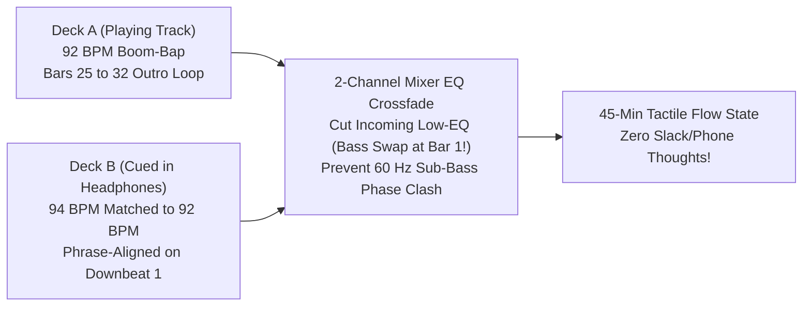
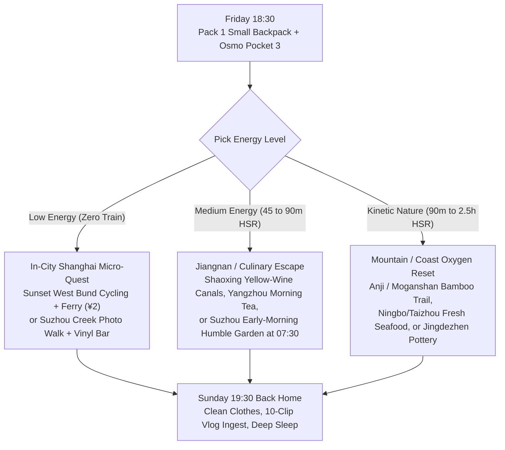

# Hip-Hop Culture, Vinyl/DJing, Guilt-Free Gaming & 48-Hour Micro-Adventures (音乐、游戏与周末微冒险实战)

In [00-README.md](00-README.md), we saw why repetitive passive scrolling at 11 PM leaves zero episodic memory traces. To feel genuinely alive and young at 32, you don't need to quit your job and backpack Antarctica—you need **tactile flow hobbies built around things you already love** (hip-hop music, gaming, visual storytelling, kinetic movement) plus **48-hour weekend scene shifts** that force your brain's spatial and sensory circuits to write vivid new keyframes.

---

## Table of Contents

1. [Experiencing Hip-Hop & Live Music in 3D (Beyond AirPods)](#1-experiencing-hip-hop--live-music-in-3d-beyond-airpods)
2. [Bedroom Producer & DJ Flow: Mixing & Beatmaking in 30 Minutes](#2-bedroom-producer--dj-flow-mixing--beatmaking-in-30-minutes)
3. [Kinetic Groove: Beginner Hip-Hop / House Dance & Bouldering](#3-kinetic-groove-beginner-hip-hop--house-dance--bouldering)
4. [High-Joy Gaming vs 1 AM Brain-Rot Grinding](#4-high-joy-gaming-vs-1-am-brain-rot-grinding)
5. [48-Hour Weekend Micro-Adventures Around Shanghai (`周末微冒险SOP`)](#5-48-hour-weekend-micro-adventures-around-shanghai-周末微冒险sop)

---

## 1. Experiencing Hip-Hop & Live Music in 3D (Beyond AirPods)

Listening to Spotify/Apple Music while staring at TypeScript errors treats music as background white noise. Once or twice a month, step into spaces where **sub-bass (`40–80 Hz`) physically vibrates the air** and strangers nod their heads to the same snare backbeat:

| Experience Type | What Makes It Special | Shanghai & Travel Starting Spots |
| :--- | :--- | :--- |
| **Hi-Fi Vinyl Listening Bars (`黑胶听音室 / Jazz Kissa`)** | Horn speakers (`JBL / Tannoy / Altec`), tube amps, warm `2700K` wood interiors; you sit with a drink and actually *listen* to full albums (Nujabes, A Tribe Called Quest, Kendrick, D'Angelo, Miles Davis) | *Bar Lotus*, *Sober Company*, *Root Down* (funk/hip-hop/soul vinyl bar!), *MorningLab / Vinyldigz* |
| **Intimate Jazz & Soul Live Clubs** | Watching a live drummer pocket a swung 16th-note groove and horn soloists improvise 3 meters in front of you—shows you the exact jazz/soul DNA that 90s/modern hip-hop samples! | *JZ Club*, *Blue Note Shanghai*, *Lincoln Jazz Center*, *Heyday Vintage Jazz Lounge* |
| **Livehouses & Hip-Hop Sets** | Raw stage energy, cyphers, touring indie/rap/electronic producers | *VAS Ear / VAS est*, *Modern Sky Lab (`摩登天空`)*, *Bandai Namco Shanghai Base*, *All Club / System* |
| **Digging Physical Vinyl Crates (`淘黑胶唱片`)** | Tactile album artwork, reading liner notes (`Producer / Sample Credits`), owning 15–20 desert-island records (`Illmatic`, `Madvillainy`, `Modal Soul`, `good kid, m.A.A.d city`, `Midnight Marauders`) | *Daily Vinyl*, *Uptown Records* (Pingwu Rd basement!), Tokyo *Disk Union Shibuya* when traveling |

---

## 2. Bedroom Producer & DJ Flow: Mixing & Beatmaking in 30 Minutes

Engineers fall in love with DJing and sample-based beatmaking faster than almost anyone because **a DJ mixer or sampler is literally a real-time dual-buffer audio DSP state machine**:

### Two Low-Friction Entry Paths (Under RMB 2,500)
1. **Bedroom Hip-Hop / R&B DJ Mixing (`Pioneer AlphaTheta DDJ-FLX4` + `Serato DJ Lite` / `Rekordbox` + `Apple Music / Tidal` streaming)**:
   - Costs ~RMB 2,100 (resells on Xianyu for 85% value anytime!).
   - **What You Learn in 2 Weeks**: Counting **4-bar / 8-bar / 16-bar phrases**, matching `BPM` (`85–98 BPM` golden-era hip-hop & R&B), **EQ Bass-Swapping** (never letting two `808` kicklines collide at `12 o'clock` Low EQ simultaneously!), baby-scratching drop-ins on Beat `1`, and stem-separation mashups (putting a Kendrick acapella live over a Nujabes instrumental!).
   - Recording a 30-minute Sunday afternoon mixtape for your own commute—or playing background grooves while cooking dinner—is pure joy.
2. **Couch / Flight Sample Beatmaking (`Koala Sampler` App — RMB 38 on iPhone/iPad!)**:
   - Modeled directly on the legendary **Roland SP-404** hip-hop sampler used by Madlib and J Dilla.
   - Screen-record a 12-second jazz piano loop, slice it across 16 pads (`Auto-Chop`), tap in a dusty boom-bap kick-snare-hat pattern with quantize **OFF** (real human swing!), add vinyl crackle + compressor pump, and export your own 60-second vlog BGM (**100% copyright-strike free for your personal Osmo Pocket 3 vlogs!**).

---

## 3. Kinetic Groove: Beginner Hip-Hop / House Dance & Bouldering

Why do some 32-year-olds walk into a room looking stiff and "aged (`肢体僵硬`)" while others move with effortless bounce? **Thoracic spine mobility, rhythm, and proprioception.**

1. **Zero-Foundation Hip-Hop / Groove / House Basics (`零基础律动课`)**:
   - Almost every major dance studio in Shanghai (*Caster*, *GH5*, *EnDance*, *Souldancing*) offers **adult zero-foundation (`零基础入门律动`)** evening classes focused purely on **Bounce (`Up/Down 律动`)**, **Rock**, and basic two-step groove to 90s hip-hop & R&B.
   - Nobody cares how beginners look in the back row—everyone is staring at themselves in the mirror! 10 classes unlock rhythm in your shoulders and neck for life, burn 500 kcal without boring treadmills, and flood your brain with endorphins.
2. **Indoor Bouldering (`室内抱石攀岩` — The Ultimate Software Engineer Sport)**:
   - Zero ropes needed (`4.5 m` walls over thick crash pads; e.g., * Dome / 岩时 / 香蕉攀岩*).
   - Every color-coded route (`V0 -> V1 -> V2 -> V3`) is a **3D physical debugging puzzle** requiring grip strength, hip rotation, balance, and 100% present-moment focus (impossible to worry about work while hanging off two crimps!).

---

## 4. High-Joy Gaming vs 1 AM Brain-Rot Grinding

Not all video games affect your nervous system the same way. Separate **regenerative masterpiece play** from **algorithmic rage-bait grinding**:

| Dimension | Dopamine-Trap Grinding (Drains Youth) | High-Joy Intentional Gaming (Restores Wonder) |
| :--- | :--- | :--- |
| **Mechanics** | Daily login FOMO quests, gacha pulls, solo-queue ranked games (`排位连跪红温`) at `01:30 AM` | Crafted finite stories, art direction, musical scores, or laughing couch co-op |
| **Post-Session Mood** | Wired, irritated, dry-eyed, guilty, fragmented sleep | Inspired, relaxed, shared inside jokes, clean stopping point |
| **Top Curated Picks** | *(Delete daily-chore mobile gachas)* | **Couple Couch Co-Op** (*It Takes Two 双人成行*, *Split Fiction 双影奇境*, *Overcooked 2*, *Super Mario Bros. Wonder*, *Mario Kart 8*); **Narrative Art** (*Astro Bot*, *Zelda: Tears of the Kingdom*, *Baldur's Gate 3*, *Cyberpunk 2077*, *Red Dead Redemption 2*, *Hades II*, *Disco Elysium*, *Dave the Diver*) |

- **The Hard `22:45` Rule**: Play guilt-free on a Friday night or Sunday afternoon on a proper OLED TV/monitor with good speakers—and shut down screens by `22:45` so REM sleep stays intact.

---

## 5. 48-Hour Weekend Micro-Adventures Around Shanghai (`周末微冒险SOP`)

A normal weekend (`sleep until 11:30 -> takeout -> mall -> scroll -> Sunday dread`) registers as `0.2` days in memory. A **Micro-Adventure** uses Shanghai's high-speed rail and riverfront geography to pack 5 distinct sensory scenes into 36–48 hours while still returning home by **Sunday `19:30`** for an unhurried shower and early sleep!

### Six Plug-and-Play Micro-Adventures You Can Do This Month

1. **The RMB 2 Huangpu River Sunset Ferry + West Bund Ride (`2元轮渡 + 徐汇滨江落日骑行`)**:
   - Rent a shared or road bike at `16:30` from *Long Museum (`龙美术馆`)* down West Bund greenway (`滑板公园 / 橙色塔吊`), watch skateboarders and dogs in golden light, or hop the **Dongchang Rd ↔ Jinling East Rd RMB 2 ferry (`东金线轮渡`)** at sunset with your Osmo Pocket 3.
2. **Early-Bird 08:00 Street Walk Before Tourists Wake Up**:
   - Walk *Fuxing West Rd -> Wukang Rd -> Hunan Rd -> Yanqing Rd* at `08:00` on a sunny Saturday with a hot flat white—quiet plane-tree shadows on historic villas feel like Paris before the `11:00` crowds arrive.
3. **Yangzhou Morning Tea & Footbath Reset (`扬州早茶三丁包 + 搓背修脚`, ~1h50m HSR)**:
   - Saturday early train -> *Quyuan (`趣园`)* or *Yechun* lakeside dim sum (`翡翠烧卖 / 烫干丝 / 蟹黄汤包`) -> Slender West Lake walk -> traditional Yangzhou bathhouse recovery -> sleep deeply.
4. **Shaoxing Lu Xun Canals & Black-Awning Boat (`绍兴乌篷船与黄酒棒冰`, ~1h20m HSR)**:
   - Hand-rowed canal alleys at *Shusheng GuLi (`书圣故里`)* and *Cangqiao Straight Street*—10x more authentic and lived-in than commercialized tourist water towns.
5. **Taizhou / Linhai Culinary & Great Wall Hike (`台州临海糯米海鲜王国`, ~2h45m HSR)**:
   - Michelin-caliber East China Sea small-boat seafood (`新荣记` hometown!) + Linhai ancient Southern Great Wall +紫阳街 seaweed cakes (`海苔饼`).
6. **Jingdezhen Hands-On Ceramic Throwing (`景德镇陶溪川拉坯烧制`, Weekend Trip)**:
   - Spend 2 hours on a spinning potter's wheel shaping two handmade tea/coffee cups (`拉坯上釉`), have the studio kiln-fire and courier them to your Shanghai apartment 2 weeks later—every morning coffee afterward carries that weekend's memory!
