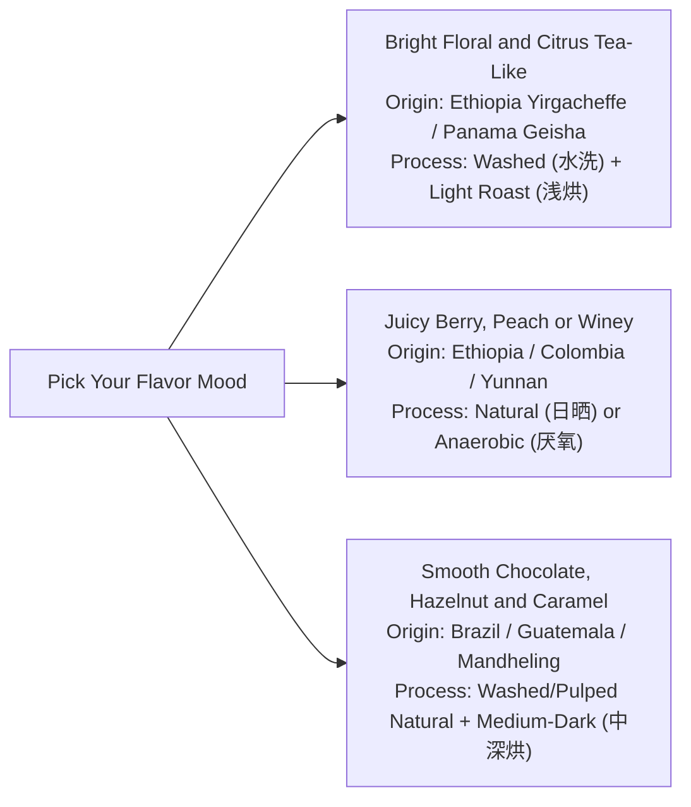
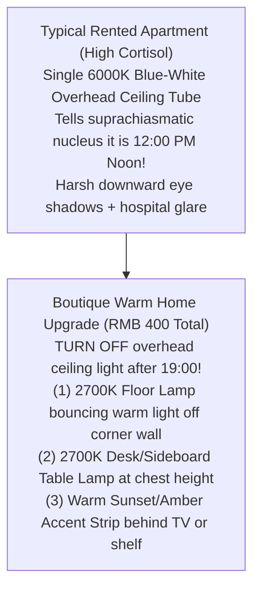

# Upgrading Everyday Sensory Joy: Specialty Coffee, Classic Drinks, Scent & De-Corporatizing Your Home (日常感官审美与去班味居家改造)

You spend ~`3,500 hours` every year inside your own apartment and repeat daily rituals—morning coffee, evening lighting, music, scent, weekend drinks—hundreds of times. Upgrading your **sensory resolution (`感官颗粒度`)** transforms ordinary Tuesdays from grey survival into deliberate enjoyment.

---

## Table of Contents

1. [5-Minute Specialty Coffee Literacy (Zero Snobbery!)](#1-5-minute-specialty-coffee-literacy-zero-snobbery)
2. [Zero-Intimidation Bar Literacy: 6 Classic Cocktails & Craft Mocktails](#2-zero-intimidation-bar-literacy-6-classic-cocktails--craft-mocktails)
3. [Killing Corporate "Banwei" (`去班味`): Lighting, Audio, Plants & Home Vibe](#3-killing-corporate-banwei-去班味-lighting-audio-plants--home-vibe)
4. [Personal & Home Olfactory Architecture (`高级木质柑橘气味系统`)](#4-personal--home-olfactory-architecture-高级木质柑橘气味系统)

---

## 1. 5-Minute Specialty Coffee Literacy (Zero Snobbery!)

Shanghai has more specialty coffee shops (`精品咖啡馆`) per capita than almost any city on Earth—yet most people only order bitter dark-roast iced Americanos (`苦焦美式`) as caffeine IV drips. Once you know **Origin + Processing + Roast Level**, coffee turns into tasting fruit, jasmine flowers, and dark chocolate with **zero added sugar**:

### Ordering Like an Insider Anywhere in the World
- **Pour-Over (`手冲单品 SOE`)**: Best way to taste floral/fruity light roasts (`水洗耶加雪菲` tastes like bergamot jasmine tea!). Order hot or iced (`冰手冲` — brewed double-strength directly over ice to lock in floral aromatics!).
- **Espresso + Milk Ratios (`意式奶咖浓度阶梯`)**:
  - **Dirty (`脏咖啡`, `~180 mL`, Iced Only)**: Hot double ristretto layered gently on top of ice-cold high-fat milk (`冰博克/鲜奶`). **Do NOT stir with a straw!** Take 3 big sips straight from the rim so hot rich espresso hits your tongue first, followed by sweet cold milk!
  - **Flat White (`澳白`, `~180–200 mL`, Hot)**: Double ristretto + thin silky microfoam—stronger coffee punch and creamier texture than a foamy Cappuccino or milky `350 mL` Latte.
- **5-Minute Saturday Morning Home Pour-Over Kit (`RMB 350` total)**:
  - **Hario V60 `01` plastic/ceramic dripper (`¥45`)** + bleached paper filters + **manual stainless burr grinder (`手摇磨豆机`, e.g., Timemore Chestnut C3 `泰摩栗子C3`, `¥260` — freshly ground whole beans smell 10x better than pre-ground powder!)** + gooseneck kettle + your kitchen `0.1 g` scale:
  - **Golden `1 : 15` Formula**: `15 g` medium-fine freshly ground beans + `92°C` water -> pour `30 g` water to bloom `30s` (`闷蒸排气`) -> pour in slow circles to `135 g` -> finish to **`225 g` total by `2:00`**. Done!

---

## 2. Zero-Intimidation Bar Literacy: 6 Classic Cocktails & Craft Mocktails

Walking into a quiet speakeasy or hotel bar without a printed menu can feel intimidating if you have never ordered cocktails before. Every bartender on Earth respects these **6 timeless classics** (ordered from lightest/refreshing to spirit-forward), plus high-taste **0%-ABV non-alcoholic options**:

| Drink | Base & Flavor Profile | ABV Strength | Best Occasion |
| :--- | :--- | :---: | :--- |
| **1. Gin & Tonic (`金汤力`, ask for Hendrick's or Roku Gin)** | Botanical juniper, cucumber/yuzu peel, crisp quinine bubbles | Light (`~8–10%`) | Hot summer evening, casual first round |
| **2. Whiskey Sour (`威士忌酸`, with egg white foam)** | Bourbon, fresh lemon juice, touch of syrup, silky citrus foam | Medium (`~15%`) | **#1 Crowd-Pleaser** — balanced sweet-tart-smooth, zero harsh alcohol burn! |
| **3. Mojito / Moscow Mule (`莫吉托 / 莫斯科骡子`)** | White rum + fresh mint + lime + soda (or vodka + spicy ginger beer in copper mug) | Light-Med (`~10–12%`) | Relaxed patio / music bar |
| **4. Negroni (`内格罗尼`)** | Equal parts Gin + Campari + Sweet Vermouth over one giant clear ice cube + orange peel | Strong (`~24%`) | Herbal bittersweet Italian aperitif—looks effortlessly sharp |
| **5. Old Fashioned (`古典鸡尾酒`)** | Aged Bourbon/Rye whiskey + Angostura bitters + touch of sugar + expressed orange zest | Strong (`~30%`) | Slow 45-minute late-night conversation sipper |
| **6. Craft 0%-ABV Mocktail / Seedlip Fizz (`无酒精特调`)** | Simply tell the bartender: *"Could you make me a refreshing citrus-herbal non-alcoholic highball, not too sweet?"* (`少甜柑橘草本无酒精特调`) | **`0.0%`** | Driving, training days, early mornings, or dates with partners who don't drink alcohol! |

---

## 3. Killing Corporate "Banwei" (`去班味`): Lighting, Audio, Plants & Home Vibe

Why do rented apartments often feel cold, depressing, and indistinguishable from a cubicle (`出租屋廉价班味`) while boutique hotels and cafés make you exhale deeply the second you walk in? **90% of the difference is Color Temperature (`色温 K`) and Light Elevation (`光源高度`)!**

### Five Weekend Afternoon Upgrades That Transform Your Space
1. **The `2700K–3000K` Three-Lamp Rule (`关掉惨白吸顶灯，点亮三盏暖光灯`)**:
   - After `19:00`, **never turn on the central `6000K` white ceiling fixture**. Put three `2700K` high-CRI (`Ra >= 95`) warm smart bulbs (*Aqara / Yeelight / IKEA TRÅDFRI*) inside a linen/paper floor lamp (e.g., *ISAMU NOGUCHI Akari* rice-paper style or *IKEA*), a bedside lamp, and a shelf lamp—one voice/phone tap sets the whole room to cozy golden-hour glow and naturally boosts evening melatonin!
2. **Fill the Room With Warm Mid-Range Music (`桌面音箱与黑胶仪式感`)**:
   - Phone speakers sound tinny and stressful. A single compact room speaker (*Sonos Era 100*, *Marshall Acton III*, *HomePod*, or *Audio-Technica AT-LP60XBT* turntable) playing instrumental jazz-hop (Nujabes, Uyama Hiroto, Khruangbin, FKJ) at `50 dB` while you cook or read changes the emotional climate of your home instantly.
3. **Two Indestructible Sculptural Green Plants (`养不死的大叶绿植`)**:
   - Skip fussy tiny succulents; put **one floor-standing Monstera (`龟背竹`) or Fiddle-Leaf/Rubber Tree (`黑金刚橡皮树 / 鹤望兰`)** in a matte ceramic pot by the window (`water only once every 7–10 days when top 3 cm soil is dry!`)—living green leaves cut visual fatigue by half.
4. **60-Thread-Count Long-Staple Cotton or Washed Linen Bedding (`新疆长绒棉 / 水洗亚麻四件套`)**:
   - Retire loud cartoon/plaid sheets; put **solid Oatmeal, Dove Grey, Sage Green, or Crisp Hotel White** `80–100支` sateen/percale cotton on your bed. Making your bed in 45 seconds every morning gives you an instant visual win.
5. **Frame 3 of Your Own Travel Photos**:
   - Print three `A4/A3` matte photos you shot yourself on iPhone/Osmo Pocket 3 (a blue doorway in Rabat, sunset over Huangpu, a quiet street) inside simple black aluminum or walnut frames with wide white mattes (`宽白卡纸留白装裱`). Now the room tells *your* story.

---

## 4. Personal & Home Olfactory Architecture (`高级木质柑橘气味系统`)

Smell is the **only human sense wired directly into the amygdala and hippocampus without passing through the thalamic relay**—which is why a clean, subtle scent triggers deeper emotional memory than sight!

- **Home Entryway Reed Diffuser (`玄关无火藤条香薰`)**: Place a clean **bergamot, fig, white tea, cedarwood, or hinoki cypress (`佛手柑 / 无花果 / 白茶 / 雪松 / 扁柏`)** diffuser right inside your front door so opening the lock after work greets you with calm freshness.
- **Personal Everyday Fragrance Starter Trio (Clean, Never Cloying — `1–2 Sprays Max!`)**:
  1. **Crisp Daytime / Office / Summer**: *Hermès Terre d'Hermès Eau Givree* (iced citron + mineral wood), *Acqua di Parma Colonia Pura*, or *Jo Malone Wood Sage & Sea Salt*.
  2. **Clean Skin / Streetwear**: *Le Labo Another 13*, *Byredo Blanche / Mojave Ghost*, or *Diptyque Tam Dao* (creamy sandalwood & cedar).
  3. **Cool-Weather Evening / Date**: *Bleu de Chanel Eau de Parfum* or *Loewe 001 Man*.
