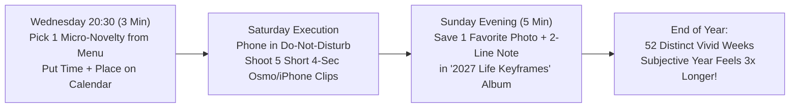

# The 1-New-Thing-Per-Week Protocol, Romantic Craft & 50-Experience Menu for Your 30s (30+重返少年感习惯与50件体验清单)

Knowing the theory of subjective time means nothing if next Saturday still defaults to lying on the couch scrolling until 3 PM. This module installs a **lightweight weekly execution cadence**, strips away subtle behavioral aging habits (`去爹味与丧气`), teaches **Kahneman Peak-End date design** for your relationship, and gives you a **50-item experience menu** so you never run out of joyful plans.

---

## Table of Contents

1. [The `1-New-Thing-Per-Week` Engine (52 Keyframes a Year)](#1-the-1-new-thing-per-week-engine-52-keyframes-a-year)
2. [Behavioral Youthfulness: Posture, Voice & Killing "Diewei" (`拒绝爹味与油腻`)](#2-behavioral-youthfulness-posture-voice--killing-diewei-拒绝爹味与油腻)
3. [Romantic Experience Design: Peak-End Rule for Unforgettable Dates](#3-romantic-experience-design-peak-end-rule-for-unforgettable-dates)
4. [The 50-Experience Menu for Your 30s (`32岁人生高光体验菜单`)](#4-the-50-experience-menu-for-your-30s-32岁人生高光体验菜单)

---

## 1. The `1-New-Thing-Per-Week` Engine (52 Keyframes a Year)

Every Wednesday evening, spend **3 minutes** booking or picking **one specific novel micro-experience (`1件本周没做过的新鲜小事`)** for the upcoming weekend—before Friday fatigue convinces you to do nothing!

- **Low-Cost Rule**: At least 3 out of 4 weekly novelties should cost **under RMB 150** (cooking a new regional dish from scratch, cycling an unexplored riverfront stretch, visiting a free contemporary art museum on West Bund, learning one J Dilla drum pattern, walking a new historic street at 8 AM). Novelty requires **curiosity, not luxury spending**.

---

## 2. Behavioral Youthfulness: Posture, Voice & Killing "Diewei" (`拒绝爹味与油腻`)

When people say a 33-year-old man has strong **`少年感` (clean, magnetic youthful energy)** vs "looking like a tired middle-aged uncle (`中年油腻/爹味`)", they are reading **five unconscious behavioral signals**:

| Signal | Aging "Uncle / Cynic" Habit (Eliminate) | Clean Youthful Adult Energy (Cultivate) |
| :--- | :--- | :--- |
| **1. Conversational Reflex** | Lecturing, correcting minor details, turning every topic into unsolicited career advice (`好为人师说教`) | **Curious Playfulness**: Asking *"Wait, how does that work? Show me!"*, laughing easily at yourself, letting others shine |
| **2. Attitude Toward New Trends** | Cynical dismissal (*"Young people's music/fashion nowadays is trash, everything is meaningless"*) | **Open-Minded Experimentation**: Trying new music, tools, sports, foods, and styles with beginner's joy |
| **3. Physical Carriage** | Rounded forward "tech neck", shuffling heels, heavy sighs when standing up (`垂头丧气拖步走`) | **Scapular Retraction + Crown Lift**: Chest open, crisp stride, light athletic bounce from strength training |
| **4. Emotional Hygiene** | Dumping unedited office complaints onto partner/friends for 90 minutes over dinner | **10-Minute Vent Cap**: Summarize a tough workday in 5 minutes, ask for a hug, then pivot fully to enjoying the evening |
| **5. Grooming Baseline** | Yellowed collar tees, overgrown nose/neck hair, oily glasses lenses | Crisp heavyweight fabrics, clean-shaven/trimmed jawline, spotless glasses, subtle clean cedar/citrus scent |

---

## 3. Romantic Experience Design: Peak-End Rule for Unforgettable Dates

Nobel laureate **Daniel Kahneman** proved that human memory does **not** average every minute of an experience—it remembers almost exclusively **the single emotional PEAK (`峰值时刻`) + the ENDING (`结尾余韵`)**!

Instead of boring, repetitive `"Mall -> Wait 45 min in queue for hotpot -> Scroll phones -> Movie -> Subway home"` dates, design dates with **1 sensory transition + 1 thoughtful tiny surprise**:

1. **Two-Scene Contrast (`动静双场景切换`)**:
   - *Scene 1 (Kinetic / Side-by-Side)*: Walking side-by-side lowers awkwardness and sparks natural conversation—e.g., golden-hour walk along *Kasbah des Oudayas* or *Shanghai West Bund / Suzhou Creek*, visiting a small exhibition, pottery studio, or vinyl shop.
   - *Scene 2 (Warm Seated Intimacy)*: Sitting at a **90-degree corner seat or bar counter** (far warmer and closer than sitting across a wide formal table like an interview!) in a `2700K` candlelit bistro.
2. **Keep a Private "Partner Radar Note" on Your Phone (`伴侣心愿备忘录`)**:
   - Whenever your girlfriend casually mentions *"I miss real Moroccan mint tea," "My hands get freezing in winter," "I've never seen the ocean at sunrise,"* or *"I love pistachio pastries,"* jot one line in a pinned encrypted note immediately. Delivering that exact tiny detail 3 weeks later without being asked feels like magic!

---

## 4. The 50-Experience Menu for Your 30s (`32岁人生高光体验菜单`)

Check off **10–15 items a year**—mix solo play, partner memories, and new skills:

### Category A: Sound, Rhythm & Creative Flow (1–10)
1. Buy a vinyl record that shaped your life and listen to Side A & Side B straight through with zero screens.
2. Beatmatch your first smooth 3-track 90s hip-hop / neo-soul transition on a DJ controller.
3. Sample a jazz piano loop and chop your own 60-second boom-bap beat for a personal vlog.
4. Sit front-row at a live jazz quartet and watch the drummer and bassist trade fours.
5. Take 8 beginner hip-hop or house dance groove classes purely for rhythm and laughter.
6. Go to an outdoor music festival or live hip-hop show and lose your voice on the chorus.
7. Edit a 3-minute "Year 32 Highlight Film" set to your favorite track every December.
8. Shoot one roll of real `35mm` color film (*Kodak Gold 200 / Portra 400*) and wait for lab scans—zero instant preview!
9. Print and frame 3 photos you took yourself to hang on your apartment wall.
10. Write a letter to your 40-year-old self and schedule-send or seal it in an envelope.

### Category B: Kinetic Play & Body Aliveness (11–20)
11. Solve your first `V2` indoor bouldering route from start hold to top hold.
12. Cycle `25 km` along a riverfront or lakefront (`千岛湖 / 太湖 / 徐汇滨江`) during golden hour.
13. Try a 2-hour beginner surfing lesson in warm waves (Hainan Riyue Bay, Bali, or Morocco's Taghazout/Rabat coast!).
14. Try snowboarding on fresh powder (`崇礼 / 长白山 / 北海道`) with wrist/hip pads and an instructor.
15. Kayak or paddleboard (`桨板 SUP`) across calm morning water at sunrise.
16. Drive outdoor go-karts (`室外卡丁车`) with friends and compare lap telemetry.
17. Run a relaxed `5K` or `10K` city fun-run purely for the morning street atmosphere, not pace anxiety.
18. Learn to swim freestyle smoothly with effortless bilateral breathing.
19. Hike above a sea of clouds (`云海日出`, e.g., Huangshan, Wugongshan, or Atlas Mountains).
20. Hit 10 clean deadlifts and 8 strict pull-ups at age 33—stronger in your 30s than at 22!

### Category C: Culinary, Craft & Everyday Aesthetics (21–30)
21. Host a 4-dish home-cooked dinner for your partner or close friends with curated playlist + warm lighting.
22. Master a restaurant-level Cantonese steamed fish (`清蒸鲈鱼`) and red-braised pork (`红烧肉`) from memory.
23. Learn from your girlfriend how to cook an authentic **Moroccan Tagine** (preserved lemon & olives or prunes & almonds) and pour **Atay mint tea** from height!
24. Brew a floral Ethiopian pour-over coffee on a quiet sunny balcony morning.
25. Throw and glaze two ceramic mugs by hand on a potter's wheel.
26. Visit a wet market or spice souk in a new city at 7:30 AM and taste street breakfast hot off the griddle.
27. Do a blind tasting of 3 different coffee origins, olive oils, or teas at home.
28. Build a signature 10-piece capsule wardrobe where every item fits your shoulders and waist cleanly.
29. Find your personal signature daytime and evening fragrances.
30. Spend a rainy Sunday afternoon in an independent bookstore and read 150 pages of a paper novel in one sitting.

### Category D: Partner Moments & Human Warmth (31–40)
31. Watch sunset over the Atlantic Ocean from the blue walls of *Kasbah des Oudayas* in Rabat together.
32. Beat *It Takes Two (`双人成行`)* or *Split Fiction* together laughing on the couch.
33. Pack a thermos of hot tea/coffee, fruit, and a blanket for an autumn park picnic under golden ginkgo/plane trees.
34. Stargaze away from city light pollution (`Bortle Class 2–3` dark sky—Sahara desert edge, Qinghai, or Western Sichuan) and see the Milky Way core with the naked eye.
35. Take an overnight sleeper or high-speed scenic train journey (`Al Boraq` to Tangier, Swiss panorama rail, or coastal Japan rail).
36. Celebrate an anniversary or birthday with a handwritten paper card naming 5 specific moments you cherished that year.
37. Walk through a night market in another country sharing street snacks without checking work messages once.
38. Cook midnight scallion oil noodles (`葱油拌面`) together after coming home late from a concert or flight.
39. Teach each other 30 everyday expressions and childhood songs from your respective hometowns.
40. Take an unposed candid portrait series of each other during golden hour on every trip.

### Category E: Global Horizons & Perspective Shifts (41–50)
41. Spend a full week living like a local in a walkable foreign neighborhood (buying morning bread at the corner bakery, riding local trams) instead of rushing 6 tourist cities in 7 days.
42. Swim in two different oceans in the same year (Pacific + Atlantic / Mediterranean / Indian Ocean).
43. Stand inside a 1,000-year-old architectural wonder (*Chellah / Hassan Tower*, *Kyoto*, *Alhambra*, *Hagia Sophia*, *Forbidden City* in snow) right as gates open.
44. Have a 30-minute conversation with a stranger from a completely different profession and country.
45. Ship one tiny independent digital creation (open-source tool, indie app, or public essay/video) signed with your own name.
46. Spend 24 hours completely offline (`Airplane Mode Sabbath`)—zero notifications, paper map, physical notebook.
47. Upgrade your parents or loved ones to an experience they would never buy for themselves.
48. Take a solo 2-day "Think Weekend" once a year in a quiet mountain/sea hotel with a notebook to design your next 12 months.
49. Keep a `1-Second-Everyday` or monthly `60-Second Reel` habit for 365 days straight.
50. Reach your 33rd birthday knowing more stories happened in the past 12 months than in the previous 3 years combined!
