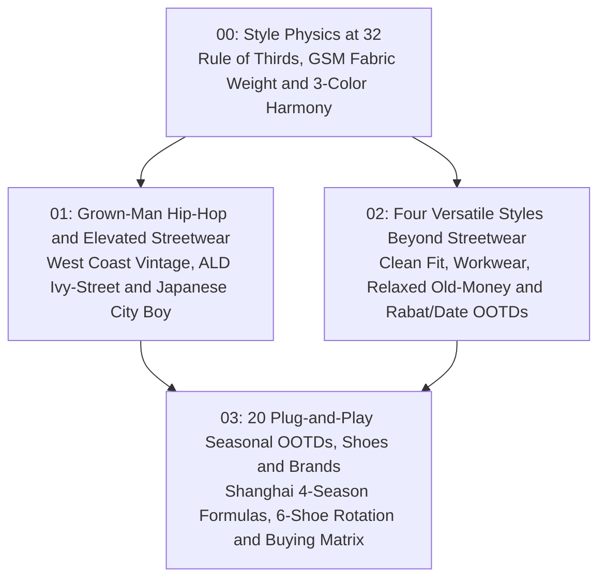
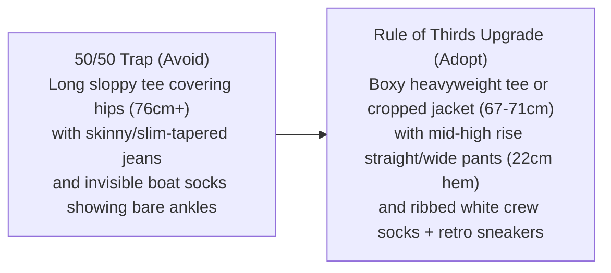

# Men's OOTD & Personal Style System at 32: Proportions, Fabric & Hip-Hop-to-Refined Versatility (32岁男士穿搭工程学)

Great personal style at 32 is neither dressing like a generic corporate robot nor dressing like a 17-year-old covered in loud fast-fashion logos. And if **hip-hop is in your DNA**, you actually have one of the richest aesthetic foundations in modern menswear: **contemporary global menswear (Aimé Leon Dore, Kith, Kendrick Lamar, Pharrell, Japanese *POPEYE* City Boy, Lemaire-infused streetwear)** is built directly on the marriage of **hip-hop silhouette confidence + tailored adult fabric quality**.

As an engineer, treat getting dressed as a **deterministic visual system** governed by three physical variables: **vertical/horizontal silhouette proportions (`廓形比例`)**, **fabric weight & drape (`克重与垂坠感`)**, and **undertone color harmony (`低饱和配色逻辑`)**.

---

## Curriculum Architecture & Learning Path

### Module Directory

| Module | File | Aesthetic Focus | Outcome |
| :--- | :--- | :--- | :--- |
| **00** | [00-README.md](00-README.md) | Proportions (`三七分`), fabric GSM physics, color palettes, 5 style killers | Understand *why* an outfit looks effortlessly cool in 3 seconds |
| **01** | [01-GROWN-MAN-HIPHOP-AND-STREETWEAR-OOTD.md](01-GROWN-MAN-HIPHOP-AND-STREETWEAR-OOTD.md) | **Grown-Man Hip-Hop (`成熟质感街头`)**: West Coast Boxy Vintage, NYC ALD Ivy-Street, Tokyo City Boy | Channel authentic hip-hop energy at 32 with zero juvenile logo clutter |
| **02** | [02-FOUR-VERSATILE-STYLES-BEYOND-STREETWEAR.md](02-FOUR-VERSATILE-STYLES-BEYOND-STREETWEAR.md) | **Clean Fit**, **Light Workwear**, **Mediterranean / Linen Relaxed**, **Smart-Casual Date Night** | Switch styles effortlessly for architecture talks, fine dining, or visiting family in Rabat |
| **03** | [03-20-SEASONAL-OOTD-FORMULAS-SHOES-AND-BRANDS.md](03-20-SEASONAL-OOTD-FORMULAS-SHOES-AND-BRANDS.md) | 20 exact head-to-toe OOTD formulas (Spring/Summer/Autumn/Winter), 6-shoe rotation, socks/accessories & brand guide | Open your closet any morning and assemble a 9/10 outfit in 90 seconds |

---

## 1. Law #1: Silhouette & The Rule of Thirds (`三七分比例 vs 五五分灾难`)

Before anyone notices the brand of your shirt, the human eye parses your **top-to-bottom rectangle ratio**:

- **The `1 : 1` (50/50) Trap (Why Standard Programmer Outfits Look Short & Sloppy)**:
  - Buying an oversized/long T-shirt or hoodie (`衣长 > 74–76 cm`) that hangs all the way down past your zipper/hips, paired with slim-tapered pants (`上宽下紧长衣摆`), slices your body in half (`50%` torso, `50%` legs) and visually subtracts `6 cm` from your height!
- **The `1 : 2` Rule of Thirds (`上短微宽 + 中高腰阔腿直筒`)**:
  - **Ideal Top Length (`衣长黄金线`)**: Boxy/relaxed in the chest and shoulders (`微落肩宽松胸围`), while the hem ends **right around the top-to-middle of your fly zipper (`臀部上方 / 裤门襟中上段`, typically `66–70 cm` for `170–178 cm` height, `70–73 cm` for `178–185 cm`)** — or lightly front-tucked / ribbed-hemmed!
  - **Ideal Pant Silhouette (`裤型黄金解`)**: **Mid-to-high rise (`中高腰`) + Relaxed Straight or Wide-Tapered (`直筒微阔 / 弯刀裤 / 单褶休闲西裤`)** with a **`21–24 cm` leg opening (`裤脚口宽`)** resting cleanly on top of your sneaker tongue (`微盖鞋面一折` — "slight stack", neither tight ankle-hugging leggings nor dragging in puddles!).

---

## 2. Law #2: Fabric Weight (`GSM 克重`) & Drape Engineering

Cheap clothes betray themselves through **clingy, translucent, wrinkly fabric**. Upgrading fabric weight (`克重 GSM = grams per square meter`) makes a RMB 150 plain tee look better than a RMB 4,000 thin designer logo tee:

| Garment | Thin / Sloppy Spec (Avoid) | Sweet-Spot Spec to Buy | Why It Looks Expensive |
| :--- | :--- | :--- | :--- |
| **Crewneck T-Shirt (`纯色短袖T恤`)** | `< 180 GSM`, wide floppy collar that turns into "bacon neck" after 3 washes | **`260–320 GSM` combed/heavy cotton**, **`2.2–2.8 cm` tight ribbed crew collar (`二本针加固窄领口`)** | Stands away from chest/nipples/stomach; crisp architectural boxy drape |
| **Pullover Hoodie (`连帽卫衣`)** | `< 320 GSM` floppy hood that collapses flat like a pancake on your back | **`450–580 GSM` heavy French terry (`重磅毛圈`) or fleece**, **double-layered structured hood (`双层立体帽兜`)**, cropped ribbed waist | The hood stands up 3D around your neck and frames your jawline! |
| **Denim Jeans (`牛仔裤`)** | Thin stretchy spandex skinny jeans (`含高弹氨纶紧身牛`) | **`12.5–14.5 oz` `100%` cotton washed/selvedge denim** (vintage mid-blue, washed black, or ecru off-white) | Holds clean vertical columns over sneakers instead of clinging to calves |
| **Trousers (`休闲西裤 / 阔腿裤`)** | Shiny tight polyester suit pants (`发亮紧身精神小伙西裤`) | **Matte wool-blend (`含羊毛混纺`), heavyweight cotton twill (`斜纹卡其`), or linen-cotton** with single pleats (`单褶`) | Flows smoothly when walking (`走路带风垂坠感`) and bridges hip-hop tees with adult refinement |

---

## 3. Law #3: The Effortless 3-Color & Undertone System

Never put more than **3 main colors** on your body at once (`70% Base + 20% Secondary + 10% Accent`), and learn the **"Sandwich Color Echo (`三明治呼应法`)"**:

- **Match Top/Cap Color to Shoe Color** (e.g., *Forest Green cap + White boxy tee + Light-wash blue jeans + White/Green sneakers*), OR **Match Outer Jacket to Shoes** with a contrasting inner layer!
- **6 Undefeatable Masculine Base Colors (Mix Any 2–3 Blindfolded and They Always Match!)**:
  1. **Off-White / Cream / Ecru (`米白 / 本白`)** — warmer, softer, and richer against East Asian skin tones than harsh hospital bleach-white!
  2. **Washed Charcoal / Vintage Black (`水洗炭黑 / 复古黑`)** — way more texture and depth than flat jet-black.
  3. **Heather Grey (`高级花灰`)** — the undisputed king of hip-hop hoodies and New Balance sneakers.
  4. **Olive / Military Sage (`复古军绿 / 鼠尾草绿`)** — cargo/fatigue pants,liner jackets, caps.
  5. **Deep Navy (`深藏青`)** — sharper and warmer than black for coats, knitwear, and caps.
  6. **Espresso Brown / Camel / Khaki (`深咖 / 驼色 / 卡其`)** — Carhartt work jackets, suede loafers/boots, corduroy.

---

## 4. Five Instant "Dated / Unflattering" Traps to Retire Today

1. **Skinny / Tight Ripped Jeans (`紧身破洞牛仔裤` / `束脚小脚慢跑裤`)**: Peak 2015–2017 fashion; instantly dates an outfit by 10 years and exaggerates thigh/calf curvature. Swap for **relaxed straight (`直筒宽松`)**!
2. **Giant Chest Logos, Fake Luxury Monograms & Busy Back Prints (`满印大Logo潮牌`)**: At 32, quiet texture, vintage wash, subtle tonal embroidery, or a small chest hit whispers confidence (`Quiet Streetwear`).
3. **Invisible Ankle Socks With Wide Pants (`长裤配船袜露脚踝`)**: Showing a gap of bare hairy ankle between trousers and sneakers breaks leg lines. Stock **10 pairs of ribbed mid-calf off-white/black cotton crew socks (`中筒罗纹棉袜`)**!
4. **Tech-Company Free Backpack + Running Shoes for Dates (`双肩电脑包 + 荧光色跑鞋去约会`)**: Keep bright marathon carbon-plate running shoes for running; wear heritage suede/leather sneakers or loafers casually, and swap the bulky company nylon laptop backpack for a clean **canvas tote, minimalist leather/Cordura messenger, or compact crossbody sling** on weekends!
5. **Unsteamed Wrinkles & Dusty Shoes (`衣服皱巴巴 + 小白鞋全是黑印`)**: Spend `90 seconds` with a handheld garment steamer (`手持挂烫机`) and `15 seconds` wiping sneaker midsoles with a wet wipe before stepping out—cleanliness multiplies every outfit by `2x`.
