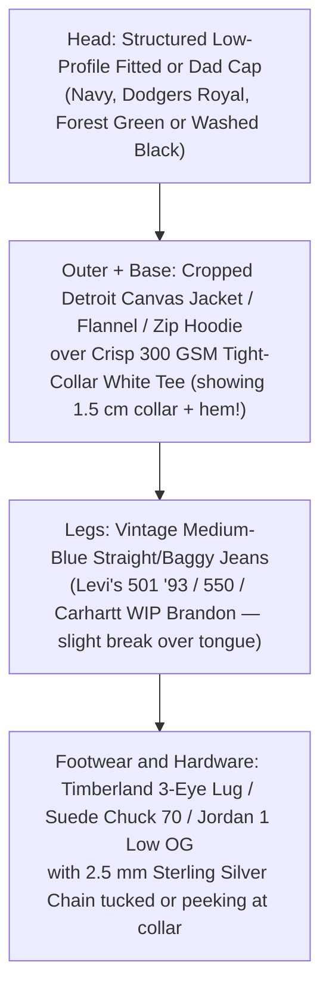

# Grown-Man Hip-Hop & Elevated Streetwear OOTD Playbook (32岁高质感Hiphop与街头穿搭)

Loving hip-hop in your 30s does **not** mean giving up streetwear—look at **Kendrick Lamar, A$AP Rocky, Pharrell Williams, Tyler, The Creator, Teddy Santis (Aimé Leon Dore), Ronnie Fieg (Kith), and Akio Hasegawa (*POPEYE* / Nautica JP)**. Notice how none of them dress in loud 2016 hypebeast graphic hoodies anymore: they blend **hip-hop silhouette swagger (relaxed drape, great sneakers, caps, subtle silver/gold hardware)** with **grown-man tailoring, vintage workwear, knitwear, and rich fabrics**.

Below are the **three signature Grown-Man Hip-Hop archetypes** you can rotate immediately.

---

## Table of Contents

1. [Archetype 1 — West Coast Clean Vintage (Kendrick Lamar Inspired)](#1-archetype-1--west-coast-clean-vintage-kendrick-lamar-inspired)
2. [Archetype 2 — NYC Ivy-Street Crossover (Aimé Leon Dore / Kith Vibe)](#2-archetype-2--nyc-ivy-street-crossover-aimé-leon-dore--kith-vibe)
3. [Archetype 3 — Tokyo City Boy Hip-Hop (Oversized Crisp + Relaxed Utility)](#3-archetype-3--tokyo-city-boy-hip-hop-oversized-crisp--relaxed-utility)
4. [Hip-Hop Proportion, Layering & Accessory Rules at 32](#4-hip-hop-proportion-layering--accessory-rules-at-32)

---

## 1. Archetype 1 — West Coast Clean Vintage (Kendrick Lamar Inspired)

**Vibe**: Effortless, rhythmic, masculine, zero try-hard flash. Relies on **impeccable boxy proportions, sun-faded denim/canvas workwear, crisp white necklines, and structured caps**.

### Key Building Blocks
- **The Crisp White Collar Rule (`白T领口叠穿灵魂`)**: Under every crewneck sweatshirt, open flannel, leather jacket, or cardigan, wear a **tight-collared heavyweight white tee** so a crisp `1–1.5 cm` white ring frames your neck—this single hip-hop styling trick brightens your face and makes dark outerwear look 3x cleaner!
- **Cropped Work Jackets (`短款工装夹克`)**: Canvas Detroit jackets (`Carhartt WIP Detroit / Santa Fe`), suede trucker jackets (`麂皮短夹克`), or boxy zip-up hoodies (`双拉链重磅连帽开衫` — unzip the bottom zipper `5 cm` to prevent belly bunching when sitting!).
- **Vintage Wash Denim (`复古水洗中蓝直筒牛仔裤`)**: Medium-blue or faded black `13.5 oz` straight-leg denim—relaxed through the thigh so movement looks fluid.

---

## 2. Archetype 2 — NYC Ivy-Street Crossover (Aimé Leon Dore / Kith Vibe)

**Vibe**: What happens when Queens/Harlem 90s hip-hop meets tailored Manhattan menswear. **This is arguably the #1 most attractive, versatile aesthetic for a 32-year-old engineer**—cool enough for an underground hip-hop vinyl bar, refined enough for an upscale dinner date or architecture talk!

### Signature Mix-and-Match Equation (`街头单品 × 绅士质感单品 混搭公式`)

Never go 100% formal OR 100% gym-casual—always cross-pollinate **50% Street/Hip-Hop** with **50% Tailored Menswear**:

| 50% Hip-Hop / Street Piece | + | 50% Grown-Man Tailored Piece | = Resulting Look |
| :--- | :---: | :--- | :--- |
| **500 GSM Heather Grey Pullover Hoodie + Baseball Cap** | + | **Long Charcoal/Camel Double-Breasted Wool Overcoat (`长款羊毛大衣`) +NB 993** | Iconic NYC Winter Street-Smart Uniform |
| **Vintage Graphic / Jazz / Hip-Hop Album Tee** | + | **Unstructured Relaxed Navy Blazer / Chore Coat + Pleated Wool Trousers + Loafers** | Effortless Creative Director Date Outfit |
| **Varsity Wool-Leather Jacket (`低调同色系棒球服`) or Fleece** | + | **Crisp Striped Oxford Shirt + Ecru Cream Corduroy Trousers (`灯芯绒直筒裤`)** | Warm, Textured Autumn Weekend Fit |
| **Washed Denim Shirt (`复古牛仔衬衫`) + Silver Ring** | + | **Olive Single-Pleat Gurkha/Chino Trousers + Dark Brown Suede Loafers** | Rugged Yet Sharp Smart-Streetwear |

---

## 3. Archetype 3 — Tokyo City Boy Hip-Hop (Oversized Crisp + Relaxed Utility)

**Vibe**: Inspired by Japanese *POPEYE* magazine, *Nautica JP*, *Beams Plus*, *WTAPS*, and *nanamica*. Designed specifically for **East Asian frames**, using crisp structured fabrics (`挺括面料`) so wide silhouettes look **clean, airy, and architectural** rather than sloppy!

### Three Foolproof City Boy Combinations
1. **Spring/Autumn Signature**:
   - **Oversized Blue/White Striped Oxford Button-Down Shirt (`宽松牛津纺条纹衬衫`)** worn unbuttoned like a light jacket (sleeves rolled neatly twice!) + `280 GSM` white tee + **Wide-Tapered Olive Army Fatigue Pants (`美式贝克军裤 / 伞兵裤`)** + **Grey New Balance `990v6` / `992` or Clarks Suede Wallabees** + Navy `'47 Brand` cap.
2. **Rainy Shanghai Commute (Gorpcore × Hip-Hop)**:
   - **Matte Black/Slate 3-Layer Gore-Tex Shell Jacket (`硬壳冲锋衣` — Arc'teryx Beta / nanamica / Goldwin / Montbell)** + Grey sweatshirt + Wide charcoal ripstop nylon cargo pants + **Salomon XT-6 Gore-Tex**.
3. **Humid Summer Breeze**:
   - **Boxy Mid-Sleeve Pocket Tee (`五分袖重磅落肩T恤`)** in Navy or Washed Olive + **Knee-Length Wide Chino Shorts (`过膝中裤`, hitting right at the kneecap—never ultra-short thigh shorts!)** + **Mid-Calf Ribbed White Crew Socks** + Retro Suede Sneakers (`Adidas Samba / Gazelle Indoor / Puma Palermo / NB 1906R`).

---

## 4. Hip-Hop Proportion, Layering & Accessory Rules at 32

1. **Jewelry & Hardware Calibration (`克制的金属点缀 = 点睛之笔`)**:
   - Skip giant iced-out cubic-zirconia pendants; wear **real 925 Sterling Silver (`925纯银`) or brushed stainless/titanium**:
     - **Neck**: One subtle `2.0–3.0 mm` silver **Rope, Figaro, or Cuban chain (`50–55 cm`)** resting right at the collarbone over or half-tucked into a heavyweight tee.
     - **Wrist**: A classic **Casio G-Shock Full-Metal Square (`GMW-B5000` silver/matte black)**, **Casio Vintage `A168`**, **Tissot PRX**, **Seiko Diver**, or **Apple Watch on a brushed metal/braided band** on the left wrist + a minimal `3 mm` silver cuff on the right.
     - **Fingers**: At most **1–2 understated brushed silver signet/band rings** (`素圈/印章银戒` on index or ring finger).
2. **Headwear Geometry (`帽子修饰头肩比`)**:
   - If you have a wider/rounder face or larger head circumference (`大头围 59–62 cm`): avoid shallow flat caps! Choose **deep-crown curved-brim caps** (`'47 Brand MVP/Clean Up XL`, `New Era 9FORTY A-Frame`, `Ralph Lauren Polo Chino Cap`, or Japanese `CA4LA / Beams` wide-crown caps) or a cuffed knit **Watch Cap / Beanie (`瓜皮冷帽`)** sitting slightly above the ears.
3. **Double-Zipper Mastery (`双头拉链心机`)**:
   - Whenever buying zip hoodies, cardigans, leather jackets, or work jackets, prioritize **two-way YKK zippers (`双头拉链`)**—zipping the top up to the chest while opening the bottom `6–8 cm` creates an instant inverted-V waist break that makes your legs look `5 cm` longer!
