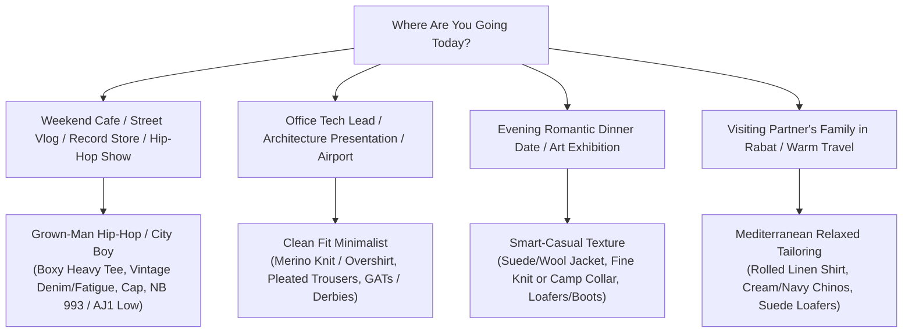

# Four Versatile Styles Beyond Streetwear: Clean Fit, Workwear, Linen Relaxed & Date Night (多元风格进阶指南)

You don't need to abandon hip-hop—you just want **4 additional "modes" in your wardrobe** that share 70% of the same base trousers, tees, and shoes while letting you walk into a Michelin restaurant, a Staff engineering summit, a sunny Mediterranean coast, or your girlfriend's family home in Rabat looking effortlessly sharp.

---

## Table of Contents

1. [Mode 1 — Clean Fit / Minimalist Architect (`极简高级松弛感`)](#1-mode-1--clean-fit--minimalist-architect-极简高级松弛感)
2. [Mode 2 — Refined Workwear & Rugged Heritage (`轻熟工装复古风`)](#2-mode-2--refined-workwear--rugged-heritage-轻熟工装复古风)
3. [Mode 3 — Mediterranean & Rabat Travel Relaxed (`老钱松弛度假与见家长得体风`)](#3-mode-3--mediterranean--rabat-travel-relaxed-老钱松弛度假与见家长得体风)
4. [Mode 4 — High-Trust Date Night & Smart-Casual (`约会与重要场合氛围感`)](#4-mode-4--high-trust-date-night--smart-casual-约会与重要场合氛围感)
5. [Choosing the Right Style by Occasion (Decision Matrix)](#5-choosing-the-right-style-by-occasion-decision-matrix)

---

## 1. Mode 1 — Clean Fit / Minimalist Architect (`极简高级松弛感`)

**Reference Benchmarks**: *Lemaire*, *Uniqlo U (Christophe Lemaire line)*, *COS*, *Studio Nicholson*, *Auralee*.
**Why Engineers Love It**: Zero graphics, zero patterns, monochromatic/tonal calm—yet commands immediate visual respect in offices, cafes, art galleries, and airports.

- **Core Formula**: **Structured Knit or Minimalist Shirt + Wide Pleated Fluid Trousers (`垂感单褶西裤`) + Minimalist Leather Footwear**.
- **3 Instant Clean-Fit Outfits**:
  1. **Charcoal + Cream Tonal**: Fine-gauge **Charcoal Merino Wool Crewneck Sweater (`精纺美利奴羊毛衫`)** (white tee collar peeking `1 cm`!) + **Cream/Ecru Wide-Straight Denim or Cotton Twill Trousers** + **Black Minimalist Leather Sneakers or Chunky Derby Shoes**.
  2. **Spring Minimalist Blouson**: **Cropped Matte Zip Blouson / Harrington Jacket (`短款翻领拉链夹克`)** in Taupe/Dark Navy + **Tucked Heavyweight Off-White Tee** + **Matched Dark Navy Wide Trousers** + **German Army Trainers (`德训鞋` — Maison Margiela Replica / Adidas BW Army)**.
  3. **Summer Knit Polo**: **Open-Collar Knitted Cotton/Silk-Blend Polo (`针织无扣翻领Polo` — NOT tight golf pique polo!)** in Espresso Brown or Olive + **Light Grey/Beige Relaxed Pleated Trousers** + **Suede Loafers**.

---

## 2. Mode 2 — Refined Workwear & Rugged Heritage (`轻熟工装复古风`)

**Reference Benchmarks**: *RRL*, *Drake's*, *Beams Plus*, *Universal Works*, *Barbour*.
**Why It Works**: Bridges directly from your hip-hop/Carhartt pieces—just swapping hoodies for **textured collars (corduroy, waxed cotton, suede, chambray, waffle thermal)** so you look grounded, reliable, and masculine.

- **Key Pieces**:
  - **Olive Waxed Jacket (*Barbour Bedale/Beaufort* style) or French Moleskin Chore Coat (`法式工装夹克`)** — 4 pockets hold your Osmo Pocket 3, phone, and passport with zero bag needed!
  - **Heavy Waffle-Knit Henley (`重磅华夫格长袖`)** or **Brushed Indigo Chambray Shirt (`水洗青年布衬衫`)**.
  - **14-Wale Corduroy Trousers (`宽条灯芯绒直筒裤`)** in Warm Brown or Forest Green + **Dark Brown Suede Chukkas / Service Boots / Paraboot Michael**.

---

## 3. Mode 3 — Mediterranean & Rabat Travel Relaxed (`老钱松弛度假与见家长得体风`)

**Reference Benchmarks**: *Massimo Dutti Studio*, *SuitSupply Casual*, *Ralph Lauren Linen*.
**Why You Specifically Need This**: Whether walking along the Atlantic breeze at *Kasbah des Oudayas* in **Rabat**, having Friday lunch at your girlfriend's family home, or traveling in Europe/Singapore, loud streetwear graphics or gym shorts look touristy—whereas **relaxed linen & breathable cotton tailoring** looks respectful, photogenic on camera, and cool in `28°C` sun!

- **The Golden Linen Travel Formula**:
  - **Top**: **100% French Linen or Cotton-Linen Relaxed Long-Sleeve Shirt (`亚麻宽松长袖衬衫`)** in **Sky Blue, Crisp White, Olive, or Sand** — unbutton the top 1–2 buttons, roll sleeves effortlessly twice just below the forearm, and wear untucked (if hem is mid-fly) or loosely tucked into drawstring waistbands, OR layered open over a ribbed tank/white tee!
  - **Bottom**: **Tailored Linen-Blend or Lightweight Cotton Drawstring Gurkha/Chino Trousers (`松紧抽绳亚麻混纺休闲长裤`)** in Cream, Stone, or Navy. *(Cultural pro tip: In Morocco and Southern Europe, adult men almost always wear airy long linen/cotton trousers rather than shorts for dinners and family visits—it keeps sun off your legs AND earns instant respect from elders!)*
  - **Shoes**: **Unlined Brown/Sand Suede Penny Loafers (`反绒皮乐福鞋` — easy to slip off cleanly when stepping onto Moroccan *Salon* carpets!)** or clean **Minimalist White Leather Sneakers**.

---

## 4. Mode 4 — High-Trust Date Night & Smart-Casual (`约会与重要场合氛围感`)

What makes an outfit feel magnetic on an evening dinner date, cocktail lounge, or concert? **Texture contrast (`材质碰撞`: soft matte wool/suede/cashmere vs subtle sheen of leather/silver) + framed shoulders + clean scent**:

1. **Autumn/Winter Date Winner**:
   - **Espresso Brown or Black Cropped Suede/Leather Jacket (`麂皮或哑光皮夹克`)** OR **Charcoal Unstructured Knit Jacket** + **Fine Black/Charcoal Mock-Neck or Crew Merino Sweater (`半高领/圆领细针织`)** + **Washed Black Straight Jeans or Charcoal Wool Trousers** + **Black Leather Chelsea Boots / Chunky Loafers** + subtle woody/citrus fragrance (`1–2 sprays` on chest/wrists—e.g., *Terre d'Hermès*, *Bleu de Chanel EDP*, *Le Labo Another 13 / Santal 33*, or *Loewe 001 Man*).
2. **Spring/Summer Evening Date Winner**:
   - **Textured Camp-Collar (`古巴领`) Tencel/Silk-Cotton Shirt** in Deep Navy/Burgundy/Olive (drapes softly across shoulders and collarbone!) + **Pleated Off-White or Charcoal Trousers** + **Leather Loafers or Clean Retro Sneakers** + wristwatch.

---

## 5. Choosing the Right Style by Occasion (Decision Matrix)

