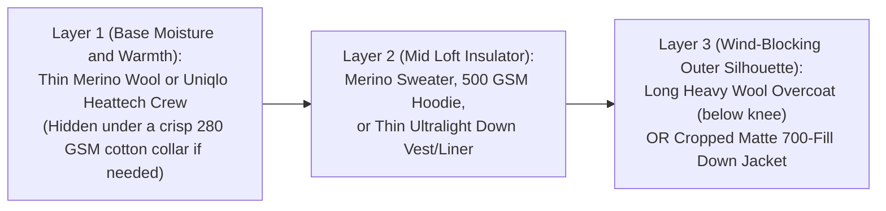

# 20 Plug-and-Play Seasonal OOTD Formulas, 6-Shoe Rotation & Brand Guide (四季20套公式与高性价比品牌清单)

Stop buying isolated "cool single pieces" that match nothing else in your closet. Build an **interchangeable modular capsule (`胶囊衣橱`)** where every top matches at least 3 bottoms, and every bottom works with at least 3 pairs of shoes.

---

## Table of Contents

1. [20 Zero-Brainpower OOTD Formulas Across 4 Seasons](#1-20-zero-brainpower-ootd-formulas-across-4-seasons)
2. [The Undefeatable 6-Pair Footwear Rotation](#2-the-undefeatable-6-pair-footwear-rotation)
3. [Shanghai Winter Anti-Bulk Layering Physics (`冬季不显臃肿三明治法则`)](#3-shanghai-winter-anti-bulk-layering-physics-冬季不显臃肿三明治法则)
4. [Brand Tier List: Where to Spend vs Where to Save (RMB 99 to 3,500)](#4-brand-tier-list-where-to-spend-vs-where-to-save-rmb-99-to-3500)

---

## 1. 20 Zero-Brainpower OOTD Formulas Across 4 Seasons

### Spring (`14°C–22°C` — Golden Layering Season)
1. **West Coast Crisp**: Cropped Khaki Canvas Detroit Jacket + `300 GSM` White Tee + Medium-Wash Blue Levi's `501` Straight Jeans + White/Green Retro Sneakers + Forest Green Dad Cap.
2. **City Boy Stripes**: Oversized Blue-White Striped Oxford Shirt (unbuttoned) + White Tee + Wide-Tapered Olive Fatigue Pants + Grey New Balance `993` + Navy Cap.
3. **Clean Fit Blouson**: Dark Navy Cropped Harrington Jacket + Heather Grey Tee + Ecru/Off-White Straight Denim + White/Grey German Army Trainers (`德训鞋`).
4. **Rainy Tech-Street**: Matte Black Gore-Tex Hard Shell + Heather Grey Crewneck Sweatshirt + Charcoal Wide Ripstop Cargo Pants + Black Salomon `XT-6`.
5. **Smart Spring Date**: Olive Unstructured Cotton-Linen Chore Jacket + Fine Cream Knit Tee + Charcoal Single-Pleat Trousers + Dark Brown Suede Loafers.

### Summer (`28°C–38°C` — Texture & Breathability Without Layers)
6. **Elevated Boxy Minimalist**: `280 GSM` Washed Charcoal Boxy Pocket Tee + Light-Blue Vintage Wide Jeans + Silver `2.5 mm` Chain + Metal-Bezel G-Shock/Mechanical Watch + White Leather Sneakers.
7. **Old-Money Breeze**: Sky-Blue `100%` Linen Long-Sleeve Shirt (sleeves rolled twice) + Stone/Cream Linen-Cotton Drawstring Trousers + Brown Suede Loafers.
8. **City Boy Summer Shorts**: Oversized Navy Mid-Sleeve Tee + Khaki Knee-Length Wide Chino Shorts + **Ribbed Mid-Calf White Crew Socks** + Grey NB `990v6` / `1906R`.
9. **Evening Camp-Collar**: Espresso Brown Tencel/Rayon Camp-Collar (`古巴领`) Short-Sleeve Shirt + White Ribbed Tank underneath + Relaxed Black Pleated Trousers + Black Chunky Loafers.
10. **Retro Sport-Street**: Off-White Knit Open-Collar Polo + Olive Fatigue Pants + Adidas Samba / Gazelle Indoor + Minimalist Sunglasses.

### Autumn (`12°C–20°C` — Peak Menswear Texture)
11. **ALD Hooded Layer**: `500 GSM` Heather Grey Hoodie + Navy Peacoat or Olive M-65 Fishtail Parka + Medium-Blue Straight Jeans + Timberland `3-Eye` Burgundy Lug Shoes.
12. **Suede & Denim**: Tobacco Brown Cropped Suede Trucker Jacket + Crisp White Tee + Washed Black Straight Jeans + Black Chelsea/Derby Shoes.
13. **Ivy Sweatshirt**: Forest Green/Navy Heavyweight Crewneck Sweatshirt (showing `1.5 cm` white tee collar or Oxford shirt collar!) + Beige Pleated Chinos + Retro Runners + Baseball Cap.
14. **Rugged Flannel**: Muted Earth-Plaid Brushed Heavy Flannel Shirt (open) + Off-White Waffle Henley + Dark Raw/One-Wash Straight Denim + Clarks Maple/Beeswax Suede Wallabees.
15. **Clean Cardigan**: Thick Ribbed Charcoal/Espresso Cardigan (`重磅粗针开衫`, bottom button undone!) + White Tee + Wide Grey Wool-Blend Trousers + Minimalist White/GAT Sneakers.

### Winter (`0°C–10°C` — Damp Shanghai / Travel Cold)
16. **NYC Street Overcoat (#1 Winter Combo)**: Long Oversized Charcoal Raglan Balmacaan Wool Coat (`插肩袖长款羊毛大衣`, hitting below knee!) + `520 GSM` Cream/Grey Hoodie + Wide Dark Denim + NB `992/993` + Knit Beanie.
17. **Cropped Boxy Puffer (`面包服黄金比例`)**: Matte Black/Olive `700+ Fill` Cropped Boxy Down Puffer (`短款哑光羽绒服` — hem at hip bone, NEVER shiny trash-bag nylon!) + Heavy Sweatshirt + Cream Corduroy Straight Pants + Chunky Boots/Sneakers.
18. **Refined Turtleneck Coat**: Camel or Dark Navy Long Wool Overcoat + Charcoal Merino Mock-Neck Sweater + Charcoal/Black Wool Pleated Trousers + Black Leather Boots/Derbies.
19. **Fleece Gorp-Street**: Retro Cream Pile Fleece Jacket (`摇粒绒夹克` under windproof shell if windy) + Olive Cargo/Fatigue Pants + Suede Mountain/Trail Sneakers.
20. **Indoor Heated Cafe / Office Ready**: Uniqlo `HEATTECH` invisible inner + Merino Crewneck Sweater + Quilted Liner Jacket (`绗缝内胆夹克`) under Overcoat + Straight Jeans.

---

## 2. The Undefeatable 6-Pair Footwear Rotation

You do not need 30 boxes of hype sneakers taking over your entryway. These **6 pairs** cover 100% of hip-hop, office, rain, travel, and formal dates—and rotating shoes so each pair airs out 24 hours with **cedar shoe trees (`雪松木鞋撑`)** makes them last 5 years odor-free:

| Slot | Archetype | Benchmark Models | Why It Earns Its Spot |
| :--- | :--- | :--- | :--- |
| **1. Daily Walking King** | **Heritage Grey Suede Runner** | **New Balance Made in USA `993` / `990v6` / `992`** (or `2002R` / `1906R`) | Walk 20,000 travel steps in comfort; bridges hip-hop hoodies AND wool overcoats effortlessly |
| **2. Crisp Street Classic** | **Clean Court / Retro Low** | **Nike Air Force 1 '07 Craft / Jordan 1 Low OG Neutral Grey**, **Adidas BW Army / Samba**, **Asics Gel-Kayano 14** | Classic hip-hop DNA; crisp low-profile anchor under wide denim |
| **3. Textured Moc / Boot** | **Suede Wallabee or Handsewn Lug** | **Clarks Originals Wallabee** (Maple/Black Suede — Wu-Tang hip-hop legend!) or **Timberland Authentic 3-Eye Classic Lug** | Instant "insider menswear + hip-hop" credibility when sneakers feel too sporty |
| **4. Minimalist Clean-Fit** | **German Army Trainer (`德训鞋`)** | **Reproduction of Found**, **Maison Margiela Replica**, **Adidas BW Army**, **Beckett Simonon Morgen** | White leather + grey suede toe cap—less boring than plain white sneakers, pairs with every trouser |
| **5. Grown-Man Upgrade** | **Penny Loafer or Tyrolean Derby** | **Paraboot Michael**, **G.H. Bass Weejuns Larson**, **Berwick 1707 Suede Loafer** (`Goodyear welted`) | Elevates jeans, chinos, and linen instantly for dates, weddings, and family dinners |
| **6. Weatherproof Utility** | **Gore-Tex All-Black / Earth Trail** | **Salomon XT-6 GTX / ACS Pro**, **Hoka Tor Ultra**, **Danner** | Keeps socks 100% dry during Shanghai typhoons/plum rains and airport travel days |

---

## 3. Shanghai Winter Anti-Bulk Layering Physics (`冬季不显臃肿三明治法则`)

Shanghai winters (`2°C–8°C`, `75%` humidity, indoor AC variation) trap most men into wearing tight bulky thermal underwear under an overstuffed mid-thigh parka. Use **3-Layer Thermal Engineering** instead:

- **Outerwear Length Extremes Rule (`要么极短利落，要么过膝气场`)**:
  - **Cropped (`65–70 cm` hip-length)** down puffers/leather jackets maximize leg length.
  - **Long (`108–118 cm` below-the-knee)** raglan wool coats create dramatic vertical movement (`走路带风`).
  - **Avoid awkward mid-thigh (`80–90 cm`) puffers**, which make even fit men look boxy and short-legged!

---

## 4. Brand Tier List: Where to Spend vs Where to Save (RMB 99 to 3,500)

Spend less on washable cotton base layers (replace crisp white tees every 12 months!) and **invest budget in outerwear, footwear, and wool trousers** that last 5–8 years:

| Category | High-Value Essentials (`RMB 99–450`) | Mid-Tier Sweet Spot (`RMB 500–1,800`) | Investment / Grail Tier (`RMB 2,000+`) |
| :--- | :--- | :--- | :--- |
| **Heavyweight Boxy Tees & Sweats** | **Uniqlo U** (`Airism Cotton` / `100% Heavy Crew`), **Pro Club / Shaka Wear**, **Bronson (`马登/白鲸/Red Tornado`)**, **Champion Reverse Weave** | **Carhartt WIP**, **Stüssy**, **Nautica JP / Freak's Store**, **Beams**, **Velva Sheen**, **House of Blanks** (makes ALD's blanks in Canada!) | **Aimé Leon Dore**, **Kith**, **WTAPS**, **Human Made**, **Visvim** |
| **Pants (Denim, Fatigue, Pleated Trousers)** | **Uniqlo Wide Straight Jeans / Pleated Wide Pants (`神裤系列`)**, **Dickies 874**, **Muji** | **Levi's Vintage / Made & Crafted (`501 '93 / 550`)**, **Carhartt WIP (`Single Knee / Brandon`)**, **COS**, **Massimo Dutti**, **orSlow** (`Fatigue Pants` benchmark!), **Lululemon (`ABC Relaxed`)** | **Studio Nicholson**, **Lemaire**, **Auralee**, **Acne Studios** |
| **Shirts, Knitwear & Outerwear** | **Uniqlo (`100% Extra Fine Merino` / `Premium Linen`)**, **Muji Labo** | **COS**, **Massimo Dutti Studio**, **Beams Plus**, **Universal Works**, **Barbour**, **Patagonia**, **Montbell** | **Aimé Leon Dore**, **Margaret Howell (MHL)**, **Arc'teryx**, **Norse Projects**, **Drake's** |
| **Caps & Everyday Bags** | **`'47 Brand` (`Clean Up` / `MVP`)**, **New Era (`9TWENTY` / `59FIFTY Low Profile`)**, **Baggu** | **Ebbets Field Flannels** (vintage wool caps!), **Bellroy** (`Venture Sling` — fits Osmo Pocket 3!), **Porter Yoshida**, ** Aer** | **Filson**, **Porter Tanker**, **Bottega / Loewe** |
