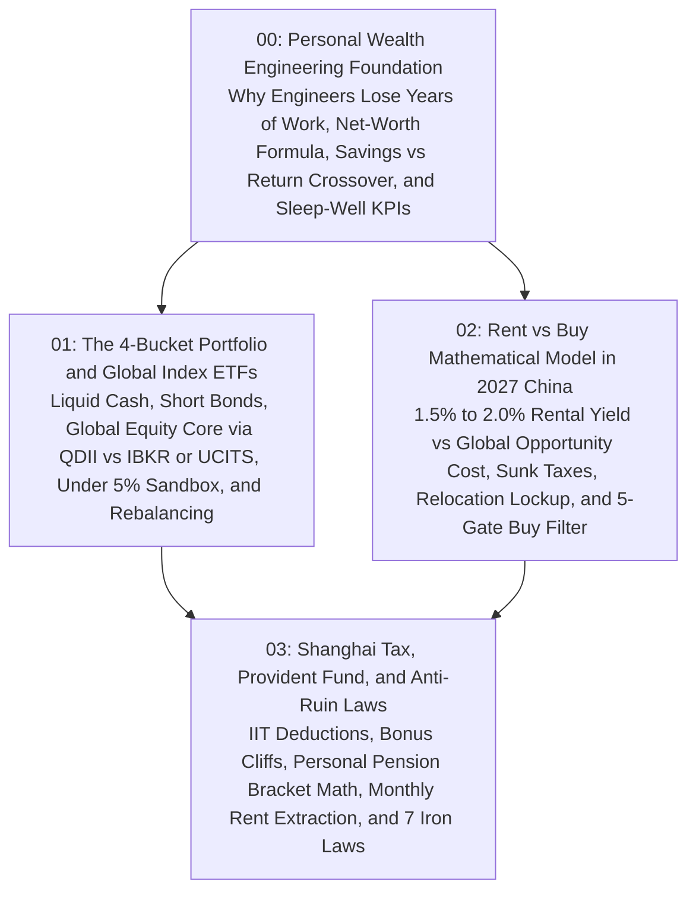

# 32+ Personal Wealth Engineering: Sleeping Soundly While Compounding Global Purchasing Power (32岁个人财富工程：睡得踏实的全球购买力复利系统)

By age 32, a capable software engineer has usually mastered fault-tolerant systems at work: you never deploy single-node databases without backups, never run production servers at `99%` memory utilization without circuit breakers, and never bet company uptime on unverified vendor promises. Yet after logging off at `21:30`, surprisingly many high-earning engineers run **catastrophically fragile personal balance sheets**.

Across China's major tech hubs, count how many talented thirty-something engineers have worked sixty-hour weeks for eight straight years — earning cumulative pre-tax compensation above `RMB 4,500,000` — only to look at their accounts at 35 and realize **half a decade of life energy vanished** into three recurring traps: chasing A-share thematic fund peaks (`山顶重仓赛道基`), blowing up offshore margin or crypto perpetual contracts (`美股期权/币圈高倍合约归零`), or locking six family wallets into a single illiquid apartment right before a demographic repricing cycle (`六个钱包高位满杠杆买房`).

Personal wealth engineering is **not** about staring at candlestick charts at `02:00 AM` or beating Wall Street quant desks from your bedroom. It is the craft of converting peak-decade engineering human capital (`30–42岁黄金职场现金流`) into **globally diversified, low-drawdown, inflation-resilient purchasing power** — engineered so cleanly that you sleep eight hours through recessions, layoffs, and currency cycles without ever checking an app in panic.

---

## Curriculum Architecture & Learning Path



### Clickable Table of Contents & Module Directory

| Module | File | Core Engineering Domain | Concrete Real-World Deliverable |
| :--- | :--- | :--- | :--- |
| **00** | [00-README.md](00-README.md) | **Wealth Philosophy & Dynamic Equations**: The 3 engineer wealth graveyards, savings-rate vs. return-rate phase transitions, global purchasing-power sovereignty, and sleep-adjusted returns | Calculate your exact **Runway Months**, **Savings Crossover Threshold**, and set up a **60-Minute Quarterly Wealth Review** |
| **01** | [01-FOUR-BUCKET-PORTFOLIO-AND-GLOBAL-INDEX-ETFS.md](01-FOUR-BUCKET-PORTFOLIO-AND-GLOBAL-INDEX-ETFS.md) | **4-Bucket Allocation & Global Passive Indexing**: Sizing cash, short bonds, global broad indices (`S&P 500`, `Nasdaq-100`, `All-World`) via onshore `QDII` vs. offshore `IBKR / Schwab / UCITS`, and `< 5%` exploration | Construct a **low-fee 4-Bucket IPS (Investment Policy Statement)**, dodge `QDII IOPV` premiums and US `NRA` estate tax traps, and automate `5/25` rebalancing |
| **02** | [02-RENT-VS-BUY-HOUSING-MATH-IN-2027-CHINA.md](02-RENT-VS-BUY-HOUSING-MATH-IN-2027-CHINA.md) | **Tier-1 Housing vs. Global Mobility Math**: Unrecoverable cost equivalence, `1.7%` rental yield vs. `5.5%+` global capital cost, `RMB 7,000,000` Shanghai 10-year simulation, and EU/SG/UAE relocation liquidity | Run any property through the **5-Gate Buy Readiness Filter**, avoid the **5 Toxic Property Types**, or upgrade rental quality at `15%` of ownership cost |
| **03** | [03-SHANGHAI-TAX-HOUSING-FUND-AND-ANTI-RUIN-RULES.md](03-SHANGHAI-TAX-HOUSING-FUND-AND-ANTI-RUIN-RULES.md) | **Shanghai Tax/Provident-Fund Alpha & Anti-Ruin Laws**: `个税专项附加扣除`, bonus tax cliff avoidance, `个人养老金` bracket arbitrage, `上海公积金` `RMB 4,000/mo` rent unlock, and 7 lifetime anti-ruin rules | Unlock **`RMB 50,000–75,000/year`** in risk-free tax + provident-fund cashflow and hard-code **7 permanent anti-ruin circuit breakers** |

### In This Document (`00-README.md`)

1. [Why High-Earning Tech Engineers Lose Years of Work: The Three Wealth Graveyards](#1-why-high-earning-tech-engineers-lose-years-of-work-the-three-wealth-graveyards)
2. [The Master Net-Worth Equation: Savings Rate vs. Return Rate Crossover](#2-the-master-net-worth-equation-savings-rate-vs-return-rate-crossover)
3. [Global Purchasing-Power Sovereignty: Escaping Nominal Single-Currency Illusion](#3-global-purchasing-power-sovereignty-escaping-nominal-single-currency-illusion)
4. [Financial Peace of Mind: Sleep-Adjusted Return & The Four True Freedom KPIs](#4-financial-peace-of-mind-sleep-adjusted-return-the-four-true-freedom-kpis)
5. [The 60-Minute Quarterly Wealth Operating Cadence](#5-the-60-minute-quarterly-wealth-operating-cadence)

---

## 1. Why High-Earning Tech Engineers Lose Years of Work: The Three Wealth Graveyards

Engineers suffer from a specific cognitive hazard in financial markets: **high IQ + domain mastery in deterministic code breeds severe overconfidence in stochastic, adversarial markets (`确定性工程思维误入零和博弈市场`)**. Because debugging harder for 40 hours fixes a kernel race condition, engineers subconsciously assume *trading more frequently or reading more macro threads* produces higher investment returns. In reality, three structural traps consume `70%+` of middle-class tech savings:

| Wealth Graveyard | The Psychological Bait | The Mathematical Flaw | Typical Damage (Age 30–38) | Structural Engineering Cure |
| :--- | :--- | :--- | :--- | :--- |
| **1. A-Share Thematic & Star-Manager Chasing (`追涨赛道基与明星主动基金`)** | Buying last year's `+80%` Alipay homepage winner (`2021 新能源/医疗/白酒`, `AI概念微盘`) right after dinner-table FOMO | Mean-reverting valuation multiples (`PE 70x -> 18x`) + `1.2%–1.5%` active fees + behavioral "buy at peak, capitulate at `-50%` trough" (`基民不赚钱效应`) | `3 to 5 years` of net salary savings locked underwater for half a decade | Replace thematic bets with **low-fee global broad-market cap-weighted indices** (`Bucket 3`) + automatic DCA |
| **2. Crypto Perpetuals, 0DTE Options & Margin (`高倍合约/末日期权/融资融券`)** | Impatience with `7%–9%` annual compounding; wanting to turn `RMB 500,000` into `RMB 10,000,000` before age 35 to escape 996 | **Path-dependent volatility drag & absorbing liquidation barriers**: a `3x` leveraged position drops `-90%` in a `-30%` flash wick and requires `+900%` just to recover | `100%` wipeout of liquid principal + chronic insomnia + revenge-trading spiral | Hard **Zero-Leverage Covenant**; isolate all speculative curiosity inside a fenced **`< 5%` spot-only Bucket 4** |
| **3. Peak-Leverage Illiquid Single-City Real Estate (`满杠杆孤注一掷单城房产`)** | Social conditioning (`不买房钱会贬值 / 丈母娘刚需`); extrapolating `2005–2020` urbanization boom linearly into `2027–2040` | `5x` leverage on a **`1.6%` net-yield asset** funded by a **`3.0%` fixed liability**: a `-20%` price normalization wipes out `100%` of a `20%` down payment while mortgage debt stays `100%` nominal | `RMB 1,500,000–3,000,000` equity evaporation + frozen geographic mobility during tech restructurings | Enforce the **5-Gate Rent-vs-Buy Model** ([02-RENT-VS-BUY-HOUSING-MATH-IN-2027-CHINA.md](02-RENT-VS-BUY-HOUSING-MATH-IN-2027-CHINA.md)) before ever signing a deposit |

> **The Asymmetric Effort Paradox**: In software architecture, `10x` effort yields `10x` system quality. In personal investing, once you own a low-cost globally diversified index portfolio, **activity is negatively correlated with net returns**. Your highest-ROI work happens in your career, health, and tax/allocation hygiene — never in intraday order books.

---

## 2. The Master Net-Worth Equation: Savings Rate vs. Return Rate Crossover

Strip away all financial marketing noise and household real net worth evolves according to one discrete-time state equation:

$$W_{t+1} = W_t \cdot (1 + r_{\text{real}, t}) + Y_{\text{net}, t} \cdot s_t - L_{\text{tail}, t}$$

Where:
- $W_t$: Investable net worth at the start of year $t$ (excluding depreciating consumer goods like cars or electronics).
- $r_{\text{real}, t}$: After-tax, after-fee, inflation-adjusted portfolio return in year $t$.
- $Y_{\text{net}, t}$: Post-tax household labor & business cashflow (including unlocked Housing Provident Fund cashflow).
- $s_t \in [0, 1]$: Net household **savings rate** ($s_t = 1 - \frac{\text{Total Living Spend}_t}{Y_{\text{net}, t}}$).
- $L_{\text{tail}, t}$: Uninsured catastrophic tail losses (margin liquidation, telecom/private-credit fraud, uninsured medical/guarantee shocks — engineered toward `0` via insurance and anti-ruin rules).

### The Wealth Crossover Point (`资本驱动临界点`)

Take the ratio of **annual portfolio compounding** to **annual labor savings**:

$$\Lambda_t = \frac{W_t \cdot r_{\text{real}}}{Y_{\text{net}, t} \cdot s_t}$$

Understanding $\Lambda_t$ prevents you from fighting the wrong battle in the wrong decade:

1. **Accumulation Phase ($\Lambda_t < 0.5$, e.g., $W_t = \text{RMB } 600,000$, saving $\text{RMB } 280,000/\text{yr}$)**:
   - Even if you transformed into Warren Buffett and beat the market by `+5%` (`RMB 30,000` extra alpha), **your annual paycheck savings (`RMB 280,000`) still drives `90%` of your wealth velocity**.
   - Obsessing over stock-picking here is catastrophic misallocation of human RAM: spending those 400 hours earning a Staff promotion, building English/global interview readiness, or maintaining a `45%+` painless savings rate compounds lifetime wealth `5x` faster.
2. **Inflection Phase ($0.5 \le \Lambda_t \le 1.5$, typically $\text{RMB } 2,000,000 \text{ to } \text{RMB } 5,000,000$ liquid)**:
   - At $W_t = \text{RMB } 4,000,000$ earning a `6.5%` global nominal return (`RMB 260,000/yr`), **your quiet portfolio works alongside you like an invisible second Senior Engineer who never sleeps, pays zero commute cost, and never gets laid off**.
   - Asset allocation, fee minimization, and drawdown discipline now equal career income in importance.
3. **Compounding Sovereignty Phase ($\Lambda_t > 1.5$, typically $\text{RMB } 6,000,000+$ liquid)**:
   - Sequence-of-returns protection, multi-currency custody safety, and zero tail-risk ruin (`L_tail = 0`) become paramount; work transitions from *survival obligation* to *voluntary craftsmanship*.

### Worked 10-Year Simulation (Age 32 to 42): Three Shanghai Engineers

Assume all three start at age 32 with **`RMB 1,000,000`** initial capital and **`RMB 650,000`** post-tax household cashflow:

| Archetype | Savings Rate $s_t$ (Annual Contribution) | Strategy & Realized Net Return $r$ | Year-5 Liquid Net Worth (Age 37) | Year-10 Liquid Net Worth (Age 42) | Stress & Sleep Cost |
| :--- | :--- | :--- | :--- | :--- | :--- |
| **Engineer A: Lifestyle Creep + Thematic Speculator** | `23%` (`RMB 150,000/yr` — luxury auto lease + impulse upgrades) | Chases hot sectors & options; high churn yields **`+1.5%/yr`** net + one `-35%` Year-6 wipeout | `RMB 1,860,000` | **`RMB 2,180,000`** | High anxiety; trapped in toxic orgs to cover fixed monthly burn |
| **Engineer B: Frugal Single-Currency Cash Saver** | `46%` (`RMB 300,000/yr`) | `100%` onshore bank CDs & money market at **`+1.8%/yr`** nominal | `RMB 2,650,000` | **`RMB 4,440,000`** | Calm short-term, but slowly eroded by global healthcare/tuition/FX inflation |
| **Engineer C: Calm Global 4-Bucket Engineer** | `46%` (`RMB 300,000/yr` — joyful core spend, zero status waste) | `15%` cash/short-bond + `80%` global low-cost ETFs + `5%` sandbox at **`+6.8%/yr`** blended | `RMB 3,110,000` | **`RMB 6,070,000`** | **8 hours deep sleep**; `20+ years` of core lean runway by age 42 |

Notice the `RMB 3,890,000` chasm by age 42 between Engineer A and Engineer C — achieved with the **exact same salary** and **less than four hours per year** of portfolio maintenance.

### The Exact Savings-Rate-to-Freedom Curve (`储蓄率决定自由年限精算表`)

Starting from low capital, the number of years $T$ required until your portfolio sustains `100%` of your living expenses at a conservative `3.5%` safe withdrawal rate ($\text{SWR} = 0.035$) and `5.0%` real return ($r = 0.05$) depends **solely on your savings rate $s$** — independent of your absolute salary:

$$T(s) = \frac{\ln\left(1 + \frac{1 - s}{s} \cdot \frac{r}{\text{SWR}}\right)}{\ln(1 + r)}$$

| Net Household Savings Rate $s$ | Share Spent $(1 - s)$ | Years From Zero to Full Lean Freedom | Real-World Shanghai Tech Household Profile (`RMB 650k` Net Cashflow) |
| :--- | :--- | :--- | :--- |
| **`15%`** | `85%` | **`45.3 years`** | Luxury auto loan + high-premium mall lifestyle; chained to paycheck past age 65 |
| **`25%`** | `75%` | **`34.1 years`** | Unbudgeted urban middle-class drift; vulnerable to age-38 industry cyclicality |
| **`35%`** | `65%` | **`26.6 years`** | Solid saver; reaches strong mid-career cushion by late forties |
| **`45%`** | `55%` | **`20.7 years`** | **Sweet Spot (`黄金平衡点`)**: High living quality (`RMB 30k/mo` spend) + full freedom by early fifties (or mid-forties with `RMB 1M` starting base) |
| **`55%`** | `45%` | **`15.9 years`** | Dual-income rational couple (`双职工理性家庭`); work becomes optional within 12–16 years |
| **`65%`** | `35%` | **`11.7 years`** | Peak-comp Staff sprint without lifestyle inflation; rapid **Coast-FI** escape velocity |

> **Key Takeaway**: Lifting your savings rate from `25%` to `45%` — not through miserable penny-pinching on `RMB 25` coffee, but by optimizing **the Big Three (`Housing + Car + Tax/Provident-Fund`)** — buys back **13.4 years of human freedom**.

---

## 3. Global Purchasing-Power Sovereignty: Escaping Nominal Single-Currency Illusion

Many diligent savers measure safety exclusively by whether their nominal RMB account balance ticks up every month (`本币名义本金幻觉`). Yet a modern engineer's real lifetime consumption basket is inherently **globally priced**:
- Imported oncology biologics, medical devices, and international hospital care (`全球定价的前沿医疗与原研药`);
- Apple/NVIDIA silicon, cloud APIs, software tooling, and global travel (`全球硬通货科技消费与旅行`);
- Potential future career chapters in Amsterdam, Munich, Zurich, Singapore, or Dubai — or children's international education (`跨国居住与教育期权`).

If `100%` of your household balance sheet sits in one country's residential concrete and `1.6%`-yielding local deposits, you carry a **100% concentrated macro bet** on a single demographic curve and interest-rate regime. True conservatism is **currency and productive-asset neutrality (`全球生产力中性配置`)**:
1. **Match Liabilities Locally (`短钱本币匹配支出`)**: Hold `12–24 months` of onshore living expenses in instant-liquidity RMB cash and short bonds (`Bucket 1 & 2`) so FX fluctuations never touch your rent, groceries, or parents' medical buffer.
2. **Compound Surplus Globally (`长钱锚定全球头部企业现金流`)**: Route long-horizon surplus (`Bucket 3`) into diversified equity indices across the US, Europe, Japan, and resilient domestic cash-cow leaders — owning a slice of the world's top 1,500 profit-generating enterprises regardless of which flag or currency leads the next decade.

### Holistic Balance-Sheet Audit: Don't Double-Count Human Capital (`人力资本与金融资产去相关性`)

Before choosing currency and sector weights in [01-FOUR-BUCKET-PORTFOLIO-AND-GLOBAL-INDEX-ETFS.md](01-FOUR-BUCKET-PORTFOLIO-AND-GLOBAL-INDEX-ETFS.md), treat your **future 10 years of engineering salary (`人力资本现值`)** as a giant hidden bond/equity position already sitting on your balance sheet:

| Your Current Employment Archetype | Implicit Human-Capital Exposure | Biggest Concentration Blind Spot | Optimal Portfolio Counter-Balance |
| :--- | :--- | :--- | :--- |
| **Domestic Internet / Hardware Firm (`境内大厂/硬科技民企`, paid `100%` RMB)** | `100%` onshore macro + domestic tech cycle | Owning `100%` A-share tech funds + a leveraged Shanghai/Hangzhou apartment = **triple correlation** in a domestic slowdown | Prioritize **global broad indices (`S&P 500 + All-World ex-US`)** via onshore `QDII` or compliant offshore ETFs + robust RMB cash buffer |
| **Foreign MNC China R&D (`外企中国研发中心`, RMB salary + USD `RSUs`)** | `60%` RMB stable salary + `40%` single-stock US tech exposure + HQ headcount risk | Holding `RMB 1,500,000+` of un-diversified employer `RSUs` (`AAPL / MSFT / NVDA / AMZN`) | **Sell vested `RSUs` systematically** upon vesting (`归属即卖`) and rotate into broad global `UCITS / S&P 500 + ex-US` + `18-month` RMB severance runway |
| **Relocation-Bound Engineer (`未来1–3年计划赴欧/新/阿联酋`)** | Transitioning from RMB cashflow to `EUR / CHF / SGD / AED` rent and living deposits | Locking `RMB 2,000,000` into illiquid real estate, 3-year CDs, or non-transferable structured products | Keep `0%` illiquid property; maximize `Bucket 1 & 2` liquid reserves + portable global brokerage (`IBKR`) that seamlessly transfers residency across 30+ countries |

---

## 4. Financial Peace of Mind: Sleep-Adjusted Return & The Four True Freedom KPIs

Quantitative finance defines the Sharpe Ratio as excess return divided by volatility. In real human life, the metric that governs your marriage warmth, engineering creativity, and health is **Sleep-Adjusted Return (`睡眠调整后真实收益`)**:

$$\text{Utility}_{\text{wealth}} = \mathbb{E}[\text{Purchasing Power Growth}] - \lambda \cdot (\text{Nighttime Cortisol} + \text{Forced Liquidation Risk})$$

If an aggressive `100% Nasdaq-100` or crypto portfolio drops `-45%` during the exact quarter your company announces a `20%` layoff — forcing you to panic-sell at the bottom to pay bills — its theoretical `12%` backtested return is worthless to *you*.


Track these **Four Freedom KPIs** on a simple 10-row spreadsheet twice a year — ignore neighbor comparisons and social-media net-worth flexing:

| Freedom KPI | Formula | Healthy Benchmark at Age 32–36 | Why It Changes How You Live |
| :--- | :--- | :--- | :--- |
| **1. Liquid Runway Months (`无收入高质量生存月数`)** | $\frac{\text{Bucket 1} + \text{Bucket 2}}{\text{Core Monthly Household Burn}}$ | **`12 to 24 months`** (pure cash + short bonds, zero stock sale needed) | Eliminates fear in HR/manager 1-on-1s; lets you walk away from toxic cultures and negotiate patiently |
| **2. Liquid-to-Net-Worth Ratio (`高流动性资产净值比`)** | $\frac{\text{Cash} + \text{Bonds} + \text{Liquid ETFs}}{\text{Total Net Worth}}$ | **`>= 50%`** (or **`85%–100%`** while renting strategically) | Prevents `"asset-rich, cash-starved"` house-poor paralysis (`纸面千万房产却不敢请假一周`) |
| **3. Crash Sleep-Test Drawdown (`35%股灾最大账面回撤额`)** | $0.35 \times (\text{Bucket 3} + \text{Bucket 4})$ in cold `RMB` | An exact RMB number you can read aloud to your partner **without heart-rate elevation** | Sizing risk in concrete `RMB` (`e.g., RMB 560,000 temporary dip`) rather than abstract `%` stops bottom-tick panic selling |
| **4. Passive Expense Coverage (`被动购买力覆盖率`)** | $\frac{0.035 \times \text{Investable Portfolio}}{\text{Annual Core Living Spend}}$ | **`25%–40%`** by 34 -> **`60%–100%`** (`Coast-FI / Lean-FI`) by 38–42 | Using a conservative `3.5%` safe withdrawal yardstick shows tangibly how many months per year are already funded forever |

### The Four Concrete Milestones of Engineering Financial Freedom (`工程师财务自主四级里程碑`)

Instead of fixating on an arbitrary social-media number like `"RMB 30,000,000"`, measure your progress through four tangible psychological unlocks (calibrated to a rational Shanghai household with **`RMB 240,000/yr` core burn** and **`RMB 360,000/yr` abundant burn**):

1. **Stage 1 — 18-Month Layoff Immunity (`RMB 360,000` in Buckets 1 + 2)**:
   - *Unlock*: You never again tolerate abusive micromanagement, illegal unpaid overtime, or coerced `"personal resignation"` forms (`骗签自愿离职`), because you can calmly job-hunt or rest for a year and a half without selling a single share of stock.
2. **Stage 2 — Coast-FI Escape Velocity (`RMB 2,000,000` in Bucket 3 by Age 32–34)**:
   - *Unlock*: Even if you stopped saving forever at 33 and merely earned enough from consulting, indie software, or a relaxed 40-hour role to cover monthly bills, `RMB 2,000,000` compounding at `5.5%` real grows to **`RMB 6,500,000` in purchasing power by age 55**. Your retirement is already mathematically funded.
3. **Stage 3 — Lean Sovereignty / Survival FI (`RMB 4,500,000` Liquid + Shanghai Provident Unlock)**:
   - *Unlock*: At a conservative `3.5%` safe draw (`RMB 157,500/yr`) plus accumulated pension/provident reserves, `100%` of baseline food, healthcare insurance, and modest housing is covered in perpetuity. Every project you accept from this day forward is voluntary.
4. **Stage 4 — Global Comfortable FI (`RMB 8,500,000 – 10,500,000` Liquid Global Portfolio)**:
   - *Unlock*: Generates **`RMB 300,000 – 367,500/year`** (`USD 42,000 – 51,000/yr`) inflation-indexed forever — funding comfortable family life across Shanghai, Lisbon, Chiang Mai, Osaka, or European university towns with zero principal depletion.

---

## 5. The 60-Minute Quarterly Wealth Operating Cadence

Great personal finance feels **almost boring** (`好的财务系统应当像自来水管道一样无感运行`). Ban financial news feeds and brokerage notifications from your phone lock screen, and run this **four-times-a-year 15-minute checklist** on the first Saturday of January, April, July, and October:

- [ ] **Payday Automation (`Monthly, 3 minutes`)**: On salary arrival day, transfer your fixed savings target immediately to your investment sub-account before discretionary spending expands to fill checking balance; verify automatic Shanghai Provident Fund rent credit arrived ([03-SHANGHAI-TAX-HOUSING-FUND-AND-ANTI-RUIN-RULES.md](03-SHANGHAI-TAX-HOUSING-FUND-AND-ANTI-RUIN-RULES.md)).
- [ ] **Quarterly Snapshot & `5/25` Rebalance (`Jan / Apr / Jul / Oct, 15 minutes`)**: Update one row in your Net-Worth Ledger (`Bucket 1, 2, 3, 4` balances). Check `QDII` ETF `IOPV` premiums (`< 1.0%`), and rebalance **only** if a bucket drifted beyond its `5%` absolute / `25%` relative band ([01-FOUR-BUCKET-PORTFOLIO-AND-GLOBAL-INDEX-ETFS.md](01-FOUR-BUCKET-PORTFOLIO-AND-GLOBAL-INDEX-ETFS.md)).
- [ ] **December Tax & Pension Window (`Dec 10–20, 20 minutes`)**: Audit all eligible `个税专项附加扣除` items for the coming year in the `个人所得税` App, verify marginal tax rate (`>= 20%`), and fund `RMB 12,000` into `个人养老金` if bracket-optimal.
- [ ] **March–June Annual Tax Settlement (`Mar 15–May 31, 15 minutes`)**: Run `综合所得年度汇算`, toggle **Year-End Bonus Separate vs. Combined Tax** both ways to pick the lower tax bill, and declare any applicable overseas investment gains cleanly.

### Copy-Pasteable Template: Quarterly 15-Minute Household Wealth Snapshot (`季度家庭净值体检表`)

Maintain this exact plain-text block in a local encrypted Markdown note — four snapshots per year give you crystal-clear trajectory visibility without daily noise:

```text
========================================================================
HOUSEHOLD WEALTH & FREEDOM SNAPSHOT — 2027-Q[1/2/3/4] (Date: YYYY-MM-DD)
FX Benchmark Used: 1 USD = [7.XX] RMB | Core Monthly Burn: RMB [2X,000]
========================================================================
[BUCKET 1: Instant RMB Cash & Money Market (Target: 6-12 Mo Burn)]
  - CMB / Alipay / T+0 Money Market:       RMB __________
  - Emergency Bank Demand Reserve:         RMB __________
  -> Bucket 1 Subtotal:                    RMB __________ ([__] Months)

[BUCKET 2: Short-Duration Pure Bonds & T-Bills (1-3 Yr Buffer)]
  - Onshore Short Pure Bond Funds:         RMB __________
  - Offshore Short US T-Bills (SGOV/BOXX): RMB __________ (eqv.)
  -> Bucket 2 Subtotal:                    RMB __________ ([__]% Weight)

[BUCKET 3: Global Broad-Market Equity Core (Target: 65%-80% Investable)]
  - US Broad Core (S&P 500 / Nasdaq-100):  RMB __________ (IOPV Prem <1%?)
  - Global ex-US (All-World / Europe/JP):  RMB __________
  - Domestic Low-Vol Dividend + Gold ETF:  RMB __________
  -> Bucket 3 Subtotal:                    RMB __________ ([__]% Weight)

[BUCKET 4: Asymmetric Sandbox (HARD CAP <= 5%, 0x Leverage)]
  - Spot BTC / Individual Conviction Bets: RMB __________ ([__]% <= 5%?)

[TOTAL LIQUID NET WORTH]:                  RMB __________
  - Liquid Runway (B1 + B2 / Burn):        [____] Months (Target >= 15)
  - 35% Equity Crash Test (0.35 * B3+B4):  -RMB _________ (Sleep OK? Y/N)
  - 3.5% Safe Passive Coverage Ratio:      [____]% of Annual Core Spend
  - Rebalance Triggered (>5% Drift)?       [YES / NO] -> Action: ________
========================================================================
```

Next, proceed to **[01-FOUR-BUCKET-PORTFOLIO-AND-GLOBAL-INDEX-ETFS.md](01-FOUR-BUCKET-PORTFOLIO-AND-GLOBAL-INDEX-ETFS.md)** to build the concrete 4-Bucket asset allocation engine, choose exact onshore and offshore tickers, and wire up automatic rebalancing.
