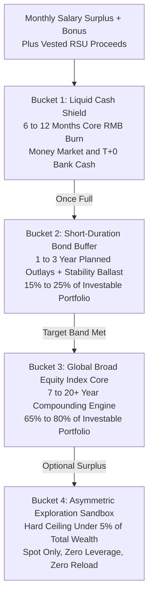
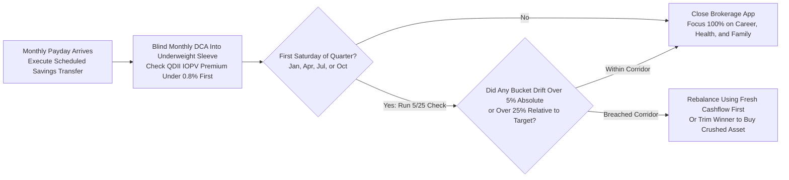

# The 4-Bucket Asset Allocation & Low-Cost Global Index Investing (四桶家庭资产配置与低成本全球指数投资实战)

In [00-README.md](00-README.md), we established that `90%+` of long-term portfolio survival comes from **structural asset allocation, low fees, and zero absorbing ruin**, rather than stock-picking heroics. Yet when an engineer sits down with `RMB 1,500,000` across three bank cards, an Alipay balance, and a vested employer `RSU` account, the hardest practical question is: **where does every specific yuan and dollar actually sit, through which legal channel, in which exact ticker, and how do I rebalance without guessing market tops?**

This module builds a complete, institutional-grade **4-Bucket Household Portfolio (`四桶全天候家庭资产引擎`)** tailored for 32+ engineers in China — bridging **onshore RMB `QDII` accounts** and **offshore global brokerages (`Interactive Brokers / Charles Schwab / HK accounts`)** with full fee, `IOPV` premium, estate-tax, and `CRS` tax-compliance clarity.

---

## Table of Contents

1. [Architecture of the 4-Bucket Portfolio: Time-Horizon Isolation](#1-architecture-of-the-4-bucket-portfolio-time-horizon-isolation)
2. [Buckets 1 & 2: Instant RMB Liquidity & Short-Duration Fixed Income](#2-buckets-1-2-instant-rmb-liquidity-short-duration-fixed-income)
3. [Bucket 3: The Global Broad-Market Equity Core & Anti-Correlation Sizing](#3-bucket-3-the-global-broad-market-equity-core-anti-correlation-sizing)
4. [Onshore QDII vs. Offshore Brokerages (IBKR / Schwab / HK): Complete Execution Guide](#4-onshore-qdii-vs-offshore-brokerages-ibkr-schwab-hk-complete-execution-guide)
5. [Bucket 4 Sandbox Rules, Automated DCA & Quarterly 5/25 Rebalancing SOP](#5-bucket-4-sandbox-rules-automated-dca-quarterly-525-rebalancing-sop)

---

## 1. Architecture of the 4-Bucket Portfolio: Time-Horizon Isolation

The root cause of panic selling in bear markets is **duration mismatch (`期限错配`)**: putting money you might need in 14 months (for a wedding, parent surgery, relocation deposit, or layoff gap) into assets with a 7-year volatility cycle (`S&P 500` or `Nasdaq-100`).

By partitioning household capital strictly by **when the cash will be spent**, you guarantee that you **never sell an equity share during a `-35%` recession**:



### Master 4-Bucket Blueprint (Reference Case: `RMB 2,000,000` Liquid Household)

Assume core monthly household living expenses (including rent) equal **`RMB 20,000/month`** (`RMB 240,000/year`):

| Bucket | Role & Time Horizon | Target Sizing (`RMB 2M` Example) | Expected Long-Run Nominal Return | Worst Historical Drawdown | Allowed Instruments | Strictly Forbidden Here |
| :--- | :--- | :--- | :--- | :--- | :--- | :--- |
| **Bucket 1: Liquid Shield (`活钱护盾`)** | Emergency layoff/medical buffer & 60-day cashflow (`0–12 months`) | **`RMB 180,000`** (`9 months` burn; fixed floor, not `%` of wealth) | `1.3%–1.8%` (RMB) | **`0.0%`** | `T+0` bank cash (`朝朝宝/活钱+`), Tier-1 money market (`余额宝/零钱通`), 1–7d Treasury reverse repo (`GC001`) | Multi-year locked CDs, structured deposits, `"固收+"` funds, foreign-currency cash |
| **Bucket 2: Short Fixed Income (`稳钱压舱石`)** | `1–3 year` planned outlays (relocation/family) + equity rebalancing dry powder | **`RMB 320,000`** (`16%` of total; `B1+B2 = 25%` defensive base) | `2.0%–2.6%` (RMB) / `3.8%–4.5%` (USD T-Bills) | **`-0.5% to -2.0%`** (in local currency) | Onshore short pure-bond funds (`短债/中短纯债A类`), policy-bank bond ETFs; offshore `SGOV / BOXX` (`0–3mo` US T-Bills) | High-yield corporate junk bonds (`信用下沉城投/地产债`), 30-year long-bond speculation, private credit |
| **Bucket 3: Global Equity Core (`长钱复利核心`)** | `7–25 year` global purchasing-power growth across world profit leaders | **`RMB 1,420,000`** (`71%` of total) | `6.5%–8.5%` annualized over full cycles | **`-30% to -45%`** (temporary mark-to-market) | Low-fee broad passive ETFs: `S&P 500`, `All-World ex-US`, modest `Nasdaq-100`, `CSI A500/红利低波`, `5%–8%` Gold ETF | Narrow sector/theme funds (`半导体/医疗/军工`), `1.5%`-fee active star managers, leveraged ETFs (`TQQQ/SOXL`) |
| **Bucket 4: Asymmetric Sandbox (`极小仓探索桶`)** | Scratch intellectual curiosity & capture convex tail upside (`5–10 years`) | **`<= RMB 80,000`** (`4%` of total; **hard cap `< 5%`**) | Highly skewed (`-100%` to `+500%`) | **`-80% to -100%`** | High-conviction individual stocks (`<= 3` names), cold-wallet spot `BTC`, tiny angel/indie tool bets | Margin (`融资融券`), futures/perps, options buying/selling, altcoin memes, adding cash to losers |

---

## 2. Buckets 1 & 2: Instant RMB Liquidity & Short-Duration Fixed Income

### Engineering Bucket 1 (`活钱管理：流动性绝对优先于0.3%利差`)
- **Split Across Two Banks for Anti-Freeze Redundancy**: Keep `70%` in your primary salary bank's `T+0` cash-management matrix (e.g., China Merchants Bank `朝朝宝/日日宝`, which spreads `RMB 50,000–100,000` across multiple underlying money-market funds so each enjoys the PBOC `RMB 10,000/day` instant fast-redemption quota) and `30%` in a completely separate Class-I debit card (`二张独立一类卡隔离风险`).
- **Never Stretch Yield in Bucket 1**: Chasing an extra `+0.5%` on `RMB 180,000` earns just `RMB 75/month` — never lock emergency cash into 90-day notice wealth products (`90天持有期理财`) that freeze redemptions during a Friday night hospital admission.

### Engineering Bucket 2 (`稳钱防坑：只买短久期纯债与短期国债`)
Bond funds fail investors in two ways: **credit default (`信用违约`)** and **duration shock (`长久期利率暴跌`)**. Keep Bucket 2 boring and bulletproof:
1. **Onshore RMB Sleeve**: Select **Short-Term Pure Bond Funds (`短债/中短债纯债基金 A类份额`)** with `0%` stocks and `0%` convertible bonds (`0股票 + 0可转债`), institutional/state-owned treasury & AAA holdings, total annual management + custody fees **`<= 0.35%`**, and hold $> 30\text{ days}$ (`A类份额` waives redemption fees after 7–30 days without ongoing `0.20%/yr` `C类` sales-service drag). Beware bank `"固收+"` products — the `"+"` is usually `10%–20%` equities or convertibles that drop `-6%` right alongside stocks!
2. **Offshore USD Sleeve (For Relocation-Possible or RSU-Holding Engineers)**: Hold **`0–3 Month` US Treasury Bill ETFs (`SGOV` at `0.09%` expense ratio, or Irish UCITS `IB01` at `0.07%`)**. Remember that for an onshore spender, USD T-Bills carry `USD/RMB` exchange-rate variance (`±4%/yr`), so size USD short bonds specifically against future international spending or global equity rebalancing dry powder.

### Buckets 1 & 2 Instrument Fee & Settlement Matrix (`活钱与稳钱工具精细对比`)

| Vehicle | Currency & Rail | Typical Fee (`TER`) | Redemption Speed | Critical Engineering Rule (`A类 vs C类` & Settlement Traps) |
| :--- | :--- | :--- | :--- | :--- |
| **`T+0` Bank Cash Matrix (`朝朝宝/活钱+`)** | Onshore RMB | `0.25%–0.35%` (embedded) | **Instant `24/7`** up to `RMB 50k–100k` | Underlying structure links 5–10 money-market funds (`RMB 10k` instant cap per fund); ideal primary living reserve |
| **Exchange Treasury Reverse Repo (`GC001 / R-001`)** | Onshore A-Share Account | `0.001%` (`十万分之一`) | `T+1` usable, `T+2` withdrawable | Lend idle broker cash before Thursday `15:30` or quarter-end holidays to capture `1-day` trade earning `3–9 days` of sovereign repo interest |
| **Short-Term Pure Bond Fund (`短债纯债 A类 vs C类`)** | Onshore OTC (`蚂蚁/天天/招行`) | `A类`: `0.30%/yr` (`1折申购费`); `C类`: `+0.20%/yr` service fee | `T+1` to bank card | **Holding-Day Crossover**: If holding **`< 6 months`**, buy `C类` (`0` upfront fee, `0` exit fee after 7–30d); if holding **`>= 6 months`**, `A类` (`0.03%` discounted entry) wins permanently |
| **US `0–3M` T-Bill ETF (`SGOV` vs Irish `IB01`)** | Offshore (`IBKR / Schwab`) | `SGOV`: `0.09%`; `IB01` (`LSE` UCITS Acc): `0.07%` | `T+1` settlement | For non-US residents (`NRA`) holding **`> USD 60,000`** total offshore, prefer London-listed **`IB01`** (`0%` US estate tax + automatic interest accumulation) |

---

## 3. Bucket 3: The Global Broad-Market Equity Core & Anti-Correlation Sizing

Over rolling 15-year windows, S&P Dow Jones `SPIVA` scorecards show **`88% to 92%` of active equity fund managers underperform their passive broad benchmark after fees**. A seemingly harmless `1.50%/yr` active fund fee + hidden turnover drag destroys **`25.0%` of terminal capital** over 20 years compared to a `0.07%` index ETF:

$$\frac{(1 - 0.015)^{20}}{(1 - 0.0007)^{20}} = \frac{0.7391}{0.9861} \approx 0.750 \quad (\text{25.0\% wealth lost purely to fee friction})$$

### Recommended Sub-Allocation Inside Bucket 3 (`100%` of Equity Core)

Why shouldn't a software engineer put `100%` of Bucket 3 into `Nasdaq-100 (QQQ)`? Because **your job, bonus, and career marketability are already a `3x` leveraged bet on the global technology capex cycle**. In a `2000–2002` (`Nasdaq -78%`) or `2022` (`Nasdaq -33%` + mass tech layoffs) downturn, a `100%` tech portfolio implodes simultaneously with your paycheck. Build a **multi-engine global core**:

| Bucket 3 Sub-Sleeve | Share of Bucket 3 | Share of Total `RMB 2M` Portfolio | Core Economic Function | Representative Onshore Tickers (RMB) | Representative Offshore Tickers (IBKR / Schwab) |
| :--- | :--- | :--- | :--- | :--- | :--- |
| **1. US Broad Large-Cap Core (`美股宽基主引擎`)** | **`45%`** | `32.0%` (`RMB 640k`) | Captures cashflows of top 500 US multinationals across tech, healthcare, financials, consumer & industrials | `513500` (博时标普500 ETF) / `159655` (华夏标普500 ETF) + OTC `050025` | **Irish UCITS**: `VUAA` / `CSPX` (`0.07%`, Acc); **US ETF**: `VOO` / `SPLG` (`0.03%`) |
| **2. Global Innovation Tilt (`科技成长增强`, Capped)** | **`15%`** | `10.5%` (`RMB 210k`) | Controlled growth tilt without over-concentrating human + financial capital | `513100` (国泰纳指100 ETF) / `159941` (广发纳指100 ETF) | **Irish UCITS**: `EQQQ` / `CNDX`; **US ETF**: `QQQM` (`0.15%`) |
| **3. Developed ex-US & Global (`非美发达市场分散`)** | **`20%`** | `14.2%` (`RMB 284k`) | Prevents single-country `CAPE` valuation trap; owns European luxury/pharma (`ASML/Novo`) & Japanese industrials | `513880` (日经225 ETF) + `513080` (法国CAC40 ETF) + OTC `摩根MSCI全球` | **Irish UCITS**: `EXUS` (World ex-US) or replace Rows 1+3 with one-ticket **`VWRA`** (`FTSE All-World Acc`, `0.22%`); **US ETF**: `VXUS` (`0.05%`) |
| **4. Domestic Cash-Cow Value (`境内低估值红利/宽基`)** | **`12%`** | `8.5%` (`RMB 170k`) | Captures `4%–5%` tax-advantaged RMB dividend cashflow when domestic valuations sit near historic lows | `515100` / `512890` (红利低波 ETF) + `159338` / `510300` (中证A500 / 沪深300 ETF) | Hold onshore directly in A-share ETF account (`万0.5–万1` commission, `免五`) |
| **5. Physical Gold Structural Hedge (`黄金主权信用对冲`)** | **`8%`** | `5.8%` (`RMB 116k`) | Zero-counterparty hedge against sovereign debt monetization, geopolitical shocks & central-bank reserve shifts | `518880` (华安黄金ETF) / `159937` (博时黄金ETF) (`0.50%` fee, backed by SGE physical Au99.99) | **Irish ETC**: `IGLN` (`0.12%`); **US ETF**: `GLDM` (`0.10%`) |

> **One-Ticket Simplicity Option Offshore**: On Interactive Brokers (`IBKR`), replacing Separate US + ex-US ETFs with **`80% VWRA` (Vanguard FTSE All-World UCITS Accumulating, covering approx. 3,600 stocks across 49 countries at market-cap weights) + `12%` Onshore CSI Dividend/A500 + `8%` Gold** cuts your entire equity maintenance down to **three tickers globally**.

### Lump-Sum Windfall Deployment Protocol (`大额年终奖/N+1赔偿金/售房款建仓SOP`)

Monthly salary DCA is effortless, but what should you do when **`RMB 400,000` (annual bonus / `N+1` severance)** or **`RMB 3,000,000` (apartment sale proceeds)** lands in cash all at once?
- **Pure Math vs. Human Regret**: While Vanguard's century-long dataset shows `100%` Day-1 lump-sum investing beats staged entry `68%` of the time, the **`32%` failure case** — wiring `RMB 3,000,000` on Monday right before a `2008` or `2022` `-28%` drop — causes almost every first-time investor to capitulate at the bottom (`一次性重仓遇大跌导致心态崩盘割肉`).
- **The Regret-Minimizing `6-Tranche` Hybrid Rule (`六个月等分建仓 + 大跌加速条款`)**:
  1. Immediately carve out `Bucket 1` (`9–12 mo` RMB cash) and `Bucket 2` (`16%–20%` short pure bonds / `IB01` T-Bills) on Day 1 so idle cash earns sovereign yield immediately.
  2. Split the `Bucket 3` equity allocation into **`6 equal monthly tranches`** (`16.7%` per month on the 15th of Months 1 through 6), parking undeployed tranches in `Bucket 2` short bonds/T-Bills while waiting.
  3. **Drawdown Acceleration Trigger**: If the `S&P 500` or `FTSE All-World` drops **`-10%`** from its 52-week high during your 6-month window, immediately double the monthly tranche (`deploy 2 tranches at once`); if it drops **`-20%`**, deploy **`100%` of remaining equity tranches immediately**.
  4. Once all 6 tranches are deployed, lock the lid and revert to standard quarterly `5/25` corridor maintenance.

---

## 4. Onshore QDII vs. Offshore Brokerages (IBKR / Schwab / HK): Complete Execution Guide

Most Chinese engineers use a **Hybrid Dual-Rail Setup (`境内QDII + 境外合规券商双轨制`)**: routing monthly RMB salary savings into onshore `QDII` ETFs/index funds while keeping vested overseas `RSUs` or lawfully converted FX inside an offshore brokerage. Know the exact rules and traps of both rails:

| Dimension | Rail A: Onshore A-Share Broker (`场内 QDII ETF + 场外联接`) | Rail B: Offshore Global Broker (`IBKR / Charles Schwab / HK Broker`) |
| :--- | :--- | :--- |
| **Account & Funding** | Standard mainland A-share account (`华泰/招商/银河`, negotiate **`ETF 万0.5–万1 免五`** before opening!); funded instantaneously in RMB | Requires valid overseas bank card (`HK BOCHK/HSBC One` or `SG OCBC`) + offshore broker; funded via vested MNC `RSUs` or lawful personal FX quota |
| **Annual Fee Drag** | **`0.60% to 1.05%/yr`** (management + custody + offshore underlying tracking cost) | **`0.03% to 0.22%/yr`** (`3x to 15x` cheaper over 20 years) |
| **Quota & Liquidity Risk** | **High `SAFE` QDII quota ceiling risk**: OTC subscriptions frequently cap at `RMB 100–1,000/day`, pushing secondary ETFs to dangerous premiums | **Zero quota cap**: institutional multi-billion-dollar daily liquidity on `NYSE / LSE` |
| **Taxation & Estate Rules** | Secondary-market ETF capital gains **currently exempt from PRC individual income tax (`暂免征收个人所得税`)**; zero CRS cross-border reporting | Subject to **PRC `20%` IIT on realized overseas investment income** (`年度自行申报`), `CRS` reporting (HK/SG/EU), and **US `NRA` estate tax rules** if holding US-situs tickers |

### Three Non-Negotiable Execution Guardrails (`避开90%中产踩过的跨境与场内深坑`)

1. **Guardrail 1 — Never Buy an Onshore `QDII` ETF Above `1.0%` IOPV Premium (`严防场内高溢价接盘惨案`)**:
   - Every trading app displays **IOPV (`基金份额参考净值`)** and **Premium Rate (`溢价率`)** next to `513500 / 513100 / 513880`:
     $$\text{IOPV Premium Rate} = \frac{P_{\text{intraday}} - \text{IOPV}}{\text{IOPV}} \times 100\%$$
   - When `SAFE` foreign-exchange quotas tighten, retail FOMO regularly bids onshore Nasdaq/Nikkei/S&P ETFs to **`+6% to +15%` premiums**. Buying at `+9%` premium guarantees an automatic `-9%` loss the day quotas expand.
   - **Hard Execution Rule**: Only execute secondary-market `QDII` ETF buys when **`Premium Rate <= +0.8%`** (ideally `-0.2% to +0.5%`). When secondary premiums spike above `1.0%`, switch your automatic daily/weekly DCA into **off-exchange OTC `QDII` A-shares (`场外QDII A类份额`, bought strictly at `0.0%` NAV)** across 2–3 fund families within their daily quota limits!
2. **Guardrail 2 — Dodge the `USD 60,000` US Estate-Tax Cliff via Irish `UCITS` (`非美居民NRA遗产税防雷`)**:
   - For a Non-Resident Alien (`NRA` — non-US citizen, non-green-card holder), while filing Form `W-8BEN` lowers US ETF dividend withholding to **`10%`** under the US-China tax treaty, **all US-situs assets (`VOO`, `QQQ`, `SGOV`, `AAPL`, uninvested USD brokerage cash in US entities) enjoy only a tiny `USD 60,000` lifetime estate-tax exemption**, above which progressive US federal estate tax climbs from **`18%` up to `40%`** before heirs can unlock the account!
   - **Clean Structural Fix**: Once your offshore portfolio exceeds `USD 60,000`, hold **Irish-domiciled `UCITS` Accumulating ETFs traded in USD on the London Stock Exchange (`VWRA`, `VUAA`, `CSPX`, `IB01`)** via Interactive Brokers. Irish `UCITS` funds have **`0%` US estate-tax exposure**, pay `15%` treaty dividend tax internally at the fund level, and **`Acc` (Accumulating) shares automatically reinvest all dividends into NAV** without generating taxable annual cash dividend distributions!
3. **Guardrail 3 — Employer `RSU` Day-One Liquidation & Lawful FX / `CRS` Hygiene**:
   - If you receive `USD 50,000/yr` in vested employer `RSUs`, ask yourself: *"If my company paid me `RMB 360,000` cash bonus today, would I take `100%` of it to buy my own employer's stock?"* If the answer is no, **sell `80%–100%` of vested `RSUs` inside each open trading window (`归属窗口期即卖`)** and rotate immediately into `VWRA / VUAA`.
   - Never use underground FX desks (`严禁地下钱庄/对敲换汇`) or split transfers across relatives' IDs (`分拆购汇蚂蚁搬家`). Under **PRC Individual Income Tax Law** and active **`CRS` (`共同申报准则`)** information exchange between HK/SG institutions and mainland tax authorities, realized offshore capital gains and dividends carry a statutory **`20%` PRC IIT obligation** (calculated annually on net realized gains within the calendar tax year during the `March 1 – June 30` self-declaration window). Buying and holding **Irish `UCITS` Accumulating (`Acc`) broad index ETFs** for 10+ years is `100%` legal, eliminates high-frequency taxable churn, and defers realization events until you actually sell shares.

### Pre-Flight Brokerage Configuration Checklist (`开户与交易参数一次性调优清单`)

- [ ] **Mainland ETF Fee Negotiation (`场内ETF免五调佣`)**: Never open an A-share account directly via generic app store download (`默认万2.5且单笔最低5元佣金`, which charges an absurd `0.50%` fee on a `RMB 1,000` DCA order!). Contact a client manager first to lock **`ETF commission 万0.5–万1 + 免除5元最低收费 (免五)`** in writing.
- [ ] **Interactive Brokers Pricing Plan (`IBKR 阶梯式 Tiered 佣金设置`)**: Inside IBKR Account Settings -> *IBKR Pricing Plan*, switch from `Fixed` to **`Tiered` (`阶梯式`)**. On US ETFs (`VOO/QQQM`), commission drops from `USD 1.00` to **`USD 0.35`**; on London Stock Exchange `UCITS` ETFs (`VWRA/VUAA`), minimum ticket commission drops from `USD 4.00` down to **`USD 1.70–1.92`**!
- [ ] **Switch Account Type to `Cash` (`现金账户` vs `Margin 保证金账户`)**: Configuring your primary long-term ETF account as a **`Cash Account`** physically blocks accidental leveraged margin borrowing (`杜绝乌龙指融资买股`) and prevents unconsented share-lending risks.
- [ ] **`W-8BEN` Triennial Renewal & Annual Statement Backup**: Verify Form `W-8BEN` stays active (renews every 3 calendar years), and download your full-year PDF `Activity Statement` every January into an offline encrypted folder so original cost basis (`历史买入成本凭证`) is permanently preserved for tax filings or future cross-border residency moves.

### Cross-Border Wire & FX Spread Optimization (`跨境电汇批次与换汇损耗精算`)

When moving lawful offshore cash (`HKD / SGD / USD` between your overseas bank card and `IBKR / Schwab`), small careless habits bleed `1.0%–1.5%` in hidden friction:

| Friction Point | Amateur Retail Mistake | Cost Drag | Engineered Low-Friction Practice |
| :--- | :--- | :--- | :--- |
| **Wire Frequency (`跨境电汇频次`)** | Wiring `USD 1,000` every month (`12 wires/yr` paying `RMB 150` wire + `USD 20` SWIFT intermediary fee each time) | **`2.9%` lost** (`USD 350+` eaten on `USD 12,000`!) | Accumulate monthly RMB DCA in onshore `QDII` or short bonds, or batch lawful offshore wires to **`1–2 transfers/year >= USD 10,000`** (`< 0.25%` wire cost); use free **`eDDA / FPS 转数快`** between `BOCHK / HSBC HK` and `IBKR HK` (`HKD 0` wire fee!) |
| **Currency Conversion (`HKD <-> USD` 换汇点差)** | Converting inside a retail HK bank app at `0.35%–0.60%` retail FX spread | `USD 180` lost per `USD 40,000` | Deposit `HKD` for free via `FPS/eDDA` into `IBKR`, and convert `HKD -> USD` at **institutional interbank spot (`0.002%` spread + flat `USD 2.00` fee)** |
| **Dividend Reinvestment (`股息再投损耗`)** | Holding distributing ETFs (`VOO/VT`) in small accounts where `10%–30%` withholding + cash drag sits idle | `0.25%–0.45%/yr` compounding leak | Hold **`VWRA / VUAA` (`UCITS Accumulating`)** so gross post-treaty dividends compound automatically inside fund NAV with `USD 0` commission |

---

## 5. Bucket 4 Sandbox Rules, Automated DCA & Quarterly 5/25 Rebalancing SOP

### Fencing Bucket 4 (`极小仓探索桶四条死规矩`)
Human beings are wired with a dopamine urge to "make a call." Rather than letting that urge infect your `RMB 1,420,000` retirement core, give yourself a strictly fenced **`<= 5%` Sandbox**:
1. **Zero Leverage & Zero Derivatives**: Spot shares or hardware-wallet spot `BTC` only — never margin, options, or perpetual swaps.
2. **One-Way Valve on Losses (`亏光不补`)**: If your `4%` sandbox drops to `1%`, **you are forbidden from transferring cash from Buckets 1–3 to average down**.
3. **Skim Convex Wins Back to Core (`翻倍抽水归核`)**: If a sandbox bet `3x`s and pushes Bucket 4 above `8%` of net worth, **harvest everything above `5%` back into Bucket 3 broad indices**.
4. **Hard Position-Count Cap (`标的上限 <= 3 个`)**: Hold at most three high-conviction positions so research stays deep and Bucket 4 never mutates into a daily chart-watching distraction.

### Automated Payday DCA + The `5/25` Corridor Rebalancing Loop

Never wait for "the market to pull back `10%`" — historical Vanguard studies across US, UK, and global markets show waiting in cash underperforms immediate/scheduled investing **`68%` of the time** because markets compound upward while worriers wait on the sidelines.



- **How the `5/25` Swensen/Bernstein Rule Works in Practice**:
  - **Large Buckets (`>= 20%` target, e.g., `70%` Bucket 3 Equity Core)**: Trigger rebalancing only if an equity surge or crash pushes Bucket 3 outside **`±5%` absolute (`< 65%` or `> 75%`)**. During a nasty `-30%` global bear market where Bucket 3 falls from `71%` down to `61%`, the rule **forces you mathematically to move Bucket 2 bond cash into cheap equities at the exact moment headlines scream apocalypse**.
  - **Smaller Sleeves (`< 20%` target, e.g., `8%` Gold or `12%` Domestic Dividend)**: Trigger rebalancing if weight drifts by **`±25%` of its own target** (e.g., `8%` Gold drifts below `6.0%` or above `10.0%`).
  - **Tax-Smart Cashflow Rebalancing First (`增量现金流再平衡优先`)**: Whenever possible, restore target weights simply by directing your next 2–3 months of fresh salary contributions into the underweight sleeve — incurring **`RMB 0` transaction fees and `RMB 0` realized capital-gains tax**.

### Worked Crash Drill: How `5/25` Protects & Multiplies Capital in a `-35%` Bear Market

Suppose your `RMB 2,000,000` portfolio sits at target (`B1 Cash = RMB 180k`, `B2 Short Bonds = RMB 320k`, `B3 Global Equities = RMB 1,420k [71%]`, `B4 Sandbox = RMB 80k [4%]`). Six months later, a global recession slashes equities by **`-35%`** (`B3` drops to `RMB 923k`) and `B4` by **`-50%`** (`RMB 40k`), while `B1 + B2` edge up to `RMB 506k`:
1. **Total Portfolio Now**: `RMB 1,469,000` (`B1+B2` weight surged from `25.0%` to **`34.4%`**, while `B3` fell from `71.0%` to **`62.8%`** — breaching the `< 66%` `-5%` corridor!).
2. **Mechanical Action on Quarter-End Saturday**: Keep `Bucket 1` untouched at `RMB 180,000` (`9 months` layoff shield intact!). Transfer **`RMB 120,000`** from `Bucket 2` short bonds + your **`RMB 25,000`** monthly salary savings directly into `Bucket 3` global index ETFs at `-35%` bargain valuations, restoring `B3` to **`71.5%`**.
3. **Zero-Emotion Result**: While speculators are margin-called and frozen in terror, your written protocol forced you to scoop up `RMB 145,000` of discounted global productive equity without touching a single yuan of emergency living runway.

### Four Classic Behavioral Bugs in Global Index Investing & Their Fixes (`宽基定投常见四大翻车诊断`)

Even with the right tickers, engineers subtly sabotage passive portfolios through four recurring anti-patterns:

| Behavioral Bug | Why Engineers Fall Into It | Hidden Damage | Permanent Engineering Fix |
| :--- | :--- | :--- | :--- |
| **1. Ticker Sprawl / Diworsification (`集邮式买15只重叠ETF`)** | Owning `VOO + SPY + VTI + QQQ + SCHG + XLK` thinking 6 tickers means 6x diversification | `85%` identical top-10 mega-cap overlap + messy rebalancing spreadsheets | Cap total Bucket 3 holdings at **`3 to 5 non-overlapping broad sleeves`** |
| **2. Abandoning DCA After `18` Flat Months (`横盘期怀疑人生断供`)** | Equity returns follow a clustered power law (`80%` of decade gains arrive in `5%` of sudden breakout months) | Stopping DCA during `2022`-style valleys misses the exact cheap share accumulation that powers the next bull run | Measure progress in **accumulated share count (`持有份额增长`)** during bear markets, never nominal market value |
| **3. Selling Winners to "Lock In `+15%` Profit" (`拿不住长牛宽基止盈过早`)** | Treating a broad global economy index like a cyclical A-share pork or solar stock | Paying transaction/tax friction and watching the global index double from the sidelines in `1.5%` cash | **Never "take profit" out of Bucket 3 into cash** — only trim if equity weight breaches its `+5%` upper rebalancing band! |
| **4. Checking Apps Nightly (`高频盯盘诱发皮质醇损耗`)** | Loss aversion makes daily `-1.2%` red ticks hurt `2.2x` more than `+1.2%` green ticks (`Kahneman 前景理论`) | Turns a `78%`-win-rate 10-year strategy into a `51%`-coin-flip emotional rollercoaster | Move brokerage apps off your primary phone or bury inside an unbadged folder opened **only 4 Saturdays/year** |

### Copy-Pasteable 1-Page Household Investment Policy Statement (`家庭投资宪章 IPS 模板`)

Sign and date this block with your partner while markets are calm — **any rule change requires a mandatory 14-day cooling-off period**:

```text
========================================================================
HOUSEHOLD INVESTMENT POLICY STATEMENT (IPS) — EFFECTIVE: 202X-XX-XX
========================================================================
1. CORE OBJECTIVE: Compound global real purchasing power at 5%-7%/yr net
   while guaranteeing >= 12 months RMB living runway without stock sales.
2. TARGET ALLOCATION & REBALANCING BANDS (Excl. Fixed Bucket 1 Floor):
   - Bucket 1 (Instant RMB Cash): Fixed Floor = RMB [180,000] (9 Mo Burn)
   - Bucket 2 (Short Pure Bonds / T-Bills):  Target 18%  (Band: 13%-23%)
   - Bucket 3 (Global Broad Equity + Gold):  Target 78%  (Band: 73%-83%)
   - Bucket 4 (Spot-Only Sandbox):           Target  4%  (HARD CAP <= 5%)
3. EXECUTION GUARDRAILS:
   - Monthly Payday DCA on the [10th] of every month, rain or shine.
   - NEVER buy onshore QDII ETF if intraday IOPV premium exceeds +0.8%.
   - NEVER use margin, futures, options, shorting, or thematic funds.
   - Sell >= 85% of vested employer RSUs within 5 days of window open.
4. CRASH COVENANT: During any -25% to -45% equity drawdown, we are
   strictly forbidden from selling Bucket 3; we only rebalance INTO it.
========================================================================
```

With your liquid compounding engine wired, the single largest financial decision left on a 32-year-old engineer's table is real estate. Continue to **[02-RENT-VS-BUY-HOUSING-MATH-IN-2027-CHINA.md](02-RENT-VS-BUY-HOUSING-MATH-IN-2027-CHINA.md)** for the exact mathematical model of renting vs. buying in Tier-1 China when global career mobility is on the horizon.
