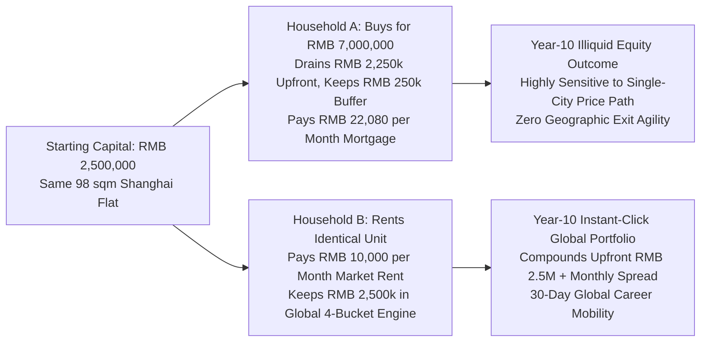
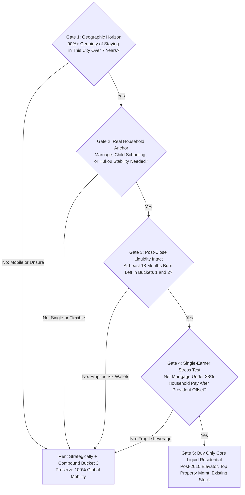

# Rent vs Buy Mathematical Model for Globally Mobile Engineers (2027中国一线城市租买数学模型与跨国流动决策)

For two decades (`2002–2021`), buying residential property in Shanghai, Beijing, or Shenzhen with maximum leverage looked like an infallible law of nature. Urbanization surged from `38%` to `65%`, baby-boomer cohorts entered marriage simultaneously, and `8%–12%` annual nominal home-price appreciation effortlessly masked `1.5%` rental yields and `5.0%` mortgage rates. During that era, anyone who paused to do cashflow math got left behind.

In 2027, every structural variable inside that equation has inverted: urban per-capita floor space exceeds `40 m²`, annual marriages and births sit roughly `50%` below their 2013–2016 peaks, Tier-1 **gross rental yields (`房屋毛租售比/租金回报率`) hover at `1.5% to 2.0%`**, while global risk-free short Treasuries and broad equity indices compound at **`3.5% to 7.5%`**. Yet dinner-table folklore (`"租房就是纯消费帮房东还贷 / 有房才有安全感"`) still pushes 32-year-old engineers to drain `RMB 2,000,000+` of liquid global capital into a single illiquid concrete box — often eighteen months before an international transfer to Amsterdam, Zurich, Singapore, or Dubai lands in their inbox.

This module replaces cultural anxiety with a **transparent financial-engineering model**: showing you how to calculate the true **Unrecoverable Cost of Owning vs. Renting**, why global mobility carries a massive hidden liquidity option value, and the **exact 5-Gate Conditions where buying a home in China DOES make rational and emotional sense**.

---

## Table of Contents

1. [Deconstructing the Myth: Unrecoverable Monthly Cost Equivalence](#1-deconstructing-the-myth-unrecoverable-monthly-cost-equivalence)
2. [Worked 2027 Case Study: RMB 7,000,000 Shanghai Apartment Over 10 Years](#2-worked-2027-case-study-rmb-7000000-shanghai-apartment-over-10-years)
3. [Global Rental-Yield Comparison & The Relocation Liquidity Penalty](#3-global-rental-yield-comparison-the-relocation-liquidity-penalty)
4. [When Buying DOES Make Sense: The 5-Gate Readiness Filter & Toxic Blacklist](#4-when-buying-does-make-sense-the-5-gate-readiness-filter-toxic-blacklist)
5. [Renting Like an Owner: Portable Quality-of-Life Engineering](#5-renting-like-an-owner-portable-quality-of-life-engineering)

---

## 1. Deconstructing the Myth: Unrecoverable Monthly Cost Equivalence

The most common retail fallacy compares **Monthly Rent (`纯消耗`)** directly against **Monthly Mortgage Payment (`月供 = 利息消耗 + 本金储蓄`)** and concludes: *"If I pay `RMB 10,000` rent, `100%` disappears; if I pay `RMB 22,000` mortgage, I keep the apartment!"*

In financial economics, a fair comparison pits **Renter's Unrecoverable Cost (`租房不可回收纯成本`)** against **Owner's Unrecoverable Cost (`买房不可回收纯成本`)** — money the homeowner *also throws away forever every single month* to banks, tax bureaus, brokers, property wear, and lost investment compounding:

$$C_{\text{own, unrec}} = P \cdot \left[ (1 - d) \cdot r_{\text{mort}} + (d + \kappa_{\text{reno}}) \cdot r_{\text{opp}} + m_{\text{maint}} + \frac{\tau_{\text{buy}} + \tau_{\text{sell}}}{T_{\text{hold}}} - g_{\text{nominal}} \right]$$

Where for a property of purchase price $P$:
- $d$: Down-payment ratio (e.g., `0.25` for a `25%` down payment), so $(1 - d)$ is the borrowed mortgage principal paying annual rate $r_{\text{mort}}$ (`approx. 2.95%–3.10%` blended in 2027 Shanghai).
- $\kappa_{\text{reno}}$: Upfront renovation & fixed-cabinet capex (`approx. 0.04 to 0.06` of $P$, which depreciates toward `RMB 0` resale value over 10 years).
- $r_{\text{opp}}$: **Opportunity cost of equity (`首付全球资产配置机会成本`)** — the conservative `4.5%–6.5%` net return that your locked down payment + renovation cash would otherwise earn inside [01-FOUR-BUCKET-PORTFOLIO-AND-GLOBAL-INDEX-ETFS.md](01-FOUR-BUCKET-PORTFOLIO-AND-GLOBAL-INDEX-ETFS.md).
- $m_{\text{maint}}$: Annual property management fees (`物业费`), heating/boiler replacement, and structural aging drag (`approx. 0.35%–0.50%/yr` — especially severe as 30-story elevator towers cross the 20-year facade/pipe aging mark).
- $\frac{\tau_{\text{buy}} + \tau_{\text{sell}}}{T_{\text{hold}}}$: Round-trip transaction friction amortized over holding period $T_{\text{hold}}$ (`契税 1.0%–1.5%` + buyer/seller agency commissions `2.0%–3.0%` + resale bid-ask spread = **`3.5% to 5.0%` of $P$**).
- $g_{\text{nominal}}$: Expected annualized nominal home-price appreciation.

### Plugging in 2027 Shanghai Market Reality (`g_nominal = 0%` Baseline)

Set $d = 0.25$, $\kappa_{\text{reno}} = 0.045$, $r_{\text{mort}} = 3.00\%$, conservative $r_{\text{opp}} = 5.50\%$, $m_{\text{maint}} = 0.40\%$, round-trip $\tau = 4.0\%$ over $T_{\text{hold}} = 10\text{ years}$ (`0.40%/yr`), and $g_{\text{nominal}} = 0.0\%$:

$$\frac{C_{\text{own, unrec}}}{P} = (0.75 \times 3.00\%) + (0.295 \times 5.50\%) + 0.40\% + 0.40\% - 0.00\% = 2.25\% + 1.62\% + 0.80\% = \mathbf{4.67\%/\text{year}}$$

Compare that **`4.67%/year` unrecoverable ownership cost** against Shanghai's actual **market gross rental yield**:

$$\text{Gross Rental Yield} = \frac{\text{Annual Rent } (12 \times R)}{\text{Property Price } P} \approx \mathbf{1.55\% \text{ to } 1.90\%/\text{year}}$$

> **The Cold Arbitrage Verdict**: In 2027 Tier-1 China, landlords willingly rent you a `RMB 7,000,000` asset for **`1.71%/year`** (`RMB 10,000/month`), while owning that exact same unit burns **`4.67%/year`** (`RMB 27,240/month`) in unrecoverable interest, friction, and foregone compounding unless prices rise **`> 3.0%` every year**. **Renting a luxury apartment in Shanghai today is heavily subsidized by the landlord's trapped equity.**

### 2027 Shanghai Residential Transaction Tax & Friction Schedule (`上海二手房交易真实税费速查表`)

Whenever evaluating a real listing, add these statutory day-one and exit friction items into $\tau_{\text{buy}} + \tau_{\text{sell}}$:

| Tax / Fee Item | Statutory Rate (Shanghai 2026/2027 Policy) | Concrete Cost on `RMB 7,000,000` (`98 m²`) | Critical Policy Nuance for Tech Buyers |
| :--- | :--- | :--- | :--- |
| **Deed Tax (`契税`, Buyer Pays)** | **`1.0%`** (`<= 140 m²`, 1st or 2nd home); **`1.5%`** (`> 140 m²` 1st home); **`2.0%`** (`> 140 m²` 2nd home) | **`RMB 70,000`** (`1.0%`) | Post-reform `140 m²` threshold slashed `90–140 m²` buyer tax from `1.5%/3.0%` down to `1.0%` |
| **VAT & Surcharges (`增值税及附加`)** | **`0.0%`** if seller held **`>= 2 years` (`满二年免征`)**; `5.3%` if `< 2 years` | **`RMB 0`** (filter strictly for `满二` listings!) | Abolition of "non-ordinary housing (`非普通住宅`)" classification eliminated massive VAT cliffs on `>= 2 yr` flats |
| **Individual Income Tax (`卖家个税`)** | **`0.0%`** if seller held **`>= 5 years` & sole family home (`满五唯一`)**; otherwise `1%–2%` or `20%` of net gain | **`RMB 0` to `RMB 140,000`** | Verify in contract whether quoted price is `"各付各税"` (statutory split) or `"卖家净到手价"` (buyer absorbs seller tax!) |
| **Shanghai Property Tax (`上海房产税试点`)** | **`0.4%–0.6%` on `70%` of price** for non-Hukou buyers, **EXEMPT (`免征/退税`)** with `120-point` Residence Permit (`居住证满120积分`) or `3-year` Residence Permit | **`RMB 0`** (once `120-point` sheet filed; pay first & refund if still processing!) | Non-Hukou engineers MUST verify their Shanghai Residence Permit **`120积分通知单`** is active before closing to claim `100%` annual property-tax exemption |
| **Agency Commission (`中介费`)** | Listed `2.0%` buyer + `1.0%` seller; **negotiable to `1.0%–1.5%` total** via mid-tier/independent channels | **`RMB 70,000 – RMB 120,000`** | Never accept `2.0%` rack rate blindly; commission is `100%` negotiable before signing an exclusive viewing slip |

---

## 2. Worked 2027 Case Study: RMB 7,000,000 Shanghai Apartment Over 10 Years

Let us run an apples-to-apples 10-year balance-sheet race between two identical 32-year-old Shanghai engineering households, both starting with **`RMB 2,500,000` liquid capital** and living inside the **exact same `98 m²` inner-middle ring 2-bedroom apartment (`总价 RMB 7,000,000`)**:



### Upfront & Monthly Cashflow Parameters (2027 Shanghai Rules)

- **Household A (Buyer)**:
  - `25%` Down payment (`RMB 1,750,000`) + First-home `<= 140 m²` Deed Tax (`1.0% = RMB 70,000`) + Buyer agency fee (`1.5% = RMB 105,000`) + Mid-grade renovation & appliances (`RMB 325,000`) = **`RMB 2,250,000` upfront cash spent** (`RMB 250,000` kept as Bucket 1 emergency cash at `2.0%`).
  - Combined `30-year` loan of **`RMB 5,250,000`** (`RMB 1,600,000` household Shanghai Provident Fund loan at `2.60%` + `RMB 3,650,000` commercial mortgage at `3.15%`, blended rate `2.98%`): equal-installment monthly payment = **`RMB 22,080/month`** + `RMB 420/month` owner maintenance reserve = **`RMB 22,500/month`**; remaining loan balance after 120 payments = **`RMB 3,965,000`**.
- **Household B (Strategic Renter-Investor)**:
  - Moves into the neighbor's identical `98 m²` apartment for **`RMB 10,000/month`** (escalating `2.0%/yr` with inflation; note we haven't even subtracted the `RMB 4,000/month` Shanghai Provident Fund rent extraction covered in [03-SHANGHAI-TAX-HOUSING-FUND-AND-ANTI-RUIN-RULES.md](03-SHANGHAI-TAX-HOUSING-FUND-AND-ANTI-RUIN-RULES.md), keeping the math strictly parallel!).
  - Invests **`RMB 2,250,000`** (`+ RMB 250,000` Bucket 1 buffer) PLUS the monthly cashflow savings (`RMB 22,500 - Rent`, starting at **`RMB 12,500/month`**) into a disciplined `5.8%` annualized blended 4-Bucket portfolio.

### 10-Year Net-Worth Scoreboard Across Three Shanghai Housing Scenarios

| 10-Year Shanghai Home Price Scenario | Household A: Year-10 Resale Value (Net of `2%` Exit Cost) | Household A: Total Net Worth (Home Equity + `RMB 305k` Cash) | Household B (Renter-Investor): Year-10 Liquid Global Net Worth | Net Wealth Advantage of Renting + Global Indexing |
| :--- | :--- | :--- | :--- | :--- |
| **Case 1: Gentle Aging Drift (`-1.5%/yr` nominal)** | `RMB 5,900,000` | **`RMB 2,240,000`** *(lost `RMB 260k` despite 10 yrs of `RMB 22.5k/mo` payments!)* | **`RMB 6,290,000`** (`100%` liquid ETFs & bonds) | **Renter wins by `+RMB 4,050,000`** |
| **Case 2: Flat Stability (`0.0%/yr` nominal)** | `RMB 6,860,000` | **`RMB 3,200,000`** (`90%` locked in concrete) | **`RMB 6,290,000`** (`100%` liquid ETFs & bonds) | **Renter wins by `+RMB 3,090,000`** |
| **Case 3: Steady Inflation Growth (`+2.5%/yr` nominal)** | `RMB 8,780,000` | **`RMB 5,120,000`** | **`RMB 6,290,000`** (`100%` liquid ETFs & bonds) | **Renter still wins by `+RMB 1,170,000`** |
| **Breakeven Threshold (`+3.7%/yr` uninterrupted)** | `RMB 9,870,000` (`RMB 71.4k/m²` -> `RMB 102.7k/m²`) | **`RMB 6,210,000`** | **`RMB 6,290,000`** | **Approximate 10-year tie** |

Read Row 3 twice: **even if Shanghai apartments appreciate `+28%` cumulatively over the next decade (`+2.5%/yr`), the disciplined Renter-Investor still finishes `RMB 1,170,000` richer** — because compounding `RMB 2,250,000` + `RMB 12,500/mo` at `5.8%` crushes `1.7%` rental yield minus `3.0%` debt cost! (Note: the *only* way Renter B loses is by spending the `RMB 12,500/mo` difference on Porsche leases and luxury watches instead of automating DCA!)

### What If You ALREADY Own a Peak-Cycle Mortgage (`2019–2023` 存量房主自救与提前还贷精算)?

Many 32+ engineers already carry a `RMB 3,000,000–5,000,000` mortgage from 2020–2022 (`存量房贷利率批量下调后约 3.15%–3.30%`). Should you prepay the loan (`提前还贷`) or invest surplus cash globally?

| Household Balance-Sheet State | Optimal Action on Surplus `RMB 500,000` Cash | Mathematical & Risk Reasoning |
| :--- | :--- | :--- |
| **Case A: Buckets 1 + 2 Liquid Cash `< 15 Months` Core Living + Mortgage Burn** | **NEVER Prepay Mortgage Yet (`严禁掏空救命现金提前还贷`)** | Once cash is wired to the bank to reduce principal, **the bank will never lend it back to you if you get laid off next month**. Fill `18 months` of liquid cash + short bonds first! |
| **Case B: Idle Cash Sitting in `1.5%` Bank CDs + Commercial Loan Rate `>= 3.20%`** | **Partial Prepayment (`提前部分还商业贷 -> 选择“月供减少、年限不变”`)** | Paying off a `3.25%` post-tax debt with `1.50%` cash earns an **instant, risk-free `+1.75%/yr` tax-free spread**; choosing **`reduce monthly payment (缩短月供额而非缩年限)`** immediately lowers mandatory monthly survival pressure |
| **Case C: Shanghai Provident Fund Loan (`2.60%` or `2.35%`)** | **NEVER Prepay (`保留低息公积金贷款到底`)** | `2.35%–2.60%` 30-year fixed-style subsidized credit is the cheapest lawful leverage an ordinary citizen will ever touch — global Bucket 3 (`6.5%+`) easily out-compounds it |
| **Case D: Holding a Suburban / Tier-2 Non-Core Investment Flat Yielding `< 1.5%`** | **De-Anchor From `2021` Peak Price & Liquidate Cleanly (`戒断沉没成本锚定`)** | Refusing to sell because *"it used to quote `RMB 4.5M` in 2021 and today fetches `RMB 3.4M`"* costs you `RMB 150,000+/yr` in ongoing opportunity drag. Ask only: **"If I held `RMB 3.4M` cash today, would I buy this exact flat?"** If no, swap dead concrete into liquid global assets |

---

## 3. Global Rental-Yield Comparison & The Relocation Liquidity Penalty

Why is Tier-1 Chinese housing uniquely punitive for globally mobile tech talent compared to overseas hubs? Compare **2027 Gross Rental Yields vs. Local Mortgage Rates** across global engineering centers:

| Tech Hub | Core 2BR Price Benchmark | Monthly Rent Benchmark | Gross Rental Yield (`租售比`) | Typical Local Mortgage Rate | Rent-vs-Buy Cashflow Dynamics |
| :--- | :--- | :--- | :--- | :--- | :--- |
| **Shanghai / Beijing / Shenzhen** | `RMB 7,000,000` | `RMB 9,500–11,000` | **`1.6% – 1.9%`** | `2.85% – 3.15%` | **Deeply Rent-Favored**: Rent costs approx. `45%` of mortgage; low yield |
| **Singapore (Condo)** | `SGD 1,900,000` | `SGD 5,200–6,000` | **`3.3% – 3.8%`** (`60% ABSD` stamp duty for foreigners!) | `2.80% – 3.30%` | **Foreigners MUST Rent** (`60% ABSD` destroys buyer math until PR/Citizen) |
| **Amsterdam / Munich** | `EUR 620,000` | `EUR 2,300–2,600` | **`4.4% – 5.0%`** (`6%–10%` round-trip transfer taxes) | `3.40% – 3.90%` | Balanced after `5+ years` once visa & neighborhood settle |
| **Zurich** | `CHF 1,650,000` | `CHF 3,400–3,900` | **`2.5% – 2.8%`** (imputed rental tax rules) | `1.60% – 2.10%` | Majority of Swiss engineers rent high-spec cooperative/private flats |
| **Dubai** | `AED 2,200,000` | `AED 12,000–14,000` | **`6.5% – 7.5%`** (`0%` income/property tax, cyclical supply) | `4.50% – 5.20%` | High rental yield, but rent Year 1–2 first to test desert summer & job fit |

### Three Hidden Costs When an Overseas Offer Arrives While You Own Onshore Property

If an AI lab or systems team in Amsterdam, Zurich, or Singapore extends a `EUR 145,000` or `SGD 260,000` relocation package next quarter:
1. **The 9-Month Illiquidity Haircut (`二手房变现折价与周期锁死`)**: In a high-inventory resale market (`上海二手挂牌量高企`), selling at fair value takes `6–14 months` of weekend showings. Needing cash within 60 days forces an **`8%–12%` fire-sale discount (`RMB 600,000+` instant haircut)**.
2. **Cross-Border FX Trap (`大额售房款跨境购汇瓶颈`)**: Even after selling for `RMB 6,500,000`, `SAFE` rules cap personal FX conversion at **`USD 50,000/year`**, leaving `90%` of your home equity stranded onshore unless you later obtain foreign permanent residency (`绿卡/永居`) and execute a one-time *Emigrant Property Transfer (`移民财产转移`, requiring household registration `户口` cancellation)*.
3. **Cross-Timezone Landlord Friction**: Renting out your `RMB 7,000,000` flat while living in Europe yields `1.4%` net after agency fees, tenant turnover, and midnight WeChat calls about leaking air-conditioners.

---

## 4. When Buying DOES Make Sense: The 5-Gate Readiness Filter & Toxic Blacklist

A house is both a **financial asset** and a **consumption durable (`居住与心理安定消费品`)**. We are never dogmatic "forever-rent extremists." Buying a primary home in Shanghai or another core city is `100%` rational **if and only if ALL FIVE gates below turn green**:



### The 5-Category Toxic Property Blacklist (`这五类不动产终身一平米都别碰`)

Even when all 5 gates pass, **90% of residential value preservation concentrates in the top 15% of urban micro-locations**. Permanently blacklist these five wealth destroyers:
1. **Commercial-Title / Loft Apartments (`商住两用公寓 / 40-50年产权LOFT`)**: Commercial water/electricity rates, zero gas or school district rights, `50%` minimum down payment, and **`20%–45%` punitive Land Value-Added + Deed Taxes (`土地增值税+契税`)** upon resale — virtually impossible to sell secondhand.
2. **Pre-Sale Off-Plan Units From Leveraged Developers (`高负债房企期房`)**: Buy **existing move-in-ready homes (`二手次新现房` or `央企实景现房`)** where you can inspect daylight, soundproofing, neighbor occupancy, and underground garage seepage in person before wiring a cent.
3. **Sky-High "Old-Broken-Small" School-Ticket Gambling (`高溢价老破小学区房`)**: China's birth cohort fell from `17.86 million (2016)` to `approx. 9.0 million (2023–2025)` — a `-50%` wave hitting elementary enrollments between `2026 and 2032`, combined with multi-school computer lottery (`多校划片摇号`), systematically erodes pure school-ticket premiums on 1980s walk-ups.
4. **Far-Suburban "Future Concept" New Towns (`远郊规划新城`)**: When population plateaus, urban value contracts inward toward **within `35 minutes` metro door-to-door of core CBD/R&D hubs** (`张江/徐汇滨江/漕河泾/静安/陆家嘴`).
5. **Vacation, Sea-View & Hometown Vanity Properties (`海景旅居盘 / 老家三四线闲置大宅`)**: Occupied 7 days a year during Spring Festival while bleeding property fees and losing `40%` liquidity value.

### De-Escalating Parental & Partner Housing Anxiety (`化解长辈催买房焦虑的高情商对齐话术`)

Often *you* understand the `1.7%` vs. `5.8%` math, but parents who lived through `1998–2018` worry that *"not owning a flat means your savings will evaporate (`不买房钱就留不住`)."* Never lecture them with formulas — **reassure their underlying need for visible security**:
- **Show the Dedicated "House-Equivalent Reserve" (`可视化的专户安全感`)**:
  - *Say warmly*: **"爸、妈，你们放心，我们不是把钱乱花掉了。这 220 万首付本金我们专门锁在独立稳健的国债和全球宽基账户里，一年光稳健收益就有十一二万，刚好全额覆盖我们现在上海品质两房的房租，等于白住不花本金！而且未来两年我有外企跨国轮岗/晋升的机会，等城市和孩子上学彻底定下来，这笔钱随时可以全款或高首付挑最好的现房，主动权完全在咱们手里。"** *(Mom, Dad, rest assured — we didn't spend the money. Our RMB 2.2M down-payment fund sits in a dedicated sovereign-bond and global-index reserve generating RMB 110k–120k/year, which already pays 100% of our Shanghai apartment rent without touching principal! Once our 7-year city and school plans are 100% settled, we can buy an existing move-in-ready flat anytime from a position of total strength.)*
- **Align With Your Partner Before Extended Family Weighs In**: Run the 10-year scoreboard table in Section 2 together over a quiet Sunday brunch so both partners present a **calm, united household voice** at holiday dinners.

### When All 5 Gates Pass: 6-Point Buyer Due-Diligence Checklist (`真要买房时的六项铁律验房尽调`)

If your family genuinely passes all 5 gates (`7+ yr` Shanghai anchor, child schooling, ample liquidity), execute these six checks **before paying a `RMB 50,000` earnest deposit (`定金`)**:
- [ ] **Pull Same-Day Official Title Search (`拉取当日不动产登记簿产调单`)**: Confirm `0` court seizures (`无司法查封`), verify exact remaining seller mortgage (`抵押金额 < 首付款`), confirm no elderly lifelong residency rights (`确认无设立“居住权”登记` — Civil Code Art. 366!), and verify school-seat quota wasn't consumed within the past 5 years (`五年一户学额未被占用`).
- [ ] **Check Property Management Fee Collection Rate (`核查物业费收缴率 >= 90%`)**: In high-rise China, **property management determines 10-year resale premium**. Ask the management office casually for the compound's collection rate and public maintenance fund balance (`维修资金余额`); walk away from compounds with broken access gates or hallway clutter.
- [ ] **Rainy-Day + `22:00` Nighttime Acoustic Inspection**: Visit once during rain (check bay-window seals and top-floor/garage water stains) and once at `22:00` (listen for elevated-road low-frequency rumble `高架低频噪音` and upstairs floor impact noise).
- [ ] **Mandatory Government Escrow Supervision (`必须走官方二手房资金监管账户`)**: Never wire down-payment funds directly to a seller's personal bank card to "help them pay off their mortgage (`垫资解押`)" — if a creditor freezes the seller's card mid-day, both your cash and the title vanish!
- [ ] **Audit Usable Area Ratio & Elevator Density (`实测得房率 >= 76% 与梯户比 <= 2梯4户`)**: High-density `3梯8户` towers turn morning `08:30` commutes into 10-minute elevator queues and age into vertical rental dormitories; prioritize `1梯2户 / 2梯2户` north-south cross-ventilated (`南北通透`) layouts.
- [ ] **Stretch Mortgage Tenor to Full 30 Years (`拉满30年等额本息保留现金流主动权`)**: Even if you can afford 15-year payments, always contract for **`30 years Equal Installment (等额本息)`** — keeping mandatory monthly obligation low while retaining the free option to make penalty-free partial prepayments whenever *you* choose.

### Copy-Pasteable 5-Minute Rent-vs-Buy Break-Even Worksheet (`买房盈亏平衡测算单`)

```text
========================================================================
SHANGHAI RENT-VS-BUY 10-YEAR SANITY CHECK — LISTING: ___________________
========================================================================
[A] Purchase Price (P):                     RMB ______________
[B] Equivalent Monthly Rent in Same Compound: RMB ____________ / mo
[C] Gross Rental Yield = (12 * [B]) / [A]:  [____.__]%  (Warning if <2.2%)

[D] Upfront Cash (Down Pmt + Tax + Comm + Reno): RMB __________
[E] Annual Unrecoverable Ownership Burn:
    1. Mortgage Interest Yr-1 (Loan * Rate):     RMB __________ / yr
    2. Down-Pmt Opportunity Cost ([D] * 5.0%):   RMB __________ / yr
    3. Property Mgmt + Aging (0.4% * [A]):       RMB __________ / yr
    4. Amortized Round-Trip Friction (0.4%*[A]): RMB __________ / yr
    -> Total Annual Unrecoverable Cost:          RMB __________ / yr
    -> Required Annual Price Growth Just to Tie Rent ([E]-12*[B])/[A]:
       MUST APPRECIATE >= [____.__]% EVERY YEAR FOR 10 YEARS
========================================================================
```

---

## 5. Renting Like an Owner: Portable Quality-of-Life Engineering

The only valid emotional complaint against renting in China is *"cheap landlord furniture and fear of sudden lease non-renewal."* Fix both structurally for **`2%` of the cost of buying**:

- **Sign 2-to-3 Year Institutional or Clean-Owner Leases (`长租锁定+违约对等条款`)**: Rent either in well-managed state/brand `保障性租赁住房` communities (zero sudden "landlord selling house" eviction + `100%` actual-rent Shanghai Provident Fund extraction!) or from individual owners who own multiple investment flats, adding a symmetrical **`2-month notice + 2-month penalty for early break`** clause (see [../family-stewardship-and-legal-literacy/02-ADULT-LEGAL-LITERACY-WORK-RENT-AND-CONTRACTS.md](../family-stewardship-and-legal-literacy/02-ADULT-LEGAL-LITERACY-WORK-RENT-AND-CONTRACTS.md)).
- **The `RMB 20,000` Portable Sanctuary Kit (`带得走的顶级生活品质套件`)**: Take one month's mortgage-vs-rent savings and buy **portable daily-touch upgrades** that move with a `RMB 600` Huolala van (`货拉拉搬家`):
  1. Flagship ergonomic chair (`Herman Miller Aeron / Embody` — protects lumbar discs 10 hours/day);
  2. `5 cm` natural latex/memory-foam mattress topper + `80-count` long-staple cotton bedding (`五星级睡眠体感`);
  3. Countertop RO instant-hot water purifier (`免安装台式反渗透净饮机`) + `4000K` high-CRI desk lighting (`Ra >= 97`);
  4. High-suction robot vacuum-mop + countertop dishwasher (`解放家务时间`).

### 2027 Shanghai Tech Corridor Rental Value Map & Off-Peak Negotiation Levers (`上海研发走廊高性价比租住选址`)

| R&D Employment Cluster | Optimal `<= 25-Min` Residential Pocket | Clean Elevator 1BR / 2BR Rent | Strategic Arbitrage Advantage |
| :--- | :--- | :--- | :--- |
| **Zhangjiang Silicon / Pharma (`张江科学城/金桥`)** | Line `13/18` (`莲溪路/御桥次新电梯`) or **`张江纳仕国际社区` (`保租房`)** | `RMB 5,500 – 9,500/mo` | Certified `保租房` unlocks **`100%` actual-rent Shanghai Provident Fund extraction** (`0` out-of-pocket cash rent!) + brand-new gym/park |
| **West Bund AI & Caohejing (`徐汇滨江/漕河泾`)** | Line `11/12` (`龙华/桂林公园`) or **1-stop cross-river Line `8/11` (`东方体育中心/三林品质次新`)** | `RMB 7,500 – 12,000/mo` | Crossing the Huangpu River 1 metro stop (`8 minutes`) cuts rent per `m²` by **`25%–35%`** for newer post-2015 elevator floorplans |
| **Jing'an / Changning Foreign MNCs (`静安寺/虹桥古北`)** | Line `14` (`武定路/曹杨路次新`) or Line `10` (`水城路/宋园路`) | `RMB 8,000 – 13,500/mo` | Walkable leafy cafés, international clinics, and `25-minute` direct Hongqiao Airport/HSR link |

**Three Proven Rent-Negotiation Levers (`砍价 8%–12% 实操三板斧`)**:
1. **Shop in Off-Peak Windows (`11月中旬–春节前` or `7–8月酷暑期`)**: Avoid post-graduation March and July waves; empty units bleed `RMB 350/day` for landlords in December, giving clean tenants massive leverage.
2. **Pitch Your "Dream Tenant Profile" (`展示低磨损工程师信用背书`)**: Show your MNC/tech badge, promise zero pets/smoking/subletting, and offer a **2-year contract with annual rent freeze (`签两年锁死不涨租`)** in exchange for **`8%–10%` off asking rent**.
3. **Trade Minor Repairs for Rent Reduction**: Offer to handle minor `< RMB 300` bulb/filter replacements yourself so a busy landlord enjoys zero hassle in exchange for `RMB 500–800/month` discount.

You enjoy `98%` of the daily tactile comfort of a `RMB 8,000,000` homeowner while your `RMB 2,500,000` compounds globally in clicks. Now turn to **[03-SHANGHAI-TAX-HOUSING-FUND-AND-ANTI-RUIN-RULES.md](03-SHANGHAI-TAX-HOUSING-FUND-AND-ANTI-RUIN-RULES.md)** to legally claw back `RMB 50,000–75,000/year` in Shanghai taxes and Housing Provident Fund cashflow — and lock in the 7 lifetime anti-ruin laws.
