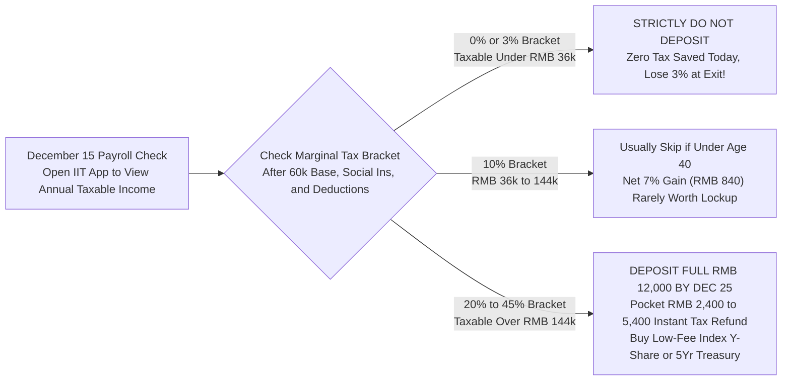
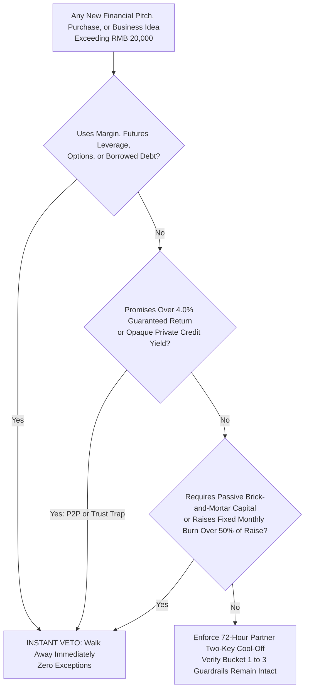

# Shanghai Tax, Provident-Fund Optimization & Lifetime Anti-Ruin Rules (上海个税公积金合法增效与终身防返贫七大铁律)

When engineers think about "making an extra `RMB 60,000` a year," their minds immediately jump to working overtime for a top performance rating or taking aggressive equity risk on `RMB 1,000,000` of principal. Almost nobody notices the **`RMB 50,000 to RMB 75,000` of completely risk-free, tax-free household cashflow** sitting unclaimed inside China's statutory Individual Income Tax (`个人所得税`) rules and Shanghai's Housing Provident Fund (`上海住房公积金`) extraction system.

Capturing `RMB 60,000/year` in legal tax refunds and unlocked `1.50%` provident-fund cash is mathematically identical to owning an **extra `RMB 1,500,000` sovereign Treasury bond yielding `4.0%` tax-free — with zero market drawdown and under sixty minutes of annual setup**. Paired with the **7 Lifetime Wealth-Preservation Iron Laws (`中产终身防返贫七大铁律`)**, this final module seals the bottom of your household bucket so decades of disciplined compounding in [01-FOUR-BUCKET-PORTFOLIO-AND-GLOBAL-INDEX-ETFS.md](01-FOUR-BUCKET-PORTFOLIO-AND-GLOBAL-INDEX-ETFS.md) can never leak away.

---

## Table of Contents

1. [Full-Stack PRC Individual Income Tax Optimization & Bonus Cliff Math](#1-full-stack-prc-individual-income-tax-optimization-bonus-cliff-math)
2. [Personal Pension Account (RMB 12,000/yr): Exact Marginal Tax Arbitrage](#2-personal-pension-account-rmb-12000yr-exact-marginal-tax-arbitrage)
3. [Shanghai Housing Provident Fund: Unlocking RMB 48,000+ Annual Rent Cashflow](#3-shanghai-housing-provident-fund-unlocking-rmb-48000-annual-rent-cashflow)
4. [The 7 Lifetime Wealth-Preservation Iron Laws Against Middle-Class Ruin](#4-the-7-lifetime-wealth-preservation-iron-laws-against-middle-class-ruin)
5. [Annual Shanghai Tax & Provident-Fund Execution Checklist](#5-annual-shanghai-tax-provident-fund-execution-checklist)

---

## 1. Full-Stack PRC Individual Income Tax Optimization & Bonus Cliff Math

Under China's comprehensive income tax regime (`综合所得 3%–45% 七级超额累进税率`), every `RMB 10,000` of lawful pre-tax deduction saves **`RMB 2,000 to RMB 3,500` in hard cash** for a Senior/Staff engineer in the `20%–35%` marginal bracket. Audit all seven statutory **Special Additional Deductions (`个税专项附加扣除`)** inside the official `个人所得税` App every December:

| Deduction Category | 2027 Statutory Standard | Annual Cash Saved (`25%` / `30%` Bracket) | High-Signal Eligibility Rules & Allocation Hacks |
| :--- | :--- | :--- | :--- |
| **1. Supporting Elderly Parents (`赡养老人`)** | **`RMB 3,000/mo`** (`独生子女`); up to **`RMB 1,500/mo`** (`非独生子女` split `RMB 3k`) | **`RMB 9,000 – RMB 10,800/yr`** (only child) | Triggered the **exact month EITHER parent turns 60** (`父母任一方年满60周岁当月起即可全额申报`, regardless of whether parents have pensions!) |
| **2. Housing Rent (`住房租金`, Shanghai)** | **`RMB 1,500/mo`** (`直辖市/省会城市标准`) | **`RMB 4,500 – RMB 5,400/yr`** | Requires zero owned housing in Shanghai (`本人及配偶在主要工作城市无房`); **no landlord invoice (`无需房东开发票`)** — just lease city, address & dates; mutually exclusive with mortgage deduction |
| **3. Continuing Education (`继续教育`)** | **`RMB 400/mo`** (`国内在职学历学位`, `<= 48 mo`); **`RMB 3,600/yr`** (`职业资格证书`) | **`RMB 900 – RMB 1,440/yr`** | Passing an official *National Vocational Qualification Directory* exam (`国家职业资格目录`: e.g., **`软考中高级系统架构设计师`**, `法律职业资格`, `CPA`) unlocks an instant `RMB 3,600` deduction in the issue year! |
| **4. Infant Care (`3岁以下婴幼儿照护`)** | **`RMB 2,000/mo per child`** (birth month to month before age 3) | **`RMB 6,000 – RMB 7,200/yr`** per child | **Marital Bracket Arbitrage**: Always elect **`100%` deduction by the higher-earning spouse** (`例如男方30%税率全额扣 vs 双方50/50对半扣在10%档`), saving an extra `RMB 2,400/yr` legally! |
| **5. Children's Education (`子女教育`)** | **`RMB 2,000/mo per child`** (age `3` preschool through full-time PhD) | **`RMB 6,000 – RMB 7,200/yr`** per child | Covers overseas university enrollment too (`境外全日制学历教育同样适用`, retain admission letter & visa records); route `100%` to higher-bracket spouse |
| **6. First-Home Mortgage Interest (`住房贷款利息`)** | **`RMB 1,000/mo`** (`<= 240 months`, first-home loan rate) | **`RMB 3,000 – RMB 3,600/yr`** | Notice `住房租金 (RMB 1,500/mo)` actually deducts **`50%` more** than `房贷利息 (RMB 1,000/mo)`! Same-city married couples cannot claim rent on one spouse and mortgage on the other |
| **7. Serious Illness Medical (`大病医疗`)** | Self-paid catalog costs `> RMB 15,000`, up to **`RMB 80,000/yr`** | Up to **`RMB 20,000 – RMB 24,000`** | Claimed during `Mar–Jun` annual settlement via `国家医保服务平台` auto-sync; **Legal Trap**: covers **self, spouse, or minor children ONLY** (`不含父母大病支出`!) |

### Year-End Bonus Separate Tax Election & The Six Deadly Bonus Cliffs (`年终奖单独计税与六大盲区`)

Through at least end-2027 (`财政部税务总局公告2023年第30号`), taxpayers can elect **Separate Taxation (`全年一次性奖金单独计税`)**: dividing the bonus $B$ by `12` to look up a much lower tax rate ($r_{\text{bonus}}$) and quick deduction ($q_{\text{bonus}}$):

$$\text{Tax}_{\text{bonus}} = B \times r_{\text{bonus}}\left(\frac{B}{12}\right) - q_{\text{bonus}}$$

For any engineer whose regular salary already sits in the `20%–35%` bracket, **Separate Taxation saves `RMB 8,000 to RMB 40,000+`** compared to merging the bonus into comprehensive income (`并入综合所得`). However, because only the quick deduction scales by `1/12` instead of `12/12`, **six mathematically brutal "cliff zones (`多发1块钱、多交几千税的年终奖盲区`)" exist**:

| Bonus Cliff Threshold | Exact "Dead Zone" Range (`税后倒挂区间`) | Extra Tax Triggered by Crossing `+RMB 1` | Smart HR / Annual Settlement Fix |
| :--- | :--- | :--- | :--- |
| **Cliff 1 (`3% -> 10%`)** | **`RMB 36,000.01 – RMB 38,566.67`** | **`+RMB 2,310`** instant tax jump | Keep bonus at `RMB 36,000` and shift excess into regular monthly salary |
| **Cliff 2 (`10% -> 20%`)** | **`RMB 144,000.01 – RMB 160,500.00`** | **`+RMB 13,200`** instant tax jump | If offered `RMB 150,000` bonus, shifting `RMB 6,000` into December salary saves `RMB 11,000+`! |
| **Cliff 3 (`20% -> 25%`)** | **`RMB 300,000.01 – RMB 318,333.33`** | **`+RMB 13,750`** instant tax jump | Negotiate `RMB 300,000` exact bonus + remainder in regular pay / RSU |
| **Cliff 4 (`25% -> 30%`)** | **`RMB 420,000.01 – RMB 447,500.00`** | **`+RMB 19,250`** instant tax jump | Common Senior/Staff trap; ask HR payroll if voluntary cliff-trimming is supported |
| **Cliff 5 (`30% -> 35%`)** | **`RMB 660,000.01 – RMB 706,538.46`** | **`+RMB 30,250`** instant tax jump | Always verify before year-end payroll lock |
| **Cliff 6 (`35% -> 45%`)** | **`RMB 960,000.01 – RMB 1,120,000.00`** | **`+RMB 88,000`** instant tax jump | Principal/Director cliff — `RMB 1,000,000` bonus nets *less* cash than `RMB 960,000`! |

> **30-Second March Settlement Rule**: Every March in the `个人所得税` App -> *年度汇算* -> *奖金计税方式选择*, click **`单独计税`**, note the refund/tax number at the bottom, go back and click **`全部并入综合所得计税`**, and submit whichever button yields the larger refund (`切勿不对比直接点下一步`)!

### Worked Full-Year Tax Audit: Shanghai Senior/Staff Engineer (`RMB 850,000` Gross Package)

See how much cash slips through the cracks when a busy 32-year-old engineer (`RMB 600,000` regular salary + `RMB 250,000` year-end bonus, single only-child renting in Shanghai, one parent aged `61`, passed `软考系统架构设计师` this year) ignores statutory elections vs. configuring every lever cleanly:

| Tax Calculation Line Item | Engineer X (Default / Unconfigured Filing) | Engineer Y (Fully Optimized Statutory Filing) | Legal Mechanism Applied |
| :--- | :--- | :--- | :--- |
| **Gross Comprehensive Salary** | `RMB 600,000` (+ `RMB 250,000` merged!) = `RMB 850,000` | `RMB 600,000` (`RMB 250,000` bonus taxed separately!) | Elect **`全年一次性奖金单独计税`** |
| **Less: Standard Base Deduction** | `-RMB 60,000` | `-RMB 60,000` | Automatic statutory `RMB 5,000/mo` base |
| **Less: Employee `五险一金` Pre-Tax** | `-RMB 98,000` (capped Shanghai social + `7%+5%` PF) | `-RMB 98,000` | Automatic payroll pre-tax deduction |
| **Less: Special Additional Deductions** | `RMB 0` *(forgot to renew App in Dec!)* | **`-RMB 57,600`** (`租金 18k + 独生赡养 36k + 软考继续教育 3.6k`) | `个人所得税` App 5-minute declaration |
| **Less: Personal Pension Deduction** | `RMB 0` | **`-RMB 12,000`** | `Dec 15` `个人养老金` deposit (`25%` bracket) |
| **Taxable Comprehensive Income** | `RMB 692,000` (`35%` marginal bracket!) | **`RMB 372,400`** (`25%` marginal bracket!) | Dropped two full marginal tax brackets! |
| **Comprehensive Tax + Bonus Tax** | **`RMB 156,280`** (`692,000 * 35% - 85,920`) | `RMB 61,180` (salary) + `RMB 48,590` (bonus `20%`) = **`RMB 109,770`** | Separate bonus lookup (`250k/12 -> 20% - 1,410`) |
| **Total Legal Tax Saved in Cash** | Baseline (`RMB 0` saved) | **`+RMB 46,510 / year` (`+RMB 46,150` net of future `3%` pension tax)** | **100% compliant statutory cash refund** |

### Three Special Tech-Career Tax Rules: Layoff Severance, MNC `RSUs` & Mid-Year Job Hops

Shanghai software engineers routinely encounter three high-value tax events outside regular monthly payroll (`财政部税务总局延续性优惠政策`):

1. **Statutory Tax-Free Severance Shield (`裁员离职经济补偿金 N+1 免税铁律`)**:
   - Under *MOF/STA Announcement 2018 No. 164*, statutory severance (`N`, `N+1`, `2N`, or negotiated mutual termination payout `协商解除劳动合同一次性补偿收入`) is **100% EXEMPT from Individual Income Tax up to `3x` the local prior-year average annual wage (`上海市上年社平工资3倍免税额`, approx. `RMB 440,000+` in Shanghai!)**.
   - Even if your package exceeds `RMB 440,000`, only the *excess portion* is taxed separately via the standalone comprehensive rate table (`单独适用综合所得税率表，绝不并入当年工资累进`)! Ensure HR codes the payout strictly as **`解除劳动合同一次性补偿金`** in the tax system — never as `"regular bonus"`!
2. **Listed-Company `RSU` & Stock Option Separate Taxation (`上市公司股权激励单独计税`, Extended Through End-2027)**:
   - Vested `RSUs` from qualifying domestic or overseas listed tech employers (`已向主管税务机关备案的境外/境内上市公司股权激励`) qualify for **standalone cumulative annual taxation (`不并入综合所得，全年累计单独适用综合税率表`)** — effectively giving you a **second, completely independent `3% -> 10% -> 20%` low-bracket ladder** alongside your regular salary! Verify your MNC China payroll has completed local tax-bureau equity plan filing (`股权激励税务备案`).
3. **Mid-Year Job-Switch Double-Exemption Notice (`年中跳槽跨月重复减除5000元正常补税`)**:
   - If you leave Company A in May and join Company B in the same May, both payroll systems often deduct the `RMB 5,000` monthly base, causing a minor `RMB 1,000–1,750` reconciliation balance next March (`年度汇算正常补齐差额，绝非税务处罚，按时申报即可`).

---

## 2. Personal Pension Account (RMB 12,000/yr): Exact Marginal Tax Arbitrage

China's **Personal Pension (`个人养老金`, `RMB 12,000/year` cap)** deducts `RMB 12,000` from your current year's taxable income, compounds tax-deferred inside a dedicated pension account, and charges a **flat `3%` individual income tax upon withdrawal** (`领取时单独按3%计税`) at statutory retirement age — **OR earlier if you permanently settle abroad (`出国（境）定居可提前一次性支取`)**.

Whether `个人养老金` is free money or a trap depends **100% on your December marginal IIT rate ($t_{\text{marginal}}$)**:



| Annual Net Taxable Income (`应纳税所得额`) | Current Marginal Tax Rate $t_m$ | Immediate Spring Tax Refund (`12,000 * t_m`) | Future `3%` Exit Tax on Principal | Net Risk-Free Tax Arbitrage | Engineering Verdict |
| :--- | :--- | :--- | :--- | :--- | :--- |
| **`<= RMB 36,000`** | `0%` or `3%` | `RMB 0` or `RMB 360` | `-RMB 360` | **`-RMB 360` to `RMB 0`** | **NEVER FUND** (Banks aggressively push `RMB 50` opening gifts to low-bracket grads — opening empty is fine, depositing loses money!) |
| **`RMB 36,001 – 144,000`** | `10%` | `RMB 1,200` | `-RMB 360` | **`+RMB 840` (`+7%`)** | **Skip** unless `>= 48` years old; liquidity option beats `RMB 840` |
| **`RMB 144,001 – 300,000`** | **`20%`** | **`RMB 2,400`** | `-RMB 360` | **`+RMB 2,040` (`+17%` day-one!)** | **Strong Buy** — `17%` instant risk-free return |
| **`RMB 300,001 – 420,000`** | **`25%`** | **`RMB 3,000`** | `-RMB 360` | **`+RMB 2,640` (`+22%` day-one!)** | **Must Fund** (`December 15–25` window) |
| **`RMB 420,001 – 660,000`** | **`30%`** | **`RMB 3,600`** | `-RMB 360` | **`+RMB 3,240` (`+27%` day-one!)** | **Must Fund** — massive day-one alpha |
| **`> RMB 660,000`** | **`35% / 45%`** | **`RMB 4,200 / 5,400`** | `-RMB 360` | **`+RMB 3,840 / +5,040`** | **No-Brainer Max Out** |

- **Two Pro Execution Rules**: (1) **Always wait until mid-December (`12月15日后`)** to deposit `RMB 12,000` so mid-year layoffs or job gaps don't accidentally drop you into the `10%` bracket. (2) Inside the pension account, buy **Broad-Market Equity Index `Y-Shares` (`沪深300ETF联接Y / 中证A500指数Y`, `0.15%/yr` half-fee class)** or **Sovereign Treasury Bonds / Specific Pension Deposits (`特定养老储蓄`)** — skip high-fee active FoFs (`管理费高达0.8%–1.0%`).

---

## 3. Shanghai Housing Provident Fund: Unlocking RMB 48,000+ Annual Rent Cashflow

In Shanghai, a full-base engineer (`7% + 7%` basic provident fund, or `12% + 12%` including `5% + 5%` supplementary fund `补充公积金`) accumulates **`RMB 5,000 to RMB 8,800+ every single month`** inside a locked account paying **`1.50%` statutory interest** (`按一年期定存基准利率计息`). Leaving `RMB 400,000` stranded at `1.50%` while paying `RMB 9,500/month` rent out of liquid capital costs you **`RMB 16,000+/year` in lost Bucket 3 compounding**.

### 5-Minute `随申办` Monthly Rent Extraction SOP (`上海无房租赁提取公积金实操`)

Open **`随申办市民云` App** (or WeChat Mini-Program) -> search **`提取住房公积金支付房屋租赁费用`**:

1. **Mode A — Standard Market Rental (`租赁市场租赁住房`, Zero Landlord Cooperation Required!)**:
   - **Eligibility**: You (and your spouse, if married) have been paying Shanghai Provident Fund for `>= 3 consecutive months` and **own zero residential property in Shanghai (`本市无自有住房`)**.
   - **2026/2027 Cap**: Extract up to **`RMB 4,000/month` per household (`RMB 48,000/year` tax-free!)** — zero lease filing (`无需网签备案`), zero invoice, zero phone call to your landlord! Select monthly automatic credit directly to your Class-I bank card (`按月自动转账到一类银行卡`) and feed that `RMB 4,000/mo` straight into [01-FOUR-BUCKET-PORTFOLIO-AND-GLOBAL-INDEX-ETFS.md](01-FOUR-BUCKET-PORTFOLIO-AND-GLOBAL-INDEX-ETFS.md).
2. **Mode B — Registered Affordable / Talent Rental (`保障性租赁住房` or `网签备案租赁`)**:
   - If renting a certified Shanghai talent/affordable apartment (`城方/微领地/张江纳仕等保租房`) or a lease filed on Shanghai's housing platform, you can extract **`100%` of your actual monthly rent (`按实际房租支出全额提取`, e.g., `RMB 8,500/month = RMB 102,000/year`)**!
3. **Crucial Check If Buying Within 18 Months (`拟使用公积金贷款者的留存底仓红线`)**:
   - Shanghai Provident Fund first-home max loan (`个人最高 RMB 800,000 / 家庭最高 RMB 1,600,000`, `+15%` green/multi-child) requires **`30x` Basic Account Balance** + **`10x` Supplementary Balance**.
   - Translation: Retaining **`RMB 30,000` in your basic PF account** (`30,000 * 30 = RMB 900,000 > RMB 800,000` cap) and **`RMB 20,000` in supplementary PF** preserves **`100%` of your maximum future Provident Fund mortgage quota** while letting you extract every single yuan above `RMB 50,000`!

### Complete Shanghai Provident Fund 4-Stage Lifecycle Playbook (`上海公积金四大人生场景提取全攻略`)

Never treat your Provident Fund as "untouchable monopoly money." Match your extraction mode to your exact career and residency chapter:

| Life & Career Chapter | Optimal `上海公积金` Action | Exact Payout Rule & Speed | Crucial Pitfall to Avoid |
| :--- | :--- | :--- | :--- |
| **1. Renting in Shanghai (`在沪无房租住期`)** | Enable **`无房租赁按月提取`** on `随申办` | **`RMB 4,000/mo`** (market lease, zero invoice) or **`100%` actual rent** (`保租房/网签备案`) | Pause extraction 6–12 months before buying *only* if balance falls below `RMB 30k` basic + `RMB 20k` supplementary |
| **2. Paying a Shanghai Mortgage (`在沪买房还贷期`)** | Sign **`提取还贷委托 — 月冲方式` (`月冲` beats `年冲`!)** | Automatically deducts **`100%` of monthly PF + commercial mortgage installments** directly from your PF + supplementary PF balance every month | Never pick `年冲` (`annual principal lump-sum` only offsets PF loan principal at `2.6%`, forcing you to pay `3.15%` commercial mortgage out of pocket!) |
| **3. Leaving Shanghai / Career Gap (`非沪籍离沪发展或间隔年`)** | **`非沪籍职工劳动关系迁出本市销户提取`** | Once Shanghai social security stops and PF account is **sealed for `>= 6 months` (`账户封存满半年`)** with zero Shanghai PF loan, extract **`100%` of entire basic + supplementary balance in 1 click** (`T+1` to debit card!) | Do NOT initiate cross-city PF transfer (`异地转移接续`) if taking a sabbatical or moving abroad — wait 6 months and cash out `100%` liquid RMB! |
| **4. Permanent Overseas Relocation (`出境定居销户提取`)** | **`出境定居全额销户提取`** | Present foreign PR / settlement permit + Hukou cancellation proof to withdraw **`100%` principal + interest** immediately | Coordinate timing with `个人养老金` overseas-settlement withdrawal so zero onshore accounts remain orphaned |

---

## 4. The 7 Lifetime Wealth-Preservation Iron Laws Against Middle-Class Ruin

While [../family-stewardship-and-legal-literacy/03-FINANCIAL-RED-LINES-AND-EMERGENCY-READINESS.md](../family-stewardship-and-legal-literacy/03-FINANCIAL-RED-LINES-AND-EMERGENCY-READINESS.md) covers external legal landmines (`连带担保 / 挂名法人 / 冻卡`), **self-inflicted financial ruin** among high-earning 32–45-year-olds almost always violates one of seven iron laws:



| Iron Law | The Classic Middle-Class Trap | Permanent Household Covenant |
| :--- | :--- | :--- |
| **Law 1: Zero Financial Leverage (`终身零杠杆投资铁律`)** | Margin accounts (`两融`), `2x–5x` crypto perps, `3x` leveraged ETFs (`TQQQ/SOXL`), or taking `2.8%` consumer loans (`消费贷套现炒股`) to invest | **Invest strictly unborrowed spot cash.** Consumer-loan diversion triggers PBOC credit recall (`抽贷拉黑征信`), and `2x` leverage turns a survivable `-40%` dip into `-80%` permanent ruin |
| **Law 2: The `4.0%` Guaranteed-Yield Scam Detector (`刚兑超4%即骗局铁律`)** | Private credit (`定融政信`), third-party wealth clubs (`中植系/恒大财富式理财`), "gold/wine leaseback," or "friend's `10%` risk-free quant arbitrage" | When China's 10-year sovereign bond yields **`1.8%–2.2%`**, anyone promising `"safe 6%–12%"` is targeting **`100%` of your principal**. Hold only exchange-custodied public securities |
| **Law 3: Single-Employer Cap `<= 10%` (`雇主风险隔离铁律`)** | Holding `RMB 2,000,000` in un-sold employer `RSUs` or employee co-investment pools (`员工跟投项目`) | Your salary + medical + career reputation already ride `100%` on your employer. Liquidate vested `RSUs` systematically into broad global ETFs |
| **Law 4: Zero Passive Brick-and-Mortar Franchises (`绝不投外行实体加盟店`)** | Spending `RMB 500,000` `N+1` layoff severance to open a "semi-passive" coffee shop, milk-tea franchise, bistro, or gym (`中产返贫第一大杀器`) | Franchise headquarters profit by selling *you* overpriced equipment and ingredients; **`85%+` close within 18 months**. Build zero-marginal-cost software/content instead |
| **Law 5: The `50%` Raise-Capture & Car Cap Rule (`防消费主义棘轮铁律`)** | Celebrating a promotion to `RMB 900k` by buying a `RMB 500k` luxury car (losing `RMB 90k/yr` in depreciation + insurance + parking) and doubling fixed overhead | **Save `>= 50%` of every raise & bonus on Day 1**; cap total car purchase price at **`<= 25%` of annual net pay** (`买得起不等于养着划算`) — fixed monthly burn is the enemy of career courage |
| **Law 6: Pre-Marital Clarity & `RMB 20k` Two-Key Cool-Off (`婚前隔离与大额双签制`)** | Commingling pre-marital savings into joint everyday accounts (`婚前财产混同`) or one spouse making impulsive `RMB 100k` trades in secret | Keep pre-marital principal in a clean dedicated account (*PRC Civil Code Art. 1063*); after marriage, **any non-routine outlay `> RMB 20,000` requires 72-hour mutual written sign-off** |
| **Law 7: Two-Sentence Cashflow Comprehension (`看不懂底层生息逻辑一分不买`)** | Structured snowball derivatives (`雪球敲入期权`), offshore whole-life leverage wrappers (`保费融资`), or complex crypto yield farms | If you cannot explain to a 12-year-old in **two plain sentences** *where the yield comes from and how much you lose in a 2008 tail event*, the fee/tail-risk is hidden *inside* you |

### Three High-Camouflage Traps Specifically Targeting High-Comp Tech Engineers (`专坑高薪程序员的三大伪精英理财局`)

Scammers know engineers ignore crude SMS fraud — so they dress traps in **quant jargon, alumni prestige, and offshore brochures**:
1. **The Ex-Colleague "Market-Neutral Crypto / Quant Private Fund" (`前大厂同事私募量化/套利基金局`)**: Shows smooth `1.8%/month` (`24%/yr`) backtests with "zero drawdown." In reality, either it sells deep out-of-the-money tail volatility that blows up `-90%` in one black-swan night, or funds sit in an unregulated offshore sub-account controlled by one founder's private key. **Rule**: Only hold public exchange-traded ETFs (`Vanguard / BlackRock / State Street / 国内头部公募`) held under statutory third-party bank custody.
2. **The Offshore "7% Illustrated IRR Savings Insurance" Trap (`香港储蓄分红险流动性锁死陷阱`)**: Insurance brokers pitch `USD 30,000/yr x 5 years` policies claiming `"7.0% long-term IRR."` Read the guaranteed column (`保证现金价值`): **guaranteed IRR over the first 15–20 years is typically `0.3% to 1.2%`**, `85%` of the illustrated return is **non-guaranteed (`非保证分红可随时下调`)**, and surrendering in Year 3–5 to fund a relocation or emergency **destroys `35% to 70%` of your principal** to pay upfront agent commissions! Pure `IB01` T-Bills + `VWRA` ETFs crush savings insurance on liquidity, transparency, and net return.
3. **The Post-35 Layoff "Paid Executive / Franchise Anxiety" Trap**: Never pay `RMB 50,000` to "career VIP clubs" or sink severance into "co-founder equity (`花钱买小公司原始股入职 / 付费上班骗局`)" — real companies pay *you* equity and salary; anyone asking an incoming engineer to invest cash for a job title is running a fraud.

---

## 5. Annual Shanghai Tax & Provident-Fund Execution Checklist

Bookmark this **45-minute annual calendar** to capture every statutory yuan without missing a single deadline:

- [ ] **Every Month (`Auto-Pilot`)**: Verify `RMB 4,000` (or `100%`保租房 actual rent) **Shanghai Housing Provident Fund extraction** arrived in your Class-I debit card and routed into your payday DCA transfer.
- [ ] **December 1–15 (`个人所得税` App — Next-Year Deduction Confirmation)**: Click **`专项附加扣除填报 -> 一键带入`** for the upcoming calendar year (`住房租金 RMB 1,500/mo`, `赡养老人`, `子女教育` routed `100%` to higher-bracket spouse, and any newly earned `继续教育` qualification certificate).
- [ ] **December 15–25 (`个人养老金` Bracket Audit)**: Check cumulative annual taxable income (`全年应纳税所得额 > RMB 144,000`, i.e., **`>= 20%` marginal rate**). If yes, wire **`RMB 12,000`** into your Personal Pension account before `Dec 28`, download the deduction QR receipt into the `个人所得税` App, and buy a low-fee CSI A500 / CSI 300 `Y-Share` index fund or Treasury inside the account.
- [ ] **March 1 – June 30 (`年度综合所得汇算清缴`)**: File your annual IIT return (book early March appointment in late February via App); **test both `奖金单独计税` and `并入综合所得`** before submitting; sync `国家医保服务平台` if self/spouse/child had `大病医疗` outlays; and declare any net realized offshore capital gains cleanly with full broker PDF statements archived.

### Copy-Pasteable Annual Shanghai Tax, Provident & Anti-Ruin Audit Sheet (`年度税务公积金与防返贫核查表`)

```text
========================================================================
ANNUAL SHANGHAI TAX, PROVIDENT & ANTI-RUIN AUDIT — TAX YEAR: 202X
========================================================================
[1] INDIVIDUAL INCOME TAX (个人所得税 APP — DEC & MAR WINDOWS)
  [ ] Housing Rent (RMB 1,500/mo) OR 1st Mortgage (RMB 1,000/mo) active?
  [ ] Elderly Support (Parent >=60: RMB 3,000 Sole / <=1,500 Split) set?
  [ ] Child/Infant Deduction routed 100% to HIGHER-bracket spouse?
  [ ] Qualifying Cert (软考/法考/CPA: RMB 3,600) claimed in issue year?
  [ ] Dec 15 Check: Taxable Income > RMB 144k (>=20% rate)?
      -> If YES: Wired RMB 12,000 to Personal Pension & bought Y-Share?
  [ ] Mar-Jun Filing: Compared Bonus [Separate] vs [Merged] & picked min?

[2] SHANGHAI HOUSING PROVIDENT FUND (随申办 — MONTHLY CASHFLOW UNLOCK)
  [ ] Auto Rent Extraction active (RMB 4,000/mo OR 100% 保租房 actual)?
  [ ] If buying within 12 mo: Retained >= RMB 30k Basic + 20k Supp PF?
  [ ] If paying Shanghai mortgage: Set to [月冲 Monthly Full Offset]?

[3] SEVEN ANTI-RUIN CIRCUIT BREAKERS (ZERO-TOLERANCE PASS/FAIL)
  [ ] 0 RMB margin / futures / options / consumer-loan stock borrowing?
  [ ] 0 RMB in >4% "guaranteed" private credit / trusts / friend funds?
  [ ] Vested employer RSUs <= 10% of liquid net worth?
  [ ] Saved >= 50% of this year's salary raise & bonus before upgrades?
  [ ] 0 RMB passive investment in cafes / restaurants / franchises?
  [ ] Pre-marital separate account un-commingled + >=20k Two-Key active?
  [ ] 0 RMB in structured snowballs / opaque savings-insurance wrappers?
========================================================================
```

Return to **[00-README.md](00-README.md)** anytime to run your **Quarterly 15-Minute Household Wealth Snapshot** — compound quietly, stay liquid, guard your downside, and spend your thirties building a life worth living.
