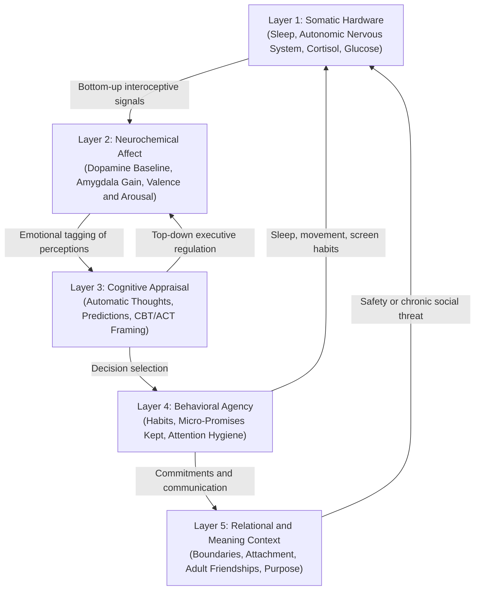
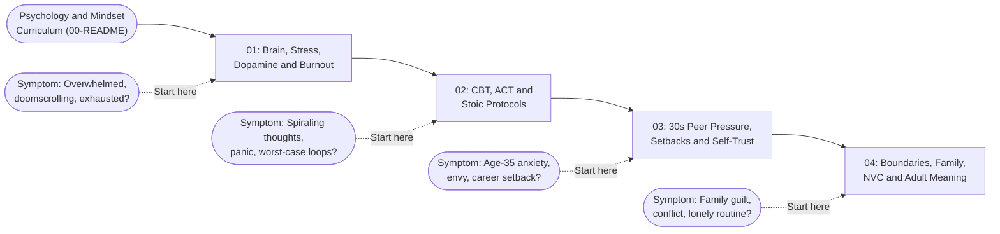

# Psychological Resilience & Positive Mindset at 32

## 1. Why Age 32 Demands an Upgraded Mental Operating System

In your twenties, raw biological energy, career novelty, and externally defined milestones (graduating, landing your first engineering job, shipping your first major system) mask fragile mental habits. You can brute-force through bad sleep, vague anxiety, and external validation loops because recovery is fast and life is relatively single-threaded.

Around age 32, the runtime environment changes fundamentally:

- **Concurrency spikes**: Career plateaus or AI-driven industry shifts, financial decisions, aging parents, long-term relationship commitments, and declining physiological recovery all run in parallel.
- **External scoreboards diverge**: Peers scatter across radically different trajectories—some cash out equity, some move abroad, some get laid off, some marry and have children, some pivot careers. The single-track school leaderboard disappears.
- **Latency of unexamined habits compounds**: Unprocessed stress turns into chronic insomnia, irritability, cynicism, or *mental friction* (精神内耗)—burning 90% of your cognitive CPU on background rumination before you write a single line of code or enjoy an evening meal.

As a software engineer, you already know that when a distributed system experiences cascading timeouts under production load, shouting "try harder!" at the servers does nothing. You inspect telemetry, isolate feedback loops, add circuit breakers, decouple single points of failure, and redesign retry policies.

**Psychological resilience is not mystical willpower or forced cheerfulness.** It is the engineering discipline of understanding how your nervous system, reward circuitry, cognitive appraisals, and interpersonal boundaries actually work—and installing reliable protocols for high-load days.

---

## 2. The Five-Layer Mental Operating System

Most people fail at mindset shifts because they try to fix a Layer 1 physiological state (sleep deprivation or sympathetic panic) using a Layer 3 cognitive lecture ("I shouldn't feel anxious"). Every mental state propagates across five interacting layers:



### Key Architectural Principles

1. **Bottom-Up Precedes Top-Down Under High Load**: When heart rate spikes and your amygdala hijacks executive function, physiological regulation (breathwork, sleep, movement, sensory grounding) must run *before* logical reframing.
2. **Emotions Are Telemetry, Not Root Directives**: An emotion is a fast heuristic summary of bodily budget + predicted threat/opportunity. Treating emotions as *infallible commands* leads to impulsivity; treating them as *useless noise to suppress* leads to burnout and psychosomatic illness. Treat them as structured system alerts to inspect.
3. **Action Mutates State Faster Than Analysis**: Rumination attempts to think your way into feeling ready to act. Behavioral psychology proves the causal arrow mostly runs in reverse: small, values-aligned action generates fresh prediction-error data that updates how you feel.

---

## 3. Emotional Literacy & High-Resolution Granularity (情绪颗粒度)

Neuroscientist Lisa Feldman Barrett's research on **constructed emotion** demonstrates one of the highest-ROI psychological skills an adult can build: **Emotional Granularity**—the ability to distinguish subtle shades of emotion rather than collapsing every unpleasant state into "stressed," "bad," or "annoyed."

In engineering terms, low emotional granularity is returning `HTTP 500 Internal Server Error` for every failure in your stack. When everything is `500`, you cannot dispatch the right runbook. High emotional granularity turns `500` into specific, actionable error codes.

### Upgrading Coarse Labels to Diagnostic Telemetry

| Coarse Label ("500 Error") | High-Granularity State | Actual Underlying Signal | Correct Engineering Action |
| :--- | :--- | :--- | :--- |
| **"I'm stressed"** | **Cognitive Overload** | Working memory buffer exceeded (too many open loops, zero prioritization) | Brain-dump all tasks externally; pick 1 active thread; defer or drop the rest |
| **"I'm stressed"** | **Anticipatory Dread** | Ambiguous future event with unexamined worst-case catastrophe | Run Stoic Fear-Setting / Pre-mortem ([02-CBT-ACT-AND-STOIC-MENTAL-MODELS.md](02-CBT-ACT-AND-STOIC-MENTAL-MODELS.md)) |
| **"I'm stressed"** | **Under-Recovery / Depletion** | Sleep debt, circadian drift, or caloric/micronutrient deficit masquerading as existential angst | Stop analyzing your career after 10 PM; sleep 8 hours first |
| **"I feel bad / down"** | **Status Envy (同辈比较焦虑)** | Exposure to curated peer highlight reels triggering perceived rank loss | Audit your scoreboard; mute algorithmic triggers; reconnect to intrinsic pillars ([03-NAVIGATING-30S-PRESSURE-WORK-AND-LIFE.md](03-NAVIGATING-30S-PRESSURE-WORK-AND-LIFE.md)) |
| **"I feel bad / down"** | **Dopamine Trough (Anhedonia)** | Post-binge receptor downregulation after hours of short-form video or stimulation | 48-hour low-stimulation reset + effort-first physical activity ([01-HOW-EMOTIONS-STRESS-AND-ANXIETY-WORK.md](01-HOW-EMOTIONS-STRESS-AND-ANXIETY-WORK.md)) |
| **"I'm angry / irritable"** | **Boundary Resentment** | Saying "yes" externally when you meant "no" internally to avoid short-term guilt | Identify the violated need; deliver an NVC boundary statement ([04-RELATIONSHIPS-BOUNDARIES-AND-MEANING.md](04-RELATIONSHIPS-BOUNDARIES-AND-MEANING.md)) |
| **"I'm unmotivated"** | **Values Disconnection** | Executing goals inherited from parents/society rather than self-authored priorities | Audit goals against personal values; introduce weekly meaning rituals |

> **Clinical Finding**: Brain imaging studies show that simply naming an unpleasant emotion with a precise 2–3 word label (**Affect Labeling**, e.g., *"This is anticipatory evaluation anxiety, not actual incompetence"*) measurably reduces right ventrolateral prefrontal cortex-mediated amygdala reactivity within seconds.

---

## 4. Fragile, Resilient, and Antifragile Minds

Borrowing Nassim Nicholas Taleb's triad and applying it to adult psychology clarifies what we are actually building. The goal is not to build an unfeeling concrete bunker; it is to build an adaptive system that metabolizes volatility into wisdom and self-trust.

| Dimension | Fragile Mind | Resilient (Robust) Mind | Antifragile Mind |
| :--- | :--- | :--- | :--- |
| **Response to Volatility & Setbacks** | Shatters or spirals when plans break (layoff, rejection, market dip) | Absorbs the blow via grit ("white-knuckling") and eventually returns to old baseline | Uses the shock to expose hidden assumptions, upgrade skills, and emerge stronger than baseline |
| **Relationship with Uncertainty** | Demands 100% certainty before acting; paralyzed by ambiguity | Tolerates uncertainty stoically while waiting for normal conditions | Treats uncertainty as asymmetric optionality; runs small low-downside experiments |
| **Source of Self-Worth** | External single point of failure (title, salary band, partner's approval) | Stoic detachment ("nothing affects me"), sometimes bordering on emotional numbness | Internalized track record of surviving hard things + diversified life pillars |
| **Error-Handling Mode** | Shame, hiding mistakes, blaming others, catastrophic self-labeling | "Move on and don't talk about it" (unprocessed residue accumulates) | Blameless post-mortem: extract the lesson, keep self-respect intact, update the playbook |
| **Stress Dosage Architecture** | Chronic low-grade rumination + avoidance of acute healthy challenges | High chronic endurance with insufficient deloading (eventual sudden burnout) | Acute voluntary challenges (deep work, hard conversations, training) paired with deep parasympathetic recovery |

**Crucial Nuance**: Antifragility requires **recovery intervals**. Muscle fibers do not grow during heavy squats; they grow during sleep and protein synthesis afterward. Psychological antifragility works identically: acute challenge + deliberate decompression + reflective integration = growth. Acute challenge + chronic rumination + zero recovery = burnout.

---

## 5. Realistic Optimism vs. Toxic Positivity vs. Cynical Pessimism

When people say they want a "positive mindset," they often accidentally reach for **toxic positivity** (盲目鸡汤 / 强行正能量)—forcing a smile, denying legitimate pain, and shaming themselves whenever fear or sadness appears. Psychological research consistently shows that emotional suppression *increases* sympathetic cardiovascular stress and causes rebound obsession.

True positivity for a rational thinker is **Realistic Optimism**, anchored by what Jim Collins termed the **Stockdale Paradox** (named after Admiral James Stockdale, who survived eight years as a POW):

1. **Unflinching Realism on Inputs**: You must never confuse faith that you will prevail in the end with the discipline to confront the most brutal facts of your current reality right now.
2. **High-Agency Optimism on Execution**: You maintain unwavering conviction that through iterative learning, adaptation, and persistence, you can shape a meaningful outcome—even if the path looks different from Plan A.

### Mindset Comparison Matrix

| Attribute | Cynical Pessimism (习得性无助) | Toxic Positivity (盲目正能量) | Realistic Optimism (理性乐观主义) |
| :--- | :--- | :--- | :--- |
| **Core Attribution Style (Martin Seligman)** | Troubles are *Permanent*, *Pervasive* ("my whole life is ruined"), and *Personal* ("I'm defective") | Denies troubles exist ("Everything happens for the best! Just smile!") | Troubles are *Temporary*, *Specific* (scoped to one domain), and *Addressable* via action |
| **Treatment of Negative Emotions** | Drowns in them; treats feelings as permanent truth | Suppresses and shames them ("Good vibes only") | Validates them as normal human signals, regulates arousal, then chooses next step |
| **Risk Calibration** | Overestimates threat; underestimates personal coping ability; defaults to inaction | Ignores tail risks; skips contingency planning; shocked when reality hits | Runs pre-mortems on downside risks, then commits 100% energy to controllable execution |
| **Self-Talk After Failure** | *"The game is rigged and I'm past my prime at 32."* | *"Actually failing was awesome! I'm totally fine!"* (while crying at 2 AM) | *"That stings, and it makes sense that it hurts. Let's rest tonight, audit the gap tomorrow, and run a better iteration."* |
| **Long-Term Outcome** | Stagnation, bitterness, shrinking life radius | Fragile denial followed by sudden emotional collapse | Compounding competence, calm confidence, high psychological safety with self and others |

---

## 6. Curriculum Map & Diagnostic Routing

Use the diagram below to jump straight to the protocol you need today, or read sequentially from `01` through `04` to build the complete mental toolkit.



### Complete Module Index

1. **[01-HOW-EMOTIONS-STRESS-AND-ANXIETY-WORK.md](01-HOW-EMOTIONS-STRESS-AND-ANXIETY-WORK.md) — Neurobiology of Stress, Anxiety, Dopamine & Burnout**
   - Amygdala hijack vs. prefrontal cortex executive control under acute and chronic stress.
   - Why uncertainty triggers analytical rumination (精神内耗) and the mathematical equation of perceived threat.
   - Tonic vs. phasic dopamine, why short-form video / doomscrolling causes anhedonia, and a concrete 14-day reward-sensitivity reset.
   - Clinical differential diagnosis table: ordinary tiredness vs. occupational burnout vs. generalized anxiety vs. clinical depression, plus medical red flags.

2. **[02-CBT-ACT-AND-STOIC-MENTAL-MODELS.md](02-CBT-ACT-AND-STOIC-MENTAL-MODELS.md) — Actionable Mental Protocols for Difficult Days**
   - Arousal-matched triage: why somatic bottom-up tools must precede cognitive reframing when heart rate spikes.
   - 60-second Physiological Sigh and sensory grounding protocols.
   - Debugging the 10 classic CBT cognitive distortions with a full 6-column Thought Record walkthrough.
   - ACT Cognitive Defusion (observing thoughts without fighting or obeying them) and Stoic Dichotomy of Control + Premeditatio Malorum (Fear-Setting).

3. **[03-NAVIGATING-30S-PRESSURE-WORK-AND-LIFE.md](03-NAVIGATING-30S-PRESSURE-WORK-AND-LIFE.md) — Conquering Age-30+ Peer Pressure (同辈压力), Setbacks & Life Transitions**
   - Deconstructing China's "35-year-old cliff" and single-track social clock narratives.
   - Decoupling identity from external KPIs (job title, TC, real estate) to eliminate ego single points of failure.
   - 4-phase incident response playbook for recovering from layoffs, financial losses, or major rejections.
   - Regret-Minimization Framework, Type 1 vs. Type 2 doors, and building intrinsic confidence via daily micro-promises kept.

4. **[04-RELATIONSHIPS-BOUNDARIES-AND-MEANING.md](04-RELATIONSHIPS-BOUNDARIES-AND-MEANING.md) — Healthy Boundaries, Relationships, Family Dynamics & Adult Meaning**
   - Adult attachment patterns (Secure, Anxious, Avoidant) and breaking the Pursuer-Distancer conflict loop.
   - Nonviolent Communication (NVC: Observation, Feeling, Need, Request) with word-for-word scripts.
   - Handling parental/family pressure with warmth + firm boundaries via Adlerian Separation of Tasks (课题分离).
   - Maintaining 30s friendships and designing weekly rituals that expand subjective time and adult meaning.

---

## 7. Baseline Mental Hygiene SLA (Daily & Weekly Maintenance)

Before reaching for advanced psychological frameworks, audit whether you are violating basic system SLAs. Eighty percent of "existential dread" in software engineers is caused by physiological debt + algorithmic overstimulation + isolation.

### Daily Minimum Viable Hygiene (15 Minutes Total Overhead)

- [ ] **First 45 Minutes Algorithm-Free**: Do not open WeChat Moments, Xiaohongshu, X/Twitter, Douyin/TikTok, or work Slack while still lying horizontal in bed. Let endogenous cortisol and tonic dopamine rise naturally with morning light and water.
- [ ] **Affect Check-In at Midday**: Pause 30 seconds before lunch and ask: *"What is my exact high-granularity emotional state right now, and what bodily need or open loop is driving it?"*
- [ ] **Hard Cognitive Shutdown Boundary**: Never evaluate your life trajectory, self-worth, or 5-year career prospects after **22:00**. After 10 PM, prefrontal executive inhibition is depleted while limbic threat sensitivity remains elevated—every nocturnal life audit produces distorted, catastrophic conclusions.
- [ ] **One Non-Zero Promise Kept**: Execute one tiny, non-negotiable daily action for yourself (15 minutes of movement, 1 page of journaling, cooking a clean meal) regardless of how chaotic work was.

### Weekly 20-Minute System Review (Sunday Evening or Monday Morning)

1. **Energy Ledger Audit**: Which 2 activities or interactions gave me net energy this week? Which 2 drained me disproportionately via unspoken resentment or pointless rumination?
2. **Control Triage**: What is the #1 thing occupying my background anxiety right now? Separate it into two columns: *Uncontrollable External Variance* (accept and release) vs. *Next Concrete 30-Minute Input Action* (schedule on calendar).
3. **Relational Ping**: Send one genuine, low-pressure message or schedule one meal/walk with a trusted friend or partner.

---

## 8. Common Engineer Anti-Patterns & Failure Modes

Watch out for four traps uniquely common among analytical builders:

- **Trap 1: Intellectualizing Emotions Instead of Feeling Them**: Reading ten psychology books and explaining *why* you feel hurt in clinical jargon while refusing to actually sit with sadness, disappointment, or grief in your body for 10 quiet minutes. Understanding the circuit diagram does not skip letting the capacitor discharge.
- **Trap 2: Productivity as Emotional Anesthesia**: Using 14-hour coding sprints, side-project hoarding, or obsessive upskilling to avoid confronting loneliness, an unhappy relationship, or grief. Workaholism is the only addiction society applauds until your body forces a hard reboot.
- **Trap 3: Waiting to "Feel Confident" Before Living**: Confidence is a *trailing indicator* of survived action, never a prerequisite. Waiting for anxiety to drop to zero before interviewing, filming a vlog, setting a boundary, or traveling abroad guarantees your comfort zone shrinks every year after 30.
- **Trap 4: Optimizing Solo Resilience While Starving Co-Regulation**: Humans are obligate social mammals; talking for 20 honest minutes with a calm, trusted friend down-regulates cortisol faster than 2 hours of solitary white-knuckling. Self-reliance is healthy; total emotional isolation is a vulnerability.

---

## 9. Quick-Start Baseline Self-Audit & Telemetry Template

Score yourself honestly from `1` (rarely true) to `5` (consistently true) across these five dimensions today, then revisit in 90 days:

| Layer | Diagnostic Statement | Score (`1–5`) | Target Module If `< 3` |
| :--- | :--- | :--- | :--- |
| **1. Somatic Hardware** | I wake up rested most mornings without touching short-video feeds for the first 45 minutes. | `___ / 5` | [01-HOW-EMOTIONS-STRESS-AND-ANXIETY-WORK.md](01-HOW-EMOTIONS-STRESS-AND-ANXIETY-WORK.md) |
| **2. Affect Granularity** | When upset, I can name the exact specific emotion and underlying need within 2 minutes. | `___ / 5` | [00-README.md](00-README.md) & [01-HOW-EMOTIONS-STRESS-AND-ANXIETY-WORK.md](01-HOW-EMOTIONS-STRESS-AND-ANXIETY-WORK.md) |
| **3. Cognitive Hygiene** | When catastrophic or envious thoughts arise, I catch and defuse them instead of spiraling for hours. | `___ / 5` | [02-CBT-ACT-AND-STOIC-MENTAL-MODELS.md](02-CBT-ACT-AND-STOIC-MENTAL-MODELS.md) |
| **4. Autonomous Identity** | My sense of self-worth stays stable even when peers flex milestones or work hits turbulence. | `___ / 5` | [03-NAVIGATING-30S-PRESSURE-WORK-AND-LIFE.md](03-NAVIGATING-30S-PRESSURE-WORK-AND-LIFE.md) |
| **5. Boundaries & Meaning** | I can hold warm, firm boundaries with family/work and have weekly rituals I genuinely look forward to. | `___ / 5` | [04-RELATIONSHIPS-BOUNDARIES-AND-MEANING.md](04-RELATIONSHIPS-BOUNDARIES-AND-MEANING.md) |

### Copy-Pasteable 3-Minute Daily Mental Telemetry Snippet

Drop this minimal block into Obsidian, Apple Notes, or a local Markdown journal whenever your mental CPU spikes above 80%:

```markdown
## Mental Telemetry Check — YYYY-MM-DD HH:MM
- **Somatic State (Sleep hrs / Caffeine / Tension 1-10)**: 
- **Coarse Feeling -> High-Granularity Label**: 
- **Triggering Event (Camera Facts Only)**: 
- **Uncontrollable Variance to Release**: 
- **Single Controllable 20-Min Action Next**: 
```

---

## 10. Core Evidence-Based Reading Shelf

If you want primary scientific and philosophical sources behind this vault, these six works have the highest signal-to-noise ratio:

1. **Lisa Feldman Barrett** — *How Emotions Are Made* (predictive brain, interoceptive body budgeting, emotional granularity).
2. **Robert Sapolsky** — *Why Zebras Don't Get Ulcers* (neuroendocrinology of acute vs. chronic HPA stress).
3. **Anna Lembke** — *Dopamine Nation* (opponent-process reward depletion in high-stimulation digital environments).
4. **David D. Burns** — *Feeling Good* / **Steven C. Hayes** — *A Liberated Mind* (foundational clinical CBT and ACT protocols).
5. **Epictetus** — *Discourses and Enchiridion* / **Marcus Aurelius** — *Meditations* (Stoic dichotomy of control in high-responsibility leadership).
6. **Ichiro Kishimi & Fumitake Koga** — *The Courage to Be Disliked (被讨厌的勇气)* (Adlerian separation of tasks and East Asian interpersonal freedom).

