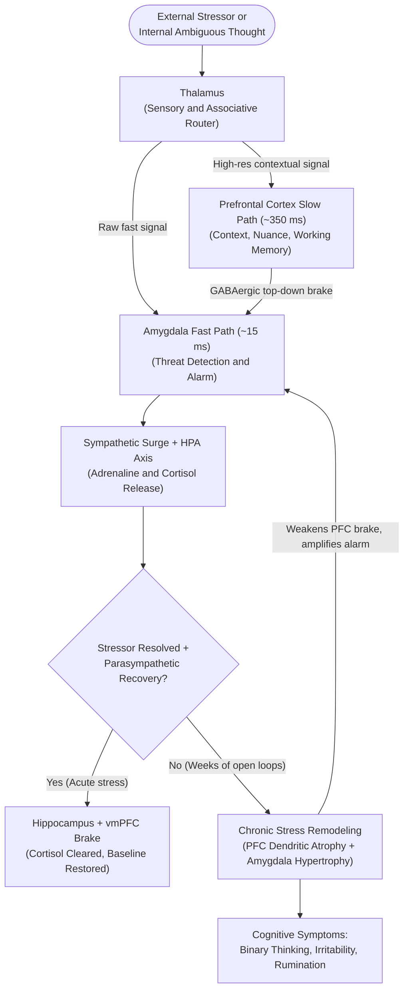
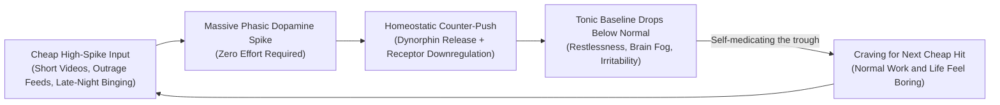

# How the Brain Handles Stress, Anxiety, Dopamine & Burnout

## 1. The Dual-Pathway Threat Architecture: Amygdala vs. Prefrontal Cortex

When you experience sudden panic before an executive presentation, or find yourself unable to write a simple function during a layoff rumor, nothing is "broken" in your intelligence. You are experiencing a predictable hardware priority interrupt between two evolutionary subsystems with radically different latencies and design goals.

### Fast Subcortical Interrupt vs. Slow Executive Controller

1. **The Amygdala Complex (Basolateral + Central Nuclei — ~12–20 ms latency)**:
   - Designed to keep a mammal alive on the savanna. It optimizes for **zero false negatives** (mistaking a stick for a snake costs 5 kcal of adrenaline; mistaking a snake for a stick costs your life).
   - Receives raw, low-resolution sensory and associative inputs directly from the thalamus before conscious awareness forms.
   - Triggers the **Sympathetic-Adreno-Medullary (SAM)** axis (epinephrine/norepinephrine surge within seconds: heart rate up, pupils dilate, blood shunted from gut to skeletal muscle) and the slower **Hypothalamic-Pituitary-Adrenal (HPA)** axis (cortisol peak ~15–25 minutes later).

2. **The Prefrontal Cortex (dlPFC & vmPFC — ~250–500 ms latency)**:
   - Houses working memory, probabilistic reasoning, long-term simulation, nuance, impulse inhibition, and emotional down-regulation.
   - Connects back to the amygdala via inhibitory GABAergic interneurons (especially from the ventromedial PFC) to send the "all-clear" signal once context is evaluated.
   - **High metabolic fragility**: The PFC requires an exact neurochemical "Goldilocks" window of norepinephrine and dopamine (the **Yerkes-Dodson inverted-U curve**). Too little arousal = brain fog; moderate arousal = flow state; excessive catecholamine/cortisol flood = **PFC functional shutdown**.

### What Chronic Unresolved Stress Does to Brain Structure

Neurobiologist Robert Sapolsky and Yale researcher Amy Arnsten documented what happens when the HPA axis stays elevated for weeks or months (chronic work pressure, financial dread, relationship conflict, sleep debt):

- **Prefrontal & Hippocampal Dendritic Retraction**: Sustained high cortisol literally prunes synaptic spines in the dorsolateral PFC and hippocampus. Working memory capacity shrinks from ~4–5 chunks to 1–2 chunks; nuance disappears; you become forgetful and indecisive.
- **Basolateral Amygdala Hypertrophy**: At the exact same time, chronic cortisol *grows* new dendritic branches inside the amygdala! Your threat detector increases its gain—neutral Slack messages read like personal attacks, and minor bugs feel like career-ending disasters.
- **Shift from Goal-Directed to Habitual Circuitry**: Under chronic stress, control shifts from the flexible PFC-caudate system to the rigid sensorimotor putamen. You automatically fall back onto entrenched coping habits (late-night scrolling, comfort eating, snapping at loved ones) even when you consciously hate doing them.

> **Engineering Takeaway**: When you are chronically stressed, your brain's hardware has temporarily lowered its executive bandwidth and raised its alarm sensitivity. Trying to make irreversible life decisions in this state is like running latency benchmarks on a thermally throttled CPU. Cool the hardware first ([02-CBT-ACT-AND-STOIC-MENTAL-MODELS.md](02-CBT-ACT-AND-STOIC-MENTAL-MODELS.md)).

---

## 2. Why Uncertainty Triggers Rumination (精神内耗的底层机制)

Many high-IQ engineers handle clear emergencies remarkably well—if production crashes at 3 PM, you calmly read logs, roll back, and patch the bug. Yet an *ambiguous* situation ("Will AI replace my role in 3 years?", "Did the hiring committee like my answer?", "Should I move cities?") can trap you in 72 hours of exhausting mental spinning.

### Fear vs. Anxiety: Present Signal vs. Unbounded Search Space

- **Fear** is a response to a **clear, present, localized threat**. It mobilizes immediate directional action (fight, flee, fix). Once action executes, the loop closes.
- **Anxiety** is a response to a **diffuse, future, uncertain threat**. Because the threat has not materialized yet, no physical action can immediately resolve it.

Modern computational neuroscience models the brain as a **Bayesian predictive engine** (Karl Friston's Free Energy Principle) whose primary mandate is minimizing **prediction error** (surprise). Uncertainty represents high entropy—an unresolved `Promise` that neither resolves nor rejects.

### Why Smart Analytical Minds Ruminate Worse

When your amygdala pings the PFC with an unspecific feeling of dread (*"Something feels unsafe"*), your analytical mind treats that feeling like a compiler error and launches a background worker thread to "solve" the future:

1. Because critical variables are unknowable (macroeconomy, someone else's private thoughts), the simulation **cannot converge**.
2. To compensate for missing inputs, the amygdala injects worst-case priors (*"Assume layoff + assume 12 months unemployed + assume social ruin"*).
3. Simulated catastrophe triggers *fresh* cortisol and adrenaline in the body—your hypothalamus cannot distinguish a vividly imagined disaster from a physical one!
4. The fresh bodily adrenaline convinces your PFC: *"See? I feel terrified, so the danger must be imminent—keep simulating!"*

This closed positive-feedback loop is **rumination (精神内耗)**: 100% CPU utilization, high thermal dissipation, zero state mutation in the external world.

### The Clinical Threat Equation

Cognitive models of anxiety summarize perceived stress load with four variables:

$$\text{Anxiety Load} = \frac{\text{Perceived Probability} \times \text{Perceived Awfulness}}{\text{Perceived Coping Efficacy} + \text{External Rescue / Safety Net}}$$

Anxious minds try to reduce $\text{Anxiety Load}$ exclusively by driving $\text{Perceived Probability} \to 0$ (seeking reassurance, refreshing news, over-analyzing). Because real life never offers $0\%$ risk, reassurance-seeking always fails.

**High-resilience minds attack the other three terms**:
- Deflate **Perceived Awfulness** (*"Even if X happens, it is an inconvenience and a pivot, not the end of my life"*).
- Increase **Perceived Coping Efficacy** (*"I have learned hard stacks before; I can adapt, cut burn rate, and rebuild"*).
- **Strengthen Safety Nets** (emergency cash buffer, transferable skills, trusted relationships).

### Breaking the 4-Step Rumination Loop in Real Time

When you catch yourself running an uncomputable future simulation for more than **10 minutes**, distinguish **Productive Planning** from **Pathological Rumination** with three binary checks:

| Question | Productive Engineering Planning | Pathological Rumination (精神内耗) |
| :--- | :--- | :--- |
| **1. Does this produce a concrete calendar action within 48 hours?** | Yes (e.g., *"Update resume section B tonight at 20:00"*) | No—just replaying hypothetical humiliation or doom |
| **2. Are the inputs knowable right now?** | Yes, or gatherable via a concrete experiment | No—guessing macro markets or unexpressed thoughts of others |
| **3. How does my body feel after 15 minutes?** | Clearer, calmer, narrower problem scope | Tighter chest, more exhausted, wider catastrophic scope |

**The Scheduled Worry Window Protocol (Clinical CBT Technique)**:
If your brain refuses to drop an uncertain topic during work or at midnight, do not yell *"Stop thinking about it!"* Instead, keep a `worry-parking-lot.md` note, write one bullet summarizing the fear, and schedule a **strict 15-minute Worry & Contingency Window at 17:30 tomorrow**. Eighty percent of midnight "emergencies" look routine when inspected at 17:30 in daylight.

---

## 3. Dopamine Dynamics: Why Doomscrolling Destroys Motivation

A widespread pop-science myth claims dopamine is the "pleasure molecule." Neuroscientist Wolfram Schultz and Stanford psychiatrist Anna Lembke (*Dopamine Nation*) clarify that **dopamine is the molecule of anticipation, craving, pursuit, and reward-prediction error**—not quiet contentment.

### Tonic Baseline vs. Phasic Spikes

Your mesolimbic dopamine pathway operates on two levels simultaneously:

1. **Tonic Dopamine (The Wave Pool Water Level)**: The steady, background trickle of dopamine circulating in your synapses. **Tonic baseline determines your subjective drive, energy, focus, and willingness to exert effort.**
2. **Phasic Dopamine (The Waves)**: Rapid transient bursts above baseline triggered by novelty, unexpected rewards, social validation, sugar, nicotine, or algorithmic hooks.

### The Opponent-Process Pleasure-Pain Balance

To preserve homeostasis, the brain pairs every high-amplitude, low-effort phasic spike with an **opponent downward deflection** (mediated by dynorphin and kappa-opioid receptors, plus D2 receptor downregulation):

### Why Algorithmic Short Video Is Uniquely Depleting

A 45-minute session on Douyin, TikTok, Reels, or infinite news feeds is neurochemically nothing like watching a single 2-hour film:
- It runs a **variable-ratio reinforcement schedule** (the exact slot-machine schedule B.F. Skinner proved creates the highest compulsion and resistance to extinction).
- Every 8–15 seconds forces a context switch + micro-prediction error (*boring -> hilarious -> outrage -> envy -> novelty*).
- **Zero effort precedes the spike**. Evolution wired dopamine to reward effortful foraging; receiving 200 novelty spikes while lying motionless in the dark causes steep tonic depletion afterward.
- Result: **Subclinical Anhedonia**—coding, reading a book, cooking dinner, or talking to a friend now produces too small a phasic signal to register against your downregulated receptors. Everything healthy feels "gray, tedious, and exhausting."

### Effort-First vs. Reward-First Activities

| Activity Category | Effort-to-Spike Profile | Post-Activity Tonic Baseline | Subjective Aftertaste (1 Hour Later) |
| :--- | :--- | :--- | :--- |
| **Algorithmic Short Video / Doomscrolling** | Zero effort -> Rapid jagged spikes | **Sharply depleted (-30%)** | Scattered attention, guilt, hollow restlessness |
| **Dopamine Stacking** (e.g., eating takeout + watching 2x video + checking phone during workout) | Layered artificial spikes | **Depleted (-20%)** | Numbness; inability to enjoy single-channel activities |
| **Zone 2 Run / Strength Training / Cold Water** | High upfront friction -> Gradual catecholamine rise | **Elevated for 2–4 hours (+25%)** | Calm alertness, clear head, earned satisfaction |
| **Deep Work / Cooking / Filming & Editing** | Moderate setup friction -> Flow state | **Sustained healthy baseline (+15%)** | Quiet pride, mental coherence, better sleep |

---

## 4. The 14-Day Dopamine & Reward Sensitivity Reset Protocol

When normal life feels dull and your attention span has fragmented to 30 seconds, willpower lectures fail. Run this structured 14-day neurochemical recalibration:

### Days 1–3: Friction Installation & Withdrawal Stabilization
- **Physical separation**: Charge your phone outside the bedroom every night; buy a cheap dedicated alarm clock or use a smartwatch alarm.
- **Grayscale + App Offloading**: Delete or log out of short-video and infinite-feed apps on your phone (if needed for creator research, restrict strictly to desktop browser during a fixed 30-minute afternoon window).
- **Expect the Days 1–3 Trough**: Restlessness, boredom, and phantom pocket-checking peak in the first 72 hours as dynorphin clears. Label it accurately: *"This discomfort is my D2 receptors upregulating."*

### Days 4–10: Single-Channel Living (De-Stacking)
- **Eliminate Dopamine Stacking**: When eating a meal, just eat and taste the food (no phone). When walking for 15 minutes, leave earbuds out at least once a day so your default mode network (DMN) can process buffered thoughts. When lifting weights, avoid scrolling social feeds between sets.
- **Enforce Effort-Before-Reward Ordering**: Morning light -> Hydration -> 60–90 minutes of deep technical/creative work *before* checking messages, news, or entertainment.

### Days 11–14: Re-Sensitization & Sustainable Guardrails
- **Boredom Micro-Reps**: Stand in an elevator or coffee line for 3 minutes without pulling out your phone. Rebuilding tolerance for unstimulated silence restores creative insight and patience.
- **Scheduled High-Quality Leisure**: Replace passive 2-hour midnight scrolling with intentional, bounded enjoyment (watching a great cinema film start-to-finish, cooking a proper meal, playing a sport, shooting street footage).

### Diurnal Neurochemical Timing: Aligning Work & Rest With Cortisol/Adenosine

Many software engineers accidentally manufacture artificial anxiety every afternoon and midnight by fighting their endogenous neurochemical clock:

| Time Window | Healthy Endogenous Profile | Common Engineer Sabotage | High-Resilience Protocol |
| :--- | :--- | :--- | :--- |
| **07:00–09:00** | **Cortisol Awakening Response (CAR)** naturally peaks (+50%) to mobilize focus | Immediate bed-scrolling + drinking coffee on empty stomach before adenosine clears | 10 min outdoor daylight + water first; delay first caffeine **60–90 min** post-wake to prevent 3 PM crash |
| **09:30–12:30** | Peak prefrontal dopamine + norepinephrine bandwidth | Burning peak hours on low-value Slack triage and status meetings | Guard for hardest architecture, coding, interview prep, or hard decisions |
| **14:00–16:00** | Natural post-prandial circadian dip | Chugging 2nd/3rd espresso ($t_{1/2} \approx 5\text{–}7\text{ hours}$), wrecking nocturnal deep sleep | 15-min outdoor walk, NSDR (Non-Sleep Deep Rest), or mechanical low-stakes tasks; **hard caffeine cutoff at 13:30** |
| **22:00–24:00** | Melatonin rises; **PFC executive brake powers down**; limbic sensitivity stays raw | Doomscrolling news, checking work email, auditing life failures in bed | Treat post-22:00 anxious thoughts as **untrusted corrupted telemetry**; dim warm lights, read fiction or rest |

---

## 5. Differential Diagnosis: Tiredness vs. Burnout vs. Anxiety vs. Depression

At 32, misdiagnosing your internal state leads to the **exact wrong intervention**—for example, forcing an exhausted, burned-out nervous system into brutal "discipline challenges," or letting clinical depression deepen through total social isolation.

Use this clinical-functional comparison matrix to identify what is actually happening:

| Diagnostic Axis | Ordinary Physical/Mental Tiredness | Occupational Burnout (WHO ICD-11) | Generalized Anxiety / Hyperarousal | Clinical Depression (MDD Spectrum) |
| :--- | :--- | :--- | :--- | :--- |
| **Core Phenomenology** | Heavy eyelids, slow cognition, muscles/brain want rest, mood remains intact | **3 Pillars**: Energy exhaustion + **Cynicism/detachment** toward work + Feeling ineffective | Wired-and-tired; muscle tension; racing "what-if" thoughts; dread of future errors | **Pervasive anhedonia** (inability to feel pleasure anywhere), emptiness, hopelessness, heavy leaden limbs |
| **Domain Scope** | Global but transient | **Context-specific at first** (flare-ups Sunday night / opening laptop; relief on non-work hobbies) | Triggered by uncertainty across work, finances, health, or approval | **Global across all domains**—even favorite foods, hobbies, and loved ones feel flat or burdensome |
| **Response to a 4-Day Unplugged Vacation** | **80–100% restored** after 2–3 nights of deep sleep | Temporary relief during trip, followed by **immediate dread/nausea** Sunday evening | Mind brings the worry to the beach; checks email secretly; cannot relax | Vacation feels grey and exhausting; guilt about "not enjoying this nice trip" |
| **Typical Sleep Disruption** | Falls asleep fast, sleeps deeply when given time | Unrefreshing sleep; revenge bedtime procrastination (staying up late for "my own time") | **Sleep-onset insomnia** (racing mind takes 60+ min to fall asleep) or 3 AM cortisol jolts | **Early-morning awakening** (e.g., 4 AM with heavy dread) OR hypersomnia (10–12 hrs yet still exhausted) |
| **Internal Inner Voice** | *"I need a good night's sleep."* | *"What's the point? Nobody cares, management is broken, I have nothing left to give."* | *"If I miss a detail, everything will collapse. I have to prepare for every scenario."* | *"I am a burden. Nothing will ever get better. Everything takes impossible effort."* |
| **Correct Primary Intervention** | Sleep banking (8–9h), hydration, 1–2 low-load days | **Workload & boundary redesign**, autonomy restoration, detaching self-worth from job, true deload weeks | Somatic down-regulation, CBT/ACT defusion, reducing caffeine/news, tolerable exposure ([02-CBT-ACT-AND-STOIC-MENTAL-MODELS.md](02-CBT-ACT-AND-STOIC-MENTAL-MODELS.md)) | **Professional evaluation (therapy / medical)** + tiny **Behavioral Activation** (sunlight, 10-min walk, human contact) |
| **Mistake That Makes It Worse** | Masking sleep debt with 400mg late-afternoon caffeine | Taking a 2-day break and returning to the *exact same* 70-hour boundaryless environment | Seeking constant reassurance or avoiding every anxiety-provoking task (shrinks world) | Isolating in a dark bedroom waiting to "feel motivated" before moving or speaking to anyone |

---

## 6. Biological Confounders & Red-Flag Escalation Thresholds

Before concluding that persistent low mood, brain fog, or anxiety is purely psychological, an engineer checks hardware telemetry. Several common physiological conditions in 30-something desk workers mimic psychiatric burnout or depression almost identically:

### Medical Lab & Sleep Checkpoints to Rule Out
1. **Thyroid Panel (`TSH`, `Free T3`, `Free T4`)**: Hypothyroidism causes profound fatigue, low mood, cold intolerance, and cognitive slowing; hyperthyroidism causes racing heart and panic-like anxiety.
2. **Vitamin D (`25-OH Vitamin D`)**: Indoor software engineers frequently test below `20 ng/mL` (severe deficiency), strongly correlated with seasonal low mood, immune dysfunction, and fatigue.
3. **Iron Storage (`Serum Ferritin` + `CBC`) & `Vitamin B12`**: Suboptimal ferritin or B12 impairs dopamine/serotonin synthesis and oxygen transport long before frank anemia appears.
4. **Obstructive Sleep Apnea (OSA) / Upper Airway Resistance**: Even lean East Asian men (due to craniofacial airway geometry) can experience nocturnal micro-arousals that destroy deep slow-wave and REM sleep, leaving morning cortisol sky-high. Warning signs: snoring, dry mouth on waking, morning headaches, unrefreshing 8-hour sleep.

### Objective Thresholds for Seeking Professional Support

Self-directed mental models in this vault are powerful preventative and mild-to-moderate tools—they are **not** substitutes for clinical care when neurochemistry or trauma crosses clinical thresholds. Book a licensed psychotherapist (CBT/ACT-trained) or physician promptly if **any** of the following hold true:

- **The 2-Week Functional Rule**: Persistent depressed mood, complete loss of interest/pleasure (anhedonia), or uncontrollable daily panic/anxiety lasting **more than 14 consecutive days** despite basic sleep recovery.
- **Impaired Core Functioning**: Inability to work, eat normally (unintended weight loss/gain >5%), maintain basic hygiene, or leave home.
- **Panic Attacks or Somatic Chest Symptoms**: Recurrent sudden surges of terror, chest tightness, shortness of breath, or dizziness (rule out cardiac/medical causes first, then treat panic loop clinically—CBT for panic has >80% efficacy).
- **Compulsive Numbing**: Relying daily on alcohol, sedatives, gambling, or destructive behaviors to fall asleep or numb emotional pain.
- **Self-Harm or Hopelessness Ideation**: Any thoughts that life is not worth living or wishing not to wake up—treat this as a **Severity-0 medical emergency**, contact a trusted person and clinical crisis/medical professional immediately, never try to "tough it out" solo.

---

## Next Step in the Curriculum

Now that you understand the hardware mechanics of stress, rumination, and dopamine, proceed to **[02-CBT-ACT-AND-STOIC-MENTAL-MODELS.md](02-CBT-ACT-AND-STOIC-MENTAL-MODELS.md)** to learn concrete 60-second to 10-minute protocols for interrupting panic, debugging distorted thoughts, and regaining calm agency on difficult days.
