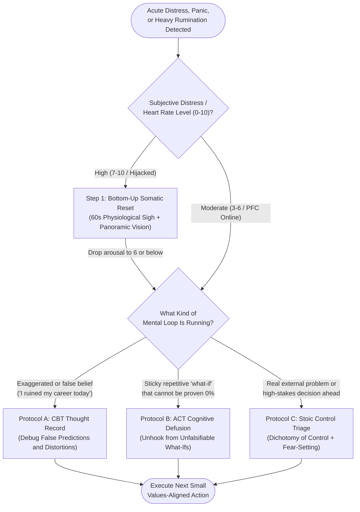
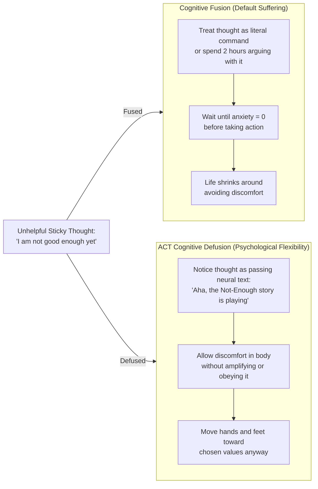

# Actionable Mental Protocols: CBT, ACT & Stoicism for Difficult Days

## 1. Arousal-Matched Protocol Routing: Pick the Right Tool for Your State

The #1 reason smart people say *"CBT doesn't work for me"* is **protocol-state mismatch**. As established in [01-HOW-EMOTIONS-STRESS-AND-ANXIETY-WORK.md](01-HOW-EMOTIONS-STRESS-AND-ANXIETY-WORK.md), when sympathetic arousal crosses 7/10 (racing pulse, tight chest, shallow breathing), your dorsolateral prefrontal cortex goes partially offline. Attempting Socratic logic puzzles during an amygdala hijack is like trying to SSH into a server whose network interface is down.

Always dispatch mental protocols based on **current physiological arousal** and **whether the underlying thought is factually distorted vs. simply unhelpful**:



---

## 2. Bottom-Up Somatic Grounding (60-Second Hardware Brakes)

When you catch yourself spiraling before an interview, fuming after a tense meeting, or jolting awake with dread, execute these direct cranial-nerve interventions before touching your thoughts.

### Protocol 2.1: The 60-Second Physiological Sigh (Stanford Lab Validated)

Discovered in the 1930s and clinically validated by Andrew Huberman and David Spiegel's randomized controlled trial at Stanford (2023), cyclic physiological sighing outperforms mindfulness meditation and box breathing for **fastest real-time reduction in autonomic arousal**:

1. **Inhale #1 (Nose, ~2 seconds)**: Take a deep, full inhalation through your nose into your belly/diaphragm (~85% lung capacity).
2. **Inhale #2 (Nose, ~0.5–1 second sharp top-off)**: Without exhaling yet, sneak in a second short, sharp sip of air through your nose. *Mechanism*: Under stress, millions of tiny lung sacs (alveoli) partially collapse; this second mechanical pop re-inflates them, maximizing alveolar surface area to dump blood $\text{CO}_2$.
3. **Extended Exhale (Mouth, ~6–8 seconds)**: Purse your lips slightly (as if blowing through a thin straw) and exhale slowly, smoothly, and completely until your lungs are empty. *Mechanism*: Prolonged exhalation elevates intrathoracic pressure, stimulating arterial baroreceptors and the **vagus nerve** to release acetylcholine onto the heart's sinoatrial node, immediately slowing heart rate.
4. **Repeat for 3 to 5 consecutive cycles** (takes ~45–60 seconds total), then return to normal nasal breathing.

### Protocol 2.2: Optic-Flow Panoramic Vision Shift

Your eyes are literally extruded brain tissue—the only part of the central nervous system outside the cranial vault.
- **Focal / Foveal Vision** (staring intensely at a 6-inch phone screen or laptop monitor) directly activates sympathetic brainstem circuits (locus coeruleus norepinephrine release), signaling pursuit or threat.
- **Panoramic Peripheral Vision** disengages that sympathetic lock:
  1. Look up toward a window, horizon, or distant wall.
  2. Keep your head and gaze still while softening your eyes to simultaneously notice the left-most edge, right-most edge, ceiling, and floor of your visual field for **60 seconds**.

### Protocol 2.3: Trigeminal Cold Reflex & 5-4-3-2-1 Anchor

- **Cold Water Dive Reflex** (for acute panic/anger > 8/10): Splash cold tap water (`10–15°C`) onto your upper cheeks, eyes, and temples—or hold a cold wet towel there for 20–30 seconds while holding a normal breath. Stimulating the ophthalmic/maxillary branches of the trigeminal nerve triggers an immediate mammalian vagal heart-rate drop.
- **5-4-3-2-1 Sensory Interrupt** (for dissociation or racing midnight loops): Name aloud or silently **5** distinct colors/shapes you see, **4** physical textures touching your skin (feet on floor, shirt on shoulders), **3** ambient sounds, **2** scents, and **1** slow breath. This reallocates cortical bandwidth from the Default Mode Network (rumination) to primary sensory cortices.

---

## 3. CBT: Debugging the 10 Classic Cognitive Distortions

**Cognitive Behavioral Therapy (CBT)**, pioneered by Aaron Beck and systematized by David Burns (*Feeling Good*), rests on one foundational insight: **External events do not directly cause most prolonged emotional suffering; our automatic cognitive appraisals of those events do.**

Under stress, human cognition systematically introduces ten predictable bugs (**Cognitive Distortions**). Memorizing their signatures lets you catch them in production like familiar compiler warnings.

### The 10 Classic Cognitive Distortions Reference Table

| # | Distortion Name | Mental Bug Signature | Typical 32yo Engineer Example | Socratic Debugging Prompt |
| :--- | :--- | :--- | :--- | :--- |
| **1** | **All-or-Nothing (Binary) Thinking** | Evaluating continuous outcomes strictly as `1` (total perfection) or `0` (worthless failure) | *"I stumbled on one system design follow-up, so the entire interview was a disaster."* | Where on the continuous `0–100%` spectrum does this performance actually sit? |
| **2** | **Catastrophizing (Magnification)** | Chaining low-probability worst cases together with probability `1.0` each | *"My PR caused a staging regression -> Manager thinks I'm washed up -> I'll get PIP'd -> Unemployable at 33."* | What is the realistic base-rate outcome (`P50`), not just the cinematic `P99.9` tail? |
| **3** | **Mind Reading** | Assuming you know another person's negative private thoughts with zero empirical telemetry | *"My tech lead replied 'OK.' with a period—he definitely resents me."* | What are 3 benign alternative explanations (e.g., walking between meetings, typing on mobile)? |
| **4** | **Fortune Telling** | Treating an anxious prediction about the future as an already-settled historical fact | *"There is no point starting a personal vlog; nobody will care and I'll just embarrass myself."* | Do I own a time machine, or am I confusing anticipatory discomfort with data? |
| **5** | **Emotional Reasoning** | `I feel X, therefore X must be objectively true` | *"I feel behind and inadequate today, which proves I actually am a mediocre engineer."* | If I felt this exact same way after 4 hours of sleep vs. 8 hours, did my actual competence change overnight? |
| **6** | **Overgeneralization** | Extrapolating `N = 1` or `N = 2` painful events into an infinite `while(true)` rule ("always", "never") | *"That relationship didn't work out; I'll never find a compatible partner in my 30s."* | Is this a permanent law of physics, or a finite sample size from which I can adjust selection criteria? |
| **7** | **Mental Filter** | Zooming exclusively onto 1 negative data point while discarding 19 positive/neutral ones | Receiving 9 strong peer review comments and 1 constructive nit, then obsessing over the 1 nit for three days | If I looked at the complete dataset cleanly, what ratio of signal am I throwing away? |
| **8** | **Disqualifying the Positive** | Actively explaining away genuine wins as "luck," "easy," or "they were just being polite" | *"Sure I shipped that service, but anyone could have done it—it doesn't count."* | Would I apply this absurdly harsh grading rubric to a junior teammate or close friend? |
| **9** | **"Should" / "Must" Statements** | Whipping yourself or others with rigid, arbitrary rules about how reality *ought* to behave | *"At 32 I SHOULD already own a paid-off apartment and never feel uncertain."* | Says which law of nature? Replace *"I should..."* with *"I would prefer..., and given where I actually am today, my best next move is..."* |
| **10** | **Labeling & Personalization** | Collapsing a specific behavioral mistake into a global identity label (`I failed` -> `I am a loser`) | *"I lost RMB 80k on a bad investment—I'm an idiot with money."* | How do I describe the specific *behavior* and flawed *hypothesis* without attacking my entire personhood? |

---

### The 6-Column CBT Thought Record (Step-by-Step Protocol)

**Critical Rule**: Never try to run a CBT Thought Record purely inside your head. Inside working memory, anxious thoughts mutate mid-sentence to evade scrutiny. **Write it down on paper or in a plain text file**—seeing an exaggerated thought rendered in cold monospace text exposes its absurdity immediately.

#### Worked Production Example

| Column | Prompt | Worked Example Entry |
| :--- | :--- | :--- |
| **1. Triggering Situation** | Just camera-recordable facts (When, where, what happened) | Saw on LinkedIn/Moments that a former college classmate (same age, 32) became Staff Engineer at a top AI lab while I felt stuck debugging legacy services this week. |
| **2. Hot Automatic Thoughts** | Exact unedited sentences running through your head | *"I wasted my late 20s. Everyone is passing me by. By 35 I'll be obsolete and unhireable."* |
| **3. Emotions & Initial Intensity** | Precise emotion labels (`0–100%`) | Status envy (`80%`), Shame (`70%`), Anticipatory panic (`75%`). |
| **4. Distortions & Evidence FOR Hot Thought** | Which distortions? What *strictly factual* evidence supports it? | *Distortions*: All-or-Nothing, Fortune Telling, Disqualifying the Positive.<br/>*Factual evidence*: My current project has slower growth, and I haven't refreshed my AI/system-design portfolio in 18 months. |
| **5. Objective Evidence AGAINST Hot Thought** | Facts you are ignoring when fused with shame | 1. I have 8+ years of real production delivery, strong reliability instincts, and stable cash flow.<br/>2. Comparing my ordinary Tuesday to 1 person's peak announcement out of 200 classmates is survivorship bias.<br/>3. At 32, a focused 6–12 month skill sprint completely transforms an engineer's market positioning. |
| **6. Balanced Realistic Appraisal & Re-Rating** | Not fake cheerleading—accurate, high-agency synthesis + re-rate emotion (`0–100%`) | *"Seeing his milestone stung because growth matters to me—that envy is useful data, not a verdict. I am not obsolete; I have simply been coasting on legacy work for a year. Starting tonight, I can dedicate 6 focused hours/week to AI systems and interview readiness."*<br/>**Re-rated Intensity**: Envy (`30%`), Shame (`15%`), Panic (`20%`). |

---

## 4. ACT: Cognitive Defusion & Psychological Flexibility

Sometimes CBT debate hits a wall. Suppose your mind whispers: *"What if my parents get sick next year?"* or *"What if the tech market stays tight in 2027?"* You **cannot** disprove those possibilities—debating them for an hour only feeds them more attention (Daniel Wegner's **Ironic Process Theory**: trying *not* to think of a white bear guarantees you think of a white bear).

**Acceptance and Commitment Therapy (ACT)**, developed by Steven Hayes, solves this by changing your **relationship** to thoughts rather than debating their content.



### Four Concrete ACT Defusion Drills (Takes 30 Seconds)

1. **Three-Step Linguistic Distance**:
   - *Step 1 (Fused)*: `"I'm going to fail this transition."` (100% hook—you are *inside* the thought).
   - *Step 2*: `"I am having the thought that I'm going to fail this transition."` (Creates 1 meter of separation).
   - *Step 3 (Defused)*: `"I am noticing that my mind is generating the thought that I'm going to fail this transition."` (Restores observer stance—you are the sky; the thought is passing weather).

2. **Name Your Recurring Doom Playlists**:
   - Every human mind has only 3 or 4 core insecurity tracks recorded in childhood or early adulthood that replay under different costumes (*"The Falling Behind Track"*, *"The Impostor Track"*, *"The Scarcity Track"*, *"The Rejection Track"*).
   - When it starts playing at 11 PM, smile wryly and say: *"Ah, Radio Doom FM is playing 'The Age-35 Doom Hit' again. Thanks for trying to keep me safe, brain, but I've got the wheel."*

3. **Passengers on the Bus Metaphor**:
   - Imagine you are driving a bus toward a meaningful destination (building a great career, filming your life, loving deeply). Anxious, critical thoughts are rowdy passengers in the back shouting scary predictions.
   - If you stop the bus to wrestle them off (suppression/rumination), **the bus goes nowhere**. If you obey them and turn down side alleys to keep them quiet (avoidance), **they are driving your life**. ACT means letting them chatter in the back while keeping your hands on the wheel toward your compass direction.

4. **Values vs. Goals Distinction**:
   - A **Goal** is a future binary checkpoint you do not fully control (*"Get an L6 offer by June"*).
   - A **Value** is an ongoing behavioral direction you 100% control right this second (*"Show up today as a curious, disciplined builder who cares for his craft and body"*). You can fulfill your values at 9:05 AM today regardless of how yesterday went.

---

## 5. Stoic Mental Models for High-Load Engineering & Life

Ancient Stoicism (Epictetus, Marcus Aurelius, Seneca) is the philosophical ancestor of modern CBT. Stripped of internet caricature, real Stoicism is **not** suppressing tears or pretending nothing hurts—it is radical clarity about agency, mortality, and emotional energy allocation.

### 5.1 The Trichotomy of Control (Epictetus Upgraded)

Divide every problem on a sheet of paper into three strict buckets—and **ruthlessly convert Bucket 2 outcomes into Bucket 1 inputs**:

| Bucket | Examples in Career & Life | Correct Mental Allocation |
| :--- | :--- | :--- |
| **Bucket 1: 100% In My Control** | My daily preparation hours, sleep bedtime, integrity, how kindly and clearly I speak, my savings rate, my reaction to bad news | **100% of your pride, focus, and self-evaluation belong here.** |
| **Bucket 2: Partially Influenced (Probabilistic)** | Passing a specific company's interview loop, getting promoted this cycle, whether someone reciprocates romantic interest, investment returns | **Zero ego attachment to single-trial variance.** Convert into Bucket 1 process goals (*"Complete 25 mock interviews cleanly"* instead of *"Must get Offer X"*). |
| **Bucket 3: 0% In My Control** | Past mistakes, macro layoffs, exchange rates, aging, family genetics, strangers' or relatives' unrequested opinions | **Radical acceptance (`0%` mental bandwidth).** Wishing reality were different is arguing with gravity. |

### 5.2 Premeditatio Malorum (Seneca's Fear-Setting Audit)

Vague fear thrives in darkness; quantified risk shrinks in daylight. Whenever a decision (negotiating salary, changing jobs, solo travel abroad, having a hard boundary conversation) triggers paralysis, spend 15 minutes filling out this 3-part table popularized by Seneca and Tim Ferriss:

1. **Define the Exact Worst Case (`1–10` permanent impact score)**: If I take this step and everything goes completely sideways, what *concretely* happens? (Usually a `3/10` temporary setback—rarely a permanent `10/10` catastrophe).
2. **Prevent & Repair**:
   - *Prevention*: What concrete safeguards lower the odds of that worst case by 50%?
   - *Repair*: If it happened anyway, who could I call, how would I cut monthly burn rate, and what are the exact first 3 steps I would take to get back on my feet?
3. **Calculate the Cost of Status-Quo Inaction**: If I avoid this out of fear, what will my life look like ethically, financially, physically, and emotionally in **6 months, 1 year, and 3 years**? *(Humans wildly overestimate the risk of action while ignoring the guaranteed slow decay of inaction.)*

### 5.3 The "Second Arrow" Rule

In both Buddhist psychology (Sallatha Sutta) and Stoic cognitive theory:
- **First Arrow (Unavoidable Reality Pain)**: You lose money, get rejected, catch the flu, or experience heartbreak. Feeling sad, disappointed, or tired is **healthy, natural biology**.
- **Second Arrow (Self-Inflicted Narrative Suffering)**: Stabbing yourself repeatedly afterward with *"Why did this happen to ME? How could I be so stupid? My whole year is ruined!"*
- **Resilience Formula**: $\text{Total Suffering} = \text{Pain} \times \text{Resistance}$. When Resistance approaches zero, clean pain metabolizes surprisingly fast.

---

## 6. Master Protocol Comparison & Failure Modes to Avoid

| Framework | Best Use Case | Time Required | Classic Engineer Misuse / Anti-Pattern |
| :--- | :--- | :--- | :--- |
| **Physiological Sigh & Somatic Grounding** | Acute anxiety, anger, pre-interview jitters, 3 AM wakeup | `60–120 seconds` | Expecting 1 breath to erase all discomfort, or skipping sleep/caffeine hygiene |
| **CBT Thought Record** | Shame spirals, impostor syndrome, false catastrophic predictions | `10 minutes` (written) | **Self-Gaslighting**: Trying to "debate away" valid grief or an objectively toxic workplace instead of taking real action |
| **ACT Cognitive Defusion** | Repetitive "what-if" uncertainty loops, perfectionism, creative block | `30–90 seconds` | Turning defusion techniques into a superstitious ritual to make anxious feelings vanish instantly |
| **Stoic Control & Fear-Setting** | High-stakes career/life crossroads, macro volatility, setbacks | `15–20 minutes` | **"Vulcan Bro-Stoicism"**: Pretending not to care about relationships or joy to avoid ever feeling vulnerable |

---

## 7. Copy-Pasteable Difficult-Day Worksheets

Keep these two plain-text templates in your notes app so you never face a blank page when stressed.

### Template A: 5-Minute CBT + ACT Rapid Debug Sheet

```markdown
## Rapid Cognitive Debug — YYYY-MM-DD
1. **Physiological Reset Done?** [ ] 3x Physiological Sighs completed
2. **Camera-Fact Trigger**: 
3. **Raw Hot Thought**: ""
4. **Initial Emotion & Intensity (0-100)**: 
5. **Distortions Detected**: (Binary / Catastrophizing / Mind-Reading / Fortune-Telling / Shoulds)
6. **Is this thought falsifiable right now?**
   - If YES -> **Objective Counter-Evidence**: 
   - If NO (Future uncertainty) -> **ACT Defusion Line**: "I notice my mind is playing the [___] story to try to protect me."
7. **Balanced Realistic Reframe**: 
8. **Next 15-Minute Values-Aligned Action**: 
```

### Template B: Stoic Fear-Setting (`Premeditatio Malorum`) Matrix

Use before salary negotiations, career switches, publishing creative work, or relocating:

```markdown
## Stoic Fear-Setting Audit — Decision: [________________]

### Part 1: Worst-Case Scenarios (If I Act)
| Worst-Case Scenario | Impact (1-10) | Concrete Prevention Step | Concrete Repair / Recovery Step |
| :--- | :--- | :--- | :--- |
| 1. | | | |
| 2. | | | |
| 3. | | | |

### Part 2: Upside of Partial Success (Even a Base Hit)
- Skills, confidence, relationships, or optionality gained even if Plan A only 50% succeeds:

### Part 3: Guaranteed Cost of Status-Quo Inaction
- **In 6 Months**: 
- **In 1 Year**: 
- **In 3 Years**: 
```

---

## Next Step in the Curriculum

With somatic resets, CBT, ACT, and Stoic tools installed, turn to **[03-NAVIGATING-30S-PRESSURE-WORK-AND-LIFE.md](03-NAVIGATING-30S-PRESSURE-WORK-AND-LIFE.md)** to apply these models directly to the biggest pressures of your thirties: peer comparison (同辈压力), China's 35-year-old career narrative, setback recovery, and building unshakeable intrinsic self-trust.
