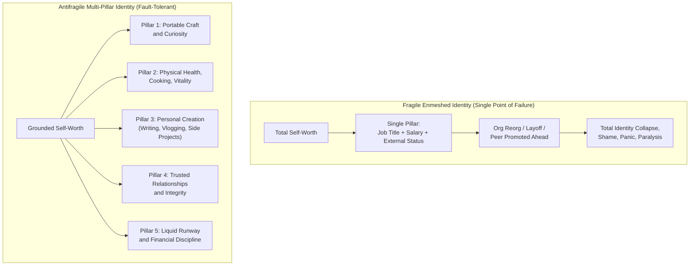
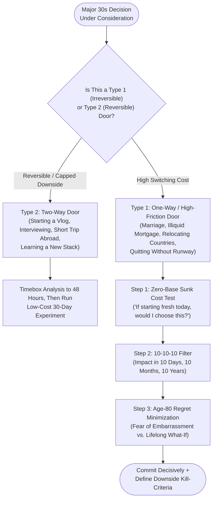

# Conquering Age-30+ Peer Pressure (同辈压力), Setbacks & Life Transitions

## 1. Deconstructing the "35-Year-Old Cliff" & Social Clock Narratives

For Chinese software engineers entering their early thirties, few phrases trigger faster background cortisol than **"35岁危机" (the 35-year-old cliff)** combined with **"同辈压力" (peer pressure)**. Even when your day-to-day engineering output is stronger at 32 than it ever was at 25, a pervasive cultural script whispers that time is running out.

To disarm this anxiety, you must inspect it like an engineer auditing legacy architecture: **separate real structural constraints from inherited cultural fiction and algorithmic fear-mongering.**

### How the "Single-Thread Social Clock" Traps Smart People

Sociologist Bernice Neugarten coined the term **Social Clock** to describe culturally internalized timetables for major life milestones. For the first 22 years of life, school trains you on a **single-variable, synchronous leaderboard**: everyone takes the same exam on the same day, graded by one scalar score.

When you enter your thirties, **adult life becomes an asynchronous, high-dimensional open-world game—yet most minds keep running single-leaderboard school firmware**:
- Graduated at 22–24 -> Senior Engineer by 27 -> Married + Tier-1 mortgage by 30 -> Director/Staff or financial freedom by 35.
- Anyone deviating from this exact timestamps-and-KPIs schema feels "late" or "defective," even if forcing that schedule would trap them in an unaffordable mortgage or the wrong marriage.

### Separating Real Engineering Risk from Manufactured Panic

| Narrative Claim | Manufactured Herd Panic (Ignore) | Real Structural Reality (Engineer Against) | Concrete Mitigation Lever |
| :--- | :--- | :--- | :--- |
| **"After 35, programmers are useless."** | Biological nonsense—fluid + crystallized architectural judgment peaks in your 30s and 40s globally. | **Cost-to-leverage compression**: Companies will not pay 35yo senior comp for 24yo CRUD boilerplate output, especially in the AI agent era. | Upgrade from CRUD implementer to **AI-augmented system owner** who solves end-to-end business/infra bottlenecks. |
| **"Everyone my age is already rich / promoted."** | **Composite Chimera Illusion**: Social feeds stitch Classmate A's IPO + Colleague B's physique + Friend C's happy family into one imaginary superhuman. | Income dispersion widens exponentially in your 30s due to equity/company variance, not pure IQ differences. | Benchmark strictly against **your own 12-month-ago baseline**, savings rate, and skill compounding. |
| **"If I haven't bought property / married by 32, I failed."** | Real estate and marriage are **high-commitment life tools**, not mandatory badges of adulthood. | Entering illiquid leverage or an incompatible marriage out of social panic is the #1 cause of 35–45yo misery. | Maintain liquid financial runway (18–24 months living expenses) and wait for high-conviction alignment. |

> **The Composite Comparison Fallacy**: When you envy someone's career title, ask yourself a ruthless question: *"Would I trade 100% of my life—my health, my temperament, my freedom, my relationships, their hidden chronic stress, their exact family dynamics—for 100% of theirs?"* Almost always, the answer is no. You cannot cherry-pick one variable out of someone else's coupled system.

---

## 2. Decoupling Identity from External KPIs (消除自我价值的单点故障)

In distributed systems, binding your entire system availability to a single upstream node without fallbacks is an amateur **Single Point of Failure (SPOF)**. Yet millions of high-achieving professionals wire their self-worth using an identical SPOF architecture:

`Self-Worth == Current Employer Brand + Job Level + Annual Package`

As long as promotions arrive on schedule, this feels like "high drive." The moment a reorg, macro layoff, industry downturn, or health pause hits, an enmeshed identity suffers a **total existential outage**—not just a loss of cash flow, but a collapse of who you believe you are as a human being.

### SPOF Identity vs. Fault-Tolerant Portfolio Identity



### Rules for Decoupling Your Core Identity

1. **Use Verbs, Not Nouns, for Identity**:
   - *Noun Identity (Fragile)*: *"I am a Senior Engineer at Company X."* (Company X owns the revoke key to your identity).
   - *Verb Identity (Portable)*: *"I am someone who solves complex technical problems, takes care of his body, documents life thoughtfully, and treats people well."* Nobody can lay you off from a verb.
2. **Never Let One Pillar Exceed 45% of Your Emotional Equity**: Even during intense career sprints, protect non-work anchors (an evening workout, cooking a great dinner from scratch, shooting weekend footage on your camera, calling a close friend). Paradoxically, engineers who are *not* existentially desperate at work negotiate better, speak more candidly with leadership, and take smarter technical swings.
3. **Separate Net Worth from Self-Worth**: Treat compensation as an **engineering telemetry metric** of market supply-demand + negotiation leverage—never as a moral scorecard of human value.

---

## 3. The 4-Phase Setback Recovery Playbook (Incident Response for Life Outages)

Between ages 30 and 40, virtually every person encounters at least one major nonlinear setback: an unexpected layoff, a failed startup or promotion bid, a painful investment drawdown, a breakup, or a family health crisis.

Resilient people do not avoid getting knocked down; they shorten **Mean Time To Recovery (MTTR)** by running a structured 4-phase incident playbook instead of spiraling in shame.

### Phase 1: Hours 0–72 — Containment & Somatic Stabilization
- **Zero Irreversible Actions**: Do not send angry resignation/bridge-burning messages, liquidate long-term portfolios in panic, make rebound commitments, or broadcast raw emotional rants online.
- **Stop Secondary Bleeding**: Calculate cold factual numbers on one sheet of paper—exact liquid cash on hand, monthly baseline expenses, severance/runway in months. Uncertainty is always scarier than arithmetic.
- **Allow Clean Grief Without Shame**: Give yourself a bounded window (e.g., 48 hours) to feel angry, sad, or exhausted without firing the "Second Arrow" ([02-CBT-ACT-AND-STOIC-MENTAL-MODELS.md](02-CBT-ACT-AND-STOIC-MENTAL-MODELS.md)). Sleep 8+ hours, walk outdoors in daylight, and tell 1–2 high-trust allies (do not isolate in secret shame).

### Phase 2: Days 4–10 — The Blameless Post-Mortem
Borrow SRE culture's best invention—**the blameless post-mortem**—and write a 1-page private document separating variance from controllable lessons:
- **What percentage was macro/external variance?** (e.g., entire business unit shut down, macro hiring freeze, market-wide multiple compression). Release self-blame here completely.
- **What percentage was a controllable blind spot in my system?** (e.g., stayed too comfortable in a legacy niche, ignored warning signs, lacked position-sizing discipline, neglected communication with stakeholders).
- **What 2 architectural guardrails will prevent a repeat?** Extract the upgrade specification; close the shame file.

### Phase 3: Weeks 2–4 — Minimum Viable Daily Rhythm
Loss of external structure (especially after a layoff or breakup) wrecks circadian rhythms and dopamine faster than the event itself. Install an unbreakable **skeleton schedule**:
- **07:30–08:30**: Fixed wake time, outdoor sunlight, hydration, zero doomscrolling.
- **09:00–12:00**: 3 hours of deep high-leverage rebuilding (interview prep, AI system building, portfolio upgrades).
- **Afternoon**: Outreach, mock interviews, administrative tasks + **45 minutes hard physical training** (metabolizes excess stress hormones and restores BDNF/dopamine).
- **Evening**: Cook real food, connect with people, wind down screen-free by 23:00.

### Phase 4: Month 2+ — Asymmetric Rebuilding & Narrative Integration
Once stabilized, look back at past chapters of your life: almost every skill leap you are proud of today was catalyzed by discomfort or constraint. Frame this transition not as *"how I fell off track,"* but as *"the inflection point where I shed legacy baggage and built my next decade's moat."*

### Destructive Coping vs. High-Agency Recovery Matrix

| Setback Dimension | Destructive Default Response (Extends Outage) | High-Agency Recovery Response (Shortens MTTR) |
| :--- | :--- | :--- |
| **Social Disclosure** | Hiding layoff or loss in secret shame for months; avoiding all friends | Informing 3–5 trusted peers matter-of-factly within 72h; activating referral network without embarrassment |
| **Financial Response** | Refusing to look at bank statements OR panic-taking the first toxic lowball role | Auditing exact monthly burn rate; trimming non-essential fat immediately to buy calm negotiation leverage |
| **Daily Schedule** | Sleeping at 03:00, waking at 11:30, doomscrolling job boards in bed for 8 hours | Protecting 07:30 wake time, morning daylight + training, timeboxed 3–4h deep upskilling/interview blocks |
| **Self-Talk Narrative** | *"I am 32 and washed up; the market is hopeless."* | *"Market liquidity tightened and my old stack commoditized; I have X months of runway to retool deliberately."* |

---

## 4. High-Stakes 30s Decision-Making Frameworks

In your thirties, choices feel heavier: *Should I jump to an AI startup or stay at a stable giant? Should I explore working or living abroad? Should I commit to or leave this relationship? Should I invest time into content creation alongside engineering?*

Analysis paralysis happens when you apply heavyweight deliberation to reversible experiments, or use short-term comfort to decide long-term trajectory.



### Four Precision Filters for Hard Choices

1. **Bezos Type 1 vs. Type 2 Doors**:
   - Most things 32-year-olds agonize over for six months—applying for overseas/remote roles, publishing videos, switching teams, testing a side product—are **Type 2 reversible doors**. If you walk through and dislike the room, you walk back out smarter. Stop demanding 95% certainty for Type 2 moves; decide with 60% data and iterate.
2. **The Zero-Base Sunk Cost Reset**:
   - Ask: *"If I did not already have 4 years invested in this team / asset / relationship, knowing everything I know right now today, would I eagerly opt into it this morning?"* Past years spent are unrecoverable sunk cost (`0` weight in optimal forward allocation).
3. **The 10-10-10 Rule (Suzy Welch)**:
   - How will I feel about making this tough call **10 minutes** from now (probably uncomfortable/anxious), **10 months** from now (relieved and growing), and **10 years** from now (proud I didn't let short-term fear shrink my life)?
4. **Age-80 Regret Minimization Framework**:
   - Psychological studies on end-of-life regret (Bronnie Ware; Thomas Gilovich at Cornell) prove a striking asymmetry: in the short run people regret *errors of action* (stumbling when trying something bold), **but over decades, 80%+ of deep human regret comes from errors of inaction**—living the script other people wrote for you while letting curiosity atrophy.

### Worked Case Study: Running a 32yo Career & Life Fork Through All 4 Filters

**Scenario**: You are 32, earning decent compensation maintaining an internal legacy platform, yet growth has stalled. You are debating whether to spend the next 6 months aggressively preparing for AI/distributed-systems roles (including English-speaking global teams) while starting a personal life/tech vlog—despite fear of rejection and looking awkward online.

| Decision Filter | Output When Applied Coldly |
| :--- | :--- |
| **1. Door Classification** | **100% Type 2 (Two-Way Door)**: Preparing while employed and publishing vlogs has capped downside (`0` lost salary) and uncapped upside. |
| **2. Zero-Base Sunk Cost Check** | *"If hired fresh today, would I choose 3 more years of purely legacy maintenance?"* -> **No.** Comfort is inertia, not strategy. |
| **3. 10-10-10 Horizon** | *10 days*: Awkward rustiness in interviews and camera speaking. *10 months*: Sharper engineering moat + 10 recorded life memories. *10 years*: Compounded compensation and global career mobility. |
| **4. Age-80 Projection** | At 80, zero chance of regretting trying hard at 32; high chance of regretting letting ages 32–37 slip away in passive defensive comfort. |

---

## 5. Building Intrinsic Confidence: The Self-Trust Ledger (底层自信的工程学)

Many people think confidence comes from loud self-praise in a mirror (*"I am amazing!"*). Engineers have built-in bullshit detectors: if you tell yourself *"I am disciplined and unstoppable"* right after hitting snooze four times and scrolling short videos until 2 AM, your subconscious rejects the claim instantly.

**Real confidence is simply self-trust—your empirical reputation with yourself.**

### How Self-Trust Degrades vs. Compounds

Every time you make an internal promise (*"Starting Monday I'll study 2 hours every night, work out 6x/week, and cook every meal"*) and abandon it by Wednesday, you write a **default record** into your internal credit ledger. After fifty broken grandiose plans, when a crisis hits and you say *"I'll figure this out,"* your own nervous system doesn't believe you—triggering chronic anxiety.

### The Non-Zero Floor Protocol (Rebuilding an AAA Self-Trust Rating)

1. **Shrink Promises Until Failure Is Nearly Impossible**:
   - Instead of promising *"90 minutes of interview/AI study every single night"* (which breaks the first time production pages you at 8 PM), set a **Two-Tier Floor/Target Contract**:
     - *Ideal Day Target*: 60–90 minutes deep practice.
     - *Chaos Day Non-Zero Floor*: **15 minutes** (read 1 system design section or review 5 flashcards before bed).
2. **Protect Streak Integrity Over Heroic Spikes**:
   - Keeping a modest 15-minute promise on a brutal, exhausting Tuesday builds **10x more self-trust** than a manic 6-hour Sunday binge followed by two weeks of quitting.
3. **Renegotiate Explicitly, Never Ghost Yourself**:
   - If priorities genuinely change, consciously update the contract in writing (*"Pausing video editing this week due to release crunch; resuming Saturday 10 AM"*). Intentional rescoping preserves self-trust; silent abandonment erodes it.
4. **Keep a Weekly "Done & Survived" Log**:
   - Our brains have a negativity bias ("Velcro for failures, Teflon for wins"). Keep a running `wins.md` file recording hard problems solved, uncomfortable conversations handled cleanly, workouts completed when tired, and promises kept. Reviewing objective evidence of your competence is the fastest antidote to impostor syndrome.

### Copy-Pasteable Quarterly Identity & Self-Trust Audit

Run this 15-minute review once per quarter in 2027 to ensure your self-worth stays diversified and your self-trust compounds:

```markdown
## Quarterly Portfolio Identity & Self-Trust Audit — 2027 Q[_]

### 1. Five-Pillar Health Check (Rate 1-10, Never Let 1 Pillar Monopolize >45%)
- **Portable Engineering Craft & AI Leverage**: ___ / 10 (Key skill compounded: __________)
- **Physical Vitality, Sleep & Nutrition**: ___ / 10 (Training consistency: __________)
- **Personal Creation (Writing / Vlog / Projects)**: ___ / 10 (Artifacts shipped: __________)
- **Deep Relationships & Community**: ___ / 10 (Meaningful 1-on-1s held: __________)
- **Liquid Financial Runway & Autonomy**: ___ / 10 (Months of calm runway: __________)

### 2. Peer-Comparison Hygiene Check
- Which social feed, group chat, or comparison trigger drained my focus this quarter?
- Action to mute, unfollow, or reframe it:

### 3. Next 90-Day Non-Zero Floor Promises (Pick Max 3)
1. [Craft] Ideal: 60m/day | Chaos-Day Floor: 15m/day
2. [Body] Ideal: 4x/wk training | Chaos-Day Floor: 15m walk + pushups
3. [Life] Ideal: 1 edited vlog/month | Chaos-Day Floor: Capture 3 honest 10s clips/week
```

---

## Next Step in the Curriculum

Inner resilience does not exist in a vacuum—our deepest joys and sharpest stressors come from other people. Continue to **[04-RELATIONSHIPS-BOUNDARIES-AND-MEANING.md](04-RELATIONSHIPS-BOUNDARIES-AND-MEANING.md)** to master Nonviolent Communication (NVC), secure attachment, handling Chinese family/parental pressure via Separation of Tasks (课题分离), investing in 30s friendships, and designing weekly rituals that make ordinary adult life feel rich.
