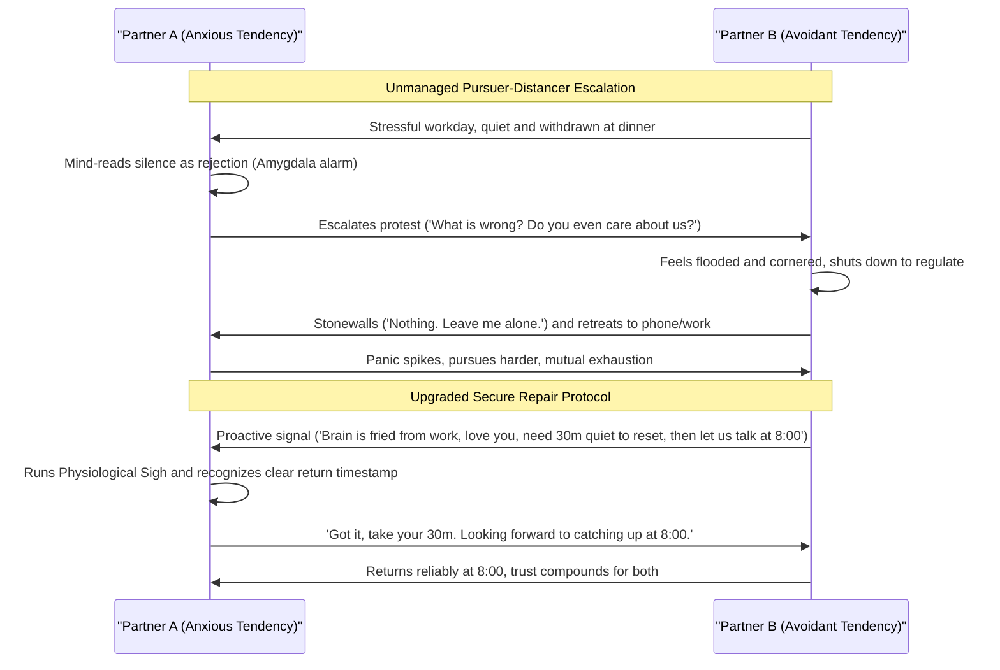
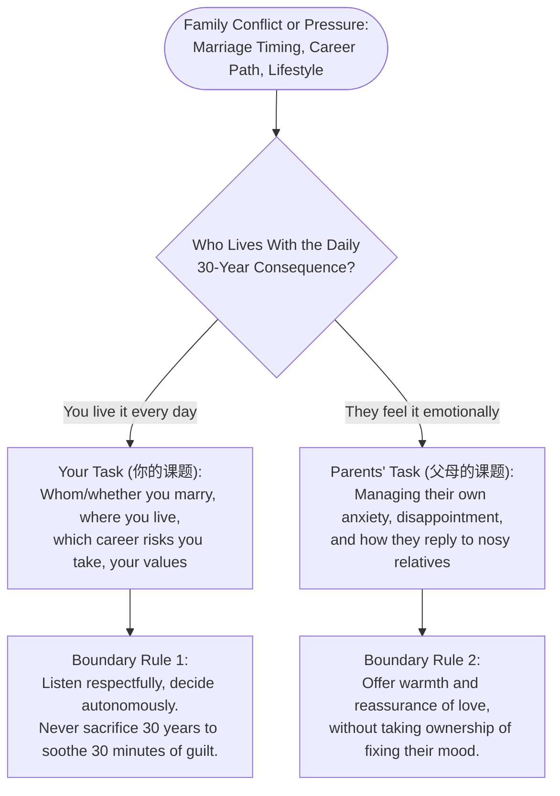

# Healthy Boundaries, Relationships, Family Dynamics & Adult Meaning

## 1. Why Relational Skill Is a Core Resilience Multiplier

The longest-running longitudinal study of adult human thriving in history—the **85-year Harvard Study of Adult Development** (directed by psychiatrist Robert Waldinger)—tracked hundreds of men from their twenties into their eighties and nineties. Its central finding was unmistakable: **the quality of your close, warm relationships in your thirties and forties is a stronger predictor of physical health, cognitive longevity, and life satisfaction at age 80 than social class, IQ, or baseline cholesterol.**

Yet relational skill is rarely taught with engineering clarity. Many 32-year-olds swing between two painful extremes:
- **Self-abandoning people-pleasing**: Swallowing resentment to keep peace with partners, bosses, or parents until emotional burnout explodes.
- **Defensive isolation**: Concluding *"relationships are too much drama"* and retreating behind screens and work, slowly starving for genuine human connection.

Healthy adult connection requires mastering three mechanics: **Attachment Awareness**, **Nonviolent Communication (NVC)**, and **Clean Boundaries (课题分离)**.

---

## 2. Adult Attachment Patterns: Understanding Relational Daemons

Pioneered by John Bowlby and Mary Ainsworth and applied to adult relationships by Hazan, Shaver, and Amir Levine (*Attached*), **Attachment Theory** explains how your nervous system automatically regulates closeness, conflict, and autonomy under stress.

Importantly, attachment styles are **plastic, not permanent DNA**—roughly 25–30% of adults shift toward **"Earned Security"** once they recognize their default patterns and choose secure partners and habits.

### The Four Adult Attachment Styles Matrix

| Attachment Style | Core Subconscious Premise | Primary Trigger | Default Stress Behavior | Path to Earned Security |
| :--- | :--- | :--- | :--- | :--- |
| **Secure (~50–55%)** | *"Closeness feels safe, and autonomy also feels safe. Conflict is solvable."* | Genuine mistreatment or prolonged neglect | States needs directly; listens without collapsing; repairs quickly after tension | Maintain honest communication; avoid rescuing partners who refuse accountability |
| **Anxious-Preoccupied (~20%)** | *"I care more than they do; if I don't stay hyper-vigilant, I'll be abandoned."* | Delayed texts, shift in tone, ambiguity, sudden distance | **Protest behaviors**: double-texting, testing, mind-reading, seeking constant reassurance | Self-soothe physiological spike *first* ([02-CBT-ACT-AND-STOIC-MENTAL-MODELS.md](02-CBT-ACT-AND-STOIC-MENTAL-MODELS.md)); ask directly instead of testing; keep rich independent hobbies |
| **Dismissive-Avoidant (~20%)** | *"Needing others makes me weak or trapped; only self-reliance is safe."* | Emotional demands, vulnerability, feeling criticized or "controlled" | **Deactivating strategies**: shutting down, stonewalling, burying in work, nitpicking flaws to justify distance | Notice shutdown impulse in body; ask for a *time-bounded* pause (*"Give me 30 min, then I'm coming back"*); practice naming 1 feeling |
| **Fearful-Avoidant / Disorganized (~5%)** | *"I deeply crave closeness, yet closeness feels dangerous."* | Both intimacy getting "too real" AND perceived rejection | Push-pull oscillation ("come here / go away"); high emotional turbulence | Trauma-informed therapy; slow-paced trust building; nervous system co-regulation |

### Breaking the Classic Anxious-Avoidant Trap (Pursuer-Distancer Loop)

In modern dating and marriages, Anxious and Avoidant nervous systems frequently attract each other—and then trigger each other's exact worst fears during conflict:



> **The Golden Rule of Time-Outs**: Taking space when flooded is healthy **only if you include a concrete return timestamp** (*"I need 25 minutes to cool down, and I promise I will come back to finish this at 8:30 PM"*). Walking away with zero return time feels like abandonment to the other person's nervous system; demanding instant resolution at peak anger feels like an ambush.

---

## 3. Nonviolent Communication (NVC): High-Clarity Conflict Protocol

Developed by clinical psychologist Marshall Rosenberg, **Nonviolent Communication (NVC)** is not about speaking in a fake, saccharine voice or letting people walk over you. It is a **high-signal, low-defensiveness communication protocol** that strips out moralistic blame so the actual problem can be solved.

Most arguments fail in the first 10 seconds because we use **"Jackal Language"**: global character labels (*"You're selfish"*), hyperbolic quantifiers (*"You NEVER listen / ALWAYS put work first"*), and disguised blame (*"I feel ignored"*). The moment someone hears a character indictment, their amygdala enters defense/counter-attack mode.

### The 4-Part OFNR Protocol

1. **O — Observation (Camera-Verifiable Data Only)**:
   - State *exact concrete events* a video camera with audio would record, stripped of adjectives or mind-reading.
   - *Bad*: *"You don't respect my time."* -> *Good*: *"For our last three dinners, you arrived 25 to 40 minutes after our agreed time without messaging."*
2. **F — Feeling (Clean Internal State, Not Pseudo-Feelings)**:
   - Own your actual emotion (*frustrated, anxious, tired, hurt, disappointed, overwhelmed*).
   - **Avoid Pseudo-Feelings**—words like *"unappreciated," "manipulated," "used,"* or *"disrespected"* are not feelings; they are **accusations about the other person's behavior** wearing an `"I feel..."` mask!
3. **N — Need (Universal Human Requirement Underneath)**:
   - Connect your feeling to the core value or need at stake (*predictability, mutual consideration, rest, partnership, psychological safety, autonomy*). Emotions arise from met or unmet needs, not magically out of thin air.
4. **R — Request (Concrete, Positive, Doable, Present Action)**:
   - Tell the person what *would* work—not vague abstractions (*"Be more supportive"*), and not pure negatives (*"Stop interrupting"*).
   - **Request vs. Demand Test**: A genuine request leaves room for negotiation (*"Would you be open to...?"*). If a `"No"` triggers punishment or guilt-tripping, you issued an ultimatum/demand, not a request.

### Real-World NVC Translation Table

| Context | Reactive Default Script (Triggers Fight/Shutdown) | NVC High-Signal Script (`O -> F -> N -> R`) |
| :--- | :--- | :--- |
| **Romantic Partner (Screen/Attention)** | *"You're addicted to your phone! You never actually spend real time with me anymore."* | *"When we sit down for dinner and our phones stay on the table buzzing (**O**), I feel lonely and disconnected (**F**) because quality presence together really matters to me after long workdays (**N**). Would you be up for both of us putting phones in the hallway for 45 minutes during dinner tonight (**R**)?"* |
| **Engineering Manager (Scope Creep)** | *"Product keeps dumping last-minute urgent tickets on me—nobody here plans properly!"* | *"When two P1 features were added to this sprint Wednesday without moving existing deadlines (**O**), I felt concerned (**F**) because I want to protect production reliability and sustainable delivery (**N**). Can we take 10 minutes right now to pick which current item moves to next sprint (**R**)?"* |
| **Close Friend (Repeated Canceling)** | *"Forget it, you always flake anyway."* | *"When plans get canceled an hour beforehand twice this month (**O**), I feel disappointed (**F**) because I value our friendship and carved out my Saturday for it (**N**). Next time if your week looks slammed, could you let me know by Thursday night so we can reschedule cleanly (**R**)?"* |

---

## 4. Family Dynamics & Adlerian Separation of Tasks (课题分离)

For many 32-year-old Chinese adults, the toughest boundary challenge is not a boss or stranger—it is **deeply loving parents** whose care comes bundled with intense anxiety, unsolicited life directives, marriage pressure (催婚), career risk-aversion ("考编/进大厂稳定"), or guilt-laden remarks (*"We only worry like this for your own good / 别人家孩子都结婚生子了"*).

Fighting back with rage leaves you flooded with filial guilt; surrendering your life choices breeds lifelong resentment. The cleanest psychological framework ever designed for this exact dilemma is Alfred Adler's **Separation of Tasks (课题分离)**, popularized across East Asia by Ichiro Kishimi (*The Courage to Be Disliked / 被讨厌的勇气*).

### How Separation of Tasks Works

Whenever guilt or interpersonal friction spikes, apply Adler's single diagnostic criterion:

> **Whose Task Is This?** Ask: *"Who ultimately bears the day-to-day, 30-year lived consequence of this choice?"*



### Key Insights for Chinese / East Asian Adult Children

1. **Filial Piety (孝) $\neq$ Total Obedience (顺)**:
   - Healthy adult care for aging parents means respecting them, staying connected, supporting their medical/physical security as they age, and sharing genuine warmth.
   - Handing two people born in the 1960s—whose mental model of society was forged in an era of scarcity and lifetime state units—the steering wheel for your 2027 career and marriage is **neither kind to you nor fair to them**.
2. **Stop Using JADE (`Justify, Argue, Defend, Explain`)**:
   - When you spend two hours trying to *convince* anxious parents that your unconventional career move, single status, or overseas travel plan is 100% risk-free, you implicitly accept the premise that **you need their sign-off to proceed**. And because their anxiety is emotional rather than analytical, more debate just creates bigger arguments.
3. **The "Warm Empathy + Calm Steel" 3-Step Script**:
   - **Step 1 — Validate the Loving Emotion Underneath** (Warmth): Acknowledge that their nagging comes from wanting you to be safe and cared for when they grow old.
   - **Step 2 — State Your Autonomous Position Concisely** (Steel, zero JADE): Calm, brief, non-defensive clarity.
   - **Step 3 — Redirect Topic or Enforce Time Boundary**: Pivot smoothly to health, food, or daily life; if berating continues after two calm warnings, end the call kindly (*"Mom, I love you, let's pause here while we're both getting tense—I'll call you Sunday"*).

#### Concrete Word-for-Word Example (Marriage / Life Pace Pressure)

- **Reactive Trap**: *"Stop bringing this up! You have no idea how exhausting dating and work are right now—stop comparing me to Cousin Li!"* *(Result: 2-hour shouting match + mutual heartbreak).*
- **Warm-Steel Script**: *"爸妈，我知道你们老提这事，是怕我以后一个人孤单、没人照应，这份心意我特别明白（Step 1: Empathy）。感情和人生节奏这件事，我有自己的标准和安排，遇到真正合适的人一定会第一时间告诉你们，但绝不会为了凑合去结婚（Step 2: Firm Separation of Tasks）。来，尝尝这道菜，最近你们体检指标怎么样？（Step 3: Clean Redirect）"*

---

## 5. Investing in 30s Friendships: Reversing the Drift

In school and your early twenties, friendships form effortlessly via **unplanned repeated proximity** (dormitories, late-night labs, shared apartments). After 30, proximity evaporates—people marry, move districts, change companies, or have toddlers. Without deliberate architecture, adult men especially wake up at 36 realizing they have 500 WeChat/LinkedIn contacts and **zero people they could call at 11 PM in a real crisis.**

### Proactive Friendship Maintenance System

| Circle Tier | Target Count | Optimal Cadence | Concrete High-ROI Format |
| :--- | :--- | :--- | :--- |
| **Tier 1: Inner Core ("2 AM Call")** | `2–4 people` | Every `2–4 weeks` | 1-on-1 hotpot/home-cooked meal, long walk, honest talk beyond surface career flexes |
| **Tier 2: Close Builders & Peers** | `8–12 people` | Every `6–10 weeks` | Recurring activity anchor (badminton/gym/hiking, coffee + tech/creator jam, weekend trip) |
| **Tier 3: Warm Extended Community** | `30–50 people` | Quarterly / Biannual | Thoughtful specific check-ins when something reminds you of them; small hosted dinners |

**Three Tactical Upgrades for Adult Friendships**:
1. **Accept Asymmetric Initiation Without Ego Scorekeeping**: Someone has to be the scheduler who picks a date and restaurant. Being the person who sends *"Hey, thinking of you—free Thursday 7 PM for skewers near Line 2?"* is a superpower, not needy behavior.
2. **Pair Shoulder-to-Shoulder Activity with Real Honesty**: Walking, cooking, driving, or shooting street video together lowers awkward eye-contact pressure and opens natural space to drop the "everything is great" mask.
3. **Celebrate Wins Generously**: How someone reacts to your *good* news (**Active-Constructive Responding**) predicts relationship health even better than how they react to bad news. Surround yourself with peers who genuinely cheer when you grow—and be that peer first.

---

## 6. Designing Adult Meaning & Rituals That Expand Subjective Time

Why did one summer at age 12 feel endless, while ages 29 to 32 vanished in the blink of an eye?

Neuroscientist David Eagleman proved that **subjective time duration is retrodictively measured by the density of novel autobiographical memories encoded in the hippocampus.** When you wake up, commute the same route, stare at the same IDE, order the same takeout (外卖), and scroll on the same sofa every week for 50 weeks, your brain deduplicates all 50 weeks into a single compressed file. Life feels short and hollow not because nothing happened, but because **nothing distinct was noticed or authored.**

### Viktor Frankl's Three Sources of Meaning (*Man's Search for Meaning*)

Psychiatrist Viktor Frankl argued that humans do not thrive on tensionless pleasure alone; we need **meaning**, built across three pillars:
1. **Creative Values (What You Give to the World)**: Mastering your engineering craft, cooking nourishing meals, shooting and editing honest personal vlogs/essays, building useful tools.
2. **Experiential Values (What You Receive Fully Present)**: Tasting wok-hei freshly off the stove, watching morning light in a foreign city, deep conversation, music, nature—experienced *without* multitasking.
3. **Attitudinal Values (Who You Choose to Be Under Constraint)**: Facing unavoidable setbacks, aging, or uncertainty with dignity, humor, and integrity ([03-NAVIGATING-30S-PRESSURE-WORK-AND-LIFE.md](03-NAVIGATING-30S-PRESSURE-WORK-AND-LIFE.md)).

### Architecture of a Rich, Memorable Ordinary Week

Install four lightweight temporal anchors so 2027 feels twice as vivid and grounded as previous years:

- **Daily Savoring Anchor (10 min)**: One intentional transition ritual marking the end of work—brewing tea/pour-over coffee, a sunset walk with a pocket camera, or cooking one dish mindfully from raw ingredients.
- **Weekly Analog / Creator Block (2–3 hrs)**: One weekend block dedicated to active creation or exploration rather than passive consumption—editing a short life vlog, exploring an unfamiliar neighborhood/market, or hosting two friends for home-cooked food.
- **Monthly Novelty Timestamp**: Do **one small new thing** every month (a hike you've never walked, a museum/film screening, cooking a regional Chinese dish you've never attempted, a weekend train trip). Novelty writes fresh timestamps into autobiographical memory.
- **Quarterly Life Review**: Once every 90 days, sit in a quiet cafe with a notebook (no work laptop), review photos/videos from the past three months, check alignment across health, craft, finances, and relationships, and choose **one clear theme** for the next 90 days.

---

## 7. High-Frequency Boundary Scripts & Red-Flag Anti-Patterns

Many engineers confuse **boundaries** with **ultimatums or walls**:
- A **Demand / Manipulation** tells *another person* what they are allowed to think or do (*"You must stop worrying about my marriage!"*). That violates their autonomy and always fails.
- A **True Boundary** states **what YOU will do** to protect your values and sanity if a line continues to be crossed (*"I love catching up with you, and if the conversation turns into criticizing my partner/career after I ask to pause, I will wrap up the call and talk next weekend"*). Boundaries require zero cooperation from the other party because you control your own feet and phone.

### Ready-to-Use Boundary Scripts Across Life Domains

| Scenario | People-Pleasing Collapse (Breeds Resentment) | Aggressive Counter-Attack (Burns Bridges) | Clean Adult Boundary (Warmth + Firmness) |
| :--- | :--- | :--- | :--- |
| **After-Hours Non-Urgent Work Pings** | Replying at 23:15 every night, then hating your team by Friday | Ignoring messages passive-aggressively and snapping in standup | *"Saw your message this morning! Outside on-call pages I unplug at 20:30 so I'm sharp at 09:30—taking a look at this PR right now."* |
| **Relative Asking Invasive Salary / Savings Questions** | Giving exact numbers awkwardly or lying defensively | *"None of your business!"* (awkward holiday explosion) | *(Warm smile)* *"够吃够喝，还在努力攒安全垫呢！您今年身体怎么样，退休以后去哪玩了？"* |
| **Friend Borrowing Significant Money** | Lending money you cannot afford to lose, ruining the friendship | Lecturing them about their financial habits | *"I have a personal rule never to mix loans with close friendships because our friendship means too much to me. I can't lend the sum, though I'm happy to help brainstorm options this weekend."* |
| **Partner / Date Pushing Past Your Pace** | Saying yes while feeling knotted in your stomach | Ghosting without explanation | *"I really enjoy spending time with you, and moving at a steady pace helps me build real trust. Let's take our time getting to know each other."* |

### Four Relational Failure Modes to Catch Early

1. **Keeping Covert Contracts**: Secretly doing favors expecting unspoken reciprocation, then exploding when the other person fails to read your mind. *Fix*: Convert covert contracts into explicit NVC requests.
2. **Confusing Intensity With Intimacy**: High-drama emotional rollercoasters in early dating often reflect anxious-avoidant nervous system activation, not deep compatibility. Healthy secure love often feels *calm, consistent, and safe*—do not mistake peace for "lack of chemistry."
3. **Performing Life Instead of Experiencing It**: When shooting photos or vlogs of meals, travel, or friends, capture 15 seconds intentionally, then put the camera away and be 100% present. Documenting life should deepen memory, never turn ordinary moments into unpaid social-media labor.
4. **Postponing Joy Until an Arbitrary Net-Worth Milestone**: *"Once I hit X million or Staff level, THEN I'll start enjoying dinners, traveling, and caring for myself."* Hedonic adaptation guarantees the goalpost will move the day you arrive. Build the capacity to savor Tuesday evening right now at 32.

### Sample 168-Hour Balanced Week Blueprint for a 32yo Builder

Meaning is not found in abstract philosophy; it lives on your calendar. Here is how relational warmth, personal craft, and savoring fit realistically alongside a demanding engineering job:

```markdown
## Sustainable Rich-Week Blueprint (No Heroic Burnout Required)
- **Mon–Fri Mornings (07:30–08:45)**: Sunlight + hydration + 45m deep personal skill/AI block before work noise starts.
- **Tue & Thu Evenings (19:00–20:30)**: Strength/cardio training + mindful home-cooked Chinese dinner (phone away while eating).
- **Wed Evening (19:30–21:00)**: 1-on-1 meal or walk with a Tier-1/Tier-2 friend OR uninterrupted partner date night.
- **Saturday Daytime**: Explore one neighborhood/park/market with Osmo Pocket 3 or iPhone; capture 5–8 honest clips without over-staging.
- **Sunday Afternoon (15:00–17:30)**: Edit a short personal memory/vlog, call parents warmly (with calm 25m boundary), prep clean ingredients, and run 20m Weekly System Review.
```

---

## Complete Curriculum Cross-Reference

- **[00-README.md](00-README.md)** — Five-Layer Mental OS, Emotional Granularity, Antifragility & Realistic Optimism
- **[01-HOW-EMOTIONS-STRESS-AND-ANXIETY-WORK.md](01-HOW-EMOTIONS-STRESS-AND-ANXIETY-WORK.md)** — Amygdala vs. PFC, Uncertainty Rumination, 14-Day Dopamine Reset & Burnout Differential
- **[02-CBT-ACT-AND-STOIC-MENTAL-MODELS.md](02-CBT-ACT-AND-STOIC-MENTAL-MODELS.md)** — 60s Physiological Sigh, 10 CBT Distortions, ACT Defusion & Stoic Fear-Setting
- **[03-NAVIGATING-30S-PRESSURE-WORK-AND-LIFE.md](03-NAVIGATING-30S-PRESSURE-WORK-AND-LIFE.md)** — Deconstructing 35yo Peer Pressure, Identity Decoupling, Setback Recovery & Self-Trust
