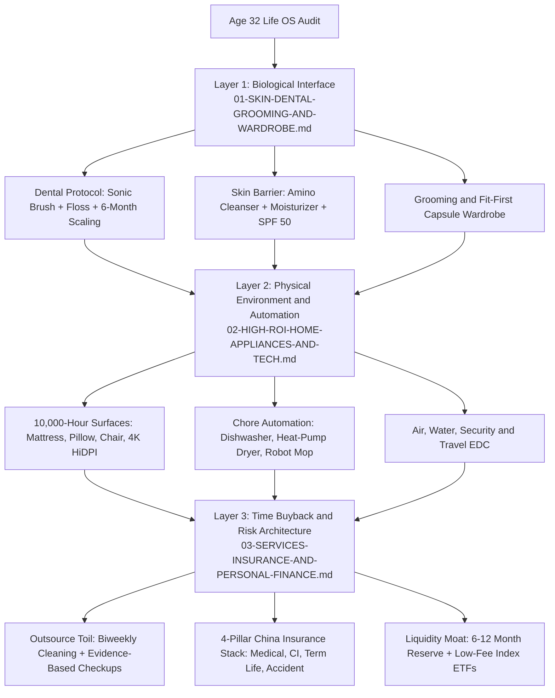
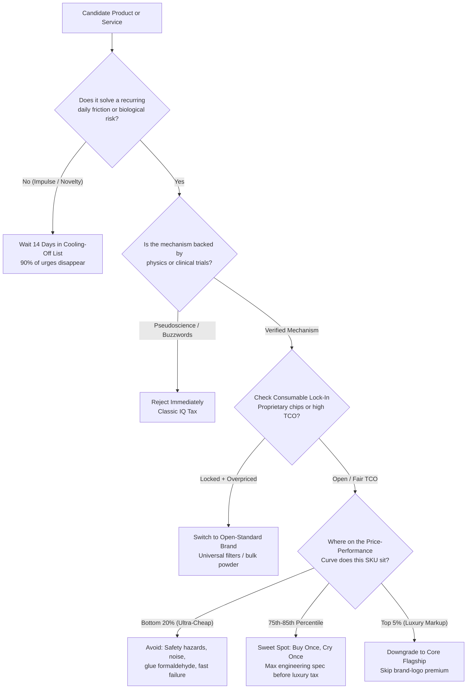

# Self-Care & High-ROI Life Upgrades at 32

Turning 32 as a software engineer marks an unmistakable structural transition. Throughout your twenties, biological resilience masks poor ergonomics, erratic sleep, harsh face washes, skipped dental cleanings, cheap mattresses, and neglected financial risk architecture. Past 30, subtle biological compounding reverses direction if left unmanaged: dermal collagen synthesis declines by roughly 1% per year, intervertebral discs lose hydration under eight-plus hours of daily sitting, uncleaned subgingival plaque calcifies into irreversible bone-resorbing tartar, and cognitive bandwidth gets quietly drained by repetitive domestic chores.

Just as Staff-level engineering relies on eliminating toil, automating recurring operations, and hardening single points of failure, upgrading your personal life at 32 is an exercise in **systems architecture for your body, living environment, time, and downside risk**. Rather than chasing luxury status symbols or falling for viral consumer "IQ taxes" (智商税), this guide applies first-principles physics, clinical evidence, and Total Cost of Ownership (TCO) math to where you actually live your life.

---

## Curriculum Map & Table of Contents

| Module | File | Primary Focus | Key Outcomes |
| :--- | :--- | :--- | :--- |
| **00** | **Overview & Mental Models** (Current File) | 10,000-Hour Surface Rule, Cost-Per-Hour ROI math, Anti-IQ-Tax triage, 90-day rollout | Rational capital allocation framework for health, home, and time |
| **01** | [01-SKIN-DENTAL-GROOMING-AND-WARDROBE.md](01-SKIN-DENTAL-GROOMING-AND-WARDROBE.md) | Evidence-based skincare (C-M-S + Retinol), 4-part dental defense, neat grooming, smart-casual capsule wardrobe | Healthy skin barrier, zero preventable root canals, effortless sharp appearance |
| **02** | [02-HIGH-ROI-HOME-APPLIANCES-AND-TECH.md](02-HIGH-ROI-HOME-APPLIANCES-AND-TECH.md) | Engineering spec matrices vs marketing traps across 10 home & desk categories | Automated dish/floor/laundry chores, pain-free 4K workstation, restorative sleep |
| **03** | [03-SERVICES-INSURANCE-AND-PERSONAL-FINANCE.md](03-SERVICES-INSURANCE-AND-PERSONAL-FINANCE.md) | Paid time-buyback services, China 4-pillar adult insurance stack, 4-bucket personal finance | Reclaimed weekends, catastrophic medical/income protection, stress-free compounding |

### Learning & Execution Path

---

## Core Mental Model 1: The 10,000-Hour Surface Rule

Most people spend money backwards. They agonize over a CNY 4,000 ergonomic chair or a CNY 6,000 supportive mattress that supports their spine for 2,800 hours every single year, yet impulsively spend CNY 8,000 on novelty gadgets, unused gym memberships, or trendy outerwear worn six times a season.

Over a five-year horizon (43,800 total hours), a software engineer's physical contact time distributes predictably across five primary interfaces:

| Physical Interface | Daily Contact | 5-Year Contact Hours | Failure Consequence if Neglected | Optimal Capital Priority |
| :--- | :--- | :--- | :--- | :--- |
| **Sleep System** (Mattress, Pillow, Bedding, Bedroom Air) | ~7.5 - 8.0 hrs | ~14,000 hrs | Cervical spondylosis, L4-L5 disc bulging, fragmented deep sleep, daytime brain fog | **Tier 0 (Non-Negotiable)** |
| **Workstation** (Chair, Standing Desk, 4K Monitor, Lighting) | ~8.0 - 10.0 hrs | ~16,000 hrs | Trapezius strain, carpal tunnel, dry eye / asthenopia, chronic lumbar fatigue | **Tier 0 (Non-Negotiable)** |
| **Biological Envelope** (Teeth, Skin Barrier, Eyes, Scalp) | 24.0 hrs | 43,800 hrs | Periodontal bone loss, CNY 15,000 implants, photoaging, chronic dermatitis | **Tier 0 (Habit + Modest Spend)** |
| **Footwear & Base Fabrics** (Walking Shoes, Socks, Base Tees) | ~10.0 - 14.0 hrs | ~20,000 hrs | Plantar fasciitis, knee joint wear, skin chafing, sloppy silhouette | **Tier 1 (High Comfort ROI)** |
| **Chore Engines** (Dishwasher, Washer/Dryer, Robot Vacuum, RO Water) | Saves ~1.5 hrs/day | Reclaims ~2,700 hrs | Lost evenings, domestic resentment, wet laundry clutter, scaling kettles | **Tier 1 (High Time ROI)** |

**The Allocation Principle**: Spend aggressively up to the point of genuine biomechanical and engineering excellence on anything separating you from the ground (mattress, chair, shoes), anything interfacing directly with your nervous system (monitor, lighting, acoustic ANC), and anything protecting irreversible tissue (teeth, skin, lungs). Cut ruthlessly on brand-logo markups and low-frequency status goods.

---

## Core Mental Model 2: Quantitative ROI of Purchases

To strip emotion and marketing hype out of purchasing decisions, evaluate every candidate upgrade above CNY 500 through two quantitative lenses: **Amortized Cost Per Hour (CPH)** and **Effective Time-Buyback Yield**.

### 1. Total Cost of Ownership (TCO) & Cost Per Hour

Never evaluate sticker price alone. Many appliances follow the "printer-and-ink" trap—cheap hardware paired with locked, overpriced consumables. Compute true Total Cost of Ownership over the expected lifespan $N$ (in years):

$$\text{TCO}_N = C_{\text{upfront}} + \sum_{t=1}^{N} \left( C_{\text{consumables}, t} + C_{\text{energy}, t} + C_{\text{maintenance}, t} \right) - V_{\text{resale}, N}$$

Divide $\text{TCO}_N$ by total active usage hours $H_{\text{total}} = 365 \times N \times h_{\text{daily}}$:

$$\text{CPH} = \frac{\text{TCO}_N}{365 \times N \times h_{\text{daily}}}$$

**Concrete Example**:
- **Ergonomic Chair + 27-inch 4K HiDPI Monitor**: Upfront CNY 6,500, zero consumables, 6-year lifespan, 8.5 hours/day:
  $$\text{CPH} = \frac{6500}{365 \times 6 \times 8.5} \approx \text{CNY } 0.35 \text{ per hour}$$
- **15-Set Auto-Open Dishwasher**: Upfront CNY 4,800, dish powder + rinse aid + salt ~CNY 220/yr, water/electricity ~CNY 180/yr, 8-year lifespan. Total $\text{TCO}_8 = 4800 + 8 \times 400 = \text{CNY } 8,000$, or **CNY 2.74 per day** to eliminate 30–45 minutes of greasy dishwashing every evening and sanitize tableware at 70 deg C.

### 2. Net Time-Buyback Valuation

As an experienced software engineer, your scarcest resource is **unfragmented cognitive energy**, not raw clock minutes. Washing dishes, scrubbing bathroom tiles, or hanging 30 pieces of wet laundry does not just take 60 minutes; it fragments an entire evening recovery window.

Define your baseline post-tax hourly value $W_{\text{net}}$:

$$W_{\text{net}} = \frac{\text{Annual Post-Tax Cash + Liquid Equity}}{\text{Annual Working Hours (approx. 2,000)}}$$

If your post-tax compensation is CNY 500,000/year, $W_{\text{net}} = \text{CNY } 250/\text{hr}$. Any product or service whose amortized cost per saved hour $C_{\text{saved-hr}}$ satisfies:

$$C_{\text{saved-hr}} = \frac{\Delta \text{Cost}_{\text{annual}}}{\Delta \text{Hours Saved}_{\text{annual}}} \le 0.4 \times W_{\text{net}}$$

is an immediate, mathematically positive buyback—provided you reinvest the reclaimed time into sleep, exercise, deep learning, cooking, creative hobbies, or genuine rest rather than doomscrolling.

---

## Core Mental Model 3: Anti-IQ-Tax (反智商税) Triage Filter

Modern consumer marketing in China and globally preys on anxiety and pseudo-scientific buzzwords ("negative ions", "graphene heating", "quantum resonance", "small-molecule alkaline water", "stem-cell exosomes", "AI posture correction"). Use this engineering decision tree before paying for any health or home product.

### The S-Curve Sweet Spot (75th–85th Percentile Rule)

In almost every consumer hardware and personal care category, quality vs. price follows an S-curve:
1. **Bottom 0–20% (Hazard Zone)**: Off-brand electric toothbrushes that tear gums, CNY 300 "ergonomic" chairs with uncertified gas lifts, cheap coconut mattresses bonded with urea-formaldehyde glue, non-certified chargers with poor ripple control. Never buy here.
2. **Middle 75th–85th Percentile (Engineering Sweet Spot)**: Where top industrial supply chains converge—DuPont RO membranes, BLDC inverter motors, Tinosorb UV filters, TUV Class-4 gas lifts, Goodyear welt or Vibram soles, 100% Supima cotton. You get 95–98% of theoretical peak performance at 25–40% of luxury pricing.
3. **Top 95–100% (Veblen / Luxury Zone)**: CNY 3,500 la-mer-style face creams whose base is mineral oil and glycerin, CNY 18,000 designer cotton T-shirts with giant logos, imported appliances charging 300% markup for identical OEM compressors. Only spend here for conscious emotional art value, never expecting functional superiority.

---

## Biological & Lifestyle Inflection Checklist at 32

Why does age 32 specifically demand a structured operating system rather than ad-hoc fixes?

| Domain | What Changed vs Age 22 | Silent Failure Mode | High-Leverage Intervention |
| :--- | :--- | :--- | :--- |
| **Oral Health** | 10+ years of subgingival tartar accumulation; impacted wisdom teeth crowd 2nd molars | Painless chronic periodontitis silently erodes alveolar bone until teeth loosen at 40 | Sonic brush + nightly string floss + biannual ultrasonic scaling ([Module 01](01-SKIN-DENTAL-GROOMING-AND-WARDROBE.md)) |
| **Skin & Hair** | Cumulative UV elastosis shows as fine lines/sunspots; androgenetic hairline shifts begin early | Harsh alkaline soap strips barrier -> oil rebound; ignoring early follicular miniaturization | Amino cleanser + ceramide lotion + daily PA++++ SPF; early dermatologist consult if thinning ([Module 01](01-SKIN-DENTAL-GROOMING-AND-WARDROBE.md)) |
| **Musculoskeletal** | Core stabilizing muscles weaken from 20,000 hrs coding; disc hydration drops | Acute lumbar herniation when bending over; chronic neck tension headaches | Zoned pocket-coil mattress + dynamic lumbar chair + 4K eye-level arm + 20-8-2 movement ([Module 02](02-HIGH-ROI-HOME-APPLIANCES-AND-TECH.md)) |
| **Domestic Bandwidth** | Higher work responsibility leaves zero patience for repetitive nightly housework | Dirty sink -> ordering greasy takeout -> metabolic decline + cluttered apartment stress | 15-set dishwasher + heat-pump dryer + plumbed robot mop + biweekly cleaner ([Module 02](02-HIGH-ROI-HOME-APPLIANCES-AND-TECH.md), [Module 03](03-SERVICES-INSURANCE-AND-PERSONAL-FINANCE.md)) |
| **Health Underwriting** | Checkup anomalies (fatty liver, thyroid/lung nodules, uric acid, elevated lipids) start appearing | Getting diagnosed with nodules/hypertension *before* buying medical/CI insurance -> exclusions or rejection | Lock in 20-yr guaranteed medical + CI insurance while clean; run LDCT/GI screening ([Module 03](03-SERVICES-INSURANCE-AND-PERSONAL-FINANCE.md)) |
| **Career Cashflow** | Peak mid-career compensation paired with tech industry volatility ("35-year threshold") | Lifestyle creep + illiquid assets or high-fee bundled insurance -> anxiety during job transitions | 6–12 month liquid emergency buffer + low-cost diversified ETF allocation ([Module 03](03-SERVICES-INSURANCE-AND-PERSONAL-FINANCE.md)) |

---

## Phased 90-Day Implementation Roadmap

Attempting to overhaul your bathroom, wardrobe, apartment appliances, and insurance portfolio in a single weekend leads to decision fatigue and impulsive mistakes. Execute upgrades in four deliberate sprints:

### Sprint 1 (Days 1–14): Zero-CapEx Biological Baseline
- **Dental**: Book a comprehensive dental exam + panoramic X-ray + ultrasonic scaling at a public stomatology hospital or reputable clinic. Order PTFE flat dental floss and a sonic toothbrush with a pressure sensor. Commit to nightly flossing before brushing.
- **Skincare**: Throw away harsh alkaline/scrub cleansers and expired open bottles. Establish the 3-minute AM/PM baseline: gentle amino-acid cleanser, barrier moisturizer, and broad-spectrum SPF 50 PA++++ sunscreen every morning with UV Index >= 3.
- **Grooming**: Standardize a 3.5-week haircut calendar reminder; set up a Sunday night 5-minute nail + nose-hair + eyebrow check.

### Sprint 2 (Days 15–30): Risk Lock-In Before Optional Checkups
- **Insurance Audit**: Review your existing social medical insurance (`医保`) status and any commercial policies (watch for expensive low-coverage bundled policies).
- **Underwriting First**: While your medical record is clean (before scheduling non-urgent elective screenings—never conceal *known* conditions, always answer health questionnaires truthfully under the Finite Inquiry Principle), configure the 4-Pillar Defense Stack: 20-year guaranteed renewal Million-CNY Medical Insurance, CNY 500k+ Consumption Critical Illness Insurance, Comprehensive Accident Insurance, and Term Life Insurance (if carrying mortgage/family obligations).
- **Emergency Buffer**: Segregate 6–12 months of core living expenses into a dedicated, liquid cash-management account separate from daily spending cards.

### Sprint 3 (Days 31–60): 10,000-Hour Workstation & Sleep Remediation
- **Desk Geometry**: Raise your primary 27-inch 4K HiDPI display on a VESA monitor arm so the top third of the screen sits at eye level. Add an asymmetric optical screen bar (Ra >= 95). Adjust chair seat depth and armrest height so shoulders hang relaxed at 90 degrees.
- **Sleep Audit**: Evaluate waking neck/lower-back stiffness. Replace collapsed high-loft pillows with a cervical-height pillow matched to your shoulder width; ensure bedroom humidity stays at 45–55% RH and pitch-dark.
- **Wardrobe Prune**: Remove stretched necklines, pilling synthetics, ill-fitting trousers, and worn-out shoes. Rebuild around 12–15 well-fitted, natural-fiber smart-casual essentials.

### Sprint 4 (Days 61–90): Chore Automation & Time Buyback
- **Appliance CapEx**: Measure water supply, drainage, cabinetry, and 10A/16A circuits. Deploy high-ROI chore engines in priority order: plumbed auto-washing robot vacuum/mop -> 14+ set auto-open dishwasher -> heat-pump dryer -> 800G+ zero-stale-water RO purifier.
- **Service Cadence**: Book a recurring biweekly 3–4 hour home cleaner with a standardized zone checklist. Schedule your evidence-based annual health screening (once insurance waiting periods of 30–90 days have cleared).
- **Digital Resilience**: Verify your 3-2-1 backup pipeline (Laptop -> NAS/SSD -> Encrypted Cloud) and password manager recovery kit.

---

## Recurring Life Maintenance Cadence Matrix

Systems decay without scheduled cron jobs. Put these recurring intervals into your calendar app so willpower is never required:

| Cadence | Maintenance Task | Target Duration | Module Reference |
| :--- | :--- | :--- | :--- |
| **Daily (AM)** | Rinse face, barrier moisturizer (if dry), SPF 50 sunscreen; 2-min sonic brush | 4 mins | [Module 01](01-SKIN-DENTAL-GROOMING-AND-WARDROBE.md) |
| **Daily (PM)** | String floss + water flosser + 2-min fluoride brush (spit, don't rinse); cleanser + moisturizer (+ retinol 3x–5x/wk) | 7 mins | [Module 01](01-SKIN-DENTAL-GROOMING-AND-WARDROBE.md) |
| **Weekly (Sun)** | Trim nails + nose hair; launder bedding/towels at 60 deg C or heat-pump dry; empty dryer lint trap & check robot mop tray | 25 mins | [Module 01](01-SKIN-DENTAL-GROOMING-AND-WARDROBE.md), [Module 02](02-HIGH-ROI-HOME-APPLIANCES-AND-TECH.md) |
| **Every 3–4 Wks** | Barber haircut; refill dishwasher rinse aid/salt; descale kettle/coffee machine if needed; biweekly professional cleaning | Automated / Scheduled | [Module 01](01-SKIN-DENTAL-GROOMING-AND-WARDROBE.md), [Module 03](03-SERVICES-INSURANCE-AND-PERSONAL-FINANCE.md) |
| **Every 3 Months** | Replace sonic toothbrush head; clean dishwasher filter mesh & run machine-care hot cycle; wash air-conditioner pre-filters | 20 mins | [Module 01](01-SKIN-DENTAL-GROOMING-AND-WARDROBE.md), [Module 02](02-HIGH-ROI-HOME-APPLIANCES-AND-TECH.md) |
| **Every 6 Months** | Ultrasonic dental scaling (`洗牙`) + caries check; replace composite PCB water filter; rotate mattress 180 degrees | Half-day Saturday | [Module 01](01-SKIN-DENTAL-GROOMING-AND-WARDROBE.md), [Module 02](02-HIGH-ROI-HOME-APPLIANCES-AND-TECH.md) |
| **Annually** | Evidence-based medical checkup; replace HEPA air purifier filter; audit 4-pillar insurance beneficiaries & rebalance ETF portfolio; test backup restore | 1 day / year | [Module 02](02-HIGH-ROI-HOME-APPLIANCES-AND-TECH.md), [Module 03](03-SERVICES-INSURANCE-AND-PERSONAL-FINANCE.md) |
