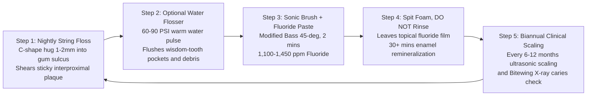

# Evidence-Based Skincare, Dental Care, Grooming & Clean Wardrobe

At 32, personal presentation and biological maintenance are no longer about vanity—they are preventative engineering for organs you cannot easily replace (enamel, alveolar bone, dermal collagen, hair follicles) and high-leverage social signaling in senior technical roles. This module strips away beauty-industry pseudoscience and fast-fashion clutter, replacing them with clinical dermatology, preventive dentistry, five-minute grooming checklists, and fabric-first wardrobe rules.

> **Navigation**: Return to [00-README.md](00-README.md) | Next: [02-HIGH-ROI-HOME-APPLIANCES-AND-TECH.md](02-HIGH-ROI-HOME-APPLIANCES-AND-TECH.md) | Services & Finance: [03-SERVICES-INSURANCE-AND-PERSONAL-FINANCE.md](03-SERVICES-INSURANCE-AND-PERSONAL-FINANCE.md)

---

## 1. Evidence-Based Skincare Protocol (科学精简护肤)

### Skin Physiology & The 80% Photoaging Reality

Your outermost skin layer, the **stratum corneum** (角质层), functions as a microscopic brick-and-mortar wall: flattened dead keratinocyte "bricks" embedded in an intercellular lipid "mortar" composed of roughly **50% ceramides, 25% cholesterol, and 15% free fatty acids** at a slightly acidic pH of 4.7 to 5.5.

Two mechanisms drive nearly all preventable skin degradation in your thirties:
1. **Barrier Stripping**: Washing with alkaline soap-base cleansers, hot shower water, or daily sheet masks disrupts the lipid mortar, triggering trans-epidermal water loss (TEWL), reactive sebum overproduction ("oily outside, tight inside" 外油内干), redness, and sensitivity.
2. **Photoaging (光老化)**: Up to **80% of visible facial aging**—coarse wrinkles, leathery texture, enlarged-looking pores from perifollicular collagen loss, and uneven pigmentation—is caused by ultraviolet radiation rather than chronological age. Crucially, while UVB (280–320 nm) peaks in summer and causes sunburn, **UVA (320–400 nm) maintains high intensity year-round, penetrates clouds and standard office/car window glass**, and reaches the deep dermis to upregulate matrix metalloproteinases (MMPs) that shred collagen.

### 60-Minute Bare-Face Skin Type Diagnostic

Before buying products, wash your face once in the evening with a gentle amino-acid cleanser, pat dry with a clean paper towel, apply **nothing**, and inspect your skin in a mirror after 60 minutes in a normal room (20–24 deg C):

| Observation at 60 Minutes | Skin Classification | Core Formulation Strategy |
| :--- | :--- | :--- |
| Tight, flaky, zero shine anywhere | **Dry (干性)** | AM water-only rinse; ceramide + squalane cream; moisturizing chemical/hybrid SPF |
| Visible shine on forehead, nose, AND cheeks | **Oily (油性)** | AM/PM amino cleanser; lightweight oil-free gel-lotion (niacinamide/B5); matte fluid SPF; BHA 2x/wk |
| Shine on forehead/nose (T-zone), normal/dry cheeks (U-zone) | **Combination (混合性)** | Zone-specific care: lightweight lotion overall, thicker cream on cheeks in winter, BHA on T-zone only |
| Comfortable, neither tight nor shiny | **Normal (中性)** | Minimalist C-M-S baseline; light lotion + daily SPF + low-dose PM retinol |
| Frequent stinging, flushing, visible capillaries | **Sensitive / Barrier-Impaired (敏感肌)** | Zero fragrance/alcohol/essential oils; pause all acids/retinoids; ceramide + panthenol repair only |

### Morning & Evening Clinical Routine Architecture

```mermaid
flowchart TD
    subgraph AM["Morning Routine (3 Minutes - Protection)"]
        AM1["Cleanse: Lukewarm Water Only (Dry/Normal)<br/>or Gentle Amino Cleanser (Oily)"] --> AM2{"Optional Antioxidant?"}
        AM2 -->|"Experienced User"| AM2A["10-15% L-Ascorbic Acid (Vitamin C)<br/>or 2-5% Niacinamide Serum"]
        AM2 -->|"Minimalist Baseline"| AM3["Moisturizer: Lightweight Barrier Lotion<br/>(Skip in humid summer if sunscreen is moisturizing)"]
        AM2A --> AM3
        AM3 --> AM4{"Daily UV Index 3+<br/>or Sitting Near Window?"}
        AM4 -->|"Yes"| AM5["Broad-Spectrum Sunscreen<br/>SPF 30-50+, PA++++ (Coin-Sized ~1g, Wait 3 Min)"]
        AM4 -->|"No (Indoors / Night)"| DoneAM["Ready for Day"]
        AM5 --> DoneAM
    end

    subgraph PM["Evening Routine (4 Minutes - Repair and Renewal)"]
        PM1["Cleanse: Gentle Amino-Acid Cleanser<br/>(30s lukewarm massage, cleanses non-waterproof SPF)"] --> PM2{"Active Night? (Only After 4 Wks Stable Barrier)"}
        PM2 -->|"Mon / Wed / Fri"| PM3A["Pea-Sized Retinol (0.1%-0.3%)<br/>on completely dry skin"]
        PM2 -->|"Tue or Sat (Oily T-Zone)"| PM3B["1-2% Salicylic Acid (BHA)<br/>targeted on nose and forehead"]
        PM2 -->|"Recovery Nights"| PM4["Barrier Moisturizer<br/>(Ceramides + Squalane + Panthenol B5)"]
        PM3A --> PM4
        PM3B --> PM4
    end
```

### Decoding the Core Three (C-M-S) Ingredients

1. **Gentle Cleanser (氨基酸洁面)**:
   - **Look for on INCI label**: `Sodium Cocoyl Glycinate` (椰油酰甘氨酸钠), `Potassium Cocoyl Glutamate` (椰油酰谷氨酸钾), `Sodium Lauroyl Glutamate` (月桂酰谷氨酸钠), or `Sodium Methyl Cocoyl Taurate` paired with `Cocamidopropyl Betaine` or `Decyl Glucoside` (APG).
   - **Avoid daily**: Soap-base formulas listing `Myristic Acid` (肉豆蔻酸) + `Lauric Acid` (月桂酸) + `Potassium Hydroxide` (氢氧化钾) in the top five ingredients, as well as `Sodium Lauryl Sulfate` (SLS) and physical walnut/apricot scrubs.
2. **Barrier Moisturizer (保湿修护乳/霜)**:
   - **Look for**: Physiological lipids (`Ceramide NP/AP/EOP` + `Cholesterol` + `Phytosphingosine`), `Squalane` (角鲨烷), `Panthenol` (维生素B5), `Niacinamide` (烟酰胺 2–5%, regulates sebum and strengthens barrier), `Glycerin`, and `Ectoin` (依克多因).
   - **Budget reality**: A well-formulated CNY 80–220 dermatological moisturizer (e.g., CeraVe PM/Lotion, La Roche-Posay B5/Toleriane, Winona, Curel, Vanicream) delivers 100% of the barrier science of a CNY 2,500 luxury jar.
3. **Broad-Spectrum Sunscreen (广谱防晒)**:
   - **Specs**: Commuting requires `SPF 30–50, PA+++` or `PA++++`; outdoor hiking/beach requires water-resistant `SPF 50+, PA++++`.
   - **Dosage math**: SPF lab testing uses $\sigma = 2.0\text{ mg/cm}^2$. An adult male face + ears measures roughly $400\text{--}450\text{ cm}^2$, requiring **0.8 to 1.0 grams** (a full 1-RMB coin puddle or two full finger-lengths). Applying half the dose drops effective protection exponentially, not linearly.
   - **Application rule**: Dot evenly across forehead, cheeks, nose, chin, and neck; spread gently in one direction rather than rubbing back and forth like lotion, then wait 3–5 minutes for the polymer film to set.

### Introducing Active Ingredients Safely (`早C晚A` & Acids)

Never introduce actives until your C-M-S baseline has run smoothly for 4 weeks with zero stinging. Introduce **one active at a time**:

| Active Ingredient | Primary Mechanism | Starting Concentration | Safe Ramp Protocol | Critical Contraindications |
| :--- | :--- | :--- | :--- | :--- |
| **Retinol (视黄醇)** / **Adapalene 0.1%** | Binds nuclear RAR receptors; accelerates cell turnover, stimulates dermal collagen, shrinks sebaceous activity | 0.1% Retinol (cosmetic) or 0.1% Adapalene (for comedonal acne) | Wk 1–2: Every 3rd night using **Sandwich Method** (thin moisturizer -> pea-sized retinol -> moisturizer). Wk 3–4: Every other night. Wk 5+: Nightly as tolerated | **PM only** (photolabile); strict AM SPF; never combine on same night with AHA/BHA; contraindicated in pregnancy |
| **Salicylic Acid (水杨酸 BHA)** | Lipophilic beta-hydroxy acid; penetrates sebum-filled pores to dissolve keratin/oil plugs and reduce inflammation | 0.5% – 2.0% leave-on pad/serum | 1x–2x per week at night on oily T-zone or blackhead-prone nose; never on dry cheeks | Avoid stacking with Retinol or Vitamin C in the same session; stop if skin flakes excessively |
| **Azelaic Acid (壬二酸)** | Inhibits *C. acnes*, normalizes follicular keratinization, blocks tyrosinase in hyperactive melanocytes | 10% – 15% gel/suspension | Pea-sized amount spot-applied or thin layer PM (transient 10-min itching is normal initially) | Excellent gentle alternative for rosacea, red/brown post-acne marks (`痘印`) |
| **Vitamin C (原型VC)** | Scavenges UV-induced reactive oxygen species (ROS), co-factor for collagen synthesis, inhibits melanin | 10% – 15% L-Ascorbic Acid + Vit E + Ferulic Acid | 3–4 drops in AM on dry skin before moisturizer and sunscreen; store cool/dark; discard if oxidized dark orange | Low pH (~3.0) can sting compromised barriers—use 3-O-Ethyl Ascorbic Acid or Ascorbyl Glucoside if sensitive |

### Skincare IQ-Tax Traps to Reject
- **Daily Sheet Masks (天天敷面膜)**: Soaking skin for 20 minutes daily causes corneocyte swelling and lipid disruption (**overhydration / maceration 水合过度**), leading to contact dermatitis and acne flares. Limit hydrating masks to post-sun or occasional pre-event use (<= 1x/week).
- **Tear-Off Pore Strips (撕拉鼻贴)**: Mechanically rips sebaceous filaments AND healthy stratum corneum off the nose without changing oil production; pores refill within 48 hours and stretch wider over time. Use 2% BHA + mineral oil/cleansing oil gentle massage instead.
- **"Pore-Shrinking" Toners & Ice Rubbing**: Pores have no arrector pili muscle around their opening—they cannot "open and close" with hot/cold water. Apparent pore size depends on sebum output (controlled by niacinamide/BHA/retinoids) and dermal collagen elasticity (protected by SPF + retinoids).

---

## 2. Complete Clinical Dental Protocol (全周期口腔防御体系)

Dental neglect is one of the highest negative-ROI mistakes a thirty-something adult can make. Tooth enamel has **zero living cells and cannot regenerate** once cavitated, and alveolar bone lost to chronic periodontitis never grows back naturally.

### The Dental Cost Escalation Curve

| Stage | Pathology | Clinical Symptom | Approximate Cost in China (Per Tooth) | Time & Pain Cost |
| :--- | :--- | :--- | :--- | :--- |
| **0. Prevention** | Unmineralized plaque biofilm | None | **CNY 400 – 800 / year** (Floss + Heads + 2x Scaling) | 4 mins/day + 2x 45-min visits/yr |
| **1. Shallow/Mid Caries** | Enamel / outer dentin demineralization | None, or mild cold/sweet twinge | **CNY 300 – 800** (3M Z350/P60 composite resin filling) | Single 30-min painless visit |
| **2. Pulpitis** | Bacterial invasion of pulp nerve | Spontaneous throbbing night pain | **CNY 4,000 – 8,000** (Microscopic Root Canal + All-Ceramic Crown) | 3–4 visits over 1 month |
| **3. Extraction & Loss** | Root fracture or severe periodontitis | Loose tooth, abscess, inability to chew | **CNY 8,000 – 18,000** (Titanium Implant + Abutment + Crown; even post-VBP集采) | 3–6 months surgical osseointegration |

### Daily Biofilm Physics & 4-Part Defense Loop

Oral bacteria organize into sticky **dental plaque biofilm** within 4–12 hours after brushing. If undisturbed for **24 to 72 hours**, calcium and phosphate ions in saliva mineralize soft plaque into rock-hard **calculus / tartar (牙结石)**, which no toothbrush can ever remove. Furthermore, toothbrush bristles physically reach only **60% of tooth surface area** (outer, inner, biting surfaces), leaving the **40% interproximal contact walls (牙缝邻面)** completely untouched—where adult cavities (`邻面龋`) and periodontal pockets predominantly start.

### Exact Execution Specs for Each Dental Step

1. **Nightly String Floss BEFORE Brushing**:
   - Flossing *before* brushing clears interdental channels so fluoride toothpaste foam can penetrate between teeth, increasing interproximal fluoride retention by ~30–40%.
   - **Floss selection**: Choose smooth **PTFE flat ribbon floss (扁线)** if you have tight contacts (e.g., Oral-B Glide), or **expanding woven polyester floss (膨胀水洗线)** (e.g., Dr. Tung's / Jordan Expand) for standard contacts—woven fibers expand on saliva contact and wipe far more plaque than cheap waxed nylon picks. Beginners can use Y-shaped or bow floss picks (`牙线棒`) for back molars, then transition to spool floss.
   - **C-Shape Technique**: Ease the floss gently past the contact point using a tiny horizontal sawing motion (**never snap straight down** onto the gum papilla). Wrap the floss into a **"C" hugging one tooth**, slide 1–2 mm into the painless gingival crevice, wipe upward 3 times, then wrap into a reverse "C" hugging the neighboring tooth and wipe 3 times.
   - **Never use wooden/bamboo toothpicks (`牙签`)**: Rigid wedges crush the triangular gum papilla, creating irreversible **black triangles (`黑三角`)** that trap even more food.
2. **Water Flosser (`冲牙器`) — Role & Limits**:
   - Keep a countertop or cordless water flosser for quick post-lunch rinsing, around crowns/retainers, or flushing partially erupted wisdom teeth. Understand the fluid mechanics: high-pressure water flushes loose food and planktonic bacteria, **but cannot strip adherent biofilm off tight enamel contact points**. Treat it as a car wash hose—you still need the mechanical sponge (string floss).
3. **Electric Toothbrush & Modified Bass Technique**:
   - **Hardware**: Either a high-frequency sonic brush (31,000–38,000 strokes/min, e.g., Philips Sonicare / Laifen / Usmile flagship with **visible pressure sensor**) or a 3D oscillating-rotating brush (e.g., Oral-B iO series). **Pressure sensor is mandatory**—over-brushing horizontally causes wedge-shaped cervical abrasion (`楔状缺损`) and irreversible gum recession.
   - **Technique**: Angle bristles at **45 degrees toward the gumline** so bristle tips sit right at the gingival sulcus. Hold lightly in place for 2–3 seconds per 2-tooth pair without aggressive scrubbing, letting the sonic vibration do the work across all 4 quadrants (outer -> inner -> chewing surfaces, 30s each = 2 minutes). Replace heads every **3 months** before bristles splay.
4. **Toothpaste Chemistry & The "Spit, Don't Rinse" Habit**:
   - **Active ingredient**: `Sodium Fluoride` (氟化钠) or `Stannous Fluoride` (氟化亚锡, adds antibacterial anti-gingivitis action) at **1,100 to 1,450 ppm fluoride** (`0.11% – 0.145%`). For cold sensitivity, choose pastes with `Calcium Sodium Phosphosilicate` (NovaMin) or `5% Potassium Nitrate`.
   - **Spit, Don't Rinse**: After 2 minutes of brushing at night, **spit out the excess foam thoroughly and do not rinse with water** (wipe your lips only). Leaving trace fluoride in saliva overnight continuously remineralizes early sub-surface enamel lesions.
   - **Avoid**: `Tranexamic acid` (`凝血酸/传明酸`) toothpastes if your gums bleed—bleeding gums indicate bacterial gingivitis, and hemostatic agents mask the warning alarm while alveolar bone continues eroding underneath! Also avoid abrasive charcoal/baking-soda whitening pastes for daily use.
5. **Clinical Dental Checkup & Wisdom Teeth Strategy**:
   - **Every 6–12 months**: Visit a public stomatology hospital (`口腔医院牙周科`) or trusted private clinic for **ultrasonic supragingival scaling (`超声波洁牙`) + air polishing (`喷砂` removes tea/coffee stain smoothly)**. Ask for **bitewing X-rays (`咬翼片`)** every 12–24 months—visual mirror exams miss up to 50% of early interproximal cavities!
   - **Note on "Teeth Feeling Loose or Gaps Widening After Scaling"**: Scaling does *not* widen gaps; tartar had previously eaten away your gum papilla and filled the empty space like dirty cement. Removing the cement reveals the pre-existing recession and stops further bone loss.
   - **Impacted Wisdom Teeth (`阻生智齿`)**: Take a panoramic X-ray (`曲面断层片`). Horizontally or mesially tilted wisdom teeth lean directly into the distal root of your vital 2nd molar—trapping food invisibly until *both* teeth decay beyond saving. Extract problematic wisdom teeth **before age 35** while jawbone elasticity is higher and post-op healing is 2x faster.

---

## 3. High-Precision Grooming & Personal Hygiene Systems

People form subconscious impressions of competence and self-respect from micro-hygiene cues within 1.5 meters. Automate these low-effort habits so they never slip.

### Hair, Scalp & Hairline Defense
- **3.5-Week Barber Cadence**: Men's side/neck hair grows ~1.2 cm per month; waiting 7 weeks creates a cycle of looking overgrown for 3 weeks and freshly buzzed for 1 week. Book every 24–28 days. **Pro tip**: Immediately after your best haircut, shoot 4 clear photos (front, left, right, back) under bright light and save them in a dedicated `Barber` phone album along with clipper guard notes (e.g., *"Sides 6mm natural taper, keep parietal ridge weight so sides don't stick out, scissor-trim top 1.5 cm, natural neckline"*).
- **Clinical Dandruff / Oily Scalp Control**: Flaking accompanied by scalp itching or redness is usually *Malassezia* yeast overgrowth (seborrheic dermatitis `脂溢性皮炎`), not "dry scalp". Keep a bottle of **2% Ketoconazole lotion/shampoo (`2%酮康唑洗剂`)** or **1% Selenium Sulfide (`二硫化硒`)**: massage foam onto the scalp, **leave on for 4–5 minutes** before rinsing, 2x/week for 3 weeks, then 1x every 1–2 weeks for maintenance, using a gentle amino-acid/sulfate-free shampoo on normal days.
- **Early Hairline / Crown Thinning (`雄激素性脱发` AGA)**: At 32, watch for progressive temple recession (`M型发际线`) or vertex thinning (`地中海`). **Ginger shampoos (`生姜洗发水`), black sesame paste, and scalp laser combs sold on livestreaming are near-total IQ taxes for AGA** (gingerol has even shown hair-follicle inhibition in lab studies). If thinning begins, visit a public hospital dermatology hair clinic (`三甲皮肤科毛发专病门诊`) early—topical **5% Minoxidil foam** and physician-prescribed **1mg Finasteride** only rescue miniaturizing follicles *before* they permanently fibrose.

### The Sunday Night 5-Minute Grooming Checklist
1. **Nose Hair**: Run a dual-edge rotary electric nose-hair trimmer (`电动鼻毛修剪器`) around the lower nostril rim (**never pluck nose hairs with tweezers**—folliculitis inside the nasal vestibule connects via valveless veins to the cavernous sinus, the medical "danger triangle of the face" `面部危险三角区`).
2. **Eyebrows & Ears**: Pluck stray hairs between the eyebrows (glabella) and trim overly long outlier brow hairs using a brow comb + small scissors.
3. **Nails & Cuticles**: Clip fingernails following the natural curve leaving 0.5–1 mm white edge; clip **toenails straight across (`一字平剪`)** rather than rounding deep into the corners to prevent painful ingrown toenails (`甲沟炎`). Apply urea/glycerin hand cream if cuticles split (`倒刺` comes from friction and dryness, NOT vitamin deficiency—clip `倒刺` cleanly at the base with nail clippers, never rip!).
4. **Breath & Tongue Hygiene**: Gently scrape the back third of your tongue 3 times each night with a stainless-steel or medical plastic **tongue scraper (`刮舌器`)**—anaerobic bacteria on the posterior tongue coating generate ~85% of non-systemic morning breath volatile sulfur compounds (VSCs). Persistent halitosis despite flossing + tongue scraping warrants checking for **tonsil stones (`扁桃体结石`)**, periodontal pockets, or *H. pylori* gastritis.

### Odor Chemistry & Subtle Fragrance Etiquette
- **Antiperspirant vs. Deodorant**: Sweat from eccrine glands is odorless; body odor occurs when axillary *Corynebacterium* metabolizes apocrine lipids. **Deodorants (`体香剂`)** only mask odor or inhibit bacteria. **Antiperspirants (`止汗露`, containing Aluminum Zirconium / Aluminum Chlorohydrate)** form temporary gel plugs inside sweat ducts. **Physics hack**: Apply roll-on antiperspirant **at night before bed onto completely dry underarms**, when sweat glands are inactive so plugs set properly—applying right after a hot morning shower washes straight off!
- **Office Fragrance Rule**: Fragrance should be **discovered at hug distance, never announced across a conference room**. Choose fresh, clean Eau de Toilette (EDT) or light Eau de Parfum (EDP) built around bergamot, neroli, vetiver, cedarwood, tea, or clean musk. Maximum **1 to 2 sprays** under your shirt on the chest/collarbone.

---

## 4. Smart-Casual Capsule Wardrobe for Engineers

Most thirty-something engineers fall into one of two wardrobe traps: wearing faded conference swag T-shirts with stretched collars and baggy athletic sneakers everywhere, or panic-buying stiff, shiny polyester suits that sit unworn in the closet. The optimal solution is an **interchangeable, logo-free, natural-fiber smart-casual capsule**.

### Rule 1: Anatomical Fit Beats Every Luxury Logo

A CNY 199 Uniqlo U / Muji / tailored cotton shirt that hits your exact anatomical landmarks looks ten times sharper than an ill-fitting CNY 4,500 designer piece. Verify these six checkpoints in the fitting room:

| Garment Zone | Exact Fit Checkpoint | Common Mistake to Reject | Tailor Fixability |
| :--- | :--- | :--- | :--- |
| **Shoulder Seam** | Seam sits squarely on the outer edge of your acromion bone (shoulder corner) | Drooping 3 cm down the biceps (unless intentional boxy heavyweight tee) or pulling tight | **Hard/Expensive** — always nail shoulders off the rack |
| **Collar & Neckline** | 1–2 fingers slide comfortably inside buttoned shirt collar; crew neck sits flush against collarbone | Stretched, wavy "bacon neck" (`荷叶边`) exposing undershirt | Unfixable on tees — buy ribbed 2-ply collars |
| **Chest & Torso** | Skims torso with 4–6 cm ease when pinched per side; zero button-pulling "X" creases | Skin-tight gym compression look OR billowing tent fabric around waist | Easy (CNY 40–80 dart/side-seam taper) |
| **Shirt / Jacket Sleeve** | Long-sleeve cuff ends precisely at the **ulnar wrist bone** (base of thumb); jacket shows 1 cm shirt cuff | Covering half the palm or riding 4 cm up forearm | Easy on shirts/unfunctional cuffs |
| **Trouser Rise & Thigh** | Mid-rise or mid-high rise sitting naturally above hip bone; straight-tapered leg with clean drape | Ultra-low rise cutting torso in half + skinny calves hugging calves tightly | Buy mid-rise straight-tapered (`直筒微锥`) |
| **Trouser Hem (Break)** | **No break (`九分/无堆叠`)** skimming top of shoe, or **slight quarter break** touching shoe vamp once | 5–8 cm of fabric accordion-bunching above sneakers (`裤脚堆叠显矮显邋遢`) | **Easiest CNY 20 fix** — hem EVERY pair of trousers! |

### Rule 2: Fabric Engineering Spec Sheet

Read garment care labels (`水洗标成分表`) exactly like hardware datasheets:

| Category | Winning Spec to Buy | Inferior Spec to Avoid | Why It Matters |
| :--- | :--- | :--- | :--- |
| **Base T-Shirts** | **220–260 gsm** 100% Extra-Long Staple cotton (Supima / Xinjiang ELS), combed compact-spun, high-density ribbed collar | Thin <160 gsm carded cotton or high-polyester blends | Heavyweight ELS cotton drapes cleanly over chest/midsection, **eliminates nipple projection (`防激凸`)**, and survives 50+ washes without collar warping |
| **Knitwear (Spring/Autumn/Winter)** | **100% Extra-Fine Merino Wool (`超细美丽诺羊毛`, <= 19.5 micron)** crewnecks, polos, and cardigans | Acrylic (`腈纶`) / cheap nylon blends that pill (`起球`) after 3 wears and trap static/sweat | Merino wool naturally regulates temperature, resists bacterial odor for days, breathes indoors, and looks refined solo or layered |
| **Casual Shirts** | **100% Cotton Oxford (OCBD)**, chambray, Tencel-cotton, or **55% Linen / 45% Cotton** (summer) | Shiny 100% polyester "non-iron" dress shirts worn untucked with jeans | Matte natural texture bridges casual trousers and chinos without looking like a bank teller or real-estate agent |
| **Everyday Trousers** | **Cotton twill chinos (2% elastane)**, **technical 4-way stretch elastomultiester** (e.g., Lululemon ABC / Commission Warpstreme style), **tropical wool trousers**, dark un-distressed raw/rinse selvedge denim | Ripped/acid-wash skinny jeans, saggy fleece sweatpants outside the gym | Technical stretch chinos and wool trousers feel like sweatpants on 8-hour flights or desk days while looking tailored |
| **Outerwear** | Unstructured navy/charcoal hopsack blazer, water-repellent field/Harrington jacket, 90% goose-down clean-baffle coat (`700+ Fill Power`), double-faced wool overcoat | Loud neon outdoor logos in formal settings, faux-leather (`PU皮` peels in 2 years) | Clean, matte, unbranded silhouettes stay timeless for 8–10 years |
| **Socks & Underwear** | Mid-calf solid navy/charcoal ribbed cotton or Merino socks; **MicroModal (兰精莫代尔 90%+)** boxer briefs | White athletic ankle socks with dark trousers; 100% cotton briefs that stay damp | MicroModal breathes 50% better than cotton and resists shrinking/hardening |

### The 16-Piece Combinatorial Capsule Matrix

Stick to a cohesive neutral palette—**Navy, Charcoal, Olive, Off-White, Heather Grey, Light Blue**—where literally every top pairs cleanly with every bottom and outer layer:

- **Tops (7)**: 2x Off-white heavyweight 240g crew tees, 1x Navy heavyweight tee, 1x Light-blue cotton Oxford button-down, 1x White linen-cotton casual shirt, 1x Charcoal extra-fine Merino crewneck sweater, 1x Navy Merino knit polo.
- **Bottoms (4)**: 1x Navy technical stretch tapered trousers, 1x Khaki/Olive cotton twill chinos, 1x Medium-charcoal wool-blend trousers, 1x Dark indigo rinse straight-tapered jeans (zero rips/whiskers).
- **Outerwear (3)**: 1x Navy/Olive Harrington or overshirt jacket, 1x Unstructured charcoal/navy hopsack blazer, 1x Winter clean matte down jacket or wool balmacaan coat.
- **Footwear Rotation (3)**:
  1. **Minimalist Full-Grain White/Off-White Leather Sneakers** (zero giant logos; clean rubber midsole wiped weekly).
  2. **Dark Brown Suede Loafer / Chelsea Boot / Goodyear-Welted Derby** (elevates chinos/wool trousers instantly for dinners, interviews, or presentations).
  3. **Ergonomic Cushioned Walking / Running Shoes** (e.g., Asics Kayano/Nimbus, New Balance 990v6, Hoka Clifton—dedicated to 10,000+ step commutes, workouts, and travel days).

### Garment & Shoe Longevity Protocol
- **Cold Wash + Mesh Bags**: Wash clothes inside-out at **30 deg C** on gentle cycle (`冷水轻柔洗`). Put knits and shirts in zippered laundry mesh bags (`洗衣袋`) so zippers/buttons never abrade fibers.
- **Skip Fabric Softener (`柔顺剂`) on Towels & Technical Wear**: Cationic surfactants coat fibers in waxy film, destroying moisture-wicking performance and locking body odor into gym clothes and bath towels.
- **Cedar Shoe Trees & 24-Hour Rotation**: Human feet perspire ~100–200 mL of moisture per day. Wearing the same leather sneakers two days straight rots the insole lining and breeds odor. Insert **unvarnished red cedar shoe trees (`雪松木鞋撑`)** immediately after taking off leather shoes to absorb moisture, neutralize odor, and flatten toe-box creases.
