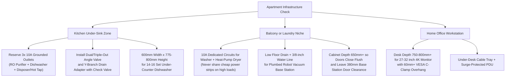
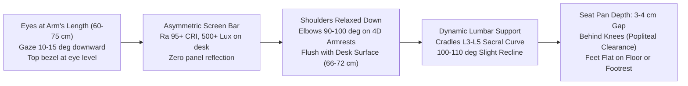

# Buy-It-For-Life & Problem-Solving Products Matrix

Consumer electronics and home appliances are notoriously opaque markets: identical-looking machines vary wildly in internal motor topology, drying thermodynamics, optical physics, and consumable lock-in. Worse, livestreaming influencers routinely promote high-margin gimmicks while hiding structural flaws like missing lint filters, sour-smelling carbon cartridges, or sub-pixel font blur.

This reference manual provides **exact engineering specifications that matter**, **quantitative sizing formulas**, and **marketing IQ-tax traps to avoid** across the ten highest-ROI product categories for a 32-year-old engineer.

> **Navigation**: Overview: [00-README.md](00-README.md) | Previous: [01-SKIN-DENTAL-GROOMING-AND-WARDROBE.md](01-SKIN-DENTAL-GROOMING-AND-WARDROBE.md) | Next: [03-SERVICES-INSURANCE-AND-PERSONAL-FINANCE.md](03-SERVICES-INSURANCE-AND-PERSONAL-FINANCE.md)

---

## Pre-Purchase Infrastructure & Renovation Check

Before ordering major chore appliances, verify physical water supply, drainage height, electrical amperage, and cabinet clearances. Retrofitting a 3-way water tee (`三通角阀`) takes 15 minutes if planned upfront, whereas discovering a missing drain forces years of manual tank dumping.

---

## 1. Dishwashers (洗碗机): Reclaiming Every Evening After Cooking

Learning Chinese cooking (`中餐烹饪`) hits a brick wall when every stir-fry leaves an oily wok, cutting board, prep bowls, and range-hood grease filters waiting in the sink. A properly sized dishwasher washes at **70–75 deg C** (melting animal fats that 40 deg C handwashing only smears around), uses **60% less water** than running-tap handwashing, and eliminates >99.9% of *H. pylori* and enteric pathogens.

| Parameter | Spec That Actually Matters (Buy This) | Marketing Gimmick / Trap (Avoid This) | Engineering Rationale |
| :--- | :--- | :--- | :--- |
| **Capacity (`套数`)** | **14 to 16+ Sets (`独嵌两用/嵌入式`)** (even if living solo or as a couple!) | 4–6 set countertop boxes or **Ultrasonic Sink Dishwashers (`水槽洗碗机`)** | Small dishwashers fit bowls *only*—leaving you hand-scrubbing woks, soup pots, and range-hood grates (`能洗碗不能洗锅=买了个寂寞`) |
| **Drying Technology** | **Auto-Open Door (`自动开门烘干`)** OR **Zeolite (`晶蕾/沸石吸湿烘干`)** OR **Dual-Fan PTC Hot Air (`双风机热风`)** | **Pure Condensation (`余温冷凝烘干`)** without auto-open or hot-air fan | Pure condensation leaves water droplets on plastic containers and stainless walls, breeding musty odors overnight |
| **Motor & Spray Arms** | **BLDC Dual-Inverter Motor** (`40–55 kPa` water pressure) + **3 Full-Size Spray Arms / Satellite Arm** | Fixed single-speed AC motor (`< 28 kPa`) + tiny corner auxiliary jets marketed as "5-arm" | BLDC varies pressure dynamically (gentle on glassware, high-pressure scouring on burnt casserole bottoms) at `< 44 dB` |
| **Inner Tub Material** | **100% Full Stainless Steel Tub (`全不锈钢一体内胆`, including bottom sump floor)** | Stainless side walls paired with a **polypropylene (PP) plastic bottom floor (`塑料底盘`)** | Plastic bottom plates scratch easily, retain chili-oil grease film, and warp/smell after 3 years of 72 deg C cycles |
| **Storage Ventilation** | **72h–168h Fresh-Air Exchange (`换气抑菌存储`)** + **Tier-1 Water/Energy Label (`一级水效`)** | "UV light sterilization" inside a sealed damp chamber with zero air exchange | UV light cannot reach shadowed bowl undersides; continuous dry airflow prevents bacterial regrowth |
| **Consumables TCO** | **Separate Dish Powder + Rinse Aid + Softening Salt (`洗碗粉 + 漂洗剂 + 软水盐`)** | Proprietary CNY 3.0/piece multi-chamber pods (`高价多合一凝珠`) for every half-load | Bulk dish powder lets you dose 10g for light loads vs 25g for heavy grease at **CNY 0.35/cycle** instead of CNY 3.0 |

**Critical Usage Rules**: Never squirt liquid hand dish-soap (`洗洁精`) into a dishwasher—foam floods the base sensor pan and trips flood protection! Never put seasoned carbon-steel/cast-iron woks, wooden cutting boards, anodized aluminum (oxidizes black!), or gold-rimmed bone china inside.

---

## 2. Heat-Pump Dryers (独立热泵干衣机 vs 洗烘一体机)

Hanging wet laundry across balcony rods blocks living-room daylight, stiffens cotton fibers, and turns miserable during winter cold snaps or southern `梅雨季/回南天`. However, buying the wrong dryer architecture is the #1 home-appliance regret.

| Architecture | Operating Temp | Lint Filtration | Anti-Tangle Drum | Verdict |
| :--- | :--- | :--- | :--- | :--- |
| **Dedicated Heat-Pump Dryer (`独立热泵式烘干机`)** | **52 – 58 deg C** (closed-loop heat-pump compressor) | **Multi-layer fine lint cage (`四重/五重绒毛收集器`)** | **1:1 Bidirectional Rotation (`1:1正反转` + independent fan)** | **GOLD STANDARD** — fluffy towels, zero wool/cotton shrinkage, strips dust mites & pet hair |
| **Condenser Washer-Dryer Combo (`冷凝式洗烘一体机`)** | **85 – 95 deg C** (resistive heating bake) | **NONE** — wet lint sticks inside internal hot-air metal duct | Single-direction fan coupling | **AVOID** — shrinks tees by 1 size, bakes wrinkles in, and rotting wet lint inside the air duct stinks after 12–18 months |
| **Heat-Pump All-in-One (`热泵洗烘一体机`)** | 55 – 60 deg C | Self-flushing lint screen (complex internal plumbing) | Good on >CNY 10k flagships | Acceptable *only* if balcony space physically forbids stacking (`叠放`) |

**Key Buying Specs for Washer + Heat-Pump Dryer Pair**:
- **Dryer**: Insist on **1:1 forward/reverse drum rotation** (cheaper 8:1 unidirectional drums roll bedsheets into a tight knot with a raw wet center!) and **4+ layer lint filtration** covering the condenser fins so you never have to disassemble the base to vacuum wet sludge.
- **Washing Machine**: Don't pay extra for fancy "24 fabric cloud modes" or micro-bubble gimmicks. Pick a **10 kg front-load inverter drum** with reliable mechanical balance, high-temperature drum self-clean (`90°C筒自洁`), and genuine wash ratio `1.08–1.10` (beware inflated `1.20+` claims tested on 3.5-hour marathon cycles).

---

## 3. Auto-Cleaning Robot Vacuums (全自动上下水扫拖机器人)

Walking barefoot on dust-free hardwood/tile floors every day without lifting a broom is transformative—**if and only if the robot maintains itself**.

- **Why Plumbed-In (`自动上下水版`) Beats Water-Tank (`水箱版`)**: Water-tank base stations require hauling heavy clean water in and pouring foul, anaerobic dirty mop sewage into the toilet every 2–3 days. Whenever apartment plumbing allows (balcony washer tap, bathroom vanity, or kitchen sink via thin 1/4" PE tubing), **always choose the auto-water supply & drain kit**.
- **Specs That Matter**:
  1. **Obstacle Avoidance**: `dToF/LDS LiDAR + 3D Structured Light + RGB Camera` (`激光雷达 + 结构光 + 视觉识别`)—prevents eating USB cables, weighing scales, slippers, or pet accidents.
  2. **Hair Anti-Tangle**: Active blade hair-cutting roller (`主动割毛滚刷`) or conical single-ended zero-tangle brush (`气旋导流零缠绕滚刷`) so long hair never jams axles.
  3. **Mop & Base Hygiene**: Pressurized dual-spin mops or **live-water roller mopping (`活水履带/滚筒实时刮洗`)**, **>= 10 mm automatic mop lift** on carpets, **60–75 deg C hot-water mop washing** (cold water cannot dissolve kitchen grease), and **45 deg C hot-air drying**.
- **Trap Warning — Handheld Wet-Dry Floor Scrubbers (`手持洗地机`)**: Unless you have a toddler dropping rice porridge three times a day, handheld floor scrubbers require 20 minutes of manual pushing *plus* cleaning hair/sludge out of the roller housing afterward—most gather dust within 3 months compared to a scheduled robot.

---

## 4. RO Water Purifiers (反渗透净水器)

Boiling municipal tap water kills bacteria but does **not** remove dissolved heavy metals, calcium/magnesium scale (`水垢`), microplastics, PFAS, or disinfection byproducts. Reverse Osmosis ($0.0001\ \mu\text{m}$ pore diameter) strips virtually everything except $\text{H}_2\text{O}$ molecules.

- **Non-Negotiable Specs**:
  1. **Flux >= 800G to 1200G (`出水流速 >= 2.1–3.0 L/min`)**: Fills a 250 mL glass in 5 seconds and a soup pot in 35 seconds without a bulky pressurized storage tank (`无桶大通量`).
  2. **Zero-Stale-Water (`零陈水 / 纯水回流技术`)**: Standard RO membranes experience osmotic ion diffusion when idle overnight, spiking the first morning cup's TDS above `120 ppm`. Pure-water backflushing keeps first-glass TDS below `15–20 ppm`.
  3. **5-Year Filter TCO Math**: Many brands sell an RO machine for CNY 1,299 but lock chipped RO cartridges at CNY 900 every 18 months! Calculate annual cartridge TCO before buying:
     $$\text{Filter TCO}_{\text{annual}} = \frac{C_{\text{PCB}}}{\text{Lifespan}_{\text{PCB}}} + \frac{C_{\text{RO}}}{\text{Lifespan}_{\text{RO}}} \le \text{CNY } 300/\text{year}$$
     Favor long-life DuPont FilmTec / Toray membranes (4–5 yr RO lifespan) or universal 10-inch standard housing builds (`通用滤瓶DIY/开源架构`) if handy.
- **IQ-Tax Traps**: Reject all **"Weakly Alkaline / Hydrogen-Rich / Small-Molecule / Magnetized Functional Water" (`弱碱性水/富氢水/小分子团水/矿化能量石`)** claims—stomach gastric acid sits at pH 1.5, instantly neutralizing any alkaline water, and trace minerals come from vegetables and dairy, not tap water! Also avoid integrated **heating-inside-RO (`净热一体机`)** units where internal heating tanks complicate descaling and double repair rates; pair a rock-solid cold RO purifier with a separate countertop/wall instant hot dispenser (`即热饮水机/管线机`) instead.

---

## 5. Sleep Engineering: Mattresses & Pillows (床垫与枕头)

You spend **one-third of your adult lifespan** unconscious on your mattress and pillow. Waking up with lumbar stiffness means your mattress is too soft (pelvis sinks like a hammock); waking up with shoulder numbness and lower-back air gaps means your mattress is rock-hard.

| Component | Target Biomechanical Spec | Dangerous / Overpriced Trap | Verification Method |
| :--- | :--- | :--- | :--- |
| **Support Core (弹簧层)** | **Independent Pocketed Coils (`独立袋装弹簧`)**, `2.0–2.2 mm` wire gauge (medium-firm `偏硬护脊`, 6.5–7.5/10 firmness) | Cheap linked Bonnell springs (`整网弹簧` squeaks & transfers motion) OR sagging ultra-plush Euro-top | Lie flat on your back for 15 mins in-store: slide flat palm under L4 lumbar curve—snug contact with zero gap and zero pelvic sinking |
| **Comfort Layer (舒适层)** | **2–3 cm Natural Latex (`泰国/斯里兰卡原液 >= 85–90%`)**, perforated memory foam, or washable **3D Air Fiber (`空气纤维`)** | `> 6 cm` thick soft latex (traps heat & sags hips) or synthetic styrene-butadiene latex (`丁苯合成乳胶` smells pungent & crumbles into yellow powder) | Check removable zipper cover (`可拆洗拉链层`—transparent brands let you inspect internal layers directly; sealed mystery mattresses hide cheap glue!) |
| **Firm Fiber Layer (硬质层)** | **Thermal-Bonded Glue-Free Jute (`无胶热压黄麻`)** or **3E Coconut Fiber (`3E环保椰棕`)** | **Urea-Formaldehyde Glued Coir (`胶水压制劣质棕垫`)** | Cheap glued coir slowly off-gasses carcinogenic **formaldehyde (`甲醛`)** for 5–10 years right beneath your nose! |
| **Cervical Pillow (`护颈枕`)** | **Partitioned Ergonomic Pillow** matched to **compressed loft**: `6–8 cm` center neck zone (back sleep) + `9–12 cm` elevated side wings (side sleep) | Overstuffed hotel feather/polyester pillows (`18 cm` uncompressed -> `2 cm` flat pancake, or overly high loft flexing neck forward like looking at phone all night) | In side sleep, nose-bridge-to-sternum line must run **parallel to the mattress**; in back sleep, chin sits neutral (neither tucked to chest nor tilted skyward) |

---

## 6. Workstation: Ergonomic Chairs, Standing Desks & 4K HiDPI

### Ideal Workstation Viewing & Posture Chain

### Ergonomic Chair & Standing Desk Specs
- **Ergonomic Chair (`人体工学椅`)**:
  - **Safety Floor**: Certified **Class-4 Gas Lift (`TUV/SGS四级气压棒`)** + steel chassis—non-negotiable.
  - **Seat Depth Adjustment (`座深前后滑轨`)**: Essential so your sacrum touches the backrest without the front edge compressing your popliteal artery behind the knees.
  - **Backrest Architecture**: Prefer **unified or mild adaptive lumbar support (`一体式/自适应追腰`)** over exaggerated protruding dual-back/split lumbar cushions (`激进顶腰分体腰靠`) unless sit-tested for 45+ minutes—aggressive lumbar pads feel supportive for 3 minutes in a showroom but cause muscle spasm after 4 hours of coding.
  - **Mesh vs. Molded Foam**: High-tension imported mesh (Matrex/Wintex) excels for `< 85 kg` users in warm rooms; users `> 85–90 kg` often find rigid mesh perimeter frames press into outer thighs and fare better on high-density molded foam seats (e.g., Steelcase Leap / Haworth Zody / Herman Miller Embody class or top domestic tier sit-tested offline).
- **Standing Desk (`电动升降桌`)**:
  - **Specs**: **Dual-motor, 3-stage steel legs (`双电机三节腿`)**, minimum height reaching **<= 62–65 cm** (most fixed desks sit at 75 cm—far too high for seated typing without shrugging your trapezius muscles, which is why a height-adjustable desk actually fixes *seated* ergonomics first!), ENF-grade low-formaldehyde or solid wood desktop (`75–80 cm` depth), integrated under-desk cable trough.
  - **The 20-8-2 Cadence**: Standing immobile for 4 hours pools venous blood in your calves and strains plantar fascia. Alternate **20 minutes sitting, 8 minutes standing, and 2 minutes walking/stretching**.

### 4K HiDPI Monitors & Asymmetric Screen Bars
- **Why 27-Inch 4K (or 5K) Is Mandatory on macOS**: Modern macOS removed sub-pixel font antialiasing, optimizing its CoreGraphics compositor exclusively for `@2x` HiDPI scaling (~110 PPI logical / ~218 PPI physical).
  - A **27-inch 2K (2560x1440 = 109 PPI)** monitor renders at `@1x`, making IDE code fonts and CJK strokes visibly fringed and jagged.
  - A **27-inch 4K (3840x2160 = 163 PPI)** monitor set to `2560x1440 HiDPI` renders internally at `5120x2880` (`@2x`) and downsamples cleanly onto 8.3 million physical pixels—delivering crisp Retina-like clarity at one-quarter the cost of a 5K display (with negligible GPU overhead on Apple M1–M4 Silicon).
- **Monitor Checklist**: 27-inch 4K IPS Black (`2000:1` contrast) or Mini-LED, **TUV Hardware Low Blue Light (`硬件防蓝光` keeps white balanced at 6500K without sickly yellow software tint)**, DC flicker-free, **USB-C 90W+ single-cable charging + KVM/USB hub**, mounted on a **gas-spring VESA monitor arm** (`显示器支架臂` frees 40% of desk surface).
- **Asymmetric Optical Screen Bar (`屏幕挂灯`)**: Clamps atop the monitor bezel, casting a sharp optical cutoff beam onto your keyboard/notes (`>= 500 lux`, $R_a \ge 95$) with **zero glare on the screen**, eliminating eye strain caused by staring at a bright monitor in a dim room.

---

## 7. Air, Humidity, Security & Travel EDC Quick-Spec Matrix

| Category | Core Engineering Spec to Demand | Common IQ-Tax / Failure Mode to Reject |
| :--- | :--- | :--- |
| **Compressor Dehumidifier (`压缩机除湿机`)** | `20–50 L/day` daily capacity, Panasonic/GMCC rotary compressor, continuous drain hose port, target **45–55% RH** | **Peltier Semiconductor Mini-Dehumidifiers (`百元半导体除湿机`)** — extracts `< 250 mL/day`, completely useless in a real room! |
| **Mist-Free Humidifier (`冷蒸发无雾加湿器`)** | Evaporative washable filter wick (`>= 400–800 mL/h`), silver-ion/UV water sterilization + auto blow-dry filter when empty | **Ultrasonic Mist Humidifier (`超声波有雾加湿器`) filled with tap water** — atomizes dissolved calcium/bacteria into airborne PM2.5 > 300 inhaled into lungs! |
| **Air Purifier (`空气净化器`)** | Particulate CADR `>= 500 m^3/h`, Formaldehyde CADR `>= 300 m^3/h`, **Amino/Catalytic Formaldehyde Decomposition (`固化分解技术`)**, sleep `<= 32 dB` | Plain activated-carbon filters in humid summer (`活性炭吸饱湿气后发酸异味`), ozone-generating "ionizers" (`臭氧超标伤肺`), tiny desktop purifiers |
| **Smart Door Lock (`智能门锁`)** | **C-Grade True Mortise Cylinder (`C级真插芯`)**, **Palm Vein (`掌静脉`) + 3D Structured Light Face**, **Mechanical Indoor Escape Handle** | Electronic-only indoor button with no mechanical override (deadly fire trap if battery/PCB burns!), 2D photo-spoofable camera unlock |
| **GaN Charger & Power Bank** | `65W–140W` GaN PD 3.1 multi-port (`< 80 mV` low voltage ripple), `10,000–20,000 mAh` (`< 100 Wh` airline cabin limit, **clear 3C certification logo** required by Chinese airports!) | Uncertified ultra-cheap chargers with high voltage ripple (`纹波过高导致触控屏漂移伤主板`), `> 100 Wh` bricks confiscated at airport security |
| **ANC Headphones & Carry-On** | Flagship Active Noise Cancelling (`-25 to -30 dB` low-frequency attenuation on planes/high-speed rail); `20-inch` **100% Polycarbonate (Covestro)** carry-on with **Hinomoto silent wheels (`日乃本静音万向轮`)** | Brittle ABS+PC composite shells that crack at corners; zipperless heavy aluminum frames exceeding 7 kg carry-on weight limits before packing! |

---

## 8. Travel & Daily Carry (EDC) Modular Kit Architecture

Frequent high-speed rail trips, flights, and international travel become effortless when you keep a **permanently pre-packed Tech & Toiletries Pouch** inside your carry-on bag so you never unplug your home desk charger or forget a toothbrush charger before an early flight.

### The Permanent One-Pouch Travel Tech Kit
1. **Power Core**: One `100W` 3-port GaN foldable-prong charger (`2x USB-C + 1x USB-A`) + two `1.5m–2.0m` braided `240W E-Marker` USB-C cables (hotel wall outlets are notoriously far from the bedside nightstand!).
2. **Aviation-Compliant Power Bank**: `10,000 mAh` (`37 Wh`) slim Qi2/wired USB-C pack for city days, or `20,000 mAh` (`72–74 Wh`) laptop-capable bank. **Mandatory 2025+ China Domestic Flight Rule**: Every power bank carried onto Chinese flights MUST display a legible **CCC (`3C认证`) mark** and rated Wh capacity on its casing, and stay strictly `<= 100 Wh` without airline approval.
3. **Acoustic & Visual Isolation**:
   - Active Noise Cancelling earbuds/headphones reduce `80–85 dB` cabin engine drone to `< 55 dB`, cutting post-flight nervous-system exhaustion in half.
   - Contoured **3D blackout silk/memory-foam sleep mask (`3D立体遮光眼罩`—zero pressure on eyelids during REM sleep)** + `32–35 dB NRR` soft slow-rebound foam earplugs (e.g., 3M 1100 / Moldex Pura-Fit) for noisy hotel corridors.
4. **Luggage & Tracking**:
   - `20-inch` pure polycarbonate spinner (`< 3.1 kg` tare weight, wide-trolley or standard recessed handle, YKK dual-coil puncture-resistant zipper `双层防爆拉链`) + compression packing cubes (`压缩收纳袋`).
   - Drop one **UWB / Find My tracker (e.g., Apple AirTag)** inside the lining of every checked and carry-on bag to verify carousel arrival directly from your seat.

---

## 9. Smart Home Protocol Hygiene & Appliance Maintenance Matrix

### Avoid Cloud-Locked Smart Home Silos
When adding smart locks, curtain motors, AC companions (`空调伴侣`), or temp/humidity sensors:
- **Prefer Local Mesh Protocols (`Zigbee 3.0 / Bluetooth Mesh / Thread + Matter`)** paired with a wired local gateway (`中枢网关`) over dozens of cheap `2.4 GHz Wi-Fi` bulbs and plugs. Fifty cheap Wi-Fi IoT chips congest airtime on your main router and go completely brain-dead whenever your ISP fiber drops or a small brand shuts down its cloud servers.
- **Keep Physical Wall Switches Functional**: Use smart relays/switches with decoupled wireless mode (`凌动开关 / 智能墙壁开关转无线`) rather than cutting hardwired neutral power to smart lights.

### Preventive Maintenance Schedule to Prevent Secondary Pollution

Neglected cleaning appliances eventually become contamination sources themselves. Follow this exact servicing table:

| Appliance | Critical Failure Mode if Unmaintained | Exact Maintenance Action | Frequency |
| :--- | :--- | :--- | :--- |
| **Dishwasher** | Food grease clogs sump mesh -> weak spray pressure & foul drain odor | Twist out bottom cylindrical filter mesh, rinse with brush under hot tap; run empty `70°C` cycle with **citric acid / dishwasher cleaner (`机体清洁剂`)** | Filter: Every 2 wks; Machine-clean: Every 2–3 mos |
| **Heat-Pump Dryer** | Lint bypasses torn seal onto wet evaporator fins -> 2x drying time | Wipe primary inner-door fluff screen **after every single load**; vacuum/rinse lower base sponge filter (`底座海绵滤网`) | Door screen: Every load; Base filter: Monthly |
| **Front-Load Washer** | Black mold & detergent biofilm inside rubber door gasket (`胶圈发霉`) | **Leave washer door cracked open 15 deg after every wash** so drum dries out; run `90°C` drum clean with sodium percarbonate (`过碳酸钠/泡腾片`) | Crack door: Always; `90°C` clean: Every 2 mos |
| **Robot Vacuum/Mop** | Hair wraps caster wheel; biofilm clogs dirty-water drain float switch | Rinse removable mop-wash tray (`清洁肋底盘`), wipe cliff/LiDAR windows with dry microfiber, replace dustbag | Tray & sensors: Monthly; Dustbag: Every 60 days |
| **Wall-Split Air Conditioner** | *Legionella* / mold dust cake on evaporator fins (`蒸发器翅片霉味`) | Pull out nylon mesh pre-screen and shower off every **6 weeks in summer**; spray foaming coil cleaner (`空调清洗剂`) onto aluminum fins before summer starts | Mesh: Every 6 wks; Fin foam clean: Annually |
| **RO Water Purifier** | TDS creeps `> 40 ppm` or flow drops by 50% | Keep a CNY 25 **TDS meter pen** in kitchen drawer; test pure-water outlet quarterly; flush for 3 minutes after returning from >5-day trips | TDS spot-check: Quarterly; Cartridges: Per indicator |
