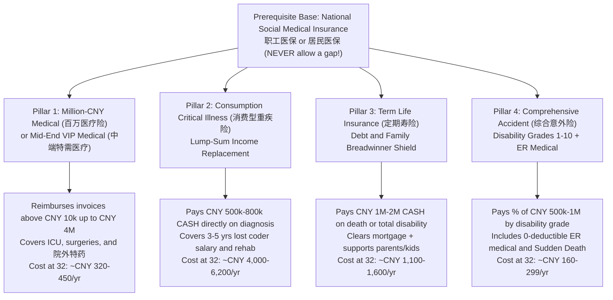
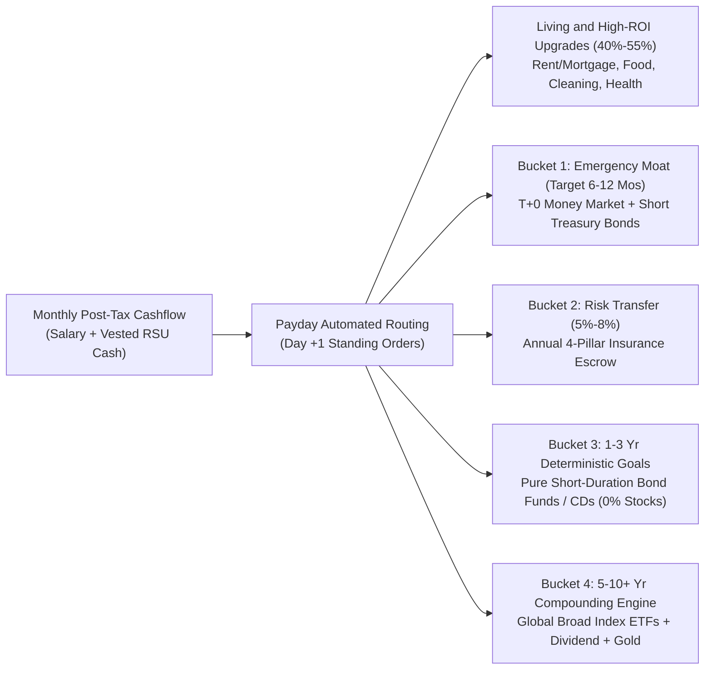

# Buying Back Your Time & Personal Risk/Insurance Architecture

Hardware upgrades eliminate daily mechanical friction, while **paid services, medical/financial risk transfer, and liquid reserves** protect your two scarcest assets at 32: **unbroken cognitive focus** and **household solvency under tail-risk shocks**.

Many high-earning engineers happily spend 10 hours comparing mechanical keyboards yet spend Saturday afternoons scrubbing bathroom limescale, skip gastroscopy/LDCT screenings, leave their `医保卡` exposed to family misuse, or get talked into CNY 18,000/year low-coverage bundled insurance policies by relatives. This module establishes a clean, quantitative operating system for services, insurance, and personal finance.

> **Navigation**: Overview: [00-README.md](00-README.md) | Skincare & Wardrobe: [01-SKIN-DENTAL-GROOMING-AND-WARDROBE.md](01-SKIN-DENTAL-GROOMING-AND-WARDROBE.md) | Home & Tech Matrix: [02-HIGH-ROI-HOME-APPLIANCES-AND-TECH.md](02-HIGH-ROI-HOME-APPLIANCES-AND-TECH.md)

---

## 1. Buying Back Your Time: High-ROI Paid Services

### The Cognitive Energy Buyback Equation

Evaluate domestic outsourcing not merely against your average salary hour, but against your **recovery-adjusted hourly value** $V_{\text{eff}}$:

$$V_{\text{eff}} = \frac{I_{\text{post-tax}}}{2000} \times k_{\text{recovery}}$$

where $I_{\text{post-tax}}$ is annual after-tax income and $k_{\text{recovery}} \in [1.3, 1.8]$ reflects the reality that weekend restorative hours power your Monday-through-Friday engineering output. At CNY 400,000–800,000 post-tax income ($V_{\text{eff}} \approx \text{CNY } 260\text{ to }720/\text{hr}$), hiring a vetted domestic specialist at **CNY 50–75/hour** yields a 4x–10x return on life quality.

### 1.1 Biweekly Professional Home Cleaning (`日常保洁 + 季度深度拆洗`)
Even with a plumbed robot vacuum and dishwasher handling daily maintenance, bathroom glass limescale, kitchen range-hood grease, window tracks, and baseboards accumulate every two weeks.
- **Cadence**: **3 to 4 hours every 2 weeks** (~CNY 160–240/session, or ~CNY 400/month). Once you find a meticulous, punctual cleaner on a reputable platform, lock in a **fixed-person biweekly subscription (`固定阿姨周期单`)** to eliminate re-onboarding overhead.
- **The Written 4-Zone SOP Rule**: Never say *"just clean everything"*. Send or print a concise 4-point checklist and provide **color-coded microfiber cloths (`四色分区抹布`)** yourself so bathroom cloths *never* touch kitchen counters:
  1. **Kitchen (Yellow Cloth)**: Degrease induction/gas stove, backsplash tiles, range-hood exterior oil cup, microwave interior, and sink strainer.
  2. **Bathroom (Red Cloth + Squeegee)**: Spray citric-acid descaler (`柠檬酸除垢剂`) on shower glass and chrome faucets (wait 5 mins, wipe crystal-clear without steel wool scratches!), scrub toilet rim/base, clear shower drain hair trap.
  3. **Surfaces & Baseboards (Blue Cloth)**: Damp-wipe desk perimeter (do *not* spray liquid on 4K monitor coatings!), window sills, cabinet tops, and door frames.
  4. **Appliance Deep Steam-Clean (Annually)**: Once a year before summer, book a dedicated **high-temperature steam teardown clean (`高温蒸汽拆洗`)** for range-hood impellers and wall-split air conditioner blower wheels (~CNY 150–250/unit).

### 1.2 Professional Garment Care & Neighborhood Tailoring (`专业洗护与改衣`)
- **Critical Chemistry Rule — NEVER Dry-Clean Goose Down (`羽绒服严禁干洗`)**: Most dry cleaners use tetrachloroethylene (`四氯乙烯`), an organic solvent that strips natural lipid coatings off duck/goose down clusters, making down brittle, clumped, and permanently less warm, while damaging DWR waterproof shell membranes! Always request **professional wet-wash + low-temp tumble air-fluffing (`专业水洗 + 低温柔烘拍打`)** for down jackets.
- **Wool & Structured Coats**: Send double-faced wool overcoats (`双面呢大衣`), unstructured blazers, and cashmere knits for professional dry cleaning **at the end of winter BEFORE storing**—invisible body oils and food sugars left over summer attract clothes moths (`衣蛾虫蛀`) and oxidize into permanent yellow stains.
- **Wash-and-Fold & Seasonal Bulk Laundry (`洗护外包与换季大件送洗`)**: During intense launch weeks or seasonal transitions, outsource heavy winter duvets, curtains, dress shirts (washed + pressed on hangers), and suede/leather sneakers to a trusted central laundry facility (`专业中央洗护工厂`) rather than overloading residential washer drums.
- **Neighborhood Tailor (`社区改衣店`)**: Locate one skilled alteration tailor within 2 km. Spending CNY 25–45 to hem trouser breaks (`改裤长`) or taper shirt waists makes CNY 300 off-the-rack clothes fit like CNY 2,500 bespoke pieces.

### 1.3 Evidence-Based Annual Health & Dental Screening (`32+科学体检与口腔预防`)
Standard corporate group checkups (`公司福利基础体检`) are notoriously poorly designed: they still use chest X-rays (`胸片`, which miss >70% of early sub-centimeter lung nodules) while upselling broad, low-specificity blood tumor marker bundles that trigger false-positive panic.

Customize your annual screening at a **Tier-3A Public Hospital Health Management Center (`公立三甲医院体检中心`)** around clinical evidence for a 32-year-old sedentary tech worker:

| Organ / System | Evidence-Based Test to Include | Why It Matters at 32+ | Overhyped IQ-Tax Test to Skip |
| :--- | :--- | :--- | :--- |
| **Lungs** | **Low-Dose Spiral Chest CT (`胸部低剂量螺旋CT`, LDCT)** (Every 1–2 yrs) | Detects 2–5 mm ground-glass nodules with 1/5th the radiation of standard CT | Standard Chest X-Ray (`胸片/胸透` — misses early lesions hidden behind heart/ribs) |
| **Metabolic & Cardio** | Fasting Glucose + **HbA1c (`糖化血红蛋白`)**, **Lipid Panel (LDL-C, ApoB, Triglycerides)**, **Uric Acid**, Homocysteine, BP | Catches pre-diabetes (`HbA1c >= 5.7%`), hyperuricemia/gout risk, and atherogenic particle burden early | "Blood viscosity rheology (`血流变`)" or "Quantum sub-health resonance (`量子亚健康检测`)" |
| **Liver, Gallbladder, Thyroid** | **Abdominal Ultrasound** + Liver Enzymes (`ALT/AST/GGT`) + **Thyroid & Cervical Node Ultrasound** | Tracks sedentary non-alcoholic fatty liver (`脂肪肝`—reversible via weight/exercise!) and grades thyroid nodules (`TI-RADS`) | Unindicated PET-CT whole-body radiation scans in healthy asymptomatic 30-year-olds |
| **Stomach & Colon** | **_H. pylori_ C13/C14 Urea Breath Test (`碳13/14呼气试验`)** + **Painless Gastroscopy & Colonoscopy (`无痛胃肠镜`)** | China has high gastric/colorectal cancer incidence; **do one baseline gastro-colonoscopy by age 35–40** (or at 32 if reflux, pain, stool changes, or family history)—snipping an adenoma polyp prevents colon cancer for 5–10 years! | Serum _H. pylori_ IgG antibody blood test (cannot distinguish past cured infection from active infection!) |
| **Oral & Periodontal** | **Biannual Ultrasonic Scaling (`超声波洗牙`)** + **Bitewing / Panoramic X-Ray** ([Module 01](01-SKIN-DENTAL-GROOMING-AND-WARDROBE.md)) | Prevents painless alveolar bone loss, interproximal caries, and CNY 15,000 implants; assess impacted wisdom teeth before 35 | Mall beauty-salon "teeth whitening strips/gels" on unscaled tartar or bleeding gums |
| **Micronutrients & Immunity** | **Serum 25-OH Vitamin D**, **Hep B Surface Antibody Quantitative (`乙肝两对半定量`)** | >80% of indoor engineers sit below `20 ng/mL` Vit D (supplement 1,000–2,000 IU D3 daily if low); boost Hep B vaccine if `HBsAb < 10 mIU/mL` | Hair trace-element testing (`微量元素测头发`) or food IgG "intolerance" panels (`食物慢性不耐受IgG智商税`) |

### 1.4 Digital Disaster Recovery: The 3-2-1 Backup & Identity Vault
Treat personal data (family photos, 4K Osmo/iPhone footage, tax records, contracts, recovery keys) like production databases:
- **3 Copies, 2 Media Types, 1 Offsite**:
  1. **Active Copy**: Laptop NVMe SSD (with FileVault full-disk encryption enabled).
  2. **Local Redundant Copy**: Dual-bay NAS in RAID 1 (`双盘位NAS镜像冗余` with immutable snapshots against ransomware) OR automated weekly Time Machine / `restic` backup to an encrypted local SSD.
  3. **Offsite Cloud Copy**: iCloud+ (2TB) / encrypted cloud object storage (`Backblaze B2 / Cloudflare R2` via `restic` or `Cryptomator` client-side zero-knowledge encryption) so an apartment fire or burglary loses zero memories.
- **Authentication Hardening**: Store all credentials in a cross-platform password manager (`1Password` or `Bitwarden`), protect your primary email and Apple/Google ID with **two hardware FIDO2 security keys (`YubiKey`, one carried, one stored safely)**, and place a printed **Emergency Recovery Sheet** inside a physical document pouch so trusted family are never locked out in an emergency.

---

## 2. Rational China Insurance Architecture at 32 (`不交智商税的四梁八柱`)

### First Principle: Insurance Is Variance Capping, Not Investing

A single ICU stay, targeted lung/hematology cancer therapy (`CAR-T` or imported third-generation inhibitors at CNY 15,000–40,000/month), or a severe stroke at 35 can wipe out ten years of coder savings in eighteen months. Conversely, **using insurance companies to manage small savings yields dismal 1.5%–2.3% locked returns** with heavy early-surrender penalties.

**The Golden Rule**: Spend **5% to 8% of annual net income** (~CNY 6,000–8,500/year at age 32) on **pure, high-leverage protection (`纯保障消费型保险`)** covering **all four distinct catastrophic exposures**, and invest the remaining 92%+ yourself in transparent, liquid financial instruments.

### The 4-Pillar Adult Defense Architecture

### Complete 4-Pillar Configuration & Clause Verification Matrix

| Policy Type | Payout Mechanism | Target Coverage (`保额`) | Non-Negotiable Contract Clauses (`必看核心条款`) | Age-32 Annual Cost Reference |
| :--- | :--- | :--- | :--- | :--- |
| **0. Social Medical (`国家医保`)** | Real-time hospital settlement | Statutory local caps | Zero lifetime health underwriting, covers pre-existing conditions (`带病投保唯一兜底`). **If unemployed/gap year, enroll in `灵活就业医保` immediately!** | Mandatory payroll / ~CNY 400–5,000 |
| **1. Million-CNY Medical (`百万医疗险`)** | **Reimbursement (`报销型`)**: pays actual hospital bills above CNY 10k deductible | **CNY 2M – 4M** annual limit | 1) **"Guaranteed Renewal for 20 Years (`保证续保20年`)"** printed in contract; 2) **External Cancer Drugs (`院外恶性肿瘤外购药`)** written into guaranteed terms without arbitrary list cuts; 3) Direct Hospital Advance (`住院垫付`) + Proton/Heavy-Ion (`质子重离子`) | **CNY 320 – 450 / yr** (Upgrade: Mid-End VIP `0免赔公立特需部` ~CNY 2,200–3,500/yr) |
| **2. Consumption Critical Illness (`消费型重疾险`)** | **Lump-Sum Cash (`给付型`)**: wires full sum upon diagnosis/criteria regardless of hospital spend | **CNY 500,000 minimum** (ideally 3–5x annual household living cost: CNY 500k–800k) | 1) **Pure CI without Death Benefit (`不捆绑身故责任`)**; 2) Term: **To Age 70 (`保至70岁`)** for budget efficiency OR **Lifetime (`保终身`)** if comfortable; 3) **30-Year Payment (`30年交`)** + Mild/Moderate Illness Waiver (`轻中症豁免保费`) + High-incidence mild conditions complete | **CNY 3,400 – 4,200 / yr** (to 70) or **CNY 5,500 – 6,500 / yr** (lifetime) |
| **3. Term Life (`定期寿险`)** | **Lump-Sum Cash (`给付型`)**: pays beneficiaries upon Death or Grade-1 Total Disability (`身故/全残`) | **CNY 1,000,000 – 2,000,000** (`Mortgage + 5x Family Spend`) | 1) Cover to **Age 60 (`保至60岁退休`)**, pay over 20–30 years; 2) **<= 3 Exclusion Clauses (`免责条款仅3条`)**; 3) Clean health questionnaire (doesn't nitpick mild nodules) | **CNY 1,100 – 1,600 / yr** (Male) / **CNY 600 – 900 / yr** (Female) |
| **4. Comprehensive Accident (`综合意外险`)** | **Tiered Disability Cash (`伤残给付`) + Medical Reimbursement (`意外医疗报销`)** | **CNY 500,000 – 1,000,000** (1-year renewable, no health check on standard tiers) | 1) **Disability Grades 1–10 (`十级伤残赔10%起`)** (crucial—Term Life does NOT cover Grades 2–10!); 2) **Accidental Medical: 0 Deductible, 100% Reimbursement Including Self-Paid (`不限社保0免赔`)**; 3) Includes **Sudden Acute Death (`含猝死责任`)**; Occupation Class `1–3类` | **CNY 150 – 299 / yr** |

> **Special Note on DRG Hospital Reform & Mid-End Medical Insurance (`中端医疗险`)**: Under nationwide public hospital DRG/DIP packaged billing reforms, general wards (`普通部`) face strict cost-control quotas on imported original-brand drugs (`原研药`) and high-end surgical consumables. If your budget comfortably allows an extra CNY 2,000/year, upgrading Pillar 1 to a **Mid-End Medical Plan covering Tier-3A Public Hospital VIP / International Departments (`公立三甲特需部/国际部`)** gives you zero deductible, single private hospital rooms, senior specialists, and unrestricted access to imported medications outside general-ward DRG caps.

### Three Ironclad Underwriting & Claims Protection Rules (`防拒赔红线`)

95% of commercial insurance claim disputes in China stem NOT from insurers "refusing to pay valid contracts", but from **undisclosed pre-existing findings during initial enrollment (`未如实健康告知`)**:

1. **Sequence Rule — Insure BEFORE Elective Checkups (`先投保、过等待期后再体检`)**:
   - Commercial health policies carry a **30-to-90-day waiting period (`等待期`)**. Any nodule, polyp, hypertension, or hepatitis abnormality recorded on a hospital/clinic system *before* purchase or *during* the waiting period must be disclosed or faces exclusion. If you currently feel healthy and have no doctor-advised urgent symptoms, configure your 4-pillar policies and let the 90-day waiting period clear *before* running elective deep screenings. (Conversely, if you already have symptoms or past checkup findings, **never conceal them**!)
2. **NEVER Lend Your `医保卡` (`严禁外借医保卡`)**:
   - Buying a box of blood-pressure, statin, or diabetes medication for your parents using *your* social medical insurance card writes a permanent outpatient chronic-disease pharmacy record under **your legal ID**, which triggers automatic claim investigation and rescission (`拒赔解除合同`) years later!
3. **Finite Inquiry Principle (`有限告知原则: 有问必答，不问不答`)**:
   - Mainland Chinese insurance law follows **Finite Inquiry**: read every single question in the **Health Questionnaire (`健康告知`)** word-for-word against your last 1–2 years of medical/checkup PDFs. If a question asks about *"thyroid nodules >= TI-RADS Grade 3"* and yours is *TI-RADS Grade 2*, follow the exact wording; if a finding hits a questionnaire item, run **online Intelligent Underwriting (`智能核保`)** first—unlike human manual underwriting (`人工核保`), online intelligent underwriting leaves **zero shared industry rejection trace** if declined!

### Four Classic Insurance IQ-Tax Traps to Reject Immediately

1. **"Get Sick We Pay, Stay Healthy Get All Money Back" (`返还型重疾险/医疗险`)**:
   - Sales pitch: *"Pay CNY 14,000/yr instead of CNY 5,000/yr, and at 75 you get all premiums back!"*
   - Math reality: You are lending the insurer an extra CNY 9,000/yr for 40 years at an implicit IRR below `1.5%`, eroding purchasing power by 60%+ to inflation while starving your actual sum insured when young.
2. **Offline "All-in-One Family Bundle" Policies (`重疾+寿险+意外捆绑全家桶`)**:
   - Typically costs CNY 12,000–20,000/year for a meager CNY 200,000–300,000 coverage where **Critical Illness and Life share the same pool (`主附险共用保额`)**—meaning once you claim CNY 200k for cancer at 38, your life coverage drops to zero and your attached 1-year medical rider may terminate!
3. **"First Month CNY 1 / CNY 3" Ad Pop-Ups (`首月1元诱导魔方保单`)**:
   - Deceptive payment-app pop-ups charge CNY 1 in Month 1, then silently auto-debit CNY 110–160/month in Months 2–12 (totaling CNY 1,400+/year—3x more expensive than top 20-year guaranteed Million-CNY Medical plans, often with worse deductibles and no renewal guarantee!).
4. **Protecting Children/Savings While Leaving Breadwinners Naked (`先给老人孩子买理财险，顶梁柱零保障`)**:
   - You—the 32-year-old primary income earner—are your family's largest financial asset. Always insure the **breadwinners first**. For parents aged 55–68 who fail standard Million-CNY Medical health checks, configure: **National `医保` + City-Inclusive Medical (`政府指导惠民保`, ~CNY 100–200/yr, zero health check!) + Cancer-Specific Medical (`防癌医疗险`) + Senior Fracture Accident Insurance (`中老年综合意外险`)**.

---

## 3. Stress-Free Personal Finance Architecture at 32

Software engineers carry massive **career beta**: your salary, annual bonus, unvested RSUs, and tech-heavy personal stock picks are all correlated to the same macro tech cycle. Your personal balance sheet must act as a **shock absorber**, never an amplifier of career volatility.

### Automated Cashflow & 4-Bucket Capital Pipeline

### Detailed Rules for Each Capital Bucket

#### Bucket 1: The 6-to-12-Month Emergency & "Walk-Away" Moat
Textbook personal finance suggests "3 months of expenses", which was written for low-specialization jobs with 2-week hiring turnarounds. For a 32-year-old Senior/Staff software engineer:
- Selective interview loops (system design, AI engineering, cross-border/remote roles) take **2 to 5 months**.
- Holding **6 to 12 months of core living expenses** (`Rent/Mortgage + Food + Utilities + Insurance`, typically CNY 80,000–180,000) in ultra-safe liquid cash vehicles gives you **psychological immunity ("F-You / Walk-Away Runway")**: you never panic-accept a 30% down-level toxic offer just to pay next month's mortgage.
- **Storage vehicle**: Split 30% in instant `T+0` money-market funds (`货币基金/零钱通`) and 70% in `T+1` short-term government treasury / AAA ultra-short bond funds (`短债基金/国债逆回购`) inside a **separate bank/brokerage account** disconnected from WeChat Pay / Alipay impulse spending.

#### Bucket 2: Downside Risk Shield (`5%–8%` of Net Income)
- Auto-transfer CNY 600–800/month into a dedicated sub-account that pays annual renewals for your 4-Pillar Insurance Stack + parents' medical/accident policies without ever denting monthly cashflow.

#### Bucket 3: 1-to-3-Year Deterministic Goal Pool (`0%` Equity Rule)
- Any capital needed within **36 months**—apartment down payment, renovation CapEx, wedding, tax bill, or planned overseas study/sabbatical—must have **zero stock-market exposure**. Equities routinely experience `-25% to -45%` drawdowns taking 3–5 years to recover; forced selling at the bottom destroys years of savings. Keep Bucket 3 in sovereign bonds, bank large-denomination CDs, or low-volatility short-duration pure bond funds (`纯债基金`).

#### Bucket 4: 5-to-10+ Year Global Low-Cost Index Compounding Engine
For surplus capital you will not touch for 5+ years, resist three classic programmer traps: **stock-picking hubris**, **leveraged options/crypto gambling**, and **holding >25% of net worth in your current employer's vested stock** (if your company stumbles, you lose your job *and* half your net worth simultaneously—sell vested RSUs systematically upon vesting and diversify!).

- **Core-Satellite Passive ETF Template (Reference Allocation)**:

| Asset Class | Role in Portfolio | Representative Low-Fee Vehicles | Target Weight |
| :--- | :--- | :--- | :--- |
| **Global Developed Equities** | Captures global AI/tech & multinational earnings growth | S&P 500 ETF (`标普500 QDII / VOO`), Nasdaq-100 (`纳指100`), MSCI World | **45% – 55%** |
| **Domestic Value & Broad Index** | RMB purchasing-power anchor + high cash-dividend yield | CSI 300 ETF (`沪深300`) + CSI Dividend Low-Vol ETF (`中证红利低波`) | **20% – 30%** |
| **Sovereign Bonds / Cash Equivalents** | Deflation/recession cushion + dry powder for rebalancing | 7–10 Yr Treasury Bond ETF (`政金债/国债ETF`) | **15% – 20%** |
| **Physical Gold ETF** | Geopolitical & fiat-currency tail hedge (low equity correlation) | Domestic Gold ETF (`黄金ETF`, 0.15%–0.50% fee vs physical jewelry markup!) | **5% – 10%** |

- **Execution Discipline**:
  1. **Fee Ceiling**: Never pay `> 0.50%/yr` management fees (`1.5%/yr` active mutual funds forfeit ~30% of terminal wealth over 20 years after compounding!).
  2. **Automated Monthly DCA (`发薪日自动定投`)**: Invest a fixed percentage on the 5th of every month regardless of scary macro headlines.
  3. **Annual Threshold Rebalancing (`年度偏离5%再平衡`)**: Check weights **once per year** on your birthday. If equities surged to 80%, trim back to target and buy lagging bonds/dividend assets; if equities crashed 30%, rebalance bond gains into cheap equities mechanically.

---

## Annual Life & Risk Audit Checklist (Run Every Birthday)

- [ ] **Social Medical Insurance (`医保`)**: Confirm continuous active status with zero missed months; verify `医保卡` has never been lent out.
- [ ] **Commercial 4-Pillar Policies**: Confirm auto-renewal bank card has sufficient balance and valid expiry date; verify beneficiary designations (`指定受益人` rather than slow statutory inheritance `法定继承`) on Term Life and Accident policies.
- [ ] **Preventive Health**: Book Tier-3A hospital custom screening (LDCT + HbA1c/Lipids/Uric Acid + Ultrasound + *H. pylori* + scheduled GI endoscopy window) and 2nd semi-annual dental scaling.
- [ ] **Liquidity Check**: Verify Bucket 1 holds >= 6–12 months of updated core living expenses.
- [ ] **Employer RSU & Portfolio Rebalance**: Liquidate excess vested single-company stock above 15% of net worth; rebalance Bucket 4 index ETFs if any sleeve drifted by more than 5 percentage points.
- [ ] **Digital Estate & Backup Drill**: Test restoring one folder from your offsite cloud/NAS backup (`未验证恢复的备份等于没有备份`), rotate any compromised credentials, and confirm your physical Emergency Kit is up to date.
